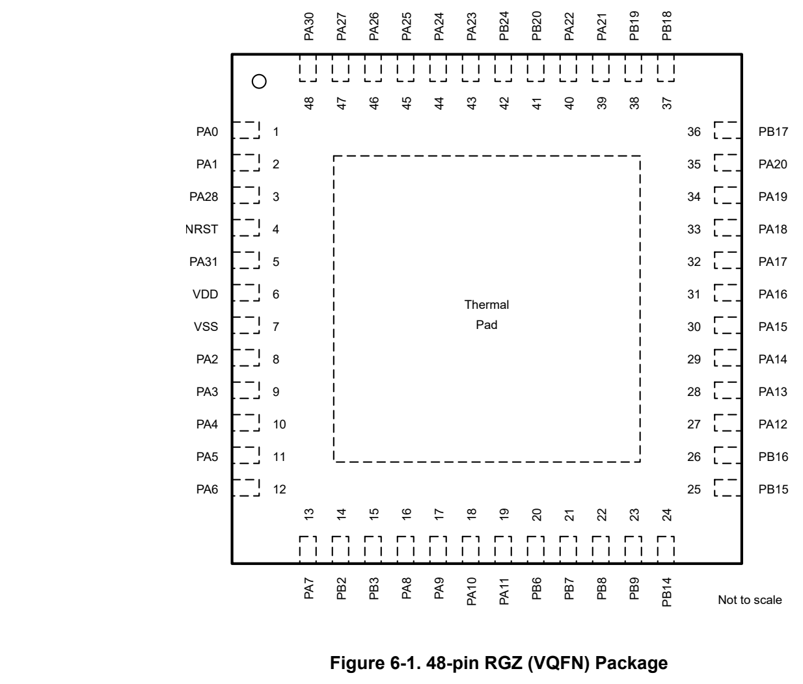
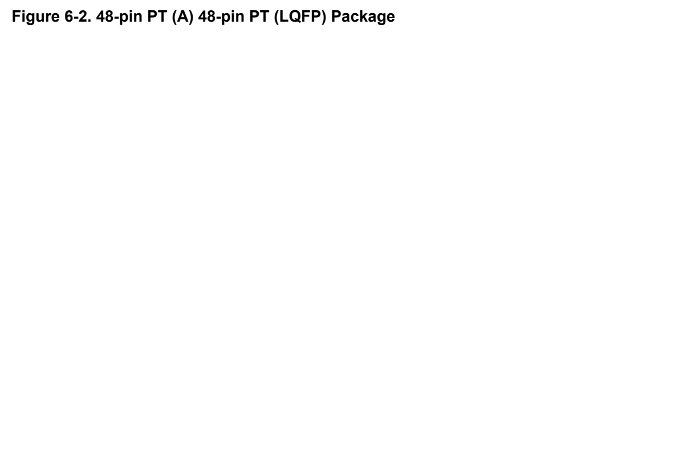
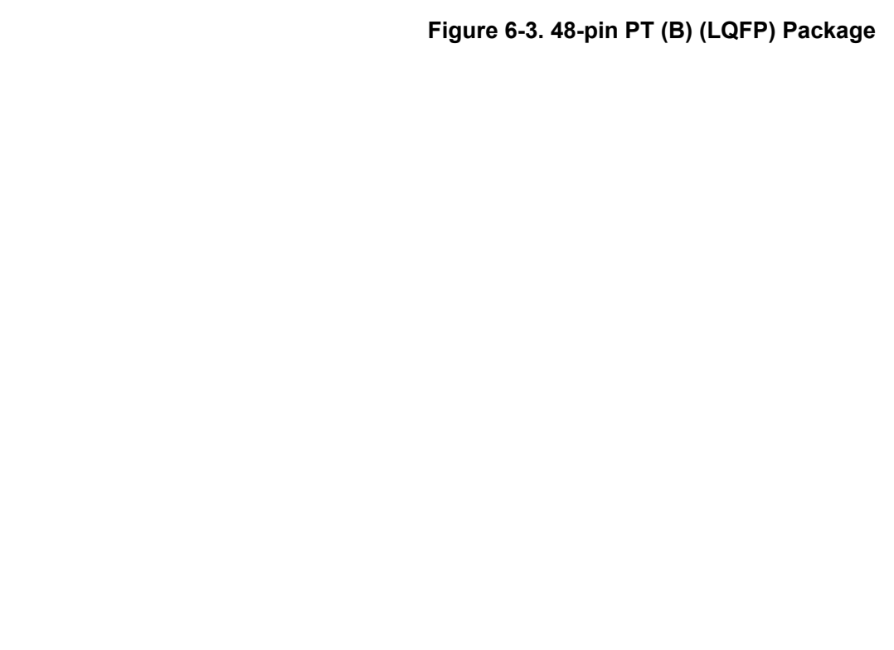
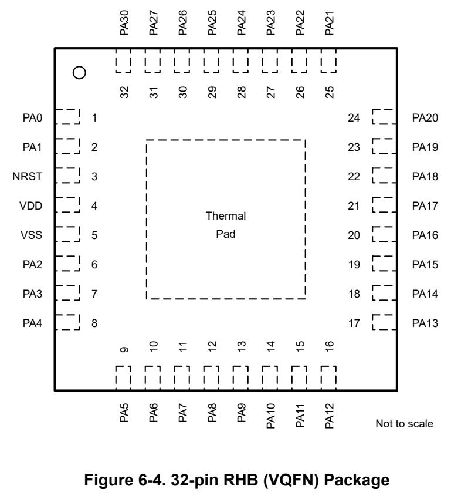
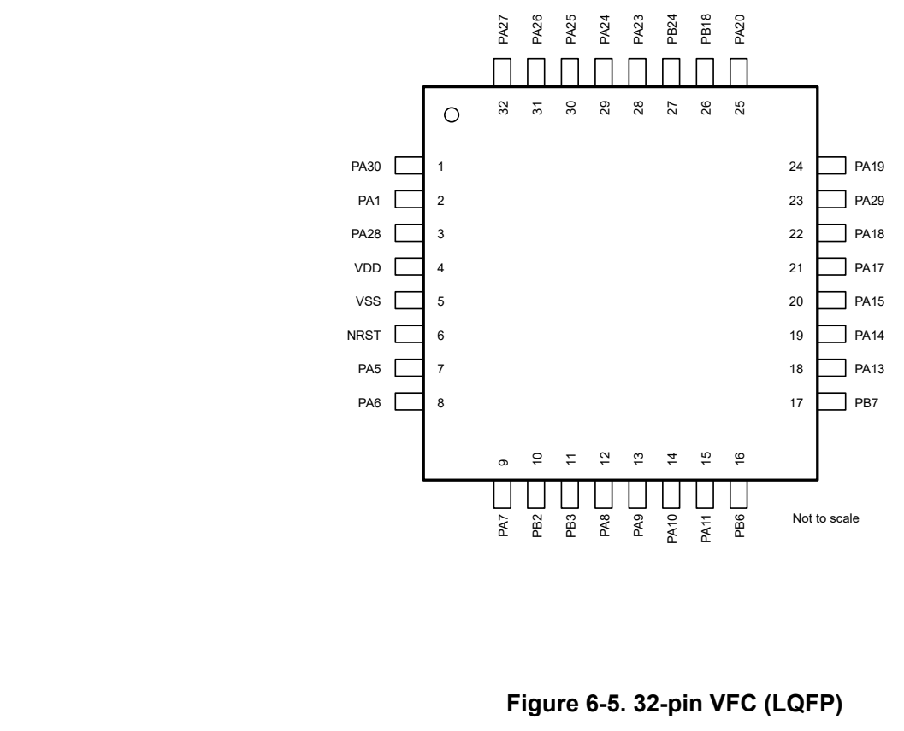
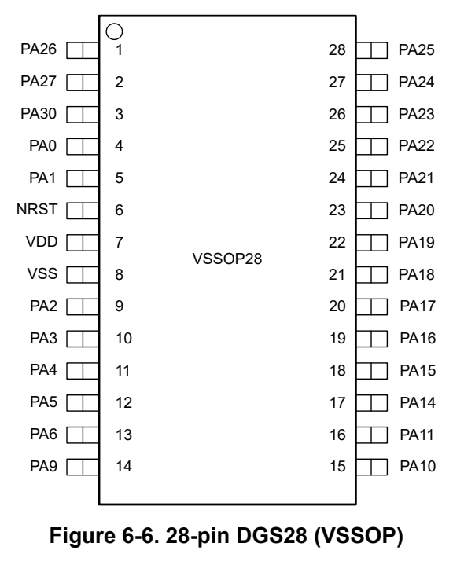
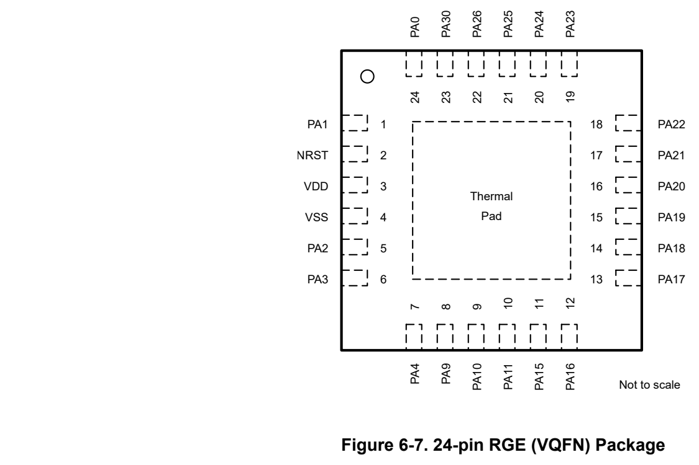
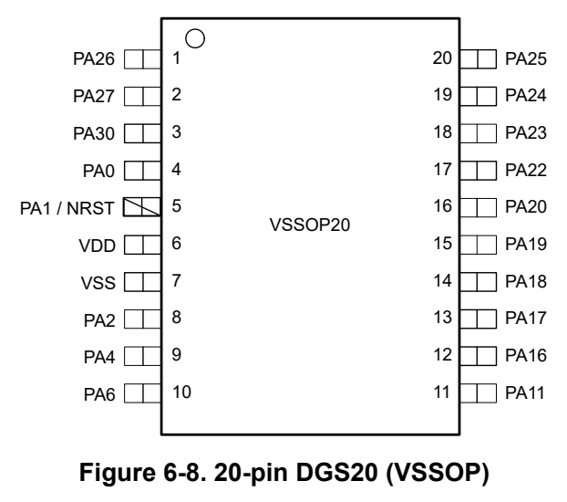
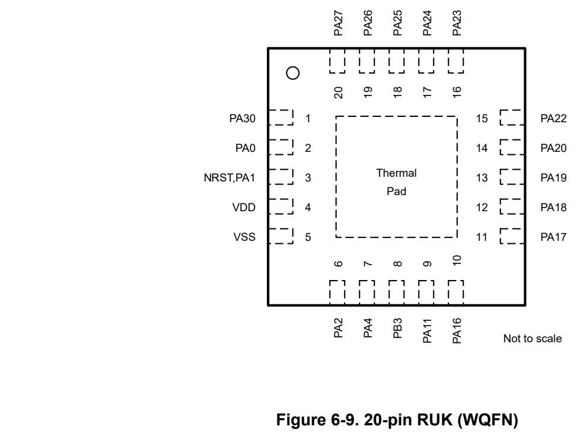
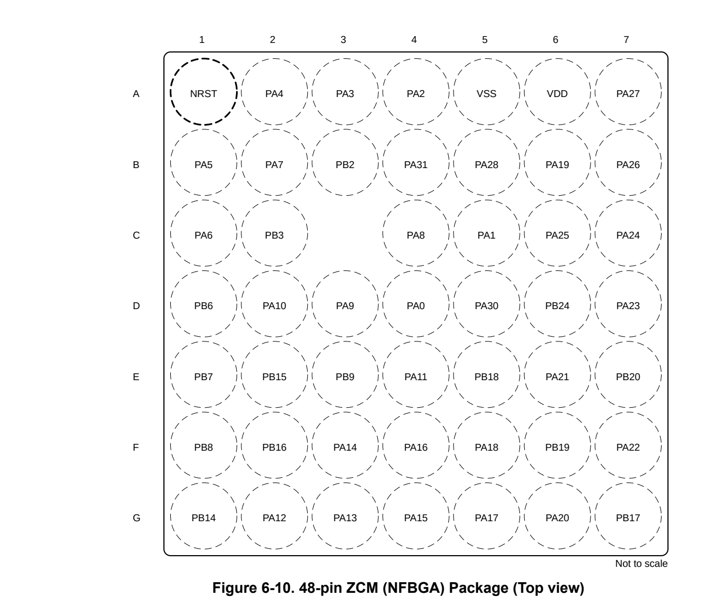

# 6 Pin Configuration and Functions (pp. 7-40)

6 Pin Configuration and Functions

The System Configuration tool provides a graphical interface to enable, configurable, and generate initialization code for pin multiplexing and simplifying pin settings. The pin diagrams shown in the data sheet show the primary peripheral functions, some of the integrated device features, and available clock signals to simplify the device pinout.

For full descriptions of the pin functions, see the Pin Attributes and Signal Descriptions sections.

6.1 Pin Diagrams

Note For full pin configuration and functions for each package option, refer to Pin Attributes and Signal Descriptions.

*Figure 6-1. 48-pin RGZ (VQFN) Package (p. 7)*

*Figure 6-2. 48-pin PT (A) 48-pin PT (LQFP) Package (p. 8)*

*Figure 6-3. 48-pin PT (B) (LQFP) Package (p. 9)*

*Figure 6-4. 32-pin RHB (VQFN) Package (p. 10)*

*Figure 6-5. 32-pin VFC (LQFP) (p. 10)*

*Figure 6-6. 28-pin DGS28 (VSSOP) (p. 11)*

*Figure 6-7. 24-pin RGE (VQFN) Package (p. 11)*

*Figure 6-8. 20-pin DGS20 (VSSOP) (p. 12)*

*Figure 6-9. 20-pin RUK (WQFN) (p. 12)*

*Figure 6-10. 48-pin ZCM (NFBGA) Package (Top view) (p. 13)*

6.2 Pin Attributes

The following table describes the functions available on every pin for each device package.

Note Each digital I/O on a device is mapped to a specific Pin Control Management Register (PINCMx) that lets users configure the desired Pin Function using the PINCM.PF control bits.

Each digital I/O on a device is mapped to a specific Pin Control Management Register (PINCMx) which allows users to configure the desired Pin Function using the PINCM.PF control bits. The IOMUX only supports connecting one IOMUX-managed digital function to the pin at the same time. The PINCM.PF and PINCM.PC in IOMUX are recommended to be set to 0 when non-IOMUX managed functions (such as analog connections) are intended to be used on a pin. However, non-IOMUX managed signals (such as analog inputs and WAKE inputs) can be enabled on a pin at the same time that an IOMUX managed digital function is enabled on the pin, provided there is no contention between the functions. In this case, the designer must verify that no contention exists between the functions enabled on each pin.

**Table 6-1. Digital IO Features by IO Type (p. 14)**

| BUFFER TYPE | INVERSION CONTROL | DRIVE STRENGTH CONTROL | HYSTERESISCONTROL | PULLUP RESISTOR | PULLDOWN RESISTOR | WAKEUP LOGIC |
| --- | --- | --- | --- | --- | --- | --- |
| SDIO (standard drive) | Y |  |  | Y | Y |  |
| SDIO (standard drive) with wake 1 | Y |  |  | Y | Y | Y |
| ODIO (5V-tolerant open drain) | Y |  | Y |  | Y | Y |

1. Standard with Wake allows the I/O to wake up the device from the lowest low-power mode of SHUTDOWN. All I/O can be configured to wakeup the MCU from higher low-power modes. See section GPIO FastWake in the MSPM0 C-Series Microcontrollers Technical Reference Manual for details.

Note There are two pin configurations for the 48 LQFP (PT) package denoted as PT (A) and PT (B). The following devices correspond to these respective configurations:

- PT (A): MSPM0C1105SPTR, & MSPM0C1106SPTR

- PT (B): MSP32C031C6SPTR, MSP32G031C6SPTR, & MSP32G031C8SPTR

**Table 6-2. Pin Attributes (PT (A), ZCM, VFC, PT (B), RGZ, RHB, DGS28, RGE, DGS20, RUK Packages) (pp. 14-28)**

| PT (A) PIN | ZCM PIN | VFC PIN | PT (B) PIN | RGZ PIN | RHB PIN | DGS2 8 PIN | RGE PIN | DGS2 0 PIN | RUK PIN | PIN NAME/ IOMUX REG/ IOMUX ADDR | SIGNAL NAME | IOMUX PF | SIGNAL TYPE | BUFFER TYPE |
| --- | --- | --- | --- | --- | --- | --- | --- | --- | --- | --- | --- | --- | --- | --- |
| 4 | A1 | 6 | 10 | 4 | 3 | 6 | 2 | 5 | 3 | NRST | NRST | (Non-IOMUX 1) 0 | RESET | RESET |
|  |  |  |  |  |  |  |  |  |  |  | PA0 | 1 | IO |  |
|  |  |  |  |  |  |  |  |  |  |  | UART0_TX | 2 | O |  |
|  |  |  |  |  |  |  |  |  |  |  | I2C0_SDA | 3 | IOD |  |
|  |  |  |  |  |  |  |  |  |  |  | TIMA0_C0 | 4 | IO |  |
|  |  |  |  |  |  |  |  |  |  | PA0 | TIMA_FAL1 | 5 | I | ODIO |
| 1 | D4 |  | 1 | 1 | 1 | 4 | 24 | 4 | 2 | PA0 PINCM1 | FCC_IN | 6 | I | (5V- |
|  |  |  |  |  |  |  |  |  |  | PINCM1 0x40428000 | TIMG8_C1 | 7 | IO | tol)with wake |
|  |  |  |  |  |  |  |  |  |  |  | BEEP | 8 | O |  |
|  |  |  |  |  |  |  |  |  |  |  | TIMG14_C0 | 9 | IO |  |
|  |  |  |  |  |  |  |  |  |  |  | SPI0_CS1_MISO1 | 10 | IO |  |
|  |  |  |  |  |  |  |  |  |  |  | PA1 | 1 | IO |  |
|  |  |  |  |  |  |  |  |  |  |  | UART0_RX | 2 | IO |  |
|  |  |  |  |  |  |  |  |  |  |  | I2C0_SCL | 3 | IOD |  |
|  |  |  |  |  |  |  |  |  |  |  | TIMA0_C1 | 4 | IO |  |
|  |  |  |  |  |  |  |  |  |  |  | TIMA_FAL2 | 5 | I |  |
|  |  |  |  |  |  |  |  |  |  | PA1 | TIMG8_IDX | 6 | I | ODIO |
| 2 | C5 | 2 | 2 | 2 | 2 | 5 | 1 | 5 | 3 | PA1 PINCM2 | TIMG8_C0 | 7 | IO | (5V- |
|  |  |  |  |  |  |  |  |  |  | PINCM2 0x40428004 | TIMG14_C1 | 9 | IO | tol)with wake |
|  |  |  |  |  |  |  |  |  |  |  | SPI0_CS3_CD_MISO3 | 10 | IO |  |
|  |  |  |  |  |  |  |  |  |  |  | HFCLKIN | 11 | I |  |
|  |  |  |  |  |  |  |  |  |  |  | UART0_TX | 12 | O |  |
|  |  |  |  |  |  |  |  |  |  |  | UART1_RTS | 13 | O |  |
|  |  |  |  |  |  |  |  |  |  |  | I2C0_SDA | 14 | IOD |  |
|  |  |  |  |  |  |  |  |  |  |  | PA2 | 1 | IO |  |
|  |  |  |  |  |  |  |  |  |  |  | TIMG8_C1 | 2 | IO |  |
|  |  |  |  |  |  |  |  |  |  |  | SPI0_CS0 | 3 | IO |  |
|  |  |  |  |  |  |  |  |  |  |  | TIMG2_C1 | 4 | IO |  |
|  |  |  |  |  |  |  |  |  |  | PA2 | TIMG8_IDX | 5 | I | SDIO |
| 8 | A4 |  |  | 8 | 6 | 9 | 5 | 8 | 6 | PINCM5 | TIMA0_C3N | 6 | O | (standar |
|  |  |  |  |  |  |  |  |  |  | 0x40428010 | TIMA0_C2N | 7 | O | d) |
|  |  |  |  |  |  |  |  |  |  |  | TIMA_FAL0 | 8 | I |  |
|  |  |  |  |  |  |  |  |  |  |  | TIMA_FAL1 | 9 | I |  |
|  |  |  |  |  |  |  |  |  |  |  | TIMA0_C0 | 11 | IO |  |
|  |  |  |  |  |  |  |  |  |  |  | I2C0_SCL | 12 | IOD |  |
|  |  |  |  |  |  |  |  |  |  |  | PA3 | 1 | IO |  |
|  |  |  |  |  |  |  |  |  |  |  | TIMG8_C0 | 2 | IO |  |
|  |  |  |  |  |  |  |  |  |  |  | SPI0_CS1_MISO1 | 3 | IO |  |
|  |  |  |  |  |  |  |  |  |  |  | I2C1_SDA | 4 | IOD |  |
|  |  |  |  |  |  |  |  |  |  |  | TIMA0_C1 | 5 | IO |  |
|  |  |  |  |  |  |  |  |  |  | PA3 | TIMG2_C0 | 7 | IO |  |
| 9 | A3 |  | 8 | 9 | 7 | 10 | 6 |  |  | PA3 PINCM6 | TIMA0_C2 | 8 | IO | SDIO (standar |
|  |  |  |  |  |  |  |  |  |  | PINCM6 0x40428014 | UART2_CTS | 9 | I | d) |
|  |  |  |  |  |  |  |  |  |  |  | UART1_TX | 10 | O |  |
|  |  |  |  |  |  |  |  |  |  |  | SPI0_CS3_CD_MISO3 | 11 | IO |  |
|  |  |  |  |  |  |  |  |  |  |  | I2C0_SDA | 12 | IOD |  |
|  |  |  |  |  |  |  |  |  |  |  | COMP0_OUT | 14 | O |  |
|  |  |  |  |  |  |  |  |  |  |  | LFXIN | (Non-IOMUX 1) 0 | A |  |
|  |  |  |  |  |  |  |  |  |  |  | PA4 | 1 | IO |  |
|  |  |  |  |  |  |  |  |  |  |  | TIMG8_C1 | 2 | IO |  |
|  |  |  |  |  |  |  |  |  |  |  | SPI0_POCI | 3 | IO |  |
|  |  |  |  |  |  |  |  |  |  |  | I2C1_SCL | 4 | IOD |  |
|  |  |  |  |  |  |  |  |  |  |  | TIMA0_C1N | 5 | O |  |
|  |  |  |  |  |  |  |  |  |  |  | LFCLKIN | 6 | I |  |
|  |  |  |  |  |  |  |  |  |  | PA4 | TIMG2_C1 | 7 | IO | SDIO |
| 10 | A2 |  | 9 | 10 | 8 | 11 | 7 | 9 | 7 | PINCM7 0x40428018 | TIMA0_C3 | 8 | IO | (standar d) |
|  |  |  |  |  |  |  |  |  |  | 0x40428018 | UART2_RTS | 9 | O | d) |
|  |  |  |  |  |  |  |  |  |  |  | UART1_RX | 10 | I |  |
|  |  |  |  |  |  |  |  |  |  |  | SPI0_CS0 | 11 | IO |  |
|  |  |  |  |  |  |  |  |  |  |  | TIMA0_C0N | 12 | O |  |
|  |  |  |  |  |  |  |  |  |  |  | HFCLKIN | 13 | I |  |
|  |  |  |  |  |  |  |  |  |  |  | LFXOUT | (Non-IOMUX 1) 0 | A |  |
|  |  |  |  |  |  |  |  |  |  |  | PA5 | 1 | IO |  |
|  |  |  |  |  |  |  |  |  |  |  | TIMG8_C0 | 2 | IO |  |
|  |  |  |  |  |  |  |  |  |  |  | SPI0_PICO | 3 | IO |  |
|  |  |  |  |  |  |  |  |  |  |  | I2C1_SDA | 4 | IOD |  |
|  |  |  |  |  |  |  |  |  |  |  | TIMG14_C0 | 5 | IO |  |
|  |  |  |  |  |  |  |  |  |  | PA5 | FCC_IN | 6 | I | SDIO |
| 11 | B1 | 7 | 11 | 11 | 9 | 12 |  |  |  | PINCM8 0x4042801c | TIMG1_C0 | 7 | IO | (standar d) |
|  |  |  |  |  |  |  |  |  |  | 0x4042801c | TIMA_FAL1 | 8 | I | d) |
|  |  |  |  |  |  |  |  |  |  |  | UART0_CTS | 9 | I |  |
|  |  |  |  |  |  |  |  |  |  |  | UART1_TX | 11 | O |  |
|  |  |  |  |  |  |  |  |  |  |  | TIMA0_C1 | 12 | IO |  |
|  |  |  |  |  |  |  |  |  |  |  | HFXIN | (Non-IOMUX 1) 0 | A |  |
|  |  |  |  |  |  |  |  |  |  |  | PA6 | 1 | IO |  |
|  |  |  |  |  |  |  |  |  |  |  | TIMG8_C1 | 2 | IO |  |
|  |  |  |  |  |  |  |  |  |  |  | SPI0_SCLK | 3 | IOD |  |
|  |  |  |  |  |  |  |  |  |  |  | I2C1_SCL | 4 | IOD |  |
|  |  |  |  |  |  |  |  |  |  |  | TIMG14_C1 | 5 | IO |  |
|  |  |  |  |  |  |  |  |  |  |  | HFCLKIN | 6 | I |  |
|  |  |  |  |  |  |  |  |  |  | PA6 | TIMG1_C1 | 7 | IO |  |
| 12 | C1 | 8 | 12 | 12 | 10 | 13 |  | 10 |  | PA6 PINCM9 | TIMA_FAL0 | 8 | I | SDIO (standar |
|  |  |  |  |  |  |  |  |  |  | PINCM9 0x40428020 | UART0_RTS | 9 | O | d) |
|  |  |  |  |  |  |  |  |  |  |  | TIMA0_C2N | 10 | O |  |
|  |  |  |  |  |  |  |  |  |  |  | UART1_RX | 11 | I |  |
|  |  |  |  |  |  |  |  |  |  |  | TIMA0_C2 | 12 | IO |  |
|  |  |  |  |  |  |  |  |  |  |  | I2C0_SDA | 13 | IOD |  |
|  |  |  |  |  |  |  |  |  |  |  | BEEP | 14 | O |  |
|  |  |  |  |  |  |  |  |  |  |  | HFXOUT | (Non-IOMUX 1) 0 | A |  |
|  |  |  |  |  |  |  |  |  |  |  | PA7 | 1 | IO |  |
|  |  |  |  |  |  |  |  |  |  |  | CLK_OUT | 2 | O |  |
|  |  |  |  |  |  |  |  |  |  |  | TIMG8_C0 | 3 | IO |  |
|  |  |  |  |  |  |  |  |  |  |  | TIMA0_C2 | 4 | IO |  |
|  |  |  |  |  |  |  |  |  |  |  | TIMG8_IDX | 5 | I |  |
|  |  |  |  |  |  |  |  |  |  |  | TIMG2_C1 | 6 | IO |  |
|  |  |  |  |  |  |  |  |  |  | PA7 | TIMA0_C1 | 7 | IO | SDIO |
| 13 | B2 | 9 | 13 | 13 | 11 |  |  |  |  | PINCM10 0x40428024 | SPI0_CS2_MISO2 | 8 | IO | (standar d) |
|  |  |  |  |  |  |  |  |  |  |  | FCC_IN | 9 | I |  |
|  |  |  |  |  |  |  |  |  |  |  | SPI0_POCI | 10 | IO |  |
|  |  |  |  |  |  |  |  |  |  |  | SPI0_PICO | 11 | IO |  |
|  |  |  |  |  |  |  |  |  |  |  | UART1_TX | 12 | O |  |
|  |  |  |  |  |  |  |  |  |  |  | TIMG1_C0 | 13 | IO |  |
|  |  |  |  |  |  |  |  |  |  |  | COMP0_OUT | 14 | O |  |
|  |  |  |  |  |  |  |  |  |  |  | PA8 | 1 | IO |  |
|  |  |  |  |  |  |  |  |  |  |  | UART1_TX | 2 | O |  |
|  |  |  |  |  |  |  |  |  |  |  | SPI0_CS0 | 3 | IO |  |
|  |  |  |  |  |  |  |  |  |  |  | I2C0_SDA | 4 | IOD |  |
|  |  |  |  |  |  |  |  |  |  |  | TIMA0_C0 | 5 | IO |  |
|  |  |  |  |  |  |  |  |  |  |  | TIMA_FAL2 | 6 | I |  |
|  |  |  |  |  |  |  |  |  |  | PA8 | TIMA_FAL0 | 7 | I | SDIO |
| 16 | C4 | 12 | 16 | 16 | 12 |  |  |  |  | PINCM13 0x40428030 | SPI0_CS3_CD_MISO3 | 8 | IO | (standar d) |
|  |  |  |  |  |  |  |  |  |  |  | TIMG2_C1 | 9 | IO |  |
|  |  |  |  |  |  |  |  |  |  |  | HFCLKIN | 10 | I |  |
|  |  |  |  |  |  |  |  |  |  |  | UART0_RTS | 11 | O |  |
|  |  |  |  |  |  |  |  |  |  |  | SPI0_SCLK | 12 | IOD |  |
|  |  |  |  |  |  |  |  |  |  |  | UART1_RX | 13 | I |  |
|  |  |  |  |  |  |  |  |  |  |  | TIMA0_C3N | 14 | O |  |
|  |  |  |  |  |  |  |  |  |  |  | PA9 | 1 | IO |  |
|  |  |  |  |  |  |  |  |  |  |  | UART1_RX | 2 | I |  |
|  |  |  |  |  |  |  |  |  |  |  | SPI0_PICO | 3 | IO |  |
|  |  |  |  |  |  |  |  |  |  |  | I2C0_SCL | 4 | IOD |  |
|  |  |  |  |  |  |  |  |  |  |  | TIMA0_C0N | 5 | O |  |
|  |  |  |  |  |  |  |  |  |  | PA9 | CLK_OUT | 6 | O | SDIO |
| 17 | D3 | 13 | 17 | 17 | 13 | 14 | 8 |  |  | PINCM14 | TIMA0_C1 | 7 | IO | (standar |
|  |  |  |  |  |  |  |  |  |  | 0x40428034 | RTC_OUT | 8 | O | d) |
|  |  |  |  |  |  |  |  |  |  |  | TIMG2_C0 | 9 | IO |  |
|  |  |  |  |  |  |  |  |  |  |  | SPI0_POCI | 10 | IO |  |
|  |  |  |  |  |  |  |  |  |  |  | UART0_CTS | 11 | I |  |
|  |  |  |  |  |  |  |  |  |  |  | TIMA_FAL1 | 12 | I |  |
|  |  |  |  |  |  |  |  |  |  |  | TIMG1_C1 | 13 | IO |  |
|  |  |  |  |  |  |  |  |  |  |  | PA10 | 1 | IO |  |
|  |  |  |  |  |  |  |  |  |  |  | UART0_TX | 2 | O |  |
|  |  |  |  |  |  |  |  |  |  |  | SPI0_POCI | 3 | IO |  |
|  |  |  |  |  |  |  |  |  |  |  | I2C0_SDA | 4 | IOD |  |
|  |  |  |  |  |  |  |  |  |  |  | TIMA0_C2 | 5 | IO |  |
|  |  |  |  |  |  |  |  |  |  | PA10 | CLK_OUT | 6 | O | SDIO |
| 18 | D2 | 14 | 18 | 18 | 14 | 15 | 9 |  |  | PINCM15 | TIMG14_C0 | 7 | IO | (standar d)with |
|  |  |  |  |  |  |  |  |  |  | 0x40428038 | I2C1_SDA | 8 | IOD | wake |
|  |  |  |  |  |  |  |  |  |  |  | TIMA_FAL1 | 10 | I |  |
|  |  |  |  |  |  |  |  |  |  |  | TIMG2_C1 | 11 | IO |  |
|  |  |  |  |  |  |  |  |  |  |  | TIMA0_C1N | 12 | O |  |
|  |  |  |  |  |  |  |  |  |  |  | TIMG8_C1 | 13 | IO |  |
|  |  |  |  |  |  |  |  |  |  |  | SPI0_PICO | 14 | IO |  |
|  |  |  |  |  |  |  |  |  |  |  | PA11 | 1 | IO |  |
|  |  |  |  |  |  |  |  |  |  |  | UART0_RX | 2 | IO |  |
|  |  |  |  |  |  |  |  |  |  |  | SPI0_SCLK | 3 | IOD |  |
|  |  |  |  |  |  |  |  |  |  |  | I2C0_SCL | 4 | IOD |  |
|  |  |  |  |  |  |  |  |  |  |  | TIMA0_C2N | 5 | O |  |
|  |  |  |  |  |  |  |  |  |  |  | UART1_RX | 6 | I |  |
|  | E4 |  |  |  |  |  |  | 11 |  | PA11 | TIMG14_C1 | 7 | IO | SDIO (standar |
| 19 | E4 | 15 | 19 | 19 | 15 | 16 | 10 | 11 | 9 | PINCM16 0x4042803c | I2C1_SCL | 8 | IOD | d)with wake |
|  |  |  |  |  |  |  |  |  |  | 0x4042803c | TIMA_FAL0 | 10 | I | wake |
|  |  |  |  |  |  |  |  |  |  |  | SPI0_CS0 | 12 | IO |  |
|  |  |  |  |  |  |  |  |  |  |  | COMP0_OUT | 14 | O |  |
|  |  |  |  |  |  |  |  |  |  |  | ADC0_25 | (Non-IOMUX 1) 0 | A |  |
|  |  |  |  |  |  |  |  |  |  |  | COMP0_DAC_OUT | (Non-IOMUX 2) 0 | A |  |
|  |  |  |  |  |  |  |  |  |  |  | PA12 | 1 | IO |  |
|  |  |  |  |  |  |  |  |  |  |  | SPI0_SCLK | 2 | IOD |  |
|  |  |  |  |  |  |  |  |  |  |  | TIMA0_C3 | 4 | IO |  |
|  |  |  |  |  |  |  |  |  |  |  | FCC_IN | 5 | I |  |
|  |  |  |  |  |  |  |  |  |  |  | TIMG14_C0 | 6 | IO |  |
|  |  |  |  |  |  |  |  |  |  | PA12 | SPI0_CS1_MISO1 | 8 | IO | SDIO |
| 27 | G2 |  | 27 | 27 | 16 |  |  |  |  | PINCM24 | UART2_CTS | 9 | I | (standar |
|  |  |  |  |  |  |  |  |  |  | 0x4042805c | UART1_CTS | 10 | I | d) |
|  |  |  |  |  |  |  |  |  |  |  | TIMA0_C3N | 11 | O |  |
|  |  |  |  |  |  |  |  |  |  |  | I2C1_SCL | 12 | IOD |  |
|  |  |  |  |  |  |  |  |  |  |  | TIMG2_C1 | 13 | IO |  |
|  |  |  |  |  |  |  |  |  |  |  | COMP0_OUT | 14 | O |  |
|  |  |  |  |  |  |  |  |  |  |  | ADC0_18 | (Non-IOMUX 1) 0 | A |  |
|  |  |  |  |  |  |  |  |  |  |  | PA13 | 1 | IO |  |
|  |  |  |  |  |  |  |  |  |  |  | UART0_RX | 2 | IO |  |
|  |  |  |  |  |  |  |  |  |  |  | SPI0_POCI | 3 | IO |  |
|  |  |  |  |  |  |  |  |  |  |  | TIMA0_C2N | 4 | O |  |
|  |  |  |  |  |  |  |  |  |  |  | TIMA0_C3N | 5 | O |  |
|  |  |  |  |  |  |  |  |  |  |  | RTC_OUT | 6 | O |  |
|  |  |  |  |  |  |  |  |  |  |  | TIMG14_C1 | 7 | IO |  |
|  |  |  |  |  |  |  |  |  |  |  | TIMG14_C3 | 8 | IO |  |
| 28 | G3 | 18 | 28 | 28 | 17 |  |  |  |  | PA13 PINCM25 0x40428060 | SPI0_CS3_CD_MISO3 | 9 | IO | SDIO (standar d) |
|  |  |  |  |  |  |  |  |  |  | 0x40428060 | UART2_TX | 10 | O | d) |
|  |  |  |  |  |  |  |  |  |  |  | UART1_RTS | 11 | O |  |
|  |  |  |  |  |  |  |  |  |  |  | SPI0_CS0 | 12 | IO |  |
|  |  |  |  |  |  |  |  |  |  |  | TIMG8_C1 | 13 | IO |  |
|  |  |  |  |  |  |  |  |  |  |  | TIMA0_C1 | 14 | IO |  |
|  |  |  |  |  |  |  |  |  |  |  | ADC0_17 | (Non-IOMUX 1) 0 | A |  |
|  |  |  |  |  |  |  |  |  |  |  | COMP0_IN2- | (Non-IOMUX 2) 0 | A |  |
|  |  |  |  |  |  |  |  |  |  |  | PA14 | 1 | IO |  |
|  |  |  |  |  |  |  |  |  |  |  | UART0_CTS | 2 | I |  |
|  |  |  |  |  |  |  |  |  |  |  | SPI0_PICO | 3 | IO |  |
|  |  |  |  |  |  |  |  |  |  |  | TIMG1_C0 | 4 | IO |  |
|  |  |  |  |  |  |  |  |  |  |  | CLK_OUT | 6 | O |  |
|  |  |  |  |  |  |  |  |  |  | PA14 | SPI0_CS2_MISO2 | 9 | IO | SDIO |
| 29 | F3 | 19 | 29 | 29 | 18 | 17 |  |  |  | PINCM26 0x40428064 | UART2_RX | 10 | I | (standar d) |
|  |  |  |  |  |  |  |  |  |  | 0x40428064 | I2C0_SCL | 12 | IOD | d) |
|  |  |  |  |  |  |  |  |  |  |  | UART0_TX | 13 | O |  |
|  |  |  |  |  |  |  |  |  |  |  | TIMA0_C2 | 14 | IO |  |
|  |  |  |  |  |  |  |  |  |  |  | ADC0_16 | (Non-IOMUX 1) 0 | A |  |
|  |  |  |  |  |  |  |  |  |  |  | COMP0_IN2+ | (Non-IOMUX 2) 0 | A |  |
|  |  |  |  |  |  |  |  |  |  |  | PA15 | 1 | IO |  |
|  |  |  |  |  |  |  |  |  |  |  | UART0_RTS | 2 | O |  |
|  |  |  |  |  |  |  |  |  |  |  | SPI0_CS2_MISO2 | 3 | IO |  |
|  |  |  |  |  |  |  |  |  |  |  | I2C1_SCL | 4 | IOD |  |
|  |  |  |  |  |  |  |  |  |  | PA15 | TIMA0_C2 | 5 | IO | SDIO |
| 30 | G4 | 20 | 30 | 30 | 19 | 18 | 11 |  |  | PINCM27 0x40428068 | TIMG8_IDX | 7 | I | (standar d) |
|  |  |  |  |  |  |  |  |  |  | 0x40428068 | UART2_RTS | 10 | O | d) |
|  |  |  |  |  |  |  |  |  |  |  | TIMG14_C1 | 12 | IO |  |
|  |  |  |  |  |  |  |  |  |  |  | ADC0_15 | (Non-IOMUX 1) 0 | A |  |
|  |  |  |  |  |  |  |  |  |  |  | COMP0_IN3+ | (Non-IOMUX 2) 0 | A |  |
|  |  |  |  |  |  |  |  |  |  |  | PA16 | 1 | IO |  |
|  |  |  |  |  |  |  |  |  |  |  | SPI0_POCI | 3 | IO |  |
|  |  |  |  |  |  |  |  |  |  |  | I2C1_SDA | 4 | IOD |  |
|  |  |  |  |  |  |  |  |  |  | PA16 | TIMA0_C2N | 5 | O |  |
| 31 | F4 |  | 31 | 31 | 20 | 19 | 12 | 12 | 10 | PA16 PINCM28 | FCC_IN | 7 | I | SDIO (standar |
|  |  |  |  |  |  |  |  |  |  | PINCM28 0x4042806c | UART2_CTS | 10 | I | d) |
|  |  |  |  |  |  |  |  |  |  |  | TIMG14_C2 | 12 | IO |  |
|  |  |  |  |  |  |  |  |  |  |  | COMP0_OUT | 14 | O |  |
|  |  |  |  |  |  |  |  |  |  |  | ADC0_14 | (Non-IOMUX 1) 0 | A |  |
|  |  |  |  |  |  |  |  |  |  |  | PA17 | 1 | IO |  |
|  |  |  |  |  |  |  |  |  |  |  | UART1_TX | 2 | O |  |
|  |  |  |  |  |  |  |  |  |  |  | TIMA0_C2 | 3 | IO |  |
|  |  |  |  |  |  |  |  |  |  |  | I2C1_SCL | 4 | IOD |  |
|  |  |  |  |  |  |  |  |  |  |  | TIMA0_C3 | 5 | IO |  |
|  |  |  |  |  |  |  |  |  |  |  | TIMG2_C0 | 6 | IO |  |
|  |  |  |  |  |  |  |  |  |  |  | TIMG8_C0 | 7 | IO |  |
| 32 | G5 | 21 | 32 | 32 | 21 | 20 | 13 | 13 | 11 | PA17 PINCM29 | TIMA0_C0N | 8 | O | SDIO (standar |
| 32 | G5 | 21 | 32 | 32 | 21 | 20 | 13 | 13 | 11 | PINCM29 0x40428070 | SPI0_CS1_MISO1 | 9 | IO | (standar d) |
|  |  |  |  |  |  |  |  |  |  |  | SPI0_SCLK | 10 | IOD |  |
|  |  |  |  |  |  |  |  |  |  |  | I2C0_SDA | 11 | IOD |  |
|  |  |  |  |  |  |  |  |  |  |  | UART0_RX | 12 | IO |  |
|  |  |  |  |  |  |  |  |  |  |  | ADC0_13 | (Non-IOMUX 1) 0 | A |  |
|  |  |  |  |  |  |  |  |  |  |  | COMP0_IN1- | (Non-IOMUX 2) 0 | A |  |
|  |  |  |  |  |  |  |  |  |  |  | PA18 | 1 | IO |  |
|  |  |  |  |  |  |  |  |  |  |  | UART1_RX | 2 | I |  |
|  |  |  |  |  |  |  |  |  |  |  | UART1_RTS | 3 | O |  |
|  |  |  |  |  |  |  |  |  |  |  | I2C1_SDA | 4 | IOD |  |
|  |  |  |  |  |  |  |  |  |  |  | TIMA0_C3N | 5 | O |  |
|  |  |  |  |  |  |  |  |  |  |  | TIMG2_C1 | 6 | IO |  |
|  |  |  |  |  |  |  |  |  |  |  | TIMG8_C1 | 7 | IO |  |
|  |  |  |  |  |  |  |  |  |  |  | SPI0_PICO | 8 | IO |  |
|  |  |  |  |  |  |  |  |  |  | PA18 | SPI0_CS0 | 9 | IO | SDIO |
| 33 | F5 | 22 | 33 | 33 | 22 | 21 | 14 | 14 | 12 | PINCM30 | TIMA0_C1N | 10 | O | (standar |
|  |  |  |  |  |  |  |  |  |  | 0x40428074 | TIMA0_C0 | 11 | IO | d) |
|  |  |  |  |  |  |  |  |  |  |  | SPI0_POCI | 12 | IO |  |
|  |  |  |  |  |  |  |  |  |  |  | TIMA_FAL2 | 13 | I |  |
|  |  |  |  |  |  |  |  |  |  |  | CLK_OUT | 14 | O |  |
|  |  |  |  |  |  |  |  |  |  |  | ADC0_12 | (Non-IOMUX 1) 0 | A |  |
|  |  |  |  |  |  |  |  |  |  |  | COMP0_IN1+ | (Non-IOMUX 2) 0 | A |  |
|  |  |  |  |  |  |  |  |  |  |  | PA19 | 1 | IO |  |
|  |  |  |  |  |  |  |  |  |  |  | SWDIO | 2 | IO |  |
|  |  |  |  |  |  |  |  |  |  |  | SPI0_SCLK | 3 | IOD |  |
|  |  |  |  |  |  |  |  |  |  |  | I2C1_SDA | 4 | IOD |  |
|  |  |  |  |  |  |  |  |  |  | PA19 | TIMA0_C2 | 5 | IO |  |
| 34 | B6 | 24 | 35 | 34 | 23 | 22 | 15 | 15 | 13 | PA19 PINCM32 | TIMG14_C0 | 6 | IO | SDIO (standar |
|  |  |  |  |  |  |  |  |  |  | PINCM32 0x4042807c | SPI0_POCI | 7 | IO | d) |
|  |  |  |  |  |  |  |  |  |  |  | UART0_CTS | 8 | I |  |
|  |  |  |  |  |  |  |  |  |  |  | UART1_RX | 11 | I |  |
|  |  |  |  |  |  |  |  |  |  |  | SPI0_PICO | 13 | IO |  |
|  |  |  |  |  |  |  |  |  |  |  | ADC0_22 | (Non-IOMUX 1) 0 | A |  |
|  |  |  |  |  |  |  |  |  |  |  | PA20 | 1 | IO |  |
|  |  |  |  |  |  |  |  |  |  |  | SWCLK | 2 | I |  |
|  |  |  |  |  |  |  |  |  |  |  | TIMA_FAL1 | 3 | I |  |
|  |  |  |  |  |  |  |  |  |  |  | I2C1_SCL | 4 | IOD |  |
|  |  |  |  |  |  |  |  |  |  |  | TIMA0_C2N | 5 | O |  |
|  |  |  |  |  |  |  |  |  |  | PA20 | TIMG14_C1 | 6 | IO |  |
| 35 | G6 | 25 | 36 | 35 | 24 | 23 | 16 | 16 | 14 | PA20 PINCM33 | SPI0_PICO | 7 | IO | SDIO (standar |
|  |  |  |  |  |  |  |  |  |  | PINCM33 0x40428080 | TIMA0_C0 | 8 | IO | d) |
|  |  |  |  |  |  |  |  |  |  |  | UART0_RTS | 10 | O |  |
|  |  |  |  |  |  |  |  |  |  |  | UART1_TX | 11 | O |  |
|  |  |  |  |  |  |  |  |  |  |  | SPI0_CS0 | 12 | IO |  |
|  |  |  |  |  |  |  |  |  |  |  | UART1_RX | 13 | I |  |
|  |  |  |  |  |  |  |  |  |  |  | ADC0_4 | (Non-IOMUX 1) 0 | A |  |
|  |  |  |  |  |  |  |  |  |  |  | PA21 | 1 | IO |  |
|  |  |  |  |  |  |  |  |  |  |  | UART2_TX | 2 | O |  |
|  |  |  |  |  |  |  |  |  |  |  | SPI0_CS3_CD_MISO3 | 3 | IO |  |
|  |  |  |  |  |  |  |  |  |  |  | UART1_CTS | 4 | I |  |
|  |  |  |  |  |  |  |  |  |  |  | TIMA0_C0 | 5 | IO |  |
|  |  |  |  |  |  |  |  |  |  | PA21 | TIMG1_C0 | 6 | IO | SDIO |
| 39 | E6 |  | 39 | 39 | 25 | 24 | 17 |  |  | PINCM37 0x40428090 | UART2_CTS | 8 | I | (standar d) |
|  |  |  |  |  |  |  |  |  |  | 0x40428090 | TIMG8_C0 | 10 | IO | d) |
|  |  |  |  |  |  |  |  |  |  |  | TIMA0_C0N | 12 | O |  |
|  |  |  |  |  |  |  |  |  |  |  | UART2_RX | 13 | I |  |
|  |  |  |  |  |  |  |  |  |  |  | ADC0_8 | (Non-IOMUX 1) 0 | A |  |
|  |  |  |  |  |  |  |  |  |  |  | ADC0_VREF- | (Non-IOMUX 2) 0 | A |  |
|  |  |  |  |  |  |  |  |  |  |  | PA22 | 1 | IO |  |
|  |  |  |  |  |  |  |  |  |  |  | UART2_RX | 2 | I |  |
|  |  |  |  |  |  |  |  |  |  |  | SPI0_CS2_MISO2 | 3 | IO |  |
|  |  |  |  |  |  |  |  |  |  |  | UART1_RTS | 4 | O |  |
|  |  |  |  |  |  |  |  |  |  |  | TIMA0_C0N | 5 | O |  |
|  |  |  |  |  |  |  |  |  |  |  | TIMG1_C1 | 6 | IO |  |
| 40 | F7 |  | 40 | 40 | 26 | 25 | 18 | 17 | 15 | PA22 | TIMA0_C1 | 7 | IO | SDIO (standar |
| 40 | F7 |  | 40 | 40 | 26 | 25 | 18 | 17 | 15 | PINCM38 0x40428094 | CLK_OUT | 8 | O | (standar d) |
|  |  |  |  |  |  |  |  |  |  |  | I2C0_SCL | 9 | IOD |  |
|  |  |  |  |  |  |  |  |  |  |  | TIMG8_C1 | 10 | IO |  |
|  |  |  |  |  |  |  |  |  |  |  | UART1_RX | 11 | I |  |
|  |  |  |  |  |  |  |  |  |  |  | SPI0_POCI | 12 | IO |  |
|  |  |  |  |  |  |  |  |  |  |  | UART2_TX | 13 | O |  |
|  |  |  |  |  |  |  |  |  |  |  | ADC0_7 | (Non-IOMUX 1) 0 | A |  |
|  |  |  |  |  |  |  |  |  |  |  | PA23 | 1 | IO |  |
|  |  |  |  |  |  |  |  |  |  |  | UART2_TX | 2 | O |  |
|  |  |  |  |  |  |  |  |  |  |  | SPI0_CS3_CD_MISO3 | 3 | IO |  |
|  |  |  |  |  |  |  |  |  |  |  | TIMA0_C3 | 5 | IO |  |
|  |  |  |  |  |  |  |  |  |  |  | TIMG8_C0 | 6 | IO |  |
|  |  |  |  |  |  |  |  |  |  | PA23 | TIMG2_C0 | 7 | IO | SDIO |
| 43 | D7 | 28 | 43 | 43 | 27 | 26 | 19 | 18 | 16 | PINCM41 0x404280a0 | UART0_TX | 8 | O | (standar d) |
|  |  |  |  |  |  |  |  |  |  | 0x404280a0 | TIMG14_C0 | 9 | IO | d) |
|  |  |  |  |  |  |  |  |  |  |  | SPI0_POCI | 12 | IO |  |
|  |  |  |  |  |  |  |  |  |  |  | UART0_CTS | 13 | I |  |
|  |  |  |  |  |  |  |  |  |  |  | ADC0_26 | (Non-IOMUX 1) 0 | A |  |
|  |  |  |  |  |  |  |  |  |  |  | ADC0_VREF+ | (Non-IOMUX 2) 0 | A |  |
|  |  |  |  |  |  |  |  |  |  |  | PA24 | 1 | IO |  |
|  |  |  |  |  |  |  |  |  |  |  | UART2_RX | 2 | I |  |
|  |  |  |  |  |  |  |  |  |  |  | SPI0_CS2_MISO2 | 3 | IO |  |
|  |  |  |  |  |  |  |  |  |  |  | UART0_RTS | 4 | O |  |
|  |  |  |  |  |  |  |  |  |  |  | TIMA0_C3N | 5 | O |  |
| 44 | C7 | 29 | 44 | 44 | 28 | 27 | 20 | 19 | 17 | PA24 | TIMG8_C1 | 6 | IO | SDIO (standar |
| 44 | C7 | 29 | 44 | 44 | 28 | 27 | 20 | 19 | 17 | PINCM42 0x404280a4 | TIMG2_C1 | 7 | IO | (standar d) |
|  |  |  |  |  |  |  |  |  |  |  | UART1_RX | 8 | I |  |
|  |  |  |  |  |  |  |  |  |  |  | TIMG14_C1 | 9 | IO |  |
|  |  |  |  |  |  |  |  |  |  |  | SPI0_PICO | 12 | IO |  |
|  |  |  |  |  |  |  |  |  |  |  | I2C0_SDA | 13 | IOD |  |
|  |  |  |  |  |  |  |  |  |  |  | ADC0_3 | (Non-IOMUX 1) 0 | A |  |
|  |  |  |  |  |  |  |  |  |  |  | PA25 | 1 | IO |  |
|  |  |  |  |  |  |  |  |  |  |  | SPI0_PICO | 2 | IO |  |
|  |  |  |  |  |  |  |  |  |  |  | SPI0_POCI | 3 | IO |  |
|  |  |  |  |  |  |  |  |  |  |  | SPI0_SCLK | 4 | IOD |  |
|  |  |  |  |  |  |  |  |  |  |  | TIMA0_C3 | 5 | IO |  |
|  |  |  |  |  |  |  |  |  |  |  | TIMA0_C1N | 6 | O |  |
|  |  |  |  |  |  |  |  |  |  | PA25 | TIMA0_C2 | 7 | IO |  |
| 45 | C6 | 30 | 45 | 45 | 29 | 28 | 21 | 20 | 18 | PA25 PINCM43 | UART2_CTS | 8 | I | SDIO (standar |
|  |  |  |  |  |  |  |  |  |  | PINCM43 0x404280a8 | TIMG14_C0 | 9 | IO | d) |
|  |  |  |  |  |  |  |  |  |  |  | TIMG1_C0 | 10 | IO |  |
|  |  |  |  |  |  |  |  |  |  |  | I2C0_SDA | 11 | IOD |  |
|  |  |  |  |  |  |  |  |  |  |  | UART0_TX | 12 | O |  |
|  |  |  |  |  |  |  |  |  |  |  | TIMA_FAL2 | 13 | I |  |
|  |  |  |  |  |  |  |  |  |  |  | I2C0_SCL | 14 | IOD |  |
|  |  |  |  |  |  |  |  |  |  |  | ADC0_2 | (Non-IOMUX 1) 0 | A |  |
|  |  |  |  |  |  |  |  |  |  |  | PA26 | 1 | IO |  |
|  |  |  |  |  |  |  |  |  |  |  | BEEP | 2 | O |  |
|  |  |  |  |  |  |  |  |  |  |  | SPI0_POCI | 3 | IO |  |
|  |  |  |  |  |  |  |  |  |  |  | TIMG8_C0 | 4 | IO |  |
|  |  |  |  |  |  |  |  |  |  |  | TIMA_FAL0 | 5 | I |  |
|  |  |  |  |  |  |  |  |  |  |  | TIMA0_C3N | 6 | O |  |
|  |  |  |  |  |  |  |  |  |  |  | TIMG2_C0 | 7 | IO |  |
|  |  |  |  |  |  |  |  |  |  | PA26 | UART2_RTS | 8 | O | SDIO |
| 46 | B7 | 31 | 46 | 46 | 30 | 1 | 22 | 1 | 19 | PINCM44 | I2C0_SCL | 9 | IOD | SDIO (standar |
|  |  |  |  |  |  |  |  |  |  | 0x404280ac | TIMG1_C1 | 10 | IO | d) |
|  |  |  |  |  |  |  |  |  |  |  | UART0_RX | 11 | IO |  |
|  |  |  |  |  |  |  |  |  |  |  | TIMA0_C0 | 12 | IO |  |
|  |  |  |  |  |  |  |  |  |  |  | I2C0_SDA | 13 | IOD |  |
|  |  |  |  |  |  |  |  |  |  |  | UART1_CTS | 14 | I |  |
|  |  |  |  |  |  |  |  |  |  |  | ADC0_1 | (Non-IOMUX 1) 0 | A |  |
|  |  |  |  |  |  |  |  |  |  |  | COMP0_IN0+ | (Non-IOMUX 2) 0 | A |  |
|  |  |  |  |  |  |  |  |  |  |  | PA27 | 1 | IO |  |
|  |  |  |  |  |  |  |  |  |  |  | SPI0_CS3_CD_MISO3 | 2 | IO |  |
|  |  |  |  |  |  |  |  |  |  |  | TIMA0_C0N | 3 | O |  |
|  |  |  |  |  |  |  |  |  |  |  | TIMG8_C1 | 4 | IO |  |
|  |  |  |  |  |  |  |  |  |  |  | TIMA_FAL2 | 5 | I |  |
|  |  |  |  |  |  |  |  |  |  |  | CLK_OUT | 6 | O |  |
|  |  |  |  |  |  |  |  |  |  | PA27 | TIMG2_C1 | 7 | IO |  |
| 47 | A7 | 32 | 47 | 47 | 31 | 2 |  | 2 | 20 | PA27 PINCM45 | RTC_OUT | 8 | O | SDIO (standar |
|  |  |  |  |  |  |  |  |  |  | PINCM45 0x404280b0 | UART1_CTS | 9 | I | d) |
|  |  |  |  |  |  |  |  |  |  |  | I2C0_SCL | 10 | IOD |  |
|  |  |  |  |  |  |  |  |  |  |  | UART0_TX | 11 | O |  |
|  |  |  |  |  |  |  |  |  |  |  | SPI0_POCI | 12 | IO |  |
|  |  |  |  |  |  |  |  |  |  |  | COMP0_OUT | 14 | O |  |
|  |  |  |  |  |  |  |  |  |  |  | ADC0_0 | (Non-IOMUX 1) 0 | A |  |
|  |  |  |  |  |  |  |  |  |  |  | COMP0_IN0- | (Non-IOMUX 2) 0 | A |  |
|  |  |  |  |  |  |  |  |  |  |  | PA28 | 1 | IO |  |
|  |  |  |  |  |  |  |  |  |  |  | UART0_TX | 2 | O |  |
|  |  |  |  |  |  |  |  |  |  | PA28 | I2C0_SDA | 3 | IOD | SDIO |
| 3 | B5 | 3 | 3 | 3 |  |  |  |  |  | PINCM3 | TIMA0_C3 | 4 | IO | (standar |
|  |  |  |  |  |  |  |  |  |  | 0x40428008 | TIMA_FAL0 | 5 | I | d) |
|  |  |  |  |  |  |  |  |  |  |  | TIMG2_C0 | 6 | IO |  |
|  |  |  |  |  |  |  |  |  |  |  | TIMA0_C1 | 7 | IO |  |
|  |  |  |  |  |  |  |  |  |  | PA29 | PA29 | 1 | IO | SDIO |
|  |  | 23 | 34 |  |  |  |  |  |  | PINCM31 | UART0_RTS | 2 | O | (standar |
|  |  |  |  |  |  |  |  |  |  | 0x40428078 | SPI0_PICO | 3 | IO | d) |
|  |  |  |  |  |  |  |  |  |  |  | PA30 | 1 | IO |  |
|  |  |  |  |  |  |  |  |  |  |  | UART0_RX | 4 | IO |  |
|  |  |  |  |  |  |  |  |  |  |  | TIMG8_IDX | 5 | I |  |
| 48 | D5 | 1 | 48 | 48 | 32 | 3 | 23 | 3 | 1 | PA30 | TIMA0_C0 | 6 | IO | SDIO (standar |
| 48 | D5 | 1 | 48 | 48 | 32 | 3 | 23 | 3 | 1 | PINCM46 0x404280b4 | UART1_RTS | 9 | O | (standar d) |
|  |  |  |  |  |  |  |  |  |  |  | TIMG2_C1 | 10 | IO |  |
|  |  |  |  |  |  |  |  |  |  |  | TIMG14_C2 | 11 | IO |  |
|  |  |  |  |  |  |  |  |  |  |  | I2C0_SDA | 12 | IOD |  |
|  |  |  |  |  |  |  |  |  |  |  | PA31 | 1 | IO |  |
|  |  |  |  |  |  |  |  |  |  | PA31 | UART0_RX | 2 | IO | SDIO |
| 5 | B4 |  | 4 | 5 |  |  |  |  |  | PINCM4 | I2C0_SCL | 3 | IOD | (standar |
|  |  |  |  |  |  |  |  |  |  | 0x4042800c | TIMA0_C3N | 4 | O | d) |
|  |  |  |  |  |  |  |  |  |  |  | CLK_OUT | 6 | O |  |
|  |  |  |  |  |  |  |  |  |  |  | PB2 | 1 | IO |  |
|  |  |  |  |  |  |  |  |  |  |  | UART2_CTS | 3 | I |  |
|  |  |  |  |  |  |  |  |  |  |  | I2C1_SCL | 4 | IOD |  |
|  |  |  |  |  |  |  |  |  |  |  | TIMA0_C3 | 5 | IO |  |
|  |  |  |  |  |  |  |  |  |  | PB2 | UART1_CTS | 6 | I | SDIO |
| 14 | B3 | 10 | 14 | 14 |  |  |  |  |  | PINCM11 | TIMG1_C0 | 7 | IO | (standar |
|  |  |  |  |  |  |  |  |  |  | 0x40428028 | UART2_TX | 8 | O | d) |
|  |  |  |  |  |  |  |  |  |  |  | HFCLKIN | 10 | I |  |
|  |  |  |  |  |  |  |  |  |  |  | SPI0_PICO | 11 | IO |  |
|  |  |  |  |  |  |  |  |  |  |  | UART1_RX | 12 | I |  |
|  |  |  |  |  |  |  |  |  |  |  | TIMA0_C1N | 13 | O |  |
|  |  |  |  |  |  |  |  |  |  |  | PB3 | 1 | IO |  |
|  |  |  |  |  |  |  |  |  |  |  | TIMA_FAL0 | 2 | I |  |
|  |  |  |  |  |  |  |  |  |  |  | UART2_RTS | 3 | O |  |
|  |  |  |  |  |  |  |  |  |  |  | I2C1_SDA | 4 | IOD |  |
|  |  |  |  |  |  |  |  |  |  |  | TIMA0_C3N | 5 | O |  |
|  |  |  |  |  |  |  |  |  |  |  | UART1_RTS | 6 | O |  |
| 15 | C2 | 11 | 15 | 15 |  |  |  |  | 8 | PB3 | TIMG1_C1 | 7 | IO | SDIO (standar |
| 15 | C2 | 11 | 15 | 15 |  |  |  |  | 8 | PINCM12 0x4042802c | UART2_RX | 8 | I | (standar d) |
|  |  |  |  |  |  |  |  |  |  |  | TIMG2_C1 | 9 | IO |  |
|  |  |  |  |  |  |  |  |  |  |  | TIMA0_C0 | 10 | IO |  |
|  |  |  |  |  |  |  |  |  |  |  | SPI0_SCLK | 11 | IOD |  |
|  |  |  |  |  |  |  |  |  |  |  | SPI0_CS0 | 12 | IO |  |
|  |  |  |  |  |  |  |  |  |  |  | UART1_TX | 13 | O |  |
|  |  |  |  |  |  |  |  |  |  |  | RTC_OUT | 14 | O |  |
|  |  |  |  |  |  |  |  |  |  |  | PB6 | 1 | IO |  |
|  |  |  |  |  |  |  |  |  |  |  | UART1_TX | 2 | O |  |
|  |  |  |  |  |  |  |  |  |  |  | TIMG8_C0 | 5 | IO |  |
|  |  |  |  |  |  |  |  |  |  |  | UART2_CTS | 6 | I |  |
|  |  |  |  |  |  |  |  |  |  |  | TIMG1_C0 | 7 | IO |  |
|  |  |  |  |  |  |  |  |  |  | PB6 | TIMA_FAL2 | 8 | I | SDIO |
| 20 | D1 | 16 | 20 | 20 |  |  |  |  |  | PINCM17 0x40428040 | SPI0_CS1_MISO1 | 9 | IO | SDIO (standar d) |
|  |  |  |  |  |  |  |  |  |  |  | TIMA0_C3N | 11 | O |  |
|  |  |  |  |  |  |  |  |  |  |  | TIMG8_C1 | 12 | IO |  |
|  |  |  |  |  |  |  |  |  |  |  | TIMA0_C2N | 13 | O |  |
|  |  |  |  |  |  |  |  |  |  |  | UART0_TX | 14 | O |  |
|  |  |  |  |  |  |  |  |  |  |  | ADC0_24 | (Non-IOMUX 1) 0 | A |  |
|  |  |  |  |  |  |  |  |  |  |  | PB7 | 1 | IO |  |
|  |  |  |  |  |  |  |  |  |  |  | UART1_RX | 2 | I |  |
|  |  |  |  |  |  |  |  |  |  |  | TIMG8_C1 | 5 | IO |  |
|  |  |  |  |  |  |  |  |  |  |  | UART2_RTS | 6 | O |  |
|  |  |  |  |  |  |  |  |  |  | PB7 | TIMG1_C1 | 7 | IO | SDIO |
| 21 | E1 | 17 | 21 | 21 |  |  |  |  |  | PINCM18 0x40428044 | SPI0_CS2_MISO2 | 9 | IO | SDIO (standar d) |
|  |  |  |  |  |  |  |  |  |  |  | BEEP | 12 | O |  |
|  |  |  |  |  |  |  |  |  |  |  | SPI0_SCLK | 13 | IOD |  |
|  |  |  |  |  |  |  |  |  |  |  | UART0_RX | 14 | IO |  |
|  |  |  |  |  |  |  |  |  |  |  | ADC0_23 | (Non-IOMUX 1) 0 | A |  |
|  |  |  |  |  |  |  |  |  |  |  | PB8 | 1 | IO |  |
|  |  |  |  |  |  |  |  |  |  |  | UART1_CTS | 2 | I |  |
|  |  |  |  |  |  |  |  |  |  |  | TIMA0_C0 | 3 | IO |  |
|  |  |  |  |  |  |  |  |  |  |  | TIMG1_C0 | 5 | IO |  |
|  |  |  |  |  |  |  |  |  |  | PB8 | SPI0_SCLK | 7 | IOD | SDIO |
| 22 | F1 |  | 22 | 22 |  |  |  |  |  | PINCM19 | BEEP | 8 | O | (standar |
|  |  |  |  |  |  |  |  |  |  | 0x40428048 | TIMG8_C0 | 9 | IO | d) |
|  |  |  |  |  |  |  |  |  |  |  | UART0_RX | 10 | IO |  |
|  |  |  |  |  |  |  |  |  |  |  | SPI0_POCI | 11 | IO |  |
|  |  |  |  |  |  |  |  |  |  |  | I2C0_SCL | 12 | IOD |  |
|  |  |  |  |  |  |  |  |  |  |  | COMP0_OUT | 14 | O |  |
|  |  |  |  |  |  |  |  |  |  |  | PB9 | 1 | IO |  |
|  |  |  |  |  |  |  |  |  |  |  | UART1_RTS | 2 | O |  |
|  |  |  |  |  |  |  |  |  |  |  | TIMA0_C0N | 5 | O |  |
|  |  |  |  |  |  |  |  |  |  |  | TIMA0_C1 | 6 | IO |  |
|  |  |  |  |  |  |  |  |  |  | PB9 | TIMG1_C1 | 7 | IO | SDIO |
| 23 | E3 |  | 23 | 23 |  |  |  |  |  | PINCM20 | TIMG2_C0 | 8 | IO | (standar |
|  |  |  |  |  |  |  |  |  |  | 0x4042804c | SPI0_POCI | 10 | IO | d) |
|  |  |  |  |  |  |  |  |  |  |  | UART0_RX | 11 | IO |  |
|  |  |  |  |  |  |  |  |  |  |  | I2C0_SCL | 12 | IOD |  |
|  |  |  |  |  |  |  |  |  |  |  | UART0_TX | 13 | O |  |
|  |  |  |  |  |  |  |  |  |  |  | I2C0_SDA | 14 | IOD |  |
|  |  |  |  |  |  |  |  |  |  |  | PB14 | 1 | IO |  |
|  |  |  |  |  |  |  |  |  |  |  | TIMA0_C0 | 5 | IO |  |
|  |  |  |  |  |  |  |  |  |  |  | TIMG8_IDX | 6 | I |  |
|  |  |  |  |  |  |  |  |  |  |  | SPI0_CS3_CD_MISO3 | 7 | IO |  |
|  |  |  |  |  |  |  |  |  |  |  | TIMG2_C1 | 8 | IO |  |
| 24 | G1 |  | 24 | 24 |  |  |  |  |  | PB14 | I2C0_SDA | 9 | IOD | SDIO (standar |
| 24 | G1 |  | 24 | 24 |  |  |  |  |  | PINCM21 0x40428050 | SPI0_PICO | 10 | IO | (standar d) |
|  |  |  |  |  |  |  |  |  |  |  | UART0_TX | 11 | O |  |
|  |  |  |  |  |  |  |  |  |  |  | TIMA_FAL2 | 12 | I |  |
|  |  |  |  |  |  |  |  |  |  |  | TIMA_FAL0 | 13 | I |  |
|  |  |  |  |  |  |  |  |  |  |  | TIMG14_C2 | 14 | IO |  |
|  |  |  |  |  |  |  |  |  |  |  |  | (Non-IOMUX 1) |  |  |
|  |  |  |  |  |  |  |  |  |  |  | PB15 | 1 | IO |  |
|  |  |  |  |  |  |  |  |  |  |  | UART2_TX | 2 | O |  |
|  |  |  |  |  |  |  |  |  |  |  | TIMG8_C0 | 5 | IO |  |
|  |  |  |  |  |  |  |  |  |  | PB15 | TIMG2_C0 | 6 | IO | SDIO |
| 25 | E2 |  | 25 | 25 |  |  |  |  |  | PINCM22 0x40428054 | TIMA0_C1N | 12 | O | (standar d) |
|  |  |  |  |  |  |  |  |  |  | 0x40428054 | UART1_TX | 13 | O | d) |
|  |  |  |  |  |  |  |  |  |  |  | TIMG2_C1 | 14 | IO |  |
|  |  |  |  |  |  |  |  |  |  |  | ADC0_20 | (Non-IOMUX 1) 0 | A |  |
|  |  |  |  |  |  |  |  |  |  |  | PB16 | 1 | IO |  |
|  |  |  |  |  |  |  |  |  |  |  | UART2_RX | 2 | I |  |
|  |  |  |  |  |  |  |  |  |  |  | TIMG8_C1 | 5 | IO |  |
|  |  |  |  |  |  |  |  |  |  | PB16 | TIMG2_C1 | 6 | IO | SDIO |
| 26 | F2 |  | 26 | 26 |  |  |  |  |  | PINCM23 0x40428058 | TIMA0_C2N | 12 | O | (standar d) |
|  |  |  |  |  |  |  |  |  |  | 0x40428058 | UART1_RX | 13 | I | d) |
|  |  |  |  |  |  |  |  |  |  |  | I2C1_SDA | 14 | IOD |  |
|  |  |  |  |  |  |  |  |  |  |  | ADC0_19 | (Non-IOMUX 1) 0 | A |  |
|  |  |  |  |  |  |  |  |  |  |  | PB17 | 1 | IO |  |
|  |  |  |  |  |  |  |  |  |  |  | UART2_TX | 2 | O |  |
|  |  |  |  |  |  |  |  |  |  |  | SPI0_PICO | 3 | IO |  |
|  |  |  |  |  |  |  |  |  |  | PB17 | I2C0_SCL | 4 | IOD |  |
| 36 | G7 |  |  | 36 |  |  |  |  |  | PB17 PINCM34 | TIMA0_C2 | 5 | IO | SDIO (standar |
|  |  |  |  |  |  |  |  |  |  | PINCM34 0x40428084 | TIMG14_C0 | 6 | IO | d) |
|  |  |  |  |  |  |  |  |  |  |  | TIMG1_C0 | 9 | IO |  |
|  |  |  |  |  |  |  |  |  |  |  | SPI0_CS0 | 10 | IO |  |
|  |  |  |  |  |  |  |  |  |  |  | ADC0_11 | (Non-IOMUX 1) 0 | A |  |
|  |  |  |  |  |  |  |  |  |  |  | PB18 | 1 | IO |  |
|  |  |  |  |  |  |  |  |  |  |  | UART2_RX | 2 | I |  |
|  |  |  |  |  |  |  |  |  |  |  | SPI0_SCLK | 3 | IOD |  |
|  |  |  |  |  |  |  |  |  |  |  | I2C0_SDA | 4 | IOD |  |
|  |  |  |  |  |  |  |  |  |  | PB18 | TIMA0_C2N | 5 | O |  |
| 37 | E5 | 26 | 37 | 37 |  |  |  |  |  | PB18 PINCM35 | TIMG14_C1 | 6 | IO | SDIO (standar |
|  |  |  |  |  |  |  |  |  |  | PINCM35 0x40428088 | SPI0_CS0 | 7 | IO | d) |
|  |  |  |  |  |  |  |  |  |  |  | TIMG1_C1 | 9 | IO |  |
|  |  |  |  |  |  |  |  |  |  |  | TIMA0_C1 | 12 | IO |  |
|  |  |  |  |  |  |  |  |  |  |  | UART0_RTS | 13 | O |  |
|  |  |  |  |  |  |  |  |  |  |  | ADC0_10 | (Non-IOMUX 1) 0 | A |  |
|  |  |  |  |  |  |  |  |  |  |  | PB19 | 1 | IO |  |
|  |  |  |  |  |  |  |  |  |  |  | SPI0_POCI | 3 | IO |  |
|  |  |  |  |  |  |  |  |  |  |  | TIMG8_C1 | 4 | IO |  |
|  |  |  |  |  |  |  |  |  |  |  | UART0_CTS | 5 | I |  |
|  |  |  |  |  |  |  |  |  |  | PB19 | TIMG2_C1 | 6 | IO |  |
| 38 | F6 |  | 38 | 38 |  |  |  |  |  | PB19 PINCM36 | TIMG8_IDX | 7 | I | SDIO (standar |
|  |  |  |  |  |  |  |  |  |  | PINCM36 0x4042808c | UART2_CTS | 8 | I | d) |
|  |  |  |  |  |  |  |  |  |  |  | TIMA0_C1N | 12 | O |  |
|  |  |  |  |  |  |  |  |  |  |  | UART2_RX | 13 | I |  |
|  |  |  |  |  |  |  |  |  |  |  | COMP0_OUT | 14 | O |  |
|  |  |  |  |  |  |  |  |  |  |  | ADC0_9 | (Non-IOMUX 1) 0 | A |  |
|  |  |  |  |  |  |  |  |  |  |  | PB20 | 1 | IO |  |
|  |  |  |  |  |  |  |  |  |  |  | SPI0_CS2_MISO2 | 2 | IO |  |
|  |  |  |  |  |  |  |  |  |  |  | TIMA0_C2 | 5 | IO |  |
|  |  |  |  |  |  |  |  |  |  |  | TIMA_FAL1 | 6 | I |  |
|  |  |  |  |  |  |  |  |  |  | PB20 | TIMA0_C1 | 7 | IO | SDIO |
| 41 | E7 |  | 41 | 41 |  |  |  |  |  | PINCM39 | UART2_RTS | 8 | O | (standar |
|  |  |  |  |  |  |  |  |  |  | 0x40428098 | I2C0_SDA | 9 | IOD | d) |
|  |  |  |  |  |  |  |  |  |  |  | UART1_CTS | 12 | I |  |
|  |  |  |  |  |  |  |  |  |  |  | TIMA0_C2N | 13 | O |  |
|  |  |  |  |  |  |  |  |  |  |  | TIMG8_C1 | 14 | IO |  |
|  |  |  |  |  |  |  |  |  |  |  | ADC0_6 | (Non-IOMUX 1) 0 | A |  |
|  |  |  |  |  |  |  |  |  |  |  | PB24 | 1 | IO |  |
|  |  |  |  |  |  |  |  |  |  |  | SPI0_CS3_CD_MISO3 | 2 | IO |  |
|  |  |  |  |  |  |  |  |  |  |  | SPI0_CS1_MISO1 | 3 | IO |  |
|  |  |  |  |  |  |  |  |  |  | PB24 | TIMA0_C3 | 5 | IO | SDIO |
| 42 | D6 | 27 | 42 | 42 |  |  |  |  |  | PINCM40 | TIMA0_C1N | 6 | O | SDIO (standar |
|  |  |  |  |  |  |  |  |  |  | 0x4042809c | UART2_RTS | 8 | O | d) |
|  |  |  |  |  |  |  |  |  |  |  | SPI0_SCLK | 12 | IOD |  |
|  |  |  |  |  |  |  |  |  |  |  | TIMG14_C2 | 13 | IO |  |
|  |  |  |  |  |  |  |  |  |  |  | UART0_RTS | 14 | O |  |
|  |  |  |  |  |  |  |  |  |  |  | ADC0_5 | (Non-IOMUX 1) 0 | A |  |
| 6 | A6 | 4 | 6 | 6 | 4 | 7 | 3 | 6 | 4 | VDD | VDD | (Non-IOMUX 1) 0 | PWR | PWR |
| 7 | A5 | 5 | 7 | 7 | 5 | 8 | 4 | 7 | 5 | VSS | VSS | (Non-IOMUX 1) 0 | PWR | PWR |

Table 6-4 (Non-IOMUX 2) I 0

### 6.3 Signal Descriptions (p. 28)

**Table 6-3. Analog to Digital Converter (ADC) Signal Descriptions (pp. 28-29)**

| SIGNAL NAME | PIN TYPE | DESCRIPTION | PT (A) PIN | ZCM PIN | VFC PIN | PT (B) PIN | RGZ PIN | RHB PIN | RGE PIN | DGS2 0 PIN | RUK PIN |
| --- | --- | --- | --- | --- | --- | --- | --- | --- | --- | --- | --- |
|  |  | ADC0 voltage reference (VREF) power supply | 43 | D7 | 28 | 43 | 43 | 27 | 19 | 18 | 16 |
| ADC0_VREF- | A | ADC0 voltage reference (VREF) ground supply | 39 | E6 |  | 39 | 39 | 25 | 17 |  |  |
| ADC0_0 | A | ADC0 analog input channel 0 | 47 | A7 | 32 | 47 | 47 | 31 |  | 2 | 20 |
| ADC0_1 | A | ADC0 analog input channel 1 | 46 | B7 | 31 | 46 | 46 | 30 | 22 | 1 | 19 |
| ADC0_2 | A | ADC0 analog input channel 2 | 45 | C6 | 30 | 45 | 45 | 29 | 21 | 20 | 18 |
| ADC0_3 | A | ADC0 analog input channel 3 | 44 | C7 | 29 | 44 | 44 | 28 | 20 | 19 | 17 |
| ADC0_4 | A | ADC0 analog input channel 4 | 35 | G6 | 25 | 36 | 35 | 24 | 16 | 16 | 14 |
| ADC0_5 | A | ADC0 analog input channel 5 | 42 | D6 | 27 | 42 | 42 |  |  |  |  |
| ADC0_6 | A | ADC0 analog input channel 6 | 41 | E7 |  | 41 | 41 |  |  |  |  |
| ADC0_7 | A | ADC0 analog input channel 7 | 40 | F7 |  | 40 | 40 | 26 | 18 | 17 | 15 |
| ADC0_8 | A | ADC0 analog input channel 8 | 39 | E6 |  | 39 | 39 | 25 | 17 |  |  |
| ADC0_9 | A | ADC0 analog input channel 9 | 38 | F6 |  | 38 | 38 |  |  |  |  |
| ADC0_10 | A | ADC0 analog input channel 10 | 37 | E5 | 26 | 37 | 37 |  |  |  |  |
| ADC0_11 | A | ADC0 analog input channel 11 | 36 | G7 |  |  | 36 |  |  |  |  |
| ADC0_12 | A | ADC0 analog input channel 12 | 33 | F5 | 22 | 33 | 33 | 22 | 14 | 14 | 12 |
| ADC0_13 | A | ADC0 analog input channel 13 | 32 | G5 | 21 | 32 | 32 | 21 | 13 | 13 | 11 |
| ADC0_14 | A | ADC0 analog input channel 14 | 31 | F4 |  | 31 | 31 | 20 | 12 | 12 | 10 |
| ADC0_15 | A | ADC0 analog input channel 15 | 30 | G4 | 20 | 30 | 30 | 19 | 11 |  |  |
| ADC0_16 | A | ADC0 analog input channel 16 | 29 | F3 | 19 | 29 | 29 | 18 |  |  |  |
| ADC0_17 | A | ADC0 analog input channel 17 | 28 | G3 | 18 | 28 | 28 | 17 |  |  |  |
| ADC0_18 | A | ADC0 analog input channel 18 | 27 | G2 |  | 27 | 27 | 16 |  |  |  |
| ADC0_19 | A | ADC0 analog input channel 19 | 26 | F2 |  | 26 | 26 |  |  |  |  |
| ADC0_20 | A | ADC0 analog input channel 20 | 25 | E2 |  | 25 | 25 |  |  |  |  |
| ADC0_21 | A | ADC0 analog input channel 21 | 24 | G1 |  | 24 | 24 |  |  |  |  |
| ADC0_22 | A | ADC0 analog input channel 22 | 34 | B6 | 24 | 35 | 34 | 23 | 15 | 15 | 13 |
| ADC0_23 | A | ADC0 analog input channel 23 | 21 | E1 | 17 | 21 | 21 |  |  |  |  |
| ADC0_24 | A | ADC0 analog input channel 24 | 20 | D1 | 16 | 20 | 20 |  |  |  |  |
| ADC0_25 | A | ADC0 analog input channel 25 | 19 | E4 | 15 | 19 | 19 | 15 | 10 | 11 | 9 |
| ADC0_26 | A | ADC0 analog input channel 26 | 43 | D7 | 28 | 43 | 43 | 27 | 19 | 18 | 16 |

**Table 6-4. Flash Bootstrap Loader (BSL) Signal Descriptions (p. 29)**

| SIGNAL NAME | PIN TYPE | DESCRIPTION | PT (A) PIN | ZCM PIN | VFC PIN | PT (B) PIN | RGZ PIN | RHB PIN | DGS28 PIN | RGE PIN | DGS20 PIN | RUK PIN |
| --- | --- | --- | --- | --- | --- | --- | --- | --- | --- | --- | --- | --- |
| BSL_invoke (Flash) | I | Default Flash BSL invoke signal | 33 | F5 | 22 | 33 | 33 | 22 | 21 | 14 | 14 | 12 |

Table 6-5. Clock Module (CKM) Signal Descriptions PT PT SIGNAL PIN ZCM VFC RGZ RHB DGS2 RGE DGS2 RUK DESCRIPTION (A) (B) NAME TYPE PIN PIN PIN PIN 8 PIN PIN 0 PIN PIN PIN PIN

13 A7 13 13 13 11 14 14 14 12 ,,,,,,,,,, 17 B2 14 17 17 13 15 18 8 17 2 15 20 ,,,,,,,,,,, 18 B4 19 18 18 14 17 2 9 ,,,,,,,, O CLK_OUT digital clock output 29, D2, 22, 29, 29, 18, 21, 25 CLK_OUT from the PMCU 33 D3 32 9 33 4 33 22 ,,,,,,, 40 F3 40 47 40 26 31

F7

**Table 6-5. Clock Module (CKM) Signal Descriptions (continued) (p. 30)**

| SIGNAL NAME | PIN TYPE | DESCRIPTION | PT (A) PIN | ZCM PIN | VFC PIN | PT (B) PIN | RGZ PIN | RHB PIN | DGS2 8 PIN | RGE PIN | DGS2 0 PIN | RUK PIN |
| --- | --- | --- | --- | --- | --- | --- | --- | --- | --- | --- | --- | --- |
| FCC_IN | I | Frequency clock counter (FCC) input signal | 1 11 ,, 13 , 27 31 , | B1 , B2 , D4 , F4 , G2 | 7 9 , | 1 11 ,, 13 , 27 31 , | 1 11 ,, 13 , 27 31 , | 1 11 ,, 16 , 20 9 , | 12 , 19 4 , | 12 24 , | 12 4 , | 10 2 , |
| HFCLKIN | I | High frequency clock digital clock input signal | 10 , 12 , 14 , 16 2 , | A2 , B3 , C1 , C4 , C5 | 10 , 12 2 ,, 8 | 12 , 14 , 16 2 ,, 9 | 10 , 12 , 14 , 16 2 , | 10 , 12 2 ,, 8 | 11 , 13 5 , | 1 7 , | 10 5 ,, 9 | 3 7 , |
| HFXIN | A | High frequency crystal oscillator (HFXT) signal | 11 | B1 | 7 | 11 | 11 | 9 | 12 |  |  |  |
| HFXOUT | A | High frequency crystal oscillator (HFXT) signal | 12 | C1 | 8 | 12 | 12 | 10 | 13 |  | 10 |  |
| LFCLKIN | I | Low frequency clock digital clock input signal | 10 | A2 |  | 9 | 10 | 8 | 11 | 7 | 9 | 7 |
| LFXIN | A | Low frequency crystal oscillator (LFXT) signal | 9 | A3 |  | 8 | 9 | 7 | 10 | 6 |  |  |
| LFXOUT | A | Low frequency crystal oscillator (LFXT) signal | 10 | A2 |  | 9 | 10 | 8 | 11 | 7 | 9 | 7 |

**Table 6-6. Comparator (COMP) Signal Descriptions (p. 30)**

| SIGNAL NAME | PIN TYPE | DESCRIPTION | PT (A) PIN | ZCM PIN | VFC PIN | PT (B) PIN | RGZ PIN | RHB PIN | DGS2 8 PIN | RGE PIN | DGS2 0 PIN | RUK PIN |
| --- | --- | --- | --- | --- | --- | --- | --- | --- | --- | --- | --- | --- |
| COMP0_DAC_OUT | A | COMP0 DAC output | 19 | E4 | 15 | 19 | 19 | 15 | 16 | 10 | 11 | 9 |
| COMP0_OUT | O | COMP0 output | 13 , 19 , 22 , 27 , 31 , 38 , 47 9 , | A3 , A7 , B2 , E4 , F1 , F4 , F6 , G2 | 15 , 32 9 , | 13 , 19 , 22 , 27 , 31 , 38 , 47 8 , | 13 , 19 , 22 , 27 , 31 , 38 , 47 9 , | 11 , 15 , 16 , 20 , 31 7 , | 10 , 16 , 19 2 , | 10 , 12 6 , | 11 , 12 2 , | 10 , 20 9 , |
| COMP0_IN0+ | A | COMP0 non-inverting input 0 | 46 | B7 | 31 | 46 | 46 | 30 | 1 | 22 | 1 | 19 |
| COMP0_IN0- | A | COMP0 inverting input 0 | 47 | A7 | 32 | 47 | 47 | 31 | 2 |  | 2 | 20 |
| COMP0_IN1+ | A | COMP0 non-inverting input 1 | 33 | F5 | 22 | 33 | 33 | 22 | 21 | 14 | 14 | 12 |
| COMP0_IN1- | A | COMP0 inverting input 1 | 32 | G5 | 21 | 32 | 32 | 21 | 20 | 13 | 13 | 11 |
| COMP0_IN2+ | A | COMP0 non-inverting input 2 | 29 | F3 | 19 | 29 | 29 | 18 | 17 |  |  |  |
| COMP0_IN2- | A | COMP0 inverting input 2 | 28 | G3 | 18 | 28 | 28 | 17 |  |  |  |  |
| COMP0_IN3+ | A | COMP0 non-inverting input 3 | 30 | G4 | 20 | 30 | 30 | 19 | 18 | 11 |  |  |

**Table 6-7. General Purpose Input Output Module Signal Descriptions (pp. 30-31)**

| SIGNAL NAME | PIN TYPE | DESCRIPTION | PT (A) PIN | ZCM PIN | VFC PIN | PT (B) PIN | RGZ PIN | RHB PIN | DGS2 8 PIN | RGE PIN | DGS2 0 PIN | RUK PIN |
| --- | --- | --- | --- | --- | --- | --- | --- | --- | --- | --- | --- | --- |
| PA0 | IO | GPIO port A input/output 0 | 1 | D4 |  | 1 | 1 | 1 | 4 | 24 | 4 | 2 |
| PA1 | IO | GPIO port A input/output 1 | 2 | C5 | 2 | 2 | 2 | 2 | 5 | 1 | 5 | 3 |
| PA2 | IO | GPIO port A input/output 2 | 8 | A4 |  |  | 8 | 6 | 9 | 5 | 8 | 6 |
| PA3 | IO | GPIO port A input/output 3 | 9 | A3 |  | 8 | 9 | 7 | 10 | 6 |  |  |
| PA5 | IO | GPIO port A input/output 5 | 11 | B1 | 7 | 11 | 11 | 9 | 12 |  |  |  |
| PA6 | IO | GPIO port A input/output 6 | 12 | C1 | 8 | 12 | 12 | 10 | 13 |  | 10 |  |
| PA7 | IO | GPIO port A input/output 7 | 13 | B2 | 9 | 13 | 13 | 11 |  |  |  |  |
| PA8 | IO | GPIO port A input/output 8 | 16 | C4 | 12 | 16 | 16 | 12 |  |  |  |  |
| PA9 | IO | GPIO port A input/output 9 | 17 | D3 | 13 | 17 | 17 | 13 | 14 | 8 |  |  |
| PA10 | IO | GPIO port A input/output 10 | 18 | D2 | 14 | 18 | 18 | 14 | 15 | 9 |  |  |
| PA11 | IO | GPIO port A input/output 11 | 19 | E4 | 15 | 19 | 19 | 15 | 16 | 10 | 11 | 9 |
| PA12 | IO | GPIO port A input/output 12 | 27 | G2 |  | 27 | 27 | 16 |  |  |  |  |
| PA13 | IO | GPIO port A input/output 13 | 28 | G3 | 18 | 28 | 28 | 17 |  |  |  |  |
| PA14 | IO | GPIO port A input/output 14 | 29 | F3 | 19 | 29 | 29 | 18 | 17 |  |  |  |
| PA15 | IO | GPIO port A input/output 15 | 30 | G4 | 20 | 30 | 30 | 19 | 18 | 11 |  |  |
| PA16 | IO | GPIO port A input/output 16 | 31 | F4 |  | 31 | 31 | 20 | 19 | 12 | 12 | 10 |
| PA17 | IO | GPIO port A input/output 17 | 32 | G5 | 21 | 32 | 32 | 21 | 20 | 13 | 13 | 11 |
| PA18 | IO | GPIO port A input/output 18 | 33 | F5 | 22 | 33 | 33 | 22 | 21 | 14 | 14 | 12 |
| PA19 | IO | GPIO port A input/output 19 | 34 | B6 | 24 | 35 | 34 | 23 | 22 | 15 | 15 | 13 |
| PA20 | IO | GPIO port A input/output 20 | 35 | G6 | 25 | 36 | 35 | 24 | 23 | 16 | 16 | 14 |
| PA21 | IO | GPIO port A input/output 21 | 39 | E6 |  | 39 | 39 | 25 | 24 | 17 |  |  |
| PA22 | IO | GPIO port A input/output 22 | 40 | F7 |  | 40 | 40 | 26 | 25 | 18 | 17 | 15 |
| PA23 | IO | GPIO port A input/output 23 | 43 | D7 | 28 | 43 | 43 | 27 | 26 | 19 | 18 | 16 |
| PA24 | IO | GPIO port A input/output 24 | 44 | C7 | 29 | 44 | 44 | 28 | 27 | 20 | 19 | 17 |
| PA25 | IO | GPIO port A input/output 25 | 45 | C6 | 30 | 45 | 45 | 29 | 28 | 21 | 20 | 18 |
| PA26 | IO | GPIO port A input/output 26 | 46 | B7 | 31 | 46 | 46 | 30 | 1 | 22 | 1 | 19 |
| PA27 | IO | GPIO port A input/output 27 | 47 | A7 | 32 | 47 | 47 | 31 | 2 |  | 2 | 20 |
| PA28 | IO | GPIO port A input/output 28 | 3 | B5 | 3 | 3 | 3 |  |  |  |  |  |
| PA29 | IO | GPIO port A input/output 29 |  |  | 23 | 34 |  |  |  |  |  |  |
| PA30 | IO | GPIO port A input/output 30 | 48 | D5 | 1 | 48 | 48 | 32 | 3 | 23 | 3 | 1 |
| PA31 | IO | GPIO port A input/output 31 | 5 | B4 |  | 4 | 5 |  |  |  |  |  |
| PB2 | IO | GPIO port B input/output 2 | 14 | B3 | 10 | 14 | 14 |  |  |  |  |  |
| PB3 | IO | GPIO port B input/output 3 | 15 | C2 | 11 | 15 | 15 |  |  |  |  | 8 |
| PB6 | IO | GPIO port B input/output 6 | 20 | D1 | 16 | 20 | 20 |  |  |  |  |  |
| PB7 | IO | GPIO port B input/output 7 | 21 | E1 | 17 | 21 | 21 |  |  |  |  |  |
| PB8 | IO | GPIO port B input/output 8 | 22 | F1 |  | 22 | 22 |  |  |  |  |  |
| PB9 | IO | GPIO port B input/output 9 | 23 | E3 |  | 23 | 23 |  |  |  |  |  |
| PB14 | IO | GPIO port B input/output 14 | 24 | G1 |  | 24 | 24 |  |  |  |  |  |
| PB15 | IO | GPIO port B input/output 15 | 25 | E2 |  | 25 | 25 |  |  |  |  |  |
| PB16 | IO | GPIO port B input/output 16 | 26 | F2 |  | 26 | 26 |  |  |  |  |  |
| PB17 | IO | GPIO port B input/output 17 | 36 | G7 |  |  | 36 |  |  |  |  |  |
| PB18 | IO | GPIO port B input/output 18 | 37 | E5 | 26 | 37 | 37 |  |  |  |  |  |
| PB19 | IO | GPIO port B input/output 19 | 38 | F6 |  | 38 | 38 |  |  |  |  |  |
| PB20 | IO | GPIO port B input/output 20 | 41 | E7 |  | 41 | 41 |  |  |  |  |  |
| PB24 | IO | GPIO port B input/output 24 | 42 | D6 | 27 | 42 | 42 |  |  |  |  |  |

**Table 6-8. I2C Signal Descriptions (p. 32)**

| SIGNAL NAME | PIN TYPE | DESCRIPTION | PT (A) PIN | ZCM PIN | VFC PIN | PT (B) PIN | RGZ PIN | RHB PIN | DGS2 8 PIN | RGE PIN | DGS2 0 PIN | RUK PIN |
| --- | --- | --- | --- | --- | --- | --- | --- | --- | --- | --- | --- | --- |
| I2C0_SCL | IOD | I2C0 serial clock signal (SCL) | 17 , 19 2 ,, 22 , 23 , 29 , 36 , 40 , 45 , 46 , 47 5 ,, 8 | A4 , A7 , B4 , B7 , C5 , C6 , D3 , E3 , E4 , F1 , F3 , F7 , G7 | 13 , 15 , 19 2 ,, 30 , 31 32 , | 17 , 19 2 ,, 22 , 23 , 29 4 ,, 40 , 45 , 46 47 , | 17 , 19 2 ,, 22 , 23 , 29 , 36 , 40 , 45 , 46 , 47 5 ,, 8 | 13 , 15 , 18 2 ,, 26 , 29 , 30 , 31 6 , | 1 14 ,, 16 , 17 2 ,, 25 , 28 5 ,, 9 | 1 10 ,, 18 , 21 , 22 5 ,, 8 | 1 11 ,, 17 2 ,, 20 5 ,, 8 | 15 , 18 , 19 , 20 3 ,, 6 9 , |
| I2C0_SDA | IOD | I2C0 serial data signal (SDA) | 1 12 ,, 16 , 18 2 ,, 23 , 24 3 ,, 32 , 37 , 41 , 44 , 45 , 46 , 48 9 , | A3 , B5 , B7 , C1 , C4 , C5 , C6 , C7 , D2 , D4 , D5 , E3 , E5 , E7 , G1 , G5 | 1 12 ,, 14 2 ,, 21 , 26 , 29 3 ,, 30 , 31 8 , | 1 12 ,, 16 , 18 2 ,, 23 , 24 3 ,, 32 , 37 , 41 , 44 , 45 , 46 , 48 8 , | 1 12 ,, 16 , 18 2 ,, 23 , 24 3 ,, 32 , 37 , 41 , 44 , 45 , 46 , 48 9 , | 1 10 ,, 12 , 14 2 ,, 21 , 28 , 29 , 30 , 32 7 , | 1 10 ,, 13 , 15 , 20 , 27 , 28 3 ,, 4 5 , | 1 13 ,, 20 , 21 , 22 , 23 , 24 6 ,, 9 | 1 10 ,, 13 , 19 , 20 3 ,, 4 5 , | 1 11 ,, 17 , 18 , 19 2 ,, 3 |
| I2C1_SCL | IOD | I2C1 serial clock signal (SCL) | 10 , 12 , 14 , 19 , 27 , 30 , 32 35 , | A2 , B3 , C1 , E4 , G2 , G4 , G5 , G6 | 10 , 15 , 20 , 21 , 25 8 , | 12 , 14 , 19 , 27 , 30 , 32 , 36 9 , | 10 , 12 , 14 , 19 , 27 , 30 , 32 35 , | 10 , 15 , 16 , 19 , 21 , 24 8 , | 11 , 13 , 16 , 18 , 20 23 , | 10 , 11 , 13 , 16 7 , | 10 , 11 , 13 , 16 9 , | 11 , 14 7 ,, 9 |
| I2C1_SDA | IOD | I2C1 serial data signal (SDA) | 11 , 15 , 18 , 26 , 31 , 33 , 34 9 , | A3 , B1 , B6 , C2 , D2 , F2 , F4 , F5 | 11 , 14 , 22 , 24 7 , | 11 , 15 , 18 , 26 , 31 , 33 , 35 8 , | 11 , 15 , 18 , 26 , 31 , 33 , 34 9 , | 14 , 20 , 22 , 23 7 ,, 9 | 10 , 12 , 15 , 19 , 21 22 , | 12 , 14 , 15 6 ,, 9 | 12 , 14 15 , | 10 , 12 , 13 8 , |

**Table 6-9. Real-time Clock (RTC) Signal Descriptions (p. 32)**

| SIGNAL NAME | PIN TYPE | DESCRIPTION | PT (A) PIN | ZCM PIN | VFC PIN | PT (B) PIN | RGZ PIN | RHB PIN | DGS2 8 PIN | RGE PIN | DGS2 0 PIN | RUK PIN |
| --- | --- | --- | --- | --- | --- | --- | --- | --- | --- | --- | --- | --- |
|  |  |  | 1 15 ,, | A7 , | 11 , | 1 15 ,, | 1 15 ,, | 1 13 ,, | 14 2 ,, | 24 8 , | 2 4 , | 2 20 ,, |
|  |  |  | ,, | , | , | ,, | ,, | ,, | ,, | , | , | ,, |
|  |  |  | 17 , | C2 , | 13 , | 17 , | 17 , | 17 31 , | 4 |  |  | 8 |
|  |  |  | , | , | , | , | , | , |  |  |  |  |
| RTC_OUT | O | Real-time clock output signal | 28 47 , | D3 , | 18 32 , | 28 47 , | 28 47 , |  |  |  |  |  |
|  |  |  |  | D4 , |  |  |  |  |  |  |  |  |
|  |  |  |  | , |  |  |  |  |  |  |  |  |
|  |  |  |  | G3 |  |  |  |  |  |  |  |  |

**Table 6-10. Serial Peripheral Interface (SPI) Signal Descriptions (pp. 33-34)**

| SIGNAL NAME | PIN TYPE | DESCRIPTION | PT (A) PIN | ZCM PIN | VFC PIN | PT (B) PIN | RGZ PIN | RHB PIN | DGS2 8 PIN | RGE PIN | DGS2 0 PIN | RUK PIN |
| --- | --- | --- | --- | --- | --- | --- | --- | --- | --- | --- | --- | --- |
| SPI0_PICO | IO | SPI0 peripheral in controller out signal | 11 , 13 , 14 , 17 , 18 , 24 , 29 , 33 , 34 , 35 , 36 , 44 45 , | B1 , B2 , B3 , B6 , C6 , C7 , D2 , D3 , F3 , F5 , G1 , G6 , G7 | 10 , 13 , 14 , 19 , 22 , 23 , 24 , 25 , 29 , 30 7 ,, 9 | 11 , 13 , 14 , 17 , 18 , 24 , 29 , 33 , 34 , 35 , 36 , 44 45 , | 11 , 13 , 14 , 17 , 18 , 24 , 29 , 33 , 34 , 35 , 36 , 44 45 , | 11 , 13 , 14 , 18 , 22 , 23 , 24 , 28 , 29 9 , | 12 , 14 , 15 , 17 , 21 , 22 , 23 , 27 28 , | 14 , 15 , 16 , 20 , 21 8 ,, 9 | 14 , 15 , 16 , 19 20 , | 12 , 13 , 14 , 17 18 , |
| SPI0_POCI | IO | SPI0 peripheral out controller in signal | 10 , 13 , 17 , 18 , 22 , 23 , 28 , 31 , 33 , 34 , 38 , 40 , 43 , 45 , 46 47 , | A2 , A7 , B2 , B6 , B7 , C6 , D2 , D3 , D7 , E3 , F1 , F4 , F5 , F6 , F7 , G3 | 13 , 14 , 18 , 22 , 24 , 28 , 30 , 31 , 32 9 , | 13 , 17 , 18 , 22 , 23 , 28 , 31 , 33 , 35 , 38 , 40 , 43 , 45 , 46 , 47 9 , | 10 , 13 , 17 , 18 , 22 , 23 , 28 , 31 , 33 , 34 , 38 , 40 , 43 , 45 , 46 47 , | 11 , 13 , 14 , 17 , 20 , 22 , 23 , 26 , 27 , 29 , 30 , 31 8 , | 1 11 ,, 14 , 15 , 19 2 ,, 21 , 22 , 25 , 26 28 , | 12 , 14 , 15 , 18 , 19 , 21 , 22 7 ,, 8 9 , | 1 12 ,, 14 , 15 , 17 , 18 2 ,, 20 9 , | 10 , 12 , 13 , 15 , 16 , 18 , 19 , 20 7 , |
| SPI0_SCLK | IOD | SPI0 serial clock | 12 , 15 , 16 , 19 , 21 , 22 , 27 , 32 , 34 , 37 , 42 45 , | B6 , C1 , C2 , C4 , C6 , D6 , E1 , E4 , E5 , F1 , G2 , G5 | 11 , 12 , 15 , 17 , 21 , 24 , 26 , 27 , 30 8 , | 12 , 15 , 16 , 19 , 21 , 22 , 27 , 32 , 35 , 37 , 42 45 , | 12 , 15 , 16 , 19 , 21 , 22 , 27 , 32 , 34 , 37 , 42 45 , | 10 , 12 , 15 , 16 , 21 , 23 29 , | 13 , 16 , 20 , 22 28 , | 10 , 13 , 15 21 , | 10 , 11 , 13 , 15 20 , | 11 , 13 , 18 8 ,, 9 |
| SPI0_CS0 | IO | SPI0 chip-select 0 signal | 10 , 15 , 16 , 19 , 28 , 33 , 35 , 36 , 37 8 , | A2 , A4 , C2 , C4 , E4 , E5 , F5 , G3 , G6 , G7 | 11 , 12 , 15 , 18 , 22 , 25 26 , | 15 , 16 , 19 , 28 , 33 , 36 , 37 9 , | 10 , 15 , 16 , 19 , 28 , 33 , 35 , 36 , 37 8 , | 12 , 15 , 17 , 22 , 24 6 ,, 8 | 11 , 16 , 21 , 23 9 , | 10 , 14 , 16 5 ,, 7 | 11 , 14 , 16 8 ,, 9 | 12 , 14 6 ,, 7 8 9 ,, |
| SPI0_CS1_MISO1 | IO |  | 1 20 ,, 27 , 32 , 42 9 , | A3 , D1 , D4 , D6 , G2 , G5 | 16 , 21 27 , | 1 20 ,, 27 , 32 , 42 8 , | 1 20 ,, 27 , 32 , 42 9 , | 1 16 ,, 21 7 , | 10 , 20 4 , | 13 , 24 6 , | 13 4 , | 11 2 , |
| SPI0_CS2_MISO2 | IO |  | 13 , 21 , 29 , 30 , 40 , 41 44 , | B2 , C7 , E1 , E7 , F3 , F7 , G4 | 17 , 19 , 20 , 29 9 , | 13 , 21 , 29 , 30 , 40 , 41 44 , | 13 , 21 , 29 , 30 , 40 , 41 44 , | 11 , 18 , 19 , 26 28 , | 17 , 18 , 25 27 , | 11 , 18 20 , | 17 19 , | 15 17 , |
| SPI0_CS3_CD_MISO3 | IO |  | 16 2 ,, 24 , 28 , 39 , 42 , 43 , 47 9 , | A3 , A7 , C4 , C5 , D6 , D7 , E6 , G1 , G3 | 12 , 18 2 ,, 27 , 28 32 , | 16 2 ,, 24 , 28 , 39 , 42 , 43 , 47 8 , | 16 2 ,, 24 , 28 , 39 , 42 , 43 , 47 9 , | 12 , 17 2 ,, 25 , 27 , 31 7 , | 10 2 ,, 24 , 26 5 , | 1 17 ,, 19 6 , | 18 2 ,, 5 | 16 , 20 3 , |

**Table 6-11. Serial Wire Debug (SWD) Signal Descriptions (p. 34)**

| SIGNAL NAME | PIN TYPE | DESCRIPTION | PT (A) PIN | ZCM PIN | VFC PIN | PT (B) PIN | RGZ PIN | RHB PIN | DGS2 8 PIN | RGE PIN | DGS2 0 PIN | RUK PIN |
| --- | --- | --- | --- | --- | --- | --- | --- | --- | --- | --- | --- | --- |
| SWCLK | I | Serial wire debug interface clock input signal | 35 | G6 | 25 | 36 | 35 | 24 | 23 | 16 | 16 | 14 |
| SWDIO | IO | Serial wire debug interface data input/output signal | 34 | B6 | 24 | 35 | 34 | 23 | 22 | 15 | 15 | 13 |

**Table 6-12. System Controller (SYSCTL) Signal Descriptions (p. 34)**

| SIGNAL NAME | PIN TYPE | DESCRIPTION | PT (A) PIN | ZCM PIN | VFC PIN | PT (B) PIN | RGZ PIN | RHB PIN | DGS2 8 PIN | RGE PIN | DGS2 0 PIN | RUK PIN |
| --- | --- | --- | --- | --- | --- | --- | --- | --- | --- | --- | --- | --- |
| BEEP | O | Beep output | 1 12 ,, 21 , 22 46 , | B7 , C1 , D4 , E1 , F1 | 17 , 31 8 , | 1 12 ,, 21 , 22 46 , | 1 12 ,, 21 , 22 46 , | 1 10 ,, 30 | 1 13 ,, 4 | 22 24 , | 1 10 ,, 4 | 19 2 , |
| NRST | RESET | Active-low reset signal (must be logic high for the device to start) | 4 | A1 | 6 | 10 | 4 | 3 | 6 | 2 | 5 | 3 |
| VDD | PWR | VDD supply | 6 | A6 | 4 | 6 | 6 | 4 | 7 | 3 | 6 | 4 |
| VSS | PWR | VSS (ground) | 7 | A5 | 5 | 7 | 7 | 5 | 8 | 4 | 7 | 5 |

**Table 6-13. Timer (TIMx) Signal Descriptions (pp. 34-38)**

| SIGNAL NAME | PIN TYPE | DESCRIPTION | PT (A) PIN | ZCM PIN | VFC PIN | PT (B) PIN | RGZ PIN | RHB PIN | DGS2 8 PIN | RGE PIN | DGS2 0 PIN | RUK PIN |
| --- | --- | --- | --- | --- | --- | --- | --- | --- | --- | --- | --- | --- |
|  |  |  | 1 15 ,, | A4 , | 1 11 ,, | 1 15 ,, | 1 15 ,, | 1 12 ,, | 1 21 ,, | 14 , | 1 14 ,, | 1 12 ,, |
|  |  |  | ,, | , | ,, | ,, | ,, | ,, | ,, | , | ,, | ,, |
|  |  |  | 16 , | B7 , | 12 , | 16 , | 16 , | 22 , | 23 , | 16 , | 16 3 ,, | 14 , |
|  |  |  | , | , | , | , | , | , | , | , | ,, | , |
|  |  |  | 22 , | C2 , | 22 , | 22 , | 22 , | 24 , | 24 3 ,, | 17 , | 4 8 , | 19 2 ,, |
|  |  |  | , | , | , | , | , | , | ,, | , | , | ,, |
|  |  |  | 24 , | C4 , | 25 31 , | 24 , | 24 , | 25 , | 4 9 , | 22 , |  | 6 8 , |
|  |  |  | , | , | , | , | , | , | , | , |  | , |
|  |  |  | 33 , | D4 , |  | 33 , | 33 , | 30 , |  | 23 , |  |  |
|  |  | TIMA0 capture/compare 0 | , | , |  | , | , | , |  | , |  |  |
| TIMA0_C0 | IO |  | 35 , | D5 , |  | 36 , | 35 , | 32 6 , |  | 24 5 , |  |  |
|  |  | signal | , | , |  | , | , | , |  | , |  |  |
|  |  |  | 39 , | E6 , |  | 39 , | 39 , |  |  |  |  |  |
|  |  |  | , | , |  | , | , |  |  |  |  |  |
|  |  |  | 46 , | F1 , |  | 46 48 , | 46 , |  |  |  |  |  |
|  |  |  | , | , |  | , | , |  |  |  |  |  |
|  |  |  | 48 8 , | F5 , |  |  | 48 8 , |  |  |  |  |  |
|  |  |  | , | , |  |  | , |  |  |  |  |  |
|  |  |  |  | G6 |  |  |  |  |  |  |  |  |
| TIMA0_C1 | IO | TIMA0 capture/compare 1 signal | 11 , 13 , 17 2 ,, 23 , 28 3 ,, 37 , 40 , 41 9 , | A3 , B1 , B2 , B5 , C5 , D3 , E3 , E5 , E7 , F7 , G3 | 13 , 18 2 ,, 26 3 ,, 7 9 , | 11 , 13 , 17 2 ,, 23 , 28 3 ,, 37 , 40 , 41 8 , | 11 , 13 , 17 2 ,, 23 , 28 3 ,, 37 , 40 , 41 9 , | 11 , 13 , 17 2 ,, 26 7 ,, 9 | 10 , 12 , 14 , 25 5 , | 1 18 ,, 6 8 , | 17 5 , | 15 3 , |
| TIMA0_C2 | IO | TIMA0 capture/compare 2 signal | 12 , 13 , 18 , 29 , 30 , 32 , 34 , 36 , 41 , 45 9 , | A3 , B2 , B6 , C1 , C6 , D2 , E7 , F3 , G4 , G5 , G7 | 14 , 19 , 20 , 21 , 24 , 30 8 ,, 9 | 12 , 13 , 18 , 29 , 30 , 32 , 35 , 41 , 45 8 , | 12 , 13 , 18 , 29 , 30 , 32 , 34 , 36 , 41 , 45 9 , | 10 , 11 , 14 , 18 , 19 , 21 , 23 , 29 7 , | 10 , 13 , 15 , 17 , 18 , 20 , 22 28 , | 11 , 13 , 15 , 21 6 ,, 9 | 10 , 13 , 15 20 , | 11 , 13 18 , |
| TIMA0_C3 | IO | TIMA0 capture/compare 3 signal | 10 , 14 , 27 3 ,, 32 , 42 , 43 45 , | A2 , B3 , B5 , C6 , D6 , D7 , G2 , G5 | 10 , 21 , 27 , 28 3 ,, 30 | 14 , 27 3 ,, 32 , 42 , 43 , 45 9 , | 10 , 14 , 27 3 ,, 32 , 42 , 43 45 , | 16 , 21 , 27 , 29 8 , | 11 , 20 , 26 28 , | 13 , 19 , 21 7 , | 13 , 18 , 20 9 , | 11 , 16 , 18 7 , |
| TIMA0_C0N | O | TIMA0 capture/compare 0 complementary output | 10 , 17 , 23 , 32 , 39 , 40 47 , | A2 , A7 , D3 , E3 , E6 , F7 , G5 | 13 , 21 32 , | 17 , 23 , 32 , 39 , 40 , 47 9 , | 10 , 17 , 23 , 32 , 39 , 40 47 , | 13 , 21 , 25 , 26 , 31 8 , | 11 , 14 2 ,, 20 , 24 25 , | 13 , 17 , 18 7 ,, 8 | 13 , 17 2 ,, 9 | 11 , 15 , 20 7 , |
| TIMA0_C1N | O | TIMA0 capture/compare 1 complementary output | 10 , 14 , 18 , 25 , 33 , 38 , 42 45 , | A2 , B3 , C6 , D2 , D6 , E2 , F5 , F6 | 10 , 14 , 22 , 27 30 , | 14 , 18 , 25 , 33 , 38 , 42 , 45 9 , | 10 , 14 , 18 , 25 , 33 , 38 , 42 45 , | 14 , 22 , 29 8 , | 11 , 15 , 21 28 , | 14 , 21 7 ,, 9 | 14 , 20 9 , | 12 , 18 7 , |
| TIMA0_C2N | O | TIMA0 capture/compare 2 complementary output | 12 , 19 , 20 , 26 , 28 , 31 , 35 , 37 , 41 8 , | A4 , C1 , D1 , E4 , E5 , E7 , F2 , F4 , G3 , G6 | 15 , 16 , 18 , 25 , 26 8 , | 12 , 19 , 20 , 26 , 28 , 31 , 36 , 37 41 , | 12 , 19 , 20 , 26 , 28 , 31 , 35 , 37 , 41 8 , | 10 , 15 , 17 , 20 , 24 6 , | 13 , 16 , 19 , 23 9 , | 10 , 12 , 16 5 , | 10 , 11 , 12 , 16 8 , | 10 , 14 6 ,, 9 |
| TIMA0_C3N | O | TIMA0 capture/compare 3 complementary output | 15 , 16 , 20 , 27 , 28 , 33 , 44 , 46 5 ,, 8 | A4 , B4 , B7 , C2 , C4 , C7 , D1 , F5 , G2 , G3 | 11 , 12 , 16 , 18 , 22 , 29 31 , | 15 , 16 , 20 , 27 , 28 , 33 4 ,, 44 46 , | 15 , 16 , 20 , 27 , 28 , 33 , 44 , 46 5 ,, 8 | 12 , 16 , 17 , 22 , 28 , 30 6 , | 1 21 ,, 27 9 , | 14 , 20 , 22 5 , | 1 14 ,, 19 8 , | 12 , 17 , 19 6 ,, 8 |
| TIMA_FAL0 | I | TIMA fault input 0 | 12 , 15 , 16 , 19 , 24 3 ,, 46 8 , | A4 , B5 , B7 , C1 , C2 , C4 , E4 , G1 | 11 , 12 , 15 3 ,, 31 8 , | 12 , 15 , 16 , 19 , 24 3 ,, 46 | 12 , 15 , 16 , 19 , 24 3 ,, 46 8 , | 10 , 12 , 15 , 30 6 , | 1 13 ,, 16 9 , | 10 , 22 5 , | 1 10 ,, 11 8 , | 19 6 ,, 8 9 , |
| TIMA_FAL1 | I | TIMA fault input 1 | 1 11 ,, 17 , 18 , 35 , 41 8 , | A4 , B1 , D2 , D3 , D4 , E7 , G6 | 13 , 14 , 25 7 , | 1 11 ,, 17 , 18 , 36 41 , | 1 11 ,, 17 , 18 , 35 , 41 8 , | 1 13 ,, 14 , 24 6 ,, 9 | 12 , 14 , 15 , 23 4 ,, 9 | 16 , 24 5 ,, 8 9 , | 16 4 ,, 8 | 14 2 ,, 6 |
| TIMA_FAL2 | I | TIMA fault input 2 | 16 2 ,, 20 , 24 , 33 , 45 47 , | A7 , C4 , C5 , C6 , D1 , F5 , G1 | 12 , 16 2 ,, 22 , 30 32 , | 16 2 ,, 20 , 24 , 33 , 45 47 , | 16 2 ,, 20 , 24 , 33 , 45 47 , | 12 2 ,, 22 , 29 31 , | 2 21 ,, 28 5 , | 1 14 ,, 21 | 14 2 ,, 20 5 , | 12 , 18 , 20 3 , |
| TIMG8_IDX | I | TIMG8 quadrature encoder index pulse signal | 13 2 ,, 24 , 30 , 38 , 48 8 , | A4 , B2 , C5 , D5 , F6 , G1 , G4 | 1 2 ,, 20 9 , | 13 2 ,, 24 , 30 , 38 48 , | 13 2 ,, 24 , 30 , 38 , 48 8 , | 11 , 19 2 ,, 32 6 , | 18 3 ,, 5 9 , | 1 11 ,, 23 5 , | 3 5 8 ,, | 1 3 6 ,, |
| TIMG14_C0 | IO | TIMG14 capture/compare 0 signal | 1 11 ,, 18 , 27 , 34 , 36 , 43 45 , | B1 , B6 , C6 , D2 , D4 , D7 , G2 , G7 | 14 , 24 , 28 , 30 7 , | 1 11 ,, 18 , 27 , 35 , 43 45 , | 1 11 ,, 18 , 27 , 34 , 36 , 43 45 , | 1 14 ,, 16 , 23 , 27 , 29 9 , | 12 , 15 , 22 , 26 , 28 4 , | 15 , 19 , 21 , 24 9 , | 15 , 18 , 20 4 , | 13 , 16 , 18 2 , |
| TIMG14_C1 | IO | TIMG14 capture/compare 1 signal | 12 , 19 2 ,, 28 , 30 , 35 , 37 44 , | C1 , C5 , C7 , E4 , E5 , G3 , G4 , G6 | 15 , 18 2 ,, 20 , 25 , 26 , 29 8 , | 12 , 19 2 ,, 28 , 30 , 36 , 37 44 , | 12 , 19 2 ,, 28 , 30 , 35 , 37 44 , | 10 , 15 , 17 , 19 2 ,, 24 28 , | 13 , 16 , 18 , 23 , 27 5 , | 1 10 ,, 11 , 16 20 , | 10 , 11 , 16 , 19 5 , | 14 , 17 3 ,, 9 |
| TIMG14_C2 | IO | TIMG14 capture/compare 2 signal | 24 , 31 , 42 48 , | D5 , D6 , F4 , G1 | 1 27 , | 24 , 31 , 42 48 , | 24 , 31 , 42 48 , | 20 32 , | 19 3 , | 12 23 , | 12 3 , | 1 10 , |
| TIMG14_C3 | IO | TIMG14 capture/compare 3 signal | 28 | G3 | 18 | 28 | 28 | 17 |  |  |  |  |
| TIMG1_C0 | IO | TIMG1 capture/compare 0 signal | 11 , 13 , 14 , 20 , 22 , 29 , 36 , 39 45 , | B1 , B2 , B3 , C6 , D1 , E6 , F1 , F3 , G7 | 10 , 16 , 19 , 30 7 ,, 9 | 11 , 13 , 14 , 20 , 22 , 29 , 39 45 , | 11 , 13 , 14 , 20 , 22 , 29 , 36 , 39 45 , | 11 , 18 , 25 , 29 9 , | 12 , 17 , 24 28 , | 17 21 , | 20 | 18 |
| TIMG1_C1 | IO | TIMG1 capture/compare 1 signal | 12 , 15 , 17 , 21 , 23 , 37 , 40 46 , | B7 , C1 , C2 , D3 , E1 , E3 , E5 , F7 | 11 , 13 , 17 , 26 , 31 8 , | 12 , 15 , 17 , 21 , 23 , 37 , 40 46 , | 12 , 15 , 17 , 21 , 23 , 37 , 40 46 , | 10 , 13 , 26 30 , | 1 13 ,, 14 25 , | 18 , 22 8 , | 1 10 ,, 17 | 15 , 19 8 , |
| TIMG2_C0 | IO | TIMG2 capture/compare 0 signal | 17 , 23 , 25 3 ,, 32 , 43 , 46 9 , | A3 , B5 , B7 , D3 , D7 , E2 , E3 , G5 | 13 , 21 , 28 3 ,, 31 | 17 , 23 , 25 3 ,, 32 , 43 , 46 8 , | 17 , 23 , 25 3 ,, 32 , 43 , 46 9 , | 13 , 21 , 27 , 30 7 , | 1 10 ,, 14 , 20 26 , | 13 , 19 , 22 6 ,, 8 | 1 13 ,, 18 | 11 , 16 19 , |
| TIMG2_C1 | IO | TIMG2 capture/compare 1 signal | 10 , 13 , 15 , 16 , 18 , 24 , 25 , 26 , 27 , 33 , 38 , 44 , 47 , 48 8 , | A2 , A4 , A7 , B2 , C2 , C4 , C7 , D2 , D5 , E2 , F2 , F5 , F6 , G1 , G2 | 1 11 ,, 12 , 14 , 22 , 29 , 32 9 , | 13 , 15 , 16 , 18 , 24 , 25 , 26 , 27 , 33 , 38 , 44 , 47 , 48 9 , | 10 , 13 , 15 , 16 , 18 , 24 , 25 , 26 , 27 , 33 , 38 , 44 , 47 , 48 8 , | 11 , 12 , 14 , 16 , 22 , 28 , 31 , 32 6 ,, 8 | 11 , 15 2 ,, 21 , 27 3 ,, 9 | 14 , 20 , 23 5 ,, 7 9 , | 14 , 19 2 ,, 3 8 9 ,, | 1 12 ,, 17 , 20 6 ,, 7 8 , |
| TIMG8_C0 | IO | TIMG8 capture/compare 0 signal | 11 , 13 2 ,, 20 , 22 , 25 , 32 , 39 , 43 , 46 9 , | A3 , B1 , B2 , B7 , C5 , D1 , D7 , E2 , E6 , F1 , G5 | 16 2 ,, 21 , 28 , 31 7 ,, 9 | 11 , 13 2 ,, 20 , 22 , 25 , 32 , 39 , 43 , 46 8 , | 11 , 13 2 ,, 20 , 22 , 25 , 32 , 39 , 43 , 46 9 , | 11 2 ,, 21 , 25 , 27 , 30 7 ,, 9 | 1 10 ,, 12 , 20 , 24 , 26 5 , | 1 13 ,, 17 , 19 , 22 6 , | 1 13 ,, 18 5 , | 11 , 16 , 19 3 , |
|  |  |  | 1 10 ,, | A2 , | 14 , | 1 12 ,, | 1 10 ,, | 1 10 ,, | 11 , | 14 , | 10 , | 12 , |
|  |  |  | ,, | , | , | ,, | ,, | ,, | , | , | , | , |
|  |  |  | 12 , | A4 , | 16 , | 18 , | 12 , | 14 , | 13 , | 18 , | 14 , | 15 , |
|  |  |  | , | , | , | , | , | , | , | , | , | , |
|  |  |  | 18 , | A7 , | 17 , | 20 , | 18 , | 17 , | 15 2 ,, | 20 , | 17 , | 17 2 ,, |
|  |  |  | , | , | , | , | , | , | ,, | , | , | ,, |
|  |  |  | 20 , | C1 , | 18 , | 21 , | 20 , | 22 , | 21 , | 24 5 ,, | 19 2 ,, | 20 6 ,, |
|  |  |  | , | , | , | , | , | , | , | ,, | ,, | ,, |
|  |  |  | 21 , | C7 , | 22 , | 26 , | 21 , | 26 , | 25 , | 7 9 , | 4 8 9 ,, | 7 |
|  |  |  | , | , | , | , | , | , | , | , | ,, |  |
|  |  |  | 26 , | D1 , | 29 , | 28 , | 26 , | 28 , | 27 4 ,, |  |  |  |
|  |  |  | , | , | , | , | , | , | ,, |  |  |  |
|  |  |  | 28 , | D2 , | 32 8 , | 33 , | 28 , | 31 6 ,, | 9 |  |  |  |
|  |  | TIMG8 capture/compare 1 | , | , | , | , | , | ,, |  |  |  |  |
| TIMG8_C1 | IO |  | 33 , | D4 , |  | 38 , | 33 , | 8 |  |  |  |  |
|  |  | signal | , | , |  | , | , |  |  |  |  |  |
|  |  |  | 38 , | E1 , |  | 40 , | 38 , |  |  |  |  |  |
|  |  |  | , | , |  | , | , |  |  |  |  |  |
|  |  |  | 40 , | E7 , |  | 41 , | 40 , |  |  |  |  |  |
|  |  |  | , | , |  | , | , |  |  |  |  |  |
|  |  |  | 41 , | F2 , |  | 44 , | 41 , |  |  |  |  |  |
|  |  |  | , | , |  | , | , |  |  |  |  |  |
|  |  |  | 44 , | F5 , |  | 47 9 , | 44 , |  |  |  |  |  |
|  |  |  | , | , |  | , | , |  |  |  |  |  |
|  |  |  | 47 8 , | F6 , |  |  | 47 8 , |  |  |  |  |  |
|  |  |  | , | , |  |  | , |  |  |  |  |  |
|  |  |  |  | F7 , |  |  |  |  |  |  |  |  |
|  |  |  |  | , |  |  |  |  |  |  |  |  |
|  |  |  |  | G3 |  |  |  |  |  |  |  |  |

**Table 6-14. Universal Asynchronous Receiver Transmitter (UART) Signal Descriptions (pp. 38-40)**

| SIGNAL NAME | PIN TYPE | DESCRIPTION | PT (A) PIN | ZCM PIN | VFC PIN | PT (B) PIN | RGZ PIN | RHB PIN | DGS2 8 PIN | RGE PIN | DGS2 0 PIN | RUK PIN |
| --- | --- | --- | --- | --- | --- | --- | --- | --- | --- | --- | --- | --- |
| UART0_CTS | I | UART0 clear to send signal | 11 , 17 , 29 , 34 , 38 43 , | B1 , B6 , D3 , D7 , F3 , F6 | 13 , 19 , 24 , 28 7 , | 11 , 17 , 29 , 35 , 38 43 , | 11 , 17 , 29 , 34 , 38 43 , | 13 , 18 , 23 , 27 9 , | 12 , 14 , 17 , 22 26 , | 15 , 19 8 , | 15 18 , | 13 16 , |
| UART0_RTS | O | UART0 ready to send signal | 12 , 16 , 30 , 35 , 37 , 42 44 , | C1 , C4 , C7 , D6 , E5 , G4 , G6 | 12 , 20 , 23 , 25 , 26 , 27 , 29 8 , | 12 , 16 , 30 , 34 , 36 , 37 , 42 44 , | 12 , 16 , 30 , 35 , 37 , 42 44 , | 10 , 12 , 19 , 24 28 , | 13 , 18 , 23 27 , | 11 , 16 20 , | 10 , 16 19 , | 14 17 , |
| UART0_RX | IO | UART0 receive signal (RXD) | 19 2 ,, 21 , 22 , 23 , 28 , 32 , 46 , 48 5 , | B4 , B7 , C5 , D5 , E1 , E3 , E4 , F1 , G3 , G5 | 1 15 ,, 17 , 18 2 ,, 21 31 , | 19 2 ,, 21 , 22 , 23 , 28 , 32 4 ,, 46 48 , | 19 2 ,, 21 , 22 , 23 , 28 , 32 , 46 , 48 5 , | 15 , 17 2 ,, 21 , 30 32 , | 1 16 ,, 20 3 ,, 5 | 1 10 ,, 13 , 22 23 , | 1 11 ,, 13 3 ,, 5 | 1 11 ,, 19 3 ,, 9 |
| UART0_TX | O | UART0 transmit signal (TXD) | 1 18 ,, 2 20 ,, 23 , 24 , 29 3 ,, 43 , 45 47 , | A7 , B5 , C5 , C6 , D1 , D2 , D4 , D7 , E3 , F3 , G1 | 14 , 16 , 19 2 ,, 28 3 ,, 30 32 , | 1 18 ,, 2 20 ,, 23 , 24 , 29 3 ,, 43 , 45 47 , | 1 18 ,, 2 20 ,, 23 , 24 , 29 3 ,, 43 , 45 47 , | 1 14 ,, 18 2 ,, 27 , 29 31 , | 15 , 17 2 ,, 26 , 28 4 ,, 5 | 1 19 ,, 21 , 24 9 , | 18 2 ,, 20 4 ,, 5 | 16 , 18 2 ,, 20 3 , |
| UART1_CTS | I | UART1 clear to send signal | 14 , 22 , 27 , 39 , 41 , 46 47 , | A7 , B3 , B7 , E6 , E7 , F1 , G2 | 10 , 31 32 , | 14 , 22 , 27 , 39 , 41 , 46 47 , | 14 , 22 , 27 , 39 , 41 , 46 47 , | 16 , 25 , 30 31 , | 1 2 ,, 24 | 17 22 , | 1 2 , | 19 20 , |
| UART1_RTS | O | UART1 ready to send signal | 15 2 ,, 23 , 28 , 33 , 40 48 , | C2 , C5 , D5 , E3 , F5 , F7 , G3 | 1 11 ,, 18 2 ,, 22 | 15 2 ,, 23 , 28 , 33 , 40 48 , | 15 2 ,, 23 , 28 , 33 , 40 48 , | 17 2 ,, 22 , 26 32 , | 21 , 25 3 ,, 5 | 1 14 ,, 18 23 , | 14 , 17 3 ,, 5 | 1 12 ,, 15 3 ,, 8 |
| UART1_RX | I | UART1 receive signal (RXD) | 10 , 12 , 14 , 16 , 17 , 19 , 21 , 26 , 33 , 34 , 35 , 40 44 , | A2 , B3 , B6 , C1 , C4 , C7 , D3 , E1 , E4 , F2 , F5 , F7 , G6 | 10 , 12 , 13 , 15 , 17 , 22 , 24 , 25 , 29 8 , | 12 , 14 , 16 , 17 , 19 , 21 , 26 , 33 , 35 , 36 , 40 , 44 9 , | 10 , 12 , 14 , 16 , 17 , 19 , 21 , 26 , 33 , 34 , 35 , 40 44 , | 10 , 12 , 13 , 15 , 22 , 23 , 24 , 26 , 28 8 , | 11 , 13 , 14 , 16 , 21 , 22 , 23 , 25 27 , | 10 , 14 , 15 , 16 , 18 , 20 7 ,, 8 | 10 , 11 , 14 , 15 , 16 , 17 , 19 9 , | 12 , 13 , 14 , 15 , 17 7 ,, 9 |
| UART1_TX | O | UART1 transmit signal (TXD) | 11 , 13 , 15 , 16 , 20 , 25 , 32 , 35 9 , | A3 , B1 , B2 , C2 , C4 , D1 , E2 , G5 , G6 | 11 , 12 , 16 , 21 , 25 7 ,, 9 | 11 , 13 , 15 , 16 , 20 , 25 , 32 , 36 8 , | 11 , 13 , 15 , 16 , 20 , 25 , 32 , 35 9 , | 11 , 12 , 21 , 24 7 ,, 9 | 10 , 12 , 20 23 , | 13 , 16 6 , | 13 16 , | 11 , 14 8 , |
| UART2_CTS | I | UART2 clear to send signal | 14 , 20 , 27 , 31 , 38 , 39 , 45 9 , | A3 , B3 , C6 , D1 , E6 , F4 , F6 , G2 | 10 , 16 30 , | 14 , 20 , 27 , 31 , 38 , 39 , 45 8 , | 14 , 20 , 27 , 31 , 38 , 39 , 45 9 , | 16 , 20 , 25 , 29 7 , | 10 , 19 , 24 28 , | 12 , 17 , 21 6 , | 12 20 , | 10 18 , |
| UART2_RTS | O | UART2 ready to send signal | 10 , 15 , 21 , 30 , 41 , 42 46 , | A2 , B7 , C2 , D6 , E1 , E7 , G4 | 11 , 17 , 20 , 27 31 , | 15 , 21 , 30 , 41 , 42 , 46 9 , | 10 , 15 , 21 , 30 , 41 , 42 46 , | 19 , 30 8 , | 1 11 ,, 18 | 11 , 22 7 , | 1 9 , | 19 7 ,, 8 |
| UART2_RX | I | UART2 receive signal (RXD) | 15 , 26 , 29 , 37 , 38 , 39 , 40 44 , | C2 , C7 , E5 , E6 , F2 , F3 , F6 , F7 | 11 , 19 , 26 29 , | 15 , 26 , 29 , 37 , 38 , 39 , 40 44 , | 15 , 26 , 29 , 37 , 38 , 39 , 40 44 , | 18 , 25 , 26 28 , | 17 , 24 , 25 27 , | 17 , 18 20 , | 17 19 , | 15 , 17 8 , |
|  |  |  | 14 , | B3 , | 10 , | 14 , | 14 , | 17 , | 24 , | 17 , | 17 18 , | 15 16 , |
|  |  |  | , | , | , | , | , | , | , | , | , | , |
|  |  |  | 25 , | D7 , | 18 28 , | 25 , | 25 , | 25 , | 25 26 , | 18 19 , |  |  |
|  |  |  | , | , | , | , | , | , | , | , |  |  |
|  |  |  | 28 , | E2 , |  | 28 , | 28 , | 26 27 , |  |  |  |  |
|  |  |  | , | , |  | , | , | , |  |  |  |  |
| UART2_TX | O | UART2 transmit signal (TXD) | 36 , | E6 , |  | 39 , | 36 , |  |  |  |  |  |
|  |  |  | 39 , | F7 , |  | 40 43 , | 39 , |  |  |  |  |  |
|  |  |  | , | , |  | , | , |  |  |  |  |  |
|  |  |  | 40 43 , | G3 , |  |  | 40 43 , |  |  |  |  |  |
|  |  |  | , | , |  |  | , |  |  |  |  |  |
|  |  |  |  | G7 |  |  |  |  |  |  |  |  |

### 6.4 Connections for Unused Pins (p. 40)

Table 6-15 lists the correct termination of unused pins.

**Table 6-15. Connection of Unused Pins (p. 40)**

| PIN (1) | POTENTIAL | COMMENT |
| --- | --- | --- |
| PAx and PBx | Open | Set corresponding pin functions to GPIO (PINCMx.PF = 0x1) and configure unused pins to output low or input with internal pullup/ pulldown resistor. |
| NRST | VCC | NRST is an active-low reset signal; it must be pulled high to VCC or the device will not start, for more information refer to Section 9.1 |

(1) Any unused pin with a function that is shared with general-purpose I/O should follow the "PAx and PBx" unused pin connection guidelines.
