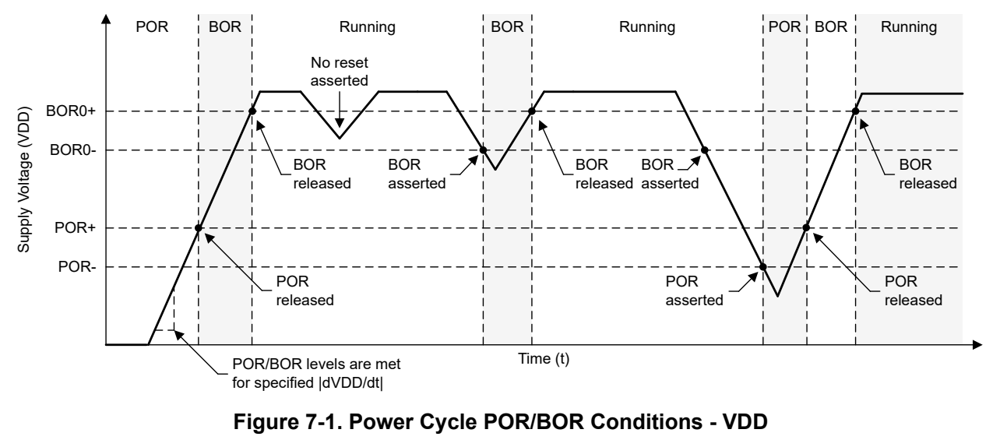
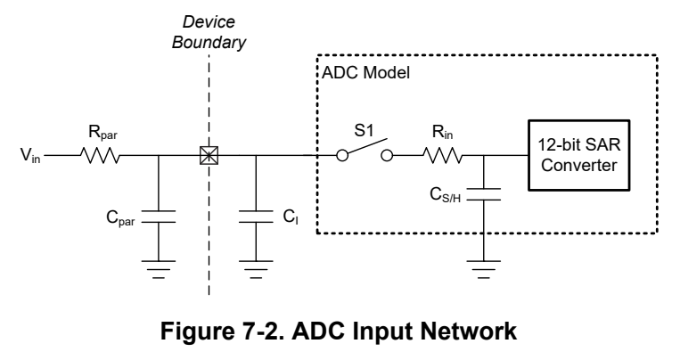
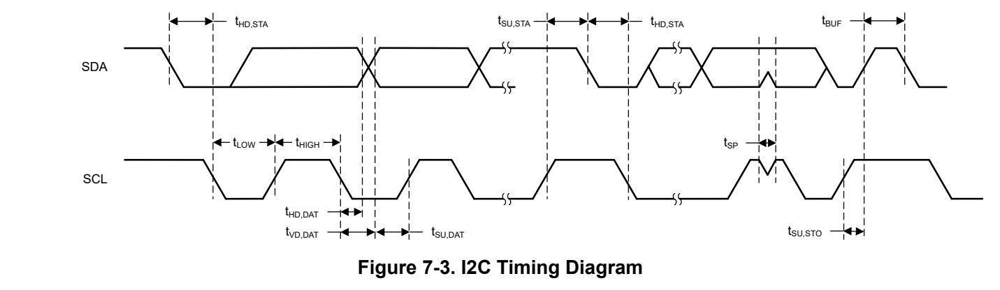
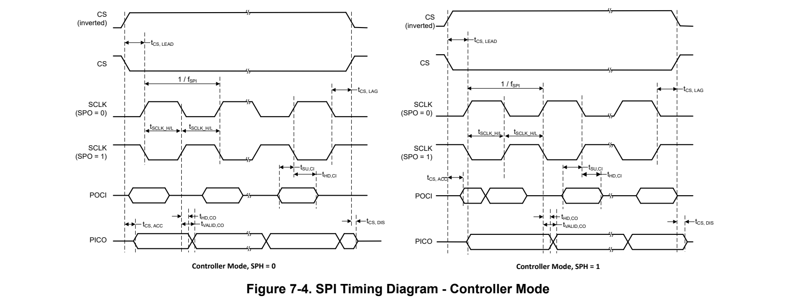
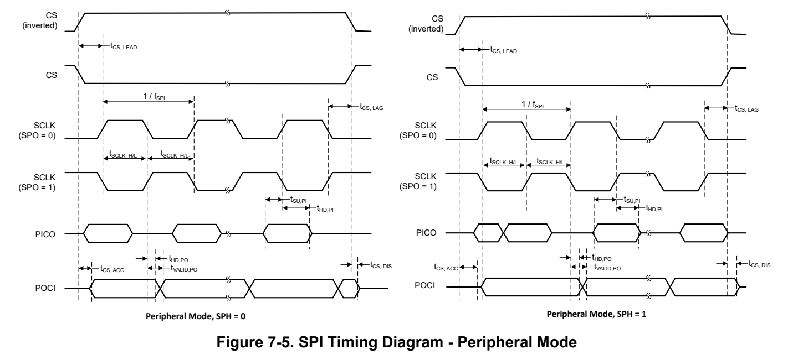

# 7 Specifications (pp. 41-57)

## 7 Specifications (p. 41)

### 7.1 Absolute Maximum Ratings (p. 41)

over operating free-air temperature range (unless otherwise noted) (1)

| Col 1 | Col 2 | Col 3 | MIN | MAX | UNIT |
| --- | --- | --- | --- | --- | --- |
| VDD | Supply voltage | At VDD pin, with respect to VSS | -0.3 | 4.1 | V |
| V I | Input voltage | Applied to any 5-V tolerant open-drain pins | -0.3 | 5.5 | V |
| V I | Input voltage | Applied to any common tolerance pins | -0.3 | V DD + 0.3 (4.1 MAX) | V |
| I (3) | Current into VDD pin | -40 °C ≤ Tj ≤ 130 °C |  | 80 | mA |
| I VDD | (source) | -40 °C ≤ Tj ≤ 85 °C |  | 100 | mA |
| I (3) | Current out of VSS pin | -40 °C ≤ Tj ≤ 130 °C |  | 80 | mA |
| I VSS | (sink) | -40 °C ≤ Tj ≤ 85 °C |  | 100 | mA |
| I | Current for SDIO pin | Current sunk or sourced by SDIO pin |  | 6 | mA |
| I IO | Current for ODIO pin | Current sunk by ODIO pin |  | 20 | mA |
| I D | Supported diode current | Diode current at any device pin |  | ±2 | mA |
| Tj | Junction temperature |  | -40 | 130 | °C |
| T stg | Storage temperature (2) |  | -40 | 150 | °C |

(1) Stresses beyond those listed under Absolute Maximum Rating may cause permanent damage to the device. These are stress ratings only, which do not imply functional operation of the device at these or any other conditions beyond those indicated under Recommended Operating Condition. Exposure to absolute-maximum-rated conditions for extended periods may affect device reliability.

(2) Higher temperatures may be applied during board soldering according to the current JEDEC J-STD-020 specification with peak reflow temperatures not higher than classified on the device label on the shipping boxes or reels.

(3) For applications operating at VDD=1.62V, I_VDD/I_VSS<=20mA is required to ensure device functionality

### 7.2 ESD Ratings (p. 41)

| Col 1 | Col 2 | Col 3 | VALUE | UNIT |
| --- | --- | --- | --- | --- |
| V | Electrostatic discharge | Human body model (HBM), per ANSI/ESDA/(1) JEDEC JS-001, all pins | ±2000 | V |
| V (ESD) | Electrostatic discharge | Charged device model (CDM), per JEDEC(2) specification JESD22-C101, all pins | ±500 | V |

(1) JEDEC document JEP155 states that 500-V HBM allows safe manufacturing with a standard ESD control process.

(2) JEDEC document JEP157 states that 250-V CDM allows safe manufacturing with a standard ESD control process.

### 7.3 Recommended Operating Conditions (p. 41)

over operating free-air temperature range (unless otherwise noted)

| Col 1 | Col 2 | MIN | NOM | MAX | UNIT |
| --- | --- | --- | --- | --- | --- |
| VDD | Supply voltage (3) | 1.62 (4) |  | 3.6 | V |
| C VDD | Capacitor placed between VDD and VSS (1) |  | 10 |  | uF |
| T A | Ambient temperature | -40 |  | 125 | °C |
| T J | Max junction temperature |  |  | 130 | °C |
| f | MCLK, CPUCLK, ULPCLK frequency with 1 flash wait state (2) |  |  | 32 | MHz |
| f MCLK | MCLK, CPUCLK, ULPCLK frequency with 0 flash wait states (2) |  |  | 24 | MHz |

(1) Connect C VDD between VDD/VSS as close to the device pins as possible. A low-ESR capacitor with at least the specified value and tolerance of ±20% or better is required for C VDD.

(2) Wait states are managed automatically by the system controller (SYSCTL) and do not need to be configured by application software.

(3) There is no dependency on MCLK frequency with respect to VDD recommended operating range.

(4) Functionality is guaranteed down to V BOR0-(max).

### 7.4 Thermal Information (p. 42)

| Col 1 | THERMAL METRIC (1) | PACKAGE | VALUE | UNIT |
| --- | --- | --- | --- | --- |
| R θJA | Junction-to-ambient thermal resistance |  | 78.8 | °C/W |
| R θJC(top) | Junction-to-case (top) thermal resistance |  | 35.1 | °C/W |
| R θJB | Junction-to-board thermal resistance | LQFP-48 (PT) | 50.7 | °C/W |
| Ψ JT | Junction-to-top characterization parameter | LQFP-48 (PT) | 3.5 | °C/W |
| Ψ JB | Junction-to-board characterization parameter |  | 50.1 | °C/W |
| R θJC(bot) | Junction-to-case (bottom) thermal resistance |  | N/A | °C/W |
| R θJA | Junction-to-ambient thermal resistance |  | 34.6 | °C/W |
| R θJC(top) | Junction-to-case (top) thermal resistance |  | 25.4 | °C/W |
| R θJB | Junction-to-board thermal resistance | VQFN-48 (RGZ) | 17.5 | °C/W |
| Ψ JT | Junction-to-top characterization parameter | VQFN-48 (RGZ) | 1.6 | °C/W |
| Ψ JB | Junction-to-board characterization parameter |  | 17.5 | °C/W |
| R θJC(bot) | Junction-to-case (bottom) thermal resistance |  | 9.0 | °C/W |
| R θJA | Junction-to-ambient thermal resistance |  | 101.1 | °C/W |
| R θJC(top) | Junction-to-case (top) thermal resistance |  | 42.1 | °C/W |
| R θJB | Junction-to-board thermal resistance | NFBGA-48 (ZCM) | 62.2 | °C/W |
| Ψ JT | Junction-to-top characterization parameter | NFBGA-48 (ZCM) | 1.8 | °C/W |
| Ψ JB | Junction-to-board characterization parameter |  | 62.0 | °C/W |
| R θJC(bot) | Junction-to-case (bottom) thermal resistance |  | N/A | °C/W |
| R θJA | Junction-to-ambient thermal resistance |  | 38.7 | °C/W |
| R θJC(top) | Junction-to-case (top) thermal resistance |  | 31.1 | °C/W |
| R θJB | Junction-to-board thermal resistance | VQFN-32 (RHB) | 18.7 | °C/W |
| Ψ JT | Junction-to-top characterization parameter | VQFN-32 (RHB) | 1.6 | °C/W |
| Ψ JB | Junction-to-board characterization parameter |  | 18.7 | °C/W |
| R θJC(bot) | Junction-to-case (bottom) thermal resistance |  | 9.1 | °C/W |
| R θJA | Junction-to-ambient thermal resistance |  | 80.6 | °C/W |
| R θJC(top) | Junction-to-case (top) thermal resistance |  | 39.9 | °C/W |
| R θJB | Junction-to-board thermal resistance | VSSOP-28 (DGS28) | 42.6 | °C/W |
| Ψ JT | Junction-to-top characterization parameter | VSSOP-28 (DGS28) | 3.5 | °C/W |
| Ψ JB | Junction-to-board characterization parameter |  | 42.2 | °C/W |
| R θJC(bot) | Junction-to-case (bottom) thermal resistance |  | N/A | °C/W |
| R θJA | Junction-to-ambient thermal resistance |  | 47.1 | °C/W |
| R θJC(top) | Junction-to-case (top) thermal resistance |  | 40.4 | °C/W |
| R θJB | Junction-to-board thermal resistance | VQFN-24 (RGE) | 23.7 | °C/W |
| Ψ JT | Junction-to-top characterization parameter | VQFN-24 (RGE) | 2.4 | °C/W |
| Ψ JB | Junction-to-board characterization parameter |  | 23.6 | °C/W |
| R θJC(bot) | Junction-to-case (bottom) thermal resistance |  | 9.3 | °C/W |
| R θJA | Junction-to-ambient thermal resistance |  | 92.8 | °C/W |
| R θJC(top) | Junction-to-case (top) thermal resistance |  | 35.5 | °C/W |
| R θJB | Junction-to-board thermal resistance | VSSOP-20 (DGS20) | 49.6 | °C/W |
| Ψ JT | Junction-to-top characterization parameter | VSSOP-20 (DGS20) | 1.3 | °C/W |
| Ψ JB | Junction-to-board characterization parameter |  | 49.1 | °C/W |
| R θJC(bot) | Junction-to-case (bottom) thermal resistance |  | N/A | °C/W |
| R θJA | Junction-to-ambient thermal resistance |  | 49.6 | °C/W |
| R θJC(top) | Junction-to-case (top) thermal resistance |  | 48.9 | °C/W |
| R θJB | Junction-to-board thermal resistance | WQFN-20 (RUK) | 23.6 | °C/W |
| Ψ JT | Junction-to-top characterization parameter | WQFN-20 (RUK) | 1.4 | °C/W |
| Ψ JB | Junction-to-board characterization parameter |  | 23.6 | °C/W |
| R θJC(bot) | Junction-to-case (bottom) thermal resistance |  | 9.2 | °C/W |

(1) For more information about traditional and new thermal metrics, see the Semiconductor and IC Package Thermal Metrics application report.

### 7.5 Supply Current Characteristics (p. 44)

#### 7.5.1 RUN/SLEEP Modes (p. 44)

VDD=3.3V. All inputs tied to 0V or VDD. Outputs do not source or sink any current. All peripherals are disabled.

| Col 1 | PARAMETER PARAMETER | MCLK MCLK | -40°C TYP | -40°C MAX | 25°C TYP | 25°C MAX | 85°C TYP | 85°C MAX | 105°C TYP | 105°C MAX | 125°C TYP | 125°C MAX | UNIT UNIT |
| --- | --- | --- | --- | --- | --- | --- | --- | --- | --- | --- | --- | --- | --- |
| RUN Mode |  |  |  |  |  |  |  |  |  |  |  |  |  |
| IDD RUN | MCLK=SYSOSC, CoreMark, execute from flash | 32MHz | 2.9 |  | 2.9 |  | 2.9 |  | 2.9 |  | 2.9 |  | mA |
| IDD RUN, | MCLK=SYSOSC, While(1), execute from flash | 32MHz | 52 | 58 | 53 | 59 | 53 | 59 | 54 | 60 | 54 | 60 | uA/Mhz |
| per MHz | MCLK=SYSOSC, CoreMark, execute from flash | 32MHz | 90 |  | 91 |  | 91 |  | 91 |  | 91 |  | uA/Mhz |
| SLEEP Mode |  |  |  |  |  |  |  |  |  |  |  |  |  |
| IDD SLEEP | MCLK=SYSOSC, CPU is halted | 32MHz | 1332 | 1455 | 1346 | 1468 | 1358 | 1479 | 1362 | 1486 | 1370 | 1490 | uA |
| IDD SLEEP | MCLK=LFCLK, CPU is halted | 32kHz | 524 | 591 | 529 | 595 | 542 | 643 | 549 | 650 | 558 | 660 | uA |

#### 7.5.2 STOP/STANDBY Modes (p. 44)

VDD=3.3V unless otherwise noted. All inputs tied to 0V or VDD. Outputs do not source or sink any current. All peripherals not noted are disabled.

| Col 1 | PARAMETER PARAMETER | ULPCLK ULPCLK | -40°C TYP | -40°C MAX | 25°C TYP | 25°C MAX | 85°C TYP | 85°C MAX | 105°C TYP | 105°C MAX | 125°C TYP | 125°C MAX | UNIT UNIT |
| --- | --- | --- | --- | --- | --- | --- | --- | --- | --- | --- | --- | --- | --- |
| STOP Mode |  |  |  |  |  |  |  |  |  |  |  |  |  |
| IDD STOP0 | SYSOSC=32MHz, DISABLESTOP=0 | 4MHz | 415 | 456 | 422 | 459 | 431 | 473 | 434 | 476 | 436 | 481 | uA |
| IDD STOP2 | SYSOSC off, DISABLESTOP=1, ULPCLK=LFCLK | 32kHz | 81 | 91 | 84 | 93 | 93 | 118 | 96 | 121 | 99 | 127 | uA |
| STANDBY Mode |  |  |  |  |  |  |  |  |  |  |  |  |  |
|  | LFXT and RTC enabled |  | 2.6 | 4.1 | 2.7 | 4.1 | 7.9 | 27 | 11 | 30 | 16 | 34 | uA |
|  | LFOSC and IWDT enabled |  | 2.4 | 3.8 | 2.5 | 3.8 | 7.6 | 27 | 10 | 30 | 13 | 35 | uA |
| IDD STBY0 | LFXT and RTC enabled, IWDT enabled |  | 2.6 | 4.1 | 2.7 | 4.1 | 8.0 | 27 | 11 | 30 | 16 | 34 | uA |
|  | STOPCLKSTBY=0, TIMG0 enabled |  | 2.3 | 3.9 | 2.4 | 3.9 | 7.6 | 27 | 10 | 29 | 15 | 35 |  |
| IDD | STOPCLKSTBY=1, TIMG0 enabled | 32kHz | 2.1 | 3.4 | 2.2 | 3.4 | 7.1 | 26 | 10 | 29 | 15 | 34 | uA |
| IDD STBY1 | STOPCLKSTBY=1, GPIOA enabled |  | 2.0 | 2.6 | 2.1 | 2.6 | 7.1 | 26 | 10 | 29 | 13 | 34 |  |

#### 7.5.3 SHUTDOWN Mode (p. 44)

VDD=3.3V unless otherwise noted. All inputs tied to 0V or VDD. Outputs do not source or sink any current. Core regulator is powered down.

| Col 1 | PARAMETER PARAMETER | -40°C TYP | -40°C MAX | 25°C TYP | 25°C MAX | 85°C TYP | 85°C MAX | 105°C TYP | 105°C MAX | 125°C TYP | 125°C MAX | UNIT UNIT |
| --- | --- | --- | --- | --- | --- | --- | --- | --- | --- | --- | --- | --- |
| IDD SHDN | Supply current in SHUTDOWN mode | 54 |  | 68 |  | 255 |  | 524 |  | 1362 |  | nA |

### 7.6 Power Supply Sequencing (p. 44)

#### 7.6.1 Power Supply Ramp (p. 44)

Figure 7-1 gives the relationship of POR- POR+, BOR0-, and BOR0+ during power-up and power-down.

*Figure 7-1. Power Cycle POR/BOR Conditions - VDD (p. 45)*

#### 7.6.2 POR and BOR (p. 45)

over operating free-air temperature range (unless otherwise noted)

| Col 2 | Col 4 | PARAMETER | Col 6 | TEST CONDITIONS | MIN | TYP | MAX | UNIT |
| --- | --- | --- | --- | --- | --- | --- | --- | --- |
|  |  |  |  | Rising |  |  | 0.1 | V/us |
| dVDD/dt |  | VDD (supply voltage) slew rate |  | Falling (1) Falling, STANDBY |  |  | 0.01 0.1 | V/us V/ms |
| V POR+ |  | Power-on reset voltage level |  | Rising | 0.95 | 1.3 | 1.59 | V |
| V POR- |  | Power-on reset voltage level |  | Falling | 0.9 | 1.25 | 1.54 | V |
| V HYS, POR | POR hysteresis |  |  |  | 30 | 58 | 74 | mV |
| V BOR0+, |  |  |  | -40 °C ≤ Ta ≤ 25 °C, Cold start, rising | 1.50 | 1.56 | 1.63 |  |
| COLD |  | Brown-out reset voltage level 0 (default level) | Brown-out reset voltage level 0 (default level) | 25 °C ≤ Ta ≤ 125 °C, Cold start, rising | 1.51 | 1.58 | 1.65 | V |
| V BOR0+ |  |  |  | Rising (1) | 1.56 | 1.59 | 1.62 |  |
| V BOR0- |  |  |  | Falling (1) | 1.55 | 1.58 | 1.61 |  |
| V BOR0, STBY |  |  |  | STANDBY mode | 1.51 | 1.56 | 1.61 |  |
| V BOR1+ |  |  |  | Rising (1) | 2.13 | 2.17 | 2.21 |  |
| V BOR1- |  | Brown-out-reset voltage level 1 |  | Falling (1) | 2.10 | 2.14 | 2.18 | V |
| V BOR1, STBY |  |  |  | STANDBY mode | 2.06 | 2.13 | 2.20 |  |
| V BOR2+ |  |  |  | Rising (1) | 2.73 | 2.77 | 2.82 |  |
| V BOR2- |  | Brown-out-reset voltage level 2 |  | Falling (1) | 2.7 | 2.74 | 2.79 | V |
| V BOR2, STBY |  |  |  | STANDBY mode | 2.62 | 2.71 | 2.8 |  |
| V BOR3+ |  |  |  | Rising (1) | 2.88 | 2.96 | 3.04 |  |
| V BOR3- |  | Brown-out-reset voltage level 3 |  | Falling (1) | 2.85 | 2.93 | 3.01 | V |
| V BOR3, STBY |  |  |  | STANDBY mode | 2.82 | 2.92 | 3.02 |  |
| V |  | Brown-out reset hysteresis |  | Level 0 |  | 15 | 21 | mV |
| V HYS,BOR |  | Brown-out reset hysteresis |  | Levels 1-3 |  | 34 | 40 | mV |
| T | BOR propagation delay |  |  | RUN/SLEEP/STOP mode |  |  | 5 | us |
| T PD, BOR | BOR propagation delay |  |  |  |  |  |  |  |
|  |  |  |  | STANDBY mode |  |  | 100 | us |
| (1) |  | Device operating in RUN, SLEEP, or STOP mode. |  |  |  |  |  |  |

### 7.7 Flash Memory Characteristics (p. 46)

over operating free-air temperature range (unless otherwise noted)

| Col 1 | PARAMETER | TEST CONDITIONS | MIN | TYP | MAX | UNIT |
| --- | --- | --- | --- | --- | --- | --- |
| Supply |  |  |  |  |  |  |
| VDD PGM/ERASE | Program and erase supply voltage |  | 1.62 |  | 3.6 | V |
| IDD ERASE | Supply current from VDD during erase operation | Supply current delta |  | 2 |  | mA |
| IDD PGM | Supply current from VDD during program operation | Supply current delta |  | 2.5 |  | mA |
| Endurance |  |  |  |  |  |  |
| NWEC (LOWER) | Erase/program cycle endurance (lower(1) 32kB flash) |  | 100 |  |  | k cycles |
| NWEC (UPPER) | Erase/program cycle endurance(1) (remaining flash) |  | 10 |  |  | k cycles |
| NE (MAX) | Total erase operations before failure (2) |  | 802 |  |  | k erase operations |
| NW (MAX) | Write operations per word line before(3) sector erase |  |  |  | 83 | write operations |
| Retention |  |  |  |  |  |  |
| t RET_85 | Flash memory data retention | -40°C ≤T j ≤ 85°C | 60 |  |  | years |
| t RET_105 | Flash memory data retention | -40°C ≤T j ≤ 105°C | 11.4 |  |  | years |
| Program and Erase Timing |  |  |  |  |  |  |
| t PROG (WORD, 64) | Program time for flash word (4) (6) |  |  | 50 | 275 | µs |
| t PROG (SEC, 64) | Program time for 1kB sector (5) (6) |  |  | 6.4 |  | ms |
| t ERASE (SEC) | Sector erase time | ≤2k erase/program cycles, T j ≥25°C |  | 4 | 20 | ms |
| t ERASE (SEC) | Sector erase time | ≤10k erase/program cycles, T j ≥25°C |  | 20 | 150 | ms |
| t ERASE (SEC) | Sector erase time | ≤10k erase/program cycles |  | 20 | 200 | ms |
| t ERASE (BANK) | Bank erase time | ≤10k erase/program cycles |  | 22 | 220 | ms |

(1) The lower 32kB flash address space supports higher erase/program endurance to enable EEPROM emulation applications. On devices with <=32kB flash memory, the entire flash memory supports NWEC (LOWER) erase/program cycles.

(2) Total number of cumulative erase operations supported by the flash before failure. A sector erase or bank erase operation is considered to be one erase operation.

(3) Maximum number of write operations allowed per word line before the word line must be erased. If additional writes to the same word line are required, a sector erase is required once the maximum number of write operations per word line is reached.

(4) Program time is defined as the time from when the program command is triggered until the command completion interrupt flag is set in the flash controller.

(5) Sector program time is defined as the time from when the first word program command is triggered until the final word program command completes and the interrupt flag is set in the flash controller. This time includes the time needed for software to load each flash word (after the first flash word) into the flash controller during programming of the sector.

(6) Flash word size is 64 data bits (8 bytes). On devices with ECC, the total flash word size is 72 bits (64 data bits plus 8 ECC bits).

### 7.8 Timing Characteristics (p. 46)

VDD=3.3V, T a =25 °C (unless otherwise noted)

| Col 1 | PARAMETER | TEST CONDITIONS | MIN | TYP | MAX | UNIT |
| --- | --- | --- | --- | --- | --- | --- |
| Wakeup Timing |  |  |  |  |  |  |
| t WAKE, SLEEP | Wakeup time from SLEEP to RUN (1) |  |  | 2 |  | cycles |
| t WAKE, STOP0 | Wakeup time from STOP0 to RUN(1) (SYSOSC enabled) |  |  | 14 |  | us |
| t WAKE, STOP2 | Wakeup time from STOP2 to RUN(1) (SYSOSC disabled) |  |  | 13 |  | us |

| VDD=3.3V, T | a =25 °C (unless otherwise noted) PARAMETER | a =25 °C (unless otherwise noted) TEST CONDITIONS | a =25 °C (unless otherwise noted) MIN | a =25 °C (unless otherwise noted) TYP | a =25 °C (unless otherwise noted) MAX | a =25 °C (unless otherwise noted) UNIT |
| --- | --- | --- | --- | --- | --- | --- |
| t WAKE, STBY0 | Wakeup time from STANDBY to RUN(1) |  |  | 15 |  | us |
| t WAKE, SHDN | Wakeup time from SHUTDOWN to RUN | Fast boot enabled |  | 255 |  | us |
| t WAKE, SHDN | Wakeup time from SHUTDOWN to RUN | Fast boot disabled |  | 265 |  | us |
|  | Asynchronous Fast Clock Request Timing |  |  |  |  |  |
| t DELAY | Delay time from edge of asynchronous request to first 32MHz MCLK edge | Mode is SLEEP2 |  | 0.9 |  | us |
| t DELAY | Delay time from edge of asynchronous request to first 32MHz MCLK edge | Mode is STOP0 |  | 2.4 |  | us |
| t DELAY | Delay time from edge of asynchronous request to first 32MHz MCLK edge | Mode is STOP2 |  | 0.9 |  | us |
| t DELAY | Delay time from edge of asynchronous request to first 32MHz MCLK edge | Mode is STANDBY1 |  | 3.2 |  | us |
| Startup Timing |  |  |  |  |  |  |
| t START, | Device cold start-up time from reset/ | Fast boot enabled |  | 241 |  | us |
| RESET | power-up (2) | Fast boot disabled |  | 284 |  | us |
| NRST Timing |  |  |  |  |  |  |
| t RST, | Minimum pulse length on NRST pin to | ULPCLK≥4MHz |  | 2 |  | us |
| BOOTRST | generate BOOTRST | ULPCLK=32kHz |  | 100 |  | us |
| t RST, POR | Minimum pulse length on NRST pin to generate POR |  |  | 1 |  | s |

(1) The wake-up time is measured from the edge of an external signal (GPIO wake-up event) to the time that the first CPU instruction is executed, with the GPIO glitch filter disabled (FILTEREN=0x0) and fast wake enabled (FASTWAKEONLY=1)

(2) The start-up time is measured from the time that VDD crosses VBOR0+ (cold start-up) to the time that the first instruction of the user program is executed.

### 7.9 Clock Specifications (p. 47)

#### 7.9.1 System Oscillator (SYSOSC) (p. 47)

over operating free-air temperature range (unless otherwise noted)

| Col 1 | PARAMETER | TEST CONDITIONS | MIN | TYP | MAX | UNIT |
| --- | --- | --- | --- | --- | --- | --- |
| f SYSOSC | Factory trimmed SYSOSC frequency | SYSOSCCFG.FREQ=00 (BASE) |  | 32 |  | MHz |
|  | SYSOSC frequency accuracy when | SETUSEFCL=1, T a = 25 °C | 0 |  | 1.0 |  |
| f SYSOSC | frequency correction loop (FCL) is(1) (2) enabled | SETUSEFCL=1, -40 °C ≤ T a ≤ 125 °C | -2.1 |  | 1.6 | % |
| f SYSOSC | SYSOSC accuracy when frequency correction loop (FCL) is disabled, 32MHz(1) (2) | SETUSEFCL=0, SYSOSCCFG.FREQ=00, -40 °C ≤ T a ≤ 125 °C | -2.6 |  | 1.8 | % |
| t settle, SYSOSC | Settling time to target accuracy (3) | SETUSEFCL=1 |  |  | 30 | us |

(1) SYSOSC accuracy is measured in the default power-up state, with MCLK = SYSOSC and the CPU running a while(1) loop.

(2) SYSOSC is measured with the internal FCC counter using an external 1ms pulse as the measurement trigger.

(3) When SYSOSC is waking up (for example, when exiting a low power mode) and FCL is enabled, the SYSOSC will initially undershoot the target frequency f SYSOSC by an additional error of up to f settle,SYSOSC for the time t settle,SYSOSC, after which the target accuracy is achieved.

#### 7.9.2 Low Frequency Oscillator (LFOSC) (p. 48)

over operating free-air temperature range (unless otherwise noted)

| Col 1 | PARAMETER | TEST CONDITIONS | MIN | TYP | MAX | UNIT |
| --- | --- | --- | --- | --- | --- | --- |
|  | LFOSC frequency |  |  | 32768 |  | Hz |
| f LFOSC | LFOSC accuracy | -40 °C ≤ T a ≤ 125 °C | -5 |  | 5 | % |
|  | LFOSC accuracy | -40 °C ≤ T a ≤ 85 °C | -3 |  | 3 | % |
| I LFOSC | LFOSC current consumption |  |  | 300 |  | nA |
| t start, LFOSC | LFOSC start-up time |  |  | 1 |  | ms |

#### 7.9.3 Low Frequency Crystal/Clock (p. 48)

over operating free-air temperature range (unless otherwise noted)

| Col 1 | PARAMETER | TEST CONDITIONS | MIN | TYP | MAX | UNIT |
| --- | --- | --- | --- | --- | --- | --- |
|  | Low frequency crystal oscillator (LFXT) |  |  |  |  |  |
| f LFXT | LFXT frequency |  |  | 32768 |  | Hz |
| DC LFXT | LFXT duty cycle |  | 30 |  | 70 | % |
| OA LFXT | LFXT crystal oscillation allowance |  |  | 419 |  | kΩ |
| C L, eff | Integrated effective load capacitance (1) |  |  | 1 |  | pF |
| t start, LFXT | LFXT start-up time |  |  | 1000 |  | ms |
| I LFXT | LFXT current consumption | XT1DRIVE=0, LOWCAP=1 |  | 300 |  | nA |
|  | Low frequency digital clock input (LFCLK_IN) |  |  |  |  |  |
| f LFIN | LFCLK_IN frequency (2) | SETUSEEXLF=1 | 29491 | 32768 | 36045 | Hz |
| DC LFIN | LFCLK_IN duty cycle (2) | SETUSEEXLF=1 | 40 |  | 60 | % |
| LFCLK Monitor |  |  |  |  |  |  |
| f FAULTLF | LFCLK monitor fault frequency (3) | MONITOR=1 | 2800 | 4200 | 8400 | Hz |

(1) This includes parasitic bond and package capacitance (≈2pF per pin), calculated as C LFXIN ×C LFXOUT/(C LFXIN +C LFXOUT), where C LFXIN and C LFXOUT are the total capacitance at LFXIN and LFXOUT, respectively.

(2) The digital clock input (LFCLK_IN) accepts a logic level square wave clock.

(3) The LFCLK monitor may be used to monitor the LFXT or LFCLK_IN. It will always fault below the MIN fault frequency, and will never fault above the MAX fault frequency.

#### 7.9.4 High Frequency Crystal/Clock (p. 48)

over operating free-air temperature range (unless otherwise noted)

| Col 1 | PARAMETER | TEST CONDITIONS | MIN | TYP | MAX | UNIT |
| --- | --- | --- | --- | --- | --- | --- |
|  | High frequency crystal oscillator (HFXT) |  |  |  |  |  |
| f HFXT | HFXT frequency | HFXTRSEL=00 | 4 |  | 8 | MHz |
| f HFXT | HFXT frequency | HFXTRSEL=01 | 8.01 |  | 16 | MHz |
| f HFXT | HFXT frequency | HFXTRSEL=10 | 16.01 |  | 32 | MHz |
| DC HFXT | HFXT duty cycle | HFXTRSEL=00 | 40 |  | 65 | % |
| DC HFXT | HFXT duty cycle | HFXTRSEL=01 | 40 |  | 60 | % |
| DC HFXT | HFXT duty cycle | HFXTRSEL=10 | 40 |  | 60 | % |
| OA HFXT | HFXT crystal oscillation allowance | HFXTRSEL=00 (4 to 8MHz range) |  | 2 |  | kΩ |
| C L, eff | Integrated effective load capacitance (1) |  |  | 1 |  | pF |
| start, HFXT |  | 32MHz crystal |  |  |  |  |
| I HFXT | HFXT current consumption (2) | f HFXT =4MHz, R m =300Ω, C L =12pF |  | 100 |  | uA |
| I HFXT | HFXT current consumption (2) | f HFXT =32MHz, R m =30Ω, C L =12pF, C m =6.26fF, L m =1.76mH |  | 600 |  | uA |
|  | High frequency digital clock input (HFCLK_IN) |  |  |  |  |  |
| f HFIN | HFCLK_IN frequency (3) | USEEXTHFCLK =1 | 4 |  | 32 | MHz |
| DC HFIN | HFCLK_IN duty cycle (3) | USEEXTHFCLK =1 | 40 |  | 60 | % |

(1) This includes parasitic bond and package capacitance (≈2pF per pin), calculated as C HFXIN ×C HFXOUT/(C HFXIN +C HFXOUT), where C HFXIN and C HFXOUT are the total capacitance at HFXIN and HFXOUT, respectively.

(2) The HFXT startup time (t start, HFXT) is measured from the time the HFXT is enabled until stable oscillation for a typical crystal. Start-up time is dependent upon crystal frequency and crystal specifications. Current consumption increases with higher RSEL and start up time is decreases with higher RSEL.

(3) The digital clock input (HFCLK_IN) accepts a logic level square wave clock.

### 7.10 Digital IO (p. 49)

#### 7.10.1 Electrical Characteristics (p. 49)

over recommended ranges of supply voltage and operating free-air temperature (unless otherwise noted)

| Col 1 | PARAMETER | Col 3 | TEST CONDITIONS | MIN | TYP | MAX | UNIT |
| --- | --- | --- | --- | --- | --- | --- | --- |
|  |  | ODIO (1) | VDD≥1.62V | 0.7*VDD |  | 5.5 | V |
| V IH | High level input voltage | ODIO | VDD≥2.7V | 2 |  | 5.5 | V |
| IH |  | All I/O except ODIO & Reset | VDD≥1.62V | 0.7*VDD |  | VDD+0.3 | V |
|  |  | ODIO | VDD≥1.62V | -0.3 |  | 0.3*VDD | V |
| V IL | Low level input voltage | ODIO | VDD≥2.7V | -0.3 |  | 0.8 | V |
| IL |  | All I/O except ODIO & Reset | VDD≥1.62V | -0.3 |  | 0.3*VDD | V |
|  |  | ODIO |  | 0.05*VDD |  |  | V |
| V HYS | Hysteresis | All I/O except ODIO |  | 0.1*VDD |  |  | V |
| I lkg | High-Z leakage current | SDIO (2) (3) |  |  |  | 50 (4) | nA |
| R PU | Pull up resistance | All I/O except ODIO |  |  | 40 |  | kΩ |
| R PD | Pull down resistance |  |  |  | 40 |  | kΩ |
| C I | Input capacitance |  |  |  | 5 |  | pF |
| V | Low level output voltage | SDIO | VDD≥2.7V, \|I IO \|,max =6mA VDD≥1.71V, \|I IO \|,max =2mA |  |  | 0.4 | V |
| V OL | Low level output voltage | ODIO | VDD≥2.7V, I OL,max =8mA VDD≥1.71V, I OL,max =4mA |  |  | 0.5 | V |
| V | High level output voltage | SDIO | VDD ≥ 2.7V, I OH,max = 6mA | VDD-0.5 |  |  | V |
| V OH | High level output voltage | SDIO | VDD ≥ 1.71V, I OH,max = 2mA | VDD-0.4 |  |  | V |

(1) I/O Types: ODIO = 5V Tolerant Open-Drain , SDIO = Standard-Drive

(2) The leakage current is measured with VSS or VDD applied to the corresponding pin(s), unless otherwise noted.

disabled.

(4) This value is for SDIO not muxed with any analog inputs. If the SDIO is muxed with analog inputs then the leakage can be as high as 100nA.

#### 7.10.2 Switching Characteristics (p. 50)

over recommended ranges of supply voltage and operating free-air temperature (unless otherwise noted)

| Col 1 | PARAMETER | Col 3 | TEST CONDITIONS | MIN | TYP | MAX | UNIT |
| --- | --- | --- | --- | --- | --- | --- | --- |
|  |  | SDIO (1) | VDD ≥ 1.71V, C L = 20pF |  |  | 16 |  |
| f max | Port output frequency | SDIO | VDD ≥ 2.7V, CL= 20pF |  |  | 32 | MHz |
|  |  | ODIO | VDD ≥ 1.71V, FM +, CL= 20pF - 100pF |  |  | 1 |  |
| t r,t f | Output rise/fall time | SDIO | VDD ≥ 1.71V, C L = 20pF |  |  | 3.5 | ns |
| t r,t f | Output rise/fall time | SDIO | VDD ≥ 2.7V, C L = 20pF |  |  | 6.6 | ns |
| t f | Output fall time | ODIO | VDD ≥ 1.71V, FM +, CL= 20pF-100pF | 20*VDD/5.5 |  | 120 | ns |

(1) I/O Types: ODIO = 5V Tolerant Open-Drain , SDIO = Standard-Drive

### 7.11 Analog Mux VBOOST (p. 50)

over operating free-air temperature range (unless otherwise noted)

| Col 1 | PARAMETER | TEST CONDITIONS | MIN | TYP | MAX | UNIT |
| --- | --- | --- | --- | --- | --- | --- |
|  |  | MCLK/ULPCLK is LFCLK |  | 0.8 |  |  |
| I VBST | VBOOST current adder | MCLK/ULPCLK is not LFCLK, SYSOSC frequency is 32MHz |  | 20 |  | uA |
| t START,VBST | VBOOST startup time |  |  | 12 |  | us |

### 7.12 ADC (p. 50)

#### 7.12.1 Electrical Characteristics (p. 50)

over recommended ranges of supply voltage and operating free-air temperature (unless otherwise noted), all TYP values are measured at 25 °C and all accuracy parameters are measured using 12-bit resolution mode (unless otherwise noted)

| Col 1 | PARAMETER | TEST CONDITIONS | MIN | TYP | MAX | UNIT |
| --- | --- | --- | --- | --- | --- | --- |
| Vin (ADC) | Analog input voltage range (1) | Applies to all ADC analog input pins | 0 |  | VDD | V |
|  |  | V R+ sourced from VDD |  | VDD |  | V |
| V R+ | Positive ADC reference voltage | V R+ sourced from external reference pin (VREF+) | 1.4 |  | VDD | V |
|  |  | V R+ sourced from internal reference (VREF) |  | VREF |  | V |
| V R- | Negative ADC reference voltage |  |  | 0 |  | V |
| F S | ADC sampling frequency | RES = 0x0 (12-bit mode), External Reference |  |  | 1.6 | Msps |
| F S | ADC sampling frequency | RES = 0x1 (10-bit mode), External Reference |  |  | 1.7 | Msps |
| F S | ADC sampling frequency | RES = 0x2 (8-bit mode), External Reference |  |  | 1.9 | Msps |
| I | Operating supply current | F S = 1.6MSPS, External reference, V R+ = VDD |  | 350 |  | μA |
| I (ADC) | into VDD terminal | F S = 500ksps, Internal reference, V R+ = VREF = 2.5V |  | 300 |  | μA |
| C S/H | ADC sample-and-hold capacitance |  |  | 0.22 |  | pF |
| Rin | ADC sampling switch resistance |  |  | 15 |  | kΩ |
| ENOB | Effective number of bits | Internal reference, V R+ = VREF = 2.5V, F in = 10KHz | 9.4 | 10.2 |  | bit |
| ENOB | Effective number of bits | External reference, F in = 10KHz (2) | 10 | 10.6 |  | bit |
| ENOB | Effective number of bits | External reference, hardware averaging enabled (16(2) samples), F in = 10KHz |  | 11.8 |  | bit |
| SNR | Signal-to-noise ratio | External reference (2) |  | 67 |  | dB |
| SNR | Signal-to-noise ratio | Internal reference, V R+ = VREF = 2.5V |  | 64 |  | dB |
| SNR | Signal-to-noise ratio | External reference (2), hardware averaging enabled (16 samples) |  | 75 |  | dB |

| measured at 25 | °C PARAMETER | over recommended ranges of supply voltage and operating free-air temperature (unless otherwise noted), all TYP values are and all accuracy parameters are measured using 12-bit resolution mode (unless otherwise noted) TEST CONDITIONS | over recommended ranges of supply voltage and operating free-air temperature (unless otherwise noted), all TYP values are and all accuracy parameters are measured using 12-bit resolution mode (unless otherwise noted) MIN | over recommended ranges of supply voltage and operating free-air temperature (unless otherwise noted), all TYP values are and all accuracy parameters are measured using 12-bit resolution mode (unless otherwise noted) TYP | over recommended ranges of supply voltage and operating free-air temperature (unless otherwise noted), all TYP values are and all accuracy parameters are measured using 12-bit resolution mode (unless otherwise noted) MAX | over recommended ranges of supply voltage and operating free-air temperature (unless otherwise noted), all TYP values are and all accuracy parameters are measured using 12-bit resolution mode (unless otherwise noted) UNIT |
| --- | --- | --- | --- | --- | --- | --- |
|  |  | External reference (2), VDD = VDD (min) to VDD (max) |  | 68 |  |  |
| PSRR DC | Power supply rejection ratio, DC | VDD = VDD to VDD (min) (max) Internal reference, V R+ = VREF = 2.5V |  | 61 |  | dB |
|  |  | External reference (2), ΔVDD = 0.1 V at 1 kHz |  | 61 |  |  |
| PSRR AC | Power supply rejection ratio, AC | ΔVDD = 0.1 V at 1 kHz Internal reference, V R+ = VREF = 2.5V |  | 49 |  | dB |
| T wakeup | ADC Wakeup Time | Assumes internal reference is active |  |  | 5 | us |
| V SupplyMon | Supply Monitor voltage divider (VDD/3) accuracy | ADC input channel: Supply Monitor (3) | -1.5 |  | +1.5 | % |
| I SupplyMon | Supply Monitor voltage divider current consumption | ADC input channel: Supply Monitor |  | 10 |  | uA |

(1) The analog input voltage range must be within the selected ADC reference voltage range V R+ to V R– for valid conversion results.

(2) All external reference specifications are measured with V R+ = VREF+ = VDD = 3.3V and V R- = VREF- = VSS = 0V and external 1uF cap on VREF+ pin

(3) Analog power supply monitor. Analog input on channel 15 is disconnected and is internally connected to the voltage divider which is VDD/3.

#### 7.12.2 Switching Characteristics (p. 51)

over recommended ranges of supply voltage and operating free-air temperature (unless otherwise noted)

| Col 1 | PARAMETER | Col 3 | TEST CONDITIONS | MIN | TYP | MAX | UNIT |
| --- | --- | --- | --- | --- | --- | --- | --- |
| f ADCCLK | ADC clock frequency |  |  | 4 |  | 32 | MHz |
| t ADC trigger | Software trigger minimum width |  |  | 3 |  |  | ADCCLK cycles |
| t Sample_step | Sampling time for step input | 12-bit mode, R S | = 50Ω, C pext = 10pF | 0.188 |  |  | µs |
| t Sample_VREF | Sample time with internal VREF input |  | ADC CHANNEL=29,12-bit mode, VDD as reference | 10 |  |  | µs |
| t Sample_SupplyMon | Sample time with Supply Monitor (VDD/3) | 12-bit mode |  | 5 |  |  | µs |

#### 7.12.3 Linearity Parameters (p. 51)

over recommended ranges of supply voltage and operating free-air temperature (unless otherwise noted), all TYP values are measured at 25 °C and all linearity parameters are measured using 12-bit resolution mode (unless otherwise noted)

| Col 1 | PARAMETER | TEST CONDITIONS | MIN | TYP | MAX | UNIT |
| --- | --- | --- | --- | --- | --- | --- |
| E I | Integral linearity error (INL) | External reference (1) | -2.0 |  | +2.0 | LSB |
| E D | Differential linearity error (DNL) Guaranteed no missing codes | External reference, 12-bit (1) | -1.0 |  | +1.0 | LSB |
| E O | Offset error | External reference (1) | -5 |  | 5 | mV |
| E G | Gain error | External reference (1) | -6 |  | 6 | LSB |

(1) All external reference specifications are measured with VR+ = VREF+ = VDD = 3.3V and VR- = VREF- = VSS = 0V and external 1uF cap on VREF+ pin

#### 7.12.4 Typical Connection Diagram (p. 52)

*Figure 7-2. ADC Input Network (p. 52)*

1. Refer to Electrical Characteristics for the values of R in and C S/H 2. Refer to Electrical Characteristics for the value of C I 3. C par and R par represent the parasitic capacitance and resistance of the external ADC input circuitry

Use the following equations to solve for the minimum sampling time (T) required for an ADC conversion: 1. Tau = (Rn par + R in)* C S/H + R par*(C par + C I) 2. K= ln(2 /Settling error) – ln((C par + C I)/C S/H) 3. T (Min sampling time) = K*Tau

### 7.13 Temperature Sensor (p. 52)

over operating free-air temperature range (unless otherwise noted)

| Col 1 | PARAMETER | TEST CONDITIONS | MIN | TYP | MAX | UNIT |
| --- | --- | --- | --- | --- | --- | --- |
| TS TRIM | Factory trim temperature (1) | ADC and VREF configuration: RES=0 (12-bit mode), VRSEL=2h (internal VREF), BUFCONFIG=1h (1.4V VREF), ADC t Sample =10µs | 27 | 30 | 33 | °C |
| TS c | Temperature coefficient |  | -2.05 | -1.89 | -1.75 | mV/°C |
| t SET, TS | Temperature sensor settling time (2) |  |  | 2.5 | 10 | us |

(1) Higher absolute accuracy may be achieved through user calibration.

(2) This is the maximum time required for the temperature sensor to settle when measured by the ADC. It may be used to specify the minimum ADC sample time when measuring the temperature sensor.

### 7.14 VREF (p. 53)

#### 7.14.1 Electrical Characteristics (p. 53)

over recommended ranges of supply voltage and operating free-air temperature (unless otherwise noted)

| Col 1 | PARAMETER | TEST CONDITIONS | MIN | TYP | MAX | UNIT |
| --- | --- | --- | --- | --- | --- | --- |
| I VREF | VREF operating supply current | BUFCONFIG = {0, 1}, No load |  | 80 | 100 | µA |
| TC VREF | Temperature coefficient of VREF (1) | BUFCONFIG = {0, 1} |  |  | 75 | ppm/°C |
| TC drift | Long term VREF drift | Time = 1000 hours, BUFCONFIG = {0, 1}, T = 25 °C |  |  | 300 | ppm |
| PSRR | VREF Power supply rejection ratio, | VDD = 1.7 V to VDDmax, BUFCONFIG = 1 | 60 | 70 |  | dB |
| PSRR DC | DC | VDD = 2.7 V to VDDmax, BUFCONFIG = 0 | 49 | 60 |  | dB |
| V | RMS noise at VREF output (0.1 Hz | BUFFCONFIG = 1 |  | 500 |  | µVrms |
| V noise | to 100 MHz) | BUFFCONFIG = 0 |  | 900 |  | µVrms |
| ADC F S | Max supported ADC sampling frequency | Using VREF as ADC reference |  |  | 515 | ksps |
| T startup | VREF startup time | BUFCONFIG = {0, 1} , VDD = 2.8 V |  |  | 30 | us |

(1) The temperature coefficient of the VREF output is the sum of TC VRBUF and the temperature coefficient of the internal bandgap reference.

#### 7.14.2 Voltage Characteristics (p. 53)

over recommended ranges of supply voltage and operating free-air temperature (unless otherwise noted)

| Col 1 | PARAMETER | TEST CONDITIONS | MIN | TYP | MAX | UNIT |
| --- | --- | --- | --- | --- | --- | --- |
| VDD | Minimum supply voltage needed for | BUFCONFIG = 1 | 1.62 |  |  | V |
| VDD min | VREF operation | BUFCONFIG = 0 | 2.7 |  |  | V |
| VREF | Voltage reference output voltage | BUFCONFIG = 1 | 1.38 | 1.4 | 1.42 | V |
| VREF | Voltage reference output voltage | BUFCONFIG = 0 | 2.46 | 2.5 | 2.54 | V |

### 7.15 Comparator (COMP) (p. 53)

#### 7.15.1 Comparator Electrical Characteristics (p. 53)

over recommended ranges of supply voltage and operating free-air temperature (unless otherwise noted)

| Col 1 | PARAMETER | TEST CONDITIONS | MIN | TYP | MAX | UNIT |
| --- | --- | --- | --- | --- | --- | --- |
|  | Comparator Electrical Characteristics |  |  |  |  |  |
| Vcm | Common mode input range |  | 0 |  | VDD | V |
| V offset | Input offset voltage |  | -20 |  | 20 | mV |
|  |  | HYST=00h |  | 0.4 |  |  |
| V | DC input hysteresis | HYST=01h |  | 10 |  | mV |
| V hys | DC input hysteresis | HYST=02h |  | 20 |  | mV |
|  |  | HYST=03h |  | 30 |  |  |
| t | Propagation delay, response | Output Filter off, Overdrive = 100 mV, High Speed Mode |  | 32 | 50 | ns |
| t PD_ls | time | Output Filter off, Overdrive = 100 mV, Low Power Mode |  | 1.2 | 4 | µs |
| t | Comparator enable time | Startup time to reach propagation delay specification, High Speed Mode |  |  | 5 | µs |
| t en | Comparator enable time | Startup time to reach propagation delay specification, Low Power Mode |  |  | 10 | µs |
|  |  | Vcm = VDD/2, 100mV overdrive, DAC output as a voltage reference, VDD is reference for DAC, High Speed Mode |  | 130 | 200 | µA |
| I comp | Comparator current consumption. | Vcm = VDD/2, 100mV overdrive, DAC output as a voltage reference, VDD is reference for DAC, Low Power Mode |  | 0.85 | 2.7 | µA |
|  |  | Vcm = VDD/2, 100mV overdrive, comparator only. High Speed Mode |  | 120 | 180 | µA |
|  |  | Vcm = VDD/2, 100mV overdrive, comparator only, Low Power Mode |  | 0.7 | 2.1 | µA |
|  | 8-bit DAC Electrical Characteristics |  |  |  |  |  |
| V dac | DAC output range |  | 0 |  | VDD | V |
| V dac-code | 8-bit DAC output voltage for a given code | VIN = reference voltage into 8-bit DAC, code n = 0 to 255 |  | VIN × (n+1) / 256 |  | V |
| INL | Integral nonlinearity of 8-bit DAC |  | -1 |  | 1 | LSB |
| DNL | Differential nonlinearity of 8-bit DAC |  | -1 |  | 1 | LSB |
| Gain error | Gain error of 8-bit DAC | Reference voltage = VDD | -2 |  | 2 | % of FSR |
| Offset error | Offset error of 8-bit DAC |  | -5 |  | 5 | mV |
| Output Impedance | 8-bit DAC output impedance |  |  | 50 |  | kΩ |
| t dac_settle | 8-bit DAC settling time in static mode | DACCODE0 = 0 → 255, DAC output accurate to 1 LSB, DAC output on pin PA11, Cload = 15pF |  | 6 |  | µs |
| t dac_settle | 8-bit DAC settling time in static mode | DACCODE0 = 0 → 255, DAC output accurate to 1 LSB |  | 1.5 |  | µs |

### 7.16 I2C (p. 54)

#### 7.16.1 I2C Characteristics (p. 54)

over operating free-air temperature range (unless otherwise noted)

| Col 1 | PARAMETERS PARAMETERS | TEST CONDITIONS TEST CONDITIONS | Standard mode MIN | Standard mode MAX | Fast mode MIN | Fast mode MAX | Fast mode plus MIN | Fast mode plus MAX | UNIT UNIT |
| --- | --- | --- | --- | --- | --- | --- | --- | --- | --- |
| f I2C | I2C input clock frequency | I2C in Power Domain0 | 2 | 32 | 8 | 32 | 20 | 32 | MHz |
| f SCL | SCL clock frequency |  |  | 0.1 |  | 0.4 |  | 1 | MHz |
| t HD,STA | Hold time (repeated) START |  | 4 |  | 0.6 |  | 0.26 |  | us |
| t LOW | Low period of the SCL clock |  | 4.7 |  | 1.3 |  | 0.5 |  | us |
| t HIGH | High period of the SCL clock |  | 4 |  | 0.6 |  | 0.26 |  | us |
| t SU,STA | Setup time for a repeated START |  | 4.7 |  | 0.6 |  | 0.26 |  | us |
| t HD,DAT | Data hold time |  | 0 |  | 0 |  | 0 |  | ns |
| t SU,DAT | Data setup time |  | 250 |  | 100 |  | 50 |  | ns |
| t SU,STO | Setup time for STOP |  | 4 |  | 0.6 |  | 0.26 |  | us |
| t BUF | Bus free time between a STOP and START condition |  | 4.7 |  | 1.3 |  | 0.5 |  | us |
| t VD;DAT | Data valid time |  |  | 3.45 |  | 0.9 |  | 0.45 | us |
| t VD;ACK | Data valid acknowledge time |  |  | 3.45 |  | 0.9 |  | 0.45 | us |

#### 7.16.2 I2C Filter (p. 55)

over operating free-air temperature range (unless otherwise noted)

| Col 1 | PARAMETERS | TEST CONDITIONS | MIN | TYP | MAX | UNIT |
| --- | --- | --- | --- | --- | --- | --- |
|  |  | AGFSELx = 0 |  | 6 |  | ns |
| f | Pulse duration of spikes suppressed by | AGFSELx = 1 |  | 14 | 35 | ns |
| f SP | input filter | AGFSELx = 2 |  | 22 | 60 | ns |
|  |  | AGFSELx = 3 |  | 35 | 90 | ns |

#### 7.16.3 I2C Timing Diagram (p. 55)

*Figure 7-3. I2C Timing Diagram (p. 55)*

### 7.17 SPI (p. 55)

#### 7.17.1 SPI (p. 55)

over operating free-air temperature range (unless otherwise noted)

| Col 1 | Col 3 | PARAMETERS | Col 5 | Col 6 | Col 7 | Col 8 | Col 9 | MIN | TYP | MAX | UNIT |
| --- | --- | --- | --- | --- | --- | --- | --- | --- | --- | --- | --- |
| SPI |  |  |  |  |  |  |  |  |  |  |  |
| f SPI |  | SPI clock frequency |  |  |  | Clock max speed = 32MHz 1.62 < VDD < 3.6V Controller mode |  |  |  | 16 | MHz |
| f SPI |  | SPI clock frequency |  |  |  | Clock max speed = 32MHz 1.62 < VDD < 3.6V Peripheral mode |  |  |  | 16 | MHz |
| DC SCK |  | SCK Duty Cycle |  |  |  |  |  | 40 | 50 | 60 | % |
| Controller |  |  |  |  |  |  |  |  |  |  |  |
| t SCLK_H/L |  | SCLK High or Low time |  |  |  |  |  | (tSPI/2) -1 | tSPI / 2 | (tSPI/2) + 1 | ns |
| t CS.LEAD |  |  | CS lead-time, CS active to clock |  |  |  |  | 1 SPI Clock |  |  | ns |
| t CS.LAG | inactive | inactive | CS lag time, Last clock to CS |  |  |  |  | 1 SPI Clock |  |  | ns |
| t CS.ACC | data out | data out | CS access time, CS active to PICO |  |  |  |  |  |  | 1/2 SPI Clock | ns |
| t CS.DIS |  | PICO high inpedance | CS disable time, CS inactive to |  |  |  |  |  |  | 1 SPI Clock | ns |
| t SU.CI |  |  | POCI input data setup time | (1) | enabled enabled |  | 2.7 < VDD < 3.6V, delayed sampling 1.62 < VDD < 2.7V, delayed sampling | 1 8 |  |  | ns |
| t SU.CI |  |  | POCI input data setup time | (1) |  |  | 2.7 < VDD < 3.6V, no delayed sampling | 30 |  |  | ns |

| Col 1 | PARAMETERS | TEST CONDITIONS | MIN | TYP | MAX | UNIT |
| --- | --- | --- | --- | --- | --- | --- |
| t HD.CI | POCI input data hold time | No delayed sampling | 0 |  |  | ns |
| t VALID.CO | PICO output data valid time (2) |  |  |  | 16 | ns |
| t HD.CO | PICO output data hold time (3) |  | 1 |  |  | ns |
| Peripheral |  |  |  |  |  |  |
| t CS.LEAD | CS lead-time, CS active to clock |  | 13.5 |  |  | ns |
| t CS.LAG | CS lag time, Last clock to CS inactive |  | 1 |  |  | ns |
| t CS.ACC | CS access time, CS active to POCI data out |  |  |  | 40 | ns |
| t CS.DIS | CS disable time, CS inactive to POCI high impedance |  |  |  | 40 | ns |
| t SU.PI | PICO input data setup time |  | 15 |  |  | ns |
| t HD.PI | PICO input data hold time |  | 2.5 |  |  | ns |
| t VALID.PO | POCI output data valid time (2) | 2.7 < VDD < 3.6V |  |  | 31 | ns |
| t VALID.PO | POCI output data valid time (2) | 1.62 < VDD < 2.7V |  |  | 40 | ns |
| t HD.PO | POCI output data hold time (3) |  | 5.5 |  |  | ns |

(1) The POCI input data setup time can be fully compensated when delayed sampling feature is enabled.

(2) Specifies the time to drive the next valid data to the output after the output changing SCLK clock edge

(3) Specifies how long data on the output is valid after the output changing SCLK clock edge

#### 7.17.2 SPI Timing Diagram (p. 56)

*Figure 7-4. SPI Timing Diagram - Controller Mode (p. 56)*

*Figure 7-5. SPI Timing Diagram - Peripheral Mode (p. 57)*

### 7.18 UART (p. 57)

over operating free-air temperature range (unless otherwise noted)

| Col 1 | PARAMETERS | TEST CONDITIONS | MIN | TYP | MAX | UNIT |
| --- | --- | --- | --- | --- | --- | --- |
| f UART | UART input clock frequency |  |  |  | 32 | MHz |
| f BITCLK | BITCLK clock frequency(equals baud rate in MBaud) |  |  |  | 4 | MHz |
|  |  | AGFSELx = 0 |  | 6 |  | ns |
| t | Pulse duration of spikes | AGFSELx = 1 |  | 14 | 35 | ns |
| t SP | suppressed by input filter | AGFSELx = 2 |  | 22 | 60 | ns |
|  |  | AGFSELx = 3 |  | 35 | 90 | ns |

### 7.19 TIMx (p. 57)

over operating free-air temperature range (unless otherwise noted)

| Col 1 | PARAMETERS | Col 5 | TEST CONDITIONS | MIN | TYP | MAX | UNIT |
| --- | --- | --- | --- | --- | --- | --- | --- |
|  |  | f TIMxCLK = 64MHz |  | 15.625 |  |  | ns |
| t res | Timer resolution time | f TIMxCLK = 32MHz |  | 31.25 |  |  | ns |
|  |  |  |  | 1 |  |  | t |
|  |  |  |  | 1 |  |  | t TIMxCLK |
|  |  | f TIMxCLK = 64MHz |  |  |  | 1024 | us |
| t COUNTER | 16-bit counter clock period | f TIMxCLK = 32MHz |  |  |  | 2048 | us |
|  |  |  |  | 1 |  | 65536 | t TIMxCLK |

### 7.20 Emulation and Debug (p. 57)

#### 7.20.1 SWD Timing (p. 57)

over operating free-air temperature range (unless otherwise noted)

| Col 1 | Col 3 | PARAMETER | TEST CONDITIONS | MIN | TYP | MAX | UNIT |
| --- | --- | --- | --- | --- | --- | --- | --- |
| f SWD | SWD frequency |  |  |  |  | 10 | MHz |
