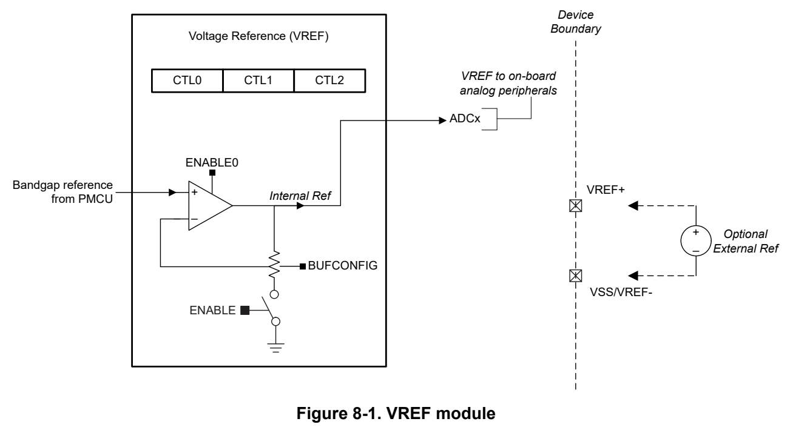
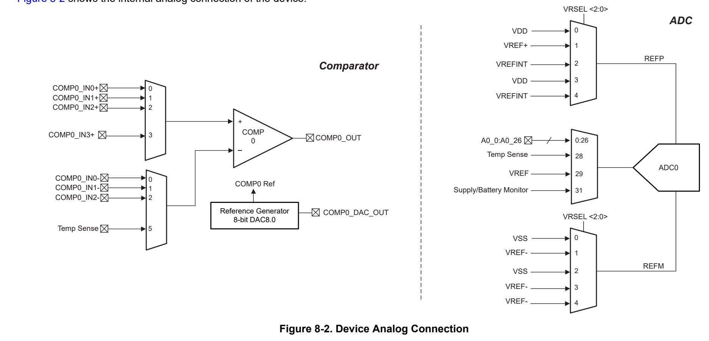
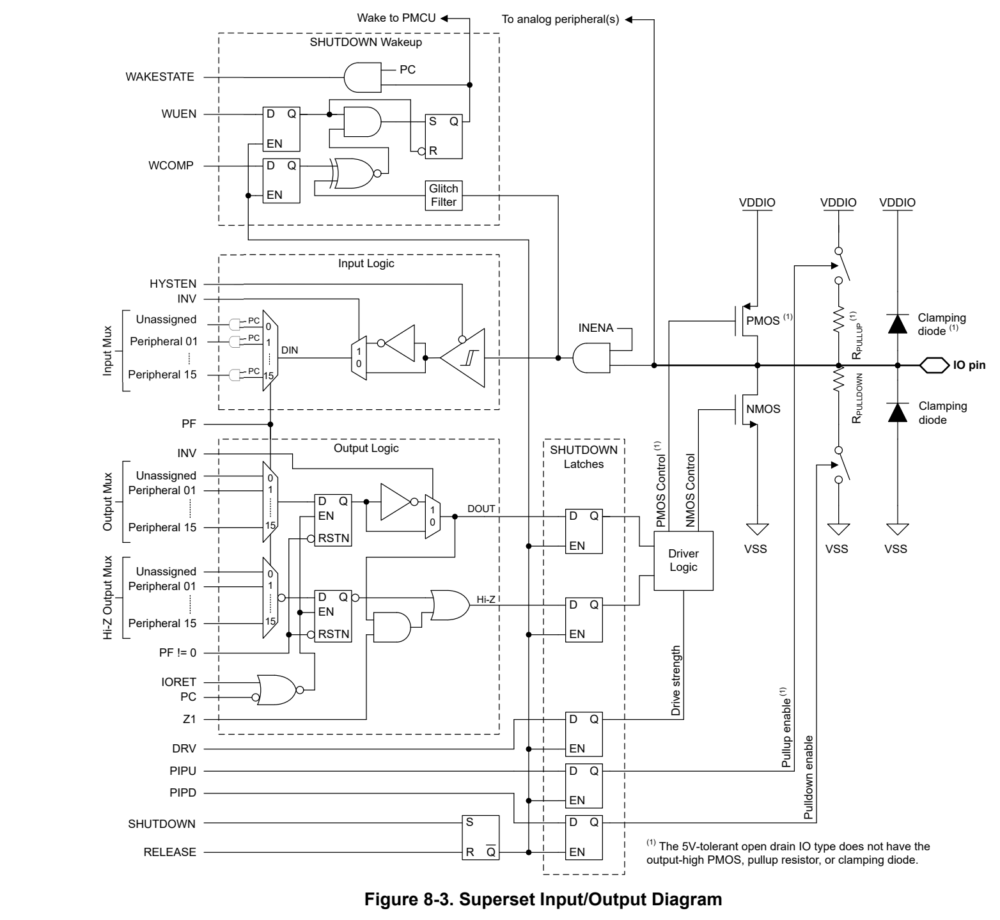

# 8 Detailed Description (pp. 58-78)

## 8 Detailed Description (p. 58)

The following sections describe all of the components that make up the devices in this data sheet. The peripherals integrated into these devices are configured by software through Memory Mapped Registers (MMRs). For more details, see the corresponding chapter of the MSPM0 C-Series Microcontrollers Technical Reference Manual.

### 8.1 Overview (p. 59)

MSPM0C1105/6 microcontrollers (MCUs) are part of MSP's highly integrated, ultra-low-power 32-bit MSPM0 MCU family based on the Arm® Cortex®-M0+ 32-bit core platform, operating at up to 32MHz frequency. These costoptimized MCUs offer high-performance analog peripheral integration, support extended temperature ranges from -40°C to 125°C, and operate with supply voltages from 1.62V to 3.6V.

The MSPM0C1105/6 devices provide up to 64KB embedded flash program memory with 8KB SRAM. These MCUs incorporate a high-speed on-chip oscillator with an accuracy from -2.1% to +1.6%, eliminating the need for an external crystal. Additional features include a 3-channel DMA, CRC-16 accelerator, and a variety of high-performance analog peripherals such as one 12-bit 1.6Msps ADC with VDD as the voltage reference, a comparator with 8-bit reference DAC and an on-chip temperature sensor. These devices also offer intelligent digital peripherals such as one 16-bit advanced timer with deadband and timer frequency up to 64MHz, four 16-bit general purpose timer, one windowed watchdog timer, and a variety of communication peripherals including three UART, one SPI, and two I2C. These communication peripherals offer protocol support for LIN, IrDA, DALI, Manchester, smart card, SMBus, and PMBus.

The TI MSPM0 family of low-power MCUs consists of devices with varying degrees of analog and digital integration allowing for customers find the MCU that meets their project's needs. The MSPM0 MCU platform combines the Arm Cortex-M0+ platform with a holistic ultra-low-power system architecture, allowing system designers to increase performance while reducing energy consumption.

For complete module descriptions, see the MSPM0 C-Series Microcontrollers Technical Reference Manual.

### 8.2 CPU (p. 59)

The CPU subsystem (MCPUSS) implements an Arm Cortex-M0+ CPU, an instruction pre-fetch/cache, a system timer, and interrupt management features. The Arm Cortex-M0+ is a cost-optimized, 32-bit CPU which delivers high performance and low power to embedded applications. Key features of the CPU Sub System include:

- Arm Cortex-M0+ CPU supporting clock frequencies up to 32MHz – ARMv6-M Thumb instruction set (little endian) with 32-cycle 32x32 multiply instruction

- Pre-fetch logic to improve sequential code execution, and I-cache with two 64-bit cache lines

- System timer (SysTick) with 24-bit down counter and automatic reload

- Nested vectored interrupt controller (NVIC) with 4 programmable priority levels and tail-chaining

### 8.3 Operating Modes (p. 59)

MSPM0 MCUs provide five main operating modes (power modes) to allow for optimization of the device power consumption based on application requirements. In order of decreasing power, the modes are: RUN, SLEEP, STOP, STANDBY, and SHUTDOWN. The CPU is active executing code in RUN mode. Peripheral interrupt events can wake the device from SLEEP, STOP, or STANDBY mode to the RUN mode. SHUTDOWN mode completely disables the internal core regulator to minimize power consumption, and wake is only possible via NRST, SWD, or a logic level match on certain IOs. RUN, SLEEP, STOP, and STANDBY modes also include several configurable policy options (for example, RUN.x) for balancing performance with power consumption.

To further balance performance and power consumption, MSPM0 devices implement two power domains: PD1 (for the CPU, memories, and high performance peripherals), and PD0 (for low speed, low power peripherals).

- PD1 is always powered in RUN and SLEEP modes, but is disabled in all other modes.

- PD0 is always powered in RUN, SLEEP, STOP, and STANDBY modes.

- PD1 and PD0 are both disabled in SHUTDOWN mode.

#### 8.3.1 Functionality by Operating Mode (p. 59)

Supported functionality in each operating mode is given in Supported Functionality by Operating Mode.

Functional key:

- EN: The function is enabled in the specified mode.

- DIS: The function is disabled (either clock or power gated) in the specified mode, but the function's configuration is retained.

- OPT: The function is optional in the specified mode, and remains enabled if configured to be enabled.

- NS: The function is not automatically disabled in the specified mode but is not supported.

- OFF: The function is fully powered off in the specified mode, and no configuration information is retained. When waking up from an OFF state, all module registers must be re-configured to the desired settings by application software.

**Table 8-1. Supported Functionality by Operating Mode (pp. 60-61)**

| Col 1 | Col 2 | Col 3 | RUN | Col 5 | Col 6 | SLEEP | Col 8 | STOP | STOP | STANDBY | STANDBY | SHUTD |
| --- | --- | --- | --- | --- | --- | --- | --- | --- | --- | --- | --- | --- |
| Operating Mode | Operating Mode | RUN0 | RUN1 | RUN2 | SLEEP0 | SLEEP1 | SLEEP2 | STOP0 | STOP2 | STANDBY0 | STANDBY1 | OWN |
|  | SYSOSC | EN | EN | DIS | EN | EN | DIS | OPT (1) | DIS | DIS | DIS | OFF |
| Oscillators | LFOSC or LFXT |  |  |  |  | EN | EN |  |  |  |  | OFF |
|  | HFXT | EN | DIS | DIS | OPT |  |  | DIS | DIS |  |  | OFF |
|  | CPUCLK | 32M | 32k | 32k |  |  |  | DIS |  |  |  | OFF |
|  | MCLK to PD1 | 32M | 32k | 32k | 32M | 32k | 32k |  | DIS | DIS |  | OFF |
|  | ULPCLK to PD0 | 32M | 32k | 32k | 32M | 32k | 32k | 4M (1) | 32k | 32k | DIS | OFF |
|  | ULPCLK to TIMG14/8 | 32M | 32k | 32k | 32M | 32k | 32k | 4M (1) |  | 32k |  | OFF |
| Clocks | RTCCLK |  |  |  |  | 32k | 32k |  |  |  |  | OFF |
| Clocks | MFCLK | OPT | DIS | DIS | OPT | DIS | DIS | OPT |  | DIS |  | OFF |
|  | LFCLK |  |  |  |  | 32k |  |  |  |  | DIS | OFF |
|  | LFCLK to TIMG14/8 |  |  |  |  | 32k | 32k |  |  |  |  | OFF |
|  | MCLK Monitor |  |  |  |  | OPT |  |  |  |  | DIS | OFF |
|  | LFCLK Monitor |  |  |  |  | OPT | OPT |  |  |  |  | OFF |
|  | POR Monitor |  |  |  |  |  | EN |  |  |  |  |  |
| PMU | BOR Monitor |  |  |  |  | EN | EN |  |  |  |  | OFF |
|  | Core Regulator |  |  | FULL DRIVE | FULL DRIVE |  |  | REDUCED DRIVE | REDUCED DRIVE | LOW DRIVE | LOW DRIVE | OFF |
|  | CPU |  | EN |  |  |  |  | DIS |  |  |  | OFF |
| Core Functions | DMA |  |  | OPT | OPT |  |  |  | NS (triggers supported) | NS (triggers supported) |  | OFF |
| Core Functions | Flash |  |  | EN | EN |  |  | OPT | OPT | DIS | DIS | OFF |
|  | SRAM |  |  | EN | EN |  |  | OPT | OPT | DIS | DIS | OFF |
| PD1 Peripherals | SPI0 |  |  | OPT | OPT |  |  |  | DIS | DIS |  | OFF |
| PD1 Peripherals | CRC |  |  | OPT | OPT |  |  |  | DIS | DIS |  | OFF |
|  | TIMG14/8 |  |  |  |  | OPT | OPT |  |  |  |  | OFF |
|  | TIMG1/2 |  |  |  |  | OPT |  |  |  |  | DIS | OFF |
|  | TIMA0 |  |  |  |  | OPT |  |  |  |  | DIS | OFF |
|  | UART0/1/2 |  |  |  |  | OPT |  |  |  |  | DIS | OFF |
| PD0 Peripherals | I2C0/1 |  |  |  |  | OPT |  |  |  |  | DIS | OFF |
|  | GPIOA/B |  |  |  |  | OPT |  |  |  |  | OPT 2 | OFF |
|  | WWDT0 |  |  |  |  | OPT |  |  |  |  | OPT (2) | OFF |
|  | IWDT |  |  |  |  | OPT | OPT |  |  |  |  | OFF |
|  | RTC_B |  |  |  |  | OPT | OPT |  |  |  |  | OFF |
| Operating Mode | Operating Mode | RUN0 | RUN1 | RUN2 | SLEEP0 | SLEEP1 | SLEEP2 | STOP0 | STOP2 | STANDBY0 | STANDBY1 | OWN |
|  | ADC0 |  |  |  | OPT |  |  |  |  | NS (triggers supported) |  | OFF |
|  | COMP |  |  |  |  | OPT | OPT |  |  |  |  | OFF |
| Analog | VREF |  |  |  | OPT |  |  |  |  | NS |  | OFF |
|  | Temperature Sensor |  |  |  | OPT | OPT |  |  |  | OFF | OFF | OFF |
| IOMUX and IO Wakeup |  |  |  |  |  | EN | EN |  |  |  |  | DIS w/ WAKE |
| Wake Sources |  |  | N/A |  |  | ANY IRQ |  |  | PD0 IRQ | PD0 IRQ |  | IOMUX, NRST, SWD |

(1) If STOP0 is entered from RUN1 (SYSOSC enabled but MCLK sourced from LFCLK), SYSOSC remains enabled as it was in RUN1, and ULPCLK remains at 32kHz as it was in RUN1. If STOP0 is entered from RUN2 (SYSOSC was disabled and MCLK was sourced from LFCLK), SYSOSC remains disabled as it was in RUN2, and ULPCLK remains at 32kHz as it was in RUN2.

(2) When using the STANDBY1 policy for STANDBY, only specific peripherals (TIMG14, TIMG8, IWDT, and RTC) are clocked. Other PD0 peripherals can generate an asynchronous fast clock request upon external activity but are not actively clocked.

### 8.4 Power Management Unit (PMU) (p. 61)

The power management unit (PMU) generates the internally regulated core supplies for the device and provides supervision of the external supply (VDD). The PMU also contains the bandgap voltage reference used by the PMU itself as well as analog peripherals. Key features of the PMU include:

- Power-on reset (POR) supply monitor

- Brown-out reset (BOR) supply monitor with early warning capability using three programmable thresholds

- Core regulator with support for RUN, SLEEP, STOP, and STANDBY mode to dynamically balance performance with power consumption

- Parity-protected trim to immediately generate a power-on reset (POR) in the event that a power management trim is corrupted

- 4 bytes of shutdown memory

For more details, see the PMU chapter of the MSPM0 C-Series Microcontrollers Technical Reference Manual.

### 8.5 Clock Module (CKM) (p. 61)

The clock module provides the following oscillators:

- LFOSC: Internal low-frequency oscillator (32kHz)

- SYSOSC: Internal high-frequency oscillator (32MHz with factory trim)

- LFXT/LFCKIN: low-frequency external crystal oscillator or digital clock input (32kHz)

- HFXT/HFCKIN: high-frequency external crystal oscillator or digital clock input (4MHz to 32MHz)

The following clocks are distributed by the clock module for use by the processor, bus, and peripherals:

- MCLK: Main system clock for PD1 peripherals, derived from SYSOSC, LFCLK, or HSCLK, active in RUN and SLEEP modes

- CPUCLK: Clock for the processor (derived from MCLK), active in RUN mode

- ULPCLK: Ultra-low power clock for PD0 peripherals, active in RUN, SLEEP, STOP, and STANDBY modes

- MFCLK: 4MHz fixed mid-frequency clock for peripherals, available in RUN, SLEEP, and STOP modes

- LFCLK: 32kHz fixed low-frequency clock for peripherals or MCLK, active in RUN, SLEEP, STOP, and STANDBY modes

- ADCCLK: ADC clock, available in RUN, SLEEP and STOP modes

- RTCCLK: Fixed 32kHz clock direct to RTC

- CLK_OUT: Used to output a clock externally, available in RUN, SLEEP, STOP, and STANDBY modes

- HFCLK: High frequency clock derived from HFXT or HFCLK_IN, available in RUN and SLEEP mode

- HSCLK: High speed clock derived from HFCLK, available in RUN and SLEEP mode

For more details, see the CKM chapter of the MSPM0 C-Series Microcontrollers Technical Reference Manual.

### 8.6 DMA_B (p. 62)

The direct memory access (DMA) controller allows movement of data from one memory address to another without CPU intervention. For example, the DMA can be used to move data from ADC conversion memory to SRAM. The DMA reduces system power consumption by allowing the CPU to remain in low power mode, without having to awaken to move data to or from a peripheral.

The DMA_B in these devices support the following key features:

- 3 DMA transfer channel – 2 full-feature channels, supporting repeated transfer modes – 1 basic channel, supporting single transfer mode

- Configurable DMA channel priorities

- Direct peripheral to DMA trigger is supported from ADC, UART, SPI or timer triggers.

- Byte (8-bit), short word (16-bit) and word (32-bit) or mixed byte and word transfer capability

- Transfer counter block size supports up to 64k transfers of any data type

- Configurable DMA transfer trigger selection

- Active channel interruption to service other channels

- Early interrupt generation for ping-pong buffer architecture

- Cascading channels upon completion of activity on another channel

- Stride mode to support data re-organization, such as 3-phase metering applications

- Gather mode

Table 8-2 shows the DMA features that are supported and the corresponding DMA channel numbers.

**Table 8-2. DMA_B Channel Features (p. 62)**

| DMA Feature | DMA_B | DMA_B |
| --- | --- | --- |
| DMA Feature | Full-Feature Channel | Basic Channel |
| Channel Number | 0, 1 | 2 |
| Repeated mode | ✓ | – |
| Table & fill mode | ✓ | – |
| Gather mode | ✓ | – |
| Early IRQ notification | ✓ | – |
| Auto enable | ✓ | ✓ |
| Long long (128-bit) transfer | ✓ | ✓ |
| Stride mode | ✓ | ✓ |
| Cascading channel support | ✓ | ✓ |

Table 8-3 lists the available triggers for the DMA which are configured using the DMATCTL.DMATSEL control bits in the DMA memory mapped registers.

**Table 8-3. DMA Trigger Mapping (pp. 62-63)**

| DMACTL.DMATSEL | TRIGGER SOURCE |
| --- | --- |
| 0 | Software |
| 1 | Generic Subscriber 0 (FSUB_0) |
| 2 | Generic Subscriber 0 (FSUB_1) |
| 3 | I2C0 PUBLISHER 1 |
| 6 | I2C1 PUBLISHER 2 |
| 7 | SPI0 PUBLISHER 1 |
| 8 | SPI0 PUBLISHER 2 |
| 9 | UART0 PUBLISHER 1 |
| 10 | UART0 PUBLISHER 2 |
| 11 | UART1 PUBLISHER 1 |
| 12 | UART1 PUBLISHER 2 |
| 13 | UART2 PUBLISHER 1 |
| 14 | UART2 PUBLISHER 2 |
| 15 | ADC0 DMA Trigger |

### 8.7 Events (p. 63)

The event manager transfers digital events from one entity (for example, a peripheral) to another (for example, a second peripheral, the DMA, or the CPU). The event manager implements event transfer through a defined set of event publishers (generators) and subscribers (receivers) which are interconnected through an event fabric containing a combination of static and programmable routes.

Events which are transferred by the event manager include:

- Peripheral event transferred to the CPU as an interrupt request (IRQ) (Static Event) – Example: RTC interrupt is sent to the CPU

- Peripheral event transferred to the DMA as a DMA trigger (DMA Event) – Example: UART data receive trigger to DMA to request a DMA transfer

- Peripheral event transferred to another peripheral to directly trigger an action in hardware (Generic Event) – Example: TIMx timer peripheral publishes a periodic event to the ADC subscriber port, and the ADC uses the event to trigger start-of-sampling

For more details, see the EVENT chapter of the MSPM0 C-Series Microcontrollers Technical Reference Manual.

Table 8-4. Generic Event Channels

A generic route is either a point-to-point (1:1) route or a point-to-two (1:2) splitter route in which the peripheral publishing the event is configured to use one of several available generic route channels to publish its event to another entity (or entities, in the case of a splitter route), where an entity may be another peripheral, a generic DMA trigger event, or a generic CPU event.

| CHANID | Generic Route Channel Selection | Channel Type |
| --- | --- | --- |
| 0 | No generic event channel selected | N/A |
| 1 | Generic event channel 1 selected | 1 : 1 |
| 2 | Generic event channel 2 selected | 1 : 1 |
| 3 | Generic event channel 3 selected | 1 : 1 |
| 4 | Generic event channel 4 selected | 1 : 1 |
| 6 | Generic event channel 5 selected | 1:1 |
| 7 | Generic event channel 5 selected | 1 : 2 (splitter) |
| 8 | Generic event channel 6 selected | 1 : 2 (splitter) |

### 8.8 Memory (p. 63)

#### 8.8.1 Memory Organization (p. 63)

Table 8-5 summarizes the memory map of the devices. For more information about the memory region detail, see the Platform Memory Map section in the MSPM0 C-Series Microcontrollers Technical Reference Manual.

**Table 8-5. Memory Organization (p. 64)**

| Memory Region | Subregion | MSPM0C1105 | MSPM0C1106 |
| --- | --- | --- | --- |
| Code (Flash) | Flash | 32KB (1) 0x0000.0000 to 0x0000.7FFF | 64KB (1) 0x0000.0000 to 0x0000.FFFF |
| SRAM (SRAM) | SRAM | 8KB 0x2000.0000 to 0x2000.1FFF | 8KB 0x2000.0000 to 0x2000.1FFF |
|  | Peripherals | 0x4000.0000 to 0x40FF.FFFF | 0x4000.0000 to 0x40FF.FFFF |
|  | Flash | 0x0040.0000 to 0x0040.7FFF | 0x0040.0000 to 0x0040.9FFF |
| Peripheral | Configuration NVM | 512 bytes 0x41C0.0000 to 0x41C0.0200 | 512 bytes 0x41C0.0000 to 0x41C0.0200 |
|  | FACTORY | 0x41C4.0000 to 0x41C4.0080 | 0x41C4.0000 to 0x41C4.0080 |
|  | Subsystem | 0x6000.0000 to 0x7FFF.FFFF | 0x6000.0000 to 0x7FFF.FFFF |
|  | System PPB | 0xE000.0000 to 0xE00F.FFFF | 0xE000.0000 to 0xE00F.FFFF |

(1) First 32KB flash memory (address 0x0000.0000 to 0x0000.8000) has up to 100000 program/erase cycles.

#### 8.8.2 Peripheral File Map (p. 64)

Table 8-6 lists the available peripherals and the register base address for each.

**Table 8-6. Peripherals Summary (pp. 64-65)**

| PERIPHERAL NAME | BASE ADDRESS | SIZE |
| --- | --- | --- |
| COMP0 | 0x40008000 | 0x00001F0 |
| VREF | 0x40030000 | 0x00001F0 |
| WWDT0 | 0x40080000 | 0x0000150 |
| TIMG14 | 0x40084000 | 0x00001F0 |
| TIMG1 | 0x40086000 | 0x00001F0 |
| TIMG2 | 0x40088000 | 0x00001F0 |
| TIMG8 | 0x40090000 | 0x00001F0 |
| LFSS | 0x40094000 | 0x0000160 |
| RTC_B | 0x40094000 | 0x0000160 |
| IWDT | 0x40094000 | 0x0000160 |
| GPIOA | 0x400A0000 | 0x00001F0 |
| GPIOB | 0x400A2000 | 0x00001F0 |
| SYSCTL | 0x400AF000 | 0x0000310 |
| DEBUGSS | 0x400C7000 | 0x00001F0 |
| EVENTLP | 0x400C9000 | 0x0000300 |
| FLASHCTL | 0x4042A000 | 0x00001F0 |
| I2C0 | 0x40440000 | 0x0000200 |
| I2C1 | 0x400CD000 | 0x0000200 |
| UART1 | 0x400F0000 | 0x00001F0 |
| UART2 | 0x400F2000 | 0x00001F0 |
| UART0 | 0x40100000 | 0x00001F0 |
| CPUSS | 0x40102000 | 0x00001F0 |
| WUC | 0x40108000 | 0x00001F0 |
| IOMUX | 0x40400000 | 0x00001F0 |
| DMA | 0x40424000 | 0x0000050 |
| CRC | 0x40428000 | 0x0000200 |
| SPI0 | 0x40468000 | 0x00001F0 |
| ADC0_SVT | 0x4055A000 | 0x0000100 |
| TIMA0 | 0x40860000 | 0x00001F0 |

#### 8.8.3 Peripheral Interrupt Vector (p. 66)

Table 8-7 shows the IRQ number and the interrupt group number for each peripheral in this device.

**Table 8-7. Interrupt Vector Number (p. 66)**

| PERIPHERAL NAME | NVIC IRQ |
| --- | --- |
| SYSCTL | 0 |
| DEBUGSS | 1 |
| TIMG8 | 2 |
| UART1 | 3 |
| ADC0 | 4 |
| COMP0 | 7 |
| UART2 | 8 |
| SPI0 | 9 |
| UART0 | 15 |
| TIMG14 | 16 |
| TIMG2 | 17 |
| TIMA0 | 18 |
| TIMG1 | 19 |
| GPIOA | 22 |
| GPIOB | 23 |
| I2C0 | 24 |
| I2C1 | 25 |
| FLASHCTL | 27 |
| WWDT0 | 29 |
| LFSS | 30 |
| RTC_B | 30 |
| IWDT | 30 |
| DMA | 31 |

### 8.9 Flash Memory (p. 66)

A single bank of nonvolatile flash memory is provided for storing executable program code and application data.

Key features of the flash include:

- In-circuit program and erase operations supported across the entire recommended supply range

- Small 1KB sector sizes (minimum erase resolution of 1KB)

- Up to 100,000 program/erase cycles on 32 selected sectors of the flash memory, with up to 10,000 program/ erase cycles on the remaining flash memory (devices with 32kB support 100,000 cycles on the entire flash memory)

For more details, see the NVM chapter of the MSPM0 C-Series Microcontrollers Technical Reference Manual.

### 8.10 SRAM (p. 66)

MSPM0Cxx MCUs include a low-power high-performance SRAM memory with zero wait state access across the supported CPU frequency range of the device. SRAM memory can be used for storing volatile information such as the call stack, heap, global data, and code. The SRAM memory content is fully retained in RUN, SLEEP, STOP, and STANDBY operating modes and is lost in SHUTDOWN mode. A write protection mechanism is provided to allow the application to dynamically write protect the SRAM memory with 1KB resolution. Write protection is useful when placing executable code into SRAM to provide a level of protection against unintentional overwrites of code by either the CPU or DMA. Placing code in SRAM can improve performance of critical loops by enabling zero wait state operation and lower power consumption.

### 8.11 GPIO (p. 67)

The general purpose input/output (GPIO) peripheral lets the application write data out and read data in through the device pins. Through the use of the Port A and Port B GPIO peripheral, these devices support up to 45 GPIO pins.

The key features of the GPIO module include:

- Set/Clear/Toggle multiple bits without the need of a read-modify-write construct in software

- GPIOs with "Standard with Wake" drive functionality able to wake the device from SHUTDOWN mode

- "FastWake" feature enables low-power wakeup from STOP and STANDBY modes for any GPIO port

- User controlled input filtering

For more details, see the GPIO chapter of the MSPM0 C-Series Microcontrollers Technical Reference Manual.

### 8.12 IOMUX (p. 67)

The IOMUX peripheral enables IO pad configuration and controls digital data flow to and from the device pins. The key features of the IOMUX include:

- IO Pad configuration registers allow for programmable drive strength, speed, pullup-down, and more

- Digital pin muxing allows for multiple peripheral signals to be routed to the same IO pad

- Pin functions and capabilities are user-configured using the PINCM register

For more details, see the IOMUX chapter of the MSPM0 C-Series Microcontrollers Technical Reference Manual.

### 8.13 ADC (p. 67)

The 12-bit analog-to-digital converter (ADC) module in these devices support fast 12-bit conversions with single-ended inputs.

ADC features include:

- 12-bit output resolution at up to 1.6-Msps with 10.6-bit ENOB (external reference)

- Up to 27 external input channels

- Internal channels for temperature sensing, supply monitoring, and analog signal chain

- Software selectable reference: – Configurable internal dedicated ADC reference voltage of 1.4V or 2.5V (VREF) – MCU supply voltage (VDD) – Support for bringing in an external reference on VREF+/- device pins – Requires a decpoupling capacitor placed on VREF+/- pins for proper operation.

- Operates in RUN, SLEEP, and STOP modes and supports triggers from STANDBY mode

**Table 8-8. ADC0 Channel Mapping (pp. 67-68)**

| CHANNEL[0:7] | SIGNAL NAME | CHANNEL[8:15] | SIGNAL NAME |
| --- | --- | --- | --- |
| 0 | A0 | 16 | A16 |
| 1 | A1 | 17 | A17 |
| 2 | A2 | 18 | A18 |
| 3 | A3 | 19 | A19 |
| 4 | A4 | 20 | A20 |
| 5 | A5 | 21 | A21 |
| 6 | A6 | 22 | A22 |
| 7 | A7 | 23 | A23 |
| 8 | A8 | 24 | A24 |
| 9 | A9 | 25 | A25 |
| 11 | A11 | 27 | Reserved |
| 12 | A12 | 28 | Temperature Sensor |
| 13 | A13 | 29 | VREF |
| 14 | A14 | 30 | Reserved |
| 15 | A15 | 31 | Supply/Battery Monitor |

Italicized signal names are internal to the SoC. These signals are used for internal peripheral interconnections.

For more details, see the ADC chapter of the MSPM0 C-Series Microcontrollers Technical Reference Manual.

### 8.14 Temperature Sensor (p. 68)

The temperature sensor provides a voltage output that changes linearly with device temperature. The temperature sensor output is internally connected to one of ADC input channels to enable a temperature-to-digital conversion.

A unit-specific single-point calibration value for the temperature sensor is provided in the factory constants memory region. This calibration value represents the ADC conversion result (in ADC code format) corresponding to the temperature sensor being measured in 12-bit mode with the 1.4V internal VREF at the factory trim temperature (TS TRIM). This calibration value can be used with the temperature sensor temperature coefficient (TS c) to estimate the device temperature. See the temperature sensor section of the MSPM0 C-Series Microcontrollers Technical Reference Manual for guidance on estimating the device temperature with the factory trim value.

### 8.15 Low-Frequency Sub System (LFSS) (p. 68)

The Low-Frequency Sub-System (LFSS) is a sub-system which combines several functional peripherals under one shared subsystem. These peripherals are clocked by the low freqency clock (LFCLK) or need to be active during low power modes. The LFCLK has a typical frequency of 32kHz and is mainly intended for long-term timekeeping.

LFSS in this device contains following components:

- Real Time Clock with additional prescalar extension and timestamp captures

- An asynchronous IWDT

For more details, see the LFSS chapter of the MSPM0 C-Series Microcontrollers Technical Reference Manual.

### 8.16 VREF (p. 68)

The shared voltage reference module (VREF) in these devices contain a configurable voltage reference buffer which allows users to supply a stable reference to on-board analog peripherals. It also supports bringing in an external reference for applications where higher accuracy is required.

VREF features include:

- 1.4V and 2.5V user-selectable internal references. Same reference voltage will be selected for ADC and COMP

- Internal reference supports ADC operation up to 515ksps

- Support for bringing in an external reference on VREF+ and VREF- device pins

*Figure 8-1. VREF module (p. 69)*

For more details, see the VREF chapter of the MSPM0 C-Series Microcontrollers Technical Reference Manual.

### 8.17 COMP (p. 69)

The comparator peripheral in the device compares the voltage levels on two inputs terminals and provides a digital output based on this comparison. It supports the following key features:

- Programmable hysteresis

- Programmable reference voltage: – External reference voltage (VREF IO) – Integrated 8-bit reference DAC

- Configurable operation modes: – High speed mode – Lower power mode

- Programmable output glitch filter delay

- Supports 6 blanking sources from TIMx instances (see Table 8-10)

- Support output wake up device from all low power modes

- Output connected to advanced timer fault handling mechanism

- The IPSEL and IMSEL bits in comparator registers can be used to select the comparator channel inputs from device pins

- 8-bit reference DAC can be used to output to device pins

**Table 8-9. COMP0 Input Channel Selection (p. 69)**

| IPSEL / IMSEL BITS | POSITIVE TERMINAL INPUT | NEGATIVE TERMINAL INPUT |
| --- | --- | --- |
| 0x0 | COMP0_IN0+ | COMP0_IN0- |
| 0x1 | COMP0_IN1+ | COMP0_IN1- |
| 0x2 | COMP0_IN2+ | COMP0_IN2- |
| 0x3 | COMP0_IN3+ | - |
| 0x5 | - | Temperature Sensor |

**Table 8-10. COMP0 Blanking Source Table (pp. 69-70)**

| CTL2.BLANKSRC | Blanking Source Selected |
| --- | --- |
| 1 | TIMA0.CC2 |
| 3 | TIMA0.CC1 |
| 4 | TIMG0.CC1 |
| 5 | TIMG1.CC1 |
| 6 | TIMG8.CC1 |

For more information about device analog connections, refer to Section 8.27.

For more details, see the COMP chapter of the MSPM0 C-Series Microcontrollers Technical Reference Manual.

### 8.18 Security (p. 70)

This device offers several security features, including:

- Debug security

- Unique Die ID

- Flexible firewalls for protecting code and data – Flash write-erase protection – Flash read-execute protection – Flash IP protection – SRAM write-execute mutual exclusion

- Secure boot

- Secure firmware update

- Customer secure code

- Cyclic redundancy checker (CRC-16) with support for custom polynomial

For more details, see the Security chapter of the MSPM0 C-Series Microcontrollers Technical Reference Manual

### 8.19 CRC (p. 70)

The cyclical redundancy check (CRC) module provides a signature for an input data sequence. Key features of the CRC module include:

- Support for 16-bit CRC based on CRC16-CCITT

- Support for bit reversal

For more details, see the CRC chapter of the MSPM0 C-Series Microcontrollers Technical Reference Manual.

### 8.20 UART (p. 70)

The UART peripherals (UART0, UART1, UART2) provide the following key features:

- Standard asynchronous communication bits for start, stop, and parity

- Fully programmable serial interface – 5, 6, 7 or 8 data bits – Even, odd, stick, or no-parity bit generation and detection – 1 or 2 stop bit generation – Line-break detection – Glitch filter on the input signals – Programmable baud rate generation with oversampling by 16, 8 or 3 – Local Interconnect Network (LIN) mode support

- Separated 4-entry transmit and receive FIFOs support DAM data transfer

- Support transmit and receive loopback mode operation

- See Table 8-11 for detail information on supported protocols.

**Table 8-11. UART Features (pp. 70-71)**

| UART Features | UART0(Extend) | UART1, UART2(Main) |
| --- | --- | --- |
| Active in Stop and Standby Mode | Yes | Yes |
| Separate transmit and receive FIFOs | Yes | Yes |
| Support hardware flow control | Yes | Yes |
| Support 9-bit configuration | Yes | Yes |
| Support LIN mode | Yes | - |
| Support DALI | Yes | - |
| Support IrDA | Yes | - |
| Support ISO7816 Smart Card | Yes | - |
| Support Manchester coding | Yes | - |

For more details, see the UART chapter of the MSPM0 C-Series Microcontrollers Technical Reference Manual.

### 8.21 I2C (p. 71)

The inter-integrated circuit interface (I2C) peripherals in these devices provide bidirectional data transfer with other I2C devices on the bus and support the following key features:

- 7-bit and 10-bit addressing mode with multiple 7-bit target addresses

- Multiple-controller transmitter or receiver mode

- Target receiver or transmitter mode with configurable clock stretching

- Support Standard-mode (Sm), with a bit rate up to 100kbps

- Support Fast-mode (Fm), with a bit rate up to 400kbps

- Support Fast-mode Plus (Fm+), with a bit rate up to 1Mbps

- Separated 4-entry transmit and receive FIFOs support DMA data transfer

- Support SMBus 3.0 with PEC, ARP, timeout detection and host support

- Wakeup from low power mode on address match

- Support analog and digital glitch filter for input signal glitch suppression

For more details, see the I2C chapter of the MSPM0 C-Series Microcontrollers Technical Reference Manual.

### 8.22 SPI (p. 71)

The serial peripheral interface (SPI) peripherals in these devices support the following key features:

- Support ULPCLK/2 bit rate and up to 16 Mbits/s in both controller and peripheral mode

- Configurable as a controller or a peripheral

- Configurable chip select for both controller and peripheral

- Programmable clock prescaler and bit rate

- Programmable data frame size from 4 bits to 16 bits (controller mode)

- Programmable data frame size from 7 bits to 16 bits (peripheral mode)

- Separated 4-entry transmit and receive FIFOs support DMA data transfer

- Supports TI mode, Motorola mode, and National Microwire format

For more details, see the SPI chapter of the MSPM0 C-Series Microcontrollers Technical Reference Manual.

### 8.23 IWDT (p. 71)

The independent watchdog timer (IWDT) in the LFSS is a device-independent supervisor which monitors code execution and overall hang up scenarios of the device. Due to the nature of LFSS, this IWDT has its own system independent power and clock source. If the application software does not successfully reset the watchdog within the programmed time, the watchdog generates a POR reset to the device.

Key features of the IWDT include:

- A 25-bit counter with closed and open window

- Counter driven from LFOSC (fixed 32kHz clock path) with a programmable clock divider

- Eight selectable watchdog timer periods

For more details, see the IWDT chapter of the MSPM0 C-Series Microcontrollers Technical Reference Manual.

### 8.24 WWDT (p. 72)

The windowed watchdog timer (WWDT) can be used to supervise the operation of the device, specifically code execution. The WWDT can be used to generate a reset or an interrupt if the application software does not successfully reset the watchdog within a specified window of time. Key features of the WWDT include:

- 25-bit counter

- Programmable clock divider

- Eight software selectable watchdog timer periods

- Eight software selectable window sizes

- Support for stopping the WWDT automatically when entering a sleep mode

- Interval timer mode for applications which do not require watchdog functionality

For more details, see the WWDT chapter of the MSPM0 C-Series Microcontrollers Technical Reference Manual.

### 8.25 RTC_B (p. 72)

The RTC_B instance of the real-time clock operates off of a 32kHz input clock source (typically a low frequency crystal) and provides a time base to the application with multiple options for interrupts to the CPU. The RTC_B provides common key features in relation to the Low-Frequency Sub System (LFSS).

Common key features of the RTC_B include:

- Counters for seconds, minutes, hours, day of the week, day of the month, month, and year

- Binary or BCD format

- Leap-year handling

- One customizable alarm interrupt based on minute, hour, day of the week, and day of the month

- Interval alarm interrupt to wake every minute, every hour, at midnight, or at noon

- Interval alarm interrupt providing periodic wake-up at 4096, 2048, 1024, 512, 256, or 128 Hz

- Interval alarm interrupt providing periodic wake-up at 64, 32, 16, 8, 4, 2, 1, and 0.5 Hz

- Calibration for crystal offset error (up to +/- 240ppm)

- Compensation for temperature drift (up to +/- 240ppm)

- RTC clock output to pin for calibration

Table 8-12 shows the RTC features supported in this device.

**Table 8-12. RTC_B Key Features (pp. 72-73)**

| RTC Features | RTC_B |
| --- | --- |
| Power enable register | - |
| Real-time clock and calendar mode providing seconds, minutes, hours, day of week, day of month, and year | Yes |
| Selectable binary or binary-coded decimal (BCD) format | Yes |
| Leap-year correction (valid for year 1901 through 2099) | Yes |
| Two customizable calendar alarm interrupts based on minute, hour, day of the week, and day of the month | Yes |
| Interval alarm interrupt to wake every minute, every hour, at midnight, or at noon | Yes |
| Periodic interrupt to wake at 4096, 2048, 1024, 512, 256, or 128Hz | Yes |
| Periodic interrupt to wake at 64, 32, 16, 8, 4, 2, 1, and 0.5Hz | Yes |
| Interrupt capability down to STANDBY mode with STOPCLKSTBY | Yes |
| Calibration for crystal offset error and crystal temperature drift (up to ±240 ppm total) | Yes |
| RTC clock output to pin for calibration (GPIO) | Yes |
| RTC clock output to pin for calibration (TIO) | - |
| Three -bit prescaler for heartbeat function with interrupt generation | - |
| RTC external clock selection of untrimmed 32kHz, trimmed 512Hz, 256Hz or 1Hz | - |
| RTC time stamp capture upon detection of a timer stamp event, including: • TIO event • VDD fail event | - |
| RTC counter lock function | - |

For more details, see the RTC chapter of the MSPM0 C-Series Microcontrollers Technical Reference Manual.

### 8.26 Timers (TIMx) (p. 73)

The timer peripherals in these devices support the following key features. For specific configuration, see Table 8-13.

Specific features for the general-purpose timer (TIMGx) include:

- 16-bit down, up/down, or up counter with repeat-reload mode

- Selectable and configurable clock source

- 8-bit programmable prescaler to divide the counter clock frequency

- Up to four independent CC channels for – Output compare – Input capture – PWM output – One-shot mode

- Support quadrature encoder interface (QEI) for positioning and movement sensing

- Support synchronization and cross trigger among different TIMx instances in the same power domain

- Support interrupt trigger generation and cross peripherals (such as ADC) trigger capability

- Cross-trigger event logic for Hall sensor inputs

Specific features for the advanced timer (TIMAx) include:

- 16-bit down or up-down counter, with repeat-reload mode

- Selectable and configurable clock source

- 8-bit programmable prescaler to divide the counter clock frequency

- Clock doubler to provide 2x clock source for improved timer resolution

- Repeat counter to generate an interrupt or event only after a given number of cycles of the counter

- Up to four independent CC channels for – Output compare – Input capture – PWM output – One-shot mode

- Shadow register for load and CC register available

- Complementary output PWM

- Asymmetric PWM with programmable dead band insertion

- Fault handling mechanism to keep the output signals in a safe user-defined state when a fault condition is encountered

- Support synchronization and cross trigger among different TIMx instances in the same power domain

- Support interrupt trigger generation and cross peripherals (such as ADC) trigger capability

- Two additional capture/compare channels for internal events

**Table 8-13. TIMx Configurations (p. 74)**

| TIMER NAME | POWER DOMAIN | RESOLUTION | PRESCALER | REPEAT COUNTER | CAPTURE / COMPARE CHANNELS | PHASE LOAD | SHADOW LOAD | SHADOW CC | DEAD-BAND | FAULT | QEI |
| --- | --- | --- | --- | --- | --- | --- | --- | --- | --- | --- | --- |
| TIMG14 | PD0 | 16 bit | 8 bit | – | 4 | – | – | – | – | – | – |
| TIMG1 | PD0 | 16 bit | 8 bit | – | 2 | – | – | – | – | – | – |
| TIMG2 | PD0 | 16 bit | 8 bit | – | 2 | – | – | – | – | – | – |
| TIMG8 | PD0 | 16 bit | 8 bit | – | 2 | – | – | – | – | – | Yes |
| TIMA0 | PD0 | 16 bit | 8 bit | 8-bit | 4 | Yes | Yes | Yes | Yes | Yes | – |

For more details, see the TIMx chapter of the MSPM0 C-Series Microcontrollers Technical Reference Manual.

### 8.27 Device Analog Connections (p. 75)

*Figure 8-2. Device Analog Connection (p. 75)*

### 8.28 Input/Output Diagrams (p. 76)

The IOMUX manages the selection of which peripheral function is to be used on a digital IO. It also provides the controls for the output driver, input path, and the wake-up logic for wakeup from SHUTDOWN mode. For more information, refer to the IOMUX section of the MSPM0 C-Series Microcontrollers Technical Reference Manual.

The mixed-signal IO pin slice diagram for a full featured IO pin is shown in Figure 8-3. Not all pins will have analog functions, wake-up logic, drive strength control, and pullup or pulldown resistors available.

*Figure 8-3. Superset Input/Output Diagram (p. 76)*

### 8.29 Serial Wire Debug Interface (p. 76)

A serial wire debug (SWD) two-wire interface is provided via an Arm compatible serial wire debug port (SW-DP) to enable access to multiple debug functions within the device.

**Table 8-14. Serial Wire Debug Pin Requirements and Functions (p. 77)**

| DEVICE SIGNAL | DIRECTION | SWD FUNCTION |
| --- | --- | --- |
| SWCLK | Input | Serial wire clock from debug probe |
| SWDIO | Input/Output | Bi-directional (shared) serial wire data |

For a complete description of the debug functionality offered on MSPM0 devices, see the Debug chapter of the MSPM0 C-Series Microcontrollers Technical Reference Manual.

### 8.30 DEBUGSS (p. 77)

The debug subsystem (DEBUGSS) interfaces the ARM Serial Wire Debug (SWD) two-wire physical interface to multiple debug functions within the device. MSPM0 devices support debugging of processor execution and the device state. The DEBUGSS also provides a mailbox system for communicating with software through SWD.

Key features provided by the debug subsystem include:

- The ARM Serial Wire Debug (SWD) two-wire (SWDIO, SWCLK) debug interface, compatible with both TI andrd 3 party debug probes – On-chip pullup and pulldown resistors for SWDIO and SWCLK, respectively, enabled by default – Support for disabling SWD functions to use SWD pins as general-purpose input/output pins – Support for debug on all low power modes

- Debug of the processor – Run, halt, and step debug support – 2 hardware breakpoints (BPU) – 1 hardware watchpoints (DWT) – Supporting software breakpoints

- Software-configurable peripheral behavior during processor debug – Ability to free run select peripherals through debug halt – Ability to halt select peripherals on a debug halt – Ability to request reset and mode changes to the PMCU

- Mailbox (DSSM) for passing data and control signals between the SWD interface and boot ROM (as well as application software)

- Support for various security features, including SWD lockout and password authenticated debugging

For more details, see the DEBUGSS chapter of the MSPM0 C-Series Microcontrollers Technical Reference Manual.

### 8.31 Device Factory Constants (p. 77)

All devices include a memory-mapped FACTORY region which provides read-only data describing the capabilities of a device as well as any factory-provided trim information for use by application software. Please refer to Factory Constants chapter of the MSPM0 C-Series Microcontrollers Technical Reference Manual for more information.

DEVICEID address is 0x41C4.0004, PARTNUM is bit 12 to 27, MANUFACTURER is bit 1 to 11.

**Table 8-15. DEVICEID (p. 77)**

| Device | PARTNUM | MANUFACTURER |
| --- | --- | --- |
| MSPM0C1105 | 0xBBBA | 0x17 |
| MSPM0C1106 | 0xBBBA | 0x17 |

USERID address is 0x41C4.0008, PART is bit 0 to 15, VARIANT is bit 16 to 23

**Table 8-16. USERID (p. 77)**

| Device | Part | Variant |
| --- | --- | --- |
| MSPM0C1105SPTR | CC25 | 31 |
| MSP32C031C6SPTR | CC25 | 53 |

USERID address is 0x41C4.0008, PART is bit 0 to 15, VARIANT is bit 16 to 23

**Table 8-16. USERID (continued) (p. 78)**

| Device | Part | Variant |
| --- | --- | --- |
| MSPM0C1105SDGS20R | CC25 | 34 |
| MSPM0C1105SRGZR | CC25 | 35 |
| MSPM0C1105SRHBR | CC25 | 36 |
| MSPM0C1105SRGER | CC25 | 37 |
| MSPM0C1105SRUKR | CC25 | 38 |
| MSP32G031C6SVFCR | CC25 | 39 |
| MSP32C031C6SVFCR | CC25 | 55 |
| MSPM0C1105SZCMR | CC25 | 60 |
| MSPM0C1106SPTR | F5CF | 3A |
| MSP32G031C8SPTR | F5CF | 56 |
| MSPM0C1106SDGS28R | F5CF | 3C |
| MSPM0C1106SDGS20R | F5CF | 3D |
| MSPM0C1106SRGZR | F5CF | 3E |
| MSPM0C11106SRHBR | F5CF | 3F |
| MSPM0C1106SRGER | F5CF | 40 |
| MSPM0C1106SRUKR | F5CF | 41 |
| MSP32G031C8SVFCR | F5CF | 42 |
| MSPM0C1106SZCMR | F5CF | 61 |

### 8.32 Identification (p. 78)

Revision and Device Identification

The hardware revision and device identification values are stored in the memory-mapped FACTORY region, refer to Device Factory Constants section, which provides read-only data describing the capabilities of a device as well as any factory-provided trim information for use by application software. Refer to the Factory Constants chapter of the MSPM0 C-Series Microcontrollers Technical Reference Manual for more information.

The device revision and identification information are also included as part of the top-side marking on the device package. The device-specific errata sheet describes these markings (see Section 10.4).
