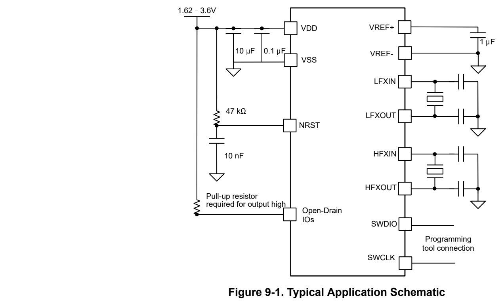

# 9 Applications, Implementation, and Layout (pp. 79-79)

## 9 Applications, Implementation, and Layout (p. 79)

### 9.1 Typical Application (p. 79)

> **Note:**

Information in the following applications sections is not part of the TI component specification, and TI does not warrant its accuracy or completeness. TI’s customers are responsible for determining suitability of components for their purposes, as well as validating and testing their design implementation to confirm system functionality.

#### 9.1.1 Schematic (p. 79)

TI recommends connecting a combination of a 10µF and a 0.1µF low-ESR ceramic decoupling capacitor to the VDD and VSS pins. Higher-value capacitors may be used but can impact supply rail ramp-up time. Decoupling capacitors must be placed as close as possible to the pins that they decouple (within a few millimeters).

The NRST reset pin is required to connect an external 47kΩ pullup resistor with a 1000pF pulldown capacitor.

For devices supporting external crystals, external bypass capacitors for the crystal oscillator pins are required. Refer to MSPM0 C-Series Microcontrollers Technical Reference Manual which explains how to calculate the capacitor value.

For 5V-tolerant open drain IOs (ODIO), a pullup resistor is required to output a logic high signal. This is required2 for I C and UART functions if the ODIO are used.

*Figure 9-1. Typical Application Schematic (p. 79)*
