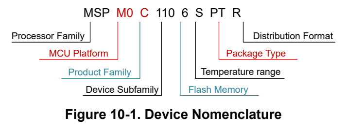

# 10 Device and Documentation Support (pp. 80-82)

## 10 Device and Documentation Support (p. 80)

TI offers an extensive line of development tools. Tools and software to evaluate the performance of the device, generate code, and develop solutions are listed below.

### 10.1 Getting Started and Next Steps (p. 80)

For more information on the MSP low-power microcontrollers and the tools and libraries that are available to help with development, visit the Texas Instruments Arm Cortex-M0+ MCUs page.

### 10.2 Device Nomenclature (p. 80)

To designate the stages in the product development cycle, TI assigns prefixes to the part numbers of all MSP MCU devices and support tools. . Each MSP MCU commercial family member has one of two prefixes: MSP or X. These prefixes represent evolutionary stages of product development from engineering prototypes (X) through fully qualified production devices (MSP).

X – Experimental device that is not necessarily representative of the final device's electrical specifications

MSP – Fully qualified production device

X devices are shipped against the following disclaimer:

"Developmental product is intended for internal evaluation purposes." MSP devices have been characterized fully, and the quality and reliability of the device have been demonstrated fully. TI's standard warranty applies. Predictions show that prototype devices (X) have a greater failure rate than the standard production devices. TI recommends that these devices not be used in any production system because their expected end-use failure rate still is undefined. Only qualified production devices are to be used.

TI device nomenclature also includes a suffix with the device family name. This suffix indicates the temperature range, package type, and distribution format. Figure 10-1 provides a legend for reading the complete device name.

*Figure 10-1. Device Nomenclature (p. 80)*

**Table 10-1. Device Nomenclature (p. 80)**

| Processor Family | MSP = Mixed-signal processor X= Experimental silicon |
| --- | --- |
| MCU Platform | M0 = Arm based 32-bit M0+ |
| Product Family | C = 32MHz frequency |
| Device Subfamily | 1105/6 = 32MHz frequency, ADC, RTC, CMP |
| Flash Memory | 5 = 32KB; 6= 64KB |
| Temperature Range | S = -40°C to 125°C |
| Package Type | See the Device Comparison section and https://www.ti.com/packaging |
| Distribution Format | R = Large reel No marking = Tube or tray |

For orderable part numbers of MSP devices in different package types, see the Package Option Addendum of this document, ti.com, or contact your TI sales representative.

### 10.3 Tools and Software (p. 81)

Design Kits and Evaluation Modules

MSPM0 LaunchPad (LP) Empowers you to immediately start developing on the industry’s best Boards: LP-MSPM0C1106 integrated analog and most cost-optimized general purpose MSPM0 MCU family. Exposes all device pins and functionality; includes some built-in circuitry, out-of-box software demos, and on-board XDS110 debug probe for programming/debugging/EnergyTrace. The LP ecosystem includes dozens of BoosterPack stackable plug-in modules to extend functionality. Embedded Software

MSPM0 Software Development Contains software drivers, middleware libraries, documentation, tools, and Kit (SDK) code examples that create a familiar and easy user experience for all MSPM0 devices.

Software Development Tools TI Cloud Tools Start your evaluation and development on a web browser without any installation. Cloud tools also have a downloadable, offline version. TI Resource Explorer Online portal to TI SDKs. Accessible in CCS IDE or in TI Cloud Tools. SysConfig Intuitive GUI to configure device and peripherals, resolve system conflicts, generate configuration code, and automate pin mux settings. Accessible in CCS IDE or in TI Cloud Tools. (offline version) MSP Academy Great starting point for all developers to learn about the MSPM0 MCU Platform with training modules that span a wide range of topics. Part of TIRex. GUI Composer GUIs that simplify evaluation of certain MSPM0 features, such as configuring and monitoring a fully integrated analog signal chain without any code needed. IDE & compiler toolchains Code Composer Studio™ Includes TI Arm-Clang compiler. Supports all TI Arm Cortex MCUs and (CCS) boasts competitive code size performance advantages, fast compile time, code coverage support, safety certification support, and completely free to use. IAR Embedded Workbench® IDE

Keil® MDK IDE

GNU Arm Embedded Toolchain

### 10.4 Documentation Support (p. 81)

To receive notification of documentation updates, navigate to the device product folder on ti.com. Click on Subscribe to updates to register and receive a weekly digest of any product information that has changed. For change details, review the revision history included in any revised document.

The following documents describe the MSPM0 MCUs. Copies of these documents are available on the Internet at www.ti.com.

Technical Reference Manual

MSPM0 C-Series This manual describes the modules and peripherals of the family of devices. Each Microcontrollers description presents the module or peripheral in a general sense. Not all features Technical Reference and functions of all modules or peripherals are present on all devices. In addition, Manual modules or peripherals can differ in their exact implementation on different devices.

Pin functions, internal signal connections, and operational parameters differ from device to device. See the device-specific data sheet for these details.

### 10.5 Support Resources (p. 82)

TI E2E™ support forums are an engineer's go-to source for fast, verified answers and design help — straight from the experts. Search existing answers or ask your own question to get the quick design help you need.

Linked content is provided "AS IS" by the respective contributors. They do not constitute TI specifications and do not necessarily reflect TI's views; see TI's Terms of Use.

### 10.6 Trademarks (p. 82)

LaunchPad™ Code Composer Studio™, and TI E2E™ are trademarks of Texas Instruments. , Arm® and Cortex® are registered trademarks of Arm Limited. All trademarks are the property of their respective owners.

### 10.7 Electrostatic Discharge Caution (p. 82)

This integrated circuit can be damaged by ESD. Texas Instruments recommends that all integrated circuits be handled with appropriate precautions. Failure to observe proper handling and installation procedures can cause damage. ESD damage can range from subtle performance degradation to complete device failure. Precision integrated circuits may be more susceptible to damage because very small parametric changes could cause the device not to meet its published specifications.

### 10.8 Glossary (p. 82)

TI Glossary This glossary lists and explains terms, acronyms, and definitions.
