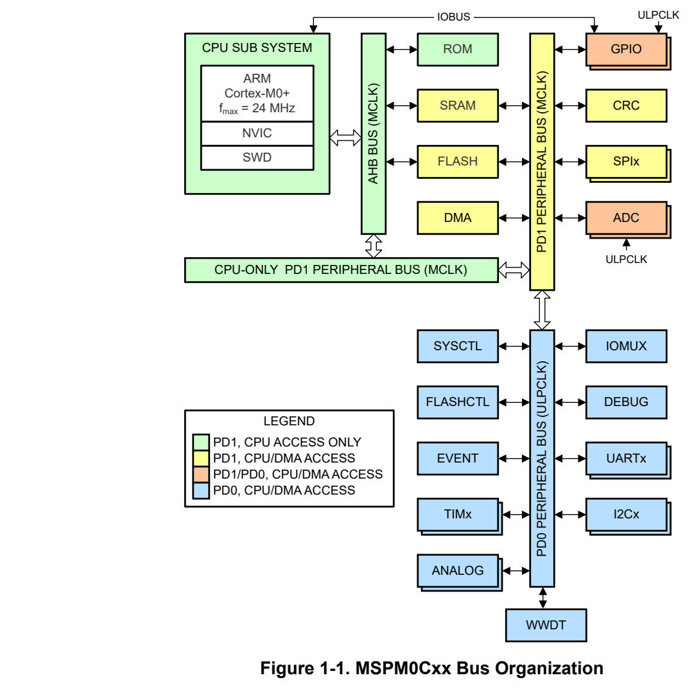

# 1 Architecture (pp. 10-59)

## Architecture (p. 10)

The device architecture includes the bus organization, the platform memory map, and the boot configuration.

### 1.1 Architecture Overview 11 (p. 10)

### 1.2 Bus Organization 11 (p. 10)

### 1.3 Platform Memory Map 13 (p. 10)

### 1.4 Boot Configuration 16 (p. 10)

### 1.5 Factory Constants 52 (p. 10)

### 1.1 Architecture Overview (p. 11)

MSPM0 C-series MCUs (MSPM0Cxx) combine 32-bit compute performance together with precision analog to enable a wide variety of sensing, interface, control, and housekeeping applications. The device architecture supports both general-purpose and low-power applications through a flexible, easy-to-configure power management and clocking system with fast wake-up from low-power modes.

MSPM0 C-series devices also offer support for 125°C ambient temperature and AEC-Q100 Grade 1 qualification.

This chapter introduces the device architecture, including an overview of the power domains and bus organization, the platform memory map, and the device boot configuration.

### 1.2 Bus Organization (p. 11)

There are three main power domains on MSPM0Cxx devices:

- PD1 (power domain 1) which contains the CPU subsystem, memory interfaces, and high-speed peripherals

- PD0 (power domain 0) which contains the low-speed low-power peripherals

- The supply voltage (VDD) which powers IOs, analog modules, and limited logic directly from the supply

The PD1 domain is disabled in certain operating modes to minimize power consumption. The PD0 domain supports ultra-low-power performance and is always enabled in operating modes in which the core regulator is operating.

There are four main data buses on MSPM0Cxx MSPM0Hxx devices:

- The AHB bus matrix, which interfaces the CPU to the device memory systems (ROM, SRAM, and flash memory) and the peripheral buses

- The PD1 (power domain 1) CPU-only peripheral bus, clocked from MCLK

- The PD1 (power domain 1) peripheral bus, clocked from MCLK

- The PD0 (power domain 0) peripheral bus, clocked from ULPCLK

The CPU and the DMA controller are the only two bus controllers in the device. Arbitration between the CPU and the DMA for shared peripherals happens between the CPU-only PD1 peripheral bus and the CPU/DMA PD1 peripheral bus. The DMA does not have access to peripherals on the CPU-only PD1 peripheral bus or the CPU bus matrix (the green components in the bus diagram). As such, the CPU can access peripherals on the CPU-only PD1 peripheral bus at the same time that the DMA is processing a transaction on the PD1 or PD0 bus.

Likewise, the CPU can access SRAM or flash memory through the AHB bus matrix at the same time that the DMA is processing a transaction, so long as the DMA is not accessing the same memory that the CPU is attempting to access. Arbitration between the CPU and the DMA for memory systems (SRAM or flash memory) happens at the memory interface itself. All arbitration between the CPU and DMA is done on a round-robin basis.

*Figure 1-1. MSPM0Cxx Bus Organization (p. 12)*

Note This is a generic diagram of the typical peripherals on an MSPM0Cxx device and their respective bus locations. Not all devices have all peripheral options shown here. To determine the peripherals which are available on a given device, see the device-specific data sheet.

The GPIO and ADC peripherals (the orange components in the bus diagram) have special capabilities to enable both fast register access from the CPU and operation in low power operating modes.

- GPIO peripherals interface to the system through the PD1 peripheral bus. – The GPIO DOUT registers (data out) are also available on the PD1 peripheral bus, primarily so that the DMA can be used to load values to the GPIO DOUT registers. Note that not all MSPM0Cxx devices have DMA supporting for GPIO, See the device-specific data sheet to determine if DMA is present for GPIO. – While the bus interfaces to the GPIO peripherals are in the PD1 power domain (for best read/write performance), the GPIO logic itself is in the PD0 power domain so that it is available in all operating modes in which the core regulator is active.

- ADC peripherals interface to the system through the PD1 peripheral bus but contain functional logic in the PD0 power domain. – ADC peripheral register accesses are processed through the PD1 peripheral bus (for best read/write performance) – The the ADC conversion logic is in the PD0 power domain to enable running timer-triggered ADC conversions without CPU interaction in certain low-power modes when PD1 is disabled.

### 1.3 Platform Memory Map (p. 13)

All MSPM0Cxx devices share a common platform memory map. Peripherals are assigned a fixed address space and have the same address space on all devices within the family. The memory map is compliant with the standard Arm Cortex-M memory regions.

**Table 1-1. Top Level Memory Map (p. 13)**

| Memory Region | Start Address | End Address | Description |
| --- | --- | --- | --- |
| Code | 0x0000.0000 | 0x1FFF.FFFF | Flash memory and ROM |
| SRAM | 0x2000.0000 | 0x3FFF.FFFF | SRAM |
| Peripheral | 0x4000.0000 | 0x5FFF.FFFF | Global peripheral memory-mapped registers and global nonexecutable data memory |
| Subsystem | 0x6000.0000 | 0x7FFF.FFFF | Local CPU subsystem memory-mapped registers |
| System PPB | 0xE000.0000 | 0xE00F.FFFF | Arm private peripheral bus |

#### 1.3.1 Code Region (p. 13)

The code region contains the flash memory used to store executable code and data. Accesses to the flash memory from the CPU through the code region are processed through the AHB bus matrix to the flash read interface directly. See Section 6.2.3.1 for the detailed flash memory map.

The code region also contains the read-only memory (ROM) used for the TI device boot code and the bootstrap loader. Note that not all MSPM0Cxx devices have the bootstrap loader. See the device-specific data sheet to determine if the bootstrap loader is present. The ROM is only available during the initial device boot process.

#### 1.3.2 SRAM Region (p. 13)

The SRAM region contains the system memory (SRAM). The SRAM supports zero wait state access at the maximum MCLK frequency . Accesses to the SRAM from the CPU are processed through the AHB bus matrix to the SRAM interface directly. See the device-specific data sheet for the amount of SRAM present on a given device.

Certain devices optionally support parity or parity and ECC checking of the SRAM. Refer to the device-specific data sheet to determine if a device supports ECC or parity checked SRAM. For information on how parity and ECC errors are handled by the device, see Section 2.4.9.

Parity Checking

In the case of parity checking (if available), 1 parity bit is provided per 8 data bits. Parity checking is capable of detecting a single bit error in the corresponding 8 bits of data (SED). Writing data to a parity checked address updates the corresponding parity bits based on the new data. Reading data from a parity checked address checks the read data against the corresponding parity bits. Upon a read, if the data does not match the corresponding parity bits, a parity error is generated. For information on how parity errors are handled by the device, see Section 2.4.9

ECC Checking

In the case of ECC checking (if available), 8 ECC bits are provided per 64 data bits. ECC is capable of correcting single bit errors (SEC) and detecting dual bit errors (DED) in the corresponding 64 data bits. Writing data to an ECC checked address updates the corresponding ECC code based on the new data. Reading data from an ECC checked address checks the read data against the corresponding ECC code. If a single bit error is found, it is corrected automatically and a correctable ECC error is generated. If a dual bit error is found, an uncorrectable ECC error is generated.

Aliased Subregions

The physical SRAM on a device is aliased into multiple address subregions in the overall SRAM region, as shown in the following table. The default, parity checked, and unchecked address subregions all map to the same physical SRAM memory. The difference between each aliased subregion is in the type of integrity checks

which are applied to the access. For example, writing data to address 0x2000.0000 (the default subregion) will cause the same data to appear at address 0x2020.0000 (the unchecked subregion).

The default subregion (0x2000.0000) is available on all MSPM0 devices, and when used, provides the highest level of integrity checking available on the device. The parity checked subregion (0x2010.0000) is available on devices which support ECC or parity checking, and accesses are always processed with parity checking. The unchecked subregion (0x2020.0000) is available on all devices, and when using this subregion, no integrity checks are performed. The parity/ECC code subregion (0x2030.0000) is available on devices with ECC or parity checking, and it returns the parity or ECC code which corresponds to the address being read.

Note Not all the MSPM0C devices support SRAM parity check or ECC. See the device-specific data sheet to determine if SRAM parity check or ECC is present.

Note To improve robustness, there is no mechanism provided to disable parity checking of the parity-checked SRAM address space. To operate without parity checking, link the application against the unchecked SRAM address space.

**Table 1-2. SRAM Region Memory Map (p. 14)**

| Subregion | Start | End (Maximum) | Description |
| --- | --- | --- | --- |
| Default | 0x2000.0000 | 0x200F.FFFF | The highest available integrity check on the device is always applied to accesses in this subregion: • If the device supports ECC, this subregion is ECC checked. • If the device only supports parity (no ECC), this subregion is parity checked and accesses are equivalent to accesses to the parity checked subregion. • If the device does not support ECC or parity, no checks are applied to accesses in this subregion and the region is equivalent to the unchecked subregion. |
| Parity checked | 0x2010.0000 | 0x201F.FFFF | If the device supports parity, accesses to this subregion are parity checked. |
| Unchecked | 0x2020.0000 | 0x202F.FFFF | No ECC or parity checks are applied to accesses in this subregion. |
| Parity/ECC code | 0x2030.0000 | 0x203F.FFFF | If the device supports parity or ECC, the parity or ECC codes may be directly accessed through this subregion: • If the device supports ECC, access to any address within a 64-bit boundary returns the 8 bits corresponding to the ECC code (if the application is linked against the default region) or the parity bits (one per byte) if the application is linked against the parity checked region. • If the device supports parity only, access to any address within a 32-bit boundary returns the 4 parity bits (one per byte) if the application is linked against the default region or parity checked region. • If the device does not support ECC or parity, access to this region always returns zeros. |

> **Note:**

In some devices, the SRAM is organized into two or more banks. Not all the banks may have have ECC and/or parity. Typically, the first bank will include ECC and/or parity while additional banks may or may not include ECC/parity. In such cases, the size of each subregion will depend on the device-specific SRAM configuration. For example, if a device features 128KB of SRAM with the first 64KB having ECC/parity protection and the second 64KB without ECC/parity, then the size of ECC protected subregion, the parity checked subregion and the codes region is each 64KB while the unchecked region will be 128KB in size. In all cases, the unchecked subregion is contiguous and of the full size, allowing applications to link code and data freely in this subregion.

Note When ECC checking is used on devices which support ECC, writes to the SRAM require two cycles to complete. Read accesses only require a single cycle and do not incur any additional performance penalty.

On devices supporting parity or ECC, it is possible for application software to partition the usage of the physical SRAM into arbitrary zones which are intended to be ECC checked, parity checked, or unchecked. For example, if a device has 32KB of total SRAM memory, and it supports ECC and parity checking, it is possible to configure the application software to link against two subregions, one being ECC checked and the other being parity checked.

Note It is not recommended to mix and match ECC checked, parity checked, and unchecked accesses to the same memory locations, as this can result in unintended parity/ECC errors. For example, if an SRAM memory location is written to through the parity checked subregion on a device which supports ECC, and then later that location is read through the default (ECC checked) subregion, an ECC error may be generated because the data was written with parity stored to the ECC/parity code memory, as opposed to the correct ECC code being stored.

Note The SRAM contents may be random at power-up or when existing SHUTDOWN mode. A read of an SRAM location through an ECC/parity checked region which has not yet been written to may result in a ECC/parity error being detected, causing a hard fault in the processor. Ensure that all SRAM locations are initialized first before being read.

If the application is using only the unchecked memory region, then the Parity/ECC code region can be used for additional application SRAM memory.

#### 1.3.3 Peripheral Region (p. 15)

The peripheral region contains the memory-mapped peripherals on the three peripheral buses. The flash memory is also aliased in the peripheral region.

**Table 1-3. Peripheral Region Memory Map (p. 15)**

| Type | Start | End | Description |
| --- | --- | --- | --- |
| Peripherals | 0x4000.0000 | 0x40FF.FFFF | Memory-mapped registers of peripherals on the peripheral buses |
| Aliased flash memory | 0x4100.0000 | 0x41FF.FFFF | See Section 6.2.3.1 |

#### 1.3.4 Subsystem Region (p. 15)

The subsystem region contains memory-mapped registers which are specific to the CPU subsystem and do not need to be accessed globally. See the CPU subsystem chapter for the memory-mapped registers in the subsystem region.

#### 1.3.5 System PPB Region (p. 16)

The system private peripheral bus (PPB) region contains memory-mapped registers on the Arm private peripheral bus. These registers are tightly coupled to the CPU and are the interface for peripherals such as the memory protection unit (MPU), SysTick timer, and CPU power management and reset functions.

### 1.4 Boot Configuration (p. 16)

After a BOOTRST, the device executes the start-up boot routines to configure the device for operation before starting the main application. Boot routines are executed from read-only memory (ROM) before the main application is started. There are two boot routines: the boot configuration routine (BCR). The boot configuration routine sets up the device security policies, configures the device for operation, and optionally starts the BSL if it presents.

After the start-up routines have successfully completed execution, the CPU is reset and the application is started by unconditionally fetching the stack pointer (SP) and reset vector from 0x0000.0000 and 0x0000.0004 of the flash memory. To enable secure boot, this single point of entry into the application code is enforced by the boot sequence. It is not possible to boot into a different memory location.

#### 1.4.1 Configuration Memory (NONMAIN) (p. 16)

The NONMAIN is a dedicated region of flash memory which stores the configuration data used by the BCR and BSL to boot the device. The region is not used for any other purpose. The BCR has configuration policies which can be left at their default values (as is typical during development and evaluation), or modified for specific purposes (as is typical during production programming) by altering the values programmed into the NONMAIN flash region.

The BCR configuration data structures are both contained within a single flash sector in the NONMAIN flash memory region. To change any parameter in the boot configuration, it is necessary to erase the entire NONMAIN sector and re-program both the BCR configuration structures with the desired settings.

The configuration data in the NONMAIN flash region is not affected by a mass erase command, but it is erased and re-programmed to factory defaults by a factory reset command sent to the BCR via the debug sub system mailbox (DSSM) over SWD.

The address ranges for the NONMAIN data structures are given in the NONMAIN Registers section. A detailed breakdown of the NONMAIN region is provided at the end of this section.

##### 1.4.1.1 CRC-Backed Configuration Data (p. 16)

The BCR configuration data for TI factory trim in the NONMAIN memory includes a CRC16 value corresponding to the CRC16 digest of the respective structure. During the device boot process, the BCR will compute the CRC digest of the data structures and compare it with the stored CRC values before the data contained within the structures is trusted for use.

TI Factory Trim Data CRC Fail Handling

Ifthe TI factory trim fails its CRC check during boot, a catastrophic boot error will also result with the following limitations:

- The error cause will be logged in the CFG-AP as a boot diagnostic

- The user application is not started

- No application debug access is enabled

- A pending TI failure analysis flow entry, if enabled, is honored

- The boot process will re-attempt up to 3 times – If the 2nd or 3rd attempt pass, the device boots normally – If the 3rd attempt does not pass, no further boot attempts are made until the next BOR or POR

1.4.1.2 16-bit Pattern Match for Critical Fields

Critical policies in the BCR configuration memory, such as the SWD security policies, are implemented as 16-bit pattern-match fields in the NONMAIN memory, with the following characteristics:

- An exact pattern match is required to enable lower security states

- Any value in the 16-bit field not matching the exact defined patterns results in a maximally secure state for the respective parameter

This behavior prevents single bit flips from causing the device to enter a lower security state than that which was originally specified.

#### 1.4.2 Boot Configuration Routine (BCR) (p. 17)

The boot configuration routine is the first firmware to run on the device after a BOOTRST. The BCR manages the following at boot time:

- Configuring the debug interface security policy

- Optionally executing a mass erase

- Optionally executing a factory reset

- Configuring the flash memory static write protection policy

##### 1.4.2.1 Serial Wire Debug Related Policies (p. 17)

The serial wire debug related policies configure the functionality which is available through the device's physical debug interface (SWD). By default, MSPM0 devices come from TI in an unrestricted state. This state allows for easy production programming, evaluation, and development. However, this unrestricted state is not recommended for mass production, as it leaves a large attack surface present. To accommodate a variety of needs while keeping the configuration process simple, MSPM0 devices support three generic security levels: no restrictions ( Level 0), custom restrictions ( Level 1), and fully restricted ( Level 2). Table 1-4 shows the three generic security levels, from least restrictive to most restrictive.

There are 2 main uses of the SWD interface for which protection needs to be considered:

- Application debug access, which includes: – Full access to the processor, memory map, and peripherals through the AHB-AP – Access to the device EnergyTrace+ state information through the ET-AP – Access to the device power state controls for debug through the PWR-AP

- Factory reset access, which includes: – Ability to send a command through SWD to erase the MAIN memory region and reset the NONMAIN device configuration memory to TI factory defaults (Level 0)

**Table 1-4. Generic Security Levels (p. 17)**

| Level | Scenario | SW-DP Policy | App Debug Policy | Mass Erase Policy | Factory Reset Policy | TI FA Policy |
| --- | --- | --- | --- | --- | --- | --- |
| 0 | No restrictions | EN | EN | DIS | EN | EN |
| 1 | Custom restrictions | EN | EN, DIS | DIS | EN, DIS | EN, DIS |
| 2 | Fully restricted | DIS |  | Don't care (access not possible with SW-DP disabled) |  | (1) |

(1) When the SW-DP policy is SW-DP disabled, the mass erase and factory reset policies are a don't care from the point of view of the SWD interface.

###### 1.4.2.1.1 SWD Security Level 0 (p. 17)

SWD security level 0 is the least restrictive SWD security state. This is the default state of a new device from TI, and it is also the state of a device following a successful factory reset. There are no restrictions on application debug access, mass erase, factory reset, for failure analysis in this state.

When to Use This State

Level 0 is well suited for prototyping and development, as it allows programming of the device memory and debug of the processor and peripherals.

When to Not Use this State

Level 0 should not be used in mass production. An attacker would have full freedom to read the contents of the device memory, manipulate the execution of the device, and possibly change the flash memory contents (depending on the flash memory write protection scheme).

###### 1.4.2.1.2 SWD Security Level 1 (p. 18)

SWD security level 1 allows for a customized security configuration. The physical debug port (SW-DP) is left enabled, and each function (application debug, mass erase command, factory reset command, and TI failure analysis) may be individually enabled, disabled, or (in some cases) enabled through password authentication, providing considerable flexibility to tailor the device behavior to specific use-cases.

When to Use This State

Level 1 is well suited for restricted prototyping/development scenarios and for mass production scenarios where the desire is to retain certain SWD functions (such as factory reset and TI failure analysis) while disabling other functions (such as application debug). Common examples of Level 1 customized configurations are given in Table 1-5.

**Table 1-5. Examples of Level 1 Configurations (p. 18)**

| Col 1 | Col 2 | Configuration | Configuration | Col 5 |
| --- | --- | --- | --- | --- |
| Level 1 Scenario | App Debug | Mass Erase | Factory Reset | TI FA |
| This scenario restricts debug access with a user-specified password, but it leaves the factory reset and TI failure analysis available. This configuration allows field debug (with password), and it also allows the device to be brought back to the default "Level 0" state through factory reset. | EN with PW | DIS | EN | EN |
| This scenario does not allow debug. It does allow factory reset, but only with a user-specified password. This provides a way to open up a device in the field by clearing the MAIN memory contents and bringing the device back to a "Level 0" state if the password is known. Importantly, even if the factory reset password were compromised, it would not be possible for an attacker to read proprietary information in the MAIN flash memory. | DIS | DIS | EN with PW | EN |
| This scenario does not allow debug and it does not allow TI failure analysis. This prevents TI from performing a factory reset and further FA activities on the device, unless the user executes a factory reset with their user-specified password before returning the devices to TI for FA. | DIS | DIS | EN with PW | DIS |

Note Level 1 is the recommended configuration for most standard production use-cases. For applications which do not require secure boot, TI recommends using Level 1 in production with factory reset left enabled (with password) and TI failure analysis left enabled. In such a configuration, the device may be recovered to a less restrictive state after provisioning either by the user (with password) or by TI (through the failure analysis return flow). In use-cases requiring maximum secure boot assurance, a more restrictive Level 1 or Level 2 may be used for production, with the trade-off that devices may not be recoverable to a less restrictive state once provisioned.

When to Not Use this State

Level 1 should not be used during prototyping if complete access to the device is desired; in such a case, Level 0 should be used instead.

Level 1 should also not be used in a mass production scenario where a maximally restrictive state is desired and no SWD functions are to be enabled; in such a case, Level 2 should be used instead as it directly disables the complete SWD physical interface and minimizes the possibility of misconfiguration.

Note If a device is configured with application debug and factory reset disabled, the only way for a user to restore debug access to the device is if the user application code provides a mechanism to change the NONMAIN configuration to a less restrictive state. If the NONMAIN is locked through static write protection then the state is not reversible and there is no way for a user to re-gain debug access.

###### 1.4.2.1.3 SWD Security Level 2 (p. 19)

SWD security level 2 configures the device in a maximally restrictive state. The physical debug port (SW-DP) is completely disabled, and all of the SWD-accessible functions (application debug, mass erase, factory reset, and TI failure analysis) are not accessible through SWD, regardless of their individual configuration.

When level 2 is selected (SW-DP disabled), the application debug configuration and TI failure analysis configuration fields are don't care fields which do not impact the device configuration.

If the BSL is disabled, then the mass erase and factory reset configuration fields are also don't care fields. However, if the BSL is enabled, then the mass erase and factory reset configuration fields are still used by the BSL to authorize mass erase or factory reset commands originating from the BSL interface.

When to Use This State

Use Level 2 only for mass production when no further access to any SWD functions is required and a maximally secure state is desired for the device.

When to Not Use this State

Do not use Level 2 in the following cases:

- Future application debug or reprogramming through SWD is required

- So that TI can perform failure analysis on the device

- To remove proprietary information from the flash memory by sending a mass erase or factory reset command through SWD

Note After a device is configured for level 2 (SW-DP disabled), further access to the device through SWD is not possible. The only way to bring a device back to a level 0 or level 1 state with SWD access restored is if a mechanism in the user application code is included which can change the NONMAIN configuration to a less restrictive state. If the NONMAIN is locked through static write protection then the level 2 state is not reversible and there is no way to re-gain SWD access.

##### 1.4.2.2 SWD Factory Reset Commands (p. 19)

The BCR provides mass erase and factory reset functionality through commands sent to the device over SWD from a debug probe using the debug subsystem mailbox (DSSM). These commands are not available in SWD security level 2, but they are optionally available in security level 0 and 1. When the device is not configured for SWD security level 2, the factory reset command can be individually configured to be enabled, enabled with a unique 128-bit password, or disabled. By default, both commands are enabled.

The SWD factory reset DSSM command superseded any static write protection policies. For example, if SWD factory reset is configured to be enabled or enabled, the BCR configuration data can be reset even if it is statically write protected.

SWD Factory Reset

A SWD factory reset is an erase of the MAIN flash regions followed by a reset of the NONMAIN flash region to default values. Such an erase is useful for completely resetting the BCR and BSL device boot policies while also erasing the application code and data.

To set the factory reset command mode, configure the BOOTCFG3.FACTORYRESETCMDACCESS field field in the NONMAIN memory.

##### 1.4.2.3 Flash Memory Protection and Integrity Related Policies (p. 20)

The flash memory protection and integrity policies specify which sectors of flash memory are locked from modification, as well as which sectors are to be checked for integrity during the boot process before the user application is started.

###### 1.4.2.3.1 Locking the Application (MAIN) Flash Memory (p. 20)

MSPM0 MCUs implement a static write protection scheme to lock out user defined sectors in the MAIN flash region from any program or erase operations at runtime. The desired static write protection scheme is configured as a part of the boot security policies in the NONMAIN flash region.

Purpose

Static write protection enables placement of a fixed, user-defined, application in the flash memory that has the following characteristics:

- Once programmed and locked, the application is not modifiable by the application code or ROM bootloader

- If placed at the beginning of the flash memory, the application is the first code that executes when the ROM boot configuration routine transfers execution to the user application

MSPM0 static write protection supports both characteristics, which must be satisfied to implement a secure boot image manager.

Capabilities

Any sector that is configured in the NONMAIN to be write-locked is functionally immutable when the boot configuration routine transfers execution to either the bootstrap loader or the user application code in MAIN flash. Any attempt to program or erase a statically protected sector by the application code or the bootstrap loader results in a hardware flash operation error, and the sector is not modified.

While static write protection prevents any modification by application code or the bootloader, a mass erase or factory reset command sent through the SWD interface is honored. If this behavior is not desired, the factory reset SWD command can be protected or disabled(see the SWD policies). To completely remove any means of modifying statically write protected MAIN flash sectors, the factory reset command (or the SW-DP) must be disabled, and the NONMAIN boot configuration memory must also be statically write protected to prevent application code from changing the underling write protection scheme by modifying the contents NONMAIN region. This is discussed in the following section.

###### 1.4.2.3.2 Locking the Configuration (NONMAIN) Flash Memory (p. 20)

MSPM0 MCUs implement a static write protection scheme to lock out the NONMAIN flash region from any program/erase operations at runtime. The write protection scheme is configured as a part of the boot security policies in the NONMAIN flash region.

Purpose

By default, the NONMAIN configuration memory (which contains the user-specified boot security policies and bootstrap loader policies) is not write protected. This enables the NONMAIN to be erased by the user during provisioning and re-programmed with the user-specified policies to use in mass production.

In many cases, it is desirable for the configuration memory to be locked after it has been provisioned. Locking the configuration memory has the benefit of preventing any unauthorized modification of the security policies, bootstrap loader policies, and static write protection policies by either the bootstrap loader or the application code. In most applications, devices in mass production do not require modification of the configuration memory, even when the device firmware is updated.

Capabilities

When configured to be protected, the entire NONMAIN region will be write-locked and will be functionally immutable when the boot configuration routine transfers execution to either the bootstrap loader or the user application code in MAIN flash. Any attempt to program or erase the NONMAIN by the application code or the bootstrap loader will result in a hardware flash operation error, and the sector will not be modified.

While static write protection prevents any modification by application code or the boot loader, a factory reset command sent through the SWD interface would still be honored. If this behavior is not desired, the factory reset SWD command may be protected or disabled altogether (see the SWD policies). To completely remove any means of modifying the NONMAIN configuration memory, the factory reset command and TI FA (or the SW-DP) must be disabled.

Note When the NONMAIN is statically write protected, and the factory reset command and TI FA (or the SW-DP) are disabled, the NONMAIN is equivalent to immutable read-only memory, and it is no longer possible to change the device configuration by any means. Further, if any MAIN memory region sectors are configured with static protection, these sectors also can not be modified by any means and may be considered as immutable.

###### 1.4.2.3.3 Static Write Protection NONMAIN Fields (p. 21)

Write protection may be enabled on a per-sector basis for the first 32 sectors of the MAIN flash memory. For the remaining sectors of flash memory, if present, write protection may be enabled per 8 sectors. To set a static write protection policy, configure the FLASHSWP0 and FLASHSWP1 fields in the NONMAIN memory.

Note Mass erase and factory reset commands Factory reset command sent to the BCR via the debug sub system mailbox (DSSM) will override the specified static write protection policy. If this behavior is not desired, configure the factory reset command to be enabled with password or disabled.

#### 1.4.3 NONMAIN Layout Types (p. 21)

The below table shows which NONMAIN layout type to use with which devices. The MSPM0-SDK includes a configurator tool to help the user configure NONMAIN contents.

**Table 1-6. NONMAIN Layout Types (p. 21)**

| NONMAIN Layout Type | Col 2 | Overview | Col 4 | Supported Devices |
| --- | --- | --- | --- | --- |
| Type B | • • • • | No CSC support No BSL support No App integrity check No passwords based configuration | • • | MSPM0C1104 MSPM0C1103 |
| Type D | • • • • | Includes CSC support Passwords are stored in SHA256 hashed format App integrity check supports CRC32 and SHA256 Supports Flash BSL only (ROM BSL is not supported) | • • | MSPM0C1105 MSPM0C1106 |

#### 1.4.4 NONMAIN_TYPEB Registers (p. 22)

Table 1-7 lists the memory-mapped registers for the NONMAIN_TYPEB registers. All register offset addresses not listed in Table 1-7 should be considered as reserved locations and the register contents should not be modified.

**Table 1-7. NONMAIN_TYPEB Registers (p. 22)**

| Offset | Acronym | Register Name | Group |
| --- | --- | --- | --- |
| 41C0000 0h | BCRCONFIGID | Configuration ID of BCR Structure |  |
| 41C0000 4h | BOOTCFG0 | Serial wire debug (SWD) lock policy. |  |
| 41C0002 0h | BOOTCFG3 | Mass erase and factory reset mode policies. These policies affect SWD initiated and BSL initiated mass erase and factory reset commands. If the SW-DP is disabled (SWDP_MODE is disabled), SWD initiated commands are not allowed as the SW-DP is fully disabled. If the BSL is disabled (BSLMODE is disabled), these settings are a a don't care for BSL initiated commands as the BSL is not enabled to be invoked. |  |
| 41C0004 4h | FLASHSWP0 | Static write protection policy for the first 32kB of flash memory. When protected, sectors will not be available for program or erase by either the bootloader or application code |  |
| 41C0004 8h | FLASHSWP1 | Static write protection policy for additional sectors of flash memory. When protected, sectors will not be available for program or erase by either the bootloader or application code. |  |

Complex bit access types are encoded to fit into small table cells. Table 1-8 shows the codes that are used for access types in this section.

**Table 1-8. NONMAIN_TYPEB Access Type Codes (p. 22)**

| Access Type | Code | Description |
| --- | --- | --- |
| Read Type |  |  |
| R | R | Read |
| Write Type |  |  |
| W | W | Write |
| Reset or Default Value |  |  |
| - n |  | Value after reset or the default value |

### 1.4.4.1 [NONMAIN_TYPEB.BCRCONFIGID] Offset: 41C00000h | Reset: 00000000h (p. 23)

BCRCONFIGID is shown in Figure 1-2 and described in Table 1-9.

Configuration ID of BCR Structure

> **Bit Map**: `[31-0] CONFIG (R/W, 0h)`

**Table 1-9. BCRCONFIGID Field Descriptions (p. 23)**

| Bit | Field | Type | Reset | Description |
| --- | --- | --- | --- | --- |
| 31-0 | CONFIG | R/W | 0h | Configuration ID of the BCR Structure |

### 1.4.4.2 [NONMAIN_TYPEB.BOOTCFG0] Offset: 41C00004h | Reset: 00000000h (p. 24)

BOOTCFG0 is shown in Figure 1-3 and described in Table 1-10.

Serial wire debug (SWD) lock policy.

> **Bit Map**: `[31-16] SWDP_MODE (R/W, AABBh)` | `[15-0] DEBUGACCESS (W, AABBh)`

**Table 1-10. BOOTCFG0 Field Descriptions (p. 24)**

| Bit | Field | Type | Reset | Description |
| --- | --- | --- | --- | --- |
| 31-16 | SWDP_MODE | R/W | AABBh | The serial wire debug port (SW-DP) access policy. This policy sets whether any communication is allowed with the device via the SWD pins (to any DAP). When disabled, no SWD communication is possible regardless of the configuration of the DEBUGACCESS field.; AABBh = The SW-DP is enabled and device access is set by the additional policies in NONMAIN; FFFFh = The SW-DP is fully disabled and no device access is possible via the SW-DP (Any value other than 0xAABB) |
| 15-0 | DEBUGACCESS | W | AABBh | The debug access policy for accessing the AHB-AP, ET-AP, and PWR-AP debug access ports. Note that if SWDP_MODE is set to DISABLED, the value of this field is ignored and the debug port will remain fully locked; AABBh = Access to AHB-AP, ET-AP, and PWR-AP via SWD is enabled; CCDDh = Access to AHB-AP, ET-AP, and PWR-AP via SWD is only enabled when the correct password is provided via the DSSM before BCR execution; FFFFh = Access to AHB-AP, ET-AP, and PWR-AP via SWD is disabled (Any value other than 0xCCDD or 0xAABB) |

### 1.4.4.3 [NONMAIN_TYPEB.BOOTCFG3] Offset: 41C00020h | Reset: 00000000h (p. 25)

BOOTCFG3 is shown in Figure 1-4 and described in Table 1-11.

Mass erase and factory reset mode policies. These policies affect SWD initiated and BSL initiated mass erase and factory reset commands. If the SW-DP is disabled (SWDP_MODE is disabled), SWD initiated commands are not allowed as the SW-DP is fully disabled. If the BSL is disabled (BSLMODE is disabled), these settings are a a don't care for BSL initiated commands as the BSL is not enabled to be invoked.

> **Bit Map**: `[31-16] NONMAINSWP (R/W, FFFFh)` | `[15-0] FACTORYRESETCMDACCESS (R/W, AABBh)`

**Table 1-11. BOOTCFG3 Field Descriptions (p. 25)**

| Bit | Field | Type | Reset | Description |
| --- | --- | --- | --- | --- |
| 31-16 | NONMAINSWP | R/W | FFFFh | Static write protection policy for entire NONMAIN device configuration memory. Only Bit 0 is used.; 0h = Unprotected, allows program/erase of the NONMAIN by normal means.; 1h = Protected, does not allow program/erase of the NONMAIN by all means other than a SWD-initiated factory reset |
| 15-0 | FACTORYRESETCMDACCESS | R/W | AABBh | The factory reset command policy; AABBh = The factory reset command is allowed; FFFFh = The factory reset command is not allowed (Any value other than 0xAABB or 0xCCDD) |

### 1.4.4.4 [NONMAIN_TYPEB.FLASHSWP0] Offset: 41C00044h | Reset: 00000000h (p. 26)

FLASHSWP0 is shown in Figure 1-5 and described in Table 1-12.

Static write protection policy for the first 32kB of flash memory. When protected, sectors will not be available for program or erase by either the bootloader or application code

> **Bit Map**: `[31-0] DATA (R/W, FFFFFFFFh)`

**Table 1-12. FLASHSWP0 Field Descriptions (p. 26)**

| Bit | Field | Type | Reset | Description |
| --- | --- | --- | --- | --- |
| 31-0 | DATA | R/W | FFFFFFFFh | 1 bit per sector |
|  |  |  |  | 0h = A value of 0 indicates the write protection is applied to the |
|  |  |  |  | corresponding sector |
|  |  |  |  | 1h = A value of 1 indicates the sector is un-protected |

### 1.4.4.5 [NONMAIN_TYPEB.FLASHSWP1] Offset: 41C00048h | Reset: 00000000h (p. 27)

FLASHSWP1 is shown in Figure 1-6 and described in Table 1-13.

Static write protection policy for additional sectors of flash memory. When protected, sectors will not be available for program or erase by either the bootloader or application code.

> **Bit Map**: `[31-0] DATA (R/W, FFFFFFFFh)`

**Table 1-13. FLASHSWP1 Field Descriptions (p. 27)**

| Bit | Field | Type | Reset | Description |
| --- | --- | --- | --- | --- |
| 31-0 | DATA | R/W | FFFFFFFFh | 1 bit per 8 sectors. This is used to protect Flash memory from (32 to |
|  |  |  |  | 256 kb) |
|  |  |  |  | 0h = A value of 0 indicates the write protection is applied to the |
|  |  |  |  | corresponding sectors |
|  |  |  |  | 1h = A value of 1 indicates the sector is un-protected |

#### 1.4.5 NONMAIN_TYPED Registers (p. 28)

Table 1-14 lists the memory-mapped registers for the NONMAIN_TYPED registers. All register offset addresses not listed in Table 1-14 should be considered as reserved locations and the register contents should not be modified.

**Table 1-14. NONMAIN_TYPED Registers (pp. 28-29)**

| Offset | Acronym | Register Name | Group |
| --- | --- | --- | --- |
| 41C0000 0h | BCRCONFIGID | Configuration ID of BCR Structure |  |
| 41C0000 4h | BOOTCFG0 | Serial wire debug (SWD) lock policy. |  |
| 41C0000 8h | BOOTCFG1 | TI Failure Analysis (FA) mode and BSL invoke pin policies |  |
| 41C0000 Ch | FLASHSWP0 | Static write protection policy for the first 32kB of flash memory. When protected, sectors will not be available for program or erase by either the bootloader or application code |  |
| 41C0001 0h | FLASHSWP1 | Static write protection policy for additional sectors of flash memory. When protected, sectors will not be available for program or erase by either the bootloader or application code |  |
| 41C0001 4h | BOOTCFG4 | Configures Static write protection policy for Configuration flash memory(NONMAIN) and Debug Hold Policy |  |
| 41C0001 8h | BOOTCFG5 | Configures the existence of Customer Secure Code(CSC) and Flash Bank Swap Policy |  |
| 41C0001 Ch | BOOTCFG2 | Fast boot mode policy and BSL mode policy |  |
| 41C0002 0h | BOOTCFG3 | Mass erase and factory reset mode policies. These policies affect SWD initiated and BSL initiated mass erase and factory reset commands. If the SW-DP is disabled (SWDP_MODE is disabled), SWD initiated commands are not allowed as the SW-DP is fully disabled. If the BSL is disabled (BSLMODE is disabled), these settings are a a don't care for BSL initiated commands as the BSL is not enabled to be invoked. |  |
| 41C0002 4h + formula | PWDMASSERASE[y] | SHA2-256 Digest of the SWD mass erase command password (must be provided via DSSM to authenticate a mass erase command) |  |
| 41C0004 4h + formula | PWDFACTORYRESET[y] | SHA2-256 digest of the SWD factory reset command password (must be provided via DSSM to authenticate a factory reset command) |  |
| 41C0006 4h + formula | PWDDEBUGLOCK[y] | SHA2-256 Digest of the Debug Lock Password. This password is used when the BOOTCFG0.DEBUGACCESS field is configured as Enable with password. |  |
| 41C0008 | BOOTCFG6 | Application digest check policy |  |
| 41C0008 8h | APPDIGESTSTART | Start address of the application CRC/SHA Digest check (must be an address in a MAIN flash region). |  |
| 41C0008 Ch | APPDIGESTLENGTH | Length of the application to be include in the application CRC/SHA Digest check (in bytes), starting from APPDIGESTSTART |  |
| 41C0009 0h + formula | APPDIGEST[y] | Expected application CRC32/SHA2-256 digest to test against during boot. Note: If CRC check is enabled only the first 32bit word of this DIGEST is used. |  |
| 41C000 B0h | FLASHSWP2 | Static write protection policy for additional sectors of flash memory. When protected, sectors will not be available for program or erase by either the bootloader or application code |  |
| 41C000 B4h | BOOTCRC | CRC digest of the BCR configuration portion of the NONMAIN memory. |  |
| 41C0010 0h | BSLCONFIGID | Configuration ID of BSL Structure |  |
| 41C0010 Ch | BSLCONFIG0 | BSL invoke pin configuration. The pin invocation is done only when the Bootloader is enabled in the BCR Configuration. |  |
| 41C0014 4h | BSLCONFIG1 |  |  |
| 41C0014 8h | SBLADDRESS | Address of an alternate BSL. |  |
| 41C0015 Ch | BSLCRC | CRC digest of the BSL_CONFIG portion of the NONMAIN memory. |  |

Complex bit access types are encoded to fit into small table cells. Table 1-15 shows the codes that are used for access types in this section.

**Table 1-15. NONMAIN_TYPED Access Type Codes (p. 29)**

| Access Type | Code | Description |
| --- | --- | --- |
| Read Type |  |  |
| R | R | Read |
| Write Type |  |  |
| W | W | Write |
| Reset or Default Value |  |  |
| - n |  | Value after reset or the default value |
| Register Array Variables |  |  |
| i,j,k,l,m,n |  | When these variables are used in a register name, an offset, or an address, they refer to the value of a register array where the register is part of a group of repeating registers. The register groups form a hierarchical structure and the array is represented with a formula. |
| y |  | When this variable is used in a register name, an offset, or an address it refers to the value of a register array. |

### 1.4.5.1 [NONMAIN_TYPED.BCRCONFIGID] Offset: 41C00000h | Reset: 00000000h (p. 30)

BCRCONFIGID is shown in Figure 1-7 and described in Table 1-16.

Configuration ID of BCR Structure

> **Bit Map**: `[31-0] CONFIG (R/W, 0h)`

**Table 1-16. BCRCONFIGID Field Descriptions (p. 30)**

| Bit | Field | Type | Reset | Description |
| --- | --- | --- | --- | --- |
| 31-0 | CONFIG | R/W | 0h | Configuration ID of the BCR Structure |

### 1.4.5.2 [NONMAIN_TYPED.BOOTCFG0] Offset: 41C00004h | Reset: 00000000h (p. 31)

BOOTCFG0 is shown in Figure 1-8 and described in Table 1-17.

Serial wire debug (SWD) lock policy.

> **Bit Map**: `[31-16] SWDP_MODE (R/W, AABBh)` | `[15-0] DEBUGACCESS (W, AABBh)`

**Table 1-17. BOOTCFG0 Field Descriptions (p. 31)**

| Bit | Field | Type | Reset | Description |
| --- | --- | --- | --- | --- |
| 31-16 | SWDP_MODE | R/W | AABBh | The serial wire debug port (SW-DP) access policy. This policy sets whether any communication is allowed with the device via the SWD pins (to any DAP). When disabled, no SWD communication is possible regardless of the configuration of the DEBUGACCESS field.; AABBh = The SW-DP is enabled and device access is set by the additional policies in NONMAIN; FFFFh = The SW-DP is fully disabled and no device access is possible via the SW-DP (Any value other than 0xAABB) |
| 15-0 | DEBUGACCESS | W | AABBh | The debug access policy for accessing the AHB-AP, ET-AP, and PWR-AP debug access ports. Note that if SWDP_MODE is set to DISABLED, the value of this field is ignored and the debug port will remain fully locked; AABBh = Access to AHB-AP, ET-AP, and PWR-AP via SWD is enabled; CCDDh = Access to AHB-AP, ET-AP, and PWR-AP via SWD is only enabled when the correct password is provided via the DSSM before BCR execution; FFFFh = Access to AHB-AP, ET-AP, and PWR-AP via SWD is disabled (Any value other than 0xCCDD or 0xAABB) |

### 1.4.5.3 [NONMAIN_TYPED.BOOTCFG1] Offset: 41C00008h | Reset: 00000000h (p. 32)

BOOTCFG1 is shown in Figure 1-9 and described in Table 1-18.

TI Failure Analysis (FA) mode and BSL invoke pin policies

> **Bit Map**: `[31-16] BSL_PIN_INVOKE (R/W, AABBh)` | `[15-0] TI_FA_MODE (R/W, AABBh)`

**Table 1-18. BOOTCFG1 Field Descriptions (p. 32)**

| Bit | Field | Type | Reset | Description |
| --- | --- | --- | --- | --- |
| 31-16 | BSL_PIN_INVOKE | R/W | AABBh | Boot strap loader (BSL) pin invoke method enable/disable policy; AABBh = The BSL_INVOKE pin is checked during boot; FFFFh = The BSL_INVOKE pin is not checked during boot (Any value other than 0xAABB) |
| 15-0 | TI_FA_MODE | R/W | AABBh | Sets the TI failure analysis enable/disable policy. If enabled, a re-test request through DSSM is allowed, else it is not allowed. Note that if SWDP_MODE is set to disabled, this field is ignored and failure analysis is not possible.; AABBh = TI failure analysis is allowed; FFFFh = TI failure analysis is not allowed (Any value other than 0xAABB) |

### 1.4.5.4 [NONMAIN_TYPED.FLASHSWP0] Offset: 41C0000Ch | Reset: 00000000h (p. 33)

FLASHSWP0 is shown in Figure 1-10 and described in Table 1-19.

Static write protection policy for the first 32kB of flash memory. When protected, sectors will not be available for program or erase by either the bootloader or application code

> **Bit Map**: `[31-0] DATA (R/W, FFFFFFFFh)`

**Table 1-19. FLASHSWP0 Field Descriptions (p. 33)**

| Bit | Field | Type | Reset | Description |
| --- | --- | --- | --- | --- |
| 31-0 | DATA | R/W | FFFFFFFFh | 1 bit per sector |
|  |  |  |  | 0h = A value of 0 indicates the write protection is applied to the |
|  |  |  |  | corresponding sector |
|  |  |  |  | 1h = A value of 1 indicates the sector is un-protected |

### 1.4.5.5 [NONMAIN_TYPED.FLASHSWP1] Offset: 41C00010h | Reset: 00000000h (p. 34)

FLASHSWP1 is shown in Figure 1-11 and described in Table 1-20.

Static write protection policy for additional sectors of flash memory. When protected, sectors will not be available for program or erase by either the bootloader or application code

> **Bit Map**: `[31-0] DATA (R/W, FFFFFFFFh)`

**Table 1-20. FLASHSWP1 Field Descriptions (p. 34)**

| Bit | Field | Type | Reset | Description |
| --- | --- | --- | --- | --- |
| 31-0 | DATA | R/W | FFFFFFFFh | 1 bit per 8 sectors. This is used to protect Flash memory from (0 to |
|  |  |  |  | 256 kb) |
|  |  |  |  | 0h = A value of 0 indicates the write protection is applied to the |
|  |  |  |  | corresponding sectors |
|  |  |  |  | 1h = A value of 1 indicates the sector is un-protected |

### 1.4.5.6 [NONMAIN_TYPED.BOOTCFG4] Offset: 41C00014h | Reset: 00000000h (p. 35)

BOOTCFG4 is shown in Figure 1-12 and described in Table 1-21.

Configures Static write protection policy for Configuration flash memory(NONMAIN) and Debug Hold Policy

> **Bit Map**: `[31-16] DEBUGHOLD (R/W, AABBh)` | `[15-0] NONMAINSWP (R/W, AABBh)`

**Table 1-21. BOOTCFG4 Field Descriptions (p. 35)**

| Bit | Field | Type | Reset | Description |
| --- | --- | --- | --- | --- |
| 31-16 | DEBUGHOLD | R/W | AABBh | Controls the release of debug access until INITDONE is issued by Customer Secure Code(CSC). This configuration is applicable only when DEBUGACCESS and CSCEXISTS is enabled.; AABBh = Debug Hold is disabled. Debug access should be available during CSC execution.; FFFFh = Debug Hold is enabled. Debug access will not be available during CSC execution. Access will be available for application debug after CSC INITDONE. (Any value other than 0xAABB) |
| 15-0 | NONMAINSWP | R/W | AABBh | Static write protection policy for entire NONMAIN device configuration memory.; AABBh = Protection is disabled. Allows program/erase of the NONMAIN by normal means.; FFFFh = Protection is enabled. Does not allow program/erase of the NONMAIN by all means other than a SWD-initiated factory reset (Any value other than 0xAABB) |

### 1.4.5.7 [NONMAIN_TYPED.BOOTCFG5] Offset: 41C00018h | Reset: 00000000h (p. 36)

BOOTCFG5 is shown in Figure 1-13 and described in Table 1-22.

Configures the existence of Customer Secure Code(CSC) and Flash Bank Swap Policy

> **Bit Map**: `[31-16] FLASHBANKSWAPPOLICY (R/W, AABBh)` | `[15-0] CSCEXISTS (R/W, AABBh)`

**Table 1-22. BOOTCFG5 Field Descriptions (p. 36)**

| Bit | Field | Type | Reset | Description |
| --- | --- | --- | --- | --- |
| 31-16 | FLASHBANKSWAPPOLICY | R/W | AABBh | Controls the Flash Bank Swap Policy. This configuration is valid only, if CSCEXISTS is enabled.; AABBh = Flash Bank swap policy is disabled. In CSC Banks cannot be swapped. Complete Main flash region has Read, Write, Execute access.; FFFFh = Flash Bank swap policy is enabled. In CSC Banks can be swapped. One bank wil have Read, Execute access and other Bank will have Read/Write access, as per the CSC configuration. |
| 15-0 | CSCEXISTS | R/W | AABBh | Controls the existence of Customer Secure Code(CSC).; AABBh = CSC does not exist. INITDONE will be already SET.; FFFFh = CSC Exists. INITDONE will be SET by the CSC. |

### 1.4.5.8 [NONMAIN_TYPED.BOOTCFG2] Offset: 41C0001Ch | Reset: 00000000h (p. 37)

BOOTCFG2 is shown in Figure 1-14 and described in Table 1-23.

Fast boot mode policy and BSL mode policy

> **Bit Map**: `[31-16] BSLMODE (R/W, FFFFh)` | `[15-0] FASTBOOTMODE (R/W, FFFFh)`

**Table 1-23. BOOTCFG2 Field Descriptions (p. 37)**

| Bit | Field | Type | Reset | Description |
| --- | --- | --- | --- | --- |
| 31-16 | BSLMODE | R/W | FFFFh | BSLMODE configures the boot strap loader enable/disable policy; AABBh = The BSL is enabled; FFFFh = The BSL is disabled (Any value other than 0xAABB) |
| 15-0 | FASTBOOTMODE | R/W | FFFFh | FASTBOOTMODE configures the fast boot mode enable/disable policy; AABBh = Fast boot mode is enabled; FFFFh = Fast boot mode is disabled. (Any value other than 0xAABB) |

### 1.4.5.9 [NONMAIN_TYPED.BOOTCFG3] Offset: 41C00020h | Reset: 00000000h (p. 38)

BOOTCFG3 is shown in Figure 1-15 and described in Table 1-24.

Mass erase and factory reset mode policies. These policies affect SWD initiated and BSL initiated mass erase and factory reset commands. If the SW-DP is disabled (SWDP_MODE is disabled), SWD initiated commands are not allowed as the SW-DP is fully disabled. If the BSL is disabled (BSLMODE is disabled), these settings are a a don't care for BSL initiated commands as the BSL is not enabled to be invoked.

> **Bit Map**: `[31-16] FACTORYRESETCMDACCESS (R/W, AABBh)` | `[15-0] MASSERASECMDACCESS (R/W, AABBh)`

**Table 1-24. BOOTCFG3 Field Descriptions (p. 38)**

| Bit | Field | Type | Reset | Description |
| --- | --- | --- | --- | --- |
| 31-16 | FACTORYRESETCMDACCESS | R/W | AABBh | The factory reset command policy; AABBh = The factory reset command is allowed; CCDDh = The factory reset command is allowed only when the matching password is provided via the DSSM; FFFFh = The factory reset command is not allowed (Any value other than 0xAABB or 0xCCDD) |
| 15-0 | MASSERASECMDACCESS | R/W | AABBh | The mass erase command policy; AABBh = The mass erase command is allowed; CCDDh = The mass erase command is allowed only when the matching password is provided via the DSSM; FFFFh = The mass erase command is not allowed (Any value other than 0xAABB or 0xCCDD) |

### 1.4.5.10 [NONMAIN_TYPED.PWDMASSERASE[y]] Offset: 41C00024h + formula | Reset: 00000000h (p. 39)

PWDMASSERASE[y] is shown in Figure 1-16 and described in Table 1-25.

SHA2-256 Digest of the SWD mass erase command password (must be provided via DSSM to authenticate a mass erase command)

Offset = 41C00024h + (y * 4h); where y = 0h to 7h

> **Bit Map**: `[31-0] DIGEST (R/W, FFFFFFFFh)`

**Table 1-25. PWDMASSERASE[y] Field Descriptions (p. 39)**

| Bit | Field | Type | Reset | Description |
| --- | --- | --- | --- | --- |
| 31-0 | DIGEST | R/W | FFFFFFFFh | SHA2-256 Bit digest of Mass Erase Password of size 128 bit |

### 1.4.5.11 [NONMAIN_TYPED.PWDFACTORYRESET[y]] Offset: 41C00044h + formula | Reset: 00000000h (p. 40)

PWDFACTORYRESET[y] is shown in Figure 1-17 and described in Table 1-26.

SHA2-256 digest of the SWD factory reset command password (must be provided via DSSM to authenticate a factory reset command)

Offset = 41C00044h + (y * 4h); where y = 0h to 7h

> **Bit Map**: `[31-0] DIGEST (R/W, FFFFFFFFh)`

**Table 1-26. PWDFACTORYRESET[y] Field Descriptions (p. 40)**

| Bit | Field | Type | Reset | Description |
| --- | --- | --- | --- | --- |
| 31-0 | DIGEST | R/W | FFFFFFFFh | SHA2-256 Bit digest of Factory Reset Password of size 128 bit |

### 1.4.5.12 [NONMAIN_TYPED.PWDDEBUGLOCK[y]] Offset: 41C00064h + formula | Reset: 00000000h (p. 41)

PWDDEBUGLOCK[y] is shown in Figure 1-18 and described in Table 1-27.

SHA2-256 Digest of the Debug Lock Password. This password is used when the BOOTCFG0.DEBUGACCESS field is configured as Enable with password.

Offset = 41C00064h + (y * 4h); where y = 0h to 7h

> **Bit Map**: `[31-0] DIGEST (R/W, FFFFFFFFh)`

**Table 1-27. PWDDEBUGLOCK[y] Field Descriptions (p. 41)**

| Bit | Field | Type | Reset | Description |
| --- | --- | --- | --- | --- |
| 31-0 | DIGEST | R/W | FFFFFFFFh | SHA2-256 Bit digest of Debug Lock Password of size 128 bit |

### 1.4.5.13 [NONMAIN_TYPED.BOOTCFG6] Offset: 41C00084h | Reset: 00000000h (p. 42)

BOOTCFG6 is shown in Figure 1-19 and described in Table 1-28.

Application digest check policy

> **Bit Map**: `[31-16] APPDIGESTMODE (R/W, FFFFh)` | `[15-0] RESERVED (R, FFFFh)`

**Table 1-28. BOOTCFG6 Field Descriptions (p. 42)**

| Bit | Field | Type | Reset | Description |
| --- | --- | --- | --- | --- |
| 31-16 | APPDIGESTMODE | R/W | FFFFh | APPDIGESTMODE configures the boot time CRC/SHA Digest check of a segment of MAIN flash memory.; AABBh = The boot time MAIN flash CRC check is enabled. If the boot time CRC check passes, the application code in MAIN flash is started unless the reset vector or stack pointer are blank (unprogrammed). In the event of a failing CRC check, the application code in MAIN flash will not be started and the boot process fails.; CCDDh = The boot time MAIN flash SHA2-256 Hash check is enabled. If the boot time Hash check passes, the application code in MAIN flash is started unless the reset vector or stack pointer are blank (unprogrammed). In the event of a failing hash check, the application code in MAIN flash will not be started and the boot process fails.; FFFFh = The boot time MAIN flash Digest check is disabled. The application code in MAIN flash is always started unless the reset vector or stack pointer are blank(unprogrammed ) |
| 15-0 | RESERVED | R | FFFFh |  |

### 1.4.5.14 [NONMAIN_TYPED.APPDIGESTSTART] Offset: 41C00088h | Reset: 00000000h (p. 43)

APPDIGESTSTART is shown in Figure 1-20 and described in Table 1-29.

Start address of the application CRC/SHA Digest check (must be an address in a MAIN flash region).

> **Bit Map**: `[31-0] ADDRESS (R/W, FFFFFFFFh)`

**Table 1-29. APPDIGESTSTART Field Descriptions (p. 43)**

| Bit | Field | Type | Reset | Description |
| --- | --- | --- | --- | --- |
| 31-0 | ADDRESS | R/W | FFFFFFFFh | Application CRC/SHA Digest check start address |

### 1.4.5.15 [NONMAIN_TYPED.APPDIGESTLENGTH] Offset: 41C0008Ch | Reset: 00000000h (p. 44)

APPDIGESTLENGTH is shown in Figure 1-21 and described in Table 1-30.

Length of the application to be include in the application CRC/SHA Digest check (in bytes), starting from APPDIGESTSTART

> **Bit Map**: `[31-0] LENGTH (R/W, FFFFFFFFh)`

**Table 1-30. APPDIGESTLENGTH Field Descriptions (p. 44)**

| Bit | Field | Type | Reset | Description |
| --- | --- | --- | --- | --- |
| 31-0 | LENGTH | R/W | FFFFFFFFh | Application CRC/SHA Digest check source data length |

### 1.4.5.16 [NONMAIN_TYPED.APPDIGEST[y]] Offset: 41C00090h + formula | Reset: 00000000h (p. 45)

APPDIGEST[y] is shown in Figure 1-22 and described in Table 1-31.

Expected application CRC32/SHA2-256 digest to test against during boot. Note: If CRC check is enabled only the first 32bit word of this DIGEST is used.

Offset = 41C00090h + (y * 4h); where y = 0h to 7h

> **Bit Map**: `[31-0] DIGEST (R/W, FFFFFFFFh)`

**Table 1-31. APPDIGEST[y] Field Descriptions (p. 45)**

| Bit | Field | Type | Reset | Description |
| --- | --- | --- | --- | --- |
| 31-0 | DIGEST | R/W | FFFFFFFFh | CRC-32 bit/or SHA-256 bit Digest of the application in Main Flash |

### 1.4.5.17 [NONMAIN_TYPED.FLASHSWP2] Offset: 41C000B0h | Reset: 00000000h (p. 46)

FLASHSWP2 is shown in Figure 1-23 and described in Table 1-32.

Static write protection policy for additional sectors of flash memory. When protected, sectors will not be available for program or erase by either the bootloader or application code

> **Bit Map**: `[31-0] DATA (R/W, FFFFFFFFh)`

**Table 1-32. FLASHSWP2 Field Descriptions (p. 46)**

| Bit | Field | Type | Reset | Description |
| --- | --- | --- | --- | --- |
| 31-0 | DATA | R/W | FFFFFFFFh | 1 bit per 8 sectors. This is used to protect Flash memory from (256 to |
|  |  |  |  | 512 kb). It is not applicable for devices that have Flash memory less |
|  |  |  |  | than 256KB. |
|  |  |  |  | 0h = A value of 0 indicates the write protection is applied to the |
|  |  |  |  | corresponding sectors |
|  |  |  |  | 1h = A value of 1 indicates the sector is un-protected |

### 1.4.5.18 [NONMAIN_TYPED.BOOTCRC] Offset: 41C000B4h | Reset: 00000000h (p. 47)

BOOTCRC is shown in Figure 1-24 and described in Table 1-33.

CRC digest of the BCR configuration portion of the NONMAIN memory.

> **Bit Map**: `[31-0] DIGEST (R/W, 0h)`

**Table 1-33. BOOTCRC Field Descriptions (p. 47)**

| Bit | Field | Type | Reset | Description |
| --- | --- | --- | --- | --- |
| 31-0 | DIGEST | R/W | 0h | BCR configuration data CRC digest. 32 bit CRC Digest, if the |
|  |  |  |  | device supports CRC32-ISO3309. Otherwise 16 bit CRC digest, |
|  |  |  |  | using polynomial CRC16-CCITT. Configuration to be used for CRC |
|  |  |  |  | calulation: 1. Polynomial should be as per the chosen standard, |
|  |  |  |  | 2. Input reflected, 3. Output reflected, 4. Initial value should be |
|  |  |  |  | 0xFFFFFFFF, 5. Final XOR value should be 0x0. |

### 1.4.5.19 [NONMAIN_TYPED.BSLCONFIGID] Offset: 41C00100h | Reset: 00000000h (p. 48)

BSLCONFIGID is shown in Figure 1-25 and described in Table 1-34.

Configuration ID of BSL Structure

> **Bit Map**: `[31-0] CONFIG (R/W, 0h)`

**Table 1-34. BSLCONFIGID Field Descriptions (p. 48)**

| Bit | Field | Type | Reset | Description |
| --- | --- | --- | --- | --- |
| 31-0 | CONFIG | R/W | 0h | Configuration ID of BSL Structure |

### 1.4.5.20 [NONMAIN_TYPED.BSLCONFIG0] Offset: 41C0010Ch | Reset: 00000000h (p. 49)

BSLCONFIG0 is shown in Figure 1-26 and described in Table 1-35.

BSL invoke pin configuration. The pin invocation is done only when the Bootloader is enabled in the BCR Configuration.

> **Bit Map**: `[31-16] RESERVED (R, FFFFh)` | `[15-14] RESERVED (R, 0h)` | `[13] BSLIVK_GPIOPORT (R/W, 0h)` | `[12-8] BSLIVK_GPIOPIN (R/W, 0h)` | `[7] BSLIVK_LVL (R/W, 1h)` | `[6] RESERVED (R, 0h)` | `[5-0] BSLIVK_PAD_NUM (R/W, 40h)`

**Table 1-35. BSLCONFIG0 Field Descriptions (p. 49)**

| Bit | Field | Type | Reset | Description |
| --- | --- | --- | --- | --- |
| 31-16 | RESERVED | R | FFFFh | Sets the memory read-out policy for the BSL interface |
| 15-14 | RESERVED | R | 0h |  |
| 13 | BSLIVK_GPIOPORT | R/W | 0h | The BSL_invoke GPIO port index corresponding to the pad used for BSL_invoke; 0h = The BSL_invoke pin is on GPIO port A; 1h = The BSL_invoke pin is on GPIO port B |
| 12-8 | BSLIVK_GPIOPIN | R/W | 0h | The BSL_invoke GPIO pin index corresponding to the pad used for BSL_invoke. Valid values are 0 to 31. |
| 7 | BSLIVK_LVL | R/W | 1h | The BSL_invoke input logic level which shall invoke the BSL; 0h = Pin state LOW will invoke BSL; 1h = Pin state HIGH will invoke BSL |
| 6 | RESERVED | R | 0h |  |
| 5-0 | BSLIVK_PAD_NUM | R/W | 40h | The IOMUX PINCM register corresponding to the pad to be used for BSL_invoke |

### 1.4.5.21 [NONMAIN_TYPED.BSLCONFIG1] Offset: 41C00144h | Reset: 00000000h (p. 50)

BSLCONFIG1 is shown in Figure 1-27 and described in Table 1-36.

> **Bit Map**: `[31-16] ALTBSLCONFIG (R/W, FFFFh)` | `[15-0] RESERVED (R, FFFFh)`

**Table 1-36. BSLCONFIG1 Field Descriptions (p. 50)**

| Bit | Field | Type | Reset | Description |
| --- | --- | --- | --- | --- |
| 31-16 | ALTBSLCONFIG | R/W | FFFFh | Controls the invocation of alternate BSL in main flash region.; AABBh = Uses the alternate BSL; FFFFh = Does not use alternate BSL. |
| 15-0 | RESERVED | R | FFFFh | Configures the Default Baud rate for the ROM BSL UART interface. Numeric value corresponding to the intended baud rate should be used from the list below. Baud rates are given in units of 'bits per second (bps)' |

### 1.4.5.22 [NONMAIN_TYPED.SBLADDRESS] Offset: 41C00148h | Reset: 00000000h (p. 51)

SBLADDRESS is shown in Figure 1-28 and described in Table 1-37.

Address of an alternate BSL.

> **Bit Map**: `[31-0] ADDRESS (R/W, FFFFFFFFh)`

**Table 1-37. SBLADDRESS Field Descriptions (p. 51)**

| Bit | Field | Type | Reset | Description |
| --- | --- | --- | --- | --- |
| 31-0 | ADDRESS | R/W | FFFFFFFFh | Address of the alternate BSL, if present. |

### 1.4.5.23 [NONMAIN_TYPED.BSLCRC] Offset: 41C0015Ch | Reset: 00000000h (p. 52)

BSLCRC is shown in Figure 1-29 and described in Table 1-38.

CRC digest of the BSL_CONFIG portion of the NONMAIN memory.

> **Bit Map**: `[31-0] DIGEST (R/W, 0h)`

**Table 1-38. BSLCRC Field Descriptions (p. 52)**

| Bit | Field | Type | Reset | Description |
| --- | --- | --- | --- | --- |
| 31-0 | DIGEST | R/W | 0h | BSL configuration data CRC digest. 32 bit CRC Digest, if the |
|  |  |  |  | device supports CRC32-ISO3309. Otherwise 16 bit CRC digest, |
|  |  |  |  | using polynomial CRC16-CCITT. Configuration to be used for CRC |
|  |  |  |  | calulation: 1. Polynomial should be as per the chosen standard, |
|  |  |  |  | 2. Input reflected, 3. Output reflected, 4. Initial value should be |
|  |  |  |  | 0xFFFFFFFF, 5. Final XOR value should be 0x0. |

### 1.5 Factory Constants (p. 52)

All devices include a memory-mapped FACTORY region which provides read-only data describing the capabilities of a device as well as any factory-provided trim information for use by application software.

Key data provided in the FACTORY memory region includes:

- The device unique 96-bit identity

- The total MAIN region flash memory size (in KB)

- The total DATA region flash memory size (in KB), if present

- The flash bank count

- The total SRAM memory size (in KB)

- The temperature sensor calibration value

#### 1.5.1 FACTORYREGION Registers (p. 53)

Table 1-39 lists the memory-mapped registers for the FACTORYREGION registers. All register offset addresses not listed in Table 1-39 should be considered as reserved locations and the register contents should not be modified.

**Table 1-39. FACTORYREGION Registers (p. 53)**

| Offset | Acronym | Register Name |
| --- | --- | --- |
| 41C40000h | TRACEID | Trace identifier |
| 41C40004h | DEVICEID | Device identifier |
| 41C40008h | USERID | Device variant identifier |
| 41C40018h | SRAMFLASH | The encoding of memory size and flash bank number |
| 41C4003Ch | TEMP_SENSE0 | Temperature sensor room temperature calibration code. This is ADC conversion results of temperature sensor output voltage. |

Complex bit access types are encoded to fit into small table cells. Table 1-40 shows the codes that are used for access types in this section.

**Table 1-40. FACTORYREGION Access Type Codes (p. 53)**

| Access Type | Code | Description |
| --- | --- | --- |
| Read Type |  |  |
| R | R | Read |
| Reset or Default Value |  |  |
| - n |  | Value after reset or the default value |

### 1.5.1.1 [FACTORYREGION.TRACEID] Offset: 41C40000h | Reset: 00000000h (p. 54)

TRACEID is shown in Figure 1-30 and described in Table 1-41.

Unique value per device shipped

> **Bit Map**: `[31-0] DATA (R, 0h)`

**Table 1-41. TRACEID Register Field Descriptions (p. 54)**

| Bit | Field | Type | Reset | Description |
| --- | --- | --- | --- | --- |
| 31-0 | DATA | R | 0h |  |

### 1.5.1.2 [FACTORYREGION.DEVICEID] Offset: 41C40004h | Reset: 0BBA102Fh (p. 55)

DEVICEID is shown in Figure 1-31 and described in Table 1-42.

Device identifier (die revision specific)

> **Bit Map**: `[31-28] VERSION (R, 0h)` | `[27-12] PARTNUM (R, BBA1h)` | `[11-1] MANUFACTURER (R, 17h)` | `[0] ALWAYS_1 (R, 1h)`

**Table 1-42. DEVICEID Register Field Descriptions (p. 55)**

| Bit | Field | Type | Reset | Description |
| --- | --- | --- | --- | --- |
| 31-28 | VERSION | R | 0h | Revision of the device |
| 27-12 | PARTNUM | R | BBA1h | Part number of the device |
| 11-1 | MANUFACTURER | R | 17h | TI's JEDEC bank and company code |
| 0 | ALWAYS_1 | R | 1h | This is always 1 |

### 1.5.1.3 [FACTORYREGION.USERID] Offset: 41C40008h | Reset: X0000000h (p. 56)

USERID is shown in Figure 1-32 and described in Table 1-43.

The variant feature set

> **Bit Map**: `[31] START (R, X)` | `[30-28] MAJORREV (R, 0h)` | `[27-24] MINORREV (R, 0h)` | `[23-16] VARIANT (R, 0h)` | `[15-0] PART (R, 0h)`

**Table 1-43. USERID Register Field Descriptions (p. 56)**

| Bit | Field | Type | Reset | Description |
| --- | --- | --- | --- | --- |
| 31 | START | R | X |  |
| 30-28 | MAJORREV | R | 0h | Monotonic increasing value indicating a new revision significant enough that users of the device may have to revise PCB or software design |
| 27-24 | MINORREV | R | 0h | Monotonic increasing value indicating a new revision that preserves compatibility with lesser MINORREV values. New capability may be introduced such that lesser MINORREV numbers may not be compatible with greater if the new capability is used. |
| 23-16 | VARIANT | R | 0h | Bit pattern uniquely identifying the variant of a part |
| 15-0 | PART | R | 0h | Bit pattern that uniquely identifying a part |

### 1.5.1.4 [FACTORYREGION.SRAMFLASH] Offset: 41C40018h | Reset: XXXXXXXXh (p. 57)

SRAMFLASH is shown in Figure 1-33 and described in Table 1-44.

The encoding of memory size and flash bank number

> **Bit Map**: `[31-26] DATAFLASH_SZ (R, X)` | `[25-16] SRAM_SZ (R, X)` | `[15-14] RESERVED (R, 0h)` | `[13-12] MAINNUMBANKS (R, X)` | `[11-0] MAINFLASH_SZ (R, X)`

**Table 1-44. SRAMFLASH Register Field Descriptions (p. 57)**

| Bit | Field | Type | Reset | Description |
| --- | --- | --- | --- | --- |
| 31-26 | DATAFLASH_SZ | R | X | The encoding of the field is that the value of the field is an integer to be interpreted as number of KB. For example, if the value of the field id 4, then it is 4KB, if the value is 32, then 32KB, and so on. |
| 25-16 | SRAM_SZ | R | X | The encoding of the field is that the value of the field is an integer to be interpreted as number of KB. For example, if the value of the field id 4, then it is 4KB, if the value is 32, then 32KB, and so on. |
| 15-14 | RESERVED | R | 0h |  |
| 13-12 | MAINNUMBANKS | R | X | The encoding of the field is that the value of the field is an integer to be interpreted as number of banks. 0 is one bank, 1 is two banks, 2 is three banks and 3 is 4 banks.; 0h = 0; 1h = 1; 2h = 2; 3h = 3 |
| 11-0 | MAINFLASH_SZ | R | X | The encoding of the field is that the value of the field is an integer to be interpreted as number of KB. For example, if the value of the field id 4, then it is 4KB, if the value is 32, then 32KB, and so on. |

### 1.5.1.5 [FACTORYREGION.TEMP_SENSE0] Offset: 41C4003Ch | Reset: 00000000h (p. 58)

TEMP_SENSE0 is shown in Figure 1-34 and described in Table 1-45.

Temperature sensor room temperature calibration code. This is ADC conversion results of temperature sensor output voltage.

> **Bit Map**: `[31-0] DATA (R, 0h)`

**Table 1-45. TEMP_SENSE0 Register Field Descriptions (p. 58)**

| Bit | Field | Type | Reset | Description |
| --- | --- | --- | --- | --- |
| 31-0 | DATA | R | 0h |  |

Chapter 2
