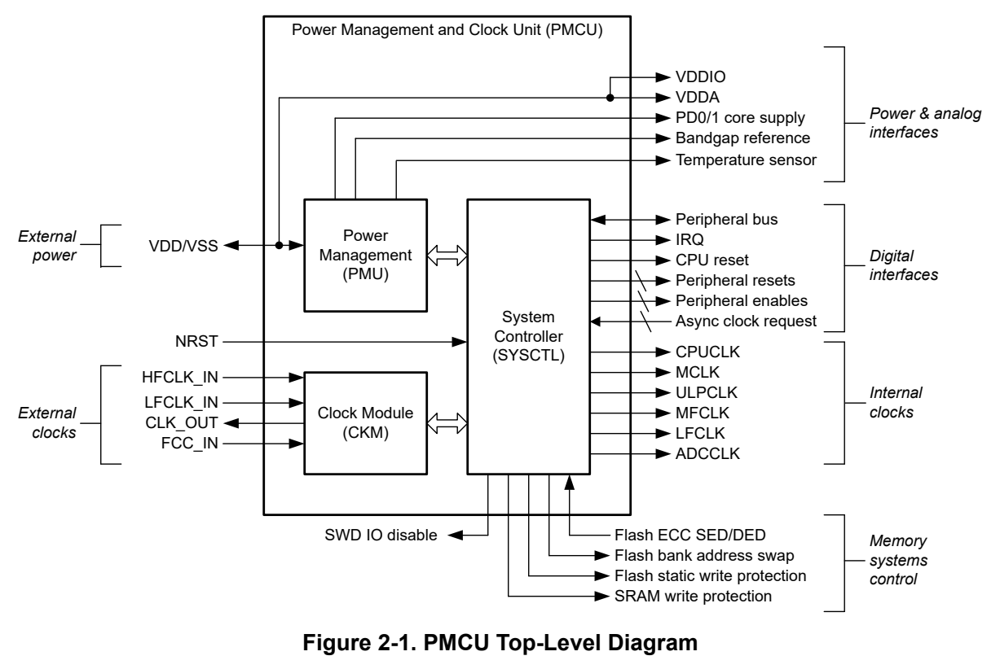
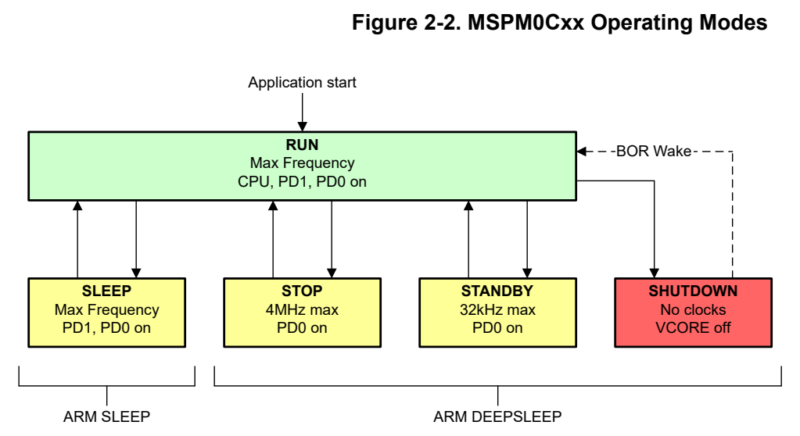
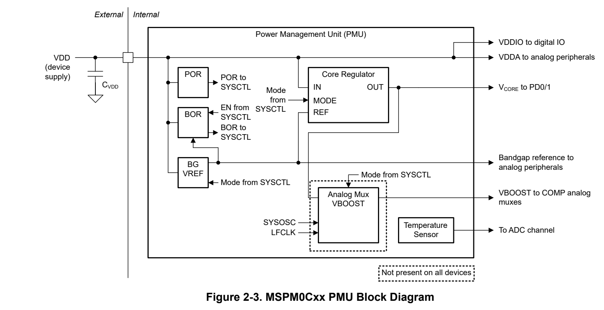
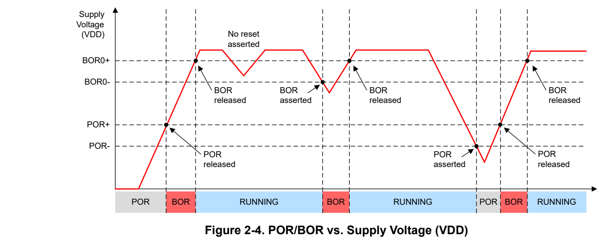
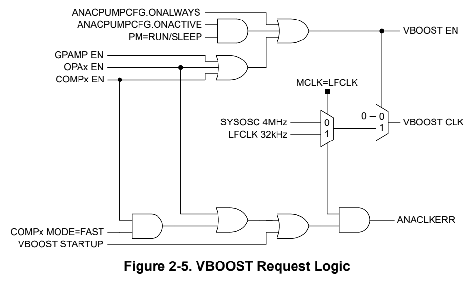
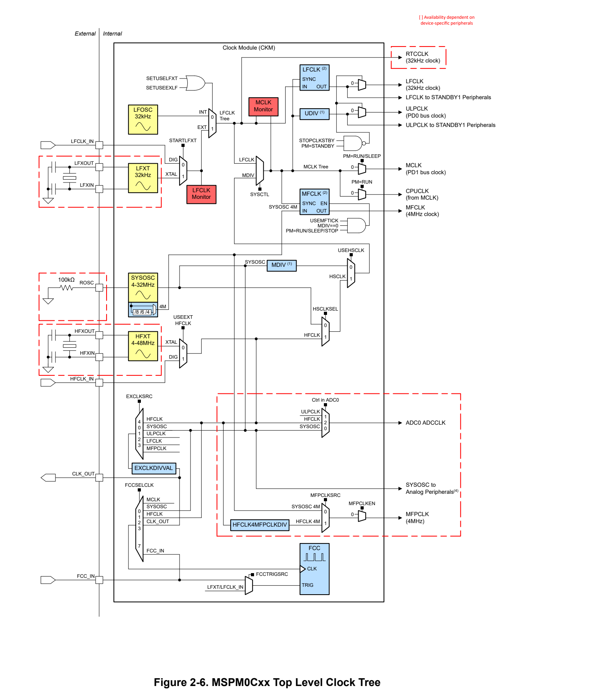
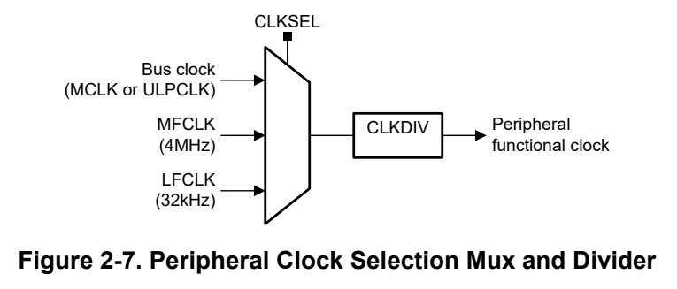
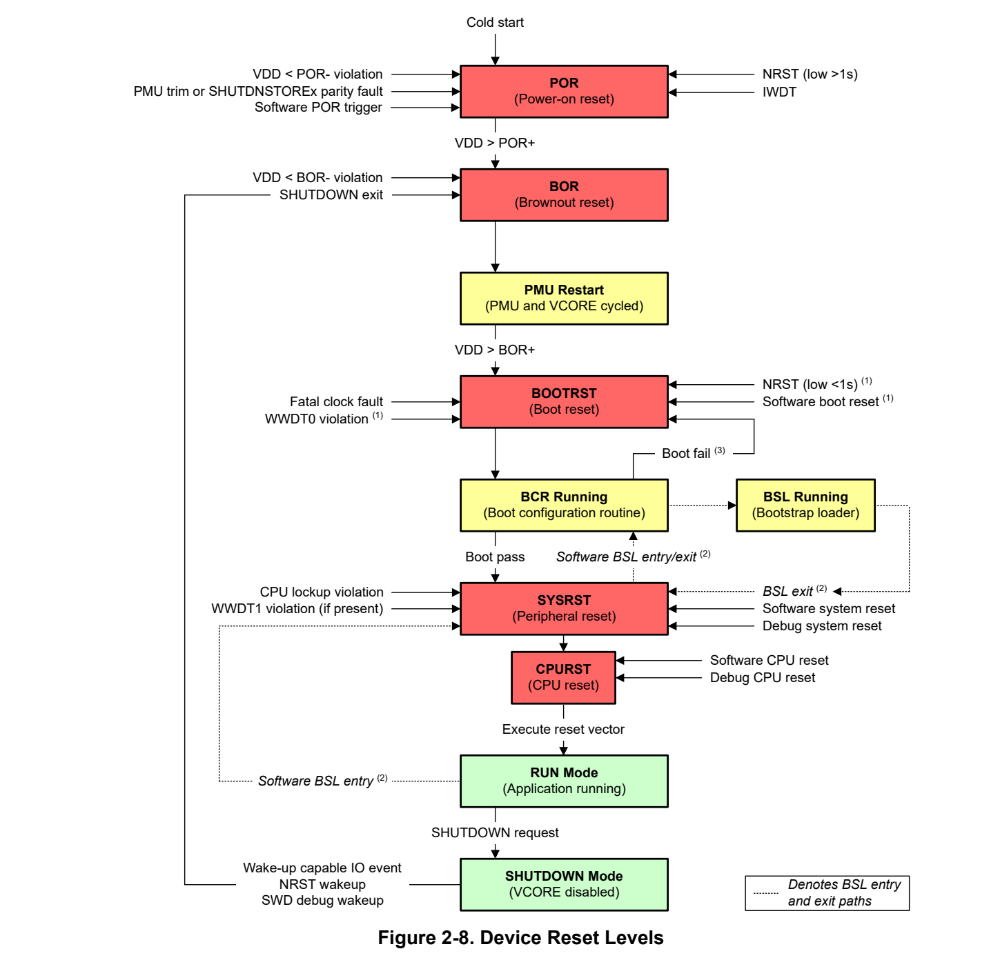
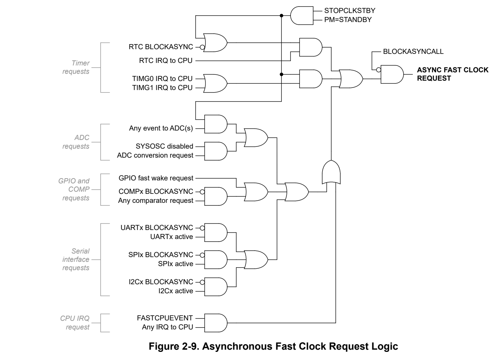

# 2 PMCU (pp. 59-204)

## PMCU (p. 59)

The power management and clock unit (PMCU) is a unified system module which provides all power management, clock configuration, and reset control functionality for the device. All power management unit (PMU) and clock module (CKM) policies for device operation are configured through memory-mapped registers in the system controller (SYSCTL).

### 2.1 PMCU Overview 60 (p. 59)

### 2.2 Power Management (PMU) 64 (p. 59)

### 2.3 Clock Module (CKM) 70 (p. 59)

### 2.4 System Controller (SYSCTL) 90 (p. 59)

### 2.5 Quick Start Reference 106 (p. 59)

### 2.6 SYSCTL_C1103_C1104 Registers 109 (p. 59)

### 2.7 SYSCTL_C1105_C1106 Registers 154 (p. 59)

### 2.1 PMCU Overview (p. 60)

The power management and clock unit (PMCU) provides all power, clocking, reset, and system control services for the device. The PMCU contains three submodules to provide this functionality: the power management unit ( PMU), the clock module ( CKM), and the system controller ( SYSCTL).

The PMU is an analog submodule that generates the internal regulated supplies for the device and supervises the condition of the external supply. The PMU also contains voltage and current reference circuits used by the on-chip regulators and analog peripherals.

The CKM is an analog submodule that provides clock sources (internal oscillators) and presents these clock sources to SYSCTL. SYSCTL distributes these clock sources to the CPU, buses, and peripherals on the device.

The SYSCTL is a digital submodule that provides the control logic for all functions in the PMCU. In addition, SYSCTL contains the memory-mapped registers used by software to configure power management and clocks, assess the status of the device, and control resets. SYSCTL also provides general-purpose memory that is retained in SHUTDOWN mode and can be used to store status information in SHUTDOWN mode when SRAM and register contents are lost.

Figure 2-1 shows the interfaces between the PMCU and the device supplies, clocks, and signals. Configuration of the PMCU by software is always done through memory-mapped registers in the SYSCTL submodule.

*Figure 2-1. PMCU Top-Level Diagram (p. 60)*

Note Not all devices have all of the PMCU features shown in Figure 2-1. See the device-specific data sheet to understand the features present on a given device.

Using this Guide

The PMU, CKM, and SYSCTL sections of this chapter describe the functionality provided by each submodule in detail.

The quick start section describes overall system level operation of the PMCU and how to configure the PMCU for different application scenarios.

#### 2.1.1 Power Domains (p. 61)

Two core power domains are provided on the device: PD1 and PD0. PD1 is always powered in RUN and SLEEP modes, but is disabled in all other modes. PD0 is always powered in RUN, SLEEP, STOP and STANDBY modes. PD1 and PD0 are both disabled in SHUTDOWN mode.

- The PD1 domain includes the CPU subsystem, the SRAM memory, PD1 peripherals, and the PD1 peripheral bus, which runs from MCLK (including the DMA). While PD1 is disabled in STOP and STANDBY mode, the CPU registers, SRAM, and peripheral configuration registers are maintained in retention such that they are available to resume operation immediately when STOP or STANDBY modes are exited.

- The PD0 domain includes the PD0 peripherals and PD0 bus segment which runs from ULPCLK in RUN and SLEEP mode, 4MHz in STOP mode, and 32kHz in STANDBY mode. The PD0 domain is powered in all modes except SHUTDOWN and can be thought of as an "always-on" domain.

The device-specific data sheet describes which peripherals on a device are in PD1 and which are in PD0.

The device also has a primary external supply (VDD) domain that provides power to the IO and analog peripherals.

The device also has a primary external supply (VDD) domain that provides power to the IO and analog peripherals.

#### 2.1.2 Operating Modes (p. 61)

Various operating modes (power modes) are provided to allow for optimization of the device power consumption based on application requirements. In order of decreasing power, the modes are: RUN, SLEEP, STOP, STANDBY and SHUTDOWN. The following figure shows the interaction between the modes.

*Figure 2-2. MSPM0Cxx Operating Modes (p. 61)*

Section 2.1.2.6 indicates what functions are available in each operating mode of the device. See the operating mode selection section for information on how to configure the device for a particular operating mode.

Operating Mode Concept

MSPM0 MCUs implement a policy-based power and clock management scheme. Policies can be configured through application software for how the clocking is to be managed in each operating mode to obtain the best balance of power and performance for a given application.

After the operating policy for each mode is configured, application software can enter and exit the various operating modes through simple register commands, and SYSCTL automatically manages all the necessary PMU states, oscillator and clock enable and disables, and the SYSOSC frequency according to the software-defined policies and software-selected mode.

A variety of hardware-triggered low-power mode suspension mechanisms also exist to enable on-demand access to a fast clock when requested by supported peripherals, as well as functions such as DMA and ADC triggering from low-power modes.

The policy-driven operating mode scheme together with the asynchronous low-power mode suspension mechanisms enable application software to select the operating mode and corresponding policy that provide the lowest possible power consumption for background activities, with transient foreground activities either bringing up the DMA, bringing up a fast clock, or bringing the device to RUN (in the case of an IRQ) for burst handling.

##### 2.1.2.1 RUN Mode (p. 62)

In RUN mode, the CPU is active executing code and any peripheral can be enabled.

There are three RUN mode policy options: RUN0, RUN1, and RUN2.

- RUN0: The MCLK and the CPUCLK run from a fast clock source (SYSOSC, HFCLK).

- RUN1: The MCLK and the CPUCLK run from LFCLK (at 32kHz) to reduce active power, but SYSOSC is left enabled to service analog modules such as an ADC.

- RUN2: The MCLK and the CPUCLK run from LFCLK (at 32kHz), and SYSOSC is completely disabled to save power. This is the lowest power state with the CPU running.

##### 2.1.2.2 SLEEP Mode (p. 62)

In SLEEP mode, the CPU is disabled (clock gated) but otherwise the device configuration is the same as RUN. There are three SLEEP mode policy options: SLEEP0, SLEEP1, and SLEEP2. The SLEEPx policy is determined by the current RUNx policy when SLEEP mode is entered.

- SLEEP0: Identical to RUN0, with the CPU disabled.

- SLEEP1: Identical to RUN1, with the CPU disabled.

- SLEEP2: Identical to RUN2, with the CPU disabled.

##### 2.1.2.3 STOP Mode (p. 62)

In STOP mode, the CPU, SRAM, and PD1 peripherals are disabled and in retention (if applicable). PD0 peripherals are available with a max ULPCLK frequency of 4MHz. SYSOSC can run at higher frequencies to support operation of analog peripheral (such as an ADC), but ULPCLK will be automatically limited to the 4MHz SYSOSC output by SYSCTL. For details on peripheral availability, please refer to the "supported functionality by operating mode" table within the device-specific datasheet.

DMA is available to be triggered. A DMA trigger wakes the PD1 power domain to make the SRAM and DMA available for processing the DMA transfer, and the DMA transfer is processed at the current MCLK rate. After the transfer completes, the SRAM is returned to retention and PD1 is disabled automatically.

STOP mode is the lowest power mode that supports the operation of analog peripherals.

There are three policy options for STOP mode: STOP0, STOP1, and STOP2.

- STOP0: The SYSOSC is left running at the current frequency when entering STOP mode. ULPCLK is always limited to 4MHz automatically by hardware, but SYSOSC is not disturbed to support consistent operation of analog peripherals. – NOTE: If STOP0 is entered from RUN1 (SYSOSC enabled but MCLK sourced from LFCLK), SYSOSC remains enabled as in RUN1, and ULPCLK remains at 32kHz as in RUN1. – NOTE: If STOP0 is entered from RUN2 (SYSOSC was disabled and MCLK was sourced from LFCLK), SYSOSC remains disabled as in RUN2, and ULPCLK remains at 32kHz as in RUN2.

- STOP2: The SYSOSC is disabled and the ULPCLK is sourced from LFCLK at 32kHz. This is the lowest power state in STOP mode.

##### 2.1.2.4 STANDBY Mode (p. 62)

In STANDBY mode, the CPU, SRAM, and PD1 peripherals are disabled and in retention. PD0 peripherals, with the exception of the ADC, DAC, and OPA are available with a maximum ULPCLK frequency of 32kHz. . High-speed oscillators such as (SYSPLL, HFXT, HFCLK_IN) and SYSOSC are disabled.

DMA is available to be triggered. A DMA trigger wakes the PD1 power domain to make the SRAM and DMA available for processing the DMA transfer, and the DMA transfer is processed at the current MCLK. After the transfer completes, the SRAM is returned to retention and PD1 is disabled automatically.

Analog peripherals (such as an ADC, 12-bit DAC, OPA, and high-speed COMP) are not supported in STANDBY mode. For details on peripheral availability, please refer to the "supported functionality by operating mode" table within the device-specific datasheet.

There are 2 policy options for STANDBY mode: STANDBY0 and STANDBY1.

- STANDBY0: All PD0 peripherals receive the ULPCLK and LFCLK, while the RTC receives the RTCCLK.

- STANDBY1: Only a few general purpose timers receive ULPCLK or LFCLK, see the device-specific data sheet to determine them. If the device contains an RTC module, it continues to receive RTCCLK. A general timer interrupt, RTC interrupt, or ADC trigger in STANDBY1 always triggers an asynchronous fast clock request to wake the system. Other PD0 peripherals (such as UART, I2C, GPIO, and low-power COMP) can also wake the system upon an external event through an asynchronous fast clock request, but they are not actively clocked in STANDBY1.

##### 2.1.2.5 SHUTDOWN Mode (p. 63)

In SHUTDOWN mode, no clocks are available. The core regulator is completely disabled and all SRAM and register contents are lost, with the exception of the general-purpose memory in SYSCTL that can be used to store state information. The BOR and bandgap circuit are disabled.

Specific IO configuration settings are retained in the SHUTDOWN operating mode.

- Drive strength

- Pullup enable

- Pulldown enable

- Input enable

- Output enable

- Output state

The device can wake through a wake-up capable IO, a debug connection, or NRST.

SHUTDOWN mode has the lowest current consumption of any operating mode. Exiting SHUTDOWN mode triggers a BOR.

##### 2.1.2.6 Supported Functionality by Operating Mode (p. 63)

Supported functionality in each operating mode is given in Supported Functionality by Operating Mode table in the detailed description section of the device-specific data sheet.

##### 2.1.2.7 Suspended Low-Power Mode Operation (p. 63)

Some peripherals can be configured to temporarily suspend STOP or STANDBY mode operation to handle a temporary activity or process an event. There are two ways in which STOP or STANDBY mode can be suspended:

- An asynchronous fast clock request

- A DMA trigger

Suspended STOP or STANDBY for an Asynchronous Fast Clock Request

An asynchronous fast clock request temporarily suspends any active low-power mode and runs the MCLK and ULPCLK tree at 32MHz, sourced from SYSOSC. Asynchronous fast clock requests are also functional in RUN and SLEEP mode if MCLK is sourced from either LFCLK at 32kHz or SYSOSC at a frequency lower than 32MHz.

This functionality enables use cases such as:

- General purpose IOs (GPIO) for glitch filtering2

- Timer-triggered ADC sampling from STANDBY mode

Suspended STOP or STANDBY for a DMA Trigger

If a DMA trigger is asserted in STOP or STANDBY mode, the low-power mode is temporarily suspended and the PD1 power domain (including the SRAM and flash memory) is enabled to process the DMA request. Unlike the asynchronous fast clock request, DMA transfers do not change the clock tree configuration. A DMA request in STOP or STANDBY mode is processed at the current MCLK rate.

Note If a temporary suspension from STOP or STANDBY mode results in an interrupt, then the device will transition to and remain in RUN mode operation to process the interrupt.

### 2.2 Power Management (PMU) (p. 64)

The power management unit (PMU) generates the regulated core supplies for the device and provides supervision of the external supply. It also contains a bandgap voltage reference used by the PMU and other analog peripherals. Refer to the device specific datasheet for the supported PMU features.

Key PMU features include:

- Support for the device across the device operating supply range

- Low-dropout linear voltage regulator to generate the internal core logic supply, with multiple operating modes for reducing device current in low-power modes (managed automatically by SYSCTL)

- Power-on reset (POR) for VDD supply

- Brownout reset (BOR) for VDD supply – The BOR monitor allows for configuring of threshold voltages to report an NMI

- Bandgap voltage reference supporting the BOR, core regulator, and analog peripherals

- Analog mux VBOOST unit for increasing analog mux performance

*Figure 2-3. MSPM0Cxx PMU Block Diagram (p. 64)*

#### 2.2.1 Power Supply (p. 65)

Power is supplied to the device through the VDD and VSS connections. A decoupling capacitor (C VDD) must be placed across all VDD and VSS supply pairs. See the device-specific data sheet for the correct value and tolerance of C VDD. Some devices with a higher pincount my feature multiple VDD/VSS power pairs.

VDD is used directly to provide the IO supply (VDDIO) and the analog supply (VDDA). VDDIO and VDDA are internally connected to VDD so that additional power supply pins are not required.

Some devices may feature an independent power supply for device-specific special features such as VBAT (for the low-frequency sub system) and VUSB (for the USB PHY). Refer to the device-specific datasheet for details on the power source for associated IO pins and features.

#### 2.2.2 Core Regulator (p. 65)

The PMU uses an on-chip, configurable, low-dropout linear voltage regulator to generate a 1.35V supply rail to power the device core. The core regulator output (V CORE) supplies power to the core logic, which includes the CPU, digital peripherals and the device memory. The core regulator requires an external capacitor (C VCORE) which is connected between the device VCORE pin and VSS (ground). See the device specific data sheet for the correct value and tolerance of C VCORE.

In some devices, the external V CORE capacitor is not supported.

The core regulator is active in all power modes except for SHUTDOWN. In all other power modes (RUN, SLEEP, STOP, and STANDBY) the drive strength of the regulator is configured automatically to support the max load current of each mode. This reduces the quiescent current of the regulator when using low-power modes, improving low power performance. SYSCTL automatically configures the regulator for best power consumption based on the power mode which is currently active.

#### 2.2.3 Supply Supervisors (p. 65)

The PMU provides two supply supervisor circuits:

- A power-on reset (POR) circuit to indicate that the external supply has reached sufficient voltage to start the on-chip bandgap reference and BOR circuit

- A user-programmable brownout reset (BOR) circuit which verifies that the external supply is maintained at the specified voltage to support correct operation of the device

##### 2.2.3.1 Power-on Reset (POR) (p. 65)

The power-on reset (POR) circuit assures a proper start-up of the device. During cold power-up, the device is held in a POR state until VDD passes the POR+ threshold. When VDD has passed POR+, the POR state is released and the bandgap reference and BOR monitor circuit are started. If VDD drops below the POR- level, then a POR- violation is asserted and the device is again held in a POR reset state.

The POR circuit does not indicate that VDD has reached a level high enough to support correct operation of the device. Rather, it is the first step in the boot process and is used to determine if the supply voltage is sufficient to power up the bandgap reference and BOR circuit, which are then used to determine if the supply has reached a level sufficient to for the device to run correctly.

The POR circuit is active in all power modes including SHUTDOWN and cannot be disabled.

##### 2.2.3.2 Brownout Reset (BOR) (p. 65)

The brownout reset (BOR) supervisor monitors the external supply (VDD) and asserts or deasserts a BOR violation to SYSCTL. The primary responsibility of the BOR circuit is to make sure that the external supply is maintained high enough to enable correct operation of internal circuits, including the core regulator. The BOR threshold reference is derived from the internal bandgap circuit. The threshold is programmable and is always higher than the POR threshold. During cold start, after VDD passes the POR+ threshold, the bandgap reference and BOR circuit are started. The device is then held in a BOR state until VDD passes the BOR0+ threshold. When VDD passes BOR0+, the BOR supervisor releases the device to continue the boot process, and the PMU is started.

There are up to four selectable BOR threshold levels (BOR0-BOR3). During startup, the BOR threshold is always BOR0 (the lowest value) to make sure that the device starts at the specified VDD minimum. After boot, software can optionally reconfigure the BOR circuit to use a different (higher) threshold level (BOR1-BOR3).

Note Some devices feature only one BOR threshold level (BOR0).

When the BOR threshold is BOR0, a BOR0- violation always generates a BOR- violation signal to SYSCTL, generating a BOR level reset. When the BOR threshold is reconfigured to BOR1, BOR2, or BOR3, the BOR circuit generates a SYSCTL interrupt rather than asserting the BOR- violation. This can be used to give the application an indication that the supply has dropped below a certain level without causing a reset.

To change the BOR level from the default (BOR0), first select the desired value in the LEVEL field of the BORTHRESHOLD register in SYSCTL. Then, activate the threshold set in the LEVEL field by setting the GO bit in the BORCLRCMD register. The change can be validated by testing the BORCURTHRESHOLD field in the SYSSTATUS register, which returns a value corresponding to the currently active BOR threshold. The BOR threshold change takes approximately 15µs to complete, during this time, the BOR circuit is blind to changes in the supply.

If the BOR is in interrupt mode (a threshold level of BOR1-BOR3), and the supply drops below the corresponding BORx- level, then an interrupt is generated and the BOR circuit automatically switches the BOR threshold level to BOR0 to make sure that a BOR- violation is asserted if VDD drops below BOR0-. Application software can set the BOR level back to the level specified in the LEVEL field of the BORTHRESHOLD register by setting the GO bit again in the BORCLRCMD register.

The BOR supervisor is active in RUN, SLEEP, STOP, and STANDBY modes but is disabled automatically in SHUTDOWN mode.

##### 2.2.3.3 POR and BOR Behavior During Supply Changes (p. 66)

When the supply voltage (VDD) drops below POR-, the entire device state is cleared. Small variations in VDD that do not pass below the BOR0- threshold do not cause a BOR- violation, and the device continues to run. Behavior for BORx thresholds other than BOR0 (for example, BOR1-BOR3) is the same as is shown for BOR0, except that the BOR circuit is configured to generate an interrupt rather than immediately triggering a BOR reset. If a BOR1-BOR3 interrupt is generated, the BOR level is automatically switched to BOR0.

*Figure 2-4. POR/BOR vs. Supply Voltage (VDD) (p. 66)*

#### 2.2.4 Bandgap Reference (p. 66)

The PMU provides a voltage reference that is stable across temperature and VDD supply voltage and is used by the device for internal functions, including:

- Deriving the brownout reset circuit thresholds

- Setting the output voltage for the core regulator

- Deriving the on-chip VREF levels for on-chip analog peripherals

The bandgap reference is enabled in RUN, SLEEP, STOP modes. This reference operates in a sampled mode in STANDBY to reduce power consumption and is disabled in SHUTDOWN mode. SYSCTL manages the bandgap state automatically; no user configuration is required.

#### 2.2.5 VBOOST for Analog Muxes (p. 67)

The VBOOST circuit in the PMU generates an internal VBOOST supply that is used by the analog muxes in specific modules. The VBOOST circuit enables consistent analog mux performance across the external supply voltage (VDD) range.

Modules supported by VBOOST

- COMP

- OPA

- GPAMP

- SYSOSC (for FCL-ON external resistor mode operation)

- HFXT

Note Refer to the data sheet for device-specific features

Enabling and Disabling VBOOST

SYSCTL automatically manages the enable request for the VBOOST circuit based on the following parameters:

- The COMP, OPA, and GPAMP peripheral PWREN settings

- The ANACPUMPCFG control bits in the GENCLKCFG register in SYSCTL (please refer to the table below)

- The enabling of HFXT as a HFCLK clock source

Note If SYSOSC is configured with FCL ON and EXT-R, then VBOOST is kept active through low power modes to provide fast exit out of LPM. This is hardware managed, and not dependent on the ANACPUMPCFG setting

VBOOST is disabled by default following a SYSRST. Application software is not required to enable the VBOOST circuit prior to using associated peripherals. When the peripheral is enabled by application software, SYSCTL also enables the VBOOST circuit to support the peripheral.

The VBOOST circuit has a startup time requirement to transition from a disabled state to an enabled state. If a peripheral is enabled when VBOOST is disabled, then the corresponding peripheral ready status is not asserted until both the peripheral and the VBOOST circuit are ready. If the startup time of the peripheral is less than the VBOOST startup time, the peripheral startup time is then equivalent to the VBOOST startup time.

Alternatively, application software can force the VBOOST circuit to be enabled at all times (with ANACPUMPCFG=0x2) or while in RUN or SLEEP mode (with ANACPUMPCFG=0x1) so that there is no additional startup delay when enabling a peripheral supported by VBOOST. Table 2-1 gives the behavior of the ANACPUMPCFG control and corresponding application use cases.

**Table 2-1. Forcing VBOOST Enable With ANACPUMPCFG (pp. 67-68)**

| Col 1 | VBOOST Control (ANACPUMPCFG) | Col 3 | Behavior |
| --- | --- | --- | --- |
| VAL | MODE | VBOOST Enable | Application Use Case |
| 0x0 | ONDEMAND | VBOOST is automatically enabled by SYSCTL only when a supported peripheral is enabled. | This setting provides the lowest power consumption in all modes when fast startup of the peripheral is not critical. |
| VAL | MODE | VBOOST Enable | Application Use Case |
| 0x1 | ONACTIVE | VBOOST is forced to be enabled when the device is in RUN or SLEEP mode. VBOOST is also kept enabled in STOP or STANDBY mode if a supported peripheral is enabled. | This setting provides low power consumption by disabling the VBOOST automatically in STOP and STANDBY modes when no peripherals requiring VBOOST are enabled. VBOOST is automatically re-enabled upon exit to RUN mode to provide fast startup of the supported peripherals in the event that application software enables a said peripheral in RUN mode. |
| 0x2 | ONALWAYS | VBOOST is forced to be enabled in all operating modes except SHUTDOWN. | This setting makes sure that the peripherals never incur additional startup latency due to VBOOST startup in applications where fast startup is critical. |

The VBOOST enable, VBOOST clock selection, and VBOOST clock error logic is shown in Figure 2-5.

*Figure 2-5. VBOOST Request Logic (p. 68)*

VBOOST Clock

The VBOOST circuit requires a functional clock to operate. VBOOST is clocked by either the SYSOSC (4MHz output) or the LFCLK (32kHz) based on the currently active MCLK and ULPCLK tree source. The VBOOST clock is selected by automatically by SYSCTL according to the logic shown in Figure 2-5 and described here:

- When the MCLK and ULPCLK are sourced from LFCLK (32kHz), the VBOOST is also sourced from LFCLK.

- In all other scenarios, VBOOST is sourced from the SYSOSC 4MHz output.

Certain VBOOST operating conditions require that the VBOOST clock be 4MHz (sourced from SYSOSC) and not 32kHz (sourced from LFCLK) for well-designed startup time. Such conditions include:

- OPA operation or fast mode COMP operation

- VBOOST is starting up (transitioning from disabled to enabled)

The application software must make sure that MCLK and ULPCLK are not sourced from LFCLK when either of these conditions are present. SYSCTL does not change the current system clock configuration for a VBOOST request. If the MCLK and ULPCLK tree is sourced from LFCLK in one of these scenarios, SYSCTL asserts an ANACLKERR status in the SYSSTATUS register in SYSCTL to indicate to application software that there is a mismatch between the VBOOST clock requirement and the current MCLK and ULPCLK configuration.

The complete clock requirements for VBOOST are given in Table 2-2.

**Table 2-2. VBOOST Clock Requirements (p. 69)**

| Col 1 | VBOOST Request | VBOOST Circuit Clock Requirement | MCLK and ULPCLK Source Requirement (1) | Supported Operating Modes or Policies |
| --- | --- | --- | --- | --- |
|  | No active request (VBOOST is disabled) | N/A | Don't care | Don't care |
|  | VBOOST is starting up from a disabled state | 4MHz | Not LFCLK | RUN0, SLEEP0, STOP0, STOP1 |
| OPA enabled |  | 4MHz | Not LFCLK | RUN0, SLEEP0, STOP0, STOP1 |
|  | Fast mode (FAST) | 4MHz | Not LFCLK | RUN0, SLEEP0, STOP0, STOP1 |
| COMP enabled | (2) Ultra-low-power mode (ULP) | 4MHz or 32kHz | Don't care | RUN0, RUN1, RUN2, SLEEP0, SLEEP1, SLEEP2, STOP0, STOP1, STOP2, STANDBY0 |
| GPAMP enabled | (2) | 4MHz or 32kHz | Don't care | RUN0, RUN1, RUN2, SLEEP0, SLEEP1, SLEEP2, STOP0, STOP1, STOP2, STANDBY0 |
|  | VBOOST running with no peripheral request(2) active (due to ANACPUMPCFG!=0x0) | 4MHz or 32kHz | Don't care | RUN0, RUN1, RUN2, SLEEP0, SLEEP1, SLEEP2, STOP0, STOP1, STOP2, STANDBY0 |
| HFXT |  | 4MHz or 32kHz | Don't care | RUN0, SLEEP0, STOP0, STOP1 |
|  | SYSOSC (with FCL ON and EXT-R) | 4MHz or 32kHz | Don't care | RUN0, SLEEP0, STOP0, STOP1 |

(1) Application software must make sure that the clock system is configured as stated in the previous table to support proper VBOOST operation for each scenario. SYSCTL does not change the system clock configuration when VBOOST is requested. If a VBOOST request requires the VBOOST clock to be 4MHz and MCLK is sourced from LFCLK, SYSCTL asserts an ANACLKERR to indicate to the application that the current system clock configuration is not valid to support the current VBOOST request.

(2) If no OPA is enabled and no COMP is enabled and configured in FAST mode, the VBOOST does not require a 4MHz clock and VBOOST can run from LFCLK to reduce power consumption. However, if the VBOOST was previously disabled (no request present) and it is requested by a peripheral becoming enabled or by application software (ANACPUMPCFG!=0x0), a 4MHz VBOOST clock is required for VBOOST startup. After VBOOST startup is complete, the VBOOST clock can be 32kHz sourced from LFCLK if no OPA is enabled and no COMP is enabled in FAST mode. Changing the MCLK source to LFCLK during VBOOST startup can lead to incorrect operation of the VBOOST and inconsistent analog peripheral performance. When the VBOOST circuit has started and is ready, the ANACPUMPGOOD bit is set in the SYSSTATUS register in SYSCTL.

#### 2.2.6 Peripheral Enable (p. 69)

All peripherals on a device, with the exception of infrastructure peripherals such as SYSCTL itself and the IOMUX, require two user actions to enable the peripheral to be ready for operation:

- Peripheral Write Enable – Provided by the peripheral write enable control register (PWREN) with a KEY and ENABLE field. – Before any other peripheral registers are configured by software, the peripheral itself must be enabled by writing the ENABLE bit together with the appropriate KEY value to the peripheral's PWREN register – When the PWREN.ENABLE bit is cleared, the peripheral's registers are not accessible for read/write operations.

- Peripheral Function Enable – Peripherals may have a functional enable bit in the corresponding register map to provide access to power or for operation

Note After setting the ENABLE | KEY bits in the PWREN register to enable a peripheral, wait at least 4 ULPCLK clock cycles before accessing the rest of the peripheral's memory-mapped registers. The 4 cycles allow for the bus isolation signals at the peripheral's bus interface to update.

##### 2.2.6.1 Automatic Peripheral Disable in Low Power Modes (p. 70)

Peripherals in power domain 1 (PD1) will be forced to a disabled state by SYSCTL upon entry into a STOP or STANDBY low-power mode. As such, these peripherals will not be available for use in STOP or STANDBY.

Most PD1 peripherals will retain their configuration settings after being automatically disabled, such that re-configuration is not required upon exit from STOP or STANDBY mode. See the peripheral-specific chapter in this guide for details on which peripheral registers are retained through STOP and STANDBY mode for PD1 peripherals.

If a PD1 peripheral was multiplexed to an IO pin (through the IOMUX) in an output configuration, the last valid output state (logic 0 or logic 1) from the peripheral to the IO is latched upon entry to STOP or STANDBY mode. This prevents external circuits from being disturbed by SYSCTL disabling a peripheral during low-power operation. Upon exit from STOP or STANDBY mode, the IO is again connected to the peripheral as the peripheral becomes re-enabled.

### 2.3 Clock Module (CKM) (p. 70)

The clock module contains the internal and external oscillators, the clock monitors, and the clock selection and control logic. A frequency clock counter is also provided for checking and/or calibrating the frequency of high-speed clocks against either the LFXT/LFCLK_IN or a reference period/pulse provided on an IO pin (FCC_IN).

#### 2.3.1 Oscillators (p. 70)

Several internal and external oscillators are provided for generating low to high frequency clocks for use by the system. The CKM contains all the oscillators in the device and uses them to generate the system clocks. See the device specific data sheet for whether external oscillators are available.

Internal Oscillators

- LFOSC: low frequency oscillator (32kHz typical frequency)

- SYSOSC: system oscillator (up to 32MHz frequency)

- SYSPLL: system PLL (phase-locked loop) with programmable frequency (optional)

- USBFLL: USB FLL (frequency-locked loop) for crystal-less USB operation (optional) •

External Oscillators

- LFXT: low frequency, low power crystal oscillator (32kHz typical frequency)

- HFXT: high frequency crystal oscillator (up to 48MHz typical frequency)

In addition to the oscillators, low frequency (LFCLK_IN) and high frequency (HFCLK_IN) digital clock inputs are provided to support cases where the LFXT or HFXT is not used and a direct digital clock is supplied to the device.

##### 2.3.1.1 Internal Low-Frequency Oscillator (LFOSC) (p. 70)

The low-frequency oscillator (LFOSC) is an on-chip low power oscillator which is factory trimmed to a frequency of 32.768kHz. LFOSC provides a stable low frequency clock source in cases where the low frequency crystal oscillator (LFXT) is either not present or not used.

LFOSC can provide higher accuracy when used over a reduced temperature range. See the device-specific data sheet for details.

The LFOSC is active by default after a BOOTRST, sourcing the LFCLK. The LFOSC startup monitor sets the LFOSCGOOD bit in the CLKSTATUS register when LFOSC is ready.

If user software selects either LFXT or LFCLK_IN as the LFCLK source, the LFOSC is disabled until the next BOOTRST.

##### 2.3.1.2 Internal System Oscillator (SYSOSC) (p. 71)

The system oscillator (SYSOSC) is an on-chip, accurate high frequency clock source (up to 32MHz). The SYSOSC provides a flexible high-speed clock source to the system in cases where the high frequency crystal oscillator (HFXT) is either not present or not used, or where fast wake-up from a low-power mode is required.

Key features of the SYSOSC include:

- High accuracy when using optional frequency correction loop (FCL) and reference resistor – The frequency correction loop may support correction via an external resistor (ROSC) or an internal resistor, depending on the device capabilities. Refer to the device-specific data sheet to determine if a device supports the FCL with an internal or external resistor, or both

- Fast start-up time from a low power state

- Capable of switching from base frequency to low frequency, or low frequency to base frequency, in one clock cycle with no functional interruption (gear shift) – Phase-aligned transition to minimize disturbance to peripherals – Fast settling to specified accuracy – SYSCTL can initiate seamless gear shift frequency switch in STOP mode to reduce SYSOSC current – Refer to the device-specific data sheet to determine if multiple frequency settings for SYSOSC are supported

- The SYSOSC clock source provides a user trimmable frequency start at 16MHz or 24MHz. – In-system trimming is supported by the usage of the FCC (frequency clock counter)

- A secondary output with a constant 4MHz frequency for use by MFCLK and MFPCLK – When f SYSOSC = 4MHz, the MFCLK/MFPCLK output is derived from SYSOSC directly. – When f SYSOSC is not 4MHz, the MFCLK/MFPCLK output is derived by a digital divider sourcing from SYSOSC with the appropriate ratio – SYSCTL manages the digital divider on this output to ensure a constant 4MHz output regardless of the user selected SYSOSC frequency. – Peripherals using this output see a continuous 4MHz functional clock in RUN, SLEEP, and STOP modes, with reduced current in STOP mode when gear shift is enabled due to SYSOSC running natively at 4MHz.

The SYSOSC is active at the device's base frequency by default after a brownout reset, sourcing MCLK.

###### 2.3.1.2.1 SYSOSC Frequency Correction Loop (p. 71)

The SYSOSC frequency accuracy can be improved through the use of the SYSOSC frequency correction loop (FCL) feature. The FCL circuit uses either an internal resistor or external resistor (populated between the ROSC pin and VSS), to stabilize the SYSOSC frequency by providing a precise reference current for the SYSOSC. The overall frequency accuracy which is achievable depends on the operating temperature range together with the tolerance and temperature drift of the selected reference resistor.

Note Not all devices support operation with an internal resistor and an external resistor for FCL. Some devices support external mode, some devices support internal mode, and some devices support both modes. See the device-specific data sheet to determine the features of a given device.

Note The power consumption of SYSOSC is marginally higher with the FCL enabled due to the reference current that flows through ROSC. Settling time from startup to target accuracy can also be longer. See the device-specific data sheet for startup times.

###### 2.3.1.2.1.1 SYSOSC FCL in Internal Resistor Mode (p. 71)

This section describes the procedure for selecting the internal resistor mode through the device SYSCTL registers. Enabling FCL in internal resistor mode can be beneficial to the user's application which require improved SYSOSC performance while not adding cost to the system for an external resistor.

Enabling FCL with Internal Resistor

To increase the SYSOSC accuracy with FCL, follow this procedure: 1. Enable FCL mode by setting the SETUSEFCL bit in the SYSOSCFCLCTL register. a. If the device supports both internal resistor and external resistor FCL modes, do not set the SETUSEEXRES bit in the SYSOSCFCLCTL register when setting the SETUSEFCL bit.

2. When the FCL mode is enabled, software cannot disable the mode. A BOOTRST is required before a change to the FCL mode.

###### 2.3.1.2.2 Disabling SYSOSC (p. 72)

SYSOSC can be disabled in STOP mode by setting the DISABLESTOP bit in the SYSOSCCFG register. Doing so forces the MCLK to use LFCLK in STOP mode (this is the STOP2 policy). This provides the lowest possible power consumption in STOP mode, as the system runs at 32kHz and SYSOSC consumes no current. When exiting STOP mode to RUN mode, SYSCTL will automatically re-enable SYSOSC and switch MCLK back to SYSOSC.

SYSOSC can be disabled manually by setting the DISABLE bit in the SYSOSCCFG register. When SYSOSCCFG.DISABLE is set, the system will run from LFCLK in all power modes.

Note The DISABLE and DISABLESTOP bits in SYSOSCCFG are mutually exclusive, and must not be set at the same time.

It is not possible to disable SYSOSC when using a different high speed clock to source MCLK (such as HSCLK). This is because SYSOSC is used by SYSCTL logic when MCLK is sourced from HSCLK.

SYSOSC is always disabled automatically in STANDBY and SHUTDOWN modes.

##### 2.3.1.3 Low Frequency Crystal Oscillator (LFXT) (p. 72)

The low-frequency crystal oscillator (LFXT) is an ultra-low-power crystal oscillator that supports a standard 32.768kHz watch crystal.

To use the LFXT, place a watch crystal between the LFXIN and LFXOUT pins. Place loading capacitors on both pins to circuit ground (VSS). Size the crystal load capacitors according to the specifications of the crystal being used. A variety of crystal types are supported through a programmable drive mechanism that allows for balancing drive current with the required drive strength for a particular crystal.

The LFXT pins LFXIN and LFXOUT are shared with digital IO functions. To use the LFXT, first configure the IOMUX to support LFXT functionality on the LFXIN and LFXOUT pins. Configure IOMUX to disable any digital IO functionality on the LFXIN and LFXOUT pins. The LFXT defaults to the highest drive strength (LFCLKCFG.XT1DRIVE == 0x03 in SYSCTL), which is recommended for fast reliable start-up of the oscillator. If a crystal with ultra-low capacitance (<3pF) is used, power consumption of the LFXT can be lowered further by setting the LOWCAP bit LFCLKCFG (LOWCAP is cleared by default for compatibility with most crystals).

After completing configuration, start the LFXT by setting the STARTLFXT bit in the LFXTCTL register in SYSCTL. When the oscillator has started successfully, the LFXT startup monitor sets the LFXTGOOD bit in the CLKSTATUS register in SYSCTL. Crystal drive strength can then be reduced to conserve power, if desired. Once STARTLFXT is set by the application software, the internal LFOSC is disabled to conserve power while the LFXT starts in anticipation of LFCLK moving to the LFXT.

To switch the LFCLK tree to use LFXT as the 32kHz clock source rather than LFOSC, set the SETUSELFXT bit in the LFXTCTL register, and SYSCTL permanently switches the LFCLK source to LFXT until a BOR reset or a fatal clock fault occurs.

After the LFXT is enabled, the internal LFOSC is disabled. LFOSC cannot be re-enabled and LFCLK thus cannot be switched back to LFOSC other than by a software-triggered POR reset.

Note To source MCLK from LFCLK with LFCLK sourced from the LFXT, first configure LFCLK to use LFXT and then configure MCLK to use LFCLK. Do not switch MCLK to LFCLK while LFCLK runs from LFOSC, and then later switch LFCLK to LFXT.

Note In the event that LFXT is selected for LFCLK at startup but the crystal fails to start properly, it is necessary to execute a POR reset to re-enable the internal LFOSC and run LFCLK from LFOSC or else a 32kHz LFCLK will not be available for the system.

Note In a scenario where LFXT fails to start, application software may leverage the flash memory to store a flag indicating that the crystal did not start properly, and then execute the POR reset. The flash memory contents can be read following a POR reset and thus in the next startup sequence the application code can decide to keep LFCLK sourced from LFOSC versus the external crystal (in the event that there is a hardware issue with the crystal preventing it from starting).

##### 2.3.1.4 LFCLK_IN (Digital Clock) (p. 73)

It is possible to bypass the LFXT circuit and bring in a 32.768kHz typical frequency digital clock into the device to use as the LFCLK source instead of LFOSC or LFXT. To configure LFCLK to use a digital clock input instead of LFXT or LFOSC, first configure the IOMUX to enable the LFCLK_IN function on the appropriate pin. When IOMUX is configured correctly and the external clock source is outputting a 32kHz clock to LFCLK_IN, set the SETUSEEXLF bit in the EXLFCTL register in SYSCTL.

LFCLK_IN is compatible with digital square wave CMOS clock inputs and should have a typical duty cycle of 50%.

When the system is initialized, LFOSC is the primary clock source for LFCLK. Before switching LFCLK to use LFCLK_IN, it is possible to check for a valid clock signal on LFCLK_IN by enabling the LFCLK monitor through setting the MONITOR bit in LFCLKCFG register.

After LFCLK_IN is selected as the LFCLK source, it is not possible to change back to LFOSC or LFXT without going through a BOR reset.

Note If MCLK is to be sourced from LFCLK with LFCLK sourced from LFCLK_IN, first configure LFCLK to use LFCLK_IN and then configure MCLK to use LFCLK. Do not switch MCLK to LFCLK with LFCLK running from LFOSC, and then later switch LFCLK to LFCLK_IN.

Note LFCLK_IN and LFXT are mutually exclusive and must not be enabled at the same time. Do not set the SETUSEEXLF bit in the EXLFCTL register if the SETUSELFXT bit or the STARTLFXT bit is set in the LFXTCTL register.

##### 2.3.1.5 High Frequency Crystal Oscillator (HFXT) (p. 73)

The high frequency crystal oscillator (HFXT) can be used with standard crystals and resonators to generate a stable high-speed reference clock for the system. The HFXT can be used to clock the primary device clock tree (MCLK) directly or it can be used as a precision reference to the on-chip PLL where higher frequencies can be generated. In addition, the HFXT can be provided directly to the ADC as the sampling clock source or for other peripherals such as the CAN-FD functional clock source. This allows for a functional clock that is asynchronous from the main system clock (MCLK).

To use the HFXT, a crystal or resonator must be populated between the HFXIN and HFXOUT pins. Loading capacitors must be placed on both pins to circuit ground (VSS). The crystal load capacitors must be sized

according to the specifications of the crystal being used. The IOMUX must be configured to enable HFXT functionality on the HFXIN and HFXOUT pins. Configure IOMUX to disable any digital IO functionality on the HFXIN and HFXOUT pins. The HFXT frequency range must be set by configuring the HFXTRSEL bits in the HFCLKCLKCFG register in SYSCTL.

A programmable HFXT startup time is provided with 64µs resolution. Program an appropriate startup time based on the desired crystal or resonator specifications into the HFXTTIME field in the HFCLKCLKCFG register in SYSCTL before starting the HFXT.

Once configured properly, the HFXT is started by setting the HFXTEN bit in the HSCLKEN register in SYSCTL. When the oscillator has started successfully, the HFCLK startup monitor will assert the HFCLKGOOD bit in the CLKSTATUS register in SYSCTL.

Note SYSOSC must be enabled at base frequency when the HFXT is enabled.

After setting HFXTEN to enable the HFXT, application software must verify that either an HFCLKGOOD indication or an HFCLKOFF (off/dead) indication in the CLKSTATUS register was asserted by hardware before attempting to disable the HFXT by clearing HFXTEN. When disabling the HFXT by clearing HFXTEN, the HFXT must not be re-enabled again until the HFCLKOFF bit in the CLKSTATUS register is set by hardware.

To use HFXT as the PLL reference after receiving an HFCLKGOOD status, set the SYSPLLREF bit in the SYSPLLCFG0 register in SYSCTL. If HFXT is selected as a reference for the SYSPLL and the SYSPLL is enabled, then the SYSPLL must be disabled and the SYSPLLOFF bit in the CLKSTATUS register must be set before the HFXT can be disabled.

To use the HFXT directly as the MCLK source after receiving an HFCLKGOOD status, first set the HSCLKSEL bit in the HSCLKCFG register to select HFCLK as the high-speed clock source (rather than the system PLL output). Then, set the USEHSCLK bit in the MCLKCFG register to select the high-speed clock source as the MCLK source. Once USEHSCLK is set, HSCLKCFG must not change and the HFXT must not be disabled until the MCLK source is switched back to SYSOSC by clearing USEHSCLK and verifying that the HSCLKMUX bit in CLKSTATUS is cleared by hardware.

##### 2.3.1.6 HFCLK_IN (Digital clock) (p. 74)

It is possible to bypass the HFXT circuit and bring in an external digital clock signal into the device to use as the HFCLK source instead of HFXT. To configure HFCLK to use a digital clock input, first configure the IOMUX to enable the HFCLK_IN function on the appropriate pin. When IOMUX is configured correctly and the clock source is outputting a clock to HFCLK_IN, set the USEEXTHFCLK bit in the HSCLKEN register in SYSCTL.

Note SYSOSC must be enabled at base frequency when the HFCLK_IN is enabled.

The HFCLK_IN can be used as the reference for SYSPLL. The SYSPLL must be off before changing the configuration of the SYSPLL reference clock source. The user can verify that SYSPLL is off by checking the SYSPLLOFF status bit in the CLKSTATUS register. The user must then select HFCLK_IN as the HFCLK source (by setting the USEEXTHFCLK bit in the HSCLKEN register) before setting the SYSPLLREF bit in the SYSPLLCFG0 register in SYSCTL. Finally, the SYSPLL can be enabled by using the SYSPLLEN bit in the HSCLKEN register.

To source MCLK from HFCLK_IN after selecting HFCLK_IN as the HFCLK source, first set the HSCLKSEL bit in the HSCLKCFG register to select HFCLK as the high-speed clock source. Then, set the USEHSCLK bit in the MCLKCFG register to select the high-speed clock source as the MCLK source. Once USEHSCLK is set, HSCLKCFG must not change and the HFCLK_IN must not be disabled until the MCLK source is switched back to SYSOSC by clearing USEHSCLK and verifying that the HSCLKMUX bit in CLKSTATUS was cleared by hardware.

HFCLK_IN is compatible with digital square wave CMOS clock inputs and should have a typical duty cycle of 50%.

Note HFCLK_IN and HFXT are mutually exclusive and must not be enabled at the same time. Do not set the USEEXTHFCLK bit if the HFXTEN bit is also set in HSCLKEN.

Note When HFCLK_IN is used, USEMFTICK in the MCLKCFG register is not supported. MFTICK can only used with SYSOSC.

#### 2.3.2 Clocks (p. 75)

The CKM takes oscillator outputs and generates a variety of functional clocks for use by the device. Refer to the device specific datasheet to determine the supported functional clocks.

Clocks

- System Clocks – MCLK: Main system clock for PD1 peripherals and PD1 bus – CPUCLK: CPU clock, derived from MCLK is available only in RUN mode – ULPCLK: Main system clock for PD0 peripherals and PD0 bus, derived from MCLK – MFCLK: Fixed 4MHz clock, synchronized to MCLK/ULPCLK – MFPCLK: Fixed 4MHz clock, utilized for the DAC – LFCLK: Fixed 32kHz clock, synchronized to MCLK/ULPCLK – HFCLK: High frequency external clock – HSCLK: High speed configurable clock for use by MCLK, sourced from SYSPLL or HFCLK

- Peripheral Specific Clocks – ADCCLK: ADC sampling period clock – RTCCLK: Fixed 32kHz clock direct to RTC

- External Clocks – CLK_OUT: External clock output with divider for pushing out a clock to external circuits

All clocks are disabled in SHUTDOWN mode.

In addition to the configurable clocks listed above, several direct clock connections are made to analog peripherals (see the Section 2.3.2.11 section).

##### 2.3.2.1 MCLK (Main Clock) Tree (p. 75)

The MCLK is the main system clock and the root point of synchronization for all synchronized clocks (MCLK, CPUCLK, ULPCLK, MFCLK, and LFCLK). It is typically the highest speed clock in the system and supports operation up to to the highest supported operating frequency across the full temperature range of the device. The MCLK tree is the root source for the CPUCLK (in RUN mode), the PD1 high speed peripheral bus clock (in RUN and SLEEP modes), and the ULPCLK low power bus clock (in RUN, SLEEP, STOP, and STANDBY modes). In addition, the 4MHz MFCLK and 32kHz LFCLK outputs are synchronized to MCLK.

The MCLK output to PD1 peripherals is enabled in RUN and SLEEP modes, and disabled in all other power modes. While the MCLK output to PD1 is disabled in STOP and STANDBY modes, the MCLK tree is still running to source ULPCLK and to provide synchronization for MFCLK and LFCLK.

The MCLK source is selected with a glitch free clock mux and can be changed dynamically at runtime by user software. It can also be changed automatically by hardware when entering STOP and STANDBY modes or during an asynchronous fast clock request.

The available sources for MCLK include:

- HSCLK (high-speed clock) at up to 32MHz which can be sourced by:

– HFCLK for applications where the main clock needs to be as accurate as possible

- SYSOSC at 24MHz or 32MHz

- LFCLK at 32kHz for applications where the entire system, including the CPU, runs at 32kHz with low peak operating current

Note Refer to the device specific datasheet to determine the max MCLK operating frequency

Using MCLK in RUN and SLEEP Mode

After boot, MCLK is sourced from SYSOSC by default. The decision of which oscillator to use to source MCLK is important because MCLK sets both the CPUCLK frequency and the bus clock frequency for PD1 peripherals. As a result, the accuracy and the clock speed of the oscillator selected for MCLK must be appropriate not only for the operation of the CPU but also for the operation of the PD1 peripherals that use the bus clock as their functional clock.

The clock source and frequency selection decisions made for MCLK also affect ULPCLK in RUN and SLEEP modes. See the ULPCLK section for more information on how MCLK and ULPCLK are related in RUN and SLEEP mode.

Using MCLK in STOP and STANDBY Mode In STOP and STANDBY modes, the MCLK output to PD1 peripherals is disabled, but the ULPCLK, which is the bus clock for PD0 peripherals, is still active in STOP and optionally active in STANDBY. See the ULPCLK section for more information on how the MCLK source and ULPCLK are related in STOP and STANDBY mode.

MCLK Source Selection

Application software can change the MCLK source from SYSOSC to the HFCLK (which is either HFXT or HFCLK_IN) by configuring the MCLKCFG.USEHSCLK and HSCLKCFG.HSCLKSEL register bits appropriately in SYSCTL. It is also possible to select LFCLK as the MCLK source in all modes by setting MCLKCFG.USELFCLK, giving the low peak current consumption with the CPU and PD1 peripherals operational. The following table gives the proper register bit configurations for selecting different clocks for MCLK in RUN and SLEEP modes.

| Desired Source | MCLKCFG.USEHSCLK | MCLKCFG.USELFCLK | HSCLKCFG.HSCLKSEL |
| --- | --- | --- | --- |
| SYSOSC | 0 | 0 | Don't care |
| HFCLK | 1 | 0 | 1 |
| LFCLK | 0 | 1 | Don't care |

To switch MCLK from SYSOSC to LFCLK in RUN mode:

1. If any high speed oscillators (HFXT, HFCLK_IN) are enabled, disable them before proceeding 2. Verify that MCLK is sourced from SYSOSC (CLKSTATUS.CURMCLKSEL is cleared) 3. If SYSOSC is not running at base frequency, and SYSOSC is to be left enabled when switching MCLK to LFCLK, set SYSOSC to base frequency before proceeding 4. Set MCLKCFG.USELFCLK to switch MCLK to LFCLK and leave SYSOSC enabled, or set SYSOSCCFG.DISABLE to switch MCLK to LFCLK and disable SYSOSC

To switch MCLK from LFCLK to SYSOSC in RUN mode:

1. Verify that MCLK is sourced from LFCLK (CLKSTATUS.CURMCLKSEL is set) 2. Clear MCLKCFG.USELFCLK or SYSOSCCFG.DISABLE, whichever was set to switch MCLK to LFCLK

To switch MCLK from SYSOSC to HSCLK:

2. Enable the desired high speed sources (HFXT, HFCLK_IN) according to their respective requirements. 3. Select the desired HSCLK source through the HSCLKCFG.HSCLKSEL control 4. Verify that CLKSTATUS.HSCLKGOOD is set, indicating that the selected HSCLK source is valid. 5. Set MCLKCFG.USEHSCLK to switch MCLK to HSCLK.

To switch MCLK from HSCLK to SYSOSC:

1. Verify that MCLK is sourced from HSCLK (CLKSTATUS.HSCLKMUX is set). 2. Clear MCLKCFG.USEHSCLK to switch MCLK to SYSOSC. 3. Wait for CLKSTATUS.HSCLKMUX to clear, indicating that MCLK is now sourced from SYSOSC. 4. If desired, disable any high-speed clock sources (HFXT)

As shown in #unique_16/unique_16_Connect_42_GUID-13D1B66C-2460-494B-908B-712C6B0E8C07, the USELFCLK and USEHSCLK bits in MCLKCFG are mutually exclusive and must not be set at the same time. To switch MCLK from LFCLK to HSCLK, or HSCLK to LFCLK, MCLK is first switched to SYSOSC before switching to the final clock source. The procedures below describe how to switch MCLK from HSCLK to LFCLK or from LFCLK to HSCLK.

To switch MCLK from HSCLK to LFCLK:

1. Verify that MCLK is sourced from HSCLK (CLKSTATUS.HSCLKMUX is set). 2. Clear MCLKCFG.USEHSCLK to switch MCLK to SYSOSC 3. Wait for CLKSTATUS.HSCLKMUX to clear, indicating that MCLK is now sourced from SYSOSC 4. Disable any high speed sources (HFXT, HFCLK_IN) which were enabled 5. Wait for CLKSTATUS.HSCLKSOFF to be asserted, indicating that high-speed clocks are off 6. Set MCLKCFG.USELFCLK to switch MCLK to LFCLK while leaving SYSOSC enabled, or set SYSOSCCFG.DISABLE to switch MCLK to LFCLK and disable SYSOSC

To switch MCLK from LFCLK to HSCLK:

1. Verify that MCLK is sourced from LFCLK (CLKSTATUS.CURMCLKSEL is set) 2. Clear SYSOSCCFG.DISABLE or MCLKCFG.USELFCLK, based on which was set previously 3. Wait for CLKSTATUS.CURMCLKSEL to clear, indicating that MCLK is now sourced from SYSOSC 4. Enable the desired high speed oscillators (HFXT, HFCLK_IN) according to their respective requirements 5. Select the desired HSCLK source through the HSCLKCFG.HSCLKSEL control 6. Verify that CLKSTATUS.HSCLKGOOD is set, indicating that the selected HSCLK source is valid 7. Set MCLKCFG.USEHSCLK to switch MCLK to HSCLK

Note When MCLK is actively sourced by HSCLK (the HSCLKMUX bit in the CLKSTATUS register is set), the HSCLK source selection must not be changed (the HSCLKSEL bit in the HSCLKCFG register and the MCLK2XVCO bit in the SYSPLLCFG0 register must not be changed). To change the HSCLK source, first switch MCLK to SYSOSC using the procedure given above, re-configure the HSCLK source, and then switch MCLK back to HSCLK.

MCLK Divider (MDIV)

An MCLK source divider (MDIV) is provided to enable MCLK operation in between the lowest SYSOSC frequency (4MHz) and the LFCLK frequency (32kHz). MDIV is for applications with a limited peak current but that still require a higher clock speed than 32kHz. MDIV supports dividing the 4MHz SYSOSC frequency by up to 16, enabling the additional MCLK frequency options given in Table 2-3. For example, a 500kHz MCLK frequency can be obtained by setting SYSOSC to 4MHz and setting MDIV to 7 (divide-by-8).

Table 2-3 shows the MCLK frequency which is realized with /2, /4, /8, and /16 MDIV configurations, but MDIV can be set to any integer divider between /2 and /16 (MDIV register values of 0x1 through 0xF, respectively, with 0x0 disabling the MDIV).

32kHz

**Table 2-3. Typical MCLK Configurations for Operation Between 4MHz and (p. 78)**

| MCLK Source | MDIV | MCLK Frequency |
| --- | --- | --- |
|  | 0 (Disabled) | 4MHz |
|  | 1 (/2) | 2MHz |
| SYSOSC (4MHz) | 3 (/4) | 1MHz |
|  | 7 (/8) | 500kHz |
|  | 15 (/16) | 250kHz |

To use MDIV to operate MCLK at an intermediate frequency below 4MHz, follow the steps below:

1. Disable asynchronous fast clock requests (make sure that the BLOCKASYNCALL bit is set in the in SYSOSCCFG register) 2. Make sure that SYSOSC is selected as the MCLK source 3. Set the SYSOSC frequency to 4MHz (set the FREQ field in the SYSOSCCFG register to 0x01) 4. Delay for 10 MCLK cycles 5. Set the desired divider value in the MDIV field in the MCLKCFG register (from 1 to 15, corresponding to /2 to /16, respectively)

Several rules apply when using MDIV to reduce the MCLK frequency:

- MDIV must not be used when high speed oscillators are used to source MCLK (SYSPLL, HFCLK); if SYSPLL or HFCLK are selected to source MCLK, MDIV must be disabled (MCLKCFG.MDIV=0x00)

- The SYSOSC frequency must be kept at 4MHz when MDIV is enabled

- Asynchronous requests to change the SYSOSC frequency must remain blocked

To disable MDIV:

1. Disable MDIV (set the MDIV field in the MCLKCFG register to 0x0) 2. Wait for 16 MCLK cycles before changing the SYSOSC frequency from 4MHz to another frequency

Note MDIV does not apply to LFCLK, as MDIV is not in the LFCLK path when LFCLK is selected as the MCLK source. If LFCLK is selected for MCLK, MDIV must be disabled.

##### 2.3.2.2 CPUCLK (Processor Clock) (p. 78)

The processor clock (CPU clock) is always derived directly from MCLK and is active in RUN mode at the MCLK frequency. In all other power modes, CPUCLK is disabled.

##### 2.3.2.3 ULPCLK (Low-Power Clock) (p. 78)

The ULPCLK is the bus clock for peripherals in the PD0 power domain. It supports operation up to the max operating frequency and is derived directly from the MCLK tree . The ULPCLK frequency is dependent on the MCLK configuration and the selected power mode.

ULPCLK Behavior in RUN and SLEEP Modes

The PD0 power domain has a frequency limit of 24MHz or 32MHz in RUN and SLEEP modes.

ULPCLK Behavior in STOP and STANDBY Modes

- In STOP mode, the MCLK tree (and by extension, the ULPCLK) can run from SYSOSC with a 4MHz rate (if SYSOSCCFG.DISABLESTOP=0x0) or from LFCLK at 32kHz (if SYSOSCCFG.DISABLESTOP=0x1). When SYSOSC is used (SYSOSCCFG.DISABLESTOP=0x0), SYSCTL ensures that ULPCLK is always 4MHz even

if SYSOSC is running at a higher frequency (due to user configuration or due to an asynchronous request from a peripheral).

- In STANDBY mode, the MCLK tree (and by extension, the ULPCLK) either run from LFCLK (STANDBY0) or are disabled (STANDBY1) to conserve power. In STANDBY1, only a few timer peripherals receive ULPCLK.

**Table 2-4. MSPM0Cxx ULPCLK by Operating Mode (p. 79)**

| Selected Power Mode | Configuration | Register Settings | ULPCLK Frequency |
| --- | --- | --- | --- |
| RUN or SLEEP (24MHz or | MCLK source is SYSOSC (RUN0, SLEEP0) | MCLKCFG.USELFCLK=0x0 | ULPCLK is sourced from MCLK according to the MCLK configuration with f ULPCLK = f MCLK |
| RUN or SLEEP (24MHz or 32MHz maximum) | MCLK source is LFCLK (RUN1/2, SLEEP1/2) | MCLKCFG.USELFCLK=0x1 or SYSOSCCFG.DISABLE=0x1 | ULPCLK is sourced from LFCLK with f ULPCLK = f LFCLK = 32kHz |
| STOP (4MHz maximum) | STOP with SYSOSC enabled (STOP0) | SYSOSCCFG.DISABLESTO P = 0x0 | ULPCLK is sourced from SYSOSC with f ULPCLK = 4MHz |
| STOP (4MHz maximum) | STOP with SYSOSC disabled (STOP2) | SYSOSCCFG.DISABLESTO P = 0x1 | ULPCLK is sourced from LFCLK with f ULPCLK = f LFCLK = 32kHz |
|  | STANDBY with ULPCLK and LFCLK enabled (STANDBY0) | MCLKCFG.STOPCLKSTBY= 0x0 | ULPCLK is sourced from LFCLK with f ULPCLK = f LFCLK = 32kHz |
| STANDBY (32kHz maximum) | STANDBY with ULPCLK and LFCLK disabled (STANDBY1) | MCLKCFG.STOPCLKSTBY= 0x1 | ULPCLK is disabled to all peripherals except one timer, which receive f ULPCLK =f LFCLK = 32kHz |
| SHUTDOWN (Off) | - | - | ULPCLK is off |

##### 2.3.2.4 MFCLK (Middle Frequency Clock) (p. 79)

The MFCLK provides a continuous 4MHz clock to a variety of peripherals on the device. The MFCLK 4MHz rate is always derived from the SYSOSC. As the SYSOSC frequency is not fixed (it can be configured for 32, 24, 16, or 4MHz), SYSCTL automatically applies a divider to SYSOSC to keep MFCLK at a constant 4MHz rate regardless of the current SYSOSC frequency. MFCLK can be used by peripherals such as timers and serial interfaces that require a constant clock source in RUN, SLEEP, and STOP power modes.

After a SYSRST, MFCLK is initially disabled. MFCLK can be enabled in software by setting USEMFTICK in the MCLKCFG register in SYSCTL. MFCLK is active in RUN, SLEEP, and STOP power modes only, and SYSOSC must be enabled for MFCLK to operate.

All MFCLK edges are synchronized to the main system clocks (MCLK and ULPCLK), meaning that the registers of peripherals clocked by MFCLK can be read or written to at any time without any special handling.

Peripherals can select MFCLK as their functional clock source through their respective CLKSEL mux. Not all peripherals support running from MFCLK.

Using MFCLK in STOP Mode

When using MFCLK in STOP mode, SYSOSC can be configured to automatically switch to 4MHz (low frequency) when entering STOP mode and automatically switch back to the previously selected frequency when exiting STOP mode to RUN mode (gear shift mode). As MFCLK is a 4MHz clock source, running SYSOSC at 4MHz in STOP mode reduces power consumption when in STOP mode. .

Requirements for Using MFCLK 1. When using MFCLK, the MDIV (MCLK divider) must be disabled (set to /1). Disable MDIV by setting MDIV in the MCLKCFG register to 0x0. SYSCTL hardware does not allow MFCLK to run when MCLKCFG.MDIV != 0. 2. When using MFCLK, if MCLK is sourced from a source other than SYSOSC then the MCLK frequency must be ≥32MHz for correct operation of MFCLK. 3. When using MFCLK, if MCLK is to be sourced from the high-speed clock (HSCLK), application software must enable MFCLK by setting the USEMFTICK bit before switching the MCLK source from SYSOSC to HSCLK. Do not change the state of USEMFTICK when MCLK is sourced from HSCLK.

4. When using MFCLK, do not enable MFCLK when MCLK is sourced from the low-frequency clock (LFCLK). Application software must enable MFCLK by setting the USEMFTICK bit before switching the MCLK source from SYSOSC to LFCLK. Software can switch MCLK to LFCLK after USEMFTICK is set. In this case, MFCLK halts when MCLK is sourced from LFCLK, and it resumes when MCLK is switched back to SYSOSC. 5. When MFCLK is enabled by setting USEMFTICK in the MCLKCFG register, it is considered by the hardware as a static policy. Do not clear USEMFTICK.

When MFCLK is configured to be enabled, it is only active when SYSOSC is active and MCLK is not sourced from LFCLK. When MCLK is sourced from LFCLK, MFCLK is stopped by hardware automatically. Note that if the device is in STANDBY, MCLK is always sourced from LFCLK and MFCLK is always disabled by hardware.

Asynchronous fast clock requests, if configured, temporarily enable SYSOSC to handle specific peripheral events and activity. If MFCLK is configured to be enabled (USEMFTICK is set), then MFTICK runs when a peripheral asserts an asynchronous fast clock request.

##### 2.3.2.5 LFCLK (Low-Frequency Clock) (p. 80)

LFCLK provides a continuous 32kHz clock to a variety of peripherals on the device. After a BOOTRST, LFCLK is sourced by the internal 32kHz oscillator ( LFOSC). After boot, LFCLK can be switched by software to either the low-frequency crystal oscillator ( LFXT) or the low-frequency digital clock input ( LFCLK_IN). See the respective oscillator section for instructions on switching the LFCLK source. When the LFCLK source is changed, the change is locked and LFOSC is disabled to save power. It is not possible to again select LFOSC as the LFCLK source without executing a BOOTRST.

Note If LFCLK is to be selected as the MCLK source, and LFXT or LFCLK_IN are to be used as the LFCLK source, configure the LFXT or LFCLK_IN as the LFCLK source before selecting LFCLK as the source for MCLK.

LFCLK is active in RUN, SLEEP, STOP, and STANDBY power modes. It is possible to disable both ULPCLK and LFCLK together to most peripherals in STANDBY mode to achieve the lowest possible STANDBY mode power consumption (STANDBY1). To do so, set the STOPCLKSTBY bit in the MCLKCFG register in SYSCTL before entering STANDBY. In this state, the RTC and a few times are the only clocked peripherals.

LFCLK is a synchronized clock. All LFCLK edges are synchronized to the main system clocks (MCLK and ULPCLK), meaning that the registers of peripherals clocked by LFCLK can be read or written to at any time without any special handling. The RTC is the only exception to this rule, as the RTC receives RTCCLK which is the asynchronous LFCLK.

Note When MCLK/ULPCLK are not sourced by LFCLK (for example, when they are sourced by SYSOSC) there is a 5 ULPCLK cycle synchronization delay between the low frequency clock source's clock edge and the corresponding LFCLK edge as seen by peripherals running from LFCLK. When the MCLK/ULPCLK frequency is constant, this delay is constant and it does not add jitter to LFCLK. If the MCLK/ULPCLK frequency changes, the synchronization delay changes proportionally and this results in a small single-cycle LFCLK jitter at the MCLK/ULPCLK frequency transition point. This jitter changes the duty cycle of one LFCLK period, but there is no accumulation of error (there is never a change in the number of LFCLK periods, ensuring an accurate LFCLK time base for peripherals).

Peripherals can select LFCLK as their functional clock source through their respective CLKSEL mux. Not all peripherals support running from LFCLK. It is possible to run the main clock ( MCLK) from LFCK, in which case the entire device runs at the LFCLK rate (32kHz).

##### 2.3.2.6 HFCLK (High-Frequency External Clock) (p. 81)

The high-frequency external clock (HFCLK) is the output of the high-frequency external clock selection mux, and can be selected as either the high-frequency oscillator ( HFXT) output or the high-frequency digital clock input ( HFCLK_IN).

The HFCLK can be used as the source for the following clocks:

- HSCLK source (to source MCLK)

- ADCCLK source

The HFCLK is only available in RUN and SLEEP modes. HFCLK is automatically disabled by SYSCTL in all other modes, along with the HFXT itself (if enabled).

##### 2.3.2.7 HSCLK (High Speed Clock) (p. 81)

The high-speed clock (HSCLK) is the output of the high-speed clock selection mux, and can be selected to source MCLK by setting the USEHSCLK bit in the MCLKCFG register. The HSCLK is only a selection option for MCLK; it does not source any other functions. HSCLK can be configured to be sourced from the HFCLK ( HFXT or HFCLK_IN). To change the HSCLK source to HFCLK, set the HSCLKSEL bit in the HSCLKCFG register.

The HSCLK is only available in RUN and SLEEP modes. It is automatically disabled by SYSCTL in all other modes, along with the HFXT (if enabled).

SYSCTL will not switch MCLK to HSCLK, even if requested by software, if the HSCLK status check indicates that selected HSCLK source was not started correctly.

##### 2.3.2.8 ADCCLK (ADC Sample Period Clock) (p. 81)

ADCCLK is used by the ADC module to set the ADC sampling period. The ADCCLK for a given ADC is provided from the CKM to the ADC, but the ADCCLK clock selection is done within each ADC peripheral's configuration registers. See the ADC chapter for information on configuring the ADCCLK. ADCCLK can be selected as ULPCLK, SYSOSC, or HFCLK (HFXT or HFCLK_IN).

##### 2.3.2.9 RTCCLK (RTC Clock) (p. 81)

RTCCLK is the sole clock source for the real-time clock peripheral. Because of the critical time-keeping nature of the RTC, the RTC is provided LFCLK directly before LFCLK is synchronized to the main clock (MCLK). This also enables the RTC to continue counting even when the system clock tree is completely gated in STANDBY mode to reduce power consumption. No special configuration is required for RTCCLK. Because the RTC logic is clocked asynchronously from the system main clock, special rules apply when reading certain RTC registers. See the RTC chapter to understand the rules for handling RTC registers.

##### 2.3.2.10 External Clock Output (CLK_OUT) (p. 81)

A clock output unit is provided for sending digital clock signals from the device to external circuits or to the frequency clock counter. This feature is useful for clocking external circuitry such as an external ADC that does not have a clock source. The clock output unit has a flexible set of sources to select and includes a programmable divider.

Available clock sources for CLK_OUT:

- SYSOSC

- ULPCLK

- LFCLK

The selected clock source can be divided by 1 (no divide), 2, 4, 6, 8, 10, 12, 14, or 16 before being output to the pin or to the frequency clock counter.

To use the clock output unit:

1. Configure IOMUX to select the CLK_OUT function on the device pin with CLK_OUT. 2. Select the desired clock source in the EXCLKSRC field of the GENCLKCFG register.

3. Set the desired clock divider, if necessary, in the EXCLKDIVVAL field of the GENCLKCFG register, and enable the divider by setting the EXCLKDIVEN bit. 4. Enable the external clock output by setting the EXCLKEN bit in the GENCLKEN register.

Note When the CLK_OUT source is selected as ULPCLK or MFPCLK, the clock divider must be enabled (EXCLKDIVEN must be set).

Note When clearing the EXCLKEN bit to disable CLK_OUT, allow the clock source to run for 10 clock cycles to stabilize the EXCLKSRC mux.

Note When disabling a clock source which is selected for CLK_OUT, it is recommended to disable the CLK_OUT function before disabling the clock source if it is important that CLK_OUT be logic low

(0) when the clock source is disabled. If CLK_OUT is left enabled and the source for CLK_OUT is disabled, it is possible that CLK_OUT may stop in a logic high (1) state.

##### 2.3.2.11 Direct Clock Connections for Infrastructure (p. 82)

Several direct clock connections are made in the device to support specific analog functionality:

- SYSOSC to ADCs

- SYSOSC and LFCLK to PMU analog mux VBOOST circuit

Direct Connections to ADCs

In addition to receiving ADCCLK to set the sampling window, the ADC modules also receive the direct output of SYSOSC. The SYSOSC direct output to the ADCs is used by the charge pump logic in the ADC modules. SYSOSC can be configured at any frequency to support this function. The ADC supports requesting SYSOSC automatically before a conversion, so there is not a requirement for application software to ensure that SYSOSC is running before triggering an ADC conversion.

Direct Connections to the PMU Analog Mux VBOOST Circuit

Both the SYSOSC and the LFCLK are connected directly to the analog mux VBOOST circuit in the PMU, which is used to boost the performance of the analog muxes used by the COMPs, OPAs, and GPAMP. The VBOOST circuit is enabled automatically when a peripheral requires it for correct operation. It is the responsibility of the application software to ensure that the SYSOSC or LFCLK are enabled to support correct operation of the VBOOST circuit. If the VBOOST circuit requires SYSOSC or LFCLK, and the clock is not available, an ANACLKERR is asserted in the CLKSTATUS register in SYSCTL. SYSCTL can also be configured to raise a SYSCTL interrupt when ANACLKERR is asserted, to alert the application that a COMP, OPA, or the GPAMP can not be functioning properly as expected.

#### 2.3.3 Clock Tree (p. 82)

The following figure shows the top level clocking tree for MSPM0Cxx family devices. This diagram shows the mapping between oscillators (sources) and clocks (destinations), as well as the SYSCTL register bit fields for the selection muxes. Note that not all devices have all clock system features shown in this figure.

*Figure 2-6. MSPM0Cxx Top Level Clock Tree (p. 83)*

1. MDIV and UDIV are clock dividers that support specific use-cases. Review the MCLK and ULPCLK sections, respectively, for specific design considerations regarding MDIV and UDIV. 2. LFCLK and MFCLK are fixed-frequency 32kHz and 4MHz clocks, respectively, that can be selected by certain peripherals for ensuring a constant clock rate even when MCLK or ULPCLK changes source or rate. LFCK and MFCLK are always synchronized to each other and to MCLK and ULPCLK. 3. Some peripherals (such as select general purpose timers) receive an ungated LFCLK and ULPCLK, enabling them to continue operating even in STANDBY1 when STOPCLKSTBY is asserted to gate the LFCLK and ULPCLK to all other peripherals to save additional power in STANDY mode. 4. SYSOSC is provided to the OPAs for use directly. The OPAs do not request SYSOSC automatically. It is the responsibility of application software to ensure that SYSOSC is enable and running at the necessary frequency to support correct OPA operation before enabling the OPA.

##### 2.3.3.1 Peripheral Clock Source Selection (p. 84)

Most peripherals on the device contain an input clock selection mux which is used to select, and optionally divide down, the functional clock for the peripheral. Figure 2-7 shows the superset peripheral clock selection mux and optional clock divider. Note that not every peripheral has every clock source shown in Figure 2-7. For example, accelerators such as CRC, and DMA run off of the bus clock. There is no option to select MFCLK or LFCLK for these peripherals. To determine the available clock sources for a peripheral, see the chapter for the specific peripheral and review the clock input selections.

*Figure 2-7. Peripheral Clock Selection Mux and Divider (p. 84)*

Exceptions

There are also several peripherals that have a unique clock selection scheme and do not use the standard peripheral clock mux shown above. Typically this is due to a requirement for a peripheral to have a clock source that is asynchronous to the rest of the system. Cases where this occurs include:

- The real-time clock (RTC), where RTCCLK is used directly and there is not a clock selection option

- An analog-to-digital converter (ADC), where ADCCLK has a special selection mux to take asynchronous clock sources directly (the ADC sampling clock is selected with a special selection in the ADC control registers)

#### 2.3.4 Clock Monitors (p. 84)

Several hardware clock monitors are provided to ensure that the CKM is functioning properly. Clock faults are processed through SYSCTL and result in either a brownout reset (in the event of a fatal fault) or a SYSCTL interrupt.

##### 2.3.4.1 LFCLK Monitor (p. 84)

A low-power analog continuously operating clock monitor is provided to ensure that LFCLK is running when it is not sourced internally (for example, when LFCLK is sourced from LFXT or LFCLK_IN and not from LFOSC). The LFCLK monitor is only intended to check for clock stuck faults. It is not intended to be used to verify that the frequency of LFCLK is within a specific tolerance.

Enabling the LFCLK Monitor

The LFCLK monitor is disabled at startup after a BOR reset or a fatal clock fault reset.

If the STARTLFXT bit in the LFXTCTL register is set, the LFCLK monitor monitors the LFXT. If the STARTLFXT bit is left cleared, the LFCLK monitor monitors the LFCLK_IN.

Before enabling the LFCLK monitor, make sure that the source clock has started and is operating at 32kHz. If STARTLFXT is set and the monitor is checking the LFXT, wait for the LFXTGOOD indication before enabling the LFCLK monitor. If STARTLFXT is cleared and the monitor is checking the LFCLK_IN digital clock input, make sure that the external clock signal is active before enabling the LFCLK monitor. If a valid clock is not present when starting the monitor, the monitor will assert a fault.

The LFCLK continuous monitor can be enabled by setting the MONITOR bit in LFCLKCFG register.

Note The LFCLK monitor requires 100µs to become active after being enabled. The LFCLK monitor can be enabled to monitor LFXT or LFCLK_IN before switching the LFCLK source from the internal LFOSC.

LFCLK Monitor Fault Handling

If an LFCLK stuck fault is detected, the system responds in one of two ways depending on the system clock configuration:

- If LFCLK is the source for MCLK (for example, if the entire system is running at 32kHz derived from LFCLK), then a LFCLK fault is considered fatal and an elevated BOOTRST is asserted. Following this elevated scenario, LFCLK will be sourced from LFOSC and the LFCLK monitor is disabled.

- If LFCLK is not the source for MCLK at the time of the failure or after the failure, an LFCLK fault asserts a nonmaskable interrupt (NMI) to the processor so that the application can immediately handle the fault and take any necessary action.

Note A typical BOOTRST does not reset the LFCLK source selection and LFCLK monitor configuration. Only this elevated BOOTRST caused by a fatal clock fault will transition the LFCLK to select LFOSC.

Note In all BOOTRST scenarios, MCLK will be sourced from SYSOSC at BASE frequency.

Falling Back to LFOSC After LFXT Failure

In the event that an LFXT or LFCLK_IN failure is detected and the failure is due to a system level / PCB level issue that is preventing the external clock source from being able to run reliably, it is possible to fall back to the internal 32kHz LFOSC rather then continuously trying to use the LFXT or LFCLK_IN. In this case, the following procedure is recommended: 1. Configure the device with LFXT or LFCLK_IN sourcing LFCLK and with the LFCLK monitor enabled, per the procedure given above in Enabling the LFCLK Monitor. 2. In the event of an LFCLK monitor fault detection: a. If MCLK is sourced from LFCLK, the failure will generate a BOOTRST automatically. b. If MCLK is not sourced from LFCLK, an NMI will be generated. In the NMI handling, application software can switch MCLK to LFCLK when the LFCLK fault is detected. This action will trigger the hardware to generate a BOOTRST automatically. Switching the MCLK source to LFCLK may be done by changing the operating mode from RUN0 to RUN1/RUN2 or STOP2/STANDBY.

3. Following the BOOTRST, MCLK will be sourced from SYSOSC at BASE frequency, and LFCLK will be sourced from LFOSC. Application software can check the cause of the reset was a fatal clock fault and decide what action to take. a. Application software may attempt again to use LFXT/LFCLK_IN. If the LFCLK fails again, application software can return to step 2 above to again switch LFCLK back to LFOSC.

b. To track the number of LFCLK failures, application software can store diagnostic information in the shutdown memory of the device. The SHUTDNSTOREx memory locations are retained through a BOOTRST. As such, it is possible for the application software to track how many LFCLK failures have occurred, and if that number exceeded some threshold, application software can elect to remain with LFOSC as the LFCLK source rather then again attempting to use the LFXT/LFCLK_IN.

##### 2.3.4.2 MCLK Monitor (p. 86)

A digital clock monitor can be used with MCLK. The MCLK monitor asserts an MCLK fault if there is no MCLK activity for a period of 1-12 LFCLK cycles. An MCLK fault is always considered fatal to the system and generates a BOOTRST.

The MCLK monitor can be enabled after the LFCLK is configured and running. To enable the MCLK monitor, set the MCLKDEADCHK bit in the MCLKCFG register in SYSCTL. When enabled, the MCLK monitor runs in all operating modes except for STANDBY1 and SHUTDOWN.

##### 2.3.4.3 Startup Monitors (p. 86)

Clock startup monitors are provided for application software to check that the LFOSC, LFXT/LFCLK_IN, HFXT/ HFCLK_IN, , and HSCLK sources are alive before they are selected by software to be used to source a clock in the system. When a clock source has started successfully and is ready, a GOOD indication is given in the CLKSTATUS register in SYSCTL and an interrupt is generated. The startup monitors only provide a status indication when a related clock system configuration change is made. When an initial GOOD indication is given, the clock is not continuously monitored by the startup monitor. Continuous monitoring is provided for LFCLK and MCLK.

###### 2.3.4.3.1 LFOSC Startup Monitor (p. 86)

The LFOSC is started automatically after a BOOTRST. The LFOSC takes some time to start. A startup monitor is provided to indicate to the application software when LFOSC startup has completed, at which time the LFCLK is available for use by peripherals. When LFSOSC startup has completed, the LFOSC startup monitor asserts the LFOSCGOOD bit in the CLKSTATUS register in SYSCTL and the LFOSCGOOD interrupt is asserted to alert the application. See the device-specific data sheet for the LFOSC startup time.

###### 2.3.4.3.2 LFXT Startup Monitor (p. 86)

The LFXT takes time to start after being enabled. A startup monitor is provided to indicate to the application software that the LFXT has successfully started, at which point the LFXT can be selected as the LFCLK source. Once the LFXT startup has completed, the LFXT startup monitor will assert the LFXTGOOD bit in the CLKSTATUS register in SYSCTL and the LFXTGOOD interrupt will be asserted to alert the application. See the device-specific data sheet for the LFXT startup time.

###### 2.3.4.3.3 HFCLK Startup Monitor (p. 86)

The HFXT takes time to start after being enabled. A startup monitor is provided to indicate to the application software if the HFXT has successfully started, at which point the HFCLK can be selected to source a variety of system functions. The HFCLK startup monitor also supports checking the HFCLK_IN digital clock input for a clock stuck fault.

To enable the HFCLK startup monitor, clear the HFCLKFLTCHK bit in the HFCLKCLKCFG register in SYSCTL (the default state is disabled).

When HFXT is started or the HFCLK_IN is selected as the HFCLK source, the HFCLKGOOD and HFCLKOFF bits in the CLKSTATUS register in SYSCTL are cleared.

In the case of HFXT being used, after the specified HFXT startup time has expired the HFXT status is tested. If the HFXT started successfully, the HFXT startup monitor asserts the HFCLKGOOD bit in the CLKSTATUS register and the HFCLKGOOD interrupt is also asserted. If the HFXT did not start within the specified startup time, the HFCLKOFF bit is set, indicating that the HFXT was dead at startup.

In the case of HFCLK_IN being used, after HFCLK_IN is selected a clock stuck check is performed. If the clock is alive, the HFCLKGOOD bit is set in the CLKSTATUS register and the HFCLKGOOD interrupt is also asserted. If the HFCLK_IN signal was stuck, the HFCLKOFF bit in CLKSTATUS register is set, indicating that the HFCLK_IN is dead.

If desired, checking of the HFCLK by the HFCLK startup monitor can be left disabled by keeping the HFCLKFLTCHK bit set in the HFCLKCLKCFG register in SYSCTL.

Note The HFCLK must be in a stable state before attempting to enter STOP or STANDBY low power modes. Before entering STOP or STANDBY, make sure that either the HFCLKGOOD bit or the HFCLKOFF bit is set.

###### 2.3.4.3.4 HSCLK Status (p. 87)

The HSCLK is sourced from the HFCLK . The CLKSTATUS register in SYSCTL provides HSCLKGOOD and HSCLKDEAD indications, which indicate if the selected HSCLK source started successfully with a GOOD status or failed with a DEAD status, respectively. SYSCTL will not switch MCLK over to HSCLK, even if requested, if HSCLKGOOD is not set.

In addition, the HSCLKSOFF bit is provided in CLKSTATUS to indicate if all HSCLK sources (HFCLK) are either off (disabled) or started with a DEAD status.

#### 2.3.5 Frequency Clock Counter (FCC) (p. 87)

The frequency clock counter (FCC) enables flexible in-system testing and calibration of a variety of oscillators and clocks on the device. The FCC counts the number of clock periods seen on the selected source clock within a known fixed trigger period (derived from a secondary reference source) to provide an estimation of the frequency of the source clock.

Application software can use the FCC to measure the frequency of the following source oscillators and clocks (selected through the FCCSELCLK field in the GENCLKCFG register):

- MCLK

- SYSOSC

- HFCLK

- CLK_OUT

- The external FCC input (FCC_IN)

The reference clock used to set the trigger time over which pulses of the source clock are counted is configurable (through the FCCTRIGSRC field in the GENCLKCFG register), and can be driven by:

- The external FCC input (FCC_IN)

- LFCLK

- The output of the mux of LFOSC, LFXT, or LFCLK_IN (32kHz)

The trigger time period can be set in one of two ways (through the FCCLVLTRIG field in the GENCLKCFG register):

- Level triggered (one rising edge to one falling edge of the reference clock input). Please note that LFCLK_IN cannot be used as a trigger clock source if using level triggering.

- Rising-edge to rising-edge triggered, for a defined number of clock periods of the reference clock (selectable from 1 to 32 through the FCCTRIGCNT field in the GENCLKCFG register)

When the trigger source is selected as the external FCC input in level-triggered mode, a user-specified counting period can be set by applying a logic high pulse on the FCC_IN pin of the desired trigger length.

When the trigger source is selected as the LFXT, using rising-edge to rising-edge triggering will cause the FCC to capture the number of source clock pulses which occurred within 1 to 32 32.768kHz clock periods of the LFXT (30.5 µs).

The FCC counter is 22 bits and supports counting from 0 up to 2 22 – 1 or 4 194 303.

While the external FCC input (FCC_IN function) can be used as either the FCC clock source or the FCC trigger input, it cannot be used for both functions during the same FCC capture. It must be configured as either the FCC clock source or the FCC trigger.

##### 2.3.5.1 Using the FCC (p. 88)

Rising-Edge to Rising-Edge Triggered Mode with FCC_IN Trigger

The following steps describe how to use the FCC to count the number of source clock pulses within the trigger period set by the reference clock, with the FCC_IN pin being selected as the reference clock and the SYSOSC being selected as the source clock. This example would be useful for calibrating the SYSOSC frequency with respect to an accurate clock source provided to the FCC_IN pin externally.

1. Set the source clock to SYSOSC by configuring the FCCSELCLK field in the GENCLKCFG register. 2. Set the reference clock to FCC_IN by clearing the FCCTRIGSRC bit in the GENCLKCFG register. 3. Select rising-edge to rising-edge triggering by clearing the FCCLVLTRIG bit in the GENCLKCFG register. 4. Select the desired number of reference clock periods to count the source clock over in the FCCTRIGCNT field in the GENCLKCFG register. 5. Ensure that SYSOSC is enabled at the desired frequency, and that the external clock source connected to FCC_IN is running correctly before continuing. 6. Write the GO bit and KEY field to the FCCCMD register to start the FCC capture on the next trigger clock period. 7. Poll the FCCDONE status bit in the CLKSTATUS register. When the capture completes, FCCDONE will be set by hardware. FCCDONE is read-only and is automatically cleared by hardware when a new capture is started. 8. Extract the resulting count from the 22-bit DATA field in the FCC register.

Rising-Edge to Rising-Edge Triggered Mode with LFXT Trigger

The following steps describe how to use the FCC to count the number of source clock pulses within the reference clock period, with the LFXT being selected as the reference clock and the SYSOSC being selected as the source clock. This example would be useful for calibrating the SYSOSC frequency with respect to an accurate 32.768kHz watch crystal.

1. Set the source clock to SYSOSC by configuring the FCCSELCLK field in the GENCLKCFG register. 2. Set the reference clock to LFXT by setting the FCCTRIGSRC bit in the GENCLKCFG register. 3. Select rising-edge to rising-edge triggering by clearing the FCCLVLTRIG bit in the GENCLKCFG register. 4. Select the desired number of reference clock periods to count the source clock over in the FCCTRIGCNT field in the GENCLKCFG register. 5. Ensure that SYSOSC is enabled at the desired frequency, and that the LFXT is running correctly before continuing. 6. Write the GO bit and KEY field to the FCCCMD register to start the FCC capture on the next trigger clock period. 7. Poll the FCCDONE status bit in the CLKSTATUS register. When the capture completes, FCCDONE will be set by hardware. FCCDONE is read-only and is automatically cleared by hardware when a new capture is started. 8. Extract the resulting count from the 22-bit DATA field in the FCC register. If SYSOSC was running at 32MHz and FCCTRIGCNT was set to '0' (one reference clock period), the result should be approximately 976 cycles counted within the single 32.768kHz period. a. To calibrate SYSOSC for 24MHz operation, the SYSOSC user trim must be adjusted until approximately 732 cycles are counted. b. To calibrate SYSOSC for 16MHz operation, the SYSOSC user trim must be adjusted until approximately 488 cycles are counted.

In general, increasing the FCCTRIGCNT value increases the accuracy of the measurement, at the expense of longer measurement time.

Level Triggered Mode with FCC_IN Trigger and HFCLK_IN Clock

The following steps describe how to use the FCC to count the number of source clock pulses within one external reference pulse window, with HFCLK_IN being selected as the source clock. This example would be useful for measuring the frequency of an external clock source with respect to a fixed pulse width driven by an external signal.

1. Set the source clock to HFCLK by configuring the FCCSELCLK field in the GENCLKCFG register. 2. Set the trigger clock to the FCC_IN pin function by clearing the FCCTRIGSRC bit in the GENCLKCFG register. 3. Set level triggering by setting the FCCLVLTRIG bit in the GENCLKCFG register. 4. Ensure that IOMUX is configured for FCC_IN, that HFCLK is configured for HFCLK_IN, and that an external clock is sourcing HFCLK_IN. 5. Write the GO bit and KEY field to the FCCCMD register to start the FCC capture when FCC_IN goes logic high. Note that if FCC_IN is already logic high when GO is asserted, counting starts immediately. When using level mode, FCC_IN should be low when GO is set, and the trigger pulse should be sent to FCC_IN after GO is set. 6. Poll the FCCDONE status bit in the CLKSTATUS register. When the capture completes, FCCDONE will be set by hardware. FCCDONE is read-only and is automatically cleared by hardware when a new capture is started. 7. Extract the resulting count from the 22-bit DATA field in the FCC register.

Level Triggered Mode with FCC_IN Trigger and HFCLK_IN Clock

The following steps describe how to use the FCC to count the number of source clock pulses within one external reference pulse window, with HFCLK_IN being selected as the source clock. This example would be useful for measuring the frequency of an external clock source with respect to a fixed pulse width driven by an external signal.

1. Set the source clock to HFCLK by configuring the FCCSELCLK field in the GENCLKCFG register. 2. Set the trigger clock to the FCC_IN pin function by clearing the FCCTRIGSRC bit in the GENCLKCFG register. 3. Set level triggering by setting the FCCLVLTRIG bit in the GENCLKCFG register. 4. Ensure that IOMUX is configured for FCC_IN, that HFCLK is configured for HFCLK_IN, and that an external clock is sourcing HFCLK_IN. 5. Write the GO bit and KEY field to the FCCCMD register to start the FCC capture when FCC_IN goes logic high. Note that if FCC_IN is already logic high when GO is asserted, counting starts immediately. When using level mode, FCC_IN should be low when GO is set, and the trigger pulse should be sent to FCC_IN after GO is set. 6. Poll the FCCDONE status bit in the CLKSTATUS register. When the capture completes, FCCDONE will be set by hardware. FCCDONE is read-only and is automatically cleared by hardware when a new capture is started. 7. Extract the resulting count from the 22-bit DATA field in the FCC register.

##### 2.3.5.2 FCC Frequency Computation and Accuracy (p. 89)

The frequency of the source clock can be computed after capture if the trigger time is known. The frequency is computed by dividing the number of source clock cycles captured by the trigger time. For example, if the trigger source was a 32.768kHz clock, the trigger mode was rising-edge to rising-edge, and the period count was 1, then the trigger time is one 32.768kHz clock period (30.5µs). If the captured source count were to come back as 122, the frequency of the source clock is computed as 122 divided by 30.5µs, giving a source clock frequency of approximately 3.99MHz.

f source = FCC.DATA / ((GENCLKCFG.FCCTRIGCNT+1) / f ref) (1)

The FCC is accuracy is dependent on the trigger clock accuracy as well as the total number of clock cycles captured. The FCC intrinsic error is ≤2 source clock cycles per capture due to synchronization of the trigger to the source clock. Therefore, the impact of these two clock cycles is reduced as more cycles are counted (as the trigger time is increased and/or the source clock frequency is increased). Approximate intrinsic error of the FCC for various source clock frequencies captured against one 32.678kHz period (FCCTRIGCNT=0) and 32 clock periods (FCCTRIGCNT=31) are given in Table 2-5.

**Table 2-5. FCC Error (p. 90)**

| Use Case (Source Clock Frequency) | FCC Trigger Time | FCC Count Result | FCC Count Uncertainty | Approximate FCC Intrinsic Uncertainty Error |
| --- | --- | --- | --- | --- |
| 4MHz source clock | 30.5µs | 122 |  | 1.6% |
| 4MHz source clock | 976.6µs | 3906 |  | 0.05% |
| 16MHz source clock | 30.5µs | 488 |  | 0.4% |
| 16MHz source clock | 976.6µs | 15625 | 2 cycles | 0.01% |
| 24MHz source clock | 30.5µs | 732 | 2 cycles | 0.27% |
| 24MHz source clock | 976.6µs | 23437 |  | 0.01% |
| 32MHz source clock | 30.5µs | 976 |  | 0.20% |
| 32MHz source clock | 976.6µs | 31250 |  | 0.01% |

Note When using the FCC_IN signal, it is recommended to have a fast slew rate of 10ns or less on the FCC_IN pin to minimize measurement uncertainty.

### 2.4 System Controller (SYSCTL) (p. 90)

The system controller (SYSCTL) contains all control logic for managing the configuration and state of the PMU and CKM analog circuitry. SYSCTL also provides reset management, NRST and SWD pin mux control, flash bank swap control, and the ECC error handling for flash and SRAM.

All power, clock, and reset configuration is done through the SYSCTL memory-mapped register interface.

#### 2.4.1 Resets and Device Initialization (p. 90)

The SYSCTL manages device reset levels and device initialization.

##### 2.4.1.1 Reset Levels (p. 90)

The device has five reset levels:

1. Power-on reset ( POR) 2. Brownout reset ( BOR) 3. Boot reset ( BOOTRST) 4. System reset ( SYSRST) 5. CPU reset ( CPURST)

The relationships between reset levels are given in Figure 2-8.

*Figure 2-8. Device Reset Levels (p. 91)*

(1) An NRST (low <1 s), software boot reset, or WWDT0 violation triggered BOOTRST runs the boot configuration routine. This does not reset the RTC, LFXT, LFCLK, LFCLK_IN, and IOMUX configuration of any IO pins used by LFXT or LFCLK_IN. This allows the RTC to keep time through an external reset trigger.

(2) A software-triggered bootstrap loader (BSL) entry command first triggers a SYSRST, after which the boot configuration routine (BCR) is run to authenticate the BSL entry before starting the BSL. After the BSL execution concludes, a SYSRST is generated and the BCR executes again. When the BCR completes, a final SYSRST is issued and the application is started. This entire process does nto reset the RTC, LFXT/LFCLK/LFCLK_IN, the IOMUX configuration of any IO pins used by LFXT or LFCLK_IN, and SYSOSC FCL enable configurations, as only a SYSRST reset level is asserted throughout the process. This allows the RTC to keep time through an external reset trigger.

(3) If a boot fail occurs during execution of the boot configuration routine, a BOOTRST can be generated by SYSCTL to attempt the boot process again from the BOOTRST level. See Section 2.4.1.8.

Note SLEEP, STOP, and STANDBY operating modes are not shown in this diagram. These modes originate from and return to RUN mode unless an exception occurs which causes a reset level to be asserted or a mode to be suspended.

###### 2.4.1.1.1 Power-on Reset (POR) Reset Level (p. 92)

A power-on reset (POR) is a complete device reset.

The following conditions generate a POR:

- The device powers up (cold start)

- A POR-supply monitor violation (VDD drops below the POR supply monitor negative-going threshold)

- A parity fault on PMU trim data or the shutdown memory

- Software triggers a POR through SYSCTL (RESETLEVEL 0x03)

- The NRST pin is held low for more than one second when in NRST mode

- Independent Watchdog Timer (IWDT)

A POR always resets the shutdown memory, re-enables the NRST/SWD pin functions (if disabled), and triggers a BOR.

###### 2.4.1.1.2 Brownout Reset (BOR) Reset Level (p. 92)

A brownout reset (BOR) resets the device power management unit (PMU). All regulated core logic powered from VCORE are power cycled.

The following conditions generate a BOR:

- A POR

- A BOR0- Supply Monitor Violation (VDD drops below the BOR0- supply monitor lower threshold voltage level)

- An exit from SHUTDOWN mode (through a wakeup-capable IO, NRST, or SWD) if SHUTDOWN mode is active

The following are not reset by a BOR:

- The shutdown memory (SHUTDNSTOREx)

- The NRST state, if disabled by software

- The SWD state, if disabled by software

- The latched IO pin state, when SHUTDOWN mode is active, and the cause of the BOR is an exit from SHUTDOWN mode (see SHUTDOWN mode handling)

A BOR always triggers a BOOTRST when VDD > BOR0+ (brownout supply monitor upper threshold voltage level).

###### 2.4.1.1.3 Boot Reset (BOOTRST) Reset Level (p. 92)

A boot reset (BOOTRST) triggers execution of the device boot configuration routine and resets the majority of the core logic, system memory (SRAM), and SYSOSC FCL mode (if enabled).

The BOOTRST does not reset the low-power clocking configuration (RTC, LFCLK, LFXT, LFCLK_IN, and related IOMUX configuration for these features) in the system, unless the BOOTRST was due to a fatal clock fault.

As a result, if LFCLK is configured to run from the LFXT or LFCLK_IN, an NRST pin BOOTRST condition or a software triggered BOOTRST condition does not reset LFCLK to the default internal oscillator (LFOSC). LFCLK continues to run from LFXT or LFCLK_IN and cannot be reconfigured. This lets the RTC maintain a time base through an external reset.

The following conditions generate a BOOTRST:

- A fatal clock failure (see LFCLK Monitor and MCLK Monitor)

- A WWDT0 violation

- Software triggers a BOOTRST through SYSCTL (RESETLEVEL 0x01)

- The NRST pin is held low for longer than the minimum reset pulse time but less than one second when in NRST mode

- A BOOTRST followed by a boot failure (re-attempt of a failed boot sequence)

The following are not reset by a BOOTRST:

- The shutdown memory (SHUTDNSTOREx) if SHUTDOWN mode is present

- The NRST disable state, if disabled by software

- The SWD disable state, if disabled by software

- The RTC, LFCLK, LFXT, LFCLK_IN, and related IOMUX configuration for these features (if the cause of the BOOTRST was not a fatal clock fault)

Following a BOOTRST, a SYSRST is always triggered upon successful completion of the boot configuration routine. If the boot configuration routine fails to complete successfully, a BOOTRST is again generated and the boot process is attempted again from the BOOTRST point. The boot process attempts to complete successfully up to 3 times, after which the device state locks until a BOR or POR reset occurs (see Section 2.4.1.8).

###### 2.4.1.1.4 System Reset (SYSRST) Reset Level (p. 93)

A system reset clears the state of the CPU and all the peripherals, with the exceptions listed below.

The following conditions generate a SYSRST:

- A BOOTRST followed by a boot pass

- Software triggers a SYSRST with BSL entry through SYSCTL (RESETLEVEL 0x02)

- A bootstrap loader (BSL) exit (if present), which is always followed by execution of the boot configuration routine (BCR)

- A CPU lockup violation

- A WWDT1 violation (if present)

- Software triggers a SYSRST through SYSCTL (RESETLEVEL 0x00)

- The debug subsystem triggers a system reset

The following are not reset by a SYSRST:

- The shutdown memory (SHUTDNSTOREx) (if present)

- The NRST state, if disabled by software

- The SWD state, if disabled by software

- The RTC, LFCLK, and LFXT/LFCLK_IN configuration, including the IOMUX settings for any IO pins configured to be used by LFXT/LFCLK_IN

- The SYSOSC frequency correction loop ( FCL), if enabled by software

In most cases, the device is in RUN mode after a SYSRST, and the CPU executes the reset vector and begins execution of the application software.

There are exceptions to this:

- If the SYSRST was triggered with a BSL entry request, the BCR runs followed by the BSL.

- If the SYSRST was triggered due to a BSL exit request, the BCR runs, followed by an additional SYSRST, after which the application software starts.

###### 2.4.1.1.5 CPU-only Reset (CPURST) Reset Level (p. 93)

A CPU-only reset clears the state of the CPU logic only. Peripheral states are not affected by a CPU reset. A CPU reset is only generated by software through the CPU AIRCR local register or by the debug subsystem.

##### 2.4.1.2 Initial Conditions After POR (p. 93)

After a POR, when the boot process completes and the CPU starts the application, the initial device conditions are as follows:

- The NRST pin is configured in NRST mode

- All other configurable I/O pins are high impedance (Hi-Z)

- Peripheral modules are reset as described in the respective chapters of this manual

- The device is in RUN mode

- MCLK is sourced from the internal SYSOSC at base frequency

- LFCLK is sourced from the internal LFOSC (note that LFOSC requires time to start up before LFCLK can be used)

- MFCLK is disabled

- HFXT is disabled

- Peripherals are disabled

- Any flash sectors configured to be write protected at boot are write protected

##### 2.4.1.3 NRST Pin (p. 94)

After a cold start, the NRST pin is configured in NRST mode. The NRST pin must be high for the device to boot successfully. There is no internal pullup resistor on NRST. External circuitry (either a pullup resistor to VDD or a reset control circuit) must actively pull NRST high for the device to start. After the device is started, a low pulse on NRST <1 second in duration triggers a BOOTRST. If a low pulse on NRST is held for >1 second, a POR is triggered.

Some low pin count devices support reconfiguring the NRST pin to be a GPIO pin. See the pin configuration of the device-specific data sheet to see if GPIO functionality is shared with NRST. Application software can disable the NRST functionality of the NRST pin, allowing GPIO functionality to be enabled. To disable NRST, set the DISABLE bit in the EXRSTPIN register along with the KEY. Then configure IOMUX for the desired functionality.

After the NRST pin function is disabled, only after a POR reset can the NRST pin function be re-enabled.

##### 2.4.1.4 SWD Pins (p. 94)

There are two serial wire debug (SWD) pins present on all devices:

- SWCLK (serial wire clock)

- SWDIO (serial wire data input/output)

After a cold start, the SWD pins are configured in SWD mode to allow a debug connection to be established. It is possible to re-configure the SWD pins as general purpose IO (GPIO) in software to enable use of these pins in an application when debug support is no longer required. To disable SWD functionality, set the DISABLE bit in the SWDCFG register in SYSCTL along with the KEY. Then configure IOMUX for the desired functionality.

Once the SWD pin functions are disabled, they can only be re-enabled by triggering a POR.

##### 2.4.1.5 Generating Resets in Software (p. 94)

Software can generate a software POR, a software BOOTRST, a software SYSRST with bootstrap loader (BSL) entry, or a software SYSRST by issuing the appropriate command to SYSCTL. To issue a reset, first select the desired reset level in the RESETLEVEL register in SYSCTL. Then set the GO bit in the RESETCMD register along with the KEY value.

**Table 2-6. Software Generated SYSCTL Reset Commands (p. 94)**

| LEVEL | Action |
| --- | --- |
| 0x0 | Software SYSRST |
| 0x1 | Software BOOTRST |
| 0x2 | Software SYSRST with BSL entry |
| 0x3 | Software POR |

A CPU-only reset (CPURST) which does not reset the peripherals can also be triggered in software within the device CPU by setting the SYSRESETREQ bit in the AIRCR local CPU register. See the CPU Sub System chapter for more information.

Starting the BSL From Software (if present)

The software-triggered BSL entry (RESETLEVEL 0x02) is a special case of the SYSRST which provides a mechanism for the application software to start the ROM bootstrap loader (BSL). It is not possible to jump to the bootloader code directly during normal software execution in RUN mode. When application software commands a software-triggered BSL entry (RESETLEVEL 0x02), a SYSRST is generated first, followed by execution of the boot configuration routine (for authentication), after which the BSL is started (if the device security policy has the BSL configured to be enabled). Once the BSL has completed execution, a second SYSRST is issued and the BCR is executed. When the BCR completes, a final SYSTRST is asserted to return control of the system back to the application software. Any system configuration which is not reset by a SYSRST is maintained through this entire process.

##### 2.4.1.6 Reset Cause (p. 95)

After a device reset occurs, the lowest level reset cause which occurred during reset processing is captured in hardware so that application software can interrogate the reason for the reset and take any appropriate action when starting the application. The lowest level reset cause is encoded into a 5-bit field in the reset cause register in SYSCTL. The contents of the reset cause register are always cleared upon a read, and return zero after being read if no reset has occurred after the read. The reset cause encodings are given in Table 2-7.

**Table 2-7. Reset Cause Encoding (pp. 95-96)**

| Col 1 | Col 2 | Col 3 | Reset | Col 5 | Col 6 | Col 7 | Col 8 | Col 9 | Device Modules Reset | Col 11 | Col 12 | Col 13 | Col 14 | Col 15 |
| --- | --- | --- | --- | --- | --- | --- | --- | --- | --- | --- | --- | --- | --- | --- |
| Reset Level | Cause ID | Cause ID | Reset Cause | NRST/SWD Disables | SHUTDN STOREx | Core Regulator | Debug Subsystem | RTC, LFXT, LFCLK State | SRAM | BCR Execution | IOMUX | EVENT, DMA, FLASHCTL, SYSCTL | Peripherals | CPU |
|  | 0x00 | 0 |  |  | No reset since last read |  |  |  |  |  |  |  |  |  |
|  |  |  | VDD < POR- violation |  |  |  |  |  |  |  |  |  |  |  |
|  | 0x01 | 1 | PMU trim parity fault | R | R | R | R | R | R | R | R | R | R | R |
| POR |  |  | SHUTDNSTOREx parity fault (if present) |  |  |  |  |  |  |  |  |  |  |  |
| POR | 0x02 | 2 | NRST pin reset (>1s) | R | R | R | R | R | R | R | R | R | R | R |
|  | 0x02 | 2 | IWDT | R | R | R | R | R | R | R | R | R | R | R |
|  | 0x03 | 3 | Software-triggered POR | R | R | R | R | R | R | R | R | R | R | R |
|  | 0x04 | 4 | VDD < BOR- violation |  |  | R | R | R | R | R | R | R | R | R |
| BOR | 0x05 | 5 | Wake from SHUTDOWN (if present) |  |  | R | R | R | R | R | R (1) | R | R | R |
| BOR | 0x06 | 6 |  |  | Reserved |  |  |  |  |  |  |  |  |  |
|  | 0x07 | 7 |  |  | Reserved |  |  |  |  |  |  |  |  |  |
|  | 0x08 | 8 |  |  | Reserved |  |  |  |  |  |  |  |  |  |
|  | 0x09 | 9 | Fatal clock fault |  |  |  |  | R | R | R | R | R | R | R |
|  | 0x0A | 10 |  |  | Reserved |  |  |  |  |  |  |  |  |  |
| BOOTRST | 0x0B | 11 |  |  | Reserved |  |  |  |  |  |  |  |  |  |
| BOOTRST | 0x0C | 12 | NRST pin reset (<1 s) |  |  |  |  |  | R | R | R (2) | R | R | R |
|  | 0x0D | 13 | Software-triggered BOOTRST |  |  |  |  |  | R | R | R (2) | R | R | R |
|  | 0x0E | 14 | WWDT0 violation |  |  |  |  |  | R | R | R (2) | R | R | R |
|  | 0x0F | 15 |  |  | Reserved |  |  |  |  |  |  |  |  |  |
| Reset Level | Cause ID | Cause ID | Reset Cause | NRST/SWD Disables | SHUTDN STOREx | Core Regulator | Debug Subsystem | RTC, LFXT, LFCLK State | SRAM | BCR Execution | IOMUX | EVENT, DMA, FLASHCTL, SYSCTL | Peripherals | CPU |
|  | 0x10 | 16 | BSL exit (if present) |  |  |  |  |  |  | R | R (2) | R (3) | R | R |
|  | 0x11 | 17 | BSL entry (if present) |  |  |  |  |  |  | R | R (2) | R (3) | R | R |
|  | 0x12 | 18 |  |  | Reserved |  |  |  |  |  |  |  |  |  |
|  | 0x13 | 19 | WWDT1 violation |  |  |  |  |  |  |  | R (2) | R (3) | R | R |
|  | 0x14 | 20 |  |  | Reserved |  |  |  |  |  |  |  |  |  |
| SYSRST | 0x15 | 21 | CPU lockup violation |  |  |  |  |  |  |  | R (2) | R (3) | R | R |
| SYSRST | 0x16 | 22 |  |  | Reserved |  |  |  |  |  |  |  |  |  |
|  | 0x17 | 23 |  |  | Reserved |  |  |  |  |  |  |  |  |  |
|  | 0x18 | 24 |  |  | Reserved |  |  |  |  |  |  |  |  |  |
|  | 0x19 | 25 |  |  | Reserved |  |  |  |  |  |  |  |  |  |
|  | 0x1A | 26 | Debug-triggered SYSRST |  |  |  |  |  |  |  | R (2) | R (3) | R | R |
|  | 0x1B | 27 | Software-triggered SYSRST |  |  |  |  |  |  |  | R (2) | R (3) | R | R |
|  | 0x1C | 28 | Debug-triggered CPURST |  |  |  |  |  |  |  |  |  |  | R |
| CPURST | 0x1D | 29 | Software-triggered CPURST |  |  |  |  |  |  |  |  |  |  | R |
| CPURST | 0x1E | 30 |  |  | Reserved |  |  |  |  |  |  |  |  |  |
|  | 0x1F | 31 |  |  | Reserved |  |  |  |  |  |  |  |  |  |

(1) In the case of a SHUTDOWN mode exit, the IOMUX registers are always reset but the IOs themselves retain their last state from the point of entry into SHUTDOWN until the user clears the RELEASE bit in the SHDNIOREL register in SYSCTL. This enables application software to be able to reconfigure IOMUX and any corresponding peripherals before releasing the IO after a SHUTDOWN exit. See shutdown mode handling and IOMUX wake.

(2) IOMUX is reset, but if LFXT or LFCLK_IN are enabled then the IOMUX settings for these pads does not reset. The RTC, LFXT, LFCLK_IN, and LFCLK continue to operate without interruption.

(3) The SYSOSC frequency correction loop ( FCL) is not reset (if enabled by software)

If two reset causes occur simultaneously, the lowest cause reset ID value is prioritized and reported. For example, if a WWDT0 violation (cause 0x0E) occurs at the same time that a VDD < BOR- violation (cause 0x04) occurs, the reported reset cause is a BOR- violation (cause 0x04), as this is a lower level reset which clears additional aspects of the device state.

The reset cause encoding enables simple software handling during application startup. The reset cause value can be read by application software and tested to be within a certain value range to determine if the following occurred:

- RESETCAUSE==0x00: No reset since last read

- RESETCAUSE<0x04: The NRST/SWD disable state was reset and can need to be reconfigured

- RESETCAUSE<0x04: The SHUTDNSTOREx memory (if present) was reset and can need to be reconfigured

- RESETCAUSE<0x08: The regulated VCORE domain was power cycled

- RESETCAUSE<0x0C: The RTC and low frequency clock configuration were reset and can need to be reconfigured

- RESETCAUSE<0x10: The SRAM is reinitialized and the constents were lost

- RESETCAUSE<0x1C: The peripherals were reset and can need to be reconfigured

The following example shows how the reset cause can be tested to take specific actions when starting an application after a reset:

// Read reset cause into SRAM variable uint8_t cause = RESETCAUSE;

// Handle device re-configuration based on reset cause level if (cause!=0) { if (cause<0x04) { // NRST/SWD disable state was lost // SHUTDNSTOREx memory state was lost // PMU/VCORE domain state was lost // RTC/LFXT/LFCLK state was lost } if (cause<0x0C) { // RTC/LFXT/LFCLK state was lost } if (cause<0x1C) { // The peripherals were reset } }

##### 2.4.1.7 Peripheral Reset Control (p. 97)

Each peripheral on a device contains a reset control register (RSTCTL) and a status register (STAT).

The STAT register is a read-only register which contains a RESETSTKY bit, indicating if the peripheral was reset. This bit can be read by application software to determine if a peripheral was reset and needs to be re-configured. The RESETSTKY bit is cleared by writing the RESETSTKYCLR bit together with the KEY value to the RSTCTL register.

Application software can also force a reset of the peripheral by writing the RESETASSERT bit together with the KEY value to the RSTCTL register. This action resets the peripheral to the default state and sets the RESETSTKY bit in the STAT register.

Note The RSTCTL register does not reset the FPUB and FSUB registers for a given peripheral. Use SYSRST or directly modify FPUB and FSUB directly of the peripheral to reset the publisher and subscriber event registers.

##### 2.4.1.8 Boot Fail Handling (p. 97)

If a boot fails during execution of the boot configuration routine ( BCR), SYSCTL asserts a BOOTRST to attempt another boot. A boot fail can be caused by the following:

- Boot configuration data integrity error

- Device trim integrity error

- BCR timeout (BCR takes significantly longer than expected to complete for any other reason)

Up to three attempts to successfully boot the device are made by hardware. If the first, second, or third boot attempt is successful, the application starts normally. If the third attempt fails, then the boot process fails, no further boot attempts are made, and the application software is not started.

The purpose of the additional boot attempts is to allow the device to boot correctly if a transient (temporary) error was the cause of the boot fail. If three boot attempts are not successful, a steady-state error condition is likely present and the application is not started to prevent unexpected operation.

Note If a device is locked due to three failed attempts to boot, and a BOR- violation occurs, a BOR and BOOTRST are still generated (by definition) and a single boot attempt is made. Under the same conditions, if power is completely removed from the device (triggering a POR- violation), then the device again attempts to boot up to three times.

#### 2.4.2 Operating Mode Selection (p. 98)

The device operating mode is configured through the use of the following:

1. Policy bits in the SYSOSCCFG and MCLKCFG registers in SYSCTL (to control the behavior of SYSOSC in RUN, SLEEP, and STOP modes) 2. Policy bits in the PMODECFG register in SYSCTL (to set the deep sleep level of STOP, STANDBY or SHUTDOWN (if present)) 3. SLEEPDEEP policy bit in the SCR local CPU register (to select whether a WFI instruction triggers SLEEP mode or STOP/STANDBY/SHUTDOWN mode (if present)) 4. Use of the Arm WFI (wait for interrupt) CPU instruction (to enter the configured SLEEP/STOP/STANDBY/ SHUTDOWN state (if present))

Before entering an operating mode where the CPU is disabled, make sure that the appropriate peripheral that can wake the CPU from sleep has been configured to generate a CPU interrupt on the desired event.

For a detailed description of the behavior of each operating mode, see the operating modes section.

Policy Bit Configuration

Table 2-8 defines how to configure the relevant policy bits for each operating mode. All values are indicated in binary format. A dash (-) indicates that the particular policy bit is a don't care for the specified operating mode.

Table 2-8. Operating Mode Policy Bit Configuration Operating Mode Policy Control RUN SLEEP (2) STOP STANDBY Register Bit RUN0 RUN1 RUN2 SLEEP0 SLEEP1 SLEEP2 STOP0 STOP2 (if present) (3)STOP2 STANDBY0 STANDBY1 SHUTDOWN (if present) DISABLE (1) 0 0 1 0 0 1 - - (1) - - -

| SYSOSCCFG | USE4MHZSTOP | - | - | - | - | - | - | 0 | 1 | 0 | - | - | - |
| --- | --- | --- | --- | --- | --- | --- | --- | --- | --- | --- | --- | --- | --- |
|  | DISABLESTOP | - | - | - | - | - | - | 0 | 0 | 1 | - | - | - |
| MCLKCFG | USELFCLK (1) | 0 | 1 | - | 0 | 1 | - | 0 | 0 | - | - | - | - |
| MCLKCFG | STOPCLKSTBY | - | - | - | - | - | - | - | - | - | 0 | 1 | - |
| PMODECFG | DSLEEP | - | - | - | - | - | - | 00 | 00 | 00 | 01 | 01 | 10 |
| SCR | SLEEPDEEP | 0 | 0 | 0 | 0 | 0 | 0 | 1 | 1 | 1 | 1 | 1 | 1 |

(1) The SYSOSCCFG.DISABLE and MCLKCFG.USELFCLK policy bits take effect immediately after being configured, as these bits affect the RUN mode behavior. Other policy bits only take effect when the CPU is put into deep sleep.

(2) SLEEP mode behavior is always identical to RUN mode, except with the CPUCLK disabled. As such, the SLEEP behavior is determined by the configuration of RUN mode.

(3) The STOP2 policy for STOP mode can be configured by setting the DISABLESTOP bit or DISABLE bit in the SYSOSCCFG register before entering DEEPSLEEP. When DISABLESTOP is set and DISABLE is cleared, SYSOSC is only disabled when DEEPSLEEP is requested. SYSOSC continues to run in RUN and SLEEP modes. When DISABLE is set, DISABLESTOP becomes a don't care, and SYSOSC is disabled immediately and is kept disabled in STOP mode.

Entering SLEEP Mode

Entering SLEEP mode disables the CPU, but otherwise maintains the same configuration as RUN. To enter SLEEP mode:

1. Configure the CPU for SLEEP by clearing the SLEEPDEEP bit in the local SCR register. 2. Enter sleep mode by executing the WFI (wait for interrupt) CPU instruction.

Entering STOP or STANDBY Modes

To enter STOP or STANDBY mode:

1. Configure the PMODECFG register in SYSCTL to 0b00 (STOP) or 0b01 (STANDBY). 2. Configure the CPU for DEEP SLEEP by setting the SLEEPDEEP bit in the local SCR register. 3. Enter sleep mode by executing a WFI (wait for interrupt) CPU instruction.

Entering SHUTDOWN Mode (if present)

To enter SHUTDOWN mode:

1. Configure the PMODECFG register in SYSCTL to 0b10 (SHUTDOWN). 2. Configure the CPU for DEEP SLEEP by setting the SLEEPDEEP bit in the local SCR register. 3. Enter sleep mode by executing a WFI (wait for interrupt) CPU instruction.

#### 2.4.3 Asynchronous Fast Clock Requests (p. 99)

Peripherals are configured to asynchronously assert a hardware request to the SYSCTL for a fast clock source, even if the device is operating in STOP or STANDBY mode. This mechanism for applications where the MCLK/ ULPCLK tree is normally sourced from either LFCLK (at 32kHz) or SYSOSC, but a faster clock is temporarily needed to quickly handle a peripheral event (for example, a timer IRQ or GPIO IRQ) or peripheral activity (such as serial communication or an ADC conversion).

Asynchronous fast clock requests are also useful for scenarios where the device is running in STANDBY1 mode. In STANDBY1 (when STOPCLKSTBY is set), the ULPCLK and LFCLK are disabled to all peripherals except for a few TIMGx, leaving TIMGx and the RTC as the only clocked peripherals. To wake up the device from this state where the bus clock (ULPCLK) is disabled, a TIMGx or RTC interrupt request forces an asynchronous fast clock request to wake the device to RUN mode. Other peripherals can also wake the device from this state if support for detecting an asynchronous event (for example GPIO, comparator, and serial interfaces) is described.

Asynchronous fast clock requests temporarily provide peripherals with bus clock ( MCLK/ ULPCLK), sourced from the SYSOSC, for the duration of the request. MFCLK, if enabled for use, is also enabled during the asynchronous request.

Asynchronous Fast Clock Behavior

When configured, SYSCTL responds to a peripheral fast clock request in the following way:

1. If the device is currently in a STOP or STANDBY mode, the low power state is temporarily suspended to support running the bus clock ( ULPCLK) at the SYSOSC base frequency. 2. If disabled, SYSOSC is forced to be enabled; if SYSOSC is already running but at a different frequency than base frequency, SYSOSC is forced to base frequency. 3. The MCLK/ ULPCLK tree is forced to be sourced from SYSOSC at the base frequency; if the device is in RUN mode then the CPUCLK is also switches to the SYSOSC rate (the CPUCLK is always derived from MCLK) 4. If the MFCLK is configured to be used, MFCLK is activated

After the configuration above is applied, values are held for the duration of time that the asynchronous request remains asserted plus approximately 1µs after the request is removed. The system then returns to

the configuration which existed before the fast clock request, provided the CPU did not change the configuration during the request.

Asynchronous fast clock requests are ignored and results in no effect on the device configuration if any of the following are true:

- MCLK is already sourced from SYSOSC at base frequency

- MCLK is sourced from HSCLK (either HFCLK or )

- Asynchronous fast clock requests are globally blocked by setting the BLOCKASYNCALL bit in the SYSOSCCFG register in SYSCTL

Peripheral Support

The RTC,, TIMGx, GPIO, comparator (if present), SPI, I2C, UART, and ADC peripherals all provide support for generating an asynchronous fast clock request. The purpose, request source, and configuration requirements for these peripherals are given in Table 2-9.

**Table 2-9. Peripheral Support for Asynchronous Fast Clock Requests (p. 100)**

| Peripheral | Purpose | Request Source | Configuration |
| --- | --- | --- | --- |
| RTC (if present) | Fast CPU wake from RTC event | RTC IRQ to CPU | An RTC IRQ event always generates an asynchronous fast clock request when the device is in STANDBY1 mode; this is needed to wake the device as the main ULPCLK is disabled to reduce power consumption. The RTC can also be configured to generate an asynchronous fast clock request in any operating mode by clearing the BLOCKASYNC bit in the RTC CLKCFG register; this provides the lowest latency RTC event response. |
| TIMGx | Fast CPU wake from TIMGx event | TIMGx, IRQ to CPU | An IRQ event from TIMGx generates an asynchronous fast clock request when the device is in STANDBY1 mode and the corresponding IMASK interrupt is set in the TIMG registers. This is needed to wake the device as the ULPCLK is disabled to reduce power consumption. |
| GPIO | Fast CPU wake from GPIO event | GPIO activity | The GPIO generates an asynchronous fast clock request through the GPIO configuration registers. This is for applications where GPIO wake from STANDBY mode is desired, as the fast clock request results in the GPIO digital glitch filters running at SYSOSC base frequency. In addition to configuring the GPIO registers to request the fast clock, the BLOCKASYNCALL bit must be cleared in the SYSOSCCFG register to allow the request to propagate. |
| Comparator (if present) | Fast wake from a comparator event | Comparator event | A comparator event generates an asynchronous fast clock request to provide the lowest latency comparator event response. The BLOCKASYNC bit in the CLKCFG register of the respective comparator must be disabled. |
| SPI | Temporarily use fast clock for bit clock generation | SPI activity | SPI activity generates an asynchronous fast clock request when the BLOCKASYNC bit is cleared in the CLKCFG register of the respective SPI peripheral. |
| I2C | Temporarily use fast clock for bit clock generation | I2C activity | I2C activity generates an asynchronous fast clock request when the BLOCKASYNC bit is cleared in the CLKCFG register of the respective I2C peripheral. |
| UART | Temporarily use a fast clock for baud rate generation | UART activity | UART activity generates an asynchronous fast clock request when the BLOCKASYNC bit is cleared in the CLKCFG register of the respective UART peripheral. |
| ADC | Temporarily run the SYSOSC to support timer-triggered ADC operation from a low-power mode | ADC | If an ADC conversion is triggered when SYSOSC is disabled, an asynchronous fast clock request is generated to enable the SYSOSC (SYSOSC is required for correct ADC operation). |

Fast CPU Event Handling

In addition to the peripheral event and activity fast clock request triggers, the SYSCTL can be configured to generate an asynchronous fast clock request upon any IRQ request to the CPU. This provides the lowest latency interrupt handling when the system is running at the LFCLK rate (32kHz), as the IRQ request propagates through the wake-up logic at the SYSOSC rate vs. the LFCLK rate (32kHz). When the FASTCPUEVENT bit is set in the SYSOSCCFG register in SYSCTL, any interrupt request to the CPU also generates a fast clock request.

Asynchronous Fast Clock Request Logic

The logic for asserting a fast clock request is given in the following figure.

*Figure 2-9. Asynchronous Fast Clock Request Logic (p. 101)*

Note Not all the devices support RTC or comparator, check the device specific data sheet to determine if these peripherals are present or not.

#### 2.4.4 SRAM Write Protection (p. 101)

Certain applications need to place read-only data into SRAM. This can occur if code is placed into SRAM (for zero wait state execution) or if critical lookup tables are placed in SRAM (for zero wait state reads). In these cases, especially when code is to be executed from the SRAM, it is desirable to prevent unintentional writes to SRAM addresses that can corrupt executable code in the event of a buffer overrun or a stack overflow. Likewise, it is desirable to prevent execution from nonwrite-protected SRAM addresses. To improve robustness of data in stored in SRAM, SYSCTL provides a write-exclusive-execute boundary mechanism.

To use this feature, first load the read-only data into the desired SRAM address, then configure the SRAM address range to be write protected. SRAM contents which are to be read-execute (no writes) should be placed into the upper portion of SRAM. SRAM contents which are to be read-write (no execute) should be placed into the lower portion of the SRAM. Then, the SRAMBOUNDARY register may be written with the desired boundary to partition the SRAM into two regions, with the lower region being RW and the upper region being RX.

#### 2.4.5 Flash Wait States (p. 102)

Flash wait states are managed automatically by SYSCTL when MCLK is running from SYSOSC or LFCLK. If MCLK will not be switched to HFXT, or HFCLK_IN, no wait state configuration is required. Application software is not required to configure any wait states for proper operation of the device.

If MCLK is to be configured to run from one of the high-speed clock sources such as HFXT, or HFCLK_IN, the flash wait state configuration in MCLKCFG.FLASHWAIT is applied. By default, MCLKCFG.FLASHWAIT is set to 0x2 (2 wait states) which supports operation at the maximum MCLK frequency of 80MHz. If MCLK is configured to run from a high-speed clock but the MCLK frequency allows operation with fewer than 2 wait states, then MCLKCFG.FLASHWAIT can be reduced.

Refer to the Recommended Operation Conditions section of the device specific data sheet to determine the max clock frequency supported with 0 or 1 wait state.

#### 2.4.6 Shutdown Mode Handling (if present) (p. 102)

When the device is configured to enter SHUTDOWN mode, the core regulator is powered down and the device register contents and SRAM contents are lost. An exit from SHUTDOWN mode generates a BOR level reset. Two mechanisms are provided to preserve the device state when entering SHUTDOWN mode: IO latching and a small shutdown memory.

Shutdown IO State

The digital IO pin states (output low/high, pullup/pulldown, Hi-Z, drive configuration) are latched and retained upon entry to SHUTDOWN. After exiting SHUTDOWN mode, the IOs are held in the previous state until released by application software setting the RELEASE bit in the SHDNIOREL register along with the matching KEY value. When exiting SHUTDOWN mode, application software must first re-configure the IO to their proper state, then release the IO. To determine at startup if the cause of a reset was an exit from SHUTDOWN mode, application software must read the RSTCAUSE register in SYSCTL.

Note When exiting SHUTDOWN, the serial wire debug (SWD) pins also remain locked until application software sets the RELEASE bit. As a result, a debug connection cannot establish when waking up from SHUTDOWN mode until the IO are released by application software.

Note When exiting SHUTDOWN, the bootstrap loader (BSL) invoke pin must be held at a logic low level to prevent unintended entry into the BSL during exit from SHUTDOWN. An entry to the BSL during SHUTDOWN exit prevents the application code from starting, the BSL interfaces are not be available, and a SWD connection is possible as the IO states remain latched through SHUTDOWN exit until application software releases the IOs.

Shutdown Memory

To enable saving of application state information before entering SHUTDOWN mode, 4 bytes of shutdown memory are provided in SYSCTL. These memory locations are retained in SHUTDOWN mode and are readable by the application after exiting SHUTDOWN. To save data to the SHUTDOWN memory, write to the SHUTDNSTORE0-SHUTDNSTORE3 registers in SYSCTL.

#### 2.4.7 Configuration Lockout (p. 103)

Configuration registers in SYSCTL can be locked out from writes to add a layer of robustness against unintended changes to the PMCU at runtime. To lock out the configuration registers from writes, set the ACTIVE bit in the WRITELOCK register in SYSCTL.

All SYSCTL registers are protected by the WRITELOCK functionality except for those listed below:

- WRITELOCK

- PMODECFG

- FCC, FCCCMD

- FLBANKSWAP (if present)

- RSTCAUSE (read-to-clear), RESETLEVEL, RESETCMD

- BORTHRESHOLD, BORCLRCMD

- SHDNIOREL (if present)

- SHUTDNSTOREx (if present)

In addition to the overall SYSCTL configuration write lock feature, many SYSCTL registers also require a KEY value to be written in conjunction with the desire configuration data for the write to take effect.

#### 2.4.8 System Status (p. 103)

The status of various aspects of the PMCU can be polled by software by reading the CLKSTATUS and SYSSTATUS registers in SYSCTL.

Checking Clock Status (CLKSTATUS)

The CLKSTATUS register in SYSCTL is a read-only register which indicates the current configuration and status of the clock module. Key status information provided in CLKSTATUS includes:

- The current SYSOSC frequency

- The current HSCLK selection

- The current LFCLK selection

- The current MCLK selection

- The HFCLK and SYSPLL (if present) status

- The LFXT status

- The LFOSC status

- Indications that the HSCLK, HFCLK, and SYSPLL (if present) are disabled

- Error indications if a peripheral requested a clock and the clock cannot be generated

This status information is useful to validate that a requested clock change has completed successfully, or to check the true SYSOSC frequency in applications where SYSOSC can have asynchronous activation or frequency requests issued by peripherals.

Checking System Status (SYSSTATUS)

The SYSSTATUS register in SYSCTL is a read-only register which indicates the peripheral-specific status information.

#### 2.4.9 Error Handling (p. 103)

MSPM0 devices include several diagnostic mechanism to detect errors at runtime. Table 2-10 lists error sources and their corresponding handling mechanism.

Note Not all MSPM0 devices support all diagnostic features. For example, some devices do not have ECC/parity on memories and some devices do not have dual watchdog timers. Always refer to the device-specific data sheet to understand which diagnostic features are available for a given device. In the PMCU registers section, register maps are also provided for each MCU subfamily detailing the specific registers available for a given device.

**Table 2-10. Error Sources and Handling Mechanisms (pp. 104-105)**

| Error Source | Error | Col 3 | Handling Mechanism |
| --- | --- | --- | --- |
| Flash (if device has ECC) | Non-correctable ECC error (if device has ECC) | • • | For a CPU or DMA request, a FLASHDED nonmaskable interrupt is generated to the processor or a SYSRST is generated depending on configuration of the FLASHECCRSTDIS bit The FLASHDED sticky bit is set in the SYSSTATUS register in SYSCTL |
|  | Correctable ECC error (if device has ECC) | • • | A FLASHSEC interrupt is also generated in SYSCTL The FLASHSEC sticky bit is set in the SYSSTATUS register in SYSCTL |
| SRAM | Non-correctable ECC error (if device has ECC) | • | An SRAMDED nonmaskable interrupt is generated to the processor |
|  | Correctable ECC error (if device has ECC) | • | A SYSCTL SRAMSED interrupt is generated to the processor |
|  | Parity error (if device has parity) | • • | Nonmaskable interrupt is generated to the processor if the request was from the CPU DMA data error interrupt is generated if the request was from the DMA |
|  | Address error on CPU access | • | A hard fault is generated in the CPU |
|  | Address error on DMA access | • | A DMA address error interrupt is generated in the DMA controller |
|  | ECC error on CAN SRAM (if device has CAN-FD) | • | An interrupt is generated in the CAN-FD peripheral |
| SHUTDNSTOREx Memory (if present) | Parity error | • | A POR is generated |
| CKM | MCLK failure | • | A BOOTRST is generated |
|  | LFCLK failure (if present) | • • | A BOOTRST is generated if LFCLK is sourcing MCLK An LFCLKFAIL nonmaskable interrupt is generated in the SYSCTL NMI registers. |
| CPUSS (if device has MPU) | Memory protection unit violation | • | A hard fault is generated in the CPU |
| WWDT | WWDT0 violation | • | A BOOTRST is generated or a nonmaskable interrupt is generated in the SYSCTL NMI registers depending on configuration of the WWDTLP0RSTDIS bit |
|  | WWDT1 violation (if present) | • | A BOOTRST is generated or a nonmaskable interrupt is generated in the SYSCTL NMI registers depending on configuration of the WWDTLP1RSTDIS bit |
| PMU | Trim parity error | • | A POR is generated |
|  | POR0- supply error | • | A POR is generated |
|  | BOR0- supply error | • | A BOR is generated |
|  | BOR1/2/3- supply error (if present) | • | A BORLVL nonmaskable interrupt is generated in the SYSCTL NMI registers |
| CPUSS | Memory protection unit violation (if present) | • | A hard fault is generated in the CPU |

Configurable NMI Triggers

Error sources can be configured to trigger either a nonmaskable interrupt or a different handling mechanism. The SYSTEMCFG register in SYSCTL may be used to specify the desired error handling mechanism. For example, the WWDT0 may be configured to generate either a BOOTRST or an NMI, with BOOTRST being the default case. Refer to the SYSTEMCFG register for the relevant device subfamily for the available error handling options.

#### 2.4.10 SYSCTL Events (p. 105)

The SYSCTL module contains two event publishers and no event subscribers. One event publisher manages SYSCTL interrupt requests (IRQs) to the CPU subsystem. The second publisher manages nonmaskable interrupts to the CPU subsystem for critical diagnostics.

The SYSCTL events are summarized in SYSCTL Events.

**Table 2-11. SYSCTL Events (p. 105)**

| Event | Type | Source | Destination | Route | Configuration | Functionality |
| --- | --- | --- | --- | --- | --- | --- |
| CPU interrupt | Publisher | SYSCTL | CPU Subsystem | Static route | SYSCTL interrupt registers | Fixed interrupt route from SYSCTL to CPU |
| CPU nonmaskable interrupt (NMI) | Publisher | SYSCTL | CPU Subsystem | Static route | NMI interrupt registers | Fixed interrupt route from SYSCTL to CPU |

##### 2.4.10.1 CPU Interrupt Event (CPU_INT) (p. 105)

The SYSCTL module provides several interrupt sources which can be configured to source a CPU interrupt event. In order of decreasing interrupt priority, the CPU interrupt events from the SYSCTL are given in Table 2-12.

**Table 2-12. SYSCTL CPU Interrupt Event Sources (pp. 105-106)**

| Index (IIDX) | Name | Description |
| --- | --- | --- |
| 0 | NONE | No interrupt pending. |
| 1 | LFOSCGOOD | Indicates when LFOSC is ready during startup, as LFOSC takes ≈1ms to start. |
| 2 | ANACLKERR | Indicates that an analog function was enabled and expecting a SYSOSC to be operation at a certain frequency, but SYSOSC was either not available or not operating at the required frequency. |
| 5 | LFXTGOOD | Indicates when the low frequency external clock (either the LFXT oscillator or LFCLK_IN digital clock) are ready. This indication is useful when starting the clock system and waiting for LFXT or LFCK_IN to be ready before switching the LFCLK source from LFOSC to an external source. |
| 6 | HFCLKGOOD | Indicates when the high frequency external clock (either the HFXT oscillator or HFCLK_IN digital clock) are ready. This indication is useful when starting the clock system and waiting for HFCLK to be ready before switching the MCLK source to HFCLK or before starting the SYSPLL with HFCLK as the SYSPLL reference. |
| 8 | HSCLKGOOD | Indicates when the HSCLK (sourced by either HFCLK or a SYSPLL output) is ready. This indication is useful when waking up from STOP or STANDBY mode when HSCLK is configured as the MCLK source in RUN/SLEEP mode. When waking from STOP or STANDBY, MCLK will run from SYSOSC until the HSCLK is available, at which time SYSCTL automatically switches the MCLK source to the selected HSCLK source. This interrupt communicates that after wake-up from STOP/STANDBY, MCLK has switched over to the desired HSCLK source and it is now possible to use timing-sensitive peripherals sourced by MCLK. |

The CPU interrupt event configuration is managed with the SYSCTL IIDX, IMASK, RIS, MIS, ISET, and ICLR event management registers. See Section 7.2.5 for guidance on configuring these registers for CPU interrupts.

##### 2.4.10.2 Nonmaskable Interrupt Event (NMI) (p. 106)

The SYSCTL module provides x interrupt sources which can be configured to source a CPU interrupt event. In order of decreasing interrupt priority, the CPU interrupt events from the SYSCTL are given in Table 2-12.

**Table 2-13. Nonmaskable Interrupt Event Table (p. 106)**

| Index (IIDX) | Name | Description |
| --- | --- | --- |
| 0 | NONE | No NMI pending. |
| 1 | BORLVL | Indicates that VDD has dropped below the specified VBOR- threshold. |
| 2 | WWDT0 | A WWDT0 violation occurred. |
| 4 | LFCLKFAIL | Indicates that the LFXT or LFCLK_IN clock source is dead. This indication is useful for handling LFCLK errors when LFCLK is not sourcing MCLK but is sourcing a peripheral (for example, the RTC) |

The CPU nonmaskable interrupt event configuration is managed with the NMIIIDX, NMIRIS, NMIISET, and NMIICLR event management registers. See Section 7.2.5 for guidance on configuring the interrupt management registers.

### 2.5 Quick Start Reference (p. 106)

The PMCU is designed to provide a simple, easy-to-use power management, clocking, and reset management functionality. This section describes the basic operating principles of the PMCU as well as tips and tricks for taking the default configuration out of reset and optimizing it for particular applications.

#### 2.5.1 Default Device Configuration (p. 106)

The default operating configuration of the device provides basic functionality which can be suitable for many applications without modification.

MSPM0Cxx devices power up and release reset for execution of application code when the external supply (VDD and VSS) reaches 1.62V. When the application code is released for execution, the device is in RUN mode with MCLK, which is sourced from the internal SYSOSC at at the max operating frequency. The CPUCLK and ULPCLK are also at the max operating frequiency, derived from MCLK. LFCLK starts automatically, sourced from the internal LFOSC. In RUN mode with the default configuration, all peripherals are available to be enabled. Peripherals such as the DMA and CRC run directly from MCLK at the MCLK rate. Other peripherals, such as

timers and serial interfaces, can run from the bus clock or from the low-frequency 32kHz clock (LFCLK) based on their peripheral clock selection.

Power consumption can be reduced by entering SLEEP, STOP, STANDBY, or SHUTDOWN mode. By default, these modes behave in the following way:

- In SLEEP mode, the CPUCLK is disabled but all peripherals, including the DMA, continue to run as configured at either the max operating frequency or 32kHz. This power mode is designed for scenarios where PD1 peripherals are used and having the lowest possible wakeup latency is more important than having the lowest power consumption.

- In STOP mode, (STOP0 by default), the MCLK source to PD1 peripherals is disabled and PD1 peripherals are disabled and in retention (unavailable for use). The default STOP mode is designed for scenarios where power optimization is important but the ADC, OPA, or a clock faster than 32kHz is needed. – SYSOSC by default will continue to run at , but the MCLK tree will run at 4MHz (SYSOSC/6) and peripherals in PD0 which are still active will see the bus clock (ULPCLK) change from the max operating frequiency to 4MHz. – PD0 peripherals configured to run from LFCLK continue to run at 32kHz. – The ADC will always see SYSOSC at the max SYSOSC operating frequency for sampling

- In STANDBY mode (STANDBY0 by default), the MCLK tree runs from LFCLK at 32kHz and SYSOSC is disabled. PD0 peripherals running from the bus clock change to 32kHz. PD0 peripherals running from LFCLK continue to run at 32kHz with no change.

#### 2.5.2 Leveraging MFCLK (p. 107)

When running with the default PMCU configuration, timers and serial interfaces can select either the bus clock (MCLK/ULPCLK) or the LFCLK as their clock source. LFCLK is always 32kHz in RUN, SLEEP, STOP, and STANDBY, but MCLK/ULPCLK changes to 4MHz in STOP and to 32kHz in STANDBY, meaning that peripherals running from the bus clock see the source clock frequency change when transitioning power modes.

MFCLK, by contrast, works like LFCLK in that it provides a constant frequency clock source for peripherals across RUN, SLEEP, and STOP modes. MFCLK provides a constant 4MHz as an alternative to LFCLK which runs at 32kHz. The 4MHz time base for MFCLK is always derived from SYSOSC. Peripherals, specifically PD0 peripherals that can be used in STOP mode, can select MFCLK as their clock source instead of ULPCLK. MFCLK is maintained at 4MHz in RUN, SLEEP and STOP for peripherals like UART, I2C, and low-power timers that need a consistent clock but require a clock source greater than 32kHz.

For information on using MFCLK, see the MFCLK section.

#### 2.5.3 Optimizing Power Consumption in STOP Mode (p. 107)

The STOP mode provides considerable flexibility for tailoring the device to an application's specific power and performance requirements. There are several options available for reducing power consumption in STOP mode:

- By default, SYSOSC runs in STOP mode at the max SYSOSC operating frequency (base frequency) with a divide-by- 6 or 8 to meet the 4MHz max frequency limit in STOP mode.

- If a 32kHz clock is sufficient to run the needed peripherals, it is possible to run in STOP mode with MCLK sourced from LFCLK at 32kHz. SYSOSC can be disabled to conserve power. To disable SYSOSC in STOP mode and run from LFCLK (STOP2), see disabling SYSOSC and operating mode selection.

#### 2.5.4 Optimizing Power Consumption in STANDBY Mode (p. 107)

In STANDBY mode, if only RTC, TIMG8, TIMG14 or asynchronous fast wake from GPIO, comparator (low-power mode), or a serial interface is desired, the lowest possible power consumption can be achieved by configuring the ULPCLK and LFCLK to be disabled when entering STANDBY, leaving only the RTC, TIMG8, TIMG14 (STANDBY1). See the LFCLK section. In this state, RTC, TIMG8, TIMG14 or asynchronous activity/event will trigger an asynchronous fast clock request to wake the system.

#### 2.5.5 Increasing MCLK and ULPCLK Precision (p. 108)

If an application requires high clocking accuracy for high-frequency peripherals, the best accuracy is achieved by using an external high-frequency crystal with the HFXT and sourcing the MCLK tree directly from HFCLK. By sourcing the MCLK directly from HFCLK, the bus clock to all peripherals in PD1 and PD0 will be the HFCLK.

#### 2.5.6 High Speed Clock (SYSPLL, HFCLK) Handling in Low-Power Modes (p. 108)

The and HFCLK (HFXT, HFCLK_IN) high speed clock sources are not supported in the STOP and STANDBY operating modes. When a high-speed clock source ( , HFCLK) is enabled, entering either the STOP mode or STANDBY mode will cause SYSCTL to automatically disable the and/or HFCLK before entering STOP or STANDBY mode. Upon exit from STOP or STANDBY mode to RUN mode, SYSCTL will automatically re-enable the HFCLK if they were previously enabled before entering the low-power mode.

Before entering STOP or STANDBY for the first time after enabling the HFCLK, and after waking up from STOP or STANDBY mode, application software must wait to enter STOP or STANDBY mode until any previously enabled high speed clock sources have completed startup.

Application software must check the following before entering STOP or STANDBY mode:

•

- If the HFCLK was enabled, then application software must wait for the HFCLK to complete startup. When the HFCLK startup is complete, the HFCLKGOOD bit will be set in the CLKSTATUS register in SYSCTL. If the HFCLK fails to start, the HFCLKOFF bit will be set instead. The HFCLKOFF bit indicates that the HFCLK was dead at startup or was not previously enabled. Ensure that either HFCLKGOOD or HFCLKOFF is set before attempting to enter STOP or STANDBY.

In the event that the MCLK was configured to be sourced from HSCLK before entry to STOP or STANDBY, upon exit from STOP or STANDBY the MCLK will be sourced from SYSOSC initially and the CPU will be released to begin executing code at the SYSOSC frequency. SYSCTL will automatically restore the MCLK configuration to the previously selected high-speed clock when the high-speed clock has started and is ready for use. When MCLK switches back to the high-speed clock, SYSCTL will generate an HSCLK GOOD interrupt to alert the application that MCLK is again running from the high-speed clock.

#### 2.5.7 Optimizing for Lowest Wakeup Latency (p. 108)

To ensure the lowest possible wakeup latency from STOP or STANDBY mode to RUN mode, set MCLK to SYSOSC with SYSOSC running at base frequency before entering STOP or STANDBY. SYSOSC always starts at base frequency and latency is minimized if SYSOSC does not need to change to an alternate frequency.

#### 2.5.8 Optimizing for Lowest Peak Current in RUN/SLEEP Mode (p. 108)

In applications which are peak current limited, there are two options for reducing active current in RUN and SLEEP modes:

- If 32kHz provides sufficient performance, run MCLK from LFCLK. MCLK can be selected to run from LFCLK with SYSOSC disabled. If no fast handling of events is needed, SYSOSC asynchronous requests can be disabled to ensure that the device always runs from LFCLK. This provides the lowest possible current with the CPU still running (RUN2). See the MCLK, SYSOSC, and Operating Mode Selection sections.

- If 32kHz does not provide sufficient performance, MCLK can be selected to run from SYSOSC with SYSOSC set to low frequency (4MHz). With MCLK running from SYSOSC, the MDIV divider for MCLK can be applied to reduce current consumption. For example, MCLK can be configured to run as low as 250kHz by setting MDIV to /16 when sourced from SYSOSC running at 4MHz. See the MCLK section.

### 2.6 SYSCTL_C1103_C1104 Registers (p. 109)

Table 2-14 lists the memory-mapped registers for the SYSCTL_C1103_C1104 registers. All register offset addresses not listed in Table 2-14 should be considered as reserved locations and the register contents should not be modified.

**Table 2-14. SYSCTL_C1103_C1104 Registers (p. 109)**

| Offset | Acronym | Register Name | Section |
| --- | --- | --- | --- |
| 1020h | IIDX | SYSCTL interrupt index | Section 2.6.1 |
| 1028h | IMASK | SYSCTL interrupt mask | Section 2.6.2 |
| 1030h | RIS | SYSCTL raw interrupt status | Section 2.6.3 |
| 1038h | MIS | SYSCTL masked interrupt status | Section 2.6.4 |
| 1040h | ISET | SYSCTL interrupt set | Section 2.6.5 |
| 1048h | ICLR | SYSCTL interrupt clear | Section 2.6.6 |
| 1050h | NMIIIDX | NMI interrupt index | Section 2.6.7 |
| 1060h | NMIRIS | NMI raw interrupt status | Section 2.6.8 |
| 1070h | NMIISET | NMI interrupt set | Section 2.6.9 |
| 1078h | NMIICLR | NMI interrupt clear | Section 2.6.10 |
| 1100h | SYSOSCCFG | SYSOSC configuration | Section 2.6.11 |
| 1104h | MCLKCFG | Main clock (MCLK) configuration | Section 2.6.12 |
| 1108h | HSCLKEN | High-speed clock (HSCLK) source enable/disable | Section 2.6.13 |
| 1138h | GENCLKCFG | General clock configuration | Section 2.6.14 |
| 113Ch | GENCLKEN | General clock enable control | Section 2.6.15 |
| 1140h | PMODECFG | Power mode configuration | Section 2.6.16 |
| 1150h | FCC | Frequency clock counter (FCC) count | Section 2.6.17 |
| 1178h | SRAMBOUNDARY | SRAM Write Boundary | Section 2.6.18 |
| 1180h | SYSTEMCFG | System configuration | Section 2.6.19 |
| 1190h | BEEPCFG | BEEPER Configuration | Section 2.6.20 |
| 1200h | WRITELOCK | SYSCTL register write lockout | Section 2.6.21 |
| 1204h | CLKSTATUS | Clock module (CKM) status | Section 2.6.22 |
| 1208h | SYSSTATUS | System status information | Section 2.6.23 |
| 1220h | RSTCAUSE | Reset cause | Section 2.6.24 |
| 1300h | RESETLEVEL | Reset level for application-triggered reset command | Section 2.6.25 |
| 1304h | RESETCMD | Execute an application-triggered reset command | Section 2.6.26 |
| 1308h | BORTHRESHOLD | BOR threshold selection | Section 2.6.27 |
| 130Ch | BORCLRCMD | Set the BOR threshold | Section 2.6.28 |
| 1310h | SYSOSCFCLCTL | SYSOSC frequency correction loop (FCL) ROSC enable | Section 2.6.29 |
| 1318h | EXLFCTL | LFCLK_IN and LFCLK control | Section 2.6.30 |
| 131Ch | SHDNIOREL | SHUTDOWN IO release control | Section 2.6.31 |
| 1320h | EXRSTPIN | Disable the reset function of the NRST pin | Section 2.6.32 |
| 1324h | SYSSTATUSCLR | Clear sticky bits of SYSSTATUS | Section 2.6.33 |
| 1328h | SWDCFG | Disable the SWD function on the SWD pins | Section 2.6.34 |
| 132Ch | FCCCMD | Frequency clock counter start capture | Section 2.6.35 |
| 1400h | SHUTDNSTORE0 | Shutdown storage memory (byte 0) | Section 2.6.36 |
| 1404h | SHUTDNSTORE1 | Shutdown storage memory (byte 1) | Section 2.6.37 |
| 1408h | SHUTDNSTORE2 | Shutdown storage memory (byte 2) | Section 2.6.38 |
| 140Ch | SHUTDNSTORE3 | Shutdown storage memory (byte 3) | Section 2.6.39 |

Complex bit access types are encoded to fit into small table cells. Table 2-15 shows the codes that are used for access types in this section.

Codes

**Table 2-15. SYSCTL_C1103_C1104 Access Type (p. 110)**

| Access Type | Code | Description |
| --- | --- | --- |
| Read Type |  |  |
| R | R | Read |
| RC | R C | Read to Clear |
| Write Type |  |  |
| W | W | Write |
| W1C | W 1C | Write 1 to clear |
| W1S | W 1S | Write 1 to set |
| Reset or Default Value |  |  |
| - n |  | Value after reset or the default value |

### 2.6.1 [SYSCTL_C1103_C1104.IIDX] Offset: 1020h | Reset: 00000000h (p. 111)

IIDX is shown in Figure 2-10 and described in Table 2-16.

SYSCTL interrupt index

> **Bit Map**: `[31-2] RESERVED (R, 0h)` | `[1-0] STAT (R, 0h)`

**Table 2-16. IIDX Register Field Descriptions (p. 111)**

| Bit | Field | Type | Reset | Description |
| --- | --- | --- | --- | --- |
| 31-2 | RESERVED | R | 0h |  |
| 1-0 | STAT | R | 0h | The SYSCTL interrupt index (IIDX) register generates a value corresponding to the highest priority pending interrupt source. This value may be used as an address offset for fast, deterministic handling in the interrupt service routine. A read of the IIDX register will clear the corresponding interrupt status in the RIS and MIS registers.; 0h = No interrupt pending; 1h = LFOSCGOOD interrupt pending; 2h = 2 |

### 2.6.2 [SYSCTL_C1103_C1104.IMASK] Offset: 1028h | Reset: 00000000h (p. 112)

IMASK is shown in Figure 2-11 and described in Table 2-17.

SYSCTL interrupt mask

> **Bit Map**: `[31-2] RESERVED (R, 0h)` | `[1] ANACLKERR (R/W, 0h)` | `[0] LFOSCGOOD (R/W, 0h)`

**Table 2-17. IMASK Register Field Descriptions (p. 112)**

| Bit | Field | Type | Reset | Description |
| --- | --- | --- | --- | --- |
| 31-2 | RESERVED | R | 0h |  |
| 1 | ANACLKERR | R/W | 0h | Analog Clocking Consistency Error; 0h = 0; 1h = 1 |
| 0 | LFOSCGOOD | R/W | 0h | Enable or disable the LFOSCGOOD interrupt. LFOSCGOOD indicates that the LFOSC has started successfully.; 0h = Interrupt disabled; 1h = Interrupt enabled |

### 2.6.3 [SYSCTL_C1103_C1104.RIS] Offset: 1030h | Reset: 00000000h (p. 113)

RIS is shown in Figure 2-12 and described in Table 2-18.

SYSCTL raw interrupt status

> **Bit Map**: `[31-2] RESERVED (R, 0h)` | `[1] ANACLKERR (R, 0h)` | `[0] LFOSCGOOD (R, 0h)`

**Table 2-18. RIS Register Field Descriptions (p. 113)**

| Bit | Field | Type | Reset | Description |
| --- | --- | --- | --- | --- |
| 31-2 | RESERVED | R | 0h |  |
| 1 | ANACLKERR | R | 0h | Analog Clocking Consistency Error; 0h = 0; 1h = 1 |
| 0 | LFOSCGOOD | R | 0h | Raw status of the LFOSCGOOD interrupt.; 0h = No interrupt pending; 1h = Interrupt pending |

### 2.6.4 [SYSCTL_C1103_C1104.MIS] Offset: 1038h | Reset: 00000000h (p. 114)

MIS is shown in Figure 2-13 and described in Table 2-19.

SYSCTL masked interrupt status

> **Bit Map**: `[31-2] RESERVED (R, 0h)` | `[1] ANACLKERR (R, 0h)` | `[0] LFOSCGOOD (R, 0h)`

**Table 2-19. MIS Register Field Descriptions (p. 114)**

| Bit | Field | Type | Reset | Description |
| --- | --- | --- | --- | --- |
| 31-2 | RESERVED | R | 0h |  |
| 1 | ANACLKERR | R | 0h | Analog Clocking Consistency Error; 0h = 0; 1h = 1 |
| 0 | LFOSCGOOD | R | 0h | Masked status of the LFOSCGOOD interrupt.; 0h = No interrupt pending; 1h = Interrupt pending |

### 2.6.5 [SYSCTL_C1103_C1104.ISET] Offset: 1040h | Reset: 00000000h (p. 115)

ISET is shown in Figure 2-14 and described in Table 2-20.

SYSCTL interrupt set

> **Bit Map**: `[31-2] RESERVED (R, 0h)` | `[1] ANACLKERR (W1S, 0h)` | `[0] LFOSCGOOD (W1S, 0h)`

**Table 2-20. ISET Register Field Descriptions (p. 115)**

| Bit | Field | Type | Reset | Description |
| --- | --- | --- | --- | --- |
| 31-2 | RESERVED | R | 0h |  |
| 1 | ANACLKERR | W1S | 0h | Analog Clocking Consistency Error; 0h = 0; 1h = 1 |
| 0 | LFOSCGOOD | W1S | 0h | Set the LFOSCGOOD interrupt.; 0h = Writing 0h hs no effect; 1h = Set interrupt |

### 2.6.6 [SYSCTL_C1103_C1104.ICLR] Offset: 1048h | Reset: 00000000h (p. 116)

ICLR is shown in Figure 2-15 and described in Table 2-21.

SYSCTL interrupt clear

> **Bit Map**: `[31-2] RESERVED (R, 0h)` | `[1] ANACLKERR (W1C, 0h)` | `[0] LFOSCGOOD (W1C, 0h)`

**Table 2-21. ICLR Register Field Descriptions (p. 116)**

| Bit | Field | Type | Reset | Description |
| --- | --- | --- | --- | --- |
| 31-2 | RESERVED | R | 0h |  |
| 1 | ANACLKERR | W1C | 0h | Analog Clocking Consistency Error; 0h = 0; 1h = 1 |
| 0 | LFOSCGOOD | W1C | 0h | Clear the LFOSCGOOD interrupt.; 0h = Writing 0h has no effect; 1h = Clear interrupt |

### 2.6.7 [SYSCTL_C1103_C1104.NMIIIDX] Offset: 1050h | Reset: 00000000h (p. 117)

NMIIIDX is shown in Figure 2-16 and described in Table 2-22.

NMI interrupt index

> **Bit Map**: `[31-2] RESERVED (R, 0h)` | `[1-0] STAT (R, 0h)`

**Table 2-22. NMIIIDX Register Field Descriptions (p. 117)**

| Bit | Field | Type | Reset | Description |
| --- | --- | --- | --- | --- |
| 31-2 | RESERVED | R | 0h |  |
| 1-0 | STAT | R | 0h | The NMI interrupt index (NMIIIDX) register generates a value corresponding to the highest priority pending NMI source. This value may be used as an address offset for fast, deterministic handling in the NMI service routine. A read of the NMIIIDX register will clear the corresponding interrupt status in the NMIRIS register.; 0h = No NMI pending; 1h = BOR Threshold NMI pending; 2h = 2 |

### 2.6.8 [SYSCTL_C1103_C1104.NMIRIS] Offset: 1060h | Reset: 00000000h (p. 118)

NMIRIS is shown in Figure 2-17 and described in Table 2-23.

NMI raw interrupt status

> **Bit Map**: `[31-2] RESERVED (R, 0h)` | `[1] WWDT0 (R, 0h)` | `[0] BORLVL (R, 0h)`

**Table 2-23. NMIRIS Register Field Descriptions (p. 118)**

| Bit | Field | Type | Reset | Description |
| --- | --- | --- | --- | --- |
| 31-2 | RESERVED | R | 0h |  |
| 1 | WWDT0 | R | 0h | Watch Dog 0 Fault; 0h = 0; 1h = 1 |
| 0 | BORLVL | R | 0h | Raw status of the BORLVL NMI; 0h = No interrupt pending; 1h = Interrupt pending |

### 2.6.9 [SYSCTL_C1103_C1104.NMIISET] Offset: 1070h | Reset: 00000000h (p. 119)

NMIISET is shown in Figure 2-18 and described in Table 2-24.

NMI interrupt set

> **Bit Map**: `[31-2] RESERVED (R, 0h)` | `[1] WWDT0 (W1S, 0h)` | `[0] BORLVL (W1S, 0h)`

**Table 2-24. NMIISET Register Field Descriptions (p. 119)**

| Bit | Field | Type | Reset | Description |
| --- | --- | --- | --- | --- |
| 31-2 | RESERVED | R | 0h |  |
| 1 | WWDT0 | W1S | 0h | Watch Dog 0 Fault; 0h = 0; 1h = 1 |
| 0 | BORLVL | W1S | 0h | Set the BORLVL NMI; 0h = Writing 0h hs no effect; 1h = Set interrupt |

### 2.6.10 [SYSCTL_C1103_C1104.NMIICLR] Offset: 1078h | Reset: 00000000h (p. 120)

NMIICLR is shown in Figure 2-19 and described in Table 2-25.

NMI interrupt clear

> **Bit Map**: `[31-2] RESERVED (R, 0h)` | `[1] WWDT0 (W1C, 0h)` | `[0] BORLVL (W1C, 0h)`

**Table 2-25. NMIICLR Register Field Descriptions (p. 120)**

| Bit | Field | Type | Reset | Description |
| --- | --- | --- | --- | --- |
| 31-2 | RESERVED | R | 0h |  |
| 1 | WWDT0 | W1C | 0h | Watch Dog 0 Fault; 0h = 0; 1h = 1 |
| 0 | BORLVL | W1C | 0h | Clr the BORLVL NMI; 0h = Writing 0h hs no effect; 1h = Clear interrupt |

### 2.6.11 [SYSCTL_C1103_C1104.SYSOSCCFG] Offset: 1100h | Reset: 0002XXXXh (p. 121)

SYSOSCCFG is shown in Figure 2-20 and described in Table 2-26.

SYSOSC configuration

> **Bit Map**: `[31-18] RESERVED (R, 0h)` | `[17] FASTCPUEVENT (R/W, 1h)` | `[16] BLOCKASYNCALL (R/W, 0h)` | `[15-11] RESERVED (R, 0h)` | `[10] DISABLE (R/W, 0h)` | `[9] DISABLESTOP (R/W, 0h)` | `[8-2] RESERVED (R, 0h)` | `[1-0] FREQ (R/W, 0h)`

**Table 2-26. SYSOSCCFG Register Field Descriptions (p. 121)**

| Bit | Field | Type | Reset | Description |
| --- | --- | --- | --- | --- |
| 31-18 | RESERVED | R | 0h |  |
| 17 | FASTCPUEVENT | R/W | 1h | FASTCPUEVENT may be used to assert a fast clock request when an interrupt is asserted to the CPU, reducing interrupt latency.; 0h = An interrupt to the CPU will not assert a fast clock request; 1h = An interrupt to the CPU will assert a fast clock request |
| 16 | BLOCKASYNCALL | R/W | 0h | BLOCKASYNCALL may be used to mask block all asynchronous fast clock requests, preventing hardware from dynamically changing the active clock configuration when operating in a given mode.; 0h = Asynchronous fast clock requests are controlled by the requesting peripheral; 1h = All asynchronous fast clock requests are blocked |
| 15-11 | RESERVED | R | 0h |  |
| 10 | DISABLE | R/W | 0h | DISABLE sets the SYSOSC enable/disable policy. SYSOSC may be powered off in RUN, SLEEP, and STOP modes to reduce power consumption. When SYSOSC is disabled, MCLK and ULPCLK are sourced from LFCLK.; 0h = Do not disable SYSOSC; 1h = Disable SYSOSC immediately and source MCLK and ULPCLK from LFCLK |
| 9 | DISABLESTOP | R/W | 0h | DISABLESTOP sets the SYSOSC stop mode enable/disable policy. When operating in STOP mode, the SYSOSC may be automatically disabled. When set, ULPCLK will run from LFCLK in STOP mode and SYSOSC will be disabled to reduce power consumption.; 0h = Do not disable SYSOSC in STOP mode; 1h = Disable SYSOSC in STOP mode and source ULPCLK from LFCLK |
| 8-2 | RESERVED | R | 0h |  |
| 1-0 | FREQ | R/W | 0h | Target operating frequency for the system oscillator (SYSOSC); 0h = Base frequency (32MHz); 1h = Low frequency (4MHz); 2h = User-trimmed frequency (16 or 24 MHz) |

### 2.6.12 [SYSCTL_C1103_C1104.MCLKCFG] Offset: 1104h | Reset: 000XXXX0h (p. 122)

MCLKCFG is shown in Figure 2-21 and described in Table 2-27.

Main clock (MCLK) configuration

> **Bit Map**: `[31-23] RESERVED (R, 0h)` | `[22] MCLKDEADCHK (R/W, 0h)` | `[21] STOPCLKSTBY (R/W, 0h)` | `[20] USELFCLK (R/W, 0h)` | `[19-17] RESERVED (R, 0h)` | `[16] USEHSCLK (R/W, 0h)` | `[15-13] RESERVED (R, 0h)` | `[12] USEMFTICK (R/W, 0h)` | `[11-4] RESERVED (R, 0h)` | `[3-0] MDIV (R/W, 0h)`

**Table 2-27. MCLKCFG Register Field Descriptions (pp. 122-123)**

| Bit | Field | Type | Reset | Description |
| --- | --- | --- | --- | --- |
| 31-23 | RESERVED | R | 0h |  |
| 22 | MCLKDEADCHK | R/W | 0h | MCLKDEADCHK enables or disables the continuous MCLK dead check monitor. LFCLK must be running before MCLKDEADCHK is enabled.; 0h = The MCLK dead check monitor is disabled; 1h = The MCLK dead check monitor is enabled |
| 21 | STOPCLKSTBY | R/W | 0h | STOPCLKSTBY sets the STANDBY mode policy (STANDBY0 or STANDBY1). When set, ULPCLK and LFCLK are disabled to all peripherals in STANDBY mode, with the exception of TIMG0 and TIMG1 which continue to run. Wake-up is only possible via an asynchronous fast clock request.; 0h = ULPCLK/LFCLK runs to all PD0 peripherals in STANDBY mode; 1h = ULPCLK/LFCLK is disabled to all peripherals in STANDBY mode except TIMG0 and TIMG1 |
| 20 | USELFCLK | R/W | 0h | USELFCLK sets the MCLK source policy. Set USELFCLK to use LFCLK as the MCLK source. Note that setting USELFCLK does not disable SYSOSC, and SYSOSC remains available for direct use by analog modules.; 0h = MCLK will not use the low frequency clock (LFCLK); 1h = MCLK will use the low frequency clock (LFCLK) |
| 19-17 | RESERVED | R | 0h |  |
| 16 | USEHSCLK | R/W | 0h | USEHSCLK, together with USELFCLK, sets the MCLK source policy. Set USEHSCLK to use HSCLK (HFCLK or SYSPLL) as the MCLK source in RUN and SLEEP modes.; 0h = MCLK will not use the high speed clock (HSCLK); 1h = MCLK will use the high speed clock (HSCLK) in RUN and SLEEP mode |
| 15-13 | RESERVED | R | 0h |  |
| 12 | USEMFTICK | R/W | 0h | USEMFTICK specifies whether the 4MHz constant-rate clock (MFCLK) to peripherals is enabled or disabled. When enabled, MDIV must be disabled (set to 0h=/1).; 0h = The 4MHz rate MFCLK to peripherals is enabled; 1h = The 4MHz rate MFCLK to peripherals is enabled. |
| 11-4 | RESERVED | R | 0h |  |
| 3-0 | MDIV | R/W | 0h | MDIV may be used to divide the MCLK frequency when MCLK is sourced from SYSOSC. MDIV=0h corresponds to /1 (no divider). MDIV=1h corresponds to /2 (divide-by-2). MDIV=Fh corresponds to /16 (divide-by-16). MDIV may be set between /1 and /16 on an integer basis. |

### 2.6.13 [SYSCTL_C1103_C1104.HSCLKEN] Offset: 1108h | Reset: 0000XXXXh (p. 124)

HSCLKEN is shown in Figure 2-22 and described in Table 2-28.

High-speed clock (HSCLK) source enable/disable

> **Bit Map**: `[31-17] RESERVED (R, 0h)` | `[16] USEEXTHFCLK (R/W, 0h)` | `[15-0] RESERVED (R, 0h)`

**Table 2-28. HSCLKEN Register Field Descriptions (p. 124)**

| Bit | Field | Type | Reset | Description |
| --- | --- | --- | --- | --- |
| 31-17 | RESERVED | R | 0h |  |
| 16 | USEEXTHFCLK | R/W | 0h | USEEXTHFCLK selects the HFCLK_IN digital clock input to be the source for HFCLK. When disabled, HFXT is the HFCLK source and HFXTEN may be set. Do not set HFXTEN and USEEXTHFCLK simultaneously.; 0h = Use HFXT as the HFCLK source; 1h = Use the HFCLK_IN digital clock input as the HFCLK source |
| 15-0 | RESERVED | R | 0h |  |

### 2.6.14 [SYSCTL_C1103_C1104.GENCLKCFG] Offset: 1138h | Reset: 00000X0Xh (p. 125)

GENCLKCFG is shown in Figure 2-23 and described in Table 2-29.

General clock configuration

> **Bit Map**: `[31-29] RESERVED (R, 0h)` | `[28-24] FCCTRIGCNT (R/W, 0h)` | `[23-22] ANACPUMPCFG (R/W, 0h)` | `[21] FCCLVLTRIG (R/W, 0h)` | `[20] FCCTRIGSRC (R/W, 0h)` | `[19-16] FCCSELCLK (R/W, 0h)` | `[15-12] HFCLK4MFPCLKDIV (R/W, 0h)` | `[11-10] RESERVED (R, 0h)` | `[9] MFPCLKSRC (R/W, 0h)` | `[8] RESERVED (R, 0h)` | `[7] EXCLKDIVEN (R/W, 0h)` | `[6-4] EXCLKDIVVAL (R/W, 0h)` | `[3] RESERVED (R, 0h)` | `[2-0] EXCLKSRC (R/W, 0h)`

**Table 2-29. GENCLKCFG Register Field Descriptions (pp. 125-126)**

| Bit | Field | Type | Reset | Description |
| --- | --- | --- | --- | --- |
| 31-29 | RESERVED | R | 0h |  |
| 28-24 | FCCTRIGCNT | R/W | 0h | FCCTRIGCNT specifies the number of trigger clock periods in the trigger window. FCCTRIGCNT=0h (one trigger clock period) up to 1Fh (32 trigger clock periods) may be specified. |
| 23-22 | ANACPUMPCFG | R/W | 0h | ANACPUMPCFG selects the analog mux charge pump (VBOOST) enable method.; 0h = VBOOST is enabled on request from a COMP, GPAMP, or OPA; 1h = VBOOST is enabled when the device is in RUN or SLEEP mode, or when a COMP/GPAMP/OPA is enabled; 2h = VBOOST is always enabled |
| 21 | FCCLVLTRIG | R/W | 0h | FCCLVLTRIG selects the frequency clock counter (FCC) trigger mode.; 0h = Rising edge to rising edge triggered; 1h = Level triggered |
| 20 | FCCTRIGSRC | R/W | 0h | FCCTRIGSRC selects the frequency clock counter (FCC) trigger source.; 0h = FCC trigger is the external pin; 1h = FCC trigger is the LFCLK |
| 19-16 | FCCSELCLK | R/W | 0h | FCCSELCLK selectes the frequency clock counter (FCC) clock source.; 0h = FCC clock is MCLK; 1h = FCC clock is SYSOSC; 2h = FCC clock is HFCLK; 3h = FCC clock is the CLK_OUT selection; 7h = FCC clock is the FCCIN external input |
| 15-12 | HFCLK4MFPCLKDIV | R/W | 0h | HFCLK4MFPCLKDIV selects the divider applied to HFCLK when HFCLK is used as the MFPCLK source. Integer dividers from /1 to /16 may be selected.; 0h = HFCLK is not divided before being used for MFPCLK; 1h = HFCLK is divided by 2 before being used for MFPCLK; 2h = HFCLK is divided by 3 before being used for MFPCLK; 3h = HFCLK is divided by 4 before being used for MFPCLK; 4h = HFCLK is divided by 5 before being used for MFPCLK; 5h = HFCLK is divided by 6 before being used for MFPCLK; 6h = HFCLK is divided by 7 before being used for MFPCLK; 7h = HFCLK is divided by 8 before being used for MFPCLK; 8h = HFCLK is divided by 9 before being used for MFPCLK; 9h = HFCLK is divided by 10 before being used for MFPCLK; Ah = HFCLK is divided by 11 before being used for MFPCLK; Bh = HFCLK is divided by 12 before being used for MFPCLK; Ch = HFCLK is divided by 13 before being used for MFPCLK; Dh = HFCLK is divided by 14 before being used for MFPCLK; Eh = HFCLK is divided by 15 before being used for MFPCLK; Fh = HFCLK is divided by 16 before being used for MFPCLK |
| 11-10 | RESERVED | R | 0h |  |
| 9 | MFPCLKSRC | R/W | 0h | MFPCLKSRC selects the MFPCLK (middle frequency precision clock) source.; 0h = MFPCLK is sourced from SYSOSC; 1h = MFPCLK is sourced from HFCLK |
| 8 | RESERVED | R | 0h |  |
| 7 | EXCLKDIVEN | R/W | 0h | EXCLKDIVEN enables or disables the divider function of the CLK_OUT external clock output block.; 0h = CLock divider is disabled (passthrough, EXCLKDIVVAL is not applied); 1h = Clock divider is enabled (EXCLKDIVVAL is applied) |
| 6-4 | EXCLKDIVVAL | R/W | 0h | EXCLKDIVVAL selects the divider value for the divider in the CLK_OUT external clock output block.; 0h = CLK_OUT source is divided by 2; 1h = CLK_OUT source is divided by 4; 2h = CLK_OUT source is divided by 6; 3h = CLK_OUT source is divided by 8; 4h = CLK_OUT source is divided by 10; 5h = CLK_OUT source is divided by 12; 6h = CLK_OUT source is divided by 14; 7h = CLK_OUT source is divided by 16 |
| 3 | RESERVED | R | 0h |  |
| 2-0 | EXCLKSRC | R/W | 0h | EXCLKSRC selects the source for the CLK_OUT external clock output block. ULPCLK and MFPCLK require the CLK_OUT divider (EXCLKDIVEN) to be enabled; 0h = CLK_OUT is SYSOSC; 1h = CLK_OUT is ULPCLK (EXCLKDIVEN must be enabled); 2h = CLK_OUT is LFCLK; 3h = CLK_OUT is MFPCLK (EXCLKDIVEN must be enabled); 4h = CLK_OUT is HFCLK |

### 2.6.15 [SYSCTL_C1103_C1104.GENCLKEN] Offset: 113Ch | Reset: 0000000Xh (p. 127)

GENCLKEN is shown in Figure 2-24 and described in Table 2-30.

General clock enable control

> **Bit Map**: `[31-5] RESERVED (R, 0h)` | `[4] MFPCLKEN (R/W, 0h)` | `[3-1] RESERVED (R, 0h)` | `[0] EXCLKEN (R/W, 0h)`

**Table 2-30. GENCLKEN Register Field Descriptions (p. 127)**

| Bit | Field | Type | Reset | Description |
| --- | --- | --- | --- | --- |
| 31-5 | RESERVED | R | 0h |  |
| 4 | MFPCLKEN | R/W | 0h | MFPCLKEN enables the middle frequency precision clock (MFPCLK).; 0h = MFPCLK is disabled; 1h = MFPCLK is enabled |
| 3-1 | RESERVED | R | 0h |  |
| 0 | EXCLKEN | R/W | 0h | EXCLKEN enables the CLK_OUT external clock output block.; 0h = CLK_OUT block is disabled; 1h = CLK_OUT block is enabled |

### 2.6.16 [SYSCTL_C1103_C1104.PMODECFG] Offset: 1140h | Reset: 00000000h (p. 128)

PMODECFG is shown in Figure 2-25 and described in Table 2-31.

Power mode configuration

> **Bit Map**: `[31-2] RESERVED (R, 0h)` | `[1-0] DSLEEP (R/W, 0h)`

**Table 2-31. PMODECFG Register Field Descriptions (p. 128)**

| Bit | Field | Type | Reset | Description |
| --- | --- | --- | --- | --- |
| 31-2 | RESERVED | R | 0h |  |
| 1-0 | DSLEEP | R/W | 0h | DSLEEP selects the operating mode to enter upon a DEEPSLEEP request from the CPU.; 0h = STOP mode is entered; 1h = STANDBY mode is entered; 2h = SHUTDOWN mode is entered; 3h = Reserved |

### 2.6.17 [SYSCTL_C1103_C1104.FCC] Offset: 1150h | Reset: 00000000h (p. 129)

FCC is shown in Figure 2-26 and described in Table 2-32.

Frequency clock counter (FCC) count

> **Bit Map**: `[31-22] RESERVED (R, 0h)` | `[21-0] DATA (R, 0h)`

**Table 2-32. FCC Register Field Descriptions (p. 129)**

| Bit | Field | Type | Reset | Description |
| --- | --- | --- | --- | --- |
| 31-22 | RESERVED | R | 0h |  |
| 21-0 | DATA | R | 0h | Frequency clock counter (FCC) count value. |

### 2.6.18 [SYSCTL_C1103_C1104.SRAMBOUNDARY] Offset: 1178h | Reset: 000000XXh (p. 130)

SRAMBOUNDARY is shown in Figure 2-27 and described in Table 2-33.

SRAM Write Boundary

> **Bit Map**: `[31-20] RESERVED (R, 0h)` | `[19-5] ADDR (R/W, 0h)` | `[4-0] RESERVED (R, 0h)`

**Table 2-33. SRAMBOUNDARY Register Field Descriptions (p. 130)**

| Bit | Field | Type | Reset | Description |
| --- | --- | --- | --- | --- |
| 31-20 | RESERVED | R | 0h |  |
| 19-5 | ADDR | R/W | 0h | SRAM boundary configuration. The value configured into this acts such that: SRAM accesses to addresses less than or equal value will be RW only. SRAM accesses to addresses greater than value will be RX only. Value of 0 is not valid (system will have no stack). If set to 0, the system acts as if the entire SRAM is RWX. Any non-zero value can be configured, including a value = SRAM size. |
| 4-0 | RESERVED | R | 0h |  |

### 2.6.19 [SYSCTL_C1103_C1104.SYSTEMCFG] Offset: 1180h | Reset: 00XXXXXXh (p. 131)

SYSTEMCFG is shown in Figure 2-28 and described in Table 2-34.

System configuration

> **Bit Map**: `[31-24] KEY (W, 0h)` | `[23-1] RESERVED (R, 0h)` | `[0] WWDTLP0RSTDIS (R/W, 0h)`

**Table 2-34. SYSTEMCFG Register Field Descriptions (p. 131)**

| Bit | Field | Type | Reset | Description |
| --- | --- | --- | --- | --- |
| 31-24 | KEY | W | 0h | The key value of 1Bh (27) must be written to KEY together with contents to be updated. Reads as 0; 1Bh = Issue write |
| 23-1 | RESERVED | R | 0h |  |
| 0 | WWDTLP0RSTDIS | R/W | 0h | WWDTLP0RSTDIS specifies whether a WWDT Error Event will trigger a BOOTRST or an NMI.; 0h = WWDTLP0 Error Event will trigger a BOOTRST; 1h = WWDTLP0 Error Event will trigger an NMI |

### 2.6.20 [SYSCTL_C1103_C1104.BEEPCFG] Offset: 1190h | Reset: 0000000Xh (p. 132)

BEEPCFG is shown in Figure 2-29 and described in Table 2-35.

BEEPER Configuration

> **Bit Map**: `[31-6] RESERVED (R, 0h)` | `[5-4] FREQ (R/W, 0h)` | `[3-1] RESERVED (R, 0h)` | `[0] EN (R/W, 0h)`

**Table 2-35. BEEPCFG Register Field Descriptions (p. 132)**

| Bit | Field | Type | Reset | Description |
| --- | --- | --- | --- | --- |
| 31-6 | RESERVED | R | 0h |  |
| 5-4 | FREQ | R/W | 0h | Beeper Output Frequency Configuration; 0h = Beeper runs at 8KHz; 1h = Beeper runs at 4KHz; 2h = Beeper runs at 2KHz; 3h = Beeper runs at 1KHz |
| 3-1 | RESERVED | R | 0h |  |
| 0 | EN | R/W | 0h | Beeper Output Enable; 0h = Beeper Output Disabled; 1h = Beeper Output Enabled |

### 2.6.21 [SYSCTL_C1103_C1104.WRITELOCK] Offset: 1200h | Reset: 00000000h (p. 133)

WRITELOCK is shown in Figure 2-30 and described in Table 2-36.

SYSCTL register write lockout

> **Bit Map**: `[31-1] RESERVED (R, 0h)` | `[0] ACTIVE (R/W, 0h)`

**Table 2-36. WRITELOCK Register Field Descriptions (p. 133)**

| Bit | Field | Type | Reset | Description |
| --- | --- | --- | --- | --- |
| 31-1 | RESERVED | R | 0h |  |
| 0 | ACTIVE | R/W | 0h | ACTIVE controls whether critical SYSCTL registers are write protected or not.; 0h = Allow writes to lockable registers; 1h = Disallow writes to lockable registers |

### 2.6.22 [SYSCTL_C1103_C1104.CLKSTATUS] Offset: 1204h | Reset: XXXXXXXXh (p. 134)

CLKSTATUS is shown in Figure 2-31 and described in Table 2-37.

Clock module (CKM) status

> **Bit Map**: `[31] ANACLKERR (R, 0h)` | `[30-26] RESERVED (R, 0h)` | `[25] FCCDONE (R, 0h)` | `[24] FCLMODE (R, 0h)` | `[23-18] RESERVED (R, 0h)` | `[17] CURMCLKSEL (R, 0h)` | `[16-12] RESERVED (R, 0h)` | `[11] LFOSCGOOD (R, 0h)` | `[10-8] RESERVED (R, 0h)` | `[7-6] LFCLKMUX (R, 0h)` | `[4] HSCLKMUX (R, 0h)` | `[3-2] RESERVED (R, 0h)` | `[1-0] SYSOSCFREQ (R, 0h)`

**Table 2-37. CLKSTATUS Register Field Descriptions (pp. 134-135)**

| Bit | Field | Type | Reset | Description |
| --- | --- | --- | --- | --- |
| 31 | ANACLKERR | R | 0h | ANACLKERR is set when the device clock configuration does not support an enabled analog peripheral mode and the analog peripheral may not be functioning as expected.; 0h = No analog clock errors detected; 1h = Analog clock error detected |
| 30-26 | RESERVED | R | 0h |  |
| 25 | FCCDONE | R | 0h | FCCDONE indicates when a frequency clock counter capture is complete.; 0h = FCC capture is not done; 1h = FCC capture is done |
| 24 | FCLMODE | R | 0h | FCLMODE indicates if the SYSOSC frequency correction loop (FCL) is enabled.; 0h = SYSOSC FCL is disabled; 1h = SYSOSC FCL is enabled |
| 23-18 | RESERVED | R | 0h |  |
| 17 | CURMCLKSEL | R | 0h | CURMCLKSEL indicates if MCLK is currently sourced from LFCLK.; 0h = MCLK is not sourced from LFCLK; 1h = MCLK is sourced from LFCLK |
| 16-12 | RESERVED | R | 0h |  |
| 11 | LFOSCGOOD | R | 0h | LFOSCGOOD indicates when the LFOSC startup has completed and the LFOSC is ready for use.; 0h = LFOSC is not ready; 1h = LFOSC is ready |
| 10-8 | RESERVED | R | 0h |  |
| 7-6 | LFCLKMUX | R | 0h | LFCLKMUX indicates if LFCLK is sourced from the internal LFOSC, the low frequency crystal (LFXT), or the LFCLK_IN digital clock input.; 0h = LFCLK is sourced from the internal LFOSC; 1h = LFCLK is sourced from the LFXT (crystal); 2h = LFCLK is sourced from LFCLK_IN (external digital clock input) |
| 4 | HSCLKMUX | R | 0h | HSCLKMUX indicates if MCLK is currently sourced from the high-speed clock (HSCLK).; 0h = MCLK is not sourced from HSCLK; 1h = MCLK is sourced from HSCLK |
| 3-2 | RESERVED | R | 0h |  |
| 1-0 | SYSOSCFREQ | R | 0h | SYSOSCFREQ indicates the current SYSOSC operating frequency.; 0h = SYSOSC is at base frequency (32MHz); 1h = SYSOSC is at low frequency (4MHz); 2h = SYSOSC is at the user-trimmed frequency (16 or 24MHz); 3h = Reserved |

### 2.6.23 [SYSCTL_C1103_C1104.SYSSTATUS] Offset: 1208h | Reset: XXXXXXXXh (p. 136)

SYSSTATUS is shown in Figure 2-32 and described in Table 2-38.

System status information

> **Bit Map**: `[31-30] REBOOTATTEMPTS (R, 0h)` | `[29-15] RESERVED (R, 0h)` | `[14] SHDNIOLOCK (R, 0h)` | `[13] SWDCFGDIS (R, 0h)` | `[12] EXTRSTPINDIS (R, 0h)` | `[11-7] RESERVED (R, 0h)` | `[6] PMUIREFGOOD (R, 0h)` | `[5] ANACPUMPGOOD (R, 0h)` | `[4] BORLVL (R, 0h)` | `[3-2] BORCURTHRESHOLD (R, 0h)` | `[1-0] RESERVED (R, 0h)`

**Table 2-38. SYSSTATUS Register Field Descriptions (pp. 136-137)**

| Bit | Field | Type | Reset | Description |
| --- | --- | --- | --- | --- |
| 31-30 | REBOOTATTEMPTS | R | 0h | REBOOTATTEMPTS indicates the number of boot attempts taken before the user application starts. |
| 29-15 | RESERVED | R | 0h |  |
| 14 | SHDNIOLOCK | R | 0h | SHDNIOLOCK indicates when IO is locked due to SHUTDOWN; 0h = IO IS NOT Locked due to SHUTDOWN; 1h = IO IS Locked due to SHUTDOWN |
| 13 | SWDCFGDIS | R | 0h | SWDCFGDIS indicates when user has disabled the use of SWD Port; 0h = SWD Port Enabled; 1h = SWD Port Disabled |
| 12 | EXTRSTPINDIS | R | 0h | EXTRSTPINDIS indicates when user has disabled the use of external reset pin; 0h = External Reset Pin Enabled; 1h = External Reset Pin Disabled |
| 11-7 | RESERVED | R | 0h |  |
| 6 | PMUIREFGOOD | R | 0h | PMUIREFGOOD is set by hardware when the PMU current reference is ready.; 0h = IREF is not ready; 1h = IREF is ready |
| 5 | ANACPUMPGOOD | R | 0h | ANACPUMPGOOD is set by hardware when the VBOOST analog mux charge pump is ready.; 0h = VBOOST is not ready; 1h = VBOOST is ready |
| 4 | BORLVL | R | 0h | BORLVL indicates if a BOR event occured and the BOR threshold was switched to BOR0 by hardware.; 0h = No BOR violation occured; 1h = A BOR violation occured and the BOR threshold was switched to BOR0 |
| 3-2 | BORCURTHRESHOLD | R | 0h | BORCURTHRESHOLD indicates the active brown-out reset supply monitor configuration.; 0h = Default minimum threshold; a BOR0- violation triggers a BOR; 1h = A BOR1- violation generates a BORLVL interrupt; 2h = A BOR2- violation generates a BORLVL interrupt; 3h = A BOR3- violation generates a BORLVL interrupt |
| 1-0 | RESERVED | R | 0h |  |

### 2.6.24 [SYSCTL_C1103_C1104.RSTCAUSE] Offset: 1220h | Reset: 00000000h (p. 138)

RSTCAUSE is shown in Figure 2-33 and described in Table 2-39.

Reset cause

> **Bit Map**: `[31-5] RESERVED (R, 0h)` | `[4-0] ID (RC, 0h)`

**Table 2-39. RSTCAUSE Register Field Descriptions (p. 138)**

| Bit | Field | Type | Reset | Description |
| --- | --- | --- | --- | --- |
| 31-5 | RESERVED | R | 0h |  |
| 4-0 | ID | RC | 0h | ID is a read-to-clear field which indicates the lowest level reset cause since the last read.; 0h = No reset since last read; 1h = POR- violation, SHUTDNSTOREx or PMU trim parity fault; 2h = NRST triggered POR (&gt;1s hold); 3h = Software triggered POR; 4h = BOR0- violation; 5h = SHUTDOWN mode exit; 8h = Non-PMU trim parity fault; 9h = Fatal clock failure; Ch = NRST triggered BOOTRST (&lt;1s hold); Dh = Software triggered BOOTRST; Eh = WWDT0 violation; 10h = BSL exit; 11h = BSL entry; 13h = WWDT1 violation; 14h = Flash uncorrectable ECC error; 15h = CPULOCK violation; 1Ah = Debug triggered SYSRST; 1Bh = Software triggered SYSRST; 1Ch = Debug triggered CPURST; 1Dh = Software triggered CPURST |

### 2.6.25 [SYSCTL_C1103_C1104.RESETLEVEL] Offset: 1300h | Reset: 00000000h (p. 139)

RESETLEVEL is shown in Figure 2-34 and described in Table 2-40.

Reset level for application-triggered reset command

> **Bit Map**: `[31-3] RESERVED (R, 0h)` | `[2-0] LEVEL (R/W, 0h)`

**Table 2-40. RESETLEVEL Register Field Descriptions (p. 139)**

| Bit | Field | Type | Reset | Description |
| --- | --- | --- | --- | --- |
| 31-3 | RESERVED | R | 0h |  |
| 2-0 | LEVEL | R/W | 0h | LEVEL is used to specify the type of reset to be issued when RESETCMD is set to generate a software triggered reset.; 0h = Issue a SYSRST (CPU plus peripherals only); 1h = Issue a BOOTRST (CPU, peripherals, and boot configuration routine); 2h = Issue a SYSRST and enter the boot strap loader (BSL); 3h = Issue a power-on reset (POR); 4h = Issue a SYSRST and exit the boot strap loader (BSL) |

### 2.6.26 [SYSCTL_C1103_C1104.RESETCMD] Offset: 1304h | Reset: 00XXXXXXh (p. 140)

RESETCMD is shown in Figure 2-35 and described in Table 2-41.

Execute an application-triggered reset command

> **Bit Map**: `[31-24] KEY (W, 0h)` | `[23-1] RESERVED (R, 0h)` | `[0] GO (W, 0h)`

**Table 2-41. RESETCMD Register Field Descriptions (p. 140)**

| Bit | Field | Type | Reset | Description |
| --- | --- | --- | --- | --- |
| 31-24 | KEY | W | 0h | The key value of E4h (228) must be written to KEY together with GO to trigger the reset.; E4h = Issue reset |
| 23-1 | RESERVED | R | 0h |  |
| 0 | GO | W | 0h | Execute the reset specified in RESETLEVEL.LEVEL. Must be written together with the KEY.; 1h = Issue reset |

### 2.6.27 [SYSCTL_C1103_C1104.BORTHRESHOLD] Offset: 1308h | Reset: 00000000h (p. 141)

BORTHRESHOLD is shown in Figure 2-36 and described in Table 2-42.

BOR threshold selection

> **Bit Map**: `[31-2] RESERVED (R, 0h)` | `[1-0] LEVEL (R/W, 0h)`

**Table 2-42. BORTHRESHOLD Register Field Descriptions (p. 141)**

| Bit | Field | Type | Reset | Description |
| --- | --- | --- | --- | --- |
| 31-2 | RESERVED | R | 0h |  |
| 1-0 | LEVEL | R/W | 0h | LEVEL specifies the desired BOR threshold and BOR mode.; 0h = Default minimum threshold; a BOR0- violation triggers a BOR; 1h = A BOR1- violation generates a BORLVL interrupt; 2h = A BOR2- violation generates a BORLVL interrupt; 3h = A BOR3- violation generates a BORLVL interrupt |

### 2.6.28 [SYSCTL_C1103_C1104.BORCLRCMD] Offset: 130Ch | Reset: 00XXXXXXh (p. 142)

BORCLRCMD is shown in Figure 2-37 and described in Table 2-43.

Set the BOR threshold

> **Bit Map**: `[31-24] KEY (W, 0h)` | `[23-1] RESERVED (R, 0h)` | `[0] GO (W, 0h)`

**Table 2-43. BORCLRCMD Register Field Descriptions (p. 142)**

| Bit | Field | Type | Reset | Description |
| --- | --- | --- | --- | --- |
| 31-24 | KEY | W | 0h | The key value of C7h (199) must be written to KEY together with GO to trigger the clear and BOR threshold change.; C7h = Issue clear |
| 23-1 | RESERVED | R | 0h |  |
| 0 | GO | W | 0h | GO clears any prior BOR violation status indications and attempts to change the active BOR mode to that specified in the LEVEL field of the BORTHRESHOLD register.; 1h = Issue clear |

### 2.6.29 [SYSCTL_C1103_C1104.SYSOSCFCLCTL] Offset: 1310h | Reset: 00XXXXXXh (p. 143)

SYSOSCFCLCTL is shown in Figure 2-38 and described in Table 2-44.

SYSOSC frequency correction loop (FCL) ROSC enable

> **Bit Map**: `[31-24] KEY (W, 0h)` | `[23-1] RESERVED (R, 0h)` | `[0] SETUSEFCL (W, 0h)`

**Table 2-44. SYSOSCFCLCTL Register Field Descriptions (p. 143)**

| Bit | Field | Type | Reset | Description |
| --- | --- | --- | --- | --- |
| 31-24 | KEY | W | 0h | The key value of 2Ah (42) must be written to KEY together with SETUSEFCL to enable the FCL.; 2Ah = Issue Command |
| 23-1 | RESERVED | R | 0h |  |
| 0 | SETUSEFCL | W | 0h | Set SETUSEFCL to enable the frequency correction loop in SYSOSC. Once enabled, this state is locked until the next BOOTRST.; 1h = Enable the SYSOSC FCL |

### 2.6.30 [SYSCTL_C1103_C1104.EXLFCTL] Offset: 1318h | Reset: 00XXXXXXh (p. 144)

EXLFCTL is shown in Figure 2-39 and described in Table 2-45.

LFCLK_IN and LFCLK control

> **Bit Map**: `[31-24] KEY (W, 0h)` | `[23-1] RESERVED (R, 0h)` | `[0] SETUSEEXLF (W, 0h)`

**Table 2-45. EXLFCTL Register Field Descriptions (p. 144)**

| Bit | Field | Type | Reset | Description |
| --- | --- | --- | --- | --- |
| 31-24 | KEY | W | 0h | The key value of 36h (54) must be written to KEY together with SETUSEEXLF to set SETUSEEXLF.; 36h = Issue command |
| 23-1 | RESERVED | R | 0h |  |
| 0 | SETUSEEXLF | W | 0h | Set SETUSEEXLF to switch LFCLK to the LFCLK_IN digital clock input. Once set, SETUSEEXLF remains set until the next BOOTRST.; 1h = Use LFCLK_IN as the LFCLK source |

### 2.6.31 [SYSCTL_C1103_C1104.SHDNIOREL] Offset: 131Ch | Reset: 00XXXXXXh (p. 145)

SHDNIOREL is shown in Figure 2-40 and described in Table 2-46.

SHUTDOWN IO release control

> **Bit Map**: `[31-24] KEY (W, 0h)` | `[23-1] RESERVED (R, 0h)` | `[0] RELEASE (W, 0h)`

**Table 2-46. SHDNIOREL Register Field Descriptions (p. 145)**

| Bit | Field | Type | Reset | Description |
| --- | --- | --- | --- | --- |
| 31-24 | KEY | W | 0h | The key value 91h must be written to KEY together with RELEASE to set RELEASE.; 91h = Issue command |
| 23-1 | RESERVED | R | 0h |  |
| 0 | RELEASE | W | 0h | Set RELEASE to release the IO after a SHUTDOWN mode exit.; 1h = Release IO |

### 2.6.32 [SYSCTL_C1103_C1104.EXRSTPIN] Offset: 1320h | Reset: 00XXXXXXh (p. 146)

EXRSTPIN is shown in Figure 2-41 and described in Table 2-47.

Disable the reset function of the NRST pin

> **Bit Map**: `[31-24] KEY (W, 0h)` | `[23-1] RESERVED (R, 0h)` | `[0] DISABLE (W, 0h)`

**Table 2-47. EXRSTPIN Register Field Descriptions (p. 146)**

| Bit | Field | Type | Reset | Description |
| --- | --- | --- | --- | --- |
| 31-24 | KEY | W | 0h | The key value 1Eh must be written together with DISABLE to disable the reset function.; 1Eh = Issue command |
| 23-1 | RESERVED | R | 0h |  |
| 0 | DISABLE | W | 0h | Set DISABLE to disable the reset function of the NRST pin. Once set, this configuration is locked until the next POR.; 0h = Reset function of NRST pin is enabled; 1h = Reset function of NRST pin is disabled |

### 2.6.33 [SYSCTL_C1103_C1104.SYSSTATUSCLR] Offset: 1324h | Reset: 00XXXXXXh (p. 147)

SYSSTATUSCLR is shown in Figure 2-42 and described in Table 2-48.

Clear sticky bits of SYSSTATUS

> **Bit Map**: `[31-24] KEY (W, 0h)` | `[23-1] RESERVED (R, 0h)` | `[0] ALLECC (W, 0h)`

**Table 2-48. SYSSTATUSCLR Register Field Descriptions (p. 147)**

| Bit | Field | Type | Reset | Description |
| --- | --- | --- | --- | --- |
| 31-24 | KEY | W | 0h | The key value CEh (206) must be written to KEY together with ALLECC to clear the ECC state.; CEh = Issue command |
| 23-1 | RESERVED | R | 0h |  |
| 0 | ALLECC | W | 0h | Set ALLECC to clear all ECC related SYSSTATUS indicators.; 1h = Clear ECC error state |

### 2.6.34 [SYSCTL_C1103_C1104.SWDCFG] Offset: 1328h | Reset: 00XXXXXXh (p. 148)

SWDCFG is shown in Figure 2-43 and described in Table 2-49.

Disable the SWD function on the SWD pins

> **Bit Map**: `[31-24] KEY (W, 0h)` | `[23-1] RESERVED (R, 0h)` | `[0] DISABLE (W, 0h)`

**Table 2-49. SWDCFG Register Field Descriptions (p. 148)**

| Bit | Field | Type | Reset | Description |
| --- | --- | --- | --- | --- |
| 31-24 | KEY | W | 0h | The key value 62h (98) must be written to KEY together with DISBALE to disable the SWD functions.; 62h = Issue command |
| 23-1 | RESERVED | R | 0h |  |
| 0 | DISABLE | W | 0h | Set DISABLE to disable the SWD function on SWD pins, allowing the SWD pins to be used as GPIO.; 1h = Disable SWD function on SWD pins |

### 2.6.35 [SYSCTL_C1103_C1104.FCCCMD] Offset: 132Ch | Reset: 00XXXXXXh (p. 149)

FCCCMD is shown in Figure 2-44 and described in Table 2-50.

Frequency clock counter start capture

> **Bit Map**: `[31-24] KEY (W, 0h)` | `[23-1] RESERVED (R, 0h)` | `[0] GO (W, 0h)`

**Table 2-50. FCCCMD Register Field Descriptions (p. 149)**

| Bit | Field | Type | Reset | Description |
| --- | --- | --- | --- | --- |
| 31-24 | KEY | W | 0h | The key value 0Eh (14) must be written with GO to start a capture.; 0Eh = Issue command |
| 23-1 | RESERVED | R | 0h |  |
| 0 | GO | W | 0h | Set GO to start a capture with the frequency clock counter (FCC).; 1h = 1 |

### 2.6.36 [SYSCTL_C1103_C1104.SHUTDNSTORE0] Offset: 1400h | Reset: 00000000h (p. 150)

SHUTDNSTORE0 is shown in Figure 2-45 and described in Table 2-51.

Shutdown storage memory (byte 0)

> **Bit Map**: `[31-10] RESERVED (R, 0h)` | `[7-0] DATA (R/W, 0h)`

**Table 2-51. SHUTDNSTORE0 Register Field Descriptions (p. 150)**

| Bit | Field | Type | Reset | Description |
| --- | --- | --- | --- | --- |
| 31-10 | RESERVED | R | 0h |  |
| 7-0 | DATA | R/W | 0h | Shutdown storage byte 0 |

### 2.6.37 [SYSCTL_C1103_C1104.SHUTDNSTORE1] Offset: 1404h | Reset: 00000000h (p. 151)

SHUTDNSTORE1 is shown in Figure 2-46 and described in Table 2-52.

Shutdown storage memory (byte 1)

> **Bit Map**: `[31-10] RESERVED (R, 0h)` | `[7-0] DATA (R/W, 0h)`

**Table 2-52. SHUTDNSTORE1 Register Field Descriptions (p. 151)**

| Bit | Field | Type | Reset | Description |
| --- | --- | --- | --- | --- |
| 31-10 | RESERVED | R | 0h |  |
| 7-0 | DATA | R/W | 0h | Shutdown storage byte 1 |

### 2.6.38 [SYSCTL_C1103_C1104.SHUTDNSTORE2] Offset: 1408h | Reset: 00000000h (p. 152)

SHUTDNSTORE2 is shown in Figure 2-47 and described in Table 2-53.

Shutdown storage memory (byte 2)

> **Bit Map**: `[31-10] RESERVED (R, 0h)` | `[7-0] DATA (R/W, 0h)`

**Table 2-53. SHUTDNSTORE2 Register Field Descriptions (p. 152)**

| Bit | Field | Type | Reset | Description |
| --- | --- | --- | --- | --- |
| 31-10 | RESERVED | R | 0h |  |
| 7-0 | DATA | R/W | 0h | Shutdown storage byte 2 |

### 2.6.39 [SYSCTL_C1103_C1104.SHUTDNSTORE3] Offset: 140Ch | Reset: 00000000h (p. 153)

SHUTDNSTORE3 is shown in Figure 2-48 and described in Table 2-54.

Shutdown storage memory (byte 3)

> **Bit Map**: `[31-10] RESERVED (R, 0h)` | `[7-0] DATA (R/W, 0h)`

**Table 2-54. SHUTDNSTORE3 Register Field Descriptions (p. 153)**

| Bit | Field | Type | Reset | Description |
| --- | --- | --- | --- | --- |
| 31-10 | RESERVED | R | 0h |  |
| 7-0 | DATA | R/W | 0h | Shutdown storage byte 3 |

### 2.7 SYSCTL_C1105_C1106 Registers (p. 154)

Table 2-55 lists the memory-mapped registers for the SYSCTL_C1105_C1106 registers. All register offset addresses not listed in Table 2-55 should be considered as reserved locations and the register contents should not be modified.

**Table 2-55. SYSCTL_C1105_C1106 Registers (pp. 154-155)**

| Offset | Acronym | Register Name | Section |
| --- | --- | --- | --- |
| 1020h | IIDX | SYSCTL interrupt index | Section 2.7.1 |
| 1028h | IMASK | SYSCTL interrupt mask | Section 2.7.2 |
| 1030h | RIS | SYSCTL raw interrupt status | Section 2.7.3 |
| 1038h | MIS | SYSCTL masked interrupt status | Section 2.7.4 |
| 1040h | ISET | SYSCTL interrupt set | Section 2.7.5 |
| 1048h | ICLR | SYSCTL interrupt clear | Section 2.7.6 |
| 1050h | NMIIIDX | NMI interrupt index | Section 2.7.7 |
| 1060h | NMIRIS | NMI raw interrupt status | Section 2.7.8 |
| 1070h | NMIISET | NMI interrupt set | Section 2.7.9 |
| 1078h | NMIICLR | NMI interrupt clear | Section 2.7.10 |
| 1100h | SYSOSCCFG | SYSOSC configuration | Section 2.7.11 |
| 1104h | MCLKCFG | Main clock (MCLK) configuration | Section 2.7.12 |
| 1108h | HSCLKEN | High-speed clock (HSCLK) source enable/disable | Section 2.7.13 |
| 110Ch | HSCLKCFG | High-speed clock (HSCLK) source selection | Section 2.7.14 |
| 1110h | HFCLKCLKCFG | High-frequency clock (HFCLK) configuration | Section 2.7.15 |
| 1114h | LFCLKCFG | Low frequency crystal oscillator (LFXT) configuration | Section 2.7.16 |
| 1138h | GENCLKCFG | General clock configuration | Section 2.7.17 |
| 113Ch | GENCLKEN | General clock enable control | Section 2.7.18 |
| 1140h | PMODECFG | Power mode configuration | Section 2.7.19 |
| 1150h | FCC | Frequency clock counter (FCC) count | Section 2.7.20 |
| 1178h | SRAMBOUNDARY | SRAM Write Boundary | Section 2.7.21 |
| 1180h | SYSTEMCFG | System configuration | Section 2.7.22 |
| 1190h | BEEPCFG | BEEPER Configuration | Section 2.7.23 |
| 1200h | WRITELOCK | SYSCTL register write lockout | Section 2.7.24 |
| 1204h | CLKSTATUS | Clock module (CKM) status | Section 2.7.25 |
| 1208h | SYSSTATUS | System status information | Section 2.7.26 |
| 1220h | RSTCAUSE | Reset cause | Section 2.7.27 |
| 1300h | RESETLEVEL | Reset level for application-triggered reset command | Section 2.7.28 |
| 1304h | RESETCMD | Execute an application-triggered reset command | Section 2.7.29 |
| 1308h | BORTHRESHOLD | BOR threshold selection | Section 2.7.30 |
| 130Ch | BORCLRCMD | Set the BOR threshold | Section 2.7.31 |
| 1310h | SYSOSCFCLCTL | SYSOSC frequency correction loop (FCL) ROSC enable | Section 2.7.32 |
| 1314h | LFXTCTL | LFXT and LFCLK control | Section 2.7.33 |
| 1318h | EXLFCTL | LFCLK_IN and LFCLK control | Section 2.7.34 |
| 131Ch | SHDNIOREL | SHUTDOWN IO release control | Section 2.7.35 |
| 1320h | EXRSTPIN | Disable the reset function of the NRST pin | Section 2.7.36 |
| 1324h | SYSSTATUSCLR | Clear sticky bits of SYSSTATUS | Section 2.7.37 |
| 1328h | SWDCFG | Disable the SWD function on the SWD pins | Section 2.7.38 |
| 132Ch | FCCCMD | Frequency clock counter start capture | Section 2.7.39 |
| 1404h | SHUTDNSTORE1 | Shutdown storage memory (byte 1) | Section 2.7.41 |
| 1408h | SHUTDNSTORE2 | Shutdown storage memory (byte 2) | Section 2.7.42 |
| 140Ch | SHUTDNSTORE3 | Shutdown storage memory (byte 3) | Section 2.7.43 |

Complex bit access types are encoded to fit into small table cells. Table 2-56 shows the codes that are used for access types in this section.

Codes

**Table 2-56. SYSCTL_C1105_C1106 Access Type (p. 155)**

| Access Type | Code | Description |
| --- | --- | --- |
| Read Type |  |  |
| R | R | Read |
| RC | R C | Read to Clear |
| Write Type |  |  |
| W | W | Write |
| W1C | W 1C | Write 1 to clear |
| W1S | W 1S | Write 1 to set |
| Reset or Default Value |  |  |
| - n |  | Value after reset or the default value |

### 2.7.1 [SYSCTL_C1105_C1106.IIDX] Offset: 1020h | Reset: 00000000h (p. 156)

IIDX is shown in Figure 2-49 and described in Table 2-57.

SYSCTL interrupt index

> **Bit Map**: `[31-3] RESERVED (R, 0h)` | `[2-0] STAT (R, 0h)`

**Table 2-57. IIDX Register Field Descriptions (p. 156)**

| Bit | Field | Type | Reset | Description |
| --- | --- | --- | --- | --- |
| 31-3 | RESERVED | R | 0h |  |
| 2-0 | STAT | R | 0h | The SYSCTL interrupt index (IIDX) register generates a value corresponding to the highest priority pending interrupt source. This value may be used as an address offset for fast, deterministic handling in the interrupt service routine. A read of the IIDX register will clear the corresponding interrupt status in the RIS and MIS registers.; 0h = No interrupt pending; 1h = LFOSCGOOD interrupt pending; 2h = 2; 3h = 3; 4h = 4; 5h = 5 |

### 2.7.2 [SYSCTL_C1105_C1106.IMASK] Offset: 1028h | Reset: 00000000h (p. 157)

IMASK is shown in Figure 2-50 and described in Table 2-58.

SYSCTL interrupt mask

> **Bit Map**: `[31-5] RESERVED (R, 0h)` | `[4] HSCLKGOOD (R/W, 0h)` | `[3] HFCLKGOOD (R/W, 0h)` | `[2] LFXTGOOD (R/W, 0h)` | `[1] ANACLKERR (R/W, 0h)` | `[0] LFOSCGOOD (R/W, 0h)`

**Table 2-58. IMASK Register Field Descriptions (p. 157)**

| Bit | Field | Type | Reset | Description |
| --- | --- | --- | --- | --- |
| 31-5 | RESERVED | R | 0h |  |
| 4 | HSCLKGOOD | R/W | 0h | HSCLK GOOD; 0h = 0; 1h = 1 |
| 3 | HFCLKGOOD | R/W | 0h | HFCLK GOOD; 0h = 0; 1h = 1 |
| 2 | LFXTGOOD | R/W | 0h | LFXT GOOD; 0h = 0; 1h = 1 |
| 1 | ANACLKERR | R/W | 0h | Analog Clocking Consistency Error; 0h = 0; 1h = 1 |
| 0 | LFOSCGOOD | R/W | 0h | Enable or disable the LFOSCGOOD interrupt. LFOSCGOOD indicates that the LFOSC has started successfully.; 0h = Interrupt disabled; 1h = Interrupt enabled |

### 2.7.3 [SYSCTL_C1105_C1106.RIS] Offset: 1030h | Reset: 00000000h (p. 158)

RIS is shown in Figure 2-51 and described in Table 2-59.

SYSCTL raw interrupt status

> **Bit Map**: `[31-5] RESERVED (R, 0h)` | `[4] HSCLKGOOD (R, 0h)` | `[3] HFCLKGOOD (R, 0h)` | `[2] LFXTGOOD (R, 0h)` | `[1] ANACLKERR (R, 0h)` | `[0] LFOSCGOOD (R, 0h)`

**Table 2-59. RIS Register Field Descriptions (p. 158)**

| Bit | Field | Type | Reset | Description |
| --- | --- | --- | --- | --- |
| 31-5 | RESERVED | R | 0h |  |
| 4 | HSCLKGOOD | R | 0h | HSCLK GOOD; 0h = 0; 1h = 1 |
| 3 | HFCLKGOOD | R | 0h | HFCLK GOOD; 0h = 0; 1h = 1 |
| 2 | LFXTGOOD | R | 0h | LFXT GOOD; 0h = 0; 1h = 1 |
| 1 | ANACLKERR | R | 0h | Analog Clocking Consistency Error; 0h = 0; 1h = 1 |
| 0 | LFOSCGOOD | R | 0h | Raw status of the LFOSCGOOD interrupt.; 0h = No interrupt pending; 1h = Interrupt pending |

### 2.7.4 [SYSCTL_C1105_C1106.MIS] Offset: 1038h | Reset: 00000000h (p. 159)

MIS is shown in Figure 2-52 and described in Table 2-60.

SYSCTL masked interrupt status

> **Bit Map**: `[31-5] RESERVED (R, 0h)` | `[4] HSCLKGOOD (R, 0h)` | `[3] HFCLKGOOD (R, 0h)` | `[2] LFXTGOOD (R, 0h)` | `[1] ANACLKERR (R, 0h)` | `[0] LFOSCGOOD (R, 0h)`

**Table 2-60. MIS Register Field Descriptions (p. 159)**

| Bit | Field | Type | Reset | Description |
| --- | --- | --- | --- | --- |
| 31-5 | RESERVED | R | 0h |  |
| 4 | HSCLKGOOD | R | 0h | HSCLK GOOD; 0h = 0; 1h = 1 |
| 3 | HFCLKGOOD | R | 0h | HFCLK GOOD; 0h = 0; 1h = 1 |
| 2 | LFXTGOOD | R | 0h | LFXT GOOD; 0h = 0; 1h = 1 |
| 1 | ANACLKERR | R | 0h | Analog Clocking Consistency Error; 0h = 0; 1h = 1 |
| 0 | LFOSCGOOD | R | 0h | Masked status of the LFOSCGOOD interrupt.; 0h = No interrupt pending; 1h = Interrupt pending |

### 2.7.5 [SYSCTL_C1105_C1106.ISET] Offset: 1040h | Reset: 00000000h (p. 160)

ISET is shown in Figure 2-53 and described in Table 2-61.

SYSCTL interrupt set

> **Bit Map**: `[31-5] RESERVED (R, 0h)` | `[4] HSCLKGOOD (W1S, 0h)` | `[3] HFCLKGOOD (W1S, 0h)` | `[2] LFXTGOOD (W1S, 0h)` | `[1] ANACLKERR (W1S, 0h)` | `[0] LFOSCGOOD (W1S, 0h)`

**Table 2-61. ISET Register Field Descriptions (p. 160)**

| Bit | Field | Type | Reset | Description |
| --- | --- | --- | --- | --- |
| 31-5 | RESERVED | R | 0h |  |
| 4 | HSCLKGOOD | W1S | 0h | HSCLK GOOD; 0h = 0; 1h = 1 |
| 3 | HFCLKGOOD | W1S | 0h | HFCLK GOOD; 0h = 0; 1h = 1 |
| 2 | LFXTGOOD | W1S | 0h | LFXT GOOD; 0h = 0; 1h = 1 |
| 1 | ANACLKERR | W1S | 0h | Analog Clocking Consistency Error; 0h = 0; 1h = 1 |
| 0 | LFOSCGOOD | W1S | 0h | Set the LFOSCGOOD interrupt.; 0h = Writing 0h hs no effect; 1h = Set interrupt |

### 2.7.6 [SYSCTL_C1105_C1106.ICLR] Offset: 1048h | Reset: 00000000h (p. 161)

ICLR is shown in Figure 2-54 and described in Table 2-62.

SYSCTL interrupt clear

> **Bit Map**: `[31-5] RESERVED (R, 0h)` | `[4] HSCLKGOOD (W1C, 0h)` | `[3] HFCLKGOOD (W1C, 0h)` | `[2] LFXTGOOD (W1C, 0h)` | `[1] ANACLKERR (W1C, 0h)` | `[0] LFOSCGOOD (W1C, 0h)`

**Table 2-62. ICLR Register Field Descriptions (p. 161)**

| Bit | Field | Type | Reset | Description |
| --- | --- | --- | --- | --- |
| 31-5 | RESERVED | R | 0h |  |
| 4 | HSCLKGOOD | W1C | 0h | HSCLK GOOD; 0h = 0; 1h = 1 |
| 3 | HFCLKGOOD | W1C | 0h | HFCLK GOOD; 0h = 0; 1h = 1 |
| 2 | LFXTGOOD | W1C | 0h | LFXT GOOD; 0h = 0; 1h = 1 |
| 1 | ANACLKERR | W1C | 0h | Analog Clocking Consistency Error; 0h = 0; 1h = 1 |
| 0 | LFOSCGOOD | W1C | 0h | Clear the LFOSCGOOD interrupt.; 0h = Writing 0h has no effect; 1h = Clear interrupt |

### 2.7.7 [SYSCTL_C1105_C1106.NMIIIDX] Offset: 1050h | Reset: 00000000h (p. 162)

NMIIIDX is shown in Figure 2-55 and described in Table 2-63.

NMI interrupt index

> **Bit Map**: `[31-3] RESERVED (R, 0h)` | `[2-0] STAT (R, 0h)`

**Table 2-63. NMIIIDX Register Field Descriptions (p. 162)**

| Bit | Field | Type | Reset | Description |
| --- | --- | --- | --- | --- |
| 31-3 | RESERVED | R | 0h |  |
| 2-0 | STAT | R | 0h | The NMI interrupt index (NMIIIDX) register generates a value corresponding to the highest priority pending NMI source. This value may be used as an address offset for fast, deterministic handling in the NMI service routine. A read of the NMIIIDX register will clear the corresponding interrupt status in the NMIRIS register.; 0h = No NMI pending; 1h = BOR Threshold NMI pending; 2h = 2; 3h = 3 |

### 2.7.8 [SYSCTL_C1105_C1106.NMIRIS] Offset: 1060h | Reset: 00000000h (p. 163)

NMIRIS is shown in Figure 2-56 and described in Table 2-64.

NMI raw interrupt status

> **Bit Map**: `[31-3] RESERVED (R, 0h)` | `[2] LFCLKFAIL (R, 0h)` | `[1] WWDT0 (R, 0h)` | `[0] BORLVL (R, 0h)`

**Table 2-64. NMIRIS Register Field Descriptions (p. 163)**

| Bit | Field | Type | Reset | Description |
| --- | --- | --- | --- | --- |
| 31-3 | RESERVED | R | 0h |  |
| 2 | LFCLKFAIL | R | 0h | LFXT-EXLF Monitor Fail; 0h = 0; 1h = 1 |
| 1 | WWDT0 | R | 0h | Watch Dog 0 Fault; 0h = 0; 1h = 1 |
| 0 | BORLVL | R | 0h | Raw status of the BORLVL NMI; 0h = No interrupt pending; 1h = Interrupt pending |

### 2.7.9 [SYSCTL_C1105_C1106.NMIISET] Offset: 1070h | Reset: 00000000h (p. 164)

NMIISET is shown in Figure 2-57 and described in Table 2-65.

NMI interrupt set

> **Bit Map**: `[31-3] RESERVED (R, 0h)` | `[2] LFCLKFAIL (W1S, 0h)` | `[1] WWDT0 (W1S, 0h)` | `[0] BORLVL (W1S, 0h)`

**Table 2-65. NMIISET Register Field Descriptions (p. 164)**

| Bit | Field | Type | Reset | Description |
| --- | --- | --- | --- | --- |
| 31-3 | RESERVED | R | 0h |  |
| 2 | LFCLKFAIL | W1S | 0h | LFXT-EXLF Monitor Fail; 0h = 0; 1h = 1 |
| 1 | WWDT0 | W1S | 0h | Watch Dog 0 Fault; 0h = 0; 1h = 1 |
| 0 | BORLVL | W1S | 0h | Set the BORLVL NMI; 0h = Writing 0h hs no effect; 1h = Set interrupt |

### 2.7.10 [SYSCTL_C1105_C1106.NMIICLR] Offset: 1078h | Reset: 00000000h (p. 165)

NMIICLR is shown in Figure 2-58 and described in Table 2-66.

NMI interrupt clear

> **Bit Map**: `[31-3] RESERVED (R, 0h)` | `[2] LFCLKFAIL (W1C, 0h)` | `[1] WWDT0 (W1C, 0h)` | `[0] BORLVL (W1C, 0h)`

**Table 2-66. NMIICLR Register Field Descriptions (p. 165)**

| Bit | Field | Type | Reset | Description |
| --- | --- | --- | --- | --- |
| 31-3 | RESERVED | R | 0h |  |
| 2 | LFCLKFAIL | W1C | 0h | LFXT-EXLF Monitor Fail; 0h = 0; 1h = 1 |
| 1 | WWDT0 | W1C | 0h | Watch Dog 0 Fault; 0h = 0; 1h = 1 |
| 0 | BORLVL | W1C | 0h | Clr the BORLVL NMI; 0h = Writing 0h hs no effect; 1h = Clear interrupt |

### 2.7.11 [SYSCTL_C1105_C1106.SYSOSCCFG] Offset: 1100h | Reset: 0002XXXXh (p. 166)

SYSOSCCFG is shown in Figure 2-59 and described in Table 2-67.

SYSOSC configuration

> **Bit Map**: `[31-18] RESERVED (R, 0h)` | `[17] FASTCPUEVENT (R/W, 1h)` | `[16] BLOCKASYNCALL (R/W, 0h)` | `[15-11] RESERVED (R, 0h)` | `[10] DISABLE (R/W, 0h)` | `[9] DISABLESTOP (R/W, 0h)` | `[8-2] RESERVED (R, 0h)` | `[1-0] FREQ (R/W, 0h)`

**Table 2-67. SYSOSCCFG Register Field Descriptions (p. 166)**

| Bit | Field | Type | Reset | Description |
| --- | --- | --- | --- | --- |
| 31-18 | RESERVED | R | 0h |  |
| 17 | FASTCPUEVENT | R/W | 1h | FASTCPUEVENT may be used to assert a fast clock request when an interrupt is asserted to the CPU, reducing interrupt latency.; 0h = An interrupt to the CPU will not assert a fast clock request; 1h = An interrupt to the CPU will assert a fast clock request |
| 16 | BLOCKASYNCALL | R/W | 0h | BLOCKASYNCALL may be used to mask block all asynchronous fast clock requests, preventing hardware from dynamically changing the active clock configuration when operating in a given mode.; 0h = Asynchronous fast clock requests are controlled by the requesting peripheral; 1h = All asynchronous fast clock requests are blocked |
| 15-11 | RESERVED | R | 0h |  |
| 10 | DISABLE | R/W | 0h | DISABLE sets the SYSOSC enable/disable policy. SYSOSC may be powered off in RUN, SLEEP, and STOP modes to reduce power consumption. When SYSOSC is disabled, MCLK and ULPCLK are sourced from LFCLK.; 0h = Do not disable SYSOSC; 1h = Disable SYSOSC immediately and source MCLK and ULPCLK from LFCLK |
| 9 | DISABLESTOP | R/W | 0h | DISABLESTOP sets the SYSOSC stop mode enable/disable policy. When operating in STOP mode, the SYSOSC may be automatically disabled. When set, ULPCLK will run from LFCLK in STOP mode and SYSOSC will be disabled to reduce power consumption.; 0h = Do not disable SYSOSC in STOP mode; 1h = Disable SYSOSC in STOP mode and source ULPCLK from LFCLK |
| 8-2 | RESERVED | R | 0h |  |
| 1-0 | FREQ | R/W | 0h | Target operating frequency for the system oscillator (SYSOSC); 0h = Base frequency (32MHz); 1h = Low frequency (4MHz); 2h = User-trimmed frequency (16 or 24 MHz) |

### 2.7.12 [SYSCTL_C1105_C1106.MCLKCFG] Offset: 1104h | Reset: 000XX1X0h (p. 167)

MCLKCFG is shown in Figure 2-60 and described in Table 2-68.

Main clock (MCLK) configuration

> **Bit Map**: `[31-23] RESERVED (R, 0h)` | `[22] MCLKDEADCHK (R/W, 0h)` | `[21] STOPCLKSTBY (R/W, 0h)` | `[20] USELFCLK (R/W, 0h)` | `[19-17] RESERVED (R, 0h)` | `[16] USEHSCLK (R/W, 0h)` | `[15-13] RESERVED (R, 0h)` | `[12] USEMFTICK (R/W, 0h)` | `[11-8] FLASHWAIT (R/W, 1h)` | `[7-4] RESERVED (R, 0h)` | `[3-0] MDIV (R/W, 0h)`

**Table 2-68. MCLKCFG Register Field Descriptions (pp. 167-168)**

| Bit | Field | Type | Reset | Description |
| --- | --- | --- | --- | --- |
| 31-23 | RESERVED | R | 0h |  |
| 22 | MCLKDEADCHK | R/W | 0h | MCLKDEADCHK enables or disables the continuous MCLK dead check monitor. LFCLK must be running before MCLKDEADCHK is enabled.; 0h = The MCLK dead check monitor is disabled; 1h = The MCLK dead check monitor is enabled |
| 21 | STOPCLKSTBY | R/W | 0h | STOPCLKSTBY sets the STANDBY mode policy (STANDBY0 or STANDBY1). When set, ULPCLK and LFCLK are disabled to all peripherals in STANDBY mode, with the exception of TIMG0 and TIMG1 which continue to run. Wake-up is only possible via an asynchronous fast clock request.; 0h = ULPCLK/LFCLK runs to all PD0 peripherals in STANDBY mode; 1h = ULPCLK/LFCLK is disabled to all peripherals in STANDBY mode except TIMG0 and TIMG1 |
| 20 | USELFCLK | R/W | 0h | USELFCLK sets the MCLK source policy. Set USELFCLK to use LFCLK as the MCLK source. Note that setting USELFCLK does not disable SYSOSC, and SYSOSC remains available for direct use by analog modules.; 0h = MCLK will not use the low frequency clock (LFCLK); 1h = MCLK will use the low frequency clock (LFCLK) |
| 19-17 | RESERVED | R | 0h |  |
| 16 | USEHSCLK | R/W | 0h | USEHSCLK, together with USELFCLK, sets the MCLK source policy. Set USEHSCLK to use HSCLK (HFCLK or SYSPLL) as the MCLK source in RUN and SLEEP modes.; 0h = MCLK will not use the high speed clock (HSCLK); 1h = MCLK will use the high speed clock (HSCLK) in RUN and SLEEP mode |
| 15-13 | RESERVED | R | 0h |  |
| 12 | USEMFTICK | R/W | 0h | USEMFTICK specifies whether the 4MHz constant-rate clock (MFCLK) to peripherals is enabled or disabled. When enabled, MDIV must be disabled (set to 0h=/1).; 0h = The 4MHz rate MFCLK to peripherals is enabled; 1h = The 4MHz rate MFCLK to peripherals is enabled. |
| 11-8 | FLASHWAIT | R/W | 1h | FLASHWAIT specifies the number of flash wait states when MCLK is sourced from HSCLK. FLASHWAIT has no effect when MCLK is sourced from SYSOSC or LFCLK.; 0h = No flash wait states are applied; 1h = One flash wait state is applied; 2h = 2 flash wait states are applied |
| 7-4 | RESERVED | R | 0h |  |
| 3-0 | MDIV | R/W | 0h | MDIV may be used to divide the MCLK frequency when MCLK is sourced from SYSOSC. MDIV=0h corresponds to /1 (no divider). MDIV=1h corresponds to /2 (divide-by-2). MDIV=Fh corresponds to /16 (divide-by-16). MDIV may be set between /1 and /16 on an integer basis. |

### 2.7.13 [SYSCTL_C1105_C1106.HSCLKEN] Offset: 1108h | Reset: 0000XXXXh (p. 169)

HSCLKEN is shown in Figure 2-61 and described in Table 2-69.

High-speed clock (HSCLK) source enable/disable

> **Bit Map**: `[31-17] RESERVED (R, 0h)` | `[16] USEEXTHFCLK (R/W, 0h)` | `[15-1] RESERVED (R, 0h)` | `[0] HFXTEN (R/W, 0h)`

**Table 2-69. HSCLKEN Register Field Descriptions (p. 169)**

| Bit | Field | Type | Reset | Description |
| --- | --- | --- | --- | --- |
| 31-17 | RESERVED | R | 0h |  |
| 16 | USEEXTHFCLK | R/W | 0h | USEEXTHFCLK selects the HFCLK_IN digital clock input to be the source for HFCLK. When disabled, HFXT is the HFCLK source and HFXTEN may be set. Do not set HFXTEN and USEEXTHFCLK simultaneously.; 0h = Use HFXT as the HFCLK source; 1h = Use the HFCLK_IN digital clock input as the HFCLK source |
| 15-1 | RESERVED | R | 0h |  |
| 0 | HFXTEN | R/W | 0h | HFXTEN enables or disables the high frequency crystal oscillator (HFXT).; 0h = Disable the HFXT; 1h = Enable the HFXT |

### 2.7.14 [SYSCTL_C1105_C1106.HSCLKCFG] Offset: 110Ch | Reset: 00000000h (p. 170)

HSCLKCFG is shown in Figure 2-62 and described in Table 2-70.

High-speed clock (HSCLK) source selection

> **Bit Map**: `[31-1] RESERVED (R, 0h)` | `[0] HSCLKSEL (R/W, 0h)`

**Table 2-70. HSCLKCFG Register Field Descriptions (p. 170)**

| Bit | Field | Type | Reset | Description |
| --- | --- | --- | --- | --- |
| 31-1 | RESERVED | R | 0h |  |
| 0 | HSCLKSEL | R/W | 0h | HSCLKSEL selects the HSCLK source (SYSPLL or HFCLK).; 1h = HSCLK is sourced from the HFCLK |

### 2.7.15 [SYSCTL_C1105_C1106.HFCLKCLKCFG] Offset: 1110h | Reset: 1XXXXX00h (p. 171)

HFCLKCLKCFG is shown in Figure 2-63 and described in Table 2-71.

High-frequency clock (HFCLK) configuration

> **Bit Map**: `[31-29] RESERVED (R, 0h)` | `[28] HFCLKFLTCHK (R/W, 1h)` | `[27-14] RESERVED (R, 0h)` | `[13-12] HFXTRSEL (R/W, 0h)` | `[11-8] RESERVED (R, 0h)` | `[7-0] HFXTTIME (R/W, 0h)`

**Table 2-71. HFCLKCLKCFG Register Field Descriptions (p. 171)**

| Bit | Field | Type | Reset | Description |
| --- | --- | --- | --- | --- |
| 31-29 | RESERVED | R | 0h |  |
| 28 | HFCLKFLTCHK | R/W | 1h | HFCLKFLTCHK enables or disables the HFCLK startup monitor.; 0h = HFCLK startup is not checked; 1h = HFCLK startup is checked |
| 27-14 | RESERVED | R | 0h |  |
| 13-12 | HFXTRSEL | R/W | 0h | HFXT Range Select; 0h = 4MHz <= HFXT frequency <= 8MHz; 1h = 8MHz < HFXT frequency <= 16MHz; 2h = 16MHz < HFXT frequency <= 32MHz; 3h = 32MHz < HFXT frequency <= 48MHz |
| 11-8 | RESERVED | R | 0h |  |
| 7-0 | HFXTTIME | R/W | 0h | HFXTTIME specifies the HFXT startup time in 64us resolution. If the HFCLK startup monitor is enabled (HFCLKFLTCHK), HFXT will be checked after this time expires.; 0h = Minimum startup time (approximatly zero); FFh = Maximum startup time (approximatly 16.32ms) |

### 2.7.16 [SYSCTL_C1105_C1106.LFCLKCFG] Offset: 1114h | Reset: 000000XXh (p. 172)

LFCLKCFG is shown in Figure 2-64 and described in Table 2-72.

Low frequency crystal oscillator (LFXT) configuration

> **Bit Map**: `[31-9] RESERVED (R, 0h)` | `[8] LOWCAP (R/W, 0h)` | `[7-5] RESERVED (R, 0h)` | `[4] MONITOR (R/W, 0h)` | `[3-2] RESERVED (R, 0h)` | `[1-0] XT1DRIVE (R/W, 3h)`

**Table 2-72. LFCLKCFG Register Field Descriptions (p. 172)**

| Bit | Field | Type | Reset | Description |
| --- | --- | --- | --- | --- |
| 31-9 | RESERVED | R | 0h |  |
| 8 | LOWCAP | R/W | 0h | LOWCAP controls the low-power LFXT mode. When the LFXT load capacitance is less than 3pf, LOWCAP may be set for reduced power consumption.; 0h = LFXT low capacitance mode is disabled; 1h = LFXT low capacitance mode is enabled |
| 7-5 | RESERVED | R | 0h |  |
| 4 | MONITOR | R/W | 0h | MONITOR enables or disables the LFCLK monitor, which continuously checks LFXT or LFCLK_IN for a clock stuck fault.; 0h = Clock monitor is disabled; 1h = Clock monitor is enabled |
| 3-2 | RESERVED | R | 0h |  |
| 1-0 | XT1DRIVE | R/W | 3h | XT1DRIVE selects the low frequency crystal oscillator (LFXT) drive strength.; 0h = Lowest drive and current; 1h = Lower drive and current; 2h = Higher drive and current; 3h = Highest drive and current |

### 2.7.17 [SYSCTL_C1105_C1106.GENCLKCFG] Offset: 1138h | Reset: 00000X0Xh (p. 173)

GENCLKCFG is shown in Figure 2-65 and described in Table 2-73.

General clock configuration

> **Bit Map**: `[31-30] RESERVED (R, 0h)` | `[29] FCCLFCLKSRC (R/W, 0h)` | `[28-24] FCCTRIGCNT (R/W, 0h)` | `[23-22] ANACPUMPCFG (R/W, 0h)` | `[21] FCCLVLTRIG (R/W, 0h)` | `[20] FCCTRIGSRC (R/W, 0h)` | `[19-16] FCCSELCLK (R/W, 0h)` | `[15-12] HFCLK4MFPCLKDIV (R/W, 0h)` | `[11-10] RESERVED (R, 0h)` | `[9] MFPCLKSRC (R/W, 0h)` | `[8] RESERVED (R, 0h)` | `[7] EXCLKDIVEN (R/W, 0h)` | `[6-4] EXCLKDIVVAL (R/W, 0h)` | `[3] RESERVED (R, 0h)` | `[2-0] EXCLKSRC (R/W, 0h)`

**Table 2-73. GENCLKCFG Register Field Descriptions (pp. 173-174)**

| Bit | Field | Type | Reset | Description |
| --- | --- | --- | --- | --- |
| 31-30 | RESERVED | R | 0h |  |
| 29 | FCCLFCLKSRC | R/W | 0h | FCCLFCLKSRC selects between SYSTEM LFCLK and EXTERNAL SOURCED LFCLK. |
| 28-24 | FCCTRIGCNT | R/W | 0h | FCCTRIGCNT specifies the number of trigger clock periods in the trigger window. FCCTRIGCNT=0h (one trigger clock period) up to 1Fh (32 trigger clock periods) may be specified. |
| 23-22 | ANACPUMPCFG | R/W | 0h | ANACPUMPCFG selects the analog mux charge pump (VBOOST) enable method.; 0h = VBOOST is enabled on request from a COMP, GPAMP, or OPA; 1h = VBOOST is enabled when the device is in RUN or SLEEP mode, or when a COMP/GPAMP/OPA is enabled; 2h = VBOOST is always enabled |
| 21 | FCCLVLTRIG | R/W | 0h | FCCLVLTRIG selects the frequency clock counter (FCC) trigger mode.; 0h = Rising edge to rising edge triggered; 1h = Level triggered |
| 20 | FCCTRIGSRC | R/W | 0h | FCCTRIGSRC selects the frequency clock counter (FCC) trigger source.; 0h = FCC trigger is the external pin; 1h = FCC trigger is the LFCLK |
| 19-16 | FCCSELCLK | R/W | 0h | FCCSELCLK selectes the frequency clock counter (FCC) clock source.; 0h = FCC clock is MCLK; 1h = FCC clock is SYSOSC; 2h = FCC clock is HFCLK; 3h = FCC clock is the CLK_OUT selection; 7h = FCC clock is the FCCIN external input |
| 15-12 | HFCLK4MFPCLKDIV | R/W | 0h | HFCLK4MFPCLKDIV selects the divider applied to HFCLK when HFCLK is used as the MFPCLK source. Integer dividers from /1 to /16 may be selected.; 0h = HFCLK is not divided before being used for MFPCLK; 1h = HFCLK is divided by 2 before being used for MFPCLK; 2h = HFCLK is divided by 3 before being used for MFPCLK; 3h = HFCLK is divided by 4 before being used for MFPCLK; 4h = HFCLK is divided by 5 before being used for MFPCLK; 5h = HFCLK is divided by 6 before being used for MFPCLK; 6h = HFCLK is divided by 7 before being used for MFPCLK; 7h = HFCLK is divided by 8 before being used for MFPCLK; 8h = HFCLK is divided by 9 before being used for MFPCLK; 9h = HFCLK is divided by 10 before being used for MFPCLK; Ah = HFCLK is divided by 11 before being used for MFPCLK; Bh = HFCLK is divided by 12 before being used for MFPCLK; Ch = HFCLK is divided by 13 before being used for MFPCLK; Dh = HFCLK is divided by 14 before being used for MFPCLK; Eh = HFCLK is divided by 15 before being used for MFPCLK; Fh = HFCLK is divided by 16 before being used for MFPCLK |
| 11-10 | RESERVED | R | 0h |  |
| 9 | MFPCLKSRC | R/W | 0h | MFPCLKSRC selects the MFPCLK (middle frequency precision clock) source.; 0h = MFPCLK is sourced from SYSOSC; 1h = MFPCLK is sourced from HFCLK |
| 8 | RESERVED | R | 0h |  |
| 7 | EXCLKDIVEN | R/W | 0h | EXCLKDIVEN enables or disables the divider function of the CLK_OUT external clock output block.; 0h = CLock divider is disabled (passthrough, EXCLKDIVVAL is not applied); 1h = Clock divider is enabled (EXCLKDIVVAL is applied) |
| 6-4 | EXCLKDIVVAL | R/W | 0h | EXCLKDIVVAL selects the divider value for the divider in the CLK_OUT external clock output block.; 0h = CLK_OUT source is divided by 2; 1h = CLK_OUT source is divided by 4; 2h = CLK_OUT source is divided by 6; 3h = CLK_OUT source is divided by 8; 4h = CLK_OUT source is divided by 10; 5h = CLK_OUT source is divided by 12; 6h = CLK_OUT source is divided by 14; 7h = CLK_OUT source is divided by 16 |
| 3 | RESERVED | R | 0h |  |
| 2-0 | EXCLKSRC | R/W | 0h | EXCLKSRC selects the source for the CLK_OUT external clock output block. ULPCLK and MFPCLK require the CLK_OUT divider (EXCLKDIVEN) to be enabled; 0h = CLK_OUT is SYSOSC; 1h = CLK_OUT is ULPCLK (EXCLKDIVEN must be enabled); 2h = CLK_OUT is LFCLK; 3h = CLK_OUT is MFPCLK (EXCLKDIVEN must be enabled); 4h = CLK_OUT is HFCLK |

### 2.7.18 [SYSCTL_C1105_C1106.GENCLKEN] Offset: 113Ch | Reset: 0000000Xh (p. 175)

GENCLKEN is shown in Figure 2-66 and described in Table 2-74.

General clock enable control

> **Bit Map**: `[31-5] RESERVED (R, 0h)` | `[4] MFPCLKEN (R/W, 0h)` | `[3-1] RESERVED (R, 0h)` | `[0] EXCLKEN (R/W, 0h)`

**Table 2-74. GENCLKEN Register Field Descriptions (p. 175)**

| Bit | Field | Type | Reset | Description |
| --- | --- | --- | --- | --- |
| 31-5 | RESERVED | R | 0h |  |
| 4 | MFPCLKEN | R/W | 0h | MFPCLKEN enables the middle frequency precision clock (MFPCLK).; 0h = MFPCLK is disabled; 1h = MFPCLK is enabled |
| 3-1 | RESERVED | R | 0h |  |
| 0 | EXCLKEN | R/W | 0h | EXCLKEN enables the CLK_OUT external clock output block.; 0h = CLK_OUT block is disabled; 1h = CLK_OUT block is enabled |

### 2.7.19 [SYSCTL_C1105_C1106.PMODECFG] Offset: 1140h | Reset: 00000000h (p. 176)

PMODECFG is shown in Figure 2-67 and described in Table 2-75.

Power mode configuration

> **Bit Map**: `[31-2] RESERVED (R, 0h)` | `[1-0] DSLEEP (R/W, 0h)`

**Table 2-75. PMODECFG Register Field Descriptions (p. 176)**

| Bit | Field | Type | Reset | Description |
| --- | --- | --- | --- | --- |
| 31-2 | RESERVED | R | 0h |  |
| 1-0 | DSLEEP | R/W | 0h | DSLEEP selects the operating mode to enter upon a DEEPSLEEP request from the CPU.; 0h = STOP mode is entered; 1h = STANDBY mode is entered; 2h = SHUTDOWN mode is entered; 3h = Reserved |

### 2.7.20 [SYSCTL_C1105_C1106.FCC] Offset: 1150h | Reset: 00000000h (p. 177)

FCC is shown in Figure 2-68 and described in Table 2-76.

Frequency clock counter (FCC) count

> **Bit Map**: `[31-22] RESERVED (R, 0h)` | `[21-0] DATA (R, 0h)`

**Table 2-76. FCC Register Field Descriptions (p. 177)**

| Bit | Field | Type | Reset | Description |
| --- | --- | --- | --- | --- |
| 31-22 | RESERVED | R | 0h |  |
| 21-0 | DATA | R | 0h | Frequency clock counter (FCC) count value. |

### 2.7.21 [SYSCTL_C1105_C1106.SRAMBOUNDARY] Offset: 1178h | Reset: 000000XXh (p. 178)

SRAMBOUNDARY is shown in Figure 2-69 and described in Table 2-77.

SRAM Write Boundary

> **Bit Map**: `[31-20] RESERVED (R, 0h)` | `[19-5] ADDR (R/W, 0h)` | `[4-0] RESERVED (R, 0h)`

**Table 2-77. SRAMBOUNDARY Register Field Descriptions (p. 178)**

| Bit | Field | Type | Reset | Description |
| --- | --- | --- | --- | --- |
| 31-20 | RESERVED | R | 0h |  |
| 19-5 | ADDR | R/W | 0h | SRAM boundary configuration. The value configured into this acts such that: SRAM accesses to addresses less than or equal value will be RW only. SRAM accesses to addresses greater than value will be RX only. Value of 0 is not valid (system will have no stack). If set to 0, the system acts as if the entire SRAM is RWX. Any non-zero value can be configured, including a value = SRAM size. |
| 4-0 | RESERVED | R | 0h |  |

### 2.7.22 [SYSCTL_C1105_C1106.SYSTEMCFG] Offset: 1180h | Reset: 00XXXXXXh (p. 179)

SYSTEMCFG is shown in Figure 2-70 and described in Table 2-78.

System configuration

> **Bit Map**: `[31-24] KEY (W, 0h)` | `[23-1] RESERVED (R, 0h)` | `[0] WWDTLP0RSTDIS (R/W, 0h)`

**Table 2-78. SYSTEMCFG Register Field Descriptions (p. 179)**

| Bit | Field | Type | Reset | Description |
| --- | --- | --- | --- | --- |
| 31-24 | KEY | W | 0h | The key value of 1Bh (27) must be written to KEY together with contents to be updated. Reads as 0; 1Bh = Issue write |
| 23-1 | RESERVED | R | 0h |  |
| 0 | WWDTLP0RSTDIS | R/W | 0h | WWDTLP0RSTDIS specifies whether a WWDT Error Event will trigger a BOOTRST or an NMI.; 0h = WWDTLP0 Error Event will trigger a BOOTRST; 1h = WWDTLP0 Error Event will trigger an NMI |

### 2.7.23 [SYSCTL_C1105_C1106.BEEPCFG] Offset: 1190h | Reset: 0000000Xh (p. 180)

BEEPCFG is shown in Figure 2-71 and described in Table 2-79.

BEEPER Configuration

> **Bit Map**: `[31-6] RESERVED (R, 0h)` | `[5-4] FREQ (R/W, 0h)` | `[3-1] RESERVED (R, 0h)` | `[0] EN (R/W, 0h)`

**Table 2-79. BEEPCFG Register Field Descriptions (p. 180)**

| Bit | Field | Type | Reset | Description |
| --- | --- | --- | --- | --- |
| 31-6 | RESERVED | R | 0h |  |
| 5-4 | FREQ | R/W | 0h | Beeper Output Frequency Configuration; 0h = Beeper runs at 8KHz; 1h = Beeper runs at 4KHz; 2h = Beeper runs at 2KHz; 3h = Beeper runs at 1KHz |
| 3-1 | RESERVED | R | 0h |  |
| 0 | EN | R/W | 0h | Beeper Output Enable; 0h = Beeper Output Disabled; 1h = Beeper Output Enabled |

### 2.7.24 [SYSCTL_C1105_C1106.WRITELOCK] Offset: 1200h | Reset: 00000000h (p. 181)

WRITELOCK is shown in Figure 2-72 and described in Table 2-80.

SYSCTL register write lockout

> **Bit Map**: `[31-1] RESERVED (R, 0h)` | `[0] ACTIVE (R/W, 0h)`

**Table 2-80. WRITELOCK Register Field Descriptions (p. 181)**

| Bit | Field | Type | Reset | Description |
| --- | --- | --- | --- | --- |
| 31-1 | RESERVED | R | 0h |  |
| 0 | ACTIVE | R/W | 0h | ACTIVE controls whether critical SYSCTL registers are write protected or not.; 0h = Allow writes to lockable registers; 1h = Disallow writes to lockable registers |

### 2.7.25 [SYSCTL_C1105_C1106.CLKSTATUS] Offset: 1204h | Reset: XXXXXXXXh (p. 182)

CLKSTATUS is shown in Figure 2-73 and described in Table 2-81.

Clock module (CKM) status

> **Bit Map**: `[31] ANACLKERR (R, 0h)` | `[30-29] RESERVED (R, 0h)` | `[28] HFCLKBLKUPD (R, 0h)` | `[27-26] RESERVED (R, 0h)` | `[25] FCCDONE (R, 0h)` | `[24] FCLMODE (R, 0h)` | `[23] LFCLKFAIL (R, 0h)` | `[22] RESERVED (R, 0h)` | `[21] HSCLKGOOD (R, 0h)` | `[20] HSCLKDEAD (R, 0h)` | `[19-18] RESERVED (R, 0h)` | `[17] CURMCLKSEL (R, 0h)` | `[16] CURHSCLKSEL (R, 0h)` | `[15-14] RESERVED (R, 0h)` | `[13] HFCLKOFF (R, 0h)` | `[12] HSCLKSOFF (R, 0h)` | `[11] LFOSCGOOD (R, 0h)` | `[10] LFXTGOOD (R, 0h)` | `[9] RESERVED (R, 0h)` | `[8] HFCLKGOOD (R, 0h)` | `[7-6] LFCLKMUX (R, 0h)` | `[5] RESERVED (R, 0h)` | `[4] HSCLKMUX (R, 0h)` | `[3-2] RESERVED (R, 0h)` | `[1-0] SYSOSCFREQ (R, 0h)`

**Table 2-81. CLKSTATUS Register Field Descriptions (pp. 182-184)**

| Bit | Field | Type | Reset | Description |
| --- | --- | --- | --- | --- |
| 31 | ANACLKERR | R | 0h | ANACLKERR is set when the device clock configuration does not support an enabled analog peripheral mode and the analog peripheral may not be functioning as expected.; 0h = No analog clock errors detected; 1h = Analog clock error detected |
| 30-29 | RESERVED | R | 0h |  |
| 28 | HFCLKBLKUPD | R | 0h | HFCLKBLKUPD indicates when writes to the HFCLKCLKCFG register are blocked.; 0h = Writes to HFCLKCLKCFG are allowed; 1h = Writes to HFCLKCLKCFG are blocked |
| 27-26 | RESERVED | R | 0h |  |
| 25 | FCCDONE | R | 0h | FCCDONE indicates when a frequency clock counter capture is complete.; 0h = FCC capture is not done; 1h = FCC capture is done |
| 24 | FCLMODE | R | 0h | FCLMODE indicates if the SYSOSC frequency correction loop (FCL) is enabled.; 0h = SYSOSC FCL is disabled; 1h = SYSOSC FCL is enabled |
| 23 | LFCLKFAIL | R | 0h | LFCLKFAIL indicates when the continous LFCLK monitor detects a LFXT or LFCLK_IN clock stuck failure.; 0h = No LFCLK fault detected; 1h = LFCLK stuck fault detected |
| 22 | RESERVED | R | 0h |  |
| 21 | HSCLKGOOD | R | 0h | HSCLKGOOD is set by hardware if the selected clock source for HSCLK started successfully.; 0h = The HSCLK source did not start correctly; 1h = The HSCLK source started correctly |
| 20 | HSCLKDEAD | R | 0h | HSCLKDEAD is set by hardware if the selected source for HSCLK was started but did not start successfully.; 0h = The HSCLK source was not started or started correctly; 1h = The HSCLK source did not start correctly |
| 19-18 | RESERVED | R | 0h |  |
| 17 | CURMCLKSEL | R | 0h | CURMCLKSEL indicates if MCLK is currently sourced from LFCLK.; 0h = MCLK is not sourced from LFCLK; 1h = MCLK is sourced from LFCLK |
| 16 | CURHSCLKSEL | R | 0h | CURHSCLKSEL indicates the current clock source for HSCLK.; 0h = HSCLK is currently sourced from the SYSPLL; 1h = HSCLK is currently sourced from the HFCLK |
| 15-14 | RESERVED | R | 0h |  |
| 13 | HFCLKOFF | R | 0h | HFCLKOFF indicates if the HFCLK is disabled or was dead at startup. When the HFCLK is started, HFCLKOFF is cleared by hardware. Following startup of the HFCLK, if the HFCLK startup monitor determines that the HFCLK was not started correctly, HFCLKOFF is set.; 0h = HFCLK started correctly and is enabled; 1h = HFCLK is disabled or was dead at startup |
| 12 | HSCLKSOFF | R | 0h | HSCLKSOFF is set when the high speed clock sources (SYSPLL, HFCLK) are disabled or dead. It is the logical AND of HFCLKOFF and SYSPLLOFF.; 0h = SYSPLL, HFCLK, or both were started correctly and remain enabled; 1h = SYSPLL and HFCLK are both either off or dead |
| 11 | LFOSCGOOD | R | 0h | LFOSCGOOD indicates when the LFOSC startup has completed and the LFOSC is ready for use.; 0h = LFOSC is not ready; 1h = LFOSC is ready |
| 10 | LFXTGOOD | R | 0h | LFXTGOOD indicates if the LFXT started correctly. When the LFXT is started, LFXTGOOD is cleared by hardware. After the startup settling time has expired, the LFXT status is tested. If the LFXT started successfully the LFXTGOOD bit is set, else it is left cleared.; 0h = LFXT did not start correctly; 1h = LFXT started correctly |
| 9 | RESERVED | R | 0h |  |
| 8 | HFCLKGOOD | R | 0h | HFCLKGOOD indicates that the HFCLK started correctly. When the HFXT is started or HFCLK_IN is selected as the HFCLK source, this bit will be set by hardware if a valid HFCLK is detected, and cleared if HFCLK is not operating within the expected range.; 0h = HFCLK did not start correctly; 1h = HFCLK started correctly |
| 7-6 | LFCLKMUX | R | 0h | LFCLKMUX indicates if LFCLK is sourced from the internal LFOSC, the low frequency crystal (LFXT), or the LFCLK_IN digital clock input.; 0h = LFCLK is sourced from the internal LFOSC; 1h = LFCLK is sourced from the LFXT (crystal); 2h = LFCLK is sourced from LFCLK_IN (external digital clock input) |
| 5 | RESERVED | R | 0h |  |
| 4 | HSCLKMUX | R | 0h | HSCLKMUX indicates if MCLK is currently sourced from the high-speed clock (HSCLK).; 0h = MCLK is not sourced from HSCLK; 1h = MCLK is sourced from HSCLK |
| 3-2 | RESERVED | R | 0h |  |
| 1-0 | SYSOSCFREQ | R | 0h | SYSOSCFREQ indicates the current SYSOSC operating frequency. |
|  |  |  |  | 0h = SYSOSC is at base frequency (32MHz) |
|  |  |  |  | 1h = SYSOSC is at low frequency (4MHz) |
|  |  |  |  | 2h = SYSOSC is at the user-trimmed frequency (16 or 24MHz) |
|  |  |  |  | 3h = Reserved |

### 2.7.26 [SYSCTL_C1105_C1106.SYSSTATUS] Offset: 1208h | Reset: XXXX0XXXh (p. 185)

SYSSTATUS is shown in Figure 2-74 and described in Table 2-82.

System status information

> **Bit Map**: `[31-30] REBOOTATTEMPTS (R, 0h)` | `[29-15] RESERVED (R, 0h)` | `[14] SHDNIOLOCK (R, 0h)` | `[13] SWDCFGDIS (R, 0h)` | `[12] EXTRSTPINDIS (R, 0h)` | `[11-7] RESERVED (R, 0h)` | `[6] PMUIREFGOOD (R, 0h)` | `[5] ANACPUMPGOOD (R, 0h)` | `[4] BORLVL (R, 0h)` | `[3-2] BORCURTHRESHOLD (R, 0h)` | `[1-0] RESERVED (R, 0h)`

**Table 2-82. SYSSTATUS Register Field Descriptions (pp. 185-186)**

| Bit | Field | Type | Reset | Description |
| --- | --- | --- | --- | --- |
| 31-30 | REBOOTATTEMPTS | R | 0h | REBOOTATTEMPTS indicates the number of boot attempts taken before the user application starts. |
| 29-15 | RESERVED | R | 0h |  |
| 14 | SHDNIOLOCK | R | 0h | SHDNIOLOCK indicates when IO is locked due to SHUTDOWN; 0h = IO IS NOT Locked due to SHUTDOWN; 1h = IO IS Locked due to SHUTDOWN |
| 13 | SWDCFGDIS | R | 0h | SWDCFGDIS indicates when user has disabled the use of SWD Port; 0h = SWD Port Enabled; 1h = SWD Port Disabled |
| 12 | EXTRSTPINDIS | R | 0h | EXTRSTPINDIS indicates when user has disabled the use of external reset pin; 0h = External Reset Pin Enabled; 1h = External Reset Pin Disabled |
| 11-7 | RESERVED | R | 0h |  |
| 6 | PMUIREFGOOD | R | 0h | PMUIREFGOOD is set by hardware when the PMU current reference is ready.; 0h = IREF is not ready; 1h = IREF is ready |
| 5 | ANACPUMPGOOD | R | 0h | ANACPUMPGOOD is set by hardware when the VBOOST analog mux charge pump is ready.; 0h = VBOOST is not ready; 1h = VBOOST is ready |
| 4 | BORLVL | R | 0h | BORLVL indicates if a BOR event occured and the BOR threshold was switched to BOR0 by hardware.; 0h = No BOR violation occured; 1h = A BOR violation occured and the BOR threshold was switched to BOR0 |
| 3-2 | BORCURTHRESHOLD | R | 0h | BORCURTHRESHOLD indicates the active brown-out reset supply monitor configuration.; 0h = Default minimum threshold; a BOR0- violation triggers a BOR; 1h = A BOR1- violation generates a BORLVL interrupt; 2h = A BOR2- violation generates a BORLVL interrupt; 3h = A BOR3- violation generates a BORLVL interrupt |
| 1-0 | RESERVED | R | 0h |  |

### 2.7.27 [SYSCTL_C1105_C1106.RSTCAUSE] Offset: 1220h | Reset: 00000000h (p. 187)

RSTCAUSE is shown in Figure 2-75 and described in Table 2-83.

Reset cause

> **Bit Map**: `[31-5] RESERVED (R, 0h)` | `[4-0] ID (RC, 0h)`

**Table 2-83. RSTCAUSE Register Field Descriptions (p. 187)**

| Bit | Field | Type | Reset | Description |
| --- | --- | --- | --- | --- |
| 31-5 | RESERVED | R | 0h |  |
| 4-0 | ID | RC | 0h | ID is a read-to-clear field which indicates the lowest level reset cause since the last read.; 0h = No reset since last read; 1h = POR- violation, SHUTDNSTOREx or PMU trim parity fault; 2h = NRST triggered POR (>1s hold); 3h = Software triggered POR; 4h = BOR0- violation; 5h = SHUTDOWN mode exit; 8h = Non-PMU trim parity fault; 9h = Fatal clock failure; Ch = NRST triggered BOOTRST (<1s hold); Dh = Software triggered BOOTRST; Eh = WWDT0 violation; 10h = BSL exit; 11h = BSL entry; 13h = WWDT1 violation; 14h = Flash uncorrectable ECC error; 15h = CPULOCK violation; 1Ah = Debug triggered SYSRST; 1Bh = Software triggered SYSRST; 1Ch = Debug triggered CPURST; 1Dh = Software triggered CPURST |

### 2.7.28 [SYSCTL_C1105_C1106.RESETLEVEL] Offset: 1300h | Reset: 00000000h (p. 188)

RESETLEVEL is shown in Figure 2-76 and described in Table 2-84.

Reset level for application-triggered reset command

> **Bit Map**: `[31-3] RESERVED (R, 0h)` | `[2-0] LEVEL (R/W, 0h)`

**Table 2-84. RESETLEVEL Register Field Descriptions (p. 188)**

| Bit | Field | Type | Reset | Description |
| --- | --- | --- | --- | --- |
| 31-3 | RESERVED | R | 0h |  |
| 2-0 | LEVEL | R/W | 0h | LEVEL is used to specify the type of reset to be issued when RESETCMD is set to generate a software triggered reset.; 0h = Issue a SYSRST (CPU plus peripherals only); 1h = Issue a BOOTRST (CPU, peripherals, and boot configuration routine); 2h = Issue a SYSRST and enter the boot strap loader (BSL); 3h = Issue a power-on reset (POR); 4h = Issue a SYSRST and exit the boot strap loader (BSL) |

### 2.7.29 [SYSCTL_C1105_C1106.RESETCMD] Offset: 1304h | Reset: 00XXXXXXh (p. 189)

RESETCMD is shown in Figure 2-77 and described in Table 2-85.

Execute an application-triggered reset command

> **Bit Map**: `[31-24] KEY (W, 0h)` | `[23-1] RESERVED (R, 0h)` | `[0] GO (W, 0h)`

**Table 2-85. RESETCMD Register Field Descriptions (p. 189)**

| Bit | Field | Type | Reset | Description |
| --- | --- | --- | --- | --- |
| 31-24 | KEY | W | 0h | The key value of E4h (228) must be written to KEY together with GO to trigger the reset.; E4h = Issue reset |
| 23-1 | RESERVED | R | 0h |  |
| 0 | GO | W | 0h | Execute the reset specified in RESETLEVEL.LEVEL. Must be written together with the KEY.; 1h = Issue reset |

### 2.7.30 [SYSCTL_C1105_C1106.BORTHRESHOLD] Offset: 1308h | Reset: 00000000h (p. 190)

BORTHRESHOLD is shown in Figure 2-78 and described in Table 2-86.

BOR threshold selection

> **Bit Map**: `[31-2] RESERVED (R, 0h)` | `[1-0] LEVEL (R/W, 0h)`

**Table 2-86. BORTHRESHOLD Register Field Descriptions (p. 190)**

| Bit | Field | Type | Reset | Description |
| --- | --- | --- | --- | --- |
| 31-2 | RESERVED | R | 0h |  |
| 1-0 | LEVEL | R/W | 0h | LEVEL specifies the desired BOR threshold and BOR mode.; 0h = Default minimum threshold; a BOR0- violation triggers a BOR; 1h = A BOR1- violation generates a BORLVL interrupt; 2h = A BOR2- violation generates a BORLVL interrupt; 3h = A BOR3- violation generates a BORLVL interrupt |

### 2.7.31 [SYSCTL_C1105_C1106.BORCLRCMD] Offset: 130Ch | Reset: 00XXXXXXh (p. 191)

BORCLRCMD is shown in Figure 2-79 and described in Table 2-87.

Set the BOR threshold

> **Bit Map**: `[31-24] KEY (W, 0h)` | `[23-1] RESERVED (R, 0h)` | `[0] GO (W, 0h)`

**Table 2-87. BORCLRCMD Register Field Descriptions (p. 191)**

| Bit | Field | Type | Reset | Description |
| --- | --- | --- | --- | --- |
| 31-24 | KEY | W | 0h | The key value of C7h (199) must be written to KEY together with GO to trigger the clear and BOR threshold change.; C7h = Issue clear |
| 23-1 | RESERVED | R | 0h |  |
| 0 | GO | W | 0h | GO clears any prior BOR violation status indications and attempts to change the active BOR mode to that specified in the LEVEL field of the BORTHRESHOLD register.; 1h = Issue clear |

### 2.7.32 [SYSCTL_C1105_C1106.SYSOSCFCLCTL] Offset: 1310h | Reset: 00XXXXXXh (p. 192)

SYSOSCFCLCTL is shown in Figure 2-80 and described in Table 2-88.

SYSOSC frequency correction loop (FCL) ROSC enable

> **Bit Map**: `[31-24] KEY (W, 0h)` | `[23-1] RESERVED (R, 0h)` | `[0] SETUSEFCL (W, 0h)`

**Table 2-88. SYSOSCFCLCTL Register Field Descriptions (p. 192)**

| Bit | Field | Type | Reset | Description |
| --- | --- | --- | --- | --- |
| 31-24 | KEY | W | 0h | The key value of 2Ah (42) must be written to KEY together with SETUSEFCL to enable the FCL.; 2Ah = Issue Command |
| 23-1 | RESERVED | R | 0h |  |
| 0 | SETUSEFCL | W | 0h | Set SETUSEFCL to enable the frequency correction loop in SYSOSC. Once enabled, this state is locked until the next BOOTRST.; 1h = Enable the SYSOSC FCL |

### 2.7.33 [SYSCTL_C1105_C1106.LFXTCTL] Offset: 1314h | Reset: 00XXXXXXh (p. 193)

LFXTCTL is shown in Figure 2-81 and described in Table 2-89.

LFXT and LFCLK control

> **Bit Map**: `[31-24] KEY (W, 0h)` | `[23-2] RESERVED (R, 0h)` | `[1] SETUSELFXT (W, 0h)` | `[0] STARTLFXT (W, 0h)`

**Table 2-89. LFXTCTL Register Field Descriptions (p. 193)**

| Bit | Field | Type | Reset | Description |
| --- | --- | --- | --- | --- |
| 31-24 | KEY | W | 0h | The key value of 91h (145) must be written to KEY together with either STARTLFXT or SETUSELFXT to set the corresponding bit.; 91h = Issue command |
| 23-2 | RESERVED | R | 0h |  |
| 1 | SETUSELFXT | W | 0h | Set SETUSELFXT to switch LFCLK to LFXT. Once set, SETUSELFXT remains set until the next BOOTRST.; 0h = 0; 1h = Use LFXT as the LFCLK source |
| 0 | STARTLFXT | W | 0h | Set STARTLFXT to start the low frequency crystal oscillator (LFXT). Once set, STARTLFXT remains set until the next BOOTRST.; 0h = LFXT not started; 1h = Start LFXT |

### 2.7.34 [SYSCTL_C1105_C1106.EXLFCTL] Offset: 1318h | Reset: 00XXXXXXh (p. 194)

EXLFCTL is shown in Figure 2-82 and described in Table 2-90.

LFCLK_IN and LFCLK control

> **Bit Map**: `[31-24] KEY (W, 0h)` | `[23-1] RESERVED (R, 0h)` | `[0] SETUSEEXLF (W, 0h)`

**Table 2-90. EXLFCTL Register Field Descriptions (p. 194)**

| Bit | Field | Type | Reset | Description |
| --- | --- | --- | --- | --- |
| 31-24 | KEY | W | 0h | The key value of 36h (54) must be written to KEY together with SETUSEEXLF to set SETUSEEXLF.; 36h = Issue command |
| 23-1 | RESERVED | R | 0h |  |
| 0 | SETUSEEXLF | W | 0h | Set SETUSEEXLF to switch LFCLK to the LFCLK_IN digital clock input. Once set, SETUSEEXLF remains set until the next BOOTRST.; 1h = Use LFCLK_IN as the LFCLK source |

### 2.7.35 [SYSCTL_C1105_C1106.SHDNIOREL] Offset: 131Ch | Reset: 00XXXXXXh (p. 195)

SHDNIOREL is shown in Figure 2-83 and described in Table 2-91.

SHUTDOWN IO release control

> **Bit Map**: `[31-24] KEY (W, 0h)` | `[23-1] RESERVED (R, 0h)` | `[0] RELEASE (W, 0h)`

**Table 2-91. SHDNIOREL Register Field Descriptions (p. 195)**

| Bit | Field | Type | Reset | Description |
| --- | --- | --- | --- | --- |
| 31-24 | KEY | W | 0h | The key value 91h must be written to KEY together with RELEASE to set RELEASE.; 91h = Issue command |
| 23-1 | RESERVED | R | 0h |  |
| 0 | RELEASE | W | 0h | Set RELEASE to release the IO after a SHUTDOWN mode exit.; 1h = Release IO |

### 2.7.36 [SYSCTL_C1105_C1106.EXRSTPIN] Offset: 1320h | Reset: 00XXXXXXh (p. 196)

EXRSTPIN is shown in Figure 2-84 and described in Table 2-92.

Disable the reset function of the NRST pin

> **Bit Map**: `[31-24] KEY (W, 0h)` | `[23-1] RESERVED (R, 0h)` | `[0] DISABLE (W, 0h)`

**Table 2-92. EXRSTPIN Register Field Descriptions (p. 196)**

| Bit | Field | Type | Reset | Description |
| --- | --- | --- | --- | --- |
| 31-24 | KEY | W | 0h | The key value 1Eh must be written together with DISABLE to disable the reset function.; 1Eh = Issue command |
| 23-1 | RESERVED | R | 0h |  |
| 0 | DISABLE | W | 0h | Set DISABLE to disable the reset function of the NRST pin. Once set, this configuration is locked until the next POR.; 0h = Reset function of NRST pin is enabled; 1h = Reset function of NRST pin is disabled |

### 2.7.37 [SYSCTL_C1105_C1106.SYSSTATUSCLR] Offset: 1324h | Reset: 00XXXXXXh (p. 197)

SYSSTATUSCLR is shown in Figure 2-85 and described in Table 2-93.

Clear sticky bits of SYSSTATUS

> **Bit Map**: `[31-24] KEY (W, 0h)` | `[23-1] RESERVED (R, 0h)` | `[0] ALLECC (W, 0h)`

**Table 2-93. SYSSTATUSCLR Register Field Descriptions (p. 197)**

| Bit | Field | Type | Reset | Description |
| --- | --- | --- | --- | --- |
| 31-24 | KEY | W | 0h | The key value CEh (206) must be written to KEY together with ALLECC to clear the ECC state.; CEh = Issue command |
| 23-1 | RESERVED | R | 0h |  |
| 0 | ALLECC | W | 0h | Set ALLECC to clear all ECC related SYSSTATUS indicators.; 1h = Clear ECC error state |

### 2.7.38 [SYSCTL_C1105_C1106.SWDCFG] Offset: 1328h | Reset: 00XXXXXXh (p. 198)

SWDCFG is shown in Figure 2-86 and described in Table 2-94.

Disable the SWD function on the SWD pins

> **Bit Map**: `[31-24] KEY (W, 0h)` | `[23-1] RESERVED (R, 0h)` | `[0] DISABLE (W, 0h)`

**Table 2-94. SWDCFG Register Field Descriptions (p. 198)**

| Bit | Field | Type | Reset | Description |
| --- | --- | --- | --- | --- |
| 31-24 | KEY | W | 0h | The key value 62h (98) must be written to KEY together with DISBALE to disable the SWD functions.; 62h = Issue command |
| 23-1 | RESERVED | R | 0h |  |
| 0 | DISABLE | W | 0h | Set DISABLE to disable the SWD function on SWD pins, allowing the SWD pins to be used as GPIO.; 1h = Disable SWD function on SWD pins |

### 2.7.39 [SYSCTL_C1105_C1106.FCCCMD] Offset: 132Ch | Reset: 00XXXXXXh (p. 199)

FCCCMD is shown in Figure 2-87 and described in Table 2-95.

Frequency clock counter start capture

> **Bit Map**: `[31-24] KEY (W, 0h)` | `[23-1] RESERVED (R, 0h)` | `[0] GO (W, 0h)`

**Table 2-95. FCCCMD Register Field Descriptions (p. 199)**

| Bit | Field | Type | Reset | Description |
| --- | --- | --- | --- | --- |
| 31-24 | KEY | W | 0h | The key value 0Eh (14) must be written with GO to start a capture.; 0Eh = Issue command |
| 23-1 | RESERVED | R | 0h |  |
| 0 | GO | W | 0h | Set GO to start a capture with the frequency clock counter (FCC).; 1h = 1 |

### 2.7.40 [SYSCTL_C1105_C1106.SHUTDNSTORE0] Offset: 1400h | Reset: 00000000h (p. 200)

SHUTDNSTORE0 is shown in Figure 2-88 and described in Table 2-96.

Shutdown storage memory (byte 0)

> **Bit Map**: `[31-10] RESERVED (R, 0h)` | `[7-0] DATA (R/W, 0h)`

**Table 2-96. SHUTDNSTORE0 Register Field Descriptions (p. 200)**

| Bit | Field | Type | Reset | Description |
| --- | --- | --- | --- | --- |
| 31-10 | RESERVED | R | 0h |  |
| 7-0 | DATA | R/W | 0h | Shutdown storage byte 0 |

### 2.7.41 [SYSCTL_C1105_C1106.SHUTDNSTORE1] Offset: 1404h | Reset: 00000000h (p. 201)

SHUTDNSTORE1 is shown in Figure 2-89 and described in Table 2-97.

Shutdown storage memory (byte 1)

> **Bit Map**: `[31-10] RESERVED (R, 0h)` | `[7-0] DATA (R/W, 0h)`

**Table 2-97. SHUTDNSTORE1 Register Field Descriptions (p. 201)**

| Bit | Field | Type | Reset | Description |
| --- | --- | --- | --- | --- |
| 31-10 | RESERVED | R | 0h |  |
| 7-0 | DATA | R/W | 0h | Shutdown storage byte 1 |

### 2.7.42 [SYSCTL_C1105_C1106.SHUTDNSTORE2] Offset: 1408h | Reset: 00000000h (p. 202)

SHUTDNSTORE2 is shown in Figure 2-90 and described in Table 2-98.

Shutdown storage memory (byte 2)

> **Bit Map**: `[31-10] RESERVED (R, 0h)` | `[7-0] DATA (R/W, 0h)`

**Table 2-98. SHUTDNSTORE2 Register Field Descriptions (p. 202)**

| Bit | Field | Type | Reset | Description |
| --- | --- | --- | --- | --- |
| 31-10 | RESERVED | R | 0h |  |
| 7-0 | DATA | R/W | 0h | Shutdown storage byte 2 |

### 2.7.43 [SYSCTL_C1105_C1106.SHUTDNSTORE3] Offset: 140Ch | Reset: 00000000h (p. 203)

SHUTDNSTORE3 is shown in Figure 2-91 and described in Table 2-99.

Shutdown storage memory (byte 3)

> **Bit Map**: `[31-10] RESERVED (R, 0h)` | `[7-0] DATA (R/W, 0h)`

**Table 2-99. SHUTDNSTORE3 Register Field Descriptions (p. 203)**

| Bit | Field | Type | Reset | Description |
| --- | --- | --- | --- | --- |
| 31-10 | RESERVED | R | 0h |  |
| 7-0 | DATA | R/W | 0h | Shutdown storage byte 3 |

| Chapter 3 | 3 |
| --- | --- |
| CPU |  |
| The CPU subsystem (MCPUSS) includes the Arm Cortex-M0+ processor, the interrupt logic, and the prefetch |  |
| and cache logic. |  |
