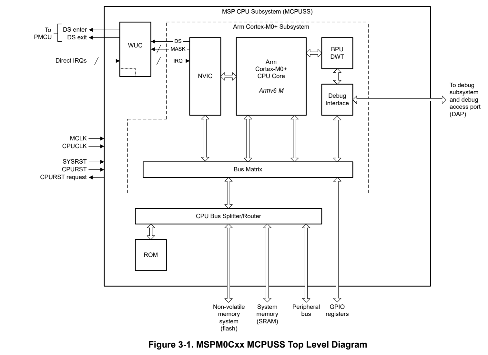
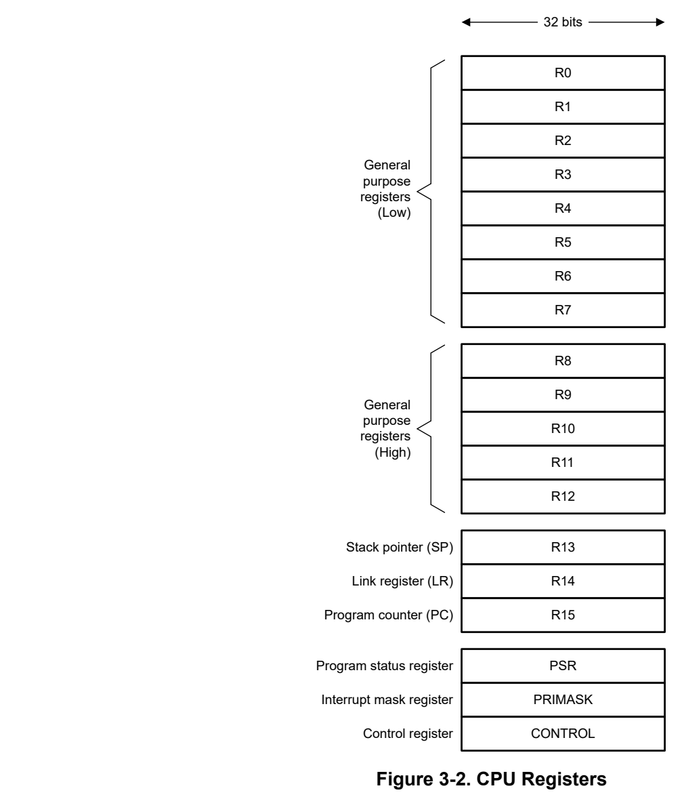
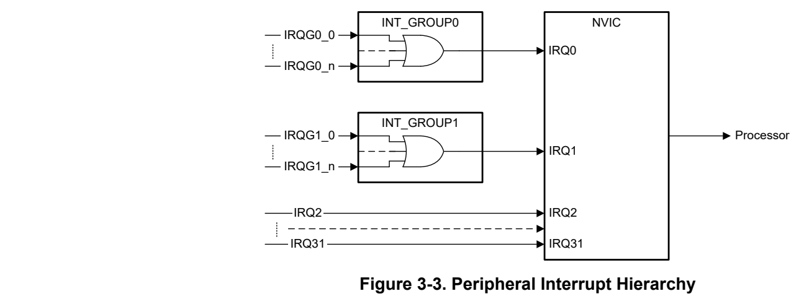

# 3 CPU (pp. 204-229)

### 3.1 Overview 205 (p. 204)

3.2 Arm Cortex-M0+ CPU 205

### 3.3 Interrupts and Exceptions 209 (p. 204)

### 3.4 CPU Peripherals 216 (p. 204)

### 3.5 Read-Only Memory (ROM) 218 (p. 204)

### 3.6 CPUSS Registers 219 (p. 204)

### 3.7 WUC Registers 227 (p. 204)

### 3.1 Overview (p. 205)

The MSP CPU subsystem (MCPUSS) contains the central processing unit (CPU) along with associated supporting logic and read-only memory (ROM). The functional blocks that comprise the MCPUSS include:

- The Arm Cortex-M0+ 32-bit CPU and internal peripherals

- The CPU bus splitter and router

- The interrupt management logic and DEEPSLEEP entry and exit logic

- The nonvolatile memory system prefetch and cache logic

- The CPU debug interface to the debug subsystem ( DEBUGSS)

- The read-only memory (ROM) used for the BCR and BSL

The top level architecture of the MCPUSS is shown in .

*Figure 3-1. MSPM0Cxx MCPUSS Top Level Diagram (p. 205)*

3.2 Arm Cortex-M0+ CPU

The MCPUSS contains an energy-efficient Arm Cortex-M0+ CPU implementing the Armv6-M instruction set architecture (ISA) with support for CPU clock speeds up to 32MHz. The Cortex-M0+ is a Von Neumann style 32-bit processor with a 2-stage ultra-low power pipeline and a single-cycle access port to the GPIO registers for efficient GPIO manipulation.

The Cortex-M0+ implementation on MSPM0Cxx devices has the following features:

- Up to 32MHz execution frequency

- Support for 32-bit word instruction fetches

- Single cycle 32×32 multiply instruction

- User and privileged execution modes

- Integrated 24-bit system tick timer (SYSTICK)

- Up to four hardware breakpoints and one hardware watchpoint for debug

- Reset-all-registers support

- Vector table offset support

The Cortex-M0+ architecture enables excellent code density, deterministic interrupt handling, and upwards compatibility with other processor architectures in the Arm Cortex-M family.

A general overview of the Arm Cortex-M0+ is given in this section to provide a basic understanding of the features of the processor. For detailed information on developing with the Arm Cortex-M0+ processor, refer to the Arm Cortex-M0+ Devices Generic User's Guide.

#### 3.2.1 CPU Register File (p. 206)

The Arm Cortex-M0+ processor instructions operate on registers in the CPU register file. The processor contains a register file consisting of 16 standard registers and 3 special registers as shown in Figure 3-2.

*Figure 3-2. CPU Registers (p. 206)*

General Purpose Registers (R0-R12)

The processor provides 13 general purpose registers, R0-R12, for operating on data. Registers R0 to R7 (low registers) are accessible by all instructions which specify a general purpose register. Registers R8 to R12 (high registers) are not accessible by 16-bit instructions but are accessible by any 32-bit instructions which specify a general purpose register.

Stack Pointer Register (R13)

The stack pointer is contained in R13, and can contain the main stack pointer (MSP) or the process stack pointer (PSP) . When the processor is running in handler mode, the main stack pointer (MSP) is always used. When the processor is running in thread mode, the MSP or the process stack pointer (PSP) can be used, depending on the configuration of the SPSEL bit in the CONTROL register.

After a CPURST, the processor automatically and unconditionally fetches the default stack pointer from the first address of main flash (0x0000.0000) as the main stack pointer (MSP).

Link Register (R14)

R14 serves as the link register and contains the return value of function calls as well as exceptions. The link register must be set before being used as it is not reset to any known value. It is accessible in privileged and unprivileged mode.

Program Counter Register (R15)

The program counter register (R15) contains the address of the next instruction to be executed. The PC is accessible in privileged and unprivileged mode.

After a CPURST, the processor automatically and unconditionally fetches the default PC from the second word of main flash (0x0000.0004).

Special Registers

Special registers include the program status register (PSR), the interrupt mask register (PRIMASK), and the control register (CONTROL). Special registers are typically accessed by using the CPS, MRS, and MSR system instructions.

- Program Status Register (PSR): The PSR is a combination of the application status (APSR), interrupt status (IPSR), and execution status (EPSR) registers. Application software can access the PSR with MRS and MSR instructions, accessing either the complete PSR or a combination of one or more registers, with some restrictions. The PSR registers can be accessed with MRS and MSR instructions using the mnemonics given in Table 3-1. – The application status register (APSR) contains the N, Z, C, and V flags which are used by the processor to evaluate conditional branch instructions. These bits are located in BIT31, BIT30, BIT29, and BIT28 of the PSR, respectively. – The interrupt status register (IPSR) reports the current exception number for a currently executing exception when in handler mode. In thread mode it reads as zero. The processor ignores writes to this register. The exception number field is presented in from BIT0 to BIT5 of the PSR. – The execution status register (EPSR) contains the T bit (BIT24), which defines whether the processor is in Thumb state. This bit cannot be read or written by software, but it is used by the processor.

- Interrupt Mask Register (PRIMASK): BIT0 of the PRIMASK register (PM) can be used to mask all interrupts to the processor which have configurable priority (see Section 3.3). This can be thought of as a global peripheral interrupt mask control. The processor ignores unprivileged writes to PRIMASK. Clearing PM to 0 enables interrupts. Setting PM to 1 disables interrupts. The CPS instruction can be used to change the PM bit value in the PRIMASK register.

- Control Register (CONTROL): The control register can be used to define whether code executing in thread mode is privileged or unprivileged by clearing or setting the nPRIV bit (BIT0), respectively. It can also be used

to select the stack pointer used in R13 as either the main stack pointer (MSP) or process stack pointer (PSP) by clearing or setting the SPSEL bit (BIT1), respectively. A CPURST clears the CONTROL register to zero. The processor ignores unprivileged writes to the CONTROL register. The SPSEL stack pointer selection bit is updated by the processor automatically when entering and returning from exceptions. Note that software must implement an ISB barrier instruction after writing to CONTROL to ensure that any changes take effect before the next application instruction is executed by the processor.

**Table 3-1. Program Status Register (PSR) Access Mnemonics (p. 208)**

| Mnemonic | Subregisters Included |
| --- | --- |
| APSR | APSR |
| IPSR | IPSR |
| EPSR | EPSR |
| IAPSR | IPSR and APSR |
| EAPSR | EPSR and APSR |
| XPSR | APSR, IPSR, EPSR |
| IEPSR | IPSR and EPSR |

#### 3.2.2 Stack Behavior (p. 208)

The Arm Cortex-M0+ processor implements a full descending stack protocol. The stack pointer register (SP) always indicates the location of the last stacked data. When new data is added to the call stack, the SP value is decremented and the data is written to the location indicated by the SP after being decremented.

The Arm Cortex-M0+ supports managing two independent stacks with two pointers: the main stack (MSP) and the process stack (PSP).

#### 3.2.3 Execution Modes and Privilege Levels (p. 208)

The processor supports two primary modes of execution:

- Thread mode (for executing application software)

- Handler mode (for handling processor exceptions and peripheral interrupts)

By default, the processor is in thread mode out of reset. If an exception is issued to the processor, the processor will handle the exception in handler mode and return to thread mode after handler execution is complete. Code running in thread mode can be configured as being privileged or unprivileged, based on the configuration of the processor's internal CONTROL register. Code running in handler mode always executes as privileged.

In general, code which executes as privileged has complete control of the processor configuration, including control of the , NVIC, and SCB. Only privileged code can change the privilege level for code running in thread mode.

Code that is executing in thread mode in an unprivileged state cannot access the previously mentioned resources ( NVIC, SCB).

#### 3.2.4 Address Space and Supported Data Sizes (p. 208)

MSPM0 devices implement a flat memory map with a 32-bit byte-addressable address space. Byte addresses32 are unsigned numbers ranging from zero to 2 -1.

Address Space The processor sees the address space as containing 2 30 32-bit words, with each word being word-aligned (4-byte aligned). Pointers are always 32 bits, and stack operations (for example, push , pop) increment the stack pointer by 4 addresses (4 bytes). Address calculations by the processor wrap around if they overflow or underflow the 32-bit memory space.

Instruction fetches by the processor are always 16-bit half-word aligned.

Data reads by the processor must be naturally aligned (for example, words must be word aligned, half words must be half-word aligned, etc.).

Supported Data Sizes

The processor supports 8-bit byte, 16-bit half-word, and 32-bit word data sizes. Signed and unsigned data is supported, and signed data is stored in CPU registers in 32-bit two's complement format. The Armv6-M instruction set does not provide native instructions supporting operations on 64-bit double-word data.

Load operations from memory to a CPU register can be signed or unsigned when the data size is less than 32 bits. When loading unsigned half-word or byte data to a CPU register, the value is zero-extended to 32 bits automatically. When loading signed half-word or byte data to a CPU register, the value is sign-extended to 32 bits automatically.

Stores from CPU registers to memory are sign agnostic.

All instruction and data accesses use little endian byte order.

### 3.3 Interrupts and Exceptions (p. 209)

Peripheral interrupt exceptions and system exceptions temporarily pause the processor's normal execution flow so that the processor can be used to handle an event.

The following can cause interruption of normal execution flow:

- A CPURST

- A fault exception in the system (HardFault)

- Execution of a supervisor call instruction (SVCall)

- Setting of a pending supervisor service request (PendSV)

- An enabled peripheral interrupt (IRQ)

- A breakpoint instruction (for debug)

Exception State Each exception source to the processor will be in one of the below states at any given point in time:

- Inactive (not active, not pending)

- Pending (waiting to be serviced by the processor)

- Active (actively being serviced by the processor)

- Active and pending (actively being serviced by the processor when the same source generates another exception)

Exception Prioritization, Entry, and Exit

Exceptions are prioritized by the processor together with the nested vectored interrupt controller ( NVIC). Each exception has either a fixed priority (reset, hard fault) or a configurable priority (SVCall, PendSV, peripheral IRQs). Exceptions with configurable priority can be disabled by application software running in privileged mode. Exceptions with fixed priority cannot be disabled.

The processor exception model supports preemption, tail-chaining, and late-arrival features to boost exception handling performance:

- In the preemption case, if an exception of higher priority is pending when an exception of lower priority is executing, the higher priority exception will preempt the ongoing handler servicing the lower priority exception.

- In the tail-chaining case, if a valid-for-entry exception is pending at the time of completion of an exception handler, then the application context is not restored from the stack and control is given immediately to the pending exception.

- In the late-arriving case, if a higher priority exception occurs during entry to a lower priority exception, the higher priority exception will be serviced first after the processor state is saved to the stack. Once the higher

priority exception handling is complete, the lower priority exception (which is still pending) is serviced based on the tail-chaining procedure.

An exception entry is issued if and when all of the following are true:

- An exception is in a pending state

- The priority of the pending exception is higher than the limit set by the exception mask register (PRIMASK)

- The processor is currently in either thread mode (not servicing an exception) or the newly pending exception is higher priority than the exception which is currently being serviced (resulting in a preemption)

Processor exceptions are vectored. When an exception occurs, the current processor state is pushed onto the stack which was active at the time of the event, and execution is vectored to the entry point address in the vector table corresponding to the exception which is to be processed.

If the exception is tail-chained to a previous handler which has completed, then there is no need to push any state to the stack and the interrupt service routine can be vectored to immediately. Likewise, if the exception is higher priority than a previous exception which started entry but did not complete entry, then there is no need to save the context again (late arrival).

Upon completion of an exception handler, if there is no exception pending which needs to be handled then the processor will pop the state from the stack and restore the processor to the previous state which it was in when the exception occurred.

#### 3.3.1 Peripheral Interrupts (IRQs) (p. 210)

Peripheral interrupt functionality is managed by several components on the device:

- The nested vectored interrupt controller ( NVIC)

- One or more interrupt groups (INT_GROUP)

- The wake-up controller (WUC)

MSPM0 devices include an Arm nested vectored interrupt controller (NVIC) with the Cortex-M0+ CPU for managing peripheral interrupts. The NVIC operation is tightly integrated with the processor and supports up to 32 native peripheral interrupt sources.

In addition to the NVIC, interrupt grouping modules can be present on a device to enable interfacing of more than 32 peripheral interrupts to the NVIC. High-priority interrupt sources that might require preemption capability are mapped directly to the NVIC and behave like normal NVIC interrupts. Lower priority interrupt sources which do not commonly require preemption capability are mapped to an interrupt grouping module, the output of which is then mapped to the NVIC as a native NVIC interrupt source. This routing arrangement is shown in Figure 3-3.

*Figure 3-3. Peripheral Interrupt Hierarchy (p. 210)*

The wake-up controller (WUC) determines if the PD1 power domain (containing the processor) needs to be powered up to service a peripheral interrupt if the PD1 domain is powered down in STOP or STANDBY mode.

##### 3.3.1.1 Nested Vectored Interrupt Controller (NVIC) (p. 211)

The nested vectored interrupt controller (NVIC) is an industry-standard Arm component which interfaces peripheral interrupts (which are external to the processor) into the CPU. The NVIC supports connection of up to 32 native peripheral interrupt sources.

The NVIC is configured through memory-mapped registers in the system private peripheral bus ( PPB) region. See Table 3-2 for the list of NVIC registers. The software development kit (SDK) provided with the devices supports the standard Arm Cortex Microcontroller Software Interface Standard (CMSIS) register access definitions for the NVIC. Application software must use 32-bit aligned, word-size transactions when accessing any NVIC register.

In addition to interfacing peripheral interrupts to the processor, the NVIC also supports programmable priority for each interrupt.

Enabling and Disabling Interrupts

Peripheral interrupt enables can be read, set, and cleared through the interrupt set-enable (ISER) and interrupt clear-enable (ICER) registers in the NVIC. The 32 interrupts are mapped to the ISER and ICER registers with interrupt zero in the BIT0 position (LSB) and interrupt 31 in the BIT31 position (MSB) of each register. To enable an interrupt, set the corresponding enable bit in the ISER register. Writing a '0' to ISER has no effect. It is possible to read the ISER register to determine which interrupts are enabled. Upon a read, a '1' indicates that an interrupt is enabled; a '0' indicates disabled. To disable an interrupt, set the corresponding enable bit in the ICER register. Writing a '0' to ICER has no effect.

Note In addition to enabling a peripheral interrupt at the NVIC, it is generally necessary to also configure the interrupt configuration of the corresponding peripheral as well. Most peripherals have multiple interrupt sources, which are merged together in the peripheral to source a single NVIC interrupt. Masking of individual peripheral interrupts is done within the peripheral's interrupt management registers.

In the event that an interrupt is disabled in the NVIC, if the interrupt is asserted by the corresponding peripheral then the NVIC interrupt will go to a pending state but the processor is not interrupted. If an interrupt is disabled when in an active state (when a handler is running) it will remain active until the exception handler returns or a reset occurs, but no further activations will happen.

Note If a peripheral asserts an interrupt to the NVIC, but that peripheral's interrupt in the NVIC is disabled, the device may remain in a higher power mode than expected as the wake-up controller (WUC) is holding an event for the processor. To prevent this situation, ensure peripheral interrupts are masked at the peripheral directly, versus only masking interrupts at the NVIC.

Setting and Clearing Pending Interrupt Status

Pending interrupt status can be read, set, and cleared through the interrupt set-pending (ISPR) and interrupt clear-pending (ICPR) registers in the NVIC. The 32 interrupts are mapped to the ISPR and ICPR registers with interrupt zero in the BIT0 position (LSB) and interrupt 31 in the BIT31 position (MSB) of each register. To read if an interrupt is pending, read either the ISPR or the ICPR. Upon a read, a '1' indicates that an interrupt is pending; a '0' indicates not pending. To set an interrupt to a pending state through software, set the corresponding bit in the ISPR register. Writing a '0' to ISPR has no effect. To clear an interrupt pending state, set the corresponding bit in the ICPR register. Writing a '0' to ICPR has no effect. Note that if a peripheral interrupt condition is still present, the pending state will be set again by hardware even if it is cleared.

Setting Interrupt Priority

Interrupts on the NVIC have programmable priority. There are four priority levels possible. Priority is set by programming the eight IPRx registers in the NVIC. Each priority field is 8 bits in length, and the priority for 4 interrupts is configured per 32-bit register. The Arm Cortex-M0+ only implements the most significant 2 bits of each 8-bit priority field (giving the 4 priority levels). Lower priority values have higher priority. System exceptions (reset, NMI, hard fault) have fixed priorities of -3, -2, and -1, respectively. As such, these exceptions always have higher priority than peripheral interrupts. Peripheral interrupt priorities are programmable as 0, 64, 128, or 192, with 0 being highest priority and 192 being lowest priority.

If the processor is currently handling an exception, it can only be preempted by a higher priority exception. In the event that there are multiple exceptions in a pending state which all have the same priority level assigned, the exception with the lowest exception number is taken first.

Note Application software must not change the priority of an interrupt while the corresponding interrupt is either active (being handled) or enabled. Doing so can result in unpredictable behavior.

**Table 3-2. Arm Cortex-M0+ NVIC Registers (p. 212)**

| Address | Register | CMSIS | Description |
| --- | --- | --- | --- |
| 0xE000.E100 | NVIC_ISER | NVIC->ISER[0] | Interrupt set-enable register |
| 0xE000.E180 | NVIC_ICER | NVIC->ICER[0] | Interrupt clear-enable register |
| 0xE000.E200 | NVIC_ISPR | NVIC->ISPR[0] | Interrupt set-pending register |
| 0xE000.E280 | NVIC_ICPR | NVIC->ICPR[0] | Interrupt clear-pending register |
| 0xE000.E400 | NVIC_IPR0 | NVIC->IP[0] | Interrupt priority register (0-3) |
| 0xE000.E404 | NVIC_IPR1 | NVIC->IP[1] | Interrupt priority register (4-7) |
| 0xE000.E408 | NVIC_IPR2 | NVIC->IP[2] | Interrupt priority register (8-11) |
| 0xE000.E40C | NVIC_IPR3 | NVIC->IP[3] | Interrupt priority register (12-15) |
| 0xE000.E410 | NVIC_IPR4 | NVIC->IP[4] | Interrupt priority register (16-19) |
| 0xE000.E414 | NVIC_IPR5 | NVIC->IP[5] | Interrupt priority register (20-23) |
| 0xE000.E418 | NVIC_IPR6 | NVIC->IP[6] | Interrupt priority register (24-27) |
| 0xE000.E41C | NVIC_IPR7 | NVIC->IP[7] | Interrupt priority register (28-31) |

##### 3.3.1.2 Interrupt Groups (p. 212)

To support mapping of more than 32 peripheral interrupt sources to the NVIC, certain MSPM0 devices include interrupt grouping logic (INT_GROUP) in the MCPUSS to combine several interrupts together to source one native NVIC interrupt.

The INT_GROUP interrupt grouping uses the MSPM0 event management register structure with the key difference being that all peripheral interrupt sources to the interrupt group are always unmasked (always enabled) such that no additional enable configuration is needed beyond the peripheral interrupt configuration and the NVIC configuration. The IMASK register itself is read-only and hardwired to enable all sources to the interrupt group. Figure 3-4 shows the INT_GROUP structure.

Because no masking control is required, application software only needs to interface with the interrupt index (IIDX) register to efficiently handle a peripheral interrupt which is registered to the NVIC through an INT_GROUP.

Application software can read the IIDX register in the INT_GROUP to determine and clear the highest priority pending peripheral interrupt in the group. A read to IIDX will return an index corresponding to the highest priority peripheral which set an interrupt. The read action will also simultaneously clear the RIS and MIS bits corresponding to the highest priority interrupt whose index was returned by the read. The value read from the IIDX register can then be used in a case statement, as shown below.

void GROUP_HANDLER(void) { switch(IIDX) { case 0: // no IRQ pending break; case 1: // IRQ[0] do_peripheral_1_ISR(); break; case 2: // IRQ[1] do_peripheral_2_ISR(); break; default: // out of range illegal(); } }

Usage

Because peripheral interrupts that are grouped together into an INT_GROUP source a single NVIC interrupt, it is not possible to have one peripheral interrupt in a group preempt the execution of an active handler for the interrupt group. For example, take the scenario where the WWDT0 interrupt request line and the PMCU interrupt request line are connected to INT_GROUP0, and INT_GROUP0 sources NVIC peripheral interrupt 0. If the WWDT0 interrupt is asserted, INT_GROUP0 will assert an interrupt request to the NVIC. If no higher priority interrupt is active, the NVIC will vector the processor to the INT_GROUP0 handler. Application software can then read the INT_GROUP0 IIDX register to determine that it was the WWDT0 that triggered the INT_GROUP0 interrupt on the NVIC, and software can jump to the WWDT0 handler function.

If the PMCU asserts its interrupt line while the processor is still in handler mode servicing the WWDT0 function (which is really a part of the INT_GROUP0 handler), the PMCU interrupt can not preempt the WWDT0 handler. When the WWDT0 handler completes, The INT_GROUP0 handler will return. At that time, the processor will see that the INT_GROUP0 request was asserted again (this time, due to the PMCU), and it will tail-chain a second entry to the interrupt handler. This time, application software will read the IIDX and determine that the PMCU was the cause of the INT_GROUP0 interrupt being asserted to the NVIC.

If there are two or more peripheral interrupts pending to a single interrupt group, software can set the priority with which the interrupts are handled by first reading the RIS or MIS register to test which peripheral interrupts are asserted, followed by executing the software-determined priority. Alternatively, if the interrupt index (IIDX) register is used, the interrupt group hardware will return the highest priority index based on the index order.

##### 3.3.1.3 Wake Up Controller (WUC) (p. 213)

The wake up controller (WUC) is responsible for monitoring for assertion of interrupts when the processor is powered down in the STOP or STANDBY operating mode. In these modes, the entire PD1 power domain is power gated, and as such, the processor and NVIC are not available to check for interrupts. The WUC retains a copy of which peripheral interrupt sources to the NVIC were enabled when the processor entered STOP or STANDBY mode. In the event that an enabled interrupt is issued, the WUC will handshake with the PMCU to bring the device out of STOP or STANDBY mode so that the CPU can service the interrupt. The WUC will capture the interrupt state and present it to the NVIC and processor when the processor is brought up, such that the processor will see the interrupt even if the raw interrupt status of the peripheral is removed before the processor finishes powering up to service the interrupt.

The WUC requires no configuration by application software upon entry to or exit from low-power modes, and operation is transparent to application software.

#### 3.3.2 Interrupt and Exception Table (p. 214)

The Arm Cortex-M0+ interrupt vector table is 48 words long (192 bytes). The complete platform interrupt and exception table with vector table addresses is given in Table 3-3.

See the device-specific data sheet for a complete list of which interrupts a particular device supports.

**Table 3-3. MSPM0 Platform Processor Interrupt and Exception Table (pp. 214-215)**

| Exception Number | NVIC Number (1) | Priority Group | Exception or Interrupt | Vector Table Address | Vector Description |
| --- | --- | --- | --- | --- | --- |
| - | - | - | - | 0x0000.0000 | Stack pointer |
| 1 | - | -3 | Reset | 0x0000.0004 | Reset vector |
| 2 | - | -2 | NMI | 0x0000.0008 | NMI handler |
| 3 | - | -1 | Hard fault | 0x0000.000C | Hard fault handler |
| 4 | - | - | Reserved | 0x0000.0010 | - |
| 5 | - | - | Reserved | 0x0000.0014 | - |
| 6 | - | - | Reserved | 0x0000.0018 | - |
| 7 | - | - | Reserved | 0x0000.001C | - |
| 8 | - | - | Reserved | 0x0000.0020 | - |
| 9 | - | - | Reserved | 0x0000.0024 | - |
| 10 | - | - | Reserved | 0x0000.0028 | - |
| 11 | - | Selectable | SVCall | 0x0000.002C | Supervisor call handler |
| 12 | - | - | Reserved | 0x0000.0030 | - |
| 13 | - | - | Reserved | 0x0000.0034 | - |
| 14 | - | Selectable | PendSV | 0x0000.0038 | Pended supervisor handler |
| 15 | - | Selectable | SysTick | 0x0000.003C | SysTick handler |
| 16 | 0 | Selectable | Device Interrupt 0 | 0x0000.0040 | Handler for Device Interrupt 0 |
| 17 | 1 | Selectable | Device Interrupt 1 | 0x0000.0044 | Handler for Device Interrupt 1 |
| 18 | 2 | Selectable | Device Interrupt 2 | 0x0000.0048 | Handler for Device Interrupt 2 |
| 19 | 3 | Selectable | Device Interrupt 3 | 0x0000.004C | Handler for Device Interrupt 3 |
| 20 | 4 | Selectable | Device Interrupt 4 | 0x0000.0050 | Handler for Device Interrupt 4 |
| 21 | 5 | Selectable | Device Interrupt 5 | 0x0000.0054 | Handler for Device Interrupt 5 |
| 22 | 6 | Selectable | Device Interrupt 6 | 0x0000.0058 | Handler for Device Interrupt 6 |
| 23 | 7 | Selectable | Device Interrupt 7 | 0x0000.005C | Handler for Device Interrupt 7 |
| 24 | 8 | Selectable | Device Interrupt 8 | 0x0000.0060 | Handler for Device Interrupt 8 |
| 25 | 9 | Selectable | Device Interrupt 9 | 0x0000.0064 | Handler for Device Interrupt 9 |
| 26 | 10 | Selectable | Device Interrupt 10 | 0x0000.0068 | Handler for Device Interrupt 10 |
| 27 | 11 | Selectable | Device Interrupt 11 | 0x0000.006C | Handler for Device Interrupt 11 |
| 28 | 12 | Selectable | Device Interrupt 12 | 0x0000.0070 | Handler for Device Interrupt 12 |
| 29 | 13 | Selectable | Device Interrupt 13 | 0x0000.0074 | Handler for Device Interrupt 13 |
| 30 | 14 | Selectable | Device Interrupt 14 | 0x0000.0078 | Handler for Device Interrupt 14 |
| 31 | 15 | Selectable | Device Interrupt 15 | 0x0000.007C | Handler for Device Interrupt 15 |
| 32 | 16 | Selectable | Device Interrupt 16 | 0x0000.0080 | Handler for Device Interrupt 16 |
| 33 | 17 | Selectable | Device Interrupt 17 | 0x0000.0084 | Handler for Device Interrupt 17 |
| 34 | 18 | Selectable | Device Interrupt 18 | 0x0000.0088 | Handler for Device Interrupt 18 |
| 35 | 19 | Selectable | Device Interrupt 19 | 0x0000.008C | Handler for Device Interrupt 19 |
| 37 | 21 | Selectable | Device Interrupt 21 | 0x0000.0094 | Handler for Device Interrupt 21 |
| 38 | 22 | Selectable | Device Interrupt 22 | 0x0000.0098 | Handler for Device Interrupt 22 |
| 39 | 23 | Selectable | Device Interrupt 23 | 0x0000.009C | Handler for Device Interrupt 23 |
| 40 | 24 | Selectable | Device Interrupt 24 | 0x0000.00A0 | Handler for Device Interrupt 24 |
| 41 | 25 | Selectable | Device Interrupt 25 | 0x0000.00A4 | Handler for Device Interrupt 25 |
| 42 | 26 | Selectable | Device Interrupt 26 | 0x0000.00A8 | Handler for Device Interrupt 26 |
| 43 | 27 | Selectable | Device Interrupt 27 | 0x0000.00AC | Handler for Device Interrupt 27 |
| 44 | 28 | Selectable | Device Interrupt 28 | 0x0000.00B0 | Handler for Device Interrupt 28 |
| 45 | 29 | Selectable | Device Interrupt 29 | 0x0000.00B4 | Handler for Device Interrupt 29 |
| 46 | 30 | Selectable | Device Interrupt 30 | 0x0000.00B8 | Handler for Device Interrupt 30 |
| 47 | 31 | Selectable | Device Interrupt 31 | 0x0000.00BC | Handler for Device Interrupt 31 |

(1) The NVIC number also indicates the relative interrupt priority if multiple NVIC interrupts have the same group priority. However, an interrupt does not preempt an active handler for another interrupt with the same group priority, even if the interrupt has a higher (numerically lower) NVIC position. For preemption to occur, the new interrupt must be configured to a higher priority group (numerically lower).

Non-Maskable Interrupt (NMI)

The CPU implements a nonmaskable interrupt, which handles critical interrupts which must be serviced immediately by the processor. The NMI interrupt sources are managed by SYSCTL. See the corresponding NMI information in the SYSCTL section of the PMCU chapter.

INT_GROUP0 Peripheral Interrupt Group

The INT_GROUP0 peripheral interrupt group sources an interrupt to NVIC0 (exception 16) if any peripheral in the group has a pending interrupt. The peripheral interrupts mapped to INT_GROUP0 are given in Table 3-4.

Note Not all of the devices support Interrupt Group or NMI (non-maskable interrupt). Refer to the device-specific data sheet to see which devices support them.

**Table 3-4. INT_GROUP0 Interrupts (p. 215)**

| Priority | IIDX Index | Interrupt | Description |
| --- | --- | --- | --- |
| 0 | 1 | WWDT0 | WWDT0 interrupt handler |
| 1 | 2 | WWDT1 | WWDT1 interrupt handler |
| 2 | 3 | DEBUGSS | Debug subsystem interrupt handler |
| 3 | 4 | FLASHCTL | Flash controller interrupt handler |
| 4 | 5 | WUC FSUB0 | Generic event subscriber 0 interrupt handler |
| 5 | 6 | WUC FSUB1 | Generic event subscriber 1 interrupt handler |
| 6 | 7 | PMCU (SYSCTL) | PMCU (system controller) interrupt handler |
| 7 | 8 | Reserved | - |

INT_GROUP1 Peripheral Interrupt Group

The INT_GROUP1 peripheral interrupt group sources an interrupt to NVIC1 (exception 17) if any peripheral in the group has a pending interrupt. The peripheral interrupts mapped to INT_GROUP1 are given in Table 3-5.

Note Not all of the devices support Interrupt Group or NMI (non-maskable interrupt). Refer to the device-specific data sheet to see which devices support them.

**Table 3-5. INT_GROUP1 Interrupts (p. 216)**

| Priority | IIDX Index | Interrupt | Description |
| --- | --- | --- | --- |
| 0 | 1 | GPIO0 | GPIO0 interrupt handler |
| 1 | 2 | GPIO1 | GPIO1 interrupt handler |
| 2 | 3 | COMP0 | COMP0 interrupt handler |
| 3 | 4 | COMP1 | COMP1 interrupt handler |
| 4 | 5 | COMP2 | COMP2 interrupt handler |
| 5 | 6 | TRNG | TRNG interrupt handler |
| 6 | 7 | Reserved | - |
| 7 | 8 | Reserved | - |

#### 3.3.3 Processor Lockup Scenario (p. 216)

There are several exception conditions which can cause the processor to enter a lockup state. On MSPM0 devices, a processor lockup is considered a fatal fault which always triggers a SYSRST to clear the lockup condition and restart the system.

A lockup state is entered by the processor if an SVC (supervisor call) or fault condition occurs while the processor is handling an exception with priority of -1 or higher (numerically lower). Such a fault is considered by the processor to be unexpected under normal operating conditions.

The following examples are conditions that can trigger a lockup state in the processor:

- The processor cannot fetch the stack pointer or reset vector at reset

- The processor cannot fetch the NMI vector

- The processor cannot fetch the hard fault vector

- A memory fault occurs when the processor is already handling an exception with priority of -1 or -2 (hard fault or NMI)

- A supervisor call (SVC) occurs when the processor is already handling an exception with priority of -1 or -2 (hard fault or NMI)

- A usage fault or undefined instruction is fetched when the processor is already handling an exception with priority of -1 or -2 (hard fault or NMI)

- A BKPT instruction is executed when the processor is already handling an exception with priority of -1 or -2 (hard fault or NMI)

### 3.4 CPU Peripherals (p. 216)

The Arm Cortex-M0+ includes tightly coupled peripherals for system timing and memory protection.

#### 3.4.1 System Control Block (SCB) (p. 216)

The system control block (SCB) provides system implementation information and system control functionality, as well as configuration, control, and reporting of processor exceptions.

The SCB is configured through memory-mapped registers in the system private peripheral bus ( PPB) region. See Table 3-6 for the list of SCB registers. The software development kit (SDK) provided with the devices supports the standard Arm Cortex Microcontroller Software Interface Standard (CMSIS) register access definitions for the SCB. Application software must use 32-bit aligned, word-size transactions when accessing any SCB register.

**Table 3-6. Arm Cortex-M0+ System Control Block Registers (pp. 216-217)**

| Address | Register | CMSIS | Description |
| --- | --- | --- | --- |
| 0xE000.ED00 | CPUID | SCB->CPUID | Read-only register indicating the CPU type and revision |
| 0xE000.ED04 | ICSR | SCB->ICSR | Provides specific interrupt controls and state |
| 0xE000.ED08 | VTOR | SCB->VTOR | Used to specify the vector table offset from 0x0000.0000 |
| 0xE000.ED0C | AIRCR | SCB->AIRCR | Used to issue a CPU reset request (SYSRESETREQ) |
| 0xE000.ED10 | SCR | SCB->SCR | System control register, used to control low-power mode behavior |
| 0xE000.ED14 | CCR | SCB->CCR | Read-only register indicating behavior of the processor |
| 0xE000.ED1C | SHPR2 | SCB->SHP[2] | Used to configure the priority of the SVCall system handler |
| 0xE000.ED20 | SHPR3 | SCB->SHP[3] | Used to configure the priority of the and PendSV system handlers |

For detailed information on the system control block register configuration, see the SCB section of the Arm Cortex-M0+ devices generic user guide.

#### 3.4.2 System Tick Timer (SysTick) (p. 217)

The system tick timer (SysTick) is a tightly-coupled timer clocked by MCLK, which can be used for system time keeping. The SysTick is available in RUN and SLEEP modes but is not available for use in STOP, STANDBY, or SHUTDOWN modes.

The SysTick is configured through memory-mapped registers in the system private peripheral bus ( PPB) region. See Table 3-7 for the list of SysTick configuration registers. The software development kit (SDK) provided with the devices supports the standard Arm Cortex Microcontroller Software Interface Standard (CMSIS) register access definitions for the SysTick.

The SysTick timer can be used in several different ways, including:

- As an RTOS timer which fires at a programmable rate (for example, 100Hz) and invokes a SysTick routine

- A high-speed alarm timer

- A simple counter used to measure time to completion and time used in an application

- A timeout counter to check that a routine has not timed out within a specified period

The SysTick timer is a simple 24-bit down counter, which counts down from its reload value to zero. Upon reaching zero, SysTick will re-load the value programmed into the reload value register (SYST_RVR) on the next clock cycle, and then again begin counting down to zero.

A SysTick event is generated when the SysTick counter reaches zero, and which point the COUNTFLAG status flag will be set. Reading the SYST_CSR register will clear the COUNTFLAG status bit. Writing to the current value register (SYST_CVR) clears the register and the COUNTFLAG status but does not generate an interrupt to the CPU. Reading SYST_CVR returns the counter value at time of access.

**Table 3-7. SysTick Registers (p. 217)**

| Address | Register | CMSIS | Description |
| --- | --- | --- | --- |
| 0xE000.E010 | SYST_CSR | SysTick->CTRL | Control and status register, used to enable/disable SysTick and its related exception, and to check the COUNTFLAG status |
| 0xE000.E014 | SYST_RVR | SysTick->LOAD | Reload register used to program the counter reload value to set the SysTick interval in MCLK cycles |
| 0xE000.E018 | SYST_CVR | SysTick->VAL | Returns the current value of the SysTick counter; a write clears the counter to zero and clears COUNTFLAG in SYST_CSR |
| 0xE000.E01C | SYST_CALIB | SysTick->CALIB | Not implemented |

Application software must only use 32-bit word-aligned word accesses to the SysTick registers. To initialize the SysTick, follow the steps below: 1. Program the desired reload value (example: to generate a flag every 1000 MCLK cycles, program 999) to SYST_RVR 2. Clear the current value by writing to the SYST_CVR register

Note The SysTick counter does not decrement when the CPU is halted for debug.

### 3.5 Read-Only Memory (ROM) (p. 218)

The MCPUSS contains a read-only memory which contains the executable code for the boot configuration routine (BCR) and bootstrap loader (BSL). The ROM is active after a BOOTRST, or after a SYSRST with BSL entry/exit. The ROM is disabled automatically when the application is started and is not accessible by application software.

### 3.6 CPUSS Registers (p. 219)

Table 3-8 lists the memory-mapped registers for the CPUSS registers. All register offset addresses not listed in Table 3-8 should be considered as reserved locations and the register contents should not be modified.

**Table 3-8. CPUSS Registers (p. 219)**

| Offset | Acronym | Register Name | Section |
| --- | --- | --- | --- |
| 10E0h | EVT_MODE | Event Mode | Section 3.6.1 |
| 10FCh | DESC | Module Description | Section 3.6.2 |
| 1100h | IIDX | Interrupt index | Section 3.6.3 |
| 1108h | IMASK | Interrupt mask | Section 3.6.4 |
| 1110h | RIS | Raw interrupt status | Section 3.6.5 |
| 1118h | MIS | Masked interrupt status | Section 3.6.6 |
| 1120h | ISET | Interrupt set | Section 3.6.7 |
| 1128h | ICLR | Interrupt clear | Section 3.6.8 |

Complex bit access types are encoded to fit into small table cells. Table 3-9 shows the codes that are used for access types in this section.

**Table 3-9. CPUSS Access Type Codes (p. 219)**

| Access Type | Code | Description |
| --- | --- | --- |
| Read Type |  |  |
| R | R | Read |
| Reset or Default Value |  |  |
| - n |  | Value after reset or the default value |

### 3.6.1 [CPUSS.EVT_MODE] Offset: 10E0h | Reset: 00000000h (p. 220)

EVT_MODE is shown in Figure 3-5 and described in Table 3-10.

Event mode register. It is used to select whether each line is disabled, in software mode (software clears the RIS) or in hardware mode (hardware clears the RIS)

> **Bit Map**: `[31-2] RESERVED (R, 0h)` | `[1-0] INT_CFG (R, 0h)`

**Table 3-10. EVT_MODE Register Field Descriptions (p. 220)**

| Bit | Field | Type | Reset | Description |
| --- | --- | --- | --- | --- |
| 31-2 | RESERVED | R | 0h |  |
| 1-0 | INT_CFG | R | 0h | Event line mode select; 0h = The interrupt or event line is disabled.; 1h = Event handled by software. Software must clear the associated RIS flag.; 2h = Event handled by hardware. The hardware (another module) clears automatically the associated RIS flag. |

### 3.6.2 [CPUSS.DESC] Offset: 10FCh | Reset: 00000000h (p. 221)

DESC is shown in Figure 3-6 and described in Table 3-11.

This register identifies the peripheral and its exact version.

> **Bit Map**: `[31-16] MODULEID (R, 0h)` | `[15-12] FEATUREVER (R, 0x0)` | `[11-8] RESERVED (R, 0h)` | `[7-4] MAJREV (R, 0x0)` | `[3-0] MINREV (R, 0x0)`

**Table 3-11. DESC Register Field Descriptions (p. 221)**

| Bit | Field | Type | Reset | Description |
| --- | --- | --- | --- | --- |
| 31-16 | MODULEID | R | 0h | Module identification contains a unique peripheral identification number. The assignments are maintained in a central database for all of the platform modules to ensure uniqueness. |
| 15-12 | FEATUREVER | R | 0x0 | Feature Set for the module *instance* |
| 11-8 | RESERVED | R | 0h |  |
| 7-4 | MAJREV | R | 0x0 | Major rev of the IP |
| 3-0 | MINREV | R | 0x0 | Minor rev of the IP |

### 3.6.3 [CPUSS.IIDX] Offset: 1100h | Reset: 00000000h (p. 222)

IIDX is shown in Figure 3-7 and described in Table 3-12.

Interrupt index register. This read-only register provides the interrupt index of the pending interrupt with the highest priority. It also indicates if no interrupt is pending. The priority order is fixed: lower index equals higher priority. Alternatively to the use of IIDX, users can implement their own prioritization schemes using other registers that expose the full set of interrupts that have occurred. On each read, only one interrupt is indicated. On a read, the current interrupt (highest priority) is automatically cleared by the hardware and the corresponding interrupt flags in the RIS and MIS are cleared as well. After a read from the CPU (not from the debug interface), the register must be updated with the next highest priority interrupt or indicate that no interrupt is pending. Only interrupts which are selected via IMASK are indicated.

> **Bit Map**: `[31-8] RESERVED (R, 0h)` | `[7-0] STAT (R, 0h)`

**Table 3-12. IIDX Register Field Descriptions (p. 222)**

| Bit | Field | Type | Reset | Description |
| --- | --- | --- | --- | --- |
| 31-8 | RESERVED | R | 0h |  |
| 7-0 | STAT | R | 0h | Interrupt index status; 0h = No pending interrupt; 1h = Interrupt 0; 2h = Interrupt 1; 3h = Interrupt 2; 4h = Interrupt 3; 5h = Interrupt 4; 6h = Interrupt 5; 7h = Interrupt 6; 8h = Interrupt 7 |

### 3.6.4 [CPUSS.IMASK] Offset: 1108h | Reset: 000000FFh (p. 223)

IMASK is shown in Figure 3-8 and described in Table 3-13.

Interrupt Mask. If a bit is set, then corresponding interrupt is unmasked. Unmasking the interrupt causes the raw interrupt to be visible in IIDX, as well as MIS.”

> **Bit Map**: `[31-8] RESERVED (R, 0h)` | `[7-0] INT (R, 0xFF)`

**Table 3-13. IMASK Register Field Descriptions (p. 223)**

| Bit | Field | Type | Reset | Description |
| --- | --- | --- | --- | --- |
| 31-8 | RESERVED | R | 0h |  |
| 7-0 | INT | R | 0xFF | Masks the corresponding interrupt; 1h = Interrupt 0; 2h = Interrupt 1; 4h = Interrupt 2; 8h = Interrupt 3; 10h = Interrupt 4; 20h = Interrupt 5; 40h = Interrupt 6; 80h = Interrupt 7 |

### 3.6.5 [CPUSS.RIS] Offset: 1110h | Reset: 00000000h (p. 224)

RIS is shown in Figure 3-9 and described in Table 3-14.

Raw interrupt status. Reflects all pending interrupts, regardless of masking. The RIS register allows the user to implement a poll scheme. A flag set in this register can be cleared by writing 1 to the ICLR register bit even if the corresponding IMASK bit is not enabled.

> **Bit Map**: `[31-8] RESERVED (R, 0h)` | `[7-0] INT (R, 0h)`

**Table 3-14. RIS Register Field Descriptions (p. 224)**

| Bit | Field | Type | Reset | Description |
| --- | --- | --- | --- | --- |
| 31-8 | RESERVED | R | 0h |  |
| 7-0 | INT | R | 0h | Raw interrupt status for INT; 1h = Interrupt 0; 2h = Interrupt 1; 4h = Interrupt 2; 8h = Interrupt 3; 10h = Interrupt 4; 20h = Interrupt 5; 40h = Interrupt 6; 80h = Interrupt 7 |

### 3.6.6 [CPUSS.MIS] Offset: 1118h | Reset: 00000000h (p. 225)

MIS is shown in Figure 3-10 and described in Table 3-15.

Masked interrupt status. This is an AND of the IMASK and RIS registers.

> **Bit Map**: `[31-8] RESERVED (R, 0h)` | `[7-0] INT (R, 0h)`

**Table 3-15. MIS Register Field Descriptions (p. 225)**

| Bit | Field | Type | Reset | Description |
| --- | --- | --- | --- | --- |
| 31-8 | RESERVED | R | 0h |  |
| 7-0 | INT | R | 0h | Masked interrupt status for INT0; 1h = Interrupt 0; 2h = Interrupt 1; 4h = Interrupt 2; 8h = Interrupt 3; 10h = Interrupt 4; 20h = Interrupt 5; 40h = Interrupt 6; 80h = Interrupt 7 |

### 3.6.7 [CPUSS.ISET] Offset: 1120h | Reset: 00000000h (p. 226)

ISET is shown in Figure 3-11 and described in Table 3-16.

Interrupt set. Allows interrupts to be set by software (useful in diagnostics and safety checks). Writing a 1 to a bit in ISET will set the event and therefore the related RIS bit also gets set. If the interrupt is enabled through the mask, then the corresponding MIS bit is also set.

> **Bit Map**: `[31-8] RESERVED (R, 0h)` | `[7-0] INT (R, 0h)`

**Table 3-16. ISET Register Field Descriptions (p. 226)**

| Bit | Field | Type | Reset | Description |
| --- | --- | --- | --- | --- |
| 31-8 | RESERVED | R | 0h |  |
| 7-0 | INT | R | 0h | Sets INT in RIS register; 1h = Interrupt 0; 2h = Interrupt 1; 4h = Interrupt 2; 8h = Interrupt 3; 10h = Interrupt 4; 20h = Interrupt 5; 40h = Interrupt 6; 80h = Interrupt 7 |

### 3.6.8 [WUC.ICLR] Offset: 1128h | Reset: 00000000h (p. 227)

ICLR is shown in Figure 3-12 and described in Table 3-17.

Interrupt clear. Write a 1 to clear corresponding Interrupt.

> **Bit Map**: `[31-8] RESERVED (R, 0h)` | `[7-0] INT (R, 0h)`

**Table 3-17. ICLR Register Field Descriptions (p. 227)**

| Bit | Field | Type | Reset | Description |
| --- | --- | --- | --- | --- |
| 31-8 | RESERVED | R | 0h |  |
| 7-0 | INT | R | 0h | Clears INT in RIS register; 1h = Interrupt 0; 2h = Interrupt 1; 4h = Interrupt 2; 8h = Interrupt 3; 10h = Interrupt 4; 20h = Interrupt 5; 40h = Interrupt 6; 80h = Interrupt 7 |

### 3.7 WUC Registers (p. 227)

Table 3-18 lists the memory-mapped registers for the WUC registers. All register offset addresses not listed in Table 3-18 should be considered as reserved locations and the register contents should not be modified.

**Table 3-18. WUC Registers (p. 227)**

| Offset | Acronym | Register Name | Section |
| --- | --- | --- | --- |
| 400h | FSUB_0 | Subscriber Port 0 | FSUB_0 Register (Offset = 400h) [Reset = 00h] |
| 404h | FSUB_1 | Subscriber Port 1 | FSUB_1 Register (Offset = 404h) [Reset = 00h] |

### 3.7.1 [WUC.FSUB_0] Offset: 400h | Reset: 00h (p. 227)

FSUB_0 is shown in Figure 3-13 and described in Table 3-19.

Subscriber port

> **Bit Map**: `[31-4] RESERVED (R/W, 0h)` | `[3-0] CHANID (R/W, 0h)`

**Table 3-19. FSUB_0 Register Field Descriptions (p. 228)**

| Bit | Field | Type | Reset | Description |
| --- | --- | --- | --- | --- |
| 31-4 | RESERVED | R/W | 0h |  |
| 3-0 | CHANID | R/W | 0h | 0 = disconnected.; 1-15 = connected to channel ID = CHANID.; 0h = A value of 0 specifies that the event is not connected; Fh = Consult your device data sheet as the actual allowed maximum can be less than 15. |

### 3.7.2 [WUC.FSUB_1] Offset: 404h | Reset: 00h (p. 228)

FSUB_1 is shown in Figure 3-14 and described in Table 3-20.

Subscriber port

> **Bit Map**: `[31-4] RESERVED (R/W, 0h)` | `[3-0] CHANID (R/W, 0h)`

**Table 3-20. FSUB_1 Register Field Descriptions (p. 228)**

| Bit | Field | Type | Reset | Description |
| --- | --- | --- | --- | --- |
| 31-4 | RESERVED | R/W | 0h |  |
| 3-0 | CHANID | R/W | 0h | 0 = disconnected.; 1-15 = connected to channel ID = CHANID.; 0h = A value of 0 specifies that the event is not connected; Fh = Consult your device data sheet as the actual allowed maximum can be less than15. |

Chapter 4
