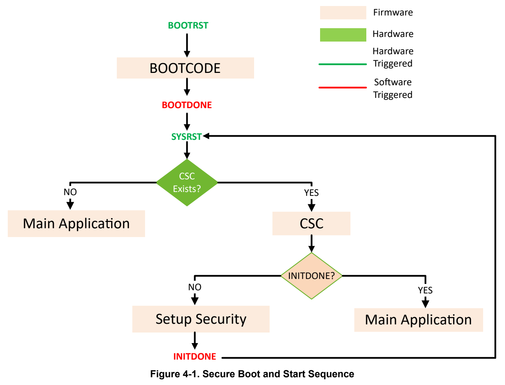

# 4 SECURITY (pp. 229-246)

## SECURITY (p. 229)

### 4.1 Overview (p. 229)

Some MSPM0 devices offer several extensive cybersecurity features as part of the device architecture, including:

- Debug security

- Device identify

- Crypto acceleration

- True random number generation

- Flash write-erase protection

- Flash read-execute protection

- Flash IP protection

- SRAM write-execute mutual exclusion

- Secure boot

- Secure firmware update

- Secure key storage

- Customer secure code

The security architecture decouples mechanisms (controls offered by MSPM0 devices) from policies that are application-defined. This allows for a wide variety of security requirements to be supported.

The overall security configuration offered by MSPM0 devices is implemented in two steps:

1. Secure Boot - TI boot code executes on a BOOTRST and configures the requested security policies. Once boot code finishes execution, the system undergoes a SYSRST followed by the start of Step 2. 2. Customer Secure Code (CSC) - CSC executes from flash memory to further configure security elements. Note that CSC is customer-owned secure software. This two-step secure boot concept enables application-specific policies to be implemented and managed by CSC while standard security enablers are implemented by boot code. When Step 2 has completed execution, the system undergoes a second SYSRST followed by the start of the main application.

In this security model, both TI boot code and CSC are considered trusted. The main application is considered untrusted. When execution jumps to the main application, all security elements are expected to have been configured, including restrictions on debug, memory accesses, key management, and so on.

Note As MSPM0 Security architecture provides a clean separation between policies and mechanisms, it is possible to build applications where no CSC is implemented and the main application execution begins right after BOOTRST.

Note Check the device-specific data sheet to determine if the security architecture features are available.

#### 4.1.1 Secure Boot (p. 230)

In Step 1, boot ROM code configures a set of security elements based on contents of the configuration memory (NONMAIN). This includes:

- Debug Security: Debug access can be allowed unconditionally, disallowed unconditionally or allowed after a successful password verification

- Mass Erase: Mass erase operation can be allowed unconditionally, disallowed unconditionally or allowed after a successful password verification

- Factory Reset: Factory reset operation can be allowed unconditionally, disallowed unconditionally or allowed after a successful password verification

- Write-protection of MAIN flash sectors: MAIN bank contents can be write protected at 1x sector or 8x sector granularity

- Write-protection of configuration memory (NONMAIN): Because boot configuration memory (NONMAIN) holds key security configuration settings, this configuration memory can be write protected to avoid inadvertent or malicious downgrading of security.

- Presence/Absence of Customer Secure Code (CSC): This attribute controls whether a second level of security and trusted flash-based code is provisioned or not.

- Bank Swap Policy: In dual/quad-bank devices, this attribute indicates if the device operates the flash banks in a swap mode or not. If swap mode, then by hardware default, the upper bank (or pair) is enforced read-write access privileges and no execute privilege. The lower bank (or pair) is enforced read-execute access privileges and no write/erase privilege.

- Delay Debug: Security applications can disable debug access during the execution of the CSC. This attribute controls whether debug access is delayed until the end of CSC execution or not.

#### 4.1.2 Customer Secure Code (CSC) (p. 230)

In this step, customer owned secure code executes and implements additional security capabilities:

- Bank swap decision

- Secure firmware update

- Secure key storage

- Flash read-execute protection

- Flash IP protection

- SRAM write-execute mutual exclusion

CSC specifies which bank holds the more recent authenticated application image. If that bank is physical bank 0 (same bank as where CSC is executing from), then bank 1 is read-write only and does not have execute privilege. If the correct application image is determined to be on physical bank 1, then the CSC must issue a bank-swap request.

Besides image authentication, the CSC sets up additional security configurations that are described later in this document. The CSC indicates the end of CSC execution by writing to the SYSCTL.SECCFG.INITDONE register with a PASS value (0x1) along with a KEY value of 0x9d. Successfully writing to the INITDONE register results in a second SYSRST operation during which the bank-swap takes effect, as well as any additional security configurations.

### 4.2 Boot and Startup Sequence (p. 230)

Figure 4-1 illustrates the boot and startup sequence in security enabled applications. At BOOTRST, TI boot-code execution commences. After successful boot, boot-code issues BOOTDONE. At this point, SYSCTL issues a SYSRST to the device to trigger execution from flash memory. Depending on the boot configuration record, this leads either to the start of the main application (if CSC does not exist in this configuration) or to the start of the CSC (if CSC is configured).

CSC is responsible for determining execution bank, memory region protections, secure key initialization into the keystore, etc. When the customer secure code issues INITDONE (by writing to SYSCTL.SECCFG.INITDONE MMR), then SYSCTL issues a second SYSRST. The device again starts execution from 0x0 mapped to flash, and the CSC executes a second time. This time, the CSC will find that INITDONE has already been issued

previously (this is determined by reading the SYSCTL.SECCFG.SECSTATUS.INITDONE bit) and it directly calls the main application.

*Figure 4-1. Secure Boot and Start Sequence (p. 231)*

Note To keep the boot flow compatible with nonsecurity enabled devices, the default settings of boot

| configuration are set to "CSC does not exist" state. | Col 4 |
| --- | --- |
|  | The secure execution flow is the path where CSC_EXISTS = YES. In this case, it may be observed that |
|  | after BOOTRST, two SYSRSTs will be issued before the main application is launched. After first SYSRST, |
|  | the customer startup code gets to execute. It configures security and issues INITDONE. At this point, the |
|  | security configuration is locked and enforced. A second SYSRST is issued at this point, restarting startup code |
|  | execution. At the second SYSRST, since INITDONE is YES, the main application is launched. |

#### 4.2.1 CSC Programming Overview (p. 231)

The CSC is expected to be a separate image from the main application. This allows a complete isolation of the CSC from the application as opposed to a scheme where the CSC functionality is embedded into the application as a single image.

At the first SYSRST following BOOTDONE, CSC will be invoked via the reset handler at 0x0. The pseudo-code below provides an overview of the CSC programming model.

void resetHandler(void) { _asm(“b __c_init00”); // this is the call to secure startup, which would issue INITDONE }

The CSC will check if INITDONE has already been issued, and accordingly decide to perform application image authentication and security configuration before launching the authenticated image.

bool init_done = (*(volatile long *)(SYSCTL_SECCFG_SECTSTAT)) & 0x1; If (! Init_done) { setupKeystorage(); // AES symmetric keys entry_point = findImageEntryPoint (); stack_ptr = findImageStackPtr(); setBankSwap(0 or 1); // depending on which bank the image is in

// setup SRAM boundary copyFromFlashToSRAM(); setupSRAMBoundary(); lockSRAMBoundary(); setupFlashFirewalls(); INITDONE = 1; // *(volatile long *) (SYSCTL_SECCFG_INITDONE) = 1 | (0x9D << 24); // This triggers a HW-initiated SYSRST }

// we will come here if INITDONE = 1 after a SYSRST launchApp(); // using entry_point and stack pointer base from image metadata

As outlined, the CSC would perform a set of security configuration actions that include:

- Transferring AES keys from flash memory to the secure key storage

- Identifying the correct application image to run and which bank it is located in. This step requires the startup code to use some pre-defined metadata scheme for where the app may be loaded, how to find the app version, how to authenticate the app, what its entry point is and where the app’s vector table is located.

- Set up bank swap information

- Set up SRAM boundary to separate code region from RW region

- Provision required read/write/IP protect flash firewalls

- Mark INITDONE

Note that the SRAM boundary set up is optional and needed only if the application intends to run any code (especially interrupt handlers) out of SRAM. This is motivated by a requirement to keep communications ISRs running while the main flash memory could be busy with integrity checks.

The final step would trigger a second SYSRST and the reset handler gets invoked a second time. Since init_done is now found to be set, CSC will simply invoke the main application at this point, using the entry_point that the CSC obtained from the application image.

Note Because the CSC enforces additional security policies over and above boot-code, and therefore an attack on CSC execution can disrupt intended security of the application, CSC development should follow the same best practices as TI boot-code. This includes analyzing and hardening CSC against glitching attacks. Also, because the CSC is customer-owned and the time it takes before calling INITDONE is variable, it is recommended that the CSC use a watchdog to ensure that INITDONE is called in a timely manner.

### 4.3 Flash Memory Protection (p. 232)

In order to meet diverse security requirements, various types of flash memory protection mechanisms are provided.

#### 4.3.1 Write Protection (p. 233)

There are three levels of write-protection that are provided:

1. Write-protection that is enforced by TI boot-code 2. Write-protection that is enforced by CSC to further protect data that it is allowed to update but that should not be modified by the application 3. Write-protection in the context of bank swap (covered in the Bank Swapping section)

Write-protection enforced by TI boot-code can protect sectors of both the MAIN bank and the boot configuration data held in NONMAIN. The mechanisms are described in the Boot Configuration chapter. In particular, this capability is useful in cases where the CSC needs to be treated as an extension of the root-of-trust and made immutable.

The CSC can further extend the write protection to additional MAIN bank sectors. On every boot, the CSC can perform write/erase operations on sectors holding secure data/metadata and then lock these sectors from any modifications when the application executes.

Configuring write protection of the MAIN bank is done by setting sector-specific bits to 1 in the SYSCTL.SECCFG.FWEPROTMAIN register. The sectors that are already write-protected by boot-code continue to be write-protected. Note that only the first 32KB of flash memory can be configured with additional write protections by the CSC.

Note In bank-swappable configuration, the protections are automatically mirrored to both banks.

#### 4.3.2 Read-Execute Protection (p. 233)

A region of flash memory can be configured for read-execute protection - read and instruction fetch accesses to this region will return an error. CPU, DMA and debugger accesses are all treated the same way. This is configured by writing to the SYSCTL.SECCFG.FRXPROTMAINSTART and SYSCTL.SECCFG.FRXPROTMAINEND registers with the start and end addresses of the range to be protected respectively. Both addresses are set up for writing at 64B granularity. To enable this protection, the FLRXPROT bit must be ENABLED (1) by writing to SYSCTL.SECCFG.FWENABLE register along with the correct KEY value (0x76).

At any time, status of the RX protection can be obtained by reading the SYSCTL.SECCFG.SECSTATUS register. The FLRXPROT field provide this status.

This mechanism is useful in scenarios where it may be required to prevent re-execution of the CSC. The protected address range of the CSC essentially runs only once at BOOTRST and can not subsequently be re-executed. Note that caution needs to be exercised in configuring the flash memory range that is configured for this protection. Address space that holds the interrupt vectors or the portion of CSC that needs to be able to run a second time after BOOTRST should not be execute-protected.

Note In bank-swappable configuration, the protection is automatically mirrored to both banks.

#### 4.3.3 IP Protection (p. 233)

A region of flash memory can be configured for read protection - read accesses to this region will return an error while instruction fetch accesses are allowed. CPU, DMA and debugger accesses are all treated the same way. This is configured by writing to the SYSCTL.SECCFG.FIPPROTMAINSTART and SYSCTL.SECCFG.FIPPROTMAINEND registers with the start and end addresses of the range to be protected respectively. Both addresses are set up for writing at 64B granularity. To enable this protection, the FLIPPROT bit must be ENABLED (1) by writing to SYSCTL.SECCFG.FWENABLE register along with the correct KEY value (0x76).

At any time, status of the IP protection can be obtained by reading the SYSCTL.SECCFG.SECSTATUS register. The FLIPPROT field provide this status.

This mechanism is useful in scenarios where it may be required to prevent code read-out of third-party vendor-supplied software IP. Note that code that is meant to be IP-protected must be compiled such that there are no embedded data accesses (literal fetches) to this region. Since data accesses return access errors, such code must be compiled with a flag such as -mexecute-only (TI Clang Compiler flag) to ensure no literal constant accesses are emitted.

Note In bank-swappable configuration, the protection is automatically mirrored to both banks.

### 4.4 SRAM Protection (p. 234)

Buffer overflows are a common source of exploits wherein, for example, a corrupt return address can cause execution to jump to malicious code. In order to mitigate such exploits, an SRAM code protection feature is available, wherein the SRAM can be partitioned into two regions:

- Region 1: Read-Write (RW)

- Region 2: Read-Execute (RX)

This is set up by configuring the SYSCTL.SOCLOCK.SRAMBOUNDARY register with an address A such that:

- Addresses >= A will be permitted for read-execute and not for writes

- Addresses < A will be permitted for read-write and not for execution (instruction fetch)

> **Note:**

Configuring A equal to the total SRAM capacity implies that the entire SRAM is for RW only and no code execution from SRAM is enabled.

> **Note:**

A = 0 is treated as entire SRAM being RWX. This is the reset state of the SRAM.

In security-enabled devices, the SRAMBOUNDARY configuration can be locked by the CSC by configuring the SYSCTL.SECCFG.FWENABLE.SRAMBOUNDARYLOCK bit. Setting the LOCK ensures that the untrusted application can not change the SRAM protection. In devices without the security add-on, the SRAMBOUNDARY functionality is still available but the LOCK functionality is not present. This enables applications to use this feature to catch memory access problems.

### 4.5 SECURITY Registers (p. 235)

Table 4-1 lists the memory-mapped registers for the SECURITY registers. All register offset addresses not listed in Table 4-1 should be considered as reserved locations and the register contents should not be modified.

**Table 4-1. SECURITY Registers (p. 235)**

| Offset | Acronym | Register Name | Group |
| --- | --- | --- | --- |
| 3000h | FWEPROTMAIN | 1 Sector Write-Erase per bit starting at address 0x0 of flash |  |
| 3018h | FRXPROTMAINSTART | Flash RX Protection Start Address |  |
| 301Ch | FRXPROTMAINEND | Flash RX Protection End Address |  |
| 3020h | FIPPROTMAINSTART | Flash IP Protection Start Address |  |
| 3024h | FIPPROTMAINEND | Flash IP Protection End Address |  |
| 3038h | FLBANKSWPPOLICY | Flash Bank Swap Policy |  |
| 303Ch | FLBANKSWP | Flash MAIN bank address swap |  |
| 3044h | FWENABLE | Security Firewall Enable Register |  |
| 3048h | SECSTATUS | Security Configuration status |  |
| 3060h | INITDONE | INITCODE PASS |  |

Complex bit access types are encoded to fit into small table cells. Table 4-2 shows the codes that are used for access types in this section.

**Table 4-2. SECURITY Access Type Codes (p. 235)**

| Access Type | Code | Description |
| --- | --- | --- |
| Read Type |  |  |
| R | R | Read |
| Write Type |  |  |
| W | W | Write |
| Reset or Default Value |  |  |
| - n |  | Value after reset or the default value |

### 4.5.1 [SECURITY.FWEPROTMAIN] Offset: 3000h | Reset: 00000000h (p. 236)

FWEPROTMAIN is shown in Figure 4-2 and described in Table 4-3.

1 Sector Write-Erase per bit starting at address 0x0 of flash

> **Bit Map**: `[31-0] DATA (R/W, 0h)`

**Table 4-3. FWEPROTMAIN Field Descriptions (p. 236)**

| Bit | Field | Type | Reset | Description |
| --- | --- | --- | --- | --- |
| 31-0 | DATA | R/W | 0h | 1 Sector Write Erase protection 1: prohibits write-erase, 0: allows |

### 4.5.2 [SECURITY.FRXPROTMAINSTART] Offset: 3018h | Reset: 000000XXh (p. 237)

FRXPROTMAINSTART is shown in Figure 4-3 and described in Table 4-4.

Flash RX Protection Start Address

> **Bit Map**: `[31-22] RESERVED (R, 0h)` | `[21-6] ADDR (R/W, 0h)` | `[5-0] RESERVED (R, 0h)`

**Table 4-4. FRXPROTMAINSTART Field Descriptions (p. 237)**

| Bit | Field | Type | Reset | Description |
| --- | --- | --- | --- | --- |
| 31-22 | RESERVED | R | 0h |  |
| 21-6 | ADDR | R/W | 0h | Flash RX Protection Start Address 64B granularity |
| 5-0 | RESERVED | R | 0h |  |

### 4.5.3 [SECURITY.FRXPROTMAINEND] Offset: 301Ch | Reset: 000000XXh (p. 238)

FRXPROTMAINEND is shown in Figure 4-4 and described in Table 4-5.

Flash RX Protection End Address

> **Bit Map**: `[31-22] RESERVED (R, 0h)` | `[21-6] ADDR (R/W, 0h)` | `[5-0] RESERVED (R, 0h)`

**Table 4-5. FRXPROTMAINEND Field Descriptions (p. 238)**

| Bit | Field | Type | Reset | Description |
| --- | --- | --- | --- | --- |
| 31-22 | RESERVED | R | 0h |  |
| 21-6 | ADDR | R/W | 0h | Flash RX Protection End Address 64B granularity |
| 5-0 | RESERVED | R | 0h |  |

### 4.5.4 [SECURITY.FIPPROTMAINSTART] Offset: 3020h | Reset: 000000XXh (p. 239)

FIPPROTMAINSTART is shown in Figure 4-5 and described in Table 4-6.

Flash IP Protection Start Address

> **Bit Map**: `[31-22] RESERVED (R, 0h)` | `[21-6] ADDR (R/W, 0h)` | `[5-0] RESERVED (R, 0h)`

**Table 4-6. FIPPROTMAINSTART Field Descriptions (p. 239)**

| Bit | Field | Type | Reset | Description |
| --- | --- | --- | --- | --- |
| 31-22 | RESERVED | R | 0h |  |
| 21-6 | ADDR | R/W | 0h | Flash IP Protection Start Address 64B granularity |
| 5-0 | RESERVED | R | 0h |  |

### 4.5.5 [SECURITY.FIPPROTMAINEND] Offset: 3024h | Reset: 000000XXh (p. 240)

FIPPROTMAINEND is shown in Figure 4-6 and described in Table 4-7.

Flash IP Protection End Address

> **Bit Map**: `[31-22] RESERVED (R, 0h)` | `[21-6] ADDR (R/W, 0h)` | `[5-0] RESERVED (R, 0h)`

**Table 4-7. FIPPROTMAINEND Field Descriptions (p. 240)**

| Bit | Field | Type | Reset | Description |
| --- | --- | --- | --- | --- |
| 31-22 | RESERVED | R | 0h |  |
| 21-6 | ADDR | R/W | 0h | Flash IP Protection End Address 64B granularity |
| 5-0 | RESERVED | R | 0h |  |

### 4.5.6 [SECURITY.FLBANKSWPPOLICY] Offset: 3038h | Reset: 00XXXXXXh (p. 241)

FLBANKSWPPOLICY is shown in Figure 4-7 and described in Table 4-8.

Flash Bank Swap Policy

> **Bit Map**: `[31-24] KEY (W, 0h)` | `[23-1] RESERVED (R, 0h)` | `[0] DISABLE (W, 0h)`

**Table 4-8. FLBANKSWPPOLICY Field Descriptions (p. 241)**

| Bit | Field | Type | Reset | Description |
| --- | --- | --- | --- | --- |
| 31-24 | KEY | W | 0h | Must have KEY==0xCA(202) for write; CAh = Write Key |
| 23-1 | RESERVED | R | 0h |  |
| 0 | DISABLE | W | 0h | 1: Disables Policy To Allow Flash Bank Swapping; 1h = Disallow Bank Swap |

### 4.5.7 [SECURITY.FLBANKSWP] Offset: 303Ch | Reset: 00XXXXXXh (p. 242)

FLBANKSWP is shown in Figure 4-8 and described in Table 4-9.

Flash MAIN bank address swap

> **Bit Map**: `[31-24] KEY (W, 0h)` | `[23-1] RESERVED (R, 0h)` | `[0] USEUPPER (W, 0h)`

**Table 4-9. FLBANKSWP Field Descriptions (p. 242)**

| Bit | Field | Type | Reset | Description |
| --- | --- | --- | --- | --- |
| 31-24 | KEY | W | 0h | The key value of 58h (88) must be written with USEUPPER to change the bank swap configuration.; 58h = Issue write |
| 23-1 | RESERVED | R | 0h |  |
| 0 | USEUPPER | W | 0h | 1: Use Upper Bank as Logical 0; 0h = Normal (default) memory map addressing scheme; 1h = Flash upper region address space swapped with lower region |

### 4.5.8 [SECURITY.FWENABLE] Offset: 3044h | Reset: 00XXXXXXh (p. 243)

FWENABLE is shown in Figure 4-9 and described in Table 4-10.

Security Firewall Enable Register

> **Bit Map**: `[31-24] KEY (W, 0h)` | `[23-9] RESERVED (R, 0h)` | `[8] SRAMBOUNDARYLOCK (W, 0h)` | `[7] RESERVED (R, 0h)` | `[6] FLIPPROT (W, 0h)` | `[5] RESERVED (R, 0h)` | `[4] FLRXPROT (W, 0h)` | `[3-0] RESERVED (R, 0h)`

**Table 4-10. FWENABLE Field Descriptions (p. 243)**

| Bit | Field | Type | Reset | Description |
| --- | --- | --- | --- | --- |
| 31-24 | KEY | W | 0h | Must have KEY==0x76(118) for write; 76h = Write Key |
| 23-9 | RESERVED | R | 0h |  |
| 8 | SRAMBOUNDARYLOCK | W | 0h | 1: Blocks Writes from Changing SRAMBOUNDARY MMR; 1h = SRAMBOUNDARY MMR Locked |
| 7 | RESERVED | R | 0h |  |
| 6 | FLIPPROT | W | 0h | 1: Flash Read IP ProtectionActive; 1h = Turn On Flash IP Protection |
| 5 | RESERVED | R | 0h |  |
| 4 | FLRXPROT | W | 0h | 1: Flash Read Execute Protection Active; 1h = Turn On Flash Read-eXecute Protection |
| 3-0 | RESERVED | R | 0h |  |

### 4.5.9 [SECURITY.SECSTATUS] Offset: 3048h | Reset: 00000XXXh (p. 244)

SECSTATUS is shown in Figure 4-10 and described in Table 4-11.

Security Configuration status

> **Bit Map**: `[31-13] RESERVED (R, 0h)` | `[12] FLBANKSWP (R, 0h)` | `[11] RESERVED (R, 0h)` | `[10] FLBANKSWPPOLICY (R, 0h)` | `[9] RESERVED (R, 0h)` | `[8] SRAMBOUNDARYLOCK (R, 0h)` | `[7] RESERVED (R, 0h)` | `[6] FLIPPROT (R, 0h)` | `[5] RESERVED (R, 0h)` | `[4] FLRXPROT (R, 0h)` | `[3] RESERVED (R, 0h)` | `[2] CSCEXISTS (R, 0h)` | `[1] RESERVED (R, 0h)` | `[0] INITDONE (R, 0h)`

**Table 4-11. SECSTATUS Field Descriptions (p. 244)**

| Bit | Field | Type | Reset | Description |
| --- | --- | --- | --- | --- |
| 31-13 | RESERVED | R | 0h |  |
| 12 | FLBANKSWP | R | 0h | 1: Upper and Lower Banks have been swapped |
| 11 | RESERVED | R | 0h |  |
| 10 | FLBANKSWPPOLICY | R | 0h | 1: Upper and Lower Banks allowed to be swapped; 0h = 0; 1h = 1 |
| 9 | RESERVED | R | 0h |  |
| 8 | SRAMBOUNDARYLOCK | R | 0h | 1: SRAM Boundary MMR Locked; 0h = 0; 1h = 1 |
| 7 | RESERVED | R | 0h |  |
| 6 | FLIPPROT | R | 0h | 1: Flash IP Protection Active; 0h = 0; 1h = 1 |
| 5 | RESERVED | R | 0h |  |
| 4 | FLRXPROT | R | 0h | 1: Flash Read Execute Protection Active; 0h = 0; 1h = 1 |
| 3 | RESERVED | R | 0h |  |
| 2 | CSCEXISTS | R | 0h | 1: CSC Exists in the system; 0h = System does not have a CSC; 1h = System does have a CSC |
| 1 | RESERVED | R | 0h |  |
| 0 | INITDONE | R | 0h | 1: CSC has been completed; 0h = INIT is not yet done; 1h = INIT is done |

### 4.5.10 [SECURITY.INITDONE] Offset: 3060h | Reset: 00XXXXXXh (p. 245)

INITDONE is shown in Figure 4-11 and described in Table 4-12.

INITCODE PASS

> **Bit Map**: `[31-24] KEY (W, 0h)` | `[23-1] RESERVED (R, 0h)` | `[0] PASS (W, 0h)`

**Table 4-12. INITDONE Field Descriptions (p. 245)**

| Bit | Field | Type | Reset | Description |
| --- | --- | --- | --- | --- |
| 31-24 | KEY | W | 0h | Must have KEY==0x9D(157) for write; 9Dh = Issue Reset |
| 23-1 | RESERVED | R | 0h |  |
| 0 | PASS | W | 0h | INITCODE writes 1 for PASS, left unwritten a timeout will occur if not blocked; 1h = INITCODE PASS |

| Chapter 5 | 5 |
| --- | --- |
| Direct Memory Access (DMA) |  |
| The direct memory access (DMA) controller module transfers data from one address to another, without CPU |  |
| intervention. This chapter describes the operation of the DMA controller. |  |
