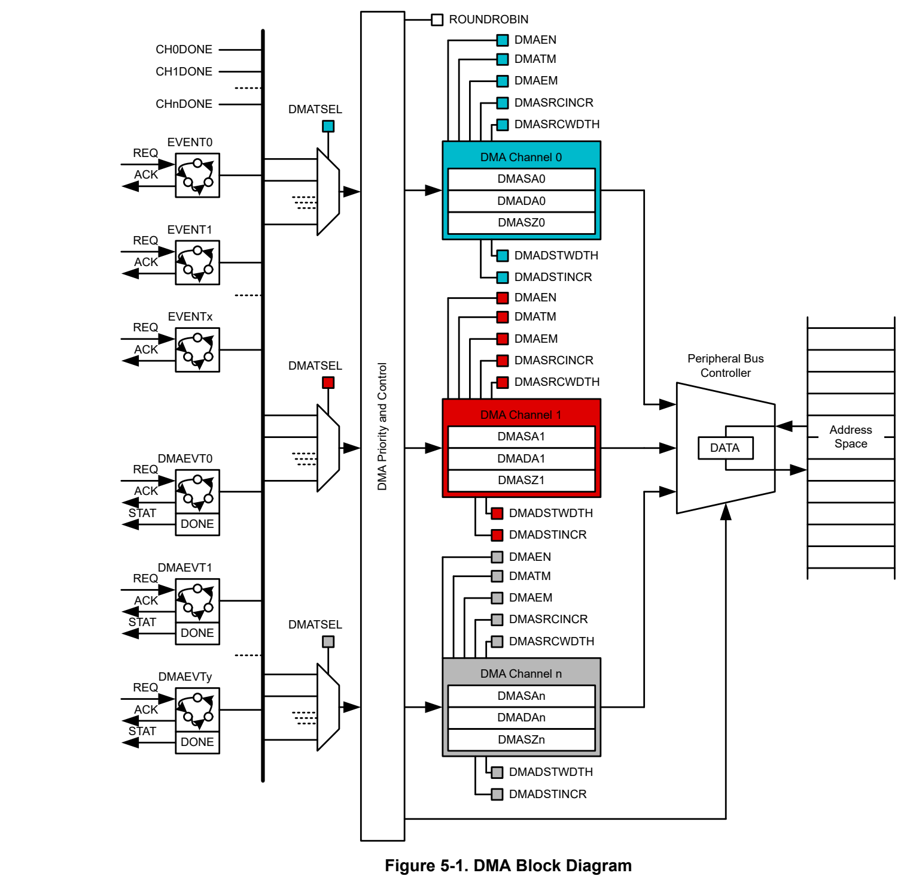
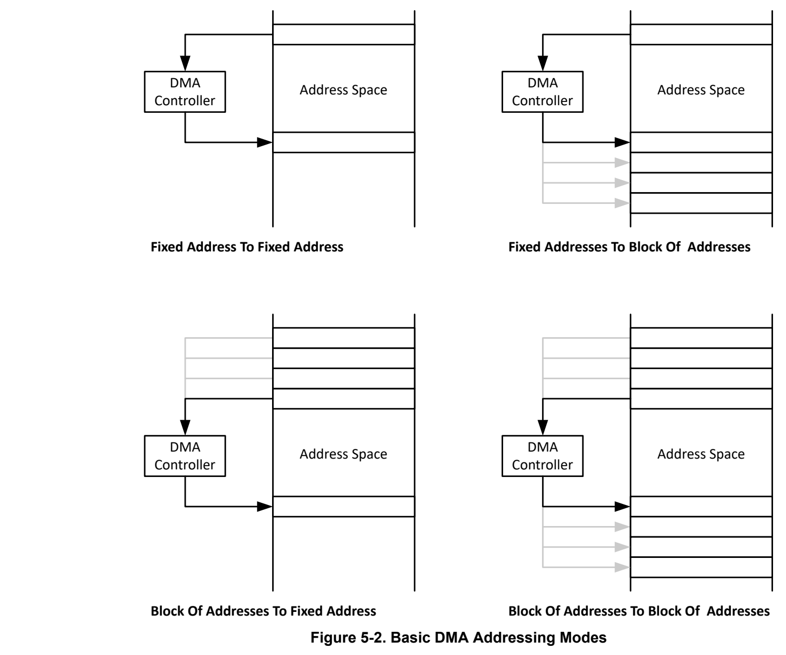
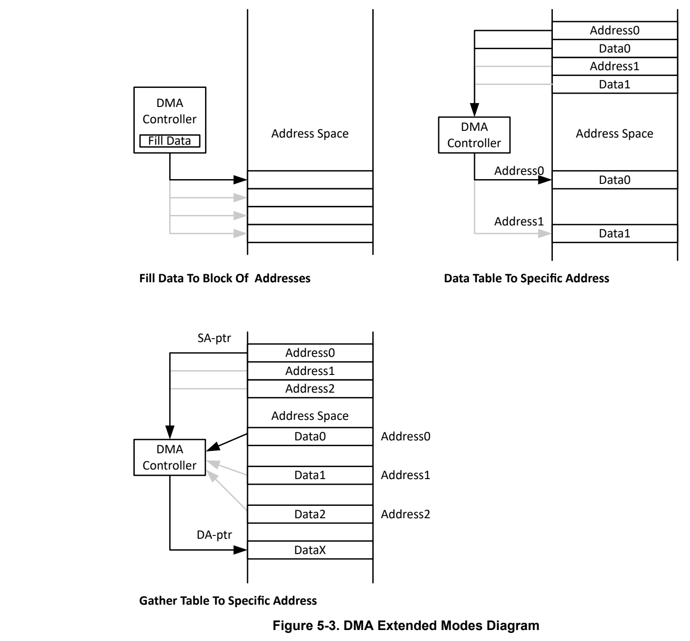
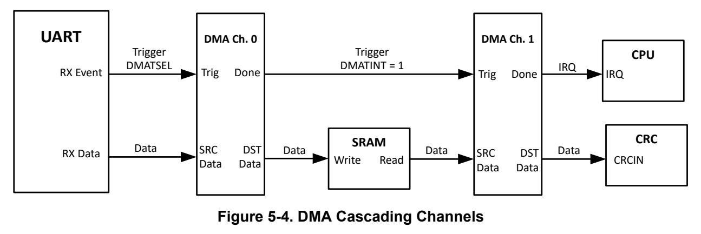

# 5 Direct Memory Access (DMA) (pp. 246-308)

### 5.1 DMA Overview 247 (p. 246)

### 5.2 DMA Operation 248 (p. 246)

### 5.3 DMA Registers 260 (p. 246)

### 5.1 DMA Overview (p. 247)

The DMA controller transfers data from a source address to a destination address without CPU intervention. For example, the DMA controller can be used to move data from ADC conversion memory to SRAM.

Devices can have up to sixteen DMA channels available. Therefore, depending on the number of DMA channels available, some features described in this chapter are not applicable to all devices. Please refer to the device-specific data sheet for the actual channel count of the DMA.

Using the DMA controller can increase the throughput of peripheral modules. It can also reduce system power consumption by allowing the CPU to remain in a low-power mode, without having to awaken to move data to or from a peripheral.

DMA controller features include:

- Up to sixteen independent transfer channels

- Configurable DMA channel priorities

- Byte (8-bit), half-word (16-bit), word (32-bit), long-word (64-bit), and long-long-word (128-bit) or mixed byte and word transfer capability

- Transfer counter block size supports up to 64k transfers of any data type

- Configurable DMA transfer trigger selection

- Seven flexible addressing modes

- Single or block transfer modes

The DMA controller block diagram is shown in Figure 5-1.

*Figure 5-1. DMA Block Diagram (p. 248)*

Note DMA in some MSPM0C devices only support ADC, no supporting for other peripherals. Refer to the device-specific data sheet to see the details.

### 5.2 DMA Operation (p. 248)

The DMA controller is configured with user software. The setup and operation of the DMA is discussed in the following sections.

#### 5.2.1 Addressing Modes (p. 249)

The DMA controller has seven addressing modes. The addressing mode for each DMA channel is independently configurable. For example, channel 0 can transfer between two fixed addresses, while channel 1 transfers between two blocks of addresses. The basic addressing modes are shown in basic address modes

The addressing modes are:

1. Fixed address to fixed address 2. Fixed address to block of addresses 3. Block of addresses to fixed address 4. Block of addresses to block of addresses 5. Fill data to block of addresses 6. Data table to specific address 7. Gather data from address table to fixed address or block of addresses

Addressing modes 1-4 shown above are the basic adressing modes are simply configured with the DMASRCINCR and DMADSTINCR control bits and are available in all channel types. The DMASRCINCR bits select if the source address is incremented, decremented, or unchanged after each transfer. The DMADSTINCR bits select if the destination address is incremented, decremented, or unchanged after each transfer.

Addressing modes 5 -7 shown above are also configured with the DMASRCINCR and DMADSTINCR control bits along with the help of additional parameters such as DMAEM for leveraging the extended modes of the DMA. Refer to Section 5.2.4.1, Section 5.2.4.2 or [Gather Mode] for more details on how to properly configure and use the DMA in Fill-Mode, Table-Mode and Gather-Mode.

Transfers can be byte to byte, half-word to half-word, word to word, long-word to long-word, long-long-word to long-long-word or any combination of the five. When transferring a wider bit width source to a shorter bit width destination, only the lower bits of the destination data transfers. When transferring a shorter bith width source to a wider bit width destination, the upper bytes of the destination data is cleared when the transfer occurs. There is no packing or unpacking support by combining several source byte transfers to one single destination word or the reverse.

*Figure 5-2. Basic DMA Addressing Modes (p. 250)*

#### 5.2.2 Channel Types (p. 250)

There are two types of DMA: DMA_A and DMA_B. Each DMA supports basic (BASIC) and full-featured (FULL) channels. BASIC channels support only single or block transfers, and FULL channels support repeated single and repeated block transfers with additional features such as early interrupt request generation and extended table, fill and gather modes.

The highest priority DMA channels (starting with DMA0) are FULL channels, and the remaining priority channels are BASIC channels.

Note See the device-specific data sheet to determine the type of DMA and the corresponding FULL and BASIC channels supported

Feature comparison table shows the features supported in the available basic and full-feature DMA channel types.

**Table 5-1. Feature Comparison of DMA_A and DMA_B Channels (p. 251)**

| DMA Feature | DMA_A | DMA_A | DMA_B | DMA_B |
| --- | --- | --- | --- | --- |
| DMA Feature | Full-Feature | Basic Channel | Full-Feature | Basic Channel |
| Repeated mode | – | – | ✓ | – |
| Table & fill mode | ✓ | – | ✓ | – |
| Gather mode | – | – | ✓ | – |
| Early IRQ notification | ✓ | – | ✓ | – |
| Auto enable | – | – | ✓ | ✓ |
| Long long (128-bit) transfer | – | – | ✓ | ✓ |
| Stride mode | ✓ | ✓ | ✓ | ✓ |
| Cascading channel support | – | – | ✓ | ✓ |

#### 5.2.3 Transfer Modes (p. 251)

The DMA controller has four transfer modes selected by the DMATM bits as listed in DMA tranfer mode table. Each channel is individually configurable for its transfer mode. For example, channel 0 can be configured in repeated block transfer mode, while channel 1 is configured for block transfer mode, and channel 2 operates in single transfer mode. The transfer mode (single, block, repeat) is configured independently from the addressing mode (decrement, fixed, increment, stride). Any addressing mode can be used with any transfer mode.

Five types of data can be transferred selectable by the DMADSTWDTH and DMASRCWDTH control bits. The source and destination locations can be either byte (8-bit), half-word (16-bit), word (32-bit), long-word (64-bit), or long-long-word (128-bit) data. It is also possible to transfer byte to byte, half-word to half-word, word to word, long-word to long-word, long-long-word to long-long-word, or any combination.

Additionally, all transfers modes support a stride mode where the DMA source and destination can be incremented to a higher value to support re-organization of data.

**Table 5-2. DMA Transfer Modes (p. 251)**

| DMATM | Transfer Mode | Description | Channel Type |
| --- | --- | --- | --- |
| 0 | Single transfer | Each transfer requires a trigger. DMAEN is automatically cleared when DMASZx transfers have been made. | Basic |
| 1 | Block transfer | A complete block is transferred with one trigger. DMAEN is automatically cleared at the end of the block transfer. | Basic |
| 2 | Repeated single transfer | Each transfer requires a trigger. The DAMSA, DMADA and DMASZ registers are reloaded to the original value when the DMASZ counted down to zero. DMAEN remains enabled. | Full-feature |
| 3 | Repeated block transfer | A complete block is transferred with one trigger and continous transfering. The DAMSA, DMADA and DMASZ registers are reloaded to the original value when the DMASZ counted down to zero. DMAEN remains enabled. | Full-feature |

##### 5.2.3.1 Single Transfer (p. 251)

In single transfer mode (DMATM = 0), each byte, half-word, word, long-word, or long-long-word transfer requires a separate trigger. Single transfer mode is available in basic and full-feature DMA channels.

The DMASZ register defines the number of transfers to be made. The DMADSTINCR and DMASRCINCR bits select if the destination address and the source address are incremented or decremented after each transfer. If DMASZ = 0, no transfers occur.

The DMASA, DMADA, and DMASZ registers are incremented or decremented after each transfer. The DMADSTWDTH will indicate whether the destination address will increment or decrement by 1, 2, 4, 8, or 16 with each transfer cycle. The same is true for the DMASRCWDTH and the source address respectively. When the DMASZ register decrements to zero, the corresponding RIS flag is set.

The DMAEN bit is cleared automatically when DMASZ decrements to zero and must be set again for another transfer to occur.

##### 5.2.3.2 Block Transfer (p. 252)

In block transfer mode (DMATM = 1), a transfer of a complete block of data occurs after one trigger. Block transfer mode is available in basic DMA channels only.

The DMASZ register defines the size of the block, and the DMADSTINCR and DMASRCINCR bits select if the destination address and the source address are incremented or decremented after each transfer of the block. If DMASZ = 0, no transfers occur.

The DMADSTWDTH will indicate whether the destination address will increment or decrement by 1, 2, 4, 8 or 16 with each transfer cycle. The same is true for the DMASRCWDTH and the source address respectively. The DMASZ register is decremented after each transfer and shows the number of transfers remaining.

The DMAEN bit is cleared after the completion of the block transfer and must be set again before another block transfer can be triggered. After a block transfer has started, another trigger signal that occurs during the block transfer is ignored.

##### 5.2.3.3 Repeated Single Transfer (p. 252)

In repeated single transfer mode (DMATM = 2), the DMA controller remains enabled with DMAEN = 1, and a transfer occurs every time a trigger occurs. Repeated single transfer modes are available in full-featured DMA channels only.

The DMASA, DMADA, and DMASZ registers are copied into temporary registers. The values of DMASA and DMADA are incremented or decremented after each transfer. The DMASZ register is decremented after each register. The DMADSTWDTH will indicate whether the destination address will increment or decrement by 1, 2, 4, 8 or 16 with each transfer cycle. The same is true for the DMASRCWDTH and the source address respectively. When the DMASZ register decrements to zero, it is reloaded from its temporary register and the corresponding RIS flag is set.

Note When using repeated single transfer mode, the DMA does not support pausing and continuing a transfer by disabling a channel (to pause) and then re-enabling the channel (to continue).

##### 5.2.3.4 Repeated Block Transfer (p. 252)

In repeated block transfer mode (DMATM = 3), the DMAEN bit remains set after completion of the block transfer. The next trigger after the completion of a repeated block transfer starts another block transfer. Repeated block transfer modes are available in full-featured DMA channels only.

The DMASA, DMADA, and DMASZ registers are copied into temporary registers. The temporary values of DMASA and DMADA are incremented or decremented after each transfer in the block. The DMADSTWDTH will indicate whether the destination address will increment or decrement by 1, 2, 4, 8 or 16 with each transfer cycle. The same is true for the DMASRCWDTH and the source address respectively. The DMASZ register is decremented after each transfer of the block and shows the number of transfers remaining in the block. When the DMASZ register decrements to zero, it is reloaded from its temporary register and the corresponding RIS flag is set.

##### 5.2.3.5 Stride Mode (p. 252)

All transfer modes support a “stride” mode where the DMA source and destination can be incremented to a higher value (rather than +1) after a transfer. This is helpful for re-organizing the order of data between the source and destination.

To support incremental strides, set the DMADSTINCR and/or DMASRCINCR to STRIDE_n, where n is the number of destination and/or source increments. The real increments are based in terms of the definitions DMADSTWDTH and/or DMASRCWDTH, respectively. For example, if external ADC data is transmitted to the

MCU as a six-word SPI frame, DMADSTINCR can be set to STRIDE_6 during a block transfer so that the destination address is incremented by 6 and the data is organized to make processing easier.

#### 5.2.4 Extended Modes (p. 253)

In FULL channels, the DMA controller has two extended modes selected by the DMAEM bits as listed in DMA extended mode table. An graphical overview of the extended modes can be seen in DMA extended mode figuer. Each channel is individually configurable for the extended mode. For example, channel 0 can be configured in table mode while channel 1 is configured in fill mode.

**Table 5-3. DMA Extended Modes (pp. 253-254)**

| DMAEM | Extended Mode | Description |
| --- | --- | --- |
| 0 | Normal mode | Operation is defined by DMATM |
| 1 | Gather mode | Used to read data from an address table and copy to configurable address |
| 2 | Fill mode | Used to fill predefined data patterns into memory |
| 3 | Table mode | Used to help configure a table of peripheral control registers |

*Figure 5-3. DMA Extended Modes Diagram (p. 254)*

##### 5.2.4.1 Fill Mode (p. 254)

In fill mode (DMAEM = 2), the DMA controller takes a predefined FILL pattern and writes the pattern to a user defined segment of memory. The DMATM bits are ignored and the automatic transfer mode used is "block transfer".

The DMASAx register is used as the FILL pattern data. The DMASRCINCR bit field is used to indicate whether the FILL pattern data should be constant or incremented/decremented with every write cycle. This feature allows for filling a memory block with a sequential pattern (for example. 0, 1, 2, 3, …). The DMASRCWDTH bit field indicates the magnitude of increment of the FILL mode data. Refer to Table 5-4 for how to use DMASRCWDTH in fill mode.

**Table 5-4. DMASRCWDTH in Fill Mode (p. 255)**

| DMASRCWDTH | FILL Mode Data Increment Value |
| --- | --- |
| 0 | ±1 |
| 1 | ±2 |
| 2 | ±4 |
| 3 | ±8 |

The destination registers and bit fields DMADAx, DMADSTINCR, and DMADSTWDTH all behave as expected and influence where and how in memory the FILL pattern is written.

##### 5.2.4.2 Table Mode (p. 255)

In table mode (DMAEM = 11b), the DMA controller executes 2 reads from the source and one write to a determined destination. This feature can be leveraged to interpret a table of addresses and data and uses the DMA to efficiently program that data to their associated addresses without CPU intervention. Table mode allows you to parse through a table of addresses and data to configure peripheral memory mapped registers in a single block transfer.

The DMASRCWDTH bit field should be set to "3" (64-bit mode) and the DMADSTWDTH bit field should be set to "2" (32-bit mode). The DMASRCINCR bit field can be set to 10b to decrement the source address or 11b to increment the source address after transfers. DMASZ is set to represent the number of entries in the table and DMATM should be set to "01" for block transfer mode. DMADAx and DMADSTINCR are ignored in table mode and can be treated as "don’t care" values.

The DMASAx register needs to be programmed with the start address of the table, which needs to be aligned to 64-bit data (that is, DMASAx[2:0] = "000"). The address stored in the table needs to be on the lower word of a 64-bit data (ADDR[2:0] = "000" while the data needs to be on the upper word of a 64-bit data (ADDR[2:0] = "100"). Table 5-5 is an example of a table in memory compatible with the DMA table mode.

**Table 5-5. Example of an Incremental Table Compatible with DMA Table Mode (p. 255)**

| Table Address | Table Data |
| --- | --- |
| 0x0000 | Address 0 |
| 0x0004 | Data 0 |
| 0x0008 | Address 1 |
| 0x000C | Data 1 |

#### 5.2.5 Initiating DMA Transfers (p. 255)

Each DMA channel is independently configured for its trigger source with DMATSEL. The DMATSEL bits should be modified only when the DMACTLx.DMAEN bit is 0; otherwise, unpredictable DMA triggers can occur.

See the device-specific data sheet for the list of triggers available, along with their respective DMATSEL values.

When selecting the trigger, the trigger must not have already occurred, or the transfer does not take place.

DMA channels can be internally triggered upon the completion of activity on another channel to support cascading. Completion of activity occurs when a DMA channel’s DMASZ counter reaches zero. This is beneficial for applications where data can be retrieved, transferred, and/or error-checked without an interrupt or event configuration.

Set the DMATINT bit to internally trigger the next DMA channel based on the DMATSEL trigger source. Once the DMATSEL trigger occurs, the next DMA channel begins to automatically execute.

For example, if UART data is received and transmitted to SRAM through DMA channel 0 and DMATSEL is set to UART RX, then DMA channel 1 can be internally triggered when the UART is finished receiving data. If DMA channel 1 is configured to transmit the data from SRAM to CRC, then the DMA transfer will trigger once the UART data is received. In this case, the DMA channels are cascaded from Channel 0 to Channel 1.

*Figure 5-4. DMA Cascading Channels (p. 256)*

#### 5.2.6 Stopping DMA Transfers (p. 256)

A DMA block transfer in progress can be stopped by clearing the DMAEN bit. The DMA will stop after the completion of the ongoing transfer cycle and all the channel registers will stay in the current state. The block transfer can be continued as originally configured after setting the DMAEN bit again and resending the trigger. Please note that a trigger is necessary for halted transfer to resume.

Note A single transfer in progress cannot be interrupted.

#### 5.2.7 Channel Priorities (p. 256)

The default DMA channel priorities are DMA0 through DMA15. If two or three triggers happen simultaneously or are pending, the channel with the highest priority completes its transfer (single or block transfer) first, then the second priority channel, then the third priority channel. Transfers in progress are not halted if a higher-priority channel is triggered. The higher-priority channel waits until the transfer in progress completes before starting.

The DMA channel priorities are configurable with the ROUNDROBIN bit. When the ROUNDROBIN bit is set, the channel that completes a transfer becomes the lowest priority. The order of the priority of the channels always stays the same, DMA0-DMA1-DMA2, for example, for three channels. When the ROUNDROBIN bit is cleared, the channel priority returns to the default priority.

**Table 5-6. Round-Robin DMA Priority Example (p. 256)**

| Current DMA Priority | Transfer Occurs | New DMA Priority |
| --- | --- | --- |
| DMA0 - DMA1 - DMA2 | DMA1 | DMA2 - DMA0 - DMA1 |
| DMA2 - DMA0 - DMA1 | DMA2 | DMA0 - DMA1 - DMA2 |
| DMA2 - DMA0 - DMA1 | DMA0 | DMA1 - DMA2 - DMA0 |

#### 5.2.8 Burst Block Mode (p. 256)

The DMA module supports a burst block mode for suspending an active channel after a configurable number of transfers to service other pending channels. The burst block size is configurable by setting DMAPRIO.BURSTSZ to 8, 16, 32, or an infinite number of transfers. If a higher priority channel is pending after the burst block, the DMA will execute the higher priority channel and resume on the suspended channel once the higher priority channel is complete. If no other channel is pending, the priority logic assigns the control back to the block transfer for the next burst.

#### 5.2.9 Using DMA with System Interrupts (p. 256)

System interrupt service routines are interrupted by DMA transfers. If an interrupt service routine or other routine must execute with no interruptions, the DMA controller should be disabled before executing the routine.

#### 5.2.10 DMA Controller Interrupts (p. 257)

Each DMA channel has its own RIS flag. Each RIS flag is set in any mode when the corresponding DMASZx register counts to zero. If the corresponding MASK and RIS bits are set, an interrupt request is generated.

All RIS flags are prioritized, with DMA0 being the highest, and combined to source a single interrupt vector. The highest-priority enabled interrupt generates a number in the IIDX register. This number can be evaluated or added to the program counter (PC) to automatically enter the appropriate software routine.

Any access, read or write, of the IIDX register automatically resets the highest pending interrupt flag. If another interrupt flag is set, another interrupt is immediately generated after servicing the initial interrupt. For example, assume that DMA0 has the highest priority. If the DMA0-RIS and DMA2-RIS flags are set when the interrupt service routine accesses the IIDX register, DMA0-RIS is reset automatically. After the interrupt service routine is executed, the DMA2-RIS generates another interrupt.

#### 5.2.11 DMA Trigger Event Status (p. 257)

The DMA controller supports dedicated DMA events. See Section 7.2.2 for details on the DMA event trigger protocol. The idea is that the DMA can inform the event triggering peripheral about the status of the assigned DMA channel. This will allow the triggering peripheral to issue an interrupt itself after the completion of a repeated transfer, instead of the DMA issuing an interrupt event. The advantage is, that the DMA interrupt service routine does not need to keep track of the assigned function of the channel. As a result, the DMA triggering peripheral interrupt service routine will deal with the completion of the DMA transfer.

The status will reflect the value of the DMASZx register. If the last DMA transfer resulted in a size decrement to zero, the DMA will return the status of 1, indicating the end of the transfer. Otherwise the status will be 0.

Additionally, the DMA module can generate an early interrupt request to the CPU to indicate that a transfer will complete within a configurable number of transfers (1, 2, 4, 8, 32, 64, half-DMASZ).

An early IRQ event is enabled by setting DMAPREIRQ to the desired number of transfers. When the DMA has reached the number of transfers, the corresponding DMA channel’s PREIRQ interrupt is set.

Early DMA interrupt generation is useful to:

- Reduce the interrupt latency in timing-critical applications where it would be beneficial to let the DMA preemptively generate the IRQ before the DMA transfer is complete

- Serve as a “progress notification” when scheduling other tasks for the CPU to complete

- Transfer weights of a neural network layer and notify the CPU to complete software configuration writes to the IP

- Implement a ping-pong buffer (by setting DMAPREIRQ to half)

> **Note:**

This feature is available on repeat-capable channels only.

#### 5.2.12 DMA Operating Mode Support (p. 257)

The DMA supports triggered transfers in RUN mode, as well as in the SLEEP, STOP, and STANDBY low-power modes. Refer to the following sections for more details.

##### 5.2.12.1 Transfer in RUN Mode (p. 257)

In RUN mode the system is fully operational. The CPU and all other peripherals and resources are available, therefore there is no restriction on the DMA functionality in RUN mode.

##### 5.2.12.2 Transfer in SLEEP Mode (p. 257)

In SLEEP mode only the CPU is halted. All other peripherals and resources are available as when in RUN mode, therefore there is no restriction on the DMA functionality in SLEEP mode. All peripherals that can trigger a DMA transfer in RUN mode will also be able to trigger a DMA transfer in SLEEP mode.

##### 5.2.12.3 Transfer in STOP Mode (p. 258)

In STOP mode the CPU is halted and the ULPCLK is limited to 4MHz operation. The event manager will detect a DMA trigger event and request the PMU to enter a "suspended STOP" state. For more info on this state refer to Section 2.1.2.7.While STOP mode is suspended, the DMA is fully functional and will work on the pending DMA trigger request. Once the DMA transfer is complete, the DMA will acknowledge the pending trigger event and the event subsystem removes the power mode request from the PMU. If the PMU has no other pending requests, the SoC will transition back into normal STOP mode.

##### 5.2.12.4 Transfers in STANDBY Mode (p. 258)

In STANDBY mode the CPU is halted and the ULPCLK is limited to 32kHz operation. The event manager will detect a DMA trigger event and request the PMU to enter a "suspended STANDBY" state. For more info on this state refer to Section 2.1.2.7.While STANDBY mode is suspended, the DMA is fully functional and will work on the pending DMA trigger request. Once the DMA transfer is complete, the DMA will acknowledge the pending trigger event and the event subsystem removes the power mode request from the PMU. If the PMU has no other pending requests, the SoC will transition back into normal STANDBY mode.

#### 5.2.13 DMA Address and Data Errors (p. 258)

The DMA itself has the ability to flag address or data errors. Source or destination address errors can come from accessing a protected or nonexisting memory range. If an address error occurs, the interrupt index IIDX[j].STAT flags a DMA address error (11h). Address error interrupts can be masked, set, and cleared using the ADDERR bit.

> **Note:**

The DMA itself does not perform range checking. If the DMA transfer occurs over a protected memory range, the destination data will report zeros (0h) for each byte of the DMA transaction that overlaps the protected or nonexisting memory range.

Data errors can occur in SRAM or flash if it has an ECC or parity error. If a data error occurs, the interrupt index IIDX[j].STAT flags a DMA data error (12h). Data error interrupts can be masked, set, and cleared using the DATERR bit.

#### 5.2.14 Interrupt and Event Support (p. 258)

The DMA module contains one event publishers and two event subscribers.

- One event publisher (CPU_INT) manages DMA interrupt requests (IRQs) to the CPU subsystem through a static event route.

- The second and third event (GEN_EVENT) are used to setup the generic event publishers and subscribers through Generic route.

DMA events are summarized in Table 5-7.

**Table 5-7. DMA Events (pp. 258-259)**

| Event | Type | Source | Destination | Route | Configuration | Functionality |
| --- | --- | --- | --- | --- | --- | --- |
| CPU interrupt | Publisher | DMA | CPU Subsystem | Static route | CPU_INT registers | Fixed interrupt route from TIMx to CPU |
| Generic publisher event | Publisher | DMA | Other peripherals | Generic route | GEN_EVENT and FPUB_1 registers | Configurable interrupt route from DMA to other peripherals |
| Generic subscriber event | Subscriber | Other peripherals | DMA | Generic route | FSUB_0 | Configurable interrupt route from other peripherals to DMA |
|  |  |  |  |  |  | Configurable |
|  |  |  |  |  |  | interrupt route |
| Generic |  |  |  |  |  |  |
|  | Subscriber | Other peripherals | DMA | Generic route | FSUB_1 | from other |
| subscriber event |  |  |  |  |  |  |
|  |  |  |  |  |  | peripherals to |
|  |  |  |  |  |  | DMA |

### 5.3 DMA Registers (p. 260)

Table 5-8 lists the memory-mapped registers for the DMA registers. All register offset addresses not listed in Table 5-8 should be considered as reserved locations and the register contents should not be modified.

**Table 5-8. DMA Registers (p. 260)**

| Offset | Acronym | Register Name | Group |
| --- | --- | --- | --- |
| 400h | FSUB_0 | Subscriber Port 0 |  |
| 404h | FSUB_1 | Subscriber Port 1 |  |
| 444h | FPUB_1 | Publisher Port 0 |  |
| 1018h | PDBGCTL | Peripheral Debug Control |  |
| 1020h | IIDX | Interrupt index | CPU_INT |
| 1028h | IMASK | Interrupt mask | CPU_INT |
| 1030h | RIS | Raw interrupt status | CPU_INT |
| 1038h | MIS | Masked interrupt status | CPU_INT |
| 1040h | ISET | Interrupt set | CPU_INT |
| 1048h | ICLR | Interrupt clear | CPU_INT |
| 1050h | IIDX | Interrupt index | GEN_EVENT |
| 1058h | IMASK | Interrupt mask | GEN_EVENT |
| 1060h | RIS | Raw interrupt status | GEN_EVENT |
| 1068h | MIS | Masked interrupt status | GEN_EVENT |
| 1070h | ISET | Interrupt set | GEN_EVENT |
| 1078h | ICLR | Interrupt clear | GEN_EVENT |
| 10E0h | EVT_MODE | Event Mode |  |
| 10FCh | DESC | Module Description |  |
| 1100h | DMAPRIO | DMA Channel Priority Control |  |
| 1110h + formula | DMATCTL[j] | DMA Trigger Select |  |
| 1200h + formula | DMACTL[j] | DMA Channel Control |  |
| 1204h + formula | DMASA[j] | DMA Channel Source Address |  |
| 1208h + formula | DMADA[j] | DMA Channel Destination Address |  |
| 120Ch + formula | DMASZ[j] | DMA Channel Size |  |

Complex bit access types are encoded to fit into small table cells. Table 5-9 shows the codes that are used for access types in this section.

**Table 5-9. DMA Access Type Codes (pp. 260-261)**

| Access Type | Code | Description |
| --- | --- | --- |
| Read Type |  |  |
| R | R | Read |
| Write Type |  |  |
| W | W | Write |
| Reset or Default Value |  |  |
| - n |  | Value after reset or the default value |
| Register Array Variables |  |  |
| i,j,k,l,m,n |  | When these variables are used in a register name, an offset, or an address, they refer to the value of a register array where the register is part of a group of repeating registers. The register groups form a hierarchical structure and the array is represented with a formula. |
| y |  | When this variable is used in a register name, an offset, or an address it refers to the value of a register array. |

### 5.3.1 [DMA.FSUB_0] Offset: 400h | Reset: 00000000h (p. 262)

FSUB_0 is shown in Figure 5-5 and described in Table 5-10.

Subscriber port

> **Bit Map**: `[31-8] RESERVED (R, 0h)` | `[7-0] CHANID (R/W, 0h)`

**Table 5-10. FSUB_0 Field Descriptions (p. 262)**

| Bit | Field | Type | Reset | Description |
| --- | --- | --- | --- | --- |
| 31-8 | RESERVED | R | 0h |  |
| 7-0 | CHANID | R/W | 0h | 0 = disconnected.; 1-255 = connected to channelID = CHANID.; 0h = A value of 0 specifies that the event is not connected; FFh = Consult your device datasheet as the actual allowed maximum may be less than 255. |

### 5.3.2 [DMA.FSUB_1] Offset: 404h | Reset: 00000000h (p. 263)

FSUB_1 is shown in Figure 5-6 and described in Table 5-11.

Subscriber port

> **Bit Map**: `[31-8] RESERVED (R, 0h)` | `[7-0] CHANID (R/W, 0h)`

**Table 5-11. FSUB_1 Field Descriptions (p. 263)**

| Bit | Field | Type | Reset | Description |
| --- | --- | --- | --- | --- |
| 31-8 | RESERVED | R | 0h |  |
| 7-0 | CHANID | R/W | 0h | 0 = disconnected.; 1-255 = connected to channelID = CHANID.; 0h = A value of 0 specifies that the event is not connected; FFh = Consult your device datasheet as the actual allowed maximum may be less than 255. |

### 5.3.3 [DMA.FPUB_1] Offset: 444h | Reset: 00000000h (p. 264)

FPUB_1 is shown in Figure 5-7 and described in Table 5-12.

Publisher port

> **Bit Map**: `[31-8] RESERVED (R, 0h)` | `[7-0] CHANID (R/W, 0h)`

**Table 5-12. FPUB_1 Field Descriptions (p. 264)**

| Bit | Field | Type | Reset | Description |
| --- | --- | --- | --- | --- |
| 31-8 | RESERVED | R | 0h |  |
| 7-0 | CHANID | R/W | 0h | 0 = disconnected.; 1-255 = connected to channelID = CHANID.; 0h = A value of 0 specifies that the event is not connected; FFh = Consult your device datasheet as the actual allowed maximum may be less than 255. |

### 5.3.4 [DMA.PDBGCTL] Offset: 1018h | Reset: 00000000h (p. 265)

PDBGCTL is shown in Figure 5-8 and described in Table 5-13.

This register can be used by the software developer to control the behavior of the peripheral relative to the 'Core Halted' input

> **Bit Map**: `[31-2] RESERVED (R, 0h)` | `[1] SOFT (R/W, 1h)` | `[0] FREE (R/W, 1h)`

**Table 5-13. PDBGCTL Field Descriptions (p. 265)**

| Bit | Field | Type | Reset | Description |
| --- | --- | --- | --- | --- |
| 31-2 | RESERVED | R | 0h |  |
| 1 | SOFT | R/W | 1h | Soft halt boundary control. This function is only available, if FREE is set to 'STOP'; 0h = The peripheral will halt immediately, even if the resultant state will result in corruption if the system is restarted; 1h = The peripheral blocks the debug freeze until it has reached a boundary where it can resume without corruption |
| 0 | FREE | R/W | 1h | Free run control; 0h = The peripheral freezes functionality while the Core Halted input is asserted and resumes when it is deasserted.; 1h = The peripheral ignores the state of the Core Halted input |

### 5.3.5 [DMA.IIDX] Offset: 1020h | Reset: 00000000h (p. 266)

IIDX is shown in Figure 5-9 and described in Table 5-14.

This register provides the highest priority enabled interrupt index. Value 0x00 means no event pending. Interrupt 1 is the highest priority, IIDX next highest, 4, 8, . . . IIDX^31 is the least priority. That is, the least bit position that is set to 1 denotes the highest priority pending interrupt. The priority order is fixed. However, users can implement their own prioritization schemes using other registers that expose the full set of interrupts that have occurred. On each read, only one interrupt is indicated. On a read, the current interrupt (highest priority) is automatically cleared by the hardware and the corresponding interrupt flag in RIS [RIS] and MIS [MIS] are cleared as well. After a read from the CPU (not from the debug interface), the register is updated with the next highest priority interrupt, if none are pending, then it should display 0x0. Note: The number of DMACH is device dependent. Please consult the datasheet of the specific device to map which channel number is implemented.

> **Bit Map**: `[31-8] RESERVED (R, 0h)` | `[7-0] STAT (R, 0h)`

**Table 5-14. IIDX Field Descriptions (p. 266)**

| Bit | Field | Type | Reset | Description |
| --- | --- | --- | --- | --- |
| 31-8 | RESERVED | R | 0h |  |
| 7-0 | STAT | R | 0h | Interrupt index status; 00h = No bit is set means there is no pending interrupt request; 01h = DMA Channel 0 size counter reached zero (DMASZ=0).; 02h = DMA Channel 1 size counter reached zero (DMASZ=0).; 03h = DMA Channel 2 size counter reached zero (DMASZ=0).; 04h = DMA Channel 3 size counter reached zero (DMASZ=0).; 05h = DMA Channel 4 size counter reached zero (DMASZ=0).; 06h = DMA Channel 5 size counter reached zero (DMASZ=0).; 07h = DMA Channel 6 size counter reached zero (DMASZ=0).; 08h = DMA Channel 7 size counter reached zero (DMASZ=0).; 09h = DMA Channel 8 size counter reached zero (DMASZ=0).; 0Ah = DMA Channel 9 size counter reached zero (DMASZ=0).; 0Bh = DMA Channel 10 size counter reached zero (DMASZ=0).; 0Ch = DMA Channel 11 size counter reached zero (DMASZ=0).; 0Dh = DMA Channel 12 size counter reached zero (DMASZ=0).; 0Eh = DMA Channel 13 size counter reached zero (DMASZ=0).; 0Fh = DMA Channel 14 size counter reached zero (DMASZ=0).; 10h = DMA Channel 15 size counter reached zero (DMASZ=0).; 11h = PRE-IRQ event for DMA Channel 0.; 12h = PRE-IRQ event for DMA Channel 1.; 13h = PRE-IRQ event for DMA Channel 2.; 14h = PRE-IRQ event for DMA Channel 3.; 15h = PRE-IRQ event for DMA Channel 4.; 16h = PRE-IRQ event for DMA Channel 5.; 17h = PRE-IRQ event for DMA Channel 6.; 18h = PRE-IRQ event for DMA Channel 7.; 19h = DMA address error, SRC address not reachable.; 1Ah = DMA data error, SRC data might be corrupted (PAR or ECC error). |

### 5.3.6 [DMA.IMASK] Offset: 1028h | Reset: 00000000h (p. 267)

IMASK is shown in Figure 5-10 and described in Table 5-15.

Interrupt Mask. If a bit is set, then the corresponding interrupt is un-masked. Un-masking the interrupt causes the raw interrupt to be visible in IIDX [IIDX], as well as MIS [MIS]. Note: The number of DMACH is device dependent. Please consult the datasheet of the specific device to map which channel number is implemented.

> **Bit Map**: `[31-26] RESERVED (R, 0h)` | `[25] DATAERR (R/W, 0h)` | `[24] ADDRERR (R/W, 0h)` | `[23] PREIRQCH7 (R/W, 0h)` | `[22] PREIRQCH6 (R/W, 0h)` | `[21] PREIRQCH5 (R/W, 0h)` | `[20] PREIRQCH4 (R/W, 0h)` | `[19] PREIRQCH3 (R/W, 0h)` | `[18] PREIRQCH2 (R/W, 0h)` | `[17] PREIRQCH1 (R/W, 0h)` | `[16] PREIRQCH0 (R/W, 0h)` | `[15] DMACH15 (R/W, 0h)` | `[14] DMACH14 (R/W, 0h)` | `[13] DMACH13 (R/W, 0h)` | `[12] DMACH12 (R/W, 0h)` | `[11] DMACH11 (R/W, 0h)` | `[10] DMACH10 (R/W, 0h)` | `[9] DMACH9 (R/W, 0h)` | `[8] DMACH8 (R/W, 0h)` | `[7] DMACH7 (R/W, 0h)` | `[6] DMACH6 (R/W, 0h)` | `[5] DMACH5 (R/W, 0h)` | `[4] DMACH4 (R/W, 0h)` | `[3] DMACH3 (R/W, 0h)` | `[2] DMACH2 (R/W, 0h)` | `[1] DMACH1 (R/W, 0h)` | `[0] DMACH0 (R/W, 0h)`

**Table 5-15. IMASK Field Descriptions (pp. 267-269)**

| Bit | Field | Type | Reset | Description |
| --- | --- | --- | --- | --- |
| 31-26 | RESERVED | R | 0h |  |
| 25 | DATAERR | R/W | 0h | DMA data error, SRC data might be corrupted (PAR or ECC error).; 0h = Clear interrupt mask bit; 1h = Set interrupt mask bit |
| 24 | ADDRERR | R/W | 0h | DMA address error, SRC address not reachable.; 0h = Clear interrupt mask bit; 1h = Set interrupt mask bit |
| 23 | PREIRQCH7 | R/W | 0h | Pre-IRQ for Channel 7. Size counter reached Pre-IRQ threshold.; 0h = Clear interrupt mask bit; 1h = Set interrupt mask bit |
| 22 | PREIRQCH6 | R/W | 0h | Pre-IRQ for Channel 6. Size counter reached Pre-IRQ threshold.; 0h = Clear interrupt mask bit; 1h = Set interrupt mask bit |
| 21 | PREIRQCH5 | R/W | 0h | Pre-IRQ for Channel 5. Size counter reached Pre-IRQ threshold.; 0h = Clear interrupt mask bit; 1h = Set interrupt mask bit |
| 20 | PREIRQCH4 | R/W | 0h | Pre-IRQ for Channel 4. Size counter reached Pre-IRQ threshold.; 0h = Clear interrupt mask bit; 1h = Set interrupt mask bit |
| 19 | PREIRQCH3 | R/W | 0h | Pre-IRQ for Channel 3. Size counter reached Pre-IRQ threshold.; 0h = Clear interrupt mask bit; 1h = Set interrupt mask bit |
| 18 | PREIRQCH2 | R/W | 0h | Pre-IRQ for Channel 2. Size counter reached Pre-IRQ threshold.; 0h = Clear interrupt mask bit; 1h = Set interrupt mask bit |
| 17 | PREIRQCH1 | R/W | 0h | Pre-IRQ for Channel 1. Size counter reached Pre-IRQ threshold.; 0h = Clear interrupt mask bit |
| 16 | PREIRQCH0 | R/W | 0h | Pre-IRQ for Channel 0. Size counter reached Pre-IRQ threshold.; 0h = Clear interrupt mask bit; 1h = Set interrupt mask bit |
| 15 | DMACH15 | R/W | 0h | DMA Channel 15 interrupt signal. Size counter reached zero (DMASZ=0).; 0h = Clear interrupt mask bit; 1h = Set interrupt mask bit |
| 14 | DMACH14 | R/W | 0h | DMA Channel 14 interrupt signal. Size counter reached zero (DMASZ=0).; 0h = Clear interrupt mask bit; 1h = Set interrupt mask bit |
| 13 | DMACH13 | R/W | 0h | DMA Channel 13 interrupt signal. Size counter reached zero (DMASZ=0).; 0h = Clear interrupt mask bit; 1h = Set interrupt mask bit |
| 12 | DMACH12 | R/W | 0h | DMA Channel 12 interrupt signal. Size counter reached zero (DMASZ=0).; 0h = Clear interrupt mask bit; 1h = Set interrupt mask bit |
| 11 | DMACH11 | R/W | 0h | DMA Channel 11 interrupt signal. Size counter reached zero (DMASZ=0).; 0h = Clear interrupt mask bit; 1h = Set interrupt mask bit |
| 10 | DMACH10 | R/W | 0h | DMA Channel 10 interrupt signal. Size counter reached zero (DMASZ=0).; 0h = Clear interrupt mask bit; 1h = Set interrupt mask bit |
| 9 | DMACH9 | R/W | 0h | DMA Channel 9 interrupt signal. Size counter reached zero (DMASZ=0).; 0h = Clear interrupt mask bit; 1h = Set interrupt mask bit |
| 8 | DMACH8 | R/W | 0h | DMA Channel 8 interrupt signal. Size counter reached zero (DMASZ=0).; 0h = Clear interrupt mask bit; 1h = Set interrupt mask bit |
| 7 | DMACH7 | R/W | 0h | DMA Channel 7 interrupt signal. Size counter reached zero (DMASZ=0).; 0h = Clear interrupt mask bit; 1h = Set interrupt mask bit |
| 6 | DMACH6 | R/W | 0h | DMA Channel 6 interrupt signal. Size counter reached zero (DMASZ=0).; 0h = Clear interrupt mask bit; 1h = Set interrupt mask bit |
| 5 | DMACH5 | R/W | 0h | DMA Channel 5 interrupt signal. Size counter reached zero (DMASZ=0).; 0h = Clear interrupt mask bit; 1h = Set interrupt mask bit |
| 4 | DMACH4 | R/W | 0h | DMA Channel 4 interrupt signal. Size counter reached zero (DMASZ=0).; 0h = Clear interrupt mask bit; 1h = Set interrupt mask bit |
| 3 | DMACH3 | R/W | 0h | DMA Channel 3 interrupt signal. Size counter reached zero (DMASZ=0).; 0h = Clear interrupt mask bit; 1h = Set interrupt mask bit |
| 2 | DMACH2 | R/W | 0h | DMA Channel 2 interrupt signal. Size counter reached zero (DMASZ=0).; 0h = Clear interrupt mask bit |
| 1 | DMACH1 | R/W | 0h | DMA Channel 1 interrupt signal. Size counter reached zero (DMASZ=0).; 0h = Clear interrupt mask bit; 1h = Set interrupt mask bit |
| 0 | DMACH0 | R/W | 0h | DMA Channel 0 interrupt signal. Size counter reached zero (DMASZ=0).; 0h = Clear interrupt mask bit; 1h = Set interrupt mask bit |

### 5.3.7 [DMA.RIS] Offset: 1030h | Reset: 00000000h (p. 270)

RIS is shown in Figure 5-11 and described in Table 5-16.

Raw interrupt status. Reflects all pending interrupts, regardless of masking. The RIS register allows the user to implement a poll scheme. A flag set in this register can be cleared by writing 1 to the ICLR [ICLR] register bit even if the corresponding IMASK [IMASK] bit is not enabled. Note: The number of DMACH is device dependent. Please consult the datasheet of the specific device to map which channel number is implemented.

> **Bit Map**: `[31-26] RESERVED (R, 0h)` | `[25] DATAERR (R, 0h)` | `[24] ADDRERR (R, 0h)` | `[23] PREIRQCH7 (R, 0h)` | `[22] PREIRQCH6 (R, 0h)` | `[21] PREIRQCH5 (R, 0h)` | `[20] PREIRQCH4 (R, 0h)` | `[19] PREIRQCH3 (R, 0h)` | `[18] PREIRQCH2 (R, 0h)` | `[17] PREIRQCH1 (R, 0h)` | `[16] PREIRQCH0 (R, 0h)` | `[15] DMACH15 (R, 0h)` | `[14] DMACH14 (R, 0h)` | `[13] DMACH13 (R, 0h)` | `[12] DMACH12 (R, 0h)` | `[11] DMACH11 (R, 0h)` | `[10] DMACH10 (R, 0h)` | `[9] DMACH9 (R, 0h)` | `[8] DMACH8 (R, 0h)` | `[7] DMACH7 (R, 0h)` | `[6] DMACH6 (R, 0h)` | `[5] DMACH5 (R, 0h)` | `[4] DMACH4 (R, 0h)` | `[3] DMACH3 (R, 0h)` | `[2] DMACH2 (R, 0h)` | `[1] DMACH1 (R, 0h)` | `[0] DMACH0 (R, 0h)`

**Table 5-16. RIS Field Descriptions (pp. 270-272)**

| Bit | Field | Type | Reset | Description |
| --- | --- | --- | --- | --- |
| 31-26 | RESERVED | R | 0h |  |
| 25 | DATAERR | R | 0h | DMA data error, SRC data might be corrupted (PAR or ECC error).; 0h = Clear interrupt mask bit; 1h = Set interrupt mask bit |
| 24 | ADDRERR | R | 0h | DMA address error, SRC address not reachable.; 0h = Clear interrupt mask bit; 1h = Set interrupt mask bit |
| 23 | PREIRQCH7 | R | 0h | Pre-IRQ for Channel 7. Size counter reached Pre-IRQ threshold.; 0h = Clear interrupt mask bit; 1h = Set interrupt mask bit |
| 22 | PREIRQCH6 | R | 0h | Pre-IRQ for Channel 6. Size counter reached Pre-IRQ threshold.; 0h = Clear interrupt mask bit; 1h = Set interrupt mask bit |
| 21 | PREIRQCH5 | R | 0h | Pre-IRQ for Channel 5. Size counter reached Pre-IRQ threshold.; 0h = Clear interrupt mask bit; 1h = Set interrupt mask bit |
| 20 | PREIRQCH4 | R | 0h | Pre-IRQ for Channel 4. Size counter reached Pre-IRQ threshold.; 0h = Clear interrupt mask bit; 1h = Set interrupt mask bit |
| 19 | PREIRQCH3 | R | 0h | Pre-IRQ for Channel 3. Size counter reached Pre-IRQ threshold.; 0h = Clear interrupt mask bit; 1h = Set interrupt mask bit |
| 18 | PREIRQCH2 | R | 0h | Pre-IRQ for Channel 2. Size counter reached Pre-IRQ threshold.; 0h = Clear interrupt mask bit; 1h = Set interrupt mask bit |
| 17 | PREIRQCH1 | R | 0h | Pre-IRQ for Channel 1. Size counter reached Pre-IRQ threshold.; 0h = Clear interrupt mask bit; 1h = Set interrupt mask bit |
| 16 | PREIRQCH0 | R | 0h | Pre-IRQ for Channel 0. Size counter reached Pre-IRQ threshold.; 0h = Clear interrupt mask bit; 1h = Set interrupt mask bit |
| 15 | DMACH15 | R | 0h | DMA Channel 15 interrupt signals that size counter reached zero (DMASZ=0).; 0h = Interrupt did not occur; 1h = Interrupt occurred |
| 14 | DMACH14 | R | 0h | DMA Channel 14 interrupt signals that size counter reached zero (DMASZ=0).; 0h = Interrupt did not occur; 1h = Interrupt occurred |
| 13 | DMACH13 | R | 0h | DMA Channel 13 interrupt signals that size counter reached zero (DMASZ=0).; 0h = Interrupt did not occur; 1h = Interrupt occurred |
| 12 | DMACH12 | R | 0h | DMA Channel 12 interrupt signals that size counter reached zero (DMASZ=0).; 0h = Interrupt did not occur; 1h = Interrupt occurred |
| 11 | DMACH11 | R | 0h | DMA Channel 11 interrupt signals that size counter reached zero (DMASZ=0).; 0h = Interrupt did not occur; 1h = Interrupt occurred |
| 10 | DMACH10 | R | 0h | DMA Channel 10 interrupt signals that size counter reached zero (DMASZ=0).; 0h = Interrupt did not occur; 1h = Interrupt occurred |
| 9 | DMACH9 | R | 0h | DMA Channel 9 interrupt signals that size counter reached zero (DMASZ=0).; 0h = Interrupt did not occur; 1h = Interrupt occurred |
| 8 | DMACH8 | R | 0h | DMA Channel 8 interrupt signals that size counter reached zero (DMASZ=0).; 0h = Interrupt did not occur; 1h = Interrupt occurred |
| 7 | DMACH7 | R | 0h | DMA Channel 7 interrupt signals that size counter reached zero (DMASZ=0).; 0h = Interrupt did not occur; 1h = Interrupt occurred |
| 6 | DMACH6 | R | 0h | DMA Channel 6 interrupt signals that size counter reached zero (DMASZ=0).; 0h = Interrupt did not occur; 1h = Interrupt occurred |
| 5 | DMACH5 | R | 0h | DMA Channel 5 interrupt signals that size counter reached zero (DMASZ=0).; 0h = Interrupt did not occur; 1h = Interrupt occurred |
| 4 | DMACH4 | R | 0h | DMA Channel 4 interrupt signals that size counter reached zero (DMASZ=0).; 0h = Interrupt did not occur; 1h = Interrupt occurred |
| 3 | DMACH3 | R | 0h | DMA Channel 3 interrupt signals that size counter reached zero (DMASZ=0).; 0h = Interrupt did not occur |
| 2 | DMACH2 | R | 0h | DMA Channel 2 interrupt signals that size counter reached zero (DMASZ=0).; 0h = Interrupt did not occur; 1h = Interrupt occurred |
| 1 | DMACH1 | R | 0h | DMA Channel 1 interrupt signals that size counter reached zero (DMASZ=0).; 0h = Interrupt did not occur; 1h = Interrupt occurred |
| 0 | DMACH0 | R | 0h | DMA Channel 0 interrupt signals that size counter reached zero (DMASZ=0).; 0h = Interrupt did not occur; 1h = Interrupt occurred |

### 5.3.8 [DMA.MIS] Offset: 1038h | Reset: 00000000h (p. 273)

MIS is shown in Figure 5-12 and described in Table 5-17.

Masked interrupt status. This is an AND of the IMASK [IMASK] and RIS [RIS] registers. Note: The number of DMACH is device dependent. Please consult the datasheet of the specific device to map which channel number is implemented.

> **Bit Map**: `[31-26] RESERVED (R, 0h)` | `[25] DATAERR (R, 0h)` | `[24] ADDRERR (R, 0h)` | `[23] PREIRQCH7 (R, 0h)` | `[22] PREIRQCH6 (R, 0h)` | `[21] PREIRQCH5 (R, 0h)` | `[20] PREIRQCH4 (R, 0h)` | `[19] PREIRQCH3 (R, 0h)` | `[18] PREIRQCH2 (R, 0h)` | `[17] PREIRQCH1 (R, 0h)` | `[16] PREIRQCH0 (R, 0h)` | `[15] DMACH15 (R, 0h)` | `[14] DMACH14 (R, 0h)` | `[13] DMACH13 (R, 0h)` | `[12] DMACH12 (R, 0h)` | `[11] DMACH11 (R, 0h)` | `[10] DMACH10 (R, 0h)` | `[9] DMACH9 (R, 0h)` | `[8] DMACH8 (R, 0h)` | `[7] DMACH7 (R, 0h)` | `[6] DMACH6 (R, 0h)` | `[5] DMACH5 (R, 0h)` | `[4] DMACH4 (R, 0h)` | `[3] DMACH3 (R, 0h)` | `[2] DMACH2 (R, 0h)` | `[1] DMACH1 (R, 0h)` | `[0] DMACH0 (R, 0h)`

**Table 5-17. MIS Field Descriptions (pp. 273-275)**

| Bit | Field | Type | Reset | Description |
| --- | --- | --- | --- | --- |
| 31-26 | RESERVED | R | 0h |  |
| 25 | DATAERR | R | 0h | DMA data error, SRC data might be corrupted (PAR or ECC error).; 0h = Clear interrupt mask bit; 1h = Set interrupt mask bit |
| 24 | ADDRERR | R | 0h | DMA address error, SRC address not reachable.; 0h = Clear interrupt mask bit; 1h = Set interrupt mask bit |
| 23 | PREIRQCH7 | R | 0h | Pre-IRQ for Channel 7. Size counter reached Pre-IRQ threshold.; 0h = Clear interrupt mask bit; 1h = Set interrupt mask bit |
| 22 | PREIRQCH6 | R | 0h | Pre-IRQ for Channel 6. Size counter reached Pre-IRQ threshold.; 0h = Clear interrupt mask bit; 1h = Set interrupt mask bit |
| 21 | PREIRQCH5 | R | 0h | Pre-IRQ for Channel 5. Size counter reached Pre-IRQ threshold.; 0h = Clear interrupt mask bit; 1h = Set interrupt mask bit |
| 20 | PREIRQCH4 | R | 0h | Pre-IRQ for Channel 4. Size counter reached Pre-IRQ threshold.; 0h = Clear interrupt mask bit; 1h = Set interrupt mask bit |
| 19 | PREIRQCH3 | R | 0h | Pre-IRQ for Channel 3. Size counter reached Pre-IRQ threshold.; 0h = Clear interrupt mask bit; 1h = Set interrupt mask bit |
| 18 | PREIRQCH2 | R | 0h | Pre-IRQ for Channel 2. Size counter reached Pre-IRQ threshold.; 0h = Clear interrupt mask bit; 1h = Set interrupt mask bit |
| 17 | PREIRQCH1 | R | 0h | Pre-IRQ for Channel 1. Size counter reached Pre-IRQ threshold.; 0h = Clear interrupt mask bit; 1h = Set interrupt mask bit |
| 16 | PREIRQCH0 | R | 0h | Pre-IRQ for Channel 0. Size counter reached Pre-IRQ threshold.; 0h = Clear interrupt mask bit; 1h = Set interrupt mask bit |
| 15 | DMACH15 | R | 0h | DMA Channel 15 interrupt signals that size counter reached zero (DMASZ=0).; 0h = Interrupt did not occur or is masked out; 1h = Interrupt occurred |
| 14 | DMACH14 | R | 0h | DMA Channel 14 interrupt signals that size counter reached zero (DMASZ=0).; 0h = Interrupt did not occur or is masked out; 1h = Interrupt occurred |
| 13 | DMACH13 | R | 0h | DMA Channel 13 interrupt signals that size counter reached zero (DMASZ=0).; 0h = Interrupt did not occur or is masked out; 1h = Interrupt occurred |
| 12 | DMACH12 | R | 0h | DMA Channel 12 interrupt signals that size counter reached zero (DMASZ=0).; 0h = Interrupt did not occur or is masked out; 1h = Interrupt occurred |
| 11 | DMACH11 | R | 0h | DMA Channel 11 interrupt signals that size counter reached zero (DMASZ=0).; 0h = Interrupt did not occur or is masked out; 1h = Interrupt occurred |
| 10 | DMACH10 | R | 0h | DMA Channel 10 interrupt signals that size counter reached zero (DMASZ=0).; 0h = Interrupt did not occur or is masked out; 1h = Interrupt occurred |
| 9 | DMACH9 | R | 0h | DMA Channel 9 interrupt signals that size counter reached zero (DMASZ=0).; 0h = Interrupt did not occur or is masked out; 1h = Interrupt occurred |
| 8 | DMACH8 | R | 0h | DMA Channel 8 interrupt signals that size counter reached zero (DMASZ=0).; 0h = Interrupt did not occur or is masked out; 1h = Interrupt occurred |
| 7 | DMACH7 | R | 0h | DMA Channel 7 interrupt signals that size counter reached zero (DMASZ=0).; 0h = Interrupt did not occur or is masked out; 1h = Interrupt occurred |
| 6 | DMACH6 | R | 0h | DMA Channel 6 interrupt signals that size counter reached zero (DMASZ=0).; 0h = Interrupt did not occur or is masked out; 1h = Interrupt occurred |
| 5 | DMACH5 | R | 0h | DMA Channel 5 interrupt signals that size counter reached zero (DMASZ=0).; 0h = Interrupt did not occur or is masked out; 1h = Interrupt occurred |
| 4 | DMACH4 | R | 0h | DMA Channel 4 interrupt signals that size counter reached zero (DMASZ=0).; 0h = Interrupt did not occur or is masked out; 1h = Interrupt occurred |
| 3 | DMACH3 | R | 0h | DMA Channel 3 interrupt signals that size counter reached zero (DMASZ=0).; 0h = Interrupt did not occur or is masked out; 1h = Interrupt occurred |
| 2 | DMACH2 | R | 0h | DMA Channel 2 interrupt signals that size counter reached zero (DMASZ=0).; 0h = Interrupt did not occur or is masked out |
| 1 | DMACH1 | R | 0h | DMA Channel 1 interrupt signals that size counter reached zero (DMASZ=0).; 0h = Interrupt did not occur or is masked out; 1h = Interrupt occurred |
| 0 | DMACH0 | R | 0h | DMA Channel 0 interrupt signals that size counter reached zero (DMASZ=0).; 0h = Interrupt did not occur or is masked out; 1h = Interrupt occurred |

### 5.3.9 [DMA.ISET] Offset: 1040h | Reset: 00000000h (p. 276)

ISET is shown in Figure 5-13 and described in Table 5-18.

Interrupt set. Allows interrupts to be set by software (useful in diagnostics and safety checks). Writing a 1 to a bit in ISET will set the event and therefore the related RIS [RIS] bit also gets set. If the interrupt is enabled through the mask, then the corresponding MIS [MIS] bit is also set. Note: The number of DMACH is device dependent. Please consult the datasheet of the specific device to map which channel number is implemented.

> **Bit Map**: `[31-26] RESERVED (R, 0h)` | `[25] DATAERR (W, 0h)` | `[24] ADDRERR (W, 0h)` | `[23] PREIRQCH7 (W, 0h)` | `[22] PREIRQCH6 (W, 0h)` | `[21] PREIRQCH5 (W, 0h)` | `[20] PREIRQCH4 (W, 0h)` | `[19] PREIRQCH3 (W, 0h)` | `[18] PREIRQCH2 (W, 0h)` | `[17] PREIRQCH1 (W, 0h)` | `[16] PREIRQCH0 (W, 0h)` | `[15] DMACH15 (W, 0h)` | `[14] DMACH14 (W, 0h)` | `[13] DMACH13 (W, 0h)` | `[12] DMACH12 (W, 0h)` | `[11] DMACH11 (W, 0h)` | `[10] DMACH10 (W, 0h)` | `[9] DMACH9 (W, 0h)` | `[8] DMACH8 (W, 0h)` | `[7] DMACH7 (W, 0h)` | `[6] DMACH6 (W, 0h)` | `[5] DMACH5 (W, 0h)` | `[4] DMACH4 (W, 0h)` | `[3] DMACH3 (W, 0h)` | `[2] DMACH2 (W, 0h)` | `[1] DMACH1 (W, 0h)` | `[0] DMACH0 (W, 0h)`

**Table 5-18. ISET Field Descriptions (pp. 276-278)**

| Bit | Field | Type | Reset | Description |
| --- | --- | --- | --- | --- |
| 31-26 | RESERVED | R | 0h |  |
| 25 | DATAERR | W | 0h | DMA data error, SRC data might be corrupted (PAR or ECC error).; 0h = Clear interrupt mask bit; 1h = Set interrupt mask bit |
| 24 | ADDRERR | W | 0h | DMA address error, SRC address not reachable.; 0h = Clear interrupt mask bit; 1h = Set interrupt mask bit |
| 23 | PREIRQCH7 | W | 0h | Pre-IRQ for Channel 7. Size counter reached Pre-IRQ threshold.; 0h = Clear interrupt mask bit; 1h = Set interrupt mask bit |
| 22 | PREIRQCH6 | W | 0h | Pre-IRQ for Channel 6. Size counter reached Pre-IRQ threshold.; 0h = Clear interrupt mask bit; 1h = Set interrupt mask bit |
| 21 | PREIRQCH5 | W | 0h | Pre-IRQ for Channel 5. Size counter reached Pre-IRQ threshold.; 0h = Clear interrupt mask bit; 1h = Set interrupt mask bit |
| 20 | PREIRQCH4 | W | 0h | Pre-IRQ for Channel 4. Size counter reached Pre-IRQ threshold.; 0h = Clear interrupt mask bit; 1h = Set interrupt mask bit |
| 19 | PREIRQCH3 | W | 0h | Pre-IRQ for Channel 3. Size counter reached Pre-IRQ threshold.; 0h = Clear interrupt mask bit; 1h = Set interrupt mask bit |
| 18 | PREIRQCH2 | W | 0h | Pre-IRQ for Channel 2. Size counter reached Pre-IRQ threshold.; 0h = Clear interrupt mask bit; 1h = Set interrupt mask bit |
| 17 | PREIRQCH1 | W | 0h | Pre-IRQ for Channel 1. Size counter reached Pre-IRQ threshold.; 0h = Clear interrupt mask bit; 1h = Set interrupt mask bit |
| 16 | PREIRQCH0 | W | 0h | Pre-IRQ for Channel 0. Size counter reached Pre-IRQ threshold.; 0h = Clear interrupt mask bit; 1h = Set interrupt mask bit |
| 15 | DMACH15 | W | 0h | DMA Channel 0 interrupt signals that size counter reached zero (DMASZ=0).; 0h = Writing 0 has no effect; 1h = Set interrupt |
| 14 | DMACH14 | W | 0h | DMA Channel 14 interrupt signals that size counter reached zero (DMASZ=0).; 0h = Writing 0 has no effect; 1h = Set interrupt |
| 13 | DMACH13 | W | 0h | DMA Channel 13 interrupt signals that size counter reached zero (DMASZ=0).; 0h = Writing 0 has no effect; 1h = Set interrupt |
| 12 | DMACH12 | W | 0h | DMA Channel 12 interrupt signals that size counter reached zero (DMASZ=0).; 0h = Writing 0 has no effect; 1h = Set interrupt |
| 11 | DMACH11 | W | 0h | DMA Channel 11 interrupt signals that size counter reached zero (DMASZ=0).; 0h = Writing 0 has no effect; 1h = Set interrupt |
| 10 | DMACH10 | W | 0h | DMA Channel 0 interrupt signals that size counter reached zero (DMASZ=0).; 0h = Writing 0 has no effect; 1h = Set interrupt |
| 9 | DMACH9 | W | 0h | DMA Channel 9 interrupt signals that size counter reached zero (DMASZ=0).; 0h = Writing 0 has no effect; 1h = Set interrupt |
| 8 | DMACH8 | W | 0h | DMA Channel 8 interrupt signals that size counter reached zero (DMASZ=0).; 0h = Writing 0 has no effect; 1h = Set interrupt |
| 7 | DMACH7 | W | 0h | DMA Channel 7 interrupt signals that size counter reached zero (DMASZ=0).; 0h = Writing 0 has no effect; 1h = Set interrupt |
| 6 | DMACH6 | W | 0h | DMA Channel 6 interrupt signals that size counter reached zero (DMASZ=0).; 0h = Writing 0 has no effect; 1h = Set interrupt |
| 5 | DMACH5 | W | 0h | DMA Channel 5 interrupt signals that size counter reached zero (DMASZ=0).; 0h = Writing 0 has no effect; 1h = Set interrupt |
| 4 | DMACH4 | W | 0h | DMA Channel 4 interrupt signals that size counter reached zero (DMASZ=0).; 0h = Writing 0 has no effect; 1h = Set interrupt |
| 3 | DMACH3 | W | 0h | DMA Channel 3 interrupt signals that size counter reached zero (DMASZ=0).; 0h = Writing 0 has no effect |
| 2 | DMACH2 | W | 0h | DMA Channel 2 interrupt signals that size counter reached zero (DMASZ=0).; 0h = Writing 0 has no effect; 1h = Set interrupt |
| 1 | DMACH1 | W | 0h | DMA Channel 1 interrupt signals that size counter reached zero (DMASZ=0).; 0h = Writing 0 has no effect; 1h = Set interrupt |
| 0 | DMACH0 | W | 0h | DMA Channel 0 interrupt signals that size counter reached zero (DMASZ=0).; 0h = Writing 0 has no effect; 1h = Set interrupt |

### 5.3.10 [DMA.ICLR] Offset: 1048h | Reset: 00000000h (p. 279)

ICLR is shown in Figure 5-14 and described in Table 5-19.

Interrupt clear. Write a 1 to clear corresponding Interrupt. Note: The number of DMACH is device dependent. Please consult the datasheet of the specific device to map which channel number is implemented.

> **Bit Map**: `[31-26] RESERVED (R, 0h)` | `[25] DATAERR (W, 0h)` | `[24] ADDRERR (W, 0h)` | `[23] PREIRQCH7 (W, 0h)` | `[22] PREIRQCH6 (W, 0h)` | `[21] PREIRQCH5 (W, 0h)` | `[20] PREIRQCH4 (W, 0h)` | `[19] PREIRQCH3 (W, 0h)` | `[18] PREIRQCH2 (W, 0h)` | `[17] PREIRQCH1 (W, 0h)` | `[16] PREIRQCH0 (W, 0h)` | `[15] DMACH15 (W, 0h)` | `[14] DMACH14 (W, 0h)` | `[13] DMACH13 (W, 0h)` | `[12] DMACH12 (W, 0h)` | `[11] DMACH11 (W, 0h)` | `[10] DMACH10 (W, 0h)` | `[9] DMACH9 (W, 0h)` | `[8] DMACH8 (W, 0h)` | `[7] DMACH7 (W, 0h)` | `[6] DMACH6 (W, 0h)` | `[5] DMACH5 (W, 0h)` | `[4] DMACH4 (W, 0h)` | `[3] DMACH3 (W, 0h)` | `[2] DMACH2 (W, 0h)` | `[1] DMACH1 (W, 0h)` | `[0] DMACH0 (W, 0h)`

**Table 5-19. ICLR Field Descriptions (pp. 279-281)**

| Bit | Field | Type | Reset | Description |
| --- | --- | --- | --- | --- |
| 31-26 | RESERVED | R | 0h |  |
| 25 | DATAERR | W | 0h | DMA data error, SRC data might be corrupted (PAR or ECC error).; 0h = Clear interrupt mask bit; 1h = Set interrupt mask bit |
| 24 | ADDRERR | W | 0h | DMA address error, SRC address not reachable.; 0h = Clear interrupt mask bit; 1h = Set interrupt mask bit |
| 23 | PREIRQCH7 | W | 0h | Pre-IRQ for Channel 7. Size counter reached Pre-IRQ threshold.; 0h = Clear interrupt mask bit; 1h = Set interrupt mask bit |
| 22 | PREIRQCH6 | W | 0h | Pre-IRQ for Channel 6. Size counter reached Pre-IRQ threshold.; 0h = Clear interrupt mask bit; 1h = Set interrupt mask bit |
| 21 | PREIRQCH5 | W | 0h | Pre-IRQ for Channel 5. Size counter reached Pre-IRQ threshold.; 0h = Clear interrupt mask bit; 1h = Set interrupt mask bit |
| 20 | PREIRQCH4 | W | 0h | Pre-IRQ for Channel 4. Size counter reached Pre-IRQ threshold.; 0h = Clear interrupt mask bit; 1h = Set interrupt mask bit |
| 19 | PREIRQCH3 | W | 0h | Pre-IRQ for Channel 3. Size counter reached Pre-IRQ threshold.; 0h = Clear interrupt mask bit; 1h = Set interrupt mask bit |
| 18 | PREIRQCH2 | W | 0h | Pre-IRQ for Channel 2. Size counter reached Pre-IRQ threshold.; 0h = Clear interrupt mask bit; 1h = Set interrupt mask bit |
| 17 | PREIRQCH1 | W | 0h | Pre-IRQ for Channel 1. Size counter reached Pre-IRQ threshold.; 0h = Clear interrupt mask bit; 1h = Set interrupt mask bit |
| 16 | PREIRQCH0 | W | 0h | Pre-IRQ for Channel 0. Size counter reached Pre-IRQ threshold.; 0h = Clear interrupt mask bit; 1h = Set interrupt mask bit |
| 15 | DMACH15 | W | 0h | DMA Channel 15 interrupt signals that size counter reached zero (DMASZ=0).; 0h = Writing 0 has no effect; 1h = Clear interrupt |
| 14 | DMACH14 | W | 0h | DMA Channel 14 interrupt signals that size counter reached zero (DMASZ=0).; 0h = Writing 0 has no effect; 1h = Clear interrupt |
| 13 | DMACH13 | W | 0h | DMA Channel 13 interrupt signals that size counter reached zero (DMASZ=0).; 0h = Writing 0 has no effect; 1h = Clear interrupt |
| 12 | DMACH12 | W | 0h | DMA Channel 12 interrupt signals that size counter reached zero (DMASZ=0).; 0h = Writing 0 has no effect; 1h = Clear interrupt |
| 11 | DMACH11 | W | 0h | DMA Channel 11 interrupt signals that size counter reached zero (DMASZ=0).; 0h = Writing 0 has no effect; 1h = Clear interrupt |
| 10 | DMACH10 | W | 0h | DMA Channel 10 interrupt signals that size counter reached zero (DMASZ=0).; 0h = Writing 0 has no effect; 1h = Clear interrupt |
| 9 | DMACH9 | W | 0h | DMA Channel 9 interrupt signals that size counter reached zero (DMASZ=0).; 0h = Writing 0 has no effect; 1h = Clear interrupt |
| 8 | DMACH8 | W | 0h | DMA Channel 8 interrupt signals that size counter reached zero (DMASZ=0).; 0h = Writing 0 has no effect; 1h = Clear interrupt |
| 7 | DMACH7 | W | 0h | DMA Channel 7 interrupt signals that size counter reached zero (DMASZ=0).; 0h = Writing 0 has no effect; 1h = Clear interrupt |
| 6 | DMACH6 | W | 0h | DMA Channel 6 interrupt signals that size counter reached zero (DMASZ=0).; 0h = Writing 0 has no effect; 1h = Clear interrupt |
| 5 | DMACH5 | W | 0h | DMA Channel 5 interrupt signals that size counter reached zero (DMASZ=0).; 0h = Writing 0 has no effect; 1h = Clear interrupt |
| 4 | DMACH4 | W | 0h | DMA Channel 4 interrupt signals that size counter reached zero (DMASZ=0).; 0h = Writing 0 has no effect; 1h = Clear interrupt |
| 3 | DMACH3 | W | 0h | DMA Channel 3 interrupt signals that size counter reached zero (DMASZ=0).; 0h = Writing 0 has no effect; 1h = Clear interrupt |
| 2 | DMACH2 | W | 0h | DMA Channel 2 interrupt signals that size counter reached zero (DMASZ=0). |
| 1 | DMACH1 | W | 0h | DMA Channel 1 interrupt signals that size counter reached zero (DMASZ=0).; 0h = Writing 0 has no effect; 1h = Clear interrupt |
| 0 | DMACH0 | W | 0h | DMA Channel 0 interrupt signals that size counter reached zero (DMASZ=0).; 0h = Writing 0 has no effect; 1h = Clear interrupt |

### 5.3.11 [DMA.IIDX] Offset: 1050h | Reset: 00000000h (p. 282)

IIDX is shown in Figure 5-15 and described in Table 5-20.

This register provides the highest priority enabled interrupt index. Value 0x00 means no event pending. Interrupt 1 is the highest priority, IIDX next highest, 4, 8, . . . IIDX^31 is the least priority. That is, the least bit position that is set to 1 denotes the highest priority pending interrupt. The priority order is fixed. However, users can implement their own prioritization schemes using other registers that expose the full set of interrupts that have occurred. On each read, only one interrupt is indicated. On a read, the current interrupt (highest priority) is automatically cleared by the hardware and the corresponding interrupt flag in RIS [RIS] and MIS [MIS] are cleared as well. After a read from the CPU (not from the debug interface), the register is updated with the next highest priority interrupt, if none are pending, then it should display 0x0. Note: The number of DMACH is device dependent. Please consult the datasheet of the specific device to map which channel number is implemented.

> **Bit Map**: `[31-8] RESERVED (R, 0h)` | `[7-0] STAT (R, 0h)`

**Table 5-20. IIDX Field Descriptions (p. 282)**

| Bit | Field | Type | Reset | Description |
| --- | --- | --- | --- | --- |
| 31-8 | RESERVED | R | 0h |  |
| 7-0 | STAT | R | 0h | Interrupt index status; 00h = No bit is set means there is no pending interrupt request; 01h = DMA Channel 0 size counter reached zero (DMASZ=0).; 02h = DMA Channel 1 size counter reached zero (DMASZ=0).; 03h = DMA Channel 2 size counter reached zero (DMASZ=0).; 04h = DMA Channel 3 size counter reached zero (DMASZ=0).; 05h = DMA Channel 4 size counter reached zero (DMASZ=0).; 06h = DMA Channel 5 size counter reached zero (DMASZ=0).; 07h = DMA Channel 6 size counter reached zero (DMASZ=0).; 08h = DMA Channel 7 size counter reached zero (DMASZ=0).; 09h = DMA Channel 8 size counter reached zero (DMASZ=0).; 0Ah = DMA Channel 9 size counter reached zero (DMASZ=0).; 0Bh = DMA Channel 10 size counter reached zero (DMASZ=0).; 0Ch = DMA Channel 11 size counter reached zero (DMASZ=0).; 0Dh = DMA Channel 12 size counter reached zero (DMASZ=0).; 0Eh = DMA Channel 13 size counter reached zero (DMASZ=0).; 0Fh = DMA Channel 14 size counter reached zero (DMASZ=0).; 10h = DMA Channel 15 size counter reached zero (DMASZ=0).; 11h = PRE-IRQ event for DMA Channel 0.; 12h = PRE-IRQ event for DMA Channel 1.; 13h = PRE-IRQ event for DMA Channel 2.; 14h = PRE-IRQ event for DMA Channel 3.; 15h = PRE-IRQ event for DMA Channel 4.; 16h = PRE-IRQ event for DMA Channel 5.; 17h = PRE-IRQ event for DMA Channel 6.; 18h = PRE-IRQ event for DMA Channel 7.; 19h = DMA address error, SRC address not reachable.; 1Ah = DMA data error, SRC data might be corrupted (PAR or ECC error). |

### 5.3.12 [DMA.IMASK] Offset: 1058h | Reset: 00000000h (p. 283)

IMASK is shown in Figure 5-16 and described in Table 5-21.

Interrupt Mask. If a bit is set, then the corresponding interrupt is un-masked. Un-masking the interrupt causes the raw interrupt to be visible in IIDX [IIDX], as well as MIS [MIS]. Note: The number of DMACH is device dependent. Please consult the datasheet of the specific device to map which channel number is implemented.

> **Bit Map**: `[31-26] RESERVED (R, 0h)` | `[25] DATAERR (R/W, 0h)` | `[24] ADDRERR (R/W, 0h)` | `[23] PREIRQCH7 (R/W, 0h)` | `[22] PREIRQCH6 (R/W, 0h)` | `[21] PREIRQCH5 (R/W, 0h)` | `[20] PREIRQCH4 (R/W, 0h)` | `[19] PREIRQCH3 (R/W, 0h)` | `[18] PREIRQCH2 (R/W, 0h)` | `[17] PREIRQCH1 (R/W, 0h)` | `[16] PREIRQCH0 (R/W, 0h)` | `[15] DMACH15 (R/W, 0h)` | `[14] DMACH14 (R/W, 0h)` | `[13] DMACH13 (R/W, 0h)` | `[12] DMACH12 (R/W, 0h)` | `[11] DMACH11 (R/W, 0h)` | `[10] DMACH10 (R/W, 0h)` | `[9] DMACH9 (R/W, 0h)` | `[8] DMACH8 (R/W, 0h)` | `[7] DMACH7 (R/W, 0h)` | `[6] DMACH6 (R/W, 0h)` | `[5] DMACH5 (R/W, 0h)` | `[4] DMACH4 (R/W, 0h)` | `[3] DMACH3 (R/W, 0h)` | `[2] DMACH2 (R/W, 0h)` | `[1] DMACH1 (R/W, 0h)` | `[0] DMACH0 (R/W, 0h)`

**Table 5-21. IMASK Field Descriptions (pp. 283-285)**

| Bit | Field | Type | Reset | Description |
| --- | --- | --- | --- | --- |
| 31-26 | RESERVED | R | 0h |  |
| 25 | DATAERR | R/W | 0h | DMA data error, SRC data might be corrupted (PAR or ECC error).; 0h = Clear interrupt mask bit; 1h = Set interrupt mask bit |
| 24 | ADDRERR | R/W | 0h | DMA address error, SRC address not reachable.; 0h = Clear interrupt mask bit; 1h = Set interrupt mask bit |
| 23 | PREIRQCH7 | R/W | 0h | Pre-IRQ for Channel 7. Size counter reached Pre-IRQ threshold.; 0h = Clear interrupt mask bit; 1h = Set interrupt mask bit |
| 22 | PREIRQCH6 | R/W | 0h | Pre-IRQ for Channel 6. Size counter reached Pre-IRQ threshold.; 0h = Clear interrupt mask bit; 1h = Set interrupt mask bit |
| 21 | PREIRQCH5 | R/W | 0h | Pre-IRQ for Channel 5. Size counter reached Pre-IRQ threshold.; 0h = Clear interrupt mask bit; 1h = Set interrupt mask bit |
| 20 | PREIRQCH4 | R/W | 0h | Pre-IRQ for Channel 4. Size counter reached Pre-IRQ threshold.; 0h = Clear interrupt mask bit; 1h = Set interrupt mask bit |
| 19 | PREIRQCH3 | R/W | 0h | Pre-IRQ for Channel 3. Size counter reached Pre-IRQ threshold.; 0h = Clear interrupt mask bit; 1h = Set interrupt mask bit |
| 18 | PREIRQCH2 | R/W | 0h | Pre-IRQ for Channel 2. Size counter reached Pre-IRQ threshold.; 0h = Clear interrupt mask bit; 1h = Set interrupt mask bit |
| 17 | PREIRQCH1 | R/W | 0h | Pre-IRQ for Channel 1. Size counter reached Pre-IRQ threshold.; 0h = Clear interrupt mask bit |
| 16 | PREIRQCH0 | R/W | 0h | Pre-IRQ for Channel 0. Size counter reached Pre-IRQ threshold.; 0h = Clear interrupt mask bit; 1h = Set interrupt mask bit |
| 15 | DMACH15 | R/W | 0h | DMA Channel 15 interrupt signal. Size counter reached zero (DMASZ=0).; 0h = Clear interrupt mask bit; 1h = Set interrupt mask bit |
| 14 | DMACH14 | R/W | 0h | DMA Channel 14 interrupt signal. Size counter reached zero (DMASZ=0).; 0h = Clear interrupt mask bit; 1h = Set interrupt mask bit |
| 13 | DMACH13 | R/W | 0h | DMA Channel 13 interrupt signal. Size counter reached zero (DMASZ=0).; 0h = Clear interrupt mask bit; 1h = Set interrupt mask bit |
| 12 | DMACH12 | R/W | 0h | DMA Channel 12 interrupt signal. Size counter reached zero (DMASZ=0).; 0h = Clear interrupt mask bit; 1h = Set interrupt mask bit |
| 11 | DMACH11 | R/W | 0h | DMA Channel 11 interrupt signal. Size counter reached zero (DMASZ=0).; 0h = Clear interrupt mask bit; 1h = Set interrupt mask bit |
| 10 | DMACH10 | R/W | 0h | DMA Channel 10 interrupt signal. Size counter reached zero (DMASZ=0).; 0h = Clear interrupt mask bit; 1h = Set interrupt mask bit |
| 9 | DMACH9 | R/W | 0h | DMA Channel 9 interrupt signal. Size counter reached zero (DMASZ=0).; 0h = Clear interrupt mask bit; 1h = Set interrupt mask bit |
| 8 | DMACH8 | R/W | 0h | DMA Channel 8 interrupt signal. Size counter reached zero (DMASZ=0).; 0h = Clear interrupt mask bit; 1h = Set interrupt mask bit |
| 7 | DMACH7 | R/W | 0h | DMA Channel 7 interrupt signal. Size counter reached zero (DMASZ=0).; 0h = Clear interrupt mask bit; 1h = Set interrupt mask bit |
| 6 | DMACH6 | R/W | 0h | DMA Channel 6 interrupt signal. Size counter reached zero (DMASZ=0).; 0h = Clear interrupt mask bit; 1h = Set interrupt mask bit |
| 5 | DMACH5 | R/W | 0h | DMA Channel 5 interrupt signal. Size counter reached zero (DMASZ=0).; 0h = Clear interrupt mask bit; 1h = Set interrupt mask bit |
| 4 | DMACH4 | R/W | 0h | DMA Channel 4 interrupt signal. Size counter reached zero (DMASZ=0).; 0h = Clear interrupt mask bit; 1h = Set interrupt mask bit |
| 3 | DMACH3 | R/W | 0h | DMA Channel 3 interrupt signal. Size counter reached zero (DMASZ=0).; 0h = Clear interrupt mask bit; 1h = Set interrupt mask bit |
| 2 | DMACH2 | R/W | 0h | DMA Channel 2 interrupt signal. Size counter reached zero (DMASZ=0).; 0h = Clear interrupt mask bit |
| 1 | DMACH1 | R/W | 0h | DMA Channel 1 interrupt signal. Size counter reached zero (DMASZ=0).; 0h = Clear interrupt mask bit; 1h = Set interrupt mask bit |
| 0 | DMACH0 | R/W | 0h | DMA Channel 0 interrupt signal. Size counter reached zero (DMASZ=0).; 0h = Clear interrupt mask bit; 1h = Set interrupt mask bit |

### 5.3.13 [DMA.RIS] Offset: 1060h | Reset: 00000000h (p. 286)

RIS is shown in Figure 5-17 and described in Table 5-22.

Raw interrupt status. Reflects all pending interrupts, regardless of masking. The RIS register allows the user to implement a poll scheme. A flag set in this register can be cleared by writing 1 to the ICLR [ICLR] register bit even if the corresponding IMASK [IMASK] bit is not enabled. Note: The number of DMACH is device dependent. Please consult the datasheet of the specific device to map which channel number is implemented.

> **Bit Map**: `[31-26] RESERVED (R, 0h)` | `[25] DATAERR (R, 0h)` | `[24] ADDRERR (R, 0h)` | `[23] PREIRQCH7 (R, 0h)` | `[22] PREIRQCH6 (R, 0h)` | `[21] PREIRQCH5 (R, 0h)` | `[20] PREIRQCH4 (R, 0h)` | `[19] PREIRQCH3 (R, 0h)` | `[18] PREIRQCH2 (R, 0h)` | `[17] PREIRQCH1 (R, 0h)` | `[16] PREIRQCH0 (R, 0h)` | `[15] DMACH15 (R, 0h)` | `[14] DMACH14 (R, 0h)` | `[13] DMACH13 (R, 0h)` | `[12] DMACH12 (R, 0h)` | `[11] DMACH11 (R, 0h)` | `[10] DMACH10 (R, 0h)` | `[9] DMACH9 (R, 0h)` | `[8] DMACH8 (R, 0h)` | `[7] DMACH7 (R, 0h)` | `[6] DMACH6 (R, 0h)` | `[5] DMACH5 (R, 0h)` | `[4] DMACH4 (R, 0h)` | `[3] DMACH3 (R, 0h)` | `[2] DMACH2 (R, 0h)` | `[1] DMACH1 (R, 0h)` | `[0] DMACH0 (R, 0h)`

**Table 5-22. RIS Field Descriptions (pp. 286-288)**

| Bit | Field | Type | Reset | Description |
| --- | --- | --- | --- | --- |
| 31-26 | RESERVED | R | 0h |  |
| 25 | DATAERR | R | 0h | DMA data error, SRC data might be corrupted (PAR or ECC error).; 0h = Clear interrupt mask bit; 1h = Set interrupt mask bit |
| 24 | ADDRERR | R | 0h | DMA address error, SRC address not reachable.; 0h = Clear interrupt mask bit; 1h = Set interrupt mask bit |
| 23 | PREIRQCH7 | R | 0h | Pre-IRQ for Channel 7. Size counter reached Pre-IRQ threshold.; 0h = Clear interrupt mask bit; 1h = Set interrupt mask bit |
| 22 | PREIRQCH6 | R | 0h | Pre-IRQ for Channel 6. Size counter reached Pre-IRQ threshold.; 0h = Clear interrupt mask bit; 1h = Set interrupt mask bit |
| 21 | PREIRQCH5 | R | 0h | Pre-IRQ for Channel 5. Size counter reached Pre-IRQ threshold.; 0h = Clear interrupt mask bit; 1h = Set interrupt mask bit |
| 20 | PREIRQCH4 | R | 0h | Pre-IRQ for Channel 4. Size counter reached Pre-IRQ threshold.; 0h = Clear interrupt mask bit; 1h = Set interrupt mask bit |
| 19 | PREIRQCH3 | R | 0h | Pre-IRQ for Channel 3. Size counter reached Pre-IRQ threshold.; 0h = Clear interrupt mask bit; 1h = Set interrupt mask bit |
| 18 | PREIRQCH2 | R | 0h | Pre-IRQ for Channel 2. Size counter reached Pre-IRQ threshold.; 0h = Clear interrupt mask bit; 1h = Set interrupt mask bit |
| 17 | PREIRQCH1 | R | 0h | Pre-IRQ for Channel 1. Size counter reached Pre-IRQ threshold.; 0h = Clear interrupt mask bit; 1h = Set interrupt mask bit |
| 16 | PREIRQCH0 | R | 0h | Pre-IRQ for Channel 0. Size counter reached Pre-IRQ threshold.; 0h = Clear interrupt mask bit; 1h = Set interrupt mask bit |
| 15 | DMACH15 | R | 0h | DMA Channel 15 interrupt signals that size counter reached zero (DMASZ=0).; 0h = Interrupt did not occur; 1h = Interrupt occurred |
| 14 | DMACH14 | R | 0h | DMA Channel 14 interrupt signals that size counter reached zero (DMASZ=0).; 0h = Interrupt did not occur; 1h = Interrupt occurred |
| 13 | DMACH13 | R | 0h | DMA Channel 13 interrupt signals that size counter reached zero (DMASZ=0).; 0h = Interrupt did not occur; 1h = Interrupt occurred |
| 12 | DMACH12 | R | 0h | DMA Channel 12 interrupt signals that size counter reached zero (DMASZ=0).; 0h = Interrupt did not occur; 1h = Interrupt occurred |
| 11 | DMACH11 | R | 0h | DMA Channel 11 interrupt signals that size counter reached zero (DMASZ=0).; 0h = Interrupt did not occur; 1h = Interrupt occurred |
| 10 | DMACH10 | R | 0h | DMA Channel 10 interrupt signals that size counter reached zero (DMASZ=0).; 0h = Interrupt did not occur; 1h = Interrupt occurred |
| 9 | DMACH9 | R | 0h | DMA Channel 9 interrupt signals that size counter reached zero (DMASZ=0).; 0h = Interrupt did not occur; 1h = Interrupt occurred |
| 8 | DMACH8 | R | 0h | DMA Channel 8 interrupt signals that size counter reached zero (DMASZ=0).; 0h = Interrupt did not occur; 1h = Interrupt occurred |
| 7 | DMACH7 | R | 0h | DMA Channel 7 interrupt signals that size counter reached zero (DMASZ=0).; 0h = Interrupt did not occur; 1h = Interrupt occurred |
| 6 | DMACH6 | R | 0h | DMA Channel 6 interrupt signals that size counter reached zero (DMASZ=0).; 0h = Interrupt did not occur; 1h = Interrupt occurred |
| 5 | DMACH5 | R | 0h | DMA Channel 5 interrupt signals that size counter reached zero (DMASZ=0).; 0h = Interrupt did not occur; 1h = Interrupt occurred |
| 4 | DMACH4 | R | 0h | DMA Channel 4 interrupt signals that size counter reached zero (DMASZ=0).; 0h = Interrupt did not occur; 1h = Interrupt occurred |
| 3 | DMACH3 | R | 0h | DMA Channel 3 interrupt signals that size counter reached zero (DMASZ=0).; 0h = Interrupt did not occur |
| 2 | DMACH2 | R | 0h | DMA Channel 2 interrupt signals that size counter reached zero (DMASZ=0).; 0h = Interrupt did not occur; 1h = Interrupt occurred |
| 1 | DMACH1 | R | 0h | DMA Channel 1 interrupt signals that size counter reached zero (DMASZ=0).; 0h = Interrupt did not occur; 1h = Interrupt occurred |
| 0 | DMACH0 | R | 0h | DMA Channel 0 interrupt signals that size counter reached zero (DMASZ=0).; 0h = Interrupt did not occur; 1h = Interrupt occurred |

### 5.3.14 [DMA.MIS] Offset: 1068h | Reset: 00000000h (p. 289)

MIS is shown in Figure 5-18 and described in Table 5-23.

Masked interrupt status. This is an AND of the IMASK [IMASK] and RIS [RIS] registers. Note: The number of DMACH is device dependent. Please consult the datasheet of the specific device to map which channel number is implemented.

> **Bit Map**: `[31-26] RESERVED (R, 0h)` | `[25] DATAERR (R, 0h)` | `[24] ADDRERR (R, 0h)` | `[23] PREIRQCH7 (R, 0h)` | `[22] PREIRQCH6 (R, 0h)` | `[21] PREIRQCH5 (R, 0h)` | `[20] PREIRQCH4 (R, 0h)` | `[19] PREIRQCH3 (R, 0h)` | `[18] PREIRQCH2 (R, 0h)` | `[17] PREIRQCH1 (R, 0h)` | `[16] PREIRQCH0 (R, 0h)` | `[15] DMACH15 (R, 0h)` | `[14] DMACH14 (R, 0h)` | `[13] DMACH13 (R, 0h)` | `[12] DMACH12 (R, 0h)` | `[11] DMACH11 (R, 0h)` | `[10] DMACH10 (R, 0h)` | `[9] DMACH9 (R, 0h)` | `[8] DMACH8 (R, 0h)` | `[7] DMACH7 (R, 0h)` | `[6] DMACH6 (R, 0h)` | `[5] DMACH5 (R, 0h)` | `[4] DMACH4 (R, 0h)` | `[3] DMACH3 (R, 0h)` | `[2] DMACH2 (R, 0h)` | `[1] DMACH1 (R, 0h)` | `[0] DMACH0 (R, 0h)`

**Table 5-23. MIS Field Descriptions (pp. 289-291)**

| Bit | Field | Type | Reset | Description |
| --- | --- | --- | --- | --- |
| 31-26 | RESERVED | R | 0h |  |
| 25 | DATAERR | R | 0h | DMA data error, SRC data might be corrupted (PAR or ECC error).; 0h = Clear interrupt mask bit; 1h = Set interrupt mask bit |
| 24 | ADDRERR | R | 0h | DMA address error, SRC address not reachable.; 0h = Clear interrupt mask bit; 1h = Set interrupt mask bit |
| 23 | PREIRQCH7 | R | 0h | Pre-IRQ for Channel 7. Size counter reached Pre-IRQ threshold.; 0h = Clear interrupt mask bit; 1h = Set interrupt mask bit |
| 22 | PREIRQCH6 | R | 0h | Pre-IRQ for Channel 6. Size counter reached Pre-IRQ threshold.; 0h = Clear interrupt mask bit; 1h = Set interrupt mask bit |
| 21 | PREIRQCH5 | R | 0h | Pre-IRQ for Channel 5. Size counter reached Pre-IRQ threshold.; 0h = Clear interrupt mask bit; 1h = Set interrupt mask bit |
| 20 | PREIRQCH4 | R | 0h | Pre-IRQ for Channel 4. Size counter reached Pre-IRQ threshold.; 0h = Clear interrupt mask bit; 1h = Set interrupt mask bit |
| 19 | PREIRQCH3 | R | 0h | Pre-IRQ for Channel 3. Size counter reached Pre-IRQ threshold.; 0h = Clear interrupt mask bit; 1h = Set interrupt mask bit |
| 18 | PREIRQCH2 | R | 0h | Pre-IRQ for Channel 2. Size counter reached Pre-IRQ threshold.; 0h = Clear interrupt mask bit; 1h = Set interrupt mask bit |
| 17 | PREIRQCH1 | R | 0h | Pre-IRQ for Channel 1. Size counter reached Pre-IRQ threshold.; 0h = Clear interrupt mask bit; 1h = Set interrupt mask bit |
| 16 | PREIRQCH0 | R | 0h | Pre-IRQ for Channel 0. Size counter reached Pre-IRQ threshold.; 0h = Clear interrupt mask bit; 1h = Set interrupt mask bit |
| 15 | DMACH15 | R | 0h | DMA Channel 15 interrupt signals that size counter reached zero (DMASZ=0).; 0h = Interrupt did not occur or is masked out; 1h = Interrupt occurred |
| 14 | DMACH14 | R | 0h | DMA Channel 14 interrupt signals that size counter reached zero (DMASZ=0).; 0h = Interrupt did not occur or is masked out; 1h = Interrupt occurred |
| 13 | DMACH13 | R | 0h | DMA Channel 13 interrupt signals that size counter reached zero (DMASZ=0).; 0h = Interrupt did not occur or is masked out; 1h = Interrupt occurred |
| 12 | DMACH12 | R | 0h | DMA Channel 12 interrupt signals that size counter reached zero (DMASZ=0).; 0h = Interrupt did not occur or is masked out; 1h = Interrupt occurred |
| 11 | DMACH11 | R | 0h | DMA Channel 11 interrupt signals that size counter reached zero (DMASZ=0).; 0h = Interrupt did not occur or is masked out; 1h = Interrupt occurred |
| 10 | DMACH10 | R | 0h | DMA Channel 10 interrupt signals that size counter reached zero (DMASZ=0).; 0h = Interrupt did not occur or is masked out; 1h = Interrupt occurred |
| 9 | DMACH9 | R | 0h | DMA Channel 9 interrupt signals that size counter reached zero (DMASZ=0).; 0h = Interrupt did not occur or is masked out; 1h = Interrupt occurred |
| 8 | DMACH8 | R | 0h | DMA Channel 8 interrupt signals that size counter reached zero (DMASZ=0).; 0h = Interrupt did not occur or is masked out; 1h = Interrupt occurred |
| 7 | DMACH7 | R | 0h | DMA Channel 7 interrupt signals that size counter reached zero (DMASZ=0).; 0h = Interrupt did not occur or is masked out; 1h = Interrupt occurred |
| 6 | DMACH6 | R | 0h | DMA Channel 6 interrupt signals that size counter reached zero (DMASZ=0).; 0h = Interrupt did not occur or is masked out; 1h = Interrupt occurred |
| 5 | DMACH5 | R | 0h | DMA Channel 5 interrupt signals that size counter reached zero (DMASZ=0).; 0h = Interrupt did not occur or is masked out; 1h = Interrupt occurred |
| 4 | DMACH4 | R | 0h | DMA Channel 4 interrupt signals that size counter reached zero (DMASZ=0).; 0h = Interrupt did not occur or is masked out; 1h = Interrupt occurred |
| 3 | DMACH3 | R | 0h | DMA Channel 3 interrupt signals that size counter reached zero (DMASZ=0).; 0h = Interrupt did not occur or is masked out; 1h = Interrupt occurred |
| 2 | DMACH2 | R | 0h | DMA Channel 2 interrupt signals that size counter reached zero (DMASZ=0).; 0h = Interrupt did not occur or is masked out |
| 1 | DMACH1 | R | 0h | DMA Channel 1 interrupt signals that size counter reached zero (DMASZ=0).; 0h = Interrupt did not occur or is masked out; 1h = Interrupt occurred |
| 0 | DMACH0 | R | 0h | DMA Channel 0 interrupt signals that size counter reached zero (DMASZ=0).; 0h = Interrupt did not occur or is masked out; 1h = Interrupt occurred |

### 5.3.15 [DMA.ISET] Offset: 1070h | Reset: 00000000h (p. 292)

ISET is shown in Figure 5-19 and described in Table 5-24.

Interrupt set. Allows interrupts to be set by software (useful in diagnostics and safety checks). Writing a 1 to a bit in ISET will set the event and therefore the related RIS [RIS] bit also gets set. If the interrupt is enabled through the mask, then the corresponding MIS [MIS] bit is also set. Note: The number of DMACH is device dependent. Please consult the datasheet of the specific device to map which channel number is implemented.

> **Bit Map**: `[31-26] RESERVED (R, 0h)` | `[25] DATAERR (W, 0h)` | `[24] ADDRERR (W, 0h)` | `[23] PREIRQCH7 (W, 0h)` | `[22] PREIRQCH6 (W, 0h)` | `[21] PREIRQCH5 (W, 0h)` | `[20] PREIRQCH4 (W, 0h)` | `[19] PREIRQCH3 (W, 0h)` | `[18] PREIRQCH2 (W, 0h)` | `[17] PREIRQCH1 (W, 0h)` | `[16] PREIRQCH0 (W, 0h)` | `[15] DMACH15 (W, 0h)` | `[14] DMACH14 (W, 0h)` | `[13] DMACH13 (W, 0h)` | `[12] DMACH12 (W, 0h)` | `[11] DMACH11 (W, 0h)` | `[10] DMACH10 (W, 0h)` | `[9] DMACH9 (W, 0h)` | `[8] DMACH8 (W, 0h)` | `[7] DMACH7 (W, 0h)` | `[6] DMACH6 (W, 0h)` | `[5] DMACH5 (W, 0h)` | `[4] DMACH4 (W, 0h)` | `[3] DMACH3 (W, 0h)` | `[2] DMACH2 (W, 0h)` | `[1] DMACH1 (W, 0h)` | `[0] DMACH0 (W, 0h)`

**Table 5-24. ISET Field Descriptions (pp. 292-294)**

| Bit | Field | Type | Reset | Description |
| --- | --- | --- | --- | --- |
| 31-26 | RESERVED | R | 0h |  |
| 25 | DATAERR | W | 0h | DMA data error, SRC data might be corrupted (PAR or ECC error).; 0h = Clear interrupt mask bit; 1h = Set interrupt mask bit |
| 24 | ADDRERR | W | 0h | DMA address error, SRC address not reachable.; 0h = Clear interrupt mask bit; 1h = Set interrupt mask bit |
| 23 | PREIRQCH7 | W | 0h | Pre-IRQ for Channel 7. Size counter reached Pre-IRQ threshold.; 0h = Clear interrupt mask bit; 1h = Set interrupt mask bit |
| 22 | PREIRQCH6 | W | 0h | Pre-IRQ for Channel 6. Size counter reached Pre-IRQ threshold.; 0h = Clear interrupt mask bit; 1h = Set interrupt mask bit |
| 21 | PREIRQCH5 | W | 0h | Pre-IRQ for Channel 5. Size counter reached Pre-IRQ threshold.; 0h = Clear interrupt mask bit; 1h = Set interrupt mask bit |
| 20 | PREIRQCH4 | W | 0h | Pre-IRQ for Channel 4. Size counter reached Pre-IRQ threshold.; 0h = Clear interrupt mask bit; 1h = Set interrupt mask bit |
| 19 | PREIRQCH3 | W | 0h | Pre-IRQ for Channel 3. Size counter reached Pre-IRQ threshold.; 0h = Clear interrupt mask bit; 1h = Set interrupt mask bit |
| 18 | PREIRQCH2 | W | 0h | Pre-IRQ for Channel 2. Size counter reached Pre-IRQ threshold.; 0h = Clear interrupt mask bit; 1h = Set interrupt mask bit |
| 17 | PREIRQCH1 | W | 0h | Pre-IRQ for Channel 1. Size counter reached Pre-IRQ threshold.; 0h = Clear interrupt mask bit; 1h = Set interrupt mask bit |
| 16 | PREIRQCH0 | W | 0h | Pre-IRQ for Channel 0. Size counter reached Pre-IRQ threshold.; 0h = Clear interrupt mask bit; 1h = Set interrupt mask bit |
| 15 | DMACH15 | W | 0h | DMA Channel 0 interrupt signals that size counter reached zero (DMASZ=0).; 0h = Writing 0 has no effect; 1h = Set interrupt |
| 14 | DMACH14 | W | 0h | DMA Channel 14 interrupt signals that size counter reached zero (DMASZ=0).; 0h = Writing 0 has no effect; 1h = Set interrupt |
| 13 | DMACH13 | W | 0h | DMA Channel 13 interrupt signals that size counter reached zero (DMASZ=0).; 0h = Writing 0 has no effect; 1h = Set interrupt |
| 12 | DMACH12 | W | 0h | DMA Channel 12 interrupt signals that size counter reached zero (DMASZ=0).; 0h = Writing 0 has no effect; 1h = Set interrupt |
| 11 | DMACH11 | W | 0h | DMA Channel 11 interrupt signals that size counter reached zero (DMASZ=0).; 0h = Writing 0 has no effect; 1h = Set interrupt |
| 10 | DMACH10 | W | 0h | DMA Channel 0 interrupt signals that size counter reached zero (DMASZ=0).; 0h = Writing 0 has no effect; 1h = Set interrupt |
| 9 | DMACH9 | W | 0h | DMA Channel 9 interrupt signals that size counter reached zero (DMASZ=0).; 0h = Writing 0 has no effect; 1h = Set interrupt |
| 8 | DMACH8 | W | 0h | DMA Channel 8 interrupt signals that size counter reached zero (DMASZ=0).; 0h = Writing 0 has no effect; 1h = Set interrupt |
| 7 | DMACH7 | W | 0h | DMA Channel 7 interrupt signals that size counter reached zero (DMASZ=0).; 0h = Writing 0 has no effect; 1h = Set interrupt |
| 6 | DMACH6 | W | 0h | DMA Channel 6 interrupt signals that size counter reached zero (DMASZ=0).; 0h = Writing 0 has no effect; 1h = Set interrupt |
| 5 | DMACH5 | W | 0h | DMA Channel 5 interrupt signals that size counter reached zero (DMASZ=0).; 0h = Writing 0 has no effect; 1h = Set interrupt |
| 4 | DMACH4 | W | 0h | DMA Channel 4 interrupt signals that size counter reached zero (DMASZ=0).; 0h = Writing 0 has no effect; 1h = Set interrupt |
| 3 | DMACH3 | W | 0h | DMA Channel 3 interrupt signals that size counter reached zero (DMASZ=0).; 0h = Writing 0 has no effect |
| 2 | DMACH2 | W | 0h | DMA Channel 2 interrupt signals that size counter reached zero (DMASZ=0).; 0h = Writing 0 has no effect; 1h = Set interrupt |
| 1 | DMACH1 | W | 0h | DMA Channel 1 interrupt signals that size counter reached zero (DMASZ=0).; 0h = Writing 0 has no effect; 1h = Set interrupt |
| 0 | DMACH0 | W | 0h | DMA Channel 0 interrupt signals that size counter reached zero (DMASZ=0).; 0h = Writing 0 has no effect; 1h = Set interrupt |

### 5.3.16 [DMA.ICLR] Offset: 1078h | Reset: 00000000h (p. 295)

ICLR is shown in Figure 5-20 and described in Table 5-25.

Interrupt clear. Write a 1 to clear corresponding Interrupt. Note: The number of DMACH is device dependent. Please consult the datasheet of the specific device to map which channel number is implemented.

> **Bit Map**: `[31-26] RESERVED (R, 0h)` | `[25] DATAERR (W, 0h)` | `[24] ADDRERR (W, 0h)` | `[23] PREIRQCH7 (W, 0h)` | `[22] PREIRQCH6 (W, 0h)` | `[21] PREIRQCH5 (W, 0h)` | `[20] PREIRQCH4 (W, 0h)` | `[19] PREIRQCH3 (W, 0h)` | `[18] PREIRQCH2 (W, 0h)` | `[17] PREIRQCH1 (W, 0h)` | `[16] PREIRQCH0 (W, 0h)` | `[15] DMACH15 (W, 0h)` | `[14] DMACH14 (W, 0h)` | `[13] DMACH13 (W, 0h)` | `[12] DMACH12 (W, 0h)` | `[11] DMACH11 (W, 0h)` | `[10] DMACH10 (W, 0h)` | `[9] DMACH9 (W, 0h)` | `[8] DMACH8 (W, 0h)` | `[7] DMACH7 (W, 0h)` | `[6] DMACH6 (W, 0h)` | `[5] DMACH5 (W, 0h)` | `[4] DMACH4 (W, 0h)` | `[3] DMACH3 (W, 0h)` | `[2] DMACH2 (W, 0h)` | `[1] DMACH1 (W, 0h)` | `[0] DMACH0 (W, 0h)`

**Table 5-25. ICLR Field Descriptions (pp. 295-297)**

| Bit | Field | Type | Reset | Description |
| --- | --- | --- | --- | --- |
| 31-26 | RESERVED | R | 0h |  |
| 25 | DATAERR | W | 0h | DMA data error, SRC data might be corrupted (PAR or ECC error).; 0h = Clear interrupt mask bit; 1h = Set interrupt mask bit |
| 24 | ADDRERR | W | 0h | DMA address error, SRC address not reachable.; 0h = Clear interrupt mask bit; 1h = Set interrupt mask bit |
| 23 | PREIRQCH7 | W | 0h | Pre-IRQ for Channel 7. Size counter reached Pre-IRQ threshold.; 0h = Clear interrupt mask bit; 1h = Set interrupt mask bit |
| 22 | PREIRQCH6 | W | 0h | Pre-IRQ for Channel 6. Size counter reached Pre-IRQ threshold.; 0h = Clear interrupt mask bit; 1h = Set interrupt mask bit |
| 21 | PREIRQCH5 | W | 0h | Pre-IRQ for Channel 5. Size counter reached Pre-IRQ threshold.; 0h = Clear interrupt mask bit; 1h = Set interrupt mask bit |
| 20 | PREIRQCH4 | W | 0h | Pre-IRQ for Channel 4. Size counter reached Pre-IRQ threshold.; 0h = Clear interrupt mask bit; 1h = Set interrupt mask bit |
| 19 | PREIRQCH3 | W | 0h | Pre-IRQ for Channel 3. Size counter reached Pre-IRQ threshold.; 0h = Clear interrupt mask bit; 1h = Set interrupt mask bit |
| 18 | PREIRQCH2 | W | 0h | Pre-IRQ for Channel 2. Size counter reached Pre-IRQ threshold.; 0h = Clear interrupt mask bit; 1h = Set interrupt mask bit |
| 17 | PREIRQCH1 | W | 0h | Pre-IRQ for Channel 1. Size counter reached Pre-IRQ threshold.; 0h = Clear interrupt mask bit; 1h = Set interrupt mask bit |
| 16 | PREIRQCH0 | W | 0h | Pre-IRQ for Channel 0. Size counter reached Pre-IRQ threshold.; 0h = Clear interrupt mask bit; 1h = Set interrupt mask bit |
| 15 | DMACH15 | W | 0h | DMA Channel 15 interrupt signals that size counter reached zero (DMASZ=0).; 0h = Writing 0 has no effect; 1h = Clear interrupt |
| 14 | DMACH14 | W | 0h | DMA Channel 14 interrupt signals that size counter reached zero (DMASZ=0).; 0h = Writing 0 has no effect; 1h = Clear interrupt |
| 13 | DMACH13 | W | 0h | DMA Channel 13 interrupt signals that size counter reached zero (DMASZ=0).; 0h = Writing 0 has no effect; 1h = Clear interrupt |
| 12 | DMACH12 | W | 0h | DMA Channel 12 interrupt signals that size counter reached zero (DMASZ=0).; 0h = Writing 0 has no effect; 1h = Clear interrupt |
| 11 | DMACH11 | W | 0h | DMA Channel 11 interrupt signals that size counter reached zero (DMASZ=0).; 0h = Writing 0 has no effect; 1h = Clear interrupt |
| 10 | DMACH10 | W | 0h | DMA Channel 10 interrupt signals that size counter reached zero (DMASZ=0).; 0h = Writing 0 has no effect; 1h = Clear interrupt |
| 9 | DMACH9 | W | 0h | DMA Channel 9 interrupt signals that size counter reached zero (DMASZ=0).; 0h = Writing 0 has no effect; 1h = Clear interrupt |
| 8 | DMACH8 | W | 0h | DMA Channel 8 interrupt signals that size counter reached zero (DMASZ=0).; 0h = Writing 0 has no effect; 1h = Clear interrupt |
| 7 | DMACH7 | W | 0h | DMA Channel 7 interrupt signals that size counter reached zero (DMASZ=0).; 0h = Writing 0 has no effect; 1h = Clear interrupt |
| 6 | DMACH6 | W | 0h | DMA Channel 6 interrupt signals that size counter reached zero (DMASZ=0).; 0h = Writing 0 has no effect; 1h = Clear interrupt |
| 5 | DMACH5 | W | 0h | DMA Channel 5 interrupt signals that size counter reached zero (DMASZ=0).; 0h = Writing 0 has no effect; 1h = Clear interrupt |
| 4 | DMACH4 | W | 0h | DMA Channel 4 interrupt signals that size counter reached zero (DMASZ=0).; 0h = Writing 0 has no effect; 1h = Clear interrupt |
| 3 | DMACH3 | W | 0h | DMA Channel 3 interrupt signals that size counter reached zero (DMASZ=0).; 0h = Writing 0 has no effect; 1h = Clear interrupt |
| 2 | DMACH2 | W | 0h | DMA Channel 2 interrupt signals that size counter reached zero (DMASZ=0). |
| 1 | DMACH1 | W | 0h | DMA Channel 1 interrupt signals that size counter reached zero (DMASZ=0).; 0h = Writing 0 has no effect; 1h = Clear interrupt |
| 0 | DMACH0 | W | 0h | DMA Channel 0 interrupt signals that size counter reached zero (DMASZ=0).; 0h = Writing 0 has no effect; 1h = Clear interrupt |

### 5.3.17 [DMA.EVT_MODE] Offset: 10E0h | Reset: 00000000h (p. 298)

EVT_MODE is shown in Figure 5-21 and described in Table 5-26.

Event mode register. It is used to select whether each line is disabled, in software mode (software clears the RIS) or in hardware mode (hardware clears the RIS)

> **Bit Map**: `[31-4] RESERVED (R, 0h)` | `[3-2] EVT1_CFG (R, 2h)` | `[1-0] INT0_CFG (R, 1h)`

**Table 5-26. EVT_MODE Field Descriptions (p. 298)**

| Bit | Field | Type | Reset | Description |
| --- | --- | --- | --- | --- |
| 31-4 | RESERVED | R | 0h |  |
| 3-2 | EVT1_CFG | R | 2h | Event line mode select for event corresponding to generic event GEN_EVENT; 0h = The interrupt or event line is disabled.; 1h = The interrupt or event line is in software mode. Software must clear the RIS.; 2h = The interrupt or event line is in hardware mode. The hardware (another module) clears automatically the associated RIS flag. |
| 1-0 | INT0_CFG | R | 1h | Event line mode select for event corresponding to interrupt event CPU_INT; 0h = The interrupt or event line is disabled.; 1h = The interrupt or event line is in software mode. Software must clear the RIS.; 2h = The interrupt or event line is in hardware mode. The hardware (another module) clears automatically the associated RIS flag. |

### 5.3.18 [DMA.DESC] Offset: 10FCh | Reset: 00000000h (p. 299)

DESC is shown in Figure 5-22 and described in Table 5-27.

This register identifies the peripheral and its exact version.

> **Bit Map**: `[31-16] MODULEID (R, 2511h)` | `[15-12] FEATUREVER (R, Fh)` | `[11-8] RESERVED (R, 0h)` | `[7-4] MAJREV (R, 0h)` | `[3-0] MINREV (R, 0h)`

**Table 5-27. DESC Field Descriptions (p. 299)**

| Bit | Field | Type | Reset | Description |
| --- | --- | --- | --- | --- |
| 31-16 | MODULEID | R | 2511h | Module identification contains a unique peripheral identification number. The assignments are maintained in a central database for all of the platform modules to ensure uniqueness.; 0h = Smallest value; FFFFh = Highest possible value |
| 15-12 | FEATUREVER | R | Fh | Feature Set for the DMA: number of DMA channel minus one (e.g. 0->1ch, 2->3ch, 15->16ch).; 0h = Smallest value (1 channel); Fh = Highest value (16 channel) |
| 11-8 | RESERVED | R | 0h |  |
| 7-4 | MAJREV | R | 0h | Major rev of the IP; 0h = Smallest value; Fh = Highest possible value |
| 3-0 | MINREV | R | 0h | Minor rev of the IP; 0h = Smallest value; Fh = Highest possible value |

### 5.3.19 [DMA.DMAPRIO] Offset: 1100h | Reset: 00000000h (p. 300)

DMAPRIO is shown in Figure 5-23 and described in Table 5-28.

DMA Channel Priority Control

> **Bit Map**: `[31-18] RESERVED (R, 0h)` | `[17-16] BURSTSZ (R/W, 0h)` | `[15-1] RESERVED (R, 0h)` | `[0] ROUNDROBIN (R/W, 0h)`

**Table 5-28. DMAPRIO Field Descriptions (p. 300)**

| Bit | Field | Type | Reset | Description |
| --- | --- | --- | --- | --- |
| 31-18 | RESERVED | R | 0h |  |
| 17-16 | BURSTSZ | R/W | 0h | Define the burst size of a block transfer, before the priority is re-evaluated; 0h = There is no burst size, the whole block transfer is completed on one transfer without interruption; 1h = The burst size is 8, after 9 transfers the block transfer is interrupted and the priority is reevaluated; 2h = The burst size is 16, after 17 transfers the block transfer is interrupted and the priority is reevaluated; 3h = The burst size is 32, after 33 transfers the block transfer is interrupted and the priority is reevaluated |
| 15-1 | RESERVED | R | 0h |  |
| 0 | ROUNDROBIN | R/W | 0h | Round robin. This bit enables the round-robin DMA channel priorities.; 0h = Roundrobin priority disabled, DMA channel priority is fixed: DMA0-DMA1-DMA2-...-DMA16; 1h = Roundrobin priority enabled, DMA channel priority changes with each transfer |

### 5.3.20 [DMA.DMATCTL[j]] Offset: 1110h + formula | Reset: 00000000h (p. 301)

DMATCTL[j] is shown in Figure 5-24 and described in Table 5-29.

DMA Trigger Control

Offset = 1110h + (j * 4h); where j = 0h to Fh

> **Bit Map**: `[31-8] RESERVED (R, 0h)` | `[7] DMATINT (R/W, 0h)` | `[6] RESERVED (R, 0h)` | `[5-0] DMATSEL (R/W, 0h)`

**Table 5-29. DMATCTL[j] Field Descriptions (p. 301)**

| Bit | Field | Type | Reset | Description |
| --- | --- | --- | --- | --- |
| 31-8 | RESERVED | R | 0h |  |
| 7 | DMATINT | R/W | 0h | DMA Trigger by Internal Channel; 0h = DMATSEL will define external trigger select as transfer trigger.; 1h = DMATSEL will define internal channel as transfer trigger select. 0-> Channel0-done, 1-> Channel1-done, ... |
| 6 | RESERVED | R | 0h |  |
| 5-0 | DMATSEL | R/W | 0h | DMA Trigger Select Note: Reference the datasheet of the device to see the specific trigger mapping.; 00h = Software trigger request; 3Fh = Highest possible value |

### 5.3.21 [DMA.DMACTL[j]] Offset: 1200h + formula | Reset: 00000000h (p. 302)

DMACTL[j] is shown in Figure 5-25 and described in Table 5-30.

DMA Channel Control

Offset = 1200h + (j * 10h); where j = 0h to Fh

> **Bit Map**: `[31-30] RESERVED (R, 0h)` | `[29-28] DMATM (R/W, 0h)` | `[27-26] RESERVED (R, 0h)` | `[25-24] DMAEM (R/W, 0h)` | `[23-20] DMADSTINCR (R/W, 0h)` | `[19-16] DMASRCINCR (R/W, 0h)` | `[15] RESERVED (R, 0h)` | `[14-12] DMADSTWDTH (R/W, 0h)` | `[11] RESERVED (R, 0h)` | `[10-8] DMASRCWDTH (R/W, 0h)` | `[7] RESERVED (R, 0h)` | `[6-4] DMAPREIRQ (R/W, 0h)` | `[3-2] DMAAUTOEN (R/W, 0h)` | `[1] DMAEN (R/W, 0h)` | `[0] DMAREQ (R/W, 0h)`

**Table 5-30. DMACTL[j] Field Descriptions (pp. 302-304)**

| Bit | Field | Type | Reset | Description |
| --- | --- | --- | --- | --- |
| 31-30 | RESERVED | R | 0h |  |
| 29-28 | DMATM | R/W | 0h | DMA transfer mode register Note: The repeat-single (2h) and repeat-block (3h) transfer are only available in a FULL-channel configuration. Please consult the datasheet of the specific device to map which channel number has FULL or BASIC capability. In a BASIC channel configuration only the values for single (0h) and block (1h) transfer can be set.; 0h = Single transfer. Each transfers requires a new trigger. When the DMASZ counts down to zero an event can be generated and the DMAEN is cleared.; 1h = Block transfer. Each trigger transfers the complete block defined in DMASZ. After the transfer is complete an event can be generated and the DMAEN is cleared.; 2h = Repeated single transfer. Each transfers requires a new trigger. When the DMASZ counts down to zero an event can be generated. After the last transfer the DMASA, DMADA, DAMSZ registers are restored to its initial value and the DMAEN stays enabled.; 3h = Repeated block transfer. Each trigger transfers the complete block defined in DMASZ. After the last transfer the DMASA, DMADA, DAMSZ registers are restored to its initial value and the DMAEN stays enabled. |
| 27-26 | RESERVED | R | 0h |  |
| 25-24 | DMAEM | R/W | 0h | DMA extended mode Note: The extended transfer modes are only available in a FULL-channel configuration. Please consult the datasheet of the specific device to map which channel number has FULL or BASIC capability. In a BASIC channel configuration this register is a read-only register and reads 0x0.; 0h = Normal mode is related to transfers from SRC to DST; 1h = Gather mode will read a data from an address table located at SA, and the data is transfered to the DA. Note: This feature is not present in all devices. Consult the device datasheet.; 2h = Fill mode will copy the SA register content as data to DA; 3h = Table mode will read an address and data value from SA and write the data to address |
| 23-20 | DMADSTINCR | R/W | 0h | DMA destination increment. This bit selects automatic incrementing or decrementing of the destination address DMADA for each transfer. The amount of change to the DMADA is based on the definitin in the DMADSTWDTH. For example an increment of 1 (+1) on a WORD transfer will increment the DMADA by 4. Note: Stride options are not present in all devices. Consult the device datasheet.; 0h = Address is unchanged (+0); 2h = Decremented by 1 (-1 * DMADSTWDTH); 3h = Incremented by 1 (+1 * DMADSTWDTH); 8h = Stride size 2 (+2 * DMADSTWDTH); 9h = Stride size 3 (+3 * DMADSTWDTH); Ah = Stride size 4 (+4 * DMADSTWDTH); Bh = Stride size 5 (+5 * DMADSTWDTH); Ch = Stride size 6 (+6 * DMADSTWDTH); Dh = Stride size 7 (+7 * DMADSTWDTH); Eh = Stride size 8 (+8 * DMADSTWDTH); Fh = Stride size 9 (+9 * DMADSTWDTH) |
| 19-16 | DMASRCINCR | R/W | 0h | DMA source increment. This bit selects automatic incrementing or decrementing of the source address DMASA for each transfer. The amount of change to the DMASA is based on the definitin in the DMASRCWDTH. For example an increment of 1 (+1) on a WORD transfer will increment the DMASA by 4. Note: Stride options are not present in all devices. Consult the device datasheet.; 0h = Address is unchanged (+0); 2h = Decremented by 1 (-1 * DMASRCWDTH); 3h = Incremented by 1 (+1 * DMASRCWDTH); 8h = Stride size 2 (+2 * DMASRCWDTH); 9h = Stride size 3 (+3 * DMASRCWDTH); Ah = Stride size 4 (+4 * DMASRCWDTH); Bh = Stride size 5 (+5 * DMASRCWDTH); Ch = Stride size 6 (+6 * DMASRCWDTH); Dh = Stride size 7 (+7 * DMASRCWDTH); Eh = Stride size 8 (+8 * DMASRCWDTH); Fh = Stride size 9 (+9 * DMASRCWDTH) |
| 15 | RESERVED | R | 0h |  |
| 14-12 | DMADSTWDTH | R/W | 0h | DMA destination width. This bit selects the destination as a byte, half word, word, long word or long-long word.; 0h = Destination data width is BYTE (8-bit); 1h = Destination data width is HALF-WORD (16-bit); 2h = Destination data width is WORD (32-bit); 3h = Destination data width is LONG-WORD (64-bit); 4h = Destination data width is LONG-LONG-WORD (128-bit). Note: This feature is not present in all devices. Consult the device datasheet. |
| 11 | RESERVED | R | 0h |  |
| 10-8 | DMASRCWDTH | R/W | 0h | DMA source width. This bit selects the source data width as a byte, half word, word, long word or long-long word.; 0h = Source data width is BYTE (8-bit); 1h = Source data width is HALF-WORD (16-bit); 2h = Source data width is WORD (32-bit); 3h = Source data width is LONG-WORD (64-bit); 4h = Source data width is LONG-LONG-WORD (128-bit). Note: This feature is not present in all devices. Consult the device datasheet. |
| 7 | RESERVED | R | 0h |  |
| 6-4 | DMAPREIRQ | R/W | 0h | Enable an early IRQ event. This can help software to react quicker to and DMA done event or allows some additional configuration before the channel is complete. Note: This register is only available in a FULL-channel configuration. Please consult the datasheet of the specific device to map which channel number has FULL or BASIC capability. In a BASIC configuration this register is a read only value and always reads as 0x0.; 0h = Pre-IRQ event disabled.; 1h = Issure Pre-IRQ event when DMASZ=1; 2h = Issure Pre-IRQ event when DMASZ=2; 3h = Issure Pre-IRQ event when DMASZ=4; 4h = Issure Pre-IRQ event when DMASZ=8; 5h = Issure Pre-IRQ event when DMASZ=32; 6h = Issure Pre-IRQ event when DMASZ=64; 7h = Issure Pre-IRQ event when DMASZ reached the half size point of the original transfer size |
| 3-2 | DMAAUTOEN | R/W | 0h | Automatic DMA channel enable on DMASA, DMADA, DMASZ register write. If channel is configured as SW trigger (DMATCTL=0), the AUTOEN will set the DMAEN and DMAREQ. If channel is configured as HW trigger (DMACTL!=0), the AUTOEN will only set the DMAEN. Note: This feature is not present in all devices. Consult the device specific datasheet.; 0h = No automatic DMA enable; 1h = Automatic DMA enable on DMASA register write.; 2h = Automatic DMA enable on DMADA register write.; 3h = Automatic DMA enable on DMASZ register write. |
| 1 | DMAEN | R/W | 0h | DMA enable; 0h = DMA channel disabled; 1h = DMA channel enabled |
| 0 | DMAREQ | R/W | 0h | DMA request. Software-controlled DMA start. DMAREQ is reset automatically.; 0h = Default read value; 1h = DMA transfer request (start DMA) |

### 5.3.22 [DMA.DMASA[j]] Offset: 1204h + formula | Reset: 00000000h (p. 305)

DMASA[j] is shown in Figure 5-26 and described in Table 5-31.

DMA Channel Source Address

Offset = 1204h + (j * 10h); where j = 0h to Fh

> **Bit Map**: `[31-0] ADDR (R/W, 0h)`

**Table 5-31. DMASA[j] Field Descriptions (p. 305)**

| Bit | Field | Type | Reset | Description |
| --- | --- | --- | --- | --- |
| 31-0 | ADDR | R/W | 0h | DMA Channel Source Address; 0h = Smallest value; FFFFFFFFh = Highest possible value |

### 5.3.23 [DMA.DMADA[j]] Offset: 1208h + formula | Reset: 00000000h (p. 306)

DMADA[j] is shown in Figure 5-27 and described in Table 5-32.

DMA Channel Destination Address

Offset = 1208h + (j * 10h); where j = 0h to Fh

> **Bit Map**: `[31-0] ADDR (R/W, 0h)`

**Table 5-32. DMADA[j] Field Descriptions (p. 306)**

| Bit | Field | Type | Reset | Description |
| --- | --- | --- | --- | --- |
| 31-0 | ADDR | R/W | 0h | DMA Channel Destination Address; 0h = Smallest value; FFFFFFFFh = Highest possible value |

### 5.3.24 [DMA.DMASZ[j]] Offset: 120Ch + formula | Reset: 00000000h (p. 307)

DMASZ[j] is shown in Figure 5-28 and described in Table 5-33.

DMA Channel Size

Offset = 120Ch + (j * 10h); where j = 0h to Fh

> **Bit Map**: `[31-16] RESERVED (R, 0h)` | `[15-0] SIZE (R/W, 0h)`

**Table 5-33. DMASZ[j] Field Descriptions (p. 307)**

| Bit | Field | Type | Reset | Description |
| --- | --- | --- | --- | --- |
| 31-16 | RESERVED | R | 0h |  |
| 15-0 | SIZE | R/W | 0h | DMA Channel Size in number of transfers; 0h = Smallest value; FFFFh = Highest possible value |

Chapter 6
