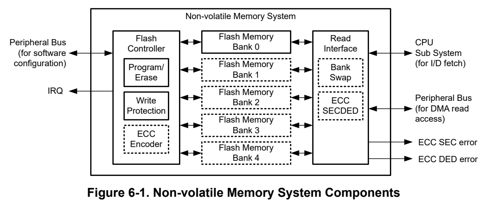
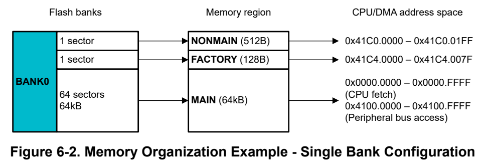
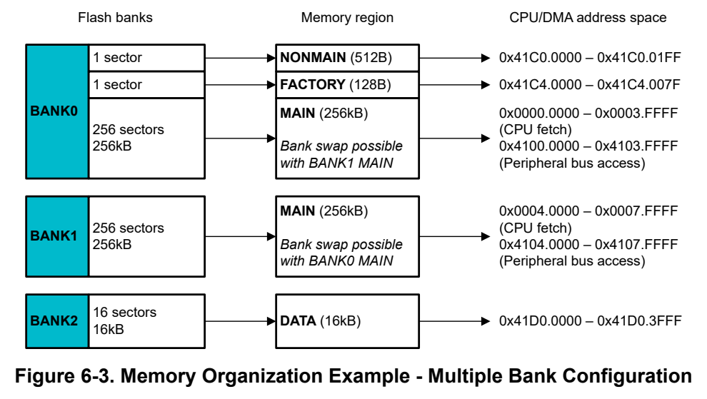

# 6 NVM (Flash) (pp. 308-411)

## NVM (Flash) (p. 308)

The nonvolatile memory (NVM) system provides nonvolatile flash memory for storing executable code and data.

### 6.1 NVM Overview 309 (p. 308)

### 6.2 Flash Memory Bank Organization 310 (p. 308)

### 6.3 Flash Controller 312 (p. 308)

### 6.4 Write Protection 321 (p. 308)

### 6.5 Read Interface 323 (p. 308)

### 6.6 FLASHCTL Registers 325 (p. 308)

### 6.1 NVM Overview (p. 309)

The nonvolatile memory system provides in-system programmable flash memory for storing executable code and data. This chapter describes the entire functionality provided by the nonvolatile memory system.

#### 6.1.1 Key Features (p. 309)

Key features of the nonvolatile memory system include:

- In-circuit program and erase supported across the entire supply voltage range

- Internal programming voltage generation

- 64-bit flash word size

- Static write protection (latched at boot and held until BOR or POR)

- Dynamic write protection (configurable at runtime)

- Sector (1KB) and bank (up to 256KB) erase

- Automatic hardware preverification to extend flash bank longevity

- Automatic hardware post-verification of program/erase •

•

•

Note To determine if a device has any of the optional features described above, review the nonvolatile memory system detailed description in the corresponding device data sheet.

#### 6.1.2 System Components (p. 309)

The nonvolatile memory system consists of three components (listed below):

- One or more flash memory banks (for storing code and data)

- The flash controller (for managing all program/erase operations on the flash banks)

- The read interface (for interfacing the flash banks to the CPU and peripheral bus)

*Figure 6-1. Non-volatile Memory System Components (p. 309)*

#### 6.1.3 Terminology (p. 309)

Key flash bank terms are defined in this section to be used as a reference for the rest of this chapter.

**Table 6-1. NVM System Terminology (pp. 309-310)**

| Term | Col 5 | Col 6 | Definition | Size |
| --- | --- | --- | --- | --- |
| Flash word |  |  | Basic data size for program and read operations on the flash memory (also the read bus width to the system) | 64 data bits (72 bits with ECC) |
| Word line |  | operation limit before sector erase | Group of flash words within a sector, with maximum program | 16 flash words (128 data bytes, optionally 16 ECC bytes) |
| Sector | resolution of the flash memory) |  | Group of word lines that are erased together (minimum erase | 8 word lines (1024 data bytes, optionally 128 ECC bytes) |
| Bank | Group of sectors that can be mass erased in one operation. Only one read, program, erase, or verify operation can run concurrently on a given bank. | Variable |  |  |
| Region | Logical assignment of a region of flash memory from a bank. | Variable |  |  |

### 6.2 Flash Memory Bank Organization (p. 310)

The flash memory is used for storing application code and data, the device boot configuration, and parameters which are preprogrammed by TI from the factory. The flash memory is organized into one or more banks, and the memory in each bank is further mapped into one or more logical memory regions and assigned system address space for use by the application.

#### 6.2.1 Banks (p. 310)

The nonvolatile memory system provides support for up to 5 flash memory banks (enumerated as BANK0 through BANK4). The number of flash banks present is device dependent. To determine the bank scheme of a particular device, review the detailed description section of the specific device data sheet. Most devices implement a single flash bank (BANK0).

On devices with a single flash bank, an ongoing program/erase operation will stall all read requests to the flash memory until the operation has completed and the flash controller has released control of the bank. On devices with more than one flash bank, a program/erase operation on a bank will also stall read requests issued to the bank which is executing the program/erase operation, but it will not stall read requests issued to any other bank. As such, the presence of multiple banks enables application cases such as:

- Dual-image firmware updates (an application can execute code out of one flash bank while a second image is programmed to a second symmetrical flash bank without stalling the application execution)

- EEPROM emulation (an application can execute code out of one flash bank while a second flash bank is used for writing data without stalling the application execution)

#### 6.2.2 Flash Memory Regions (p. 310)

The memory within each bank is mapped to one or more logical regions based upon the functions that the memory in each bank supports. There are four regions: FACTORY, NONMAIN (Configuration NVM), MAIN (Flash Memory) , and DATA.

**Table 6-2. Flash Memory Regions (p. 310)**

| Flash Memory Region | Region Contents | Executable | Used by | Programmed by |
| --- | --- | --- | --- | --- |
| FACTORY | Device ID and other parameters | No | Application | TI only (not modifiable) |
| NONMAIN (Configuration NVM) | Device boot configuration (BCR and BSL) | No | Boot ROM | TI, User |
| MAIN (Flash Memory) | Application code and data | Yes | Application | User |
| DATA | Data, or EEPROM emulation | No | Application | User |

Devices with one bank implement the FACTORY, NONMAIN, and MAIN regions on BANK0 (the only bank present), and the data region is not available. Devices with multiple banks also implement FACTORY, NONMAIN, and MAIN regions on BANK0, but include additional banks (BANK1 through BANK4) that can implement MAIN or DATA regions.

For a detailed description of the contents of the read-only FACTORY region, see Section 1.5.

#### 6.2.3 Addressing (p. 310)

The flash memory regions are assigned to address space in the system memory map.

The NONMAIN, DATA, and FACTORY regions are assigned to the peripheral address space (0x4000.0000) as they do not contain any executable code. The CPU should not fetch executable instructions from this region.

The MAIN region is assigned to both the code address space (0x0000.0000) and the peripheral address space (0x4000.0000). Instruction and data fetches are recommended to always be done through the code address space as this gives the best performance. The CPU should not fetch executable instructions from this region.

ECC

On devices which have error correction code (ECC) support, the ECC codes for all memory regions are also assigned to address space and it is possible for software to read the ECC codes as data for diagnostic purposes. It is also possible to read the contents of any of the memory regions without ECC correction applied.

##### 6.2.3.1 Flash Memory Map (p. 311)

The following table lists the system address space assignments. These assignments are consistent for all devices.

NONMAIN, DATA, and FACTORY data reads are processed through the peripheral bus and peripheral address space only. MAIN regions can be accessed through either the CPU bus matrix or through the peripheral bus, depending on whether code address space or peripheral address space is used. The code address space is recommended for CPU accesses (instruction fetches or data reads), as these accesses do not cross the peripheral bus and thus do not compete with the DMA for control of the peripheral bus. See the bus architecture section for a detailed description of the bus interconnect.

On devices that have ECC, an access to an ECC code address returns the 8-bit ECC value for the entire 64-bit flash word that was accessed. On devices that do not have ECC, accesses to the corrected and uncorrected ECC address spaces with the same offset read the same, and ECC code addresses read as 0x0.

#### 6.2.4 Memory Organization Examples (p. 311)

Figure 6-2 is an example of a single bank configuration with a 64KB MAIN region. NONMAIN and FACTORY regions are also included in the single bank (BANK0) with the MAIN region. Most devices with a main region ≤128KB in size implement a single-bank configuration.

*Figure 6-2. Memory Organization Example - Single Bank Configuration (p. 311)*

Figure 6-3 is an example of a three bank configuration with a 512KB MAIN region split across BANK0 and BANK1, with a 16KB DATA region provided in BANK2. Like the single bank example, NONMAIN and FACTORY regions are included in BANK0. This example supports EEPROM emulation in the DATA region without stalling fetches to MAIN, and it also supports dual-image applications where BANK0 main can be written to without stalling fetches to BANK1 main (and the reverse). Most devices with a main region ≥256KB in size implement a multibank configuration.

*Figure 6-3. Memory Organization Example - Multiple Bank Configuration (p. 312)*

### 6.3 Flash Controller (p. 312)

The flash controller manages all program, erase, and verification operations performed on the nonvolatile memory system. It contains memory-mapped registers in the peripheral region of the device memory map which must be configured by software to perform operations on the flash memory.

TI provides software abstraction for the flash controller as a part of the DriverLib layer of the software development kit (SDK). It is recommended to use the DriverLib abstraction layer when operating on the flash memory with software, but it is not mandatory to do so. To use the DriverLib software abstraction layer to perform operations on the flash memory, review the software development kit (SDK) documentation provided separately from this document. To directly operate on the flash memory with using low level register accesses to the flash controller, review the remainder of this section in detail.

Note The FLASHCTL registers may not always be configured to default values after a reset. This may occur if the boot configuration routine (BCR) or boot strap loader (BSL) perform an operation on the flash memory during boot. When configuring the FLASHCTL registers for an operation, ensure that all registers which are relevant for the operation are correctly configured.

#### 6.3.1 Overview of Flash Controller Commands (p. 312)

Operations on the flash memory are executed by configuring the CMDTYPE and CMDCTL registers for the desired command, along with any other registers which must be configured for a particular command, and writing 0x01 to the CMDEXEC register to initiate the command.

When 0x01 is set in CMDEXEC, the commanded operation begins executing. While an operation is executing, most configuration registers are blocked for writes until the operation completes. Some registers (for example, mask registers) can change state under hardware control while the operation runs to completion. The flash controller indicates completion of the commanded operation by setting the CMDDONE bit in the STATCMD register. The flash controller also sources an interrupt vector to the CPU subsystem to indicate a “DONE” status when an operation has completed.

The software sequence of setting the CMDEXEC bit and waiting for the CMDDONE response must be executed from either the device SRAM or from a different flash bank from the bank that is being operated on, as the flash controller will take control of the flash bank undergoing the operation. Reads to the flash bank that is being operated on while the flash controller is executing the command are not predictable.

The flash controller provides five basic commands for operating on the flash memory, specified in the COMMAND field of the CMDTYPE register. These commands are described in Table 6-3.

**Table 6-3. Flash Controller Commands (p. 313)**

| Col 1 | Command | Description |
| --- | --- | --- |
| NOOP |  | No operation (default setting). |
| PROGRAM |  | Selects a program operation on the flash memory. |
| ERASE |  | Selects an erase operation on the flash memory. |
| READVERIFY |  | Selects a standalone read verify operation. |
| BLANKVERIFY |  | Selects a standalone blank verify operation. |

Note It is recommended to call clear status command (CMDTYPE = 0x5) before call any flash operation.

#### 6.3.2 NOOP Command (p. 313)

When not using the flash controller, it is best to set the COMMAND field to NOOP to prevent any unintentional operations on the flash memory in the event that the VAL bit in CMDEXEC is unintentionally set. Executing a NOOP command has no effect on the flash memory.

#### 6.3.3 PROGRAM Command (p. 313)

The program command is used to write (program) the flash memory. Specifically, the purpose of a PROGRAM operation is to configure the flash bits in one or more flash words from the nondeterministic erased state to the deterministic programmed state. Once a byte is programmed using the PROGRAM command, the byte can not be re-programmed unless the sector is erased using the ERASE command.

All devices support single flash word programming of 64 data bits (plus 8 ECC bits on devices with ECC) at a time, with control to limit the scope of a program operation to specific bytes within a 64-bit flash word.

Some devices additionally have support for a multi-word programming mode where 2, 4, or 8 flash words can be written with a single commanded operation. Multi-word programming, when available, significantly speeds up programming when multiple words need to be programmed (for example, during production programming or firmware updates). See the device-specific data sheet to determine if multi-word programming is supported, and if so, how many flash word buffers are provided.

##### 6.3.3.1 Program Bit Masking Behavior (p. 313)

The flash controller provides a program verification mechanism to extend the lifetime of the flash bank. During program operations, the CMDDATAx registers are used by the flash controller as a programming bit mask to indicate which specific bits in the flash word require program pulses. As a result, data which is loaded into the CMDDATAx registers before starting the program operation will be lost from the CMDDATAx registers during and/or upon completion of the program operation. If the same data is to be programmed again, the CMDDATAx registers must be re-loaded by software with the correct data values to be programmed.

##### 6.3.3.2 Programming Less Than One Flash Word (p. 313)

In general, the simplest way to program the flash memory is one flash word at a time (64 bits plus 8 ECC bits if ECC is present). It is possible to program the flash memory with 32-, 16-, or 8-bit (byte) resolution, but special care must be taken when doing so to ensure the following:

1. On devices with ECC, ECC bits must be handled properly to prevent inadvertent ECC errors. 2. The number of program operations applied to a given word line must be monitored to ensure that the maximum word line program limit before erase is not violated. 3. Once a byte has been programmed, the sector containing the byte must be erased before attempting to re-program the same byte.

To program less than one flash word, the CMDBYTEN register must be configured to indicate which bytes in the flash word are to be programmed before starting the program operation. Each bit in CMDBYTEN corresponds to a byte in the flash word to be programmed, including the ECC bits.

Handling ECC

On devices with ECC, programming 64 bits of data at a time ensures that the 8 ECC bits which correspond to the 64-bit data word are also programmed both correctly and at the same time. Doing so prevents ECC errors from occurring if the memory locations are read by the CPU or DMA after programming.

If use of ECC is planned and partial programming is required, one approach is to mask (not program) the ECC bits until all 64 bits of a flash word are programmed, at which time the ECC bits can also be programmed. Programming of ECC bits is masked by clearing BIT8 (0x100) in the CMDBYTEN register. This prevents a situation where the entire sector must be erased each time a program operation is done to re-program ECC bits to match the new 64-bit data. However, in this case, a read to a partially programmed word where the ECC bits are not yet written would result in an ECC error. To avoid an ECC error, the software must either wait until the full 64-bit flash word and the 8 ECC bits are written, or read the data from the uncorrected address space.

Maximum Program Operations per Word Line Before Erase

The device data sheet specifies a maximum limit on the number of program operations per word line before erasure of the sector containing the word line is required. Exceeding this maximum can result in data corruption within the word line.

If 16-bit or greater program operations are performed, and no 16-bit location is programmed more than once before a sector is erased, the maximum limit will never be reached and thus does not need to be considered.

If 8-bit (byte) program operations are performed, the maximum program limit per word line must be considered and not exceeded. Program operations performed on ECC locations, if done independently from other program operations, count towards the number of writes before an erase is required.

Excuting a Program Less Than One Flash Word

To program the flash memory with 16-bits at address 0x1000:

1. Program 16 bit at address 0x1000 (ECC is not programmed at this step): a. CMDATAT0 is written with DATA1, CMDDATA1 is not used. b. CMDBYTEEN = 0x003.

2. Program 16 bit at address 0x1002 (ECC is not programmed at this step): a. CMDATAT0 is written with DATA2, CMDDATA1 is not used. b. CMDBYTEEN = 0x00C.

3. Program 16 bit at address 0x1004 (ECC is not programmed at this step): a. CMDATAT1 is written with DATA3, CMDDATA0 is not used. b. CMDBYTEEN = 0x030.

4. Program 16 bit at address 0x1006 (ECC is programmed at this step): a. CMDATAT0 is written with DATA1 and DATA2. b. CMDATAT1 is written with DATA3 and DATA4. c. CMDBYTEEN = 0x1FF.

##### 6.3.3.3 Target Data Alignment (Devices with Single Flash Word Programming Only) (p. 314)

For devices which only support single word programming, only the CMDDATA0, CMDDATA1, and CMDECC0 registers are used to load data to be programmed to the flash memory. CMDDATA0 is always loaded with BIT31-BIT0 of the target data, and CMDDATA1 is always loaded with BIT63-BIT32 of the target data. ECC data, if specified directly and not computed automatically, is loaded into BIT7-BIT0 of CMDECC0. No other CMDDATAx or CMDECCx registers are used, and CMDDATAINDEX is not used. If fewer than 64 data bits are being programmed, see the special handling requirements section above for programming less than one flash word.

Single-word program operations must be flash word (64-bit) aligned. This means that the target system address specified in CMDADDR must be aligned to a 0b000 boundary (for example, the 3 LSBs in CMDADDR must be zero).

##### 6.3.3.4 Target Data Alignment (Devices With Multiword Programming) (p. 315)

For devices that support 2-, 4-, or 8-word programming, there are two options for loading data to be programmed: direct mode or indexed mode. The programmer must select the mode that is most suitable to the application requirements.

Additional alignment rules apply when loading data into the CMDDATAx and CMDECCx registers on devices that support multiword programming, even if the multiword programming feature is not used and only single word programming is not used.

- 1-word program operations must have CMDADDR (the target system address) aligned to a 0b000 boundary (for example, the 3 LSBs in CMDADDR must be zero).

- 2-word program operations must have CMDADDR (the target system address) aligned to a 0b0000 boundary (for example, the 4 LSBs in CMDADDR must be zero).

- 4-word program operations must have CMDADDR (the target system address) aligned to a 0b0.0000 boundary (for example, the 5 LSBs in CMDADDR must be zero).

- 8-word program operations must have CMDADDR (the target system address) aligned to a 0b00.0000 boundary (for example, the 6 LSBs in CMDADDR must be zero).

Direct Data Load

To configure a program operation with direct data loading, the target data is loaded into the appropriate CMDDATAx registers based on the number of flash words supported by the device, the target address alignment, and the target data size. For example, if a 4-word program operation is to be initiated on a device supporting 4-word programming, the CMDDATA0-CMDDATA7 registers would be populated with the target data. If ECC is being specified directly (rather than automatically calculated by the flash controller) then the appropriate CMDECCx registers also needs to be populated with the ECC values for each data word being programmed.

Indexed Data Load

Rather than buffering data into all the CMDDATAx registers individually, it is possible to use only the CMDDATA0-CMDDATA1 registers in combination with an index register (CMDDATAINDEX) to indicate the flash word offset of the data being loaded. In this way, the index can be adjusted for each word loaded, and each target data word can be written to the same 64-bit space (CMDDATA0-CMDDATA1). When an index is applied, the loaded data will be mapped by the hardware into the appropriate CMDDATAx register. For example, if a 4-word program operation is to be initiated on a device supporting 4-word programming, the CMDDATA1:0 registers are loaded 4 times with the target data, with CMDDATAINDEX being incremented by one before each new word is loaded into CMDDATA1:0.

Alignment Rules

The alignment rules for each device configuration (2, 4, or 8 words) is given in the tables below with guidance on how target data must be placed with the CMDDATAx, CMDECCx, and CMDDATAINDEX registers for 1, 2, 4, or 8 word programming operations.

Direct Load Indexed Load 4 Words Aligned 8 Words Aligned

## 1 Word Aligned to 0b000 2 Words Aligned to 0b0000 (p. 315)

Registers Index to 0b0.0000 to 0b00.0000

**Table 6-4. Data Load Alignment for Devices Supporting Programming of 2 Flash Words (p. 315)**

| CMDDATA1:0 / CMDECC0 | CMDINDEX = 0 | Target data word 0 if the target address ends in 0b0000 | Target data word 0 | Not supported | Not supported |
| --- | --- | --- | --- | --- | --- |
| CMDDATA3:2 / CMDECC1 | CMDINDEX = 1 | Target data word 0 if the target address ends in 0b1000 | Target data word 1 | Not supported | Not supported |

Direct Load Indexed Load 4 Words Aligned 8 Words Aligned

## 1 Word Aligned to 0b000 2 Words Aligned to 0b0000 (p. 316)

Registers Index to 0b0.0000 to 0b00.0000

**Table 6-5. Data Load Alignment for Devices Supporting Programming of 4 Flash Words (p. 316)**

| CMDDATA1:0 / CMDECC0 | CMDINDEX= 0 | Target data word 0 if the target address ends in 0b0.0000 | Target data word 0 if the target address ends in 0b0.0000 | Target data word 0 | Col 6 |
| --- | --- | --- | --- | --- | --- |
| CMDDATA3:2 / CMDECC1 | CMDINDEX= 1 | Target data word 0 if the target address ends in 0b0.1000 | Target data word 1 if the target address ends in 0b0.0000 | Target data word 1 | Not supported |
| CMDDATA5:4 / CMDECC2 | CMDINDEX= 2 | Target data word 0 if the target address ends in 0b1.0000 | Target data word 0 if the target address ends in 0b1.0000 | Target data word 2 | Not supported |
| CMDDATA7:6 / CMDECC3 | CMDINDEX= 3 | Target data word 0 if the target address ends in 0b1.1000 | Target data word 1 if the target address ends in 0b1.0000 | Target data word 3 |  |

**Table 6-6. Data Load Alignment for Devices Supporting Programming of 8 Flash Words (p. 316)**

| Direct Load Registers | Indexed Load Index | 1 Word Aligned to 0b000 | 2 Words Aligned to 0b0000 | 4 Words Aligned to 0b0.0000 | 8 Words Aligned to 0b00.0000 |
| --- | --- | --- | --- | --- | --- |
| CMDDATA1:0 / CMDECC0 | CMDINDEX = 0 | Target data word 0 if the target address ends in 0b00.0000 | Target data word 0 if the target address ends in 0b00.0000 | Target data word 0 if the target address ends in 0b00.0000 | Target data word 0 |
| CMDDATA3:2 / CMDECC1 | CMDINDEX = 1 | Target data word 0 if the target address ends in 0b00.1000 | Target data word 1 if the target address ends in 0b00.0000 | Target data word 1 if the target address ends in 0b00.0000 | Target data word 1 |
| CMDDATA5:4 / CMDECC2 | CMDINDEX = 2 | Target data word 0 if the target address ends in 0b01.0000 | Target data word 0 if the target address ends in 0b01.0000 | Target data word 2 if the target address ends in 0b00.0000 | Target data word 2 |
| CMDDATA7:6 / CMDECC3 | CMDINDEX = 3 | Target data word 0 if the target address ends in 0b01.1000 | Target data word 1 if the target address ends in 0b01.0000 | Target data word 3 if the target address ends in 0b00.0000 | Target data word 3 |
| CMDDATA9:8 / CMDECC4 | CMDINDEX = 4 | Target data word 0 if the target address ends in 0b10.0000 | Target data word 0 if the target address ends in 0b10.0000 | Target data word 0 if the target address ends in 0b10.0000 | Target data word 4 |
| CMDDATA11:10 / CMDECC5 | CMDINDEX = 5 | Target data word 0 if the target address ends in 0b10.1000 | Target data word 1 if the target address ends in 0b10.0000 | Target data word 1 if the target address ends in 0b10.0000 | Target data word 5 |
| CMDDATA13:12 / CMDECC6 | CMDINDEX = 6 | Target data word 0 if the target address ends in 0b11.0000 | Target data word 0 if the target address ends in 0b11.0000 | Target data word 2 if the target address ends in 0b10.0000 | Target data word 6 |
| CMDDATA15:14 / CMDECC7 | CMDINDEX = 7 | Target data word 0 if the target address ends in 0b11.1000 | Target data word 1 if the target address ends in 0b11.0000 | Target data word 3 if the target address ends in 0b10.0000 | Target data word 7 |

##### 6.3.3.5 Executing a PROGRAM Operation (p. 316)

To program the flash memory:

1. Select the command in the CMDTYPE register: a. Set the COMMAND field in the CMDTYPE register to PROGRAM. b. Set the SIZE field in the CMDTYPE register to the desired size (1, 2, 4, or 8 flash words). If a device does not support multi-word programming, select ONEWORD. If a device supports multi-word programming, and multi-word programming is desired, select the desired size which is less than or equal to the max size supported by the target device. The hardware will not check for invalid configuration of the SIZE field; software must ensure that the selection option is supported by the device. Note that SECTOR and BANK sizes are not valid sizes for PROGRAM operations. These sizes only apply to erase operations.

a. On devices with ECC, the flash controller by default will generate the needed ECC bits from the data during the PROGRAM operation. Optionally, software can override the hardware ECC code generation and manually provide the ECC code to be programmed by setting the ECCGENOVR bit in CMDCTL register.

3. Select the target programming address in the CMDADDR and CMDBYTEN register: a. Load the target system address into the CMDADDR register to indicate the base address from which programming will start. The target address must be a flash word address (64-bit aligned). The flash controller will translate the system address into the applicable flash region, bank ID, and bank address. If desired, after the operation completes the flash region, bank ID, and bank address can be read from the STATADDR register. In a multi-word program, STATADDR will indicate the bank ID and the final address which was programmed. b. If subword programming (programming of less than the full 64 or 72 bit flash word) is desired, configure the CMDBYTEN register to set the bytes within the addressed flash word which are to be programmed. Each bit in CMDBYTEN corresponds to a byte in the addressed flash word to be programmed, including the ECC byte. For example, programming of the ECC code can be masked by clearing bit 8 in CMDBYTEN while programming the data bytes of the flash word. Note that there is a maximum number of program operations allowed per word line before a sector erase must be applied (see the device specific data sheet for the maximum).

4. Load the data to program into the CMDDATAx registers: a. For a single flash word programming operation (64 or 72 bits depending on the presence of ECC), load the data into the CMDDATAx registers consistent with the alignment requirements (for devices which only support single-word programming, CMDDATA0 and CMDDATA1 are always used regardless of the target address). b. For multi-word programming (if available and selected), load data into the CMDDATAx registers consistent with the alignment rules and the size of the multi-word program operation specified in step 1. c. If ECCGENOVR in the CMDCTL register was set above (disabling hardware ECC code generation), then write the ECC data in the CMDDATAECC0 register (for single word programming) and optionally additional CMDDATAECCx registers as applicable for multi-word programming. d. Note that the CMDDATA registers are used as bit masking registers by the flash controller during the program operation; after the operation completes, the values written to these registers will have been overwritten by the flash controller.

5. Ensure the write protection scheme is configured to allow writes to the target addresses (see the write protection section of this guide for additional information on configuring write protection). 6. Execute the program operation by writing 0x1 to the CMDEXEC register. 7. Monitor for completion of the program operation: a. The STATCMD register can be polled to determine the status of the program operation. The CMDINPROGRESS bit will be set by hardware as soon as the command is initiated. The CMDDONE bit will be set when the operation terminates. b. When CMDDONE is set, the CMDPASS bit will be reset or set at the same time to indicate whether the operation completed successfully or failed. If a program was attempted on a protected region, the FAILWEPROT or FAILILLADDR bit is asserted depend on dynamic or static write protection. If the program operation cannot be completed successfully within the maximum program pulse count limit FAILVERIFY will be asserted. See the device-specific data sheet for maximum program times.

8. After completion of a program operation, the flash controller will configure several settings: a. All dynamic write protection registers are set to a protected state (to protect against inadvertent programming) b. All data registers are set to 1. c. All program byte enables are cleared to 0.

9. Following programming of the flash memory, it is possible that there may be stale data in the processor's cache and prefetch logic. Before reading locations which were programmed, it is recommended to first flush the cache in the CPU subsystem.

#### 6.3.4 ERASE Command (p. 318)

The erase command is used to erase individual sectors of flash memory (for MAIN, NONMAIN, or DATA regions) or a complete bank of flash memory (for MAIN regions only). From this erased state, bits can later be programmed to a ‘0’ state or a '1' state as desired using the PROGRAM command. It is not possible to erase with a resolution lower than one sector (1KB) with sector alignment. For devices with multiple banks, a bank erase must be executed on all banks to erase the entire MAIN region on the device.

##### 6.3.4.1 Erase Sector Masking Behavior (p. 318)

The flash controller provides an erase verification mechanism to extend the lifetime of the flash bank. The CMDWEPROTx registers are used as an erase mask and are manipulated by the flash controller during the execution of the erase operation. At the end of all erase operations, the CMDWEPROTx registers are set to a fully protected state to prevent against inadvertent programming and must be re-configured before attempting another program or erase operation.

##### 6.3.4.2 Executing an ERASE Operation (p. 318)

To erase a sector or bank of the flash memory, follow these steps: 1. Select the command in the CMDTYPE register: a. Set the COMMAND field in the CMDTYPE register to ERASE. b. Set the SIZE field in the CMDTYPE register to SECTOR or BANK. Sizes other than SECTOR or BANK (for example, ONEWORD) are not supported by the ERASE command. It is the responsibility of software to check the configuration before issuing an ERASE command.

2. Select the target erase address in the CMDADDR register: a. Store the target system address into the CMDADDR register to indicate the base address of the sector or bank to be erased. When performing a bank erase with write protection enabled (such that only unprotected sectors are erased), ensure that the address written to CMDADDR is in an unprotected sector. The flash controller will translate the system address into the applicable flash region, bank ID, and bank address. If desired, after the operation completes the flash region, bank ID, and bank address can be read from the STATADDR register.

3. Ensure the write protection scheme is configured to allow writes to the target sectors (see the write protection section of this guide for additional information on configuring write protection). 4. Execute the erase operation by writing 0x1 to the CMDEXEC register. 5. Monitor for completion of the erase operation: a. The STATCMD register can be polled to determine the status of the erase operation. The CMDINPROGRESS bit will be set by hardware as soon as the command is initiated. The CMDDONE bit will be set when the operation terminates. When CMDDONE is set, the CMDPASS bit will be reset or set at the same time to indicate whether the operation completed successfully or failed. b. If an erase was attempted on a protected region, the FAILWEPROT bit is asserted. c. If the erase operation cannot be completed successfully within the maximum erase pulse count limit, FAILVERIFY will be asserted.

6. After completion of the erase operation, the flash controller will configure several settings to protect against inadvertent programming: a. All dynamic write protection registers are set to a protected state.

#### 6.3.5 READVERIFY Command (p. 318)

The read verify command can be used to read a flash location and compare the data to data which is preloaded into the CMDDATA registers of the flash controller. The command can be applied to a single flash word, multiple flash words (if the device supports multi-word programming), an entire sector, or an entire bank. When performing a read verify on an entire sector or bank, the data in CMDDATAx will be re-used.

##### 6.3.5.1 Executing a READVERIFY Operation (p. 319)

To execute a read verify command, follow these steps: 1. Select the command in the CMDTYPE register: a. Set the COMMAND field in the CMDTYPE register to READVERIFY. b. Set the SIZE field in the CMDTYPE register to the desired size.

2. Configure the read verify command in the CMDCTL register: a. If the desire is to manually provide ECC bits along with the data, set the ECCGENOVR bit in the CMDCTL register. If ECCGENOVR is cleared, the flash controller will generate ECC bits for comparison based on the provided compare data.

3. Select the target address to verify on the CMDADDR register: a. Load the target system address into the CMDADDR register to indicate the base address to be verified. The flash controller will translate the system address into the applicable flash region, bank ID, and bank address. If desired, after the operation completes the flash region, bank ID, and bank address can be read from the STATADDR register.

4. Load the data to verify into the CMDDATAx registers: a. For single word verification, write the data to be verified to the CMDDATA0 and CMDDATA1 registers. For multi-word verification, if available on the target device, write the data to be verified to the appropriate CMDDATAx registers beyond CMDDATA0 and CMDDATA1.

5. Configure the byte enable settings in the CMDBYTEN register: a. Any CMDBYTEN bit set to logic “0” will mask the associated data byte from being compared during the execution of the READVERIFY command. This can be used to verify data less than one flash word (less than 64 bits).

6. Execute the read verify operation by writing 0x1 to the CMDEXEC register. 7. Monitor for completion of the read verify operation: a. The STATCMD register can be polled to determine the status of the erase operation. The CMDINPROGRESS bit will be set by hardware as soon as the command is initiated. The CMDDONE bit will be set when the operation terminates. When CMDDONE is set, the CMDPASS bit will be reset or set at the same time to indicate whether the read verification passed or failed. b. The FAILVERIFY bit in STATCMD will be set if any data read from the flash did not match the expected data loaded in CMDDATAx.

8. After completion of the read verify operation, the flash controller will configure several settings: a. All dynamic write protection registers are set to a protected state (to protect against inadvertent programming). b. All data registers are set to ‘1’s. c. All program byte enables are cleared to ‘0’s.

#### 6.3.6 BLANKVERIFY Command (p. 319)

The blank verify (BLANKVERIFY) command can be used by application software to verify that a flash word is blank. A blank flash word is defined as a flash word which has been successfully erased with the ERASE command and not yet programmed away from that nonerased state with the PROGRAM command.

After erase, a flash word is not in a deterministic state until it is programmed using the PROGRAM command. This means that application software can not expect that erased bits will read back as '1's' after an erase. A memory location must be successfully programmed using the PROGRAM command before a read of that memory location can be considered deterministic and used by application software.

Because it is not possible to determine if a flash word is in an erased state by simply reading the location directly (as an erased location will return nondeterministic data when read), the BLANKVERIFY command can be used to test if a flash word is in a blank state, indicating it has not yet been programmed away from an erased state.

The BLANKVERIFY command can only be applied to a single flash word at a time.

Note After erasure, if programming flash with 0xFFFFFFFF, performing a blank verify at this location will also pass.

##### 6.3.6.1 Executing a BLANKVERIFY Operation (p. 320)

To execute a blank verify operation, follow these steps: 1. Select the command in the CMDTYPE register: a. Set the COMMAND field in the CMDTYPE register to BLANKVERIFY. b. Set the SIZE field in the CMDTYPE register to one word.

2. Select the target address to verify in the CMDADDR register: a. Store the target system address into the CMDADDR register to indicate the base address to be verified. The flash controller will translate the system address into the applicable flash region, bank ID, and bank address. If desired, after the operation completes the flash region, bank ID, and bank address can be read from the STATADDR register. All 8 data bytes in the specified flash word, and the corresponding ECC byte, will be checked by BLANKVERIFY.

3. Execute the blank verify operation by writing 0x1 to the CMDEXEC register. 4. Monitor for completion of the blank verify operation: a. The STATCMD register can be polled to determine the status of the erase operation. The CMDINPROGRESS bit will be set by hardware as soon as the command is initiated. The CMDDONE bit will be set when the operation terminates. When CMDDONE is set, the CMDPASS bit will be reset or set at the same time to indicate whether the blank verification passed or failed. b. The FAILVERIFY bit in STATCMD will be set if the flash location is not erased.

5. After completion of the blank verify operation, the flash controller will configure several settings: a. All dynamic write protection registers are set to a protected state ( to protect against inadvertent programming) b. All data registers are set to ‘1’s. c. All program byte enables are cleared to ‘0’s.

#### 6.3.7 Command Diagnostics (p. 320)

The flash controller updates several software-readable registers to communicate information about an initiated operation.

##### 6.3.7.1 Command Status (p. 320)

The STATCMD register is a read-only register which provides diagnostic information about an operation which is been initiated or completed. The CMDINPROGRESS bit indicates that an operation is currently ongoing. The CMDDONE bit indicates that an operation has completed. These bits can be polled by software to determine the state of the flash controller during operations.

##### 6.3.7.2 Address Translation (p. 320)

The STATADDR register is a read-only register which can be read to determine the current bank ID, region ID, and bank address which the flash controller is pointing to. These values can increment during execution of certain commands, in which case the value present after the completion of a command indicates the last address touched by the flash controller.

##### 6.3.7.3 Pulse Counts (p. 320)

The STATPCNT register is a read-only register which can be read to determine the current pulse count applied during a program or erase operation.

#### 6.3.8 Overriding the System Address With a Bank ID, Region ID, and Bank Address (p. 321)

Normally, flash controller commands are targeted to a specific flash location by loading a system memory map address into the CMDADDR register. This is the recommended way to specify the target address for a PROGRAM, ERASE, READVERIFY, or BLANKVERIFY command. In this mode of operation, the flash controller will automatically translate the system address into the corresponding bank ID, region ID, and bank address which are used to execute the command on the flash memory. Application software does not need to specify these items individually; only the system address is needed.

However, in some circumstances it can be desirable to directly specify the target flash bank, region, and address in the specified bank/region. For example, if the desire is to erase a complete bank when doing a mass erase operation on the device, application software actually does not need to have any knowledge of the system address of the bank to be erased- it only needs to specify the bank ID and region ID to the flash controller to erase the bank.

To use the flash controller to execute a command in address override mode, set the ADDRXLATEOVR bit in the CMDCTL register, and specify the bank ID, region, and bank address before executing the command. To return to system addressed mode, clear ADDRXLATEOVR. ADDRXLATEOVR is cleared by default (supporting system address operation).

Example Case - Bank Erase with ADDRXLATEOVR

To erase the MAIN region of BANK0 by specifying the bank ID and region instead of the system address, follow the steps in Section 6.3.4.2, but replace step 2 with the alternate steps given below:

1. Set the ADDRXLATEOVR bit in CMDCTL to enable address translation override mode 2. Specify BANK0 by setting the BANKSEL field to 0x1 in the CMDCTL register 3. Specify the MAIN region by setting the REGIONSEL field to 0x1 in the CMDCTL register 4. Set the CMDADDR register to 0x0000.0000

#### 6.3.9 FLASHCTL Events (p. 321)

The flash controller contains one event publisher and no event subscribers. One event publisher (CPU_INT) manages FLASHCTL interrupt requests (IRQs) to the CPU subsystem through a static event route.

Table 6-7 summarizes the FLASHCTL events.

**Table 6-7. FLASHCTL Events (p. 321)**

| Event | Type | Source | Destination | Route | Configuration | Functionality |
| --- | --- | --- | --- | --- | --- | --- |
| CPU Interrupt Event | Publisher | FLASHCTL | CPU Subsystem | Static route | CPU_INT registers | Fixed interrupt route from FLASHCTL to CPU |

##### 6.3.9.1 CPU Interrupt Event Publisher (p. 321)

The FLASHCTL module provides one interrupt source which can be configured to source a CPU interrupt event. The FLASHCTL interrupt conditions are given in Table 6-8.

**Table 6-8. FLASHCTL CPU Interrupt Conditions (p. 321)**

| Index (IIDX) | Name | Description |
| --- | --- | --- |
| 0 | DONE | Indicating that the FLASHCTL operation has completed |

The CPU interrupt event configuration is managed with the CPU_INT event management registers. See Section 7.2.5 for guidance on configuring these registers.

### 6.4 Write Protection (p. 321)

The flash controller provides two write protection mechanisms (one static, one dynamic) which are applied in parallel (logical OR) to protect user-specified sectors during any attempted program or erase operation. If

a program or erase operation is issued to a write protected flash sector, the operation will terminate with a FAILWEPROT error reported in the STATCMD register.

#### 6.4.1 Write Protection Resolution (p. 322)

The write protection resolution for both the static and dynamic write protection mechanisms is dependent on the flash bank and memory region which is being protected.

**Table 6-9. Write Protection Resolution by Region (p. 322)**

| Flash Bank | Memory Region | Write Protection Resolution |
| --- | --- | --- |
|  | NONMAIN | 512B (entire region) |
| 0 | MAIN | 1KB (1 sector) for first 32KB (32 sectors) 8KB (8 sectors) for remaining sectors |
| 1-4 | MAIN | 8KB (8 sectors) |
| 1-4 | DATA | 1KB (1 sector) |

#### 6.4.2 Static Write Protection (p. 322)

The static write protection scheme is configured and latched during device boot by the immutable ROM boot code before the main application in flash can execute. After a flash sector is configured to be write protected through the static write protection mechanism, software cannot remove the protection at runtime without a reboot. Thus, sectors protected by static write protection can be thought of as immutable after boot. This type of protection is useful for protecting a custom bootloader in a dual-image application, or for extending the secure root of trust from the ROM boot code into a portion of the main flash region to enable a secure boot manager with locked public keys.

The static write protection scheme is configured by programming the appropriate bits in the NONMAIN flash region, which is read by the boot code before the main application starts. The NONMAIN flash sector can be statically write protected, resulting in a system in which the static write protection scheme is fully permanent and cannot be modified. If the NONMAIN sector is configured to be statically protected, along with any other flash sectors, all statically protected flash sectors can be functionally viewed as read only memory which cannot be updated by any means.

Static write protection can be configured for all sectors of flash memory across all banks present on a device. Program or erase static write protected area will cause illegal address failure, and the FAILILLADDR bit in STATCMD will be set. Instructions for configuring the static write protection, along with the rest of the NONMAIN region, are given in Section 1.4.

#### 6.4.3 Dynamic Write Protection (p. 322)

The dynamic write protection scheme is intended to be configured at runtime by software. This scheme provides a simple way for application software to specify sectors to protect from modification by any program or erase operations that are issued with the flash controller. Unlike the static write protection mechanism, the dynamic mechanism is not lockable and thus does not provide any level of data security.

There are two primary uses for dynamic write protection. First, it provides an extra level of robustness against unintentional program or erase of specified sectors in applications that involve in-system programming for either firmware updates or EEPROM emulation. Second, it provides a way to simplify a situation where a bank erase is desired but a small number of sectors should not be erased when a bank erase command is issued. One example would be an application running on a single-bank device in which most of the MAIN region sectors are used to store the executable image, but a few sectors are used to store device-specific data that should not be erased during a firmware update. In that case, the sectors containing the device-specific data can be protected with dynamic write protection, and a bank erase command can be issued to erase all other sectors. This has the benefit that the majority of the MAIN region can be erased with a single command (a bank erase) rather than individual sector-by-sector commands, which would have a longer overall erase time and use more energy.

The dynamic write protection scheme is configured by setting up the CMDWEPROTx registers in the flash controller. The CMDWEPROTx registers cover one flash bank at a time. This means that these registers must be configured with knowledge of which flash bank an attempted program or erase operation will be applied to. Note that the CMDWEPROTx registers are reset to a protected state at the end of all program and erase operations. These registers must be re-configured by software before a new operation is initiated. Program or erase dynamic write protected area will cause write/erase protction failure, and the FAILWEPROT bit in STATCMD will be set.

##### 6.4.3.1 Configuring Protection for the MAIN Region (p. 323)

The CMDWEPROTA register is used to configure the dynamic write protection for the first 32 sectors (32KB) of the MAIN region in BANK0. Each bit corresponds to one sector of the MAIN region, starting from the beginning of the MAIN region. CMDWEPROTA is only applicable to operations on the lower 32 sectors of the MAIN region of BANK0 (sectors 0-31). It is not used during program/erase operations applied to other sectors.

The CMDWEPROTB register is also used to configure the dynamic write protection for the MAIN region. There are two modes in which CMDWEPROTB is applied, depending on whether the program/erase operation is being applied to BANK0 or BANK1-4. In the case of a program/erase operation on BANK0, CMDWEPROTB protects sectors 32-255 in 8-sector increments (1 bit per 8KB), starting from BIT4. BIT0-BIT3 in CMDWEPROTB are ignored. The lower 32 sectors (sectors 0-31 of BANK0) are protected by CMDWEPROTA. In the case of a program/erase operation on BANK1-4, CMDWEPROTB protects sectors 0-255 in 8-sector increments (1 bit per 8 sectors), starting from BIT0 in CMDWEPROTB.

The CMDWEPROTC register configures the dynamic write protection for the MAIN region. For BANK0-4, CMDWEPROTC protects sectors 256-511 in 8-sector increments (1 bit per 8 sectors).

##### 6.4.3.2 Configuring Protection for the NONMAIN Region (p. 323)

The CMDWEPROTNM register protects the NONMAIN region from program and erase. One protection bit is provided per sector. Devices only have one NONMAIN sector and it will be in BANK0.

### 6.5 Read Interface (p. 323)

The read interface provides the read path to the CPU subsystem (for instruction/data fetch), the read path to the peripheral bus (for use by the DMA controller or CPU), main bank address swapping, and detection and reporting of ECC SEC or DED errors.

#### 6.5.1 Bank Address Swapping (p. 323)

Devices that contain more than one bank support swapping of the MAIN regions of the banks within the address space. This mechanism enables two versions of application firmware to be programmed into the device without the firmware needing to know which physical bank it exists in.

Table 6-10 gives an example of the mapping before and after a bank swap is requested for a device with a 512KB main flash split across 2 banks (256KB each).

**Table 6-10. Bank Address Swap Translation (p. 323)**

| Bank and Region | Address Space Before Swap | Address Space After Swap |
| --- | --- | --- |
| BANK0 MAIN | 0x0000.0000 – 0x0003.FFFF | 0x0004.0000 – 0x0007.FFFF |
| BANK1 MAIN | 0x0004.0000 – 0x0007.FFFF | 0x0000.0000 – 0x0003.FFFF |

After a device reset, the MAIN region of the lower bank is always mapped to the lowest address space. The application software is responsible for determining if a bank address swap is to be applied. The bank address swap control is contained within the SYSCTL module; see the SYSCTL chapter for register and bit definitions. During an address swap, the application software must meet the following constraints:

1. The software must disable interrupts before issuing the bank swap command. 2. The software must poll the bank swap status after issuing the bank swap command before proceeding with execution.

3. If the swap command and poll status routines are executing from flash, they must exist at the exact same location in both banks such that execution resumes from where it left off after the bank swap. This restriction does not apply if the bank swap and status polling is done from SRAM and not from flash memory.

### 6.6 FLASHCTL Registers (p. 325)

Table 6-11 lists the memory-mapped registers for the FLASHCTL registers. All register offset addresses not listed in Table 6-11 should be considered as reserved locations and the register contents should not be modified.

**Table 6-11. FLASHCTL Registers (pp. 325-326)**

| Offset | Acronym | Register Name | Group |
| --- | --- | --- | --- |
| 1020h | IIDX | Interrupt Index Register |  |
| 1028h | IMASK | Interrupt Mask Register |  |
| 1030h | RIS | Raw Interrupt Status Register |  |
| 1038h | MIS | Masked Interrupt Status Register |  |
| 1040h | ISET | Interrupt Set Register |  |
| 1048h | ICLR | Interrupt Clear Register |  |
| 10E0h | EVT_MODE | Event Mode |  |
| 10FCh | DESC | Hardware Version Description Register |  |
| 1100h | CMDEXEC | Command Execute Register |  |
| 1104h | CMDTYPE | Command Type Register |  |
| 1108h | CMDCTL | Command Control Register |  |
| 1120h | CMDADDR | Command Address Register |  |
| 1124h | CMDBYTEN | Command Program Byte Enable Register |  |
| 112Ch | CMDDATAINDEX | Command Data Index Register |  |
| 1130h | CMDDATA0 | Command Data Register 0 |  |
| 1134h | CMDDATA1 | Command Data Register 1 |  |
| 1138h | CMDDATA2 | Command Data Register 2 |  |
| 113Ch | CMDDATA3 | Command Data Register Bits 127:96 |  |
| 1140h | CMDDATA4 | Command Data Register 4 |  |
| 1144h | CMDDATA5 | Command Data Register 5 |  |
| 1148h | CMDDATA6 | Command Data Register 6 |  |
| 114Ch | CMDDATA7 | Command Data Register 7 |  |
| 1150h | CMDDATA8 | Command Data Register 8 |  |
| 1154h | CMDDATA9 | Command Data Register 9 |  |
| 1158h | CMDDATA10 | Command Data Register 10 |  |
| 115Ch | CMDDATA11 | Command Data Register 11 |  |
| 1160h | CMDDATA12 | Command Data Register 12 |  |
| 1164h | CMDDATA13 | Command Data Register 13 |  |
| 1168h | CMDDATA14 | Command Data Register 14 |  |
| 116Ch | CMDDATA15 | Command Data Register 15 |  |
| 1170h | CMDDATA16 | Command Data Register 16 |  |
| 1174h | CMDDATA17 | Command Data Register 17 |  |
| 1178h | CMDDATA18 | Command Data Register 18 |  |
| 117Ch | CMDDATA19 | Command Data Register 19 |  |
| 1180h | CMDDATA20 | Command Data Register 20 |  |
| 1184h | CMDDATA21 | Command Data Register 21 |  |
| 1188h | CMDDATA22 | Command Data Register 22 |  |
| 118Ch | CMDDATA23 | Command Data Register 23 |  |
| 1190h | CMDDATA24 | Command Data Register 24 |  |
| 119Ch | CMDDATA27 | Command Data Register 27 |  |
| 11A0h | CMDDATA28 | Command Data Register 28 |  |
| 11A4h | CMDDATA29 | Command Data Register 29 |  |
| 11A8h | CMDDATA30 | Command Data Register 30 |  |
| 11ACh | CMDDATA31 | Command Data Register 31 |  |
| 11B0h | CMDDATAECC0 | Command Data Register ECC 0 |  |
| 11B4h | CMDDATAECC1 | Command Data Register ECC 1 |  |
| 11B8h | CMDDATAECC2 | Command Data Register ECC 2 |  |
| 11BCh | CMDDATAECC3 | Command Data Register ECC 3 |  |
| 11C0h | CMDDATAECC4 | Command Data Register ECC 4 |  |
| 11C4h | CMDDATAECC5 | Command Data Register ECC 5 |  |
| 11C8h | CMDDATAECC6 | Command Data Register ECC 6 |  |
| 11CCh | CMDDATAECC7 | Command Data Register ECC 7 |  |
| 11D0h | CMDWEPROTA | Command Write Erase Protect A Register |  |
| 11D4h | CMDWEPROTB | Command Write Erase Protect B Register |  |
| 11D8h | CMDWEPROTC | Command Write Erase Protect C Register |  |
| 1210h | CMDWEPROTNM | Command Write Erase Protect Non-Main Register |  |
| 1214h | CMDWEPROTTR | Command Write Erase Protect Trim Register |  |
| 1218h | CMDWEPROTEN | Command Write Erase Protect Engr Register |  |
| 13B0h | CFGCMD | Command Configuration Register |  |
| 13B4h | CFGPCNT | Pulse Counter Configuration Register |  |
| 13D0h | STATCMD | Command Status Register |  |
| 13D4h | STATADDR | Address Status Register |  |
| 13D8h | STATPCNT | Pulse Count Status Register |  |
| 13DCh | STATMODE | Mode Status Register |  |
| 13F0h | GBLINFO0 | Global Information Register 0 |  |
| 13F4h | GBLINFO1 | Global Information Register 1 |  |
| 13F8h | GBLINFO2 | Global Information Register 2 |  |
| 1400h | BANK0INFO0 | Bank Information Register 0 for Bank 0 |  |
| 1404h | BANK0INFO1 | Bank Information Register 1 for Bank 0 |  |
| 1410h | BANK1INFO0 | Bank Information Register 0 for Bank 1 |  |
| 1414h | BANK1INFO1 | Bank Information Register 1 for Bank 1 |  |
| 1420h | BANK2INFO0 | Bank Information Register 0 for Bank 2 |  |
| 1424h | BANK2INFO1 | Bank Information Register 1 for Bank 2 |  |
| 1430h | BANK3INFO0 | Bank Information Register 0 for Bank 3 |  |
| 1434h | BANK3INFO1 | Bank Information Register 1 for Bank 3 |  |
| 1440h | BANK4INFO0 | Bank Information Register 0 for Bank 4 |  |
| 1444h | BANK4INFO1 | Bank Information Register 1 for Bank 4 |  |

Complex bit access types are encoded to fit into small table cells. Table 6-12 shows the codes that are used for access types in this section.

**Table 6-12. FLASHCTL Access Type Codes (p. 327)**

| Access Type | Code | Description |
| --- | --- | --- |
| Read Type |  |  |
| R | R | Read |
| Write Type |  |  |
| W | W | Write |
| Reset or Default Value |  |  |
| - n |  | Value after reset or the default value |

### 6.6.1 [FLASHCTL.IIDX] Offset: 1020h | Reset: 00000000h (p. 328)

IIDX is shown in Figure 6-4 and described in Table 6-13.

Interrupt Index Register: The IIDX register provides the highest priority enabled interrupt index. PSD compliant register. Note that it is not recommended to use this register if the system clock is running at a slower clock frequency than the flash wrapper clock. If this is the case, then reading this register may fail to update the RIS register correctly. The MIS register should be read directly, and a write to ICLR should be used to clear interrupts when this clock relationship is present.

> **Bit Map**: `[31-1] RESERVED (R, 0h)` | `[0] STAT (R, 0h)`

**Table 6-13. IIDX Field Descriptions (p. 328)**

| Bit | Field | Type | Reset | Description |
| --- | --- | --- | --- | --- |
| 31-1 | RESERVED | R | 0h | Reserved |
| 0 | STAT | R | 0h | Indicates which interrupt has fired. 0x0 means no event pending. The priority order is fixed. On each read, only one interrupt is indicated. On a read, the current interrupt (highest priority) is automatically cleared by the hardware and the corresponding interrupt flags in the RIS and MIS are cleared as well. After a read from the CPU (not from the debug interface), the register must be updated with the next highest priority interrupt. 0h (R/W) = No Interrupt Pending 1h (R/W) = DONE Interrupt Pending |

### 6.6.2 [FLASHCTL.IMASK] Offset: 1028h | Reset: 00000000h (p. 329)

IMASK is shown in Figure 6-5 and described in Table 6-14.

Interrupt Mask Register: The IMASK register holds the current interrupt mask settings. Masked interrupts are read in the MIS register. PSD compliant register.

> **Bit Map**: `[31-1] RESERVED (R, 0h)` | `[0] DONE (R/W, 0h)`

**Table 6-14. IMASK Field Descriptions (p. 329)**

| Bit | Field | Type | Reset | Description |
| --- | --- | --- | --- | --- |
| 31-1 | RESERVED | R | 0h | Reserved |
| 0 | DONE | R/W | 0h | Interrupt mask for DONE: 0: Interrupt is disabled in MIS register 1: Interrupt is enabled in MIS register 0h (R/W) = Interrupt is masked out 1h (R/W) = Interrupt will request an interrupt service routine and corresponding bit in MIS will be set |

### 6.6.3 [FLASHCTL.RIS] Offset: 1030h | Reset: 00000000h (p. 330)

RIS is shown in Figure 6-6 and described in Table 6-15.

Raw Interrupt Status Register: The RIS register reflects all pending interrupts, regardless of masking. The RIS register allows the user to implement a poll scheme. A flag set in this register can be cleared by writing a 1 to the ICLR register bit even if the corresponding IMASK bit is not enabled. A flag can be set by software by writing a 1 to the ISET register. Reading the IIDX register will also clear the corresponding bit in RIS. PSD compliant register.

> **Bit Map**: `[31-1] RESERVED (R, 0h)` | `[0] DONE (R, 0h)`

**Table 6-15. RIS Field Descriptions (p. 330)**

| Bit | Field | Type | Reset | Description |
| --- | --- | --- | --- | --- |
| 31-1 | RESERVED | R | 0h | Reserved |
| 0 | DONE | R | 0h | Flash wrapper operation completed. This interrupt bit is set by firmware or the corresponding bit in the ISET register. It is cleared by the corresponding bit in in the ICLR register or reading the IIDX register when this interrupt is the highest priority. 0h (R/W) = Interrupt did not occur 1h (R/W) = Interrupt occurred |

### 6.6.4 [FLASHCTL.MIS] Offset: 1038h | Reset: 00000000h (p. 331)

MIS is shown in Figure 6-7 and described in Table 6-16.

Masked Interrupt Status Register: The MIS register is a bit-wise AND of the contents of the IMASK and RIS registers. This is kept mainly for ARM compatibility, and has limited use since the highest priority interrupt index is returned via the IIDX register. PSD compliant register.

> **Bit Map**: `[31-1] RESERVED (R, 0h)` | `[0] DONE (R, 0h)`

**Table 6-16. MIS Field Descriptions (p. 331)**

| Bit | Field | Type | Reset | Description |
| --- | --- | --- | --- | --- |
| 31-1 | RESERVED | R | 0h | Reserved |
| 0 | DONE | R | 0h | Flash wrapper operation completed. This masked interrupt bit reflects the bitwise AND of the corresponding RIS and IMASK bits. 0h (R/W) = Masked interrupt did not occur 1h (R/W) = Masked interrupt occurred |

### 6.6.5 [FLASHCTL.ISET] Offset: 1040h | Reset: 00000000h (p. 332)

ISET is shown in Figure 6-8 and described in Table 6-17.

Interrupt Set Register: The ISET register allows software to write a 1 to set corresponding interrupt. Safety: This meets a safety requirement to allow software diagnostics to trigger interrupts. PSD compliant register.

> **Bit Map**: `[31-1] RESERVED (R, 0h)` | `[0] DONE (W, 0h)`

**Table 6-17. ISET Field Descriptions (p. 332)**

| Bit | Field | Type | Reset | Description |
| --- | --- | --- | --- | --- |
| 31-1 | RESERVED | R | 0h | Reserved |
| 0 | DONE | W | 0h | 0: No effect 1: Set the DONE interrupt in the RIS register 0h (R/W) = Writing a 0 has no effect 1h (R/W) = Set RIS bit |

### 6.6.6 [FLASHCTL.ICLR] Offset: 1048h | Reset: 00000000h (p. 333)

ICLR is shown in Figure 6-9 and described in Table 6-18.

Interrupt Clear Register. The ICLR register allows allows software to write a 1 to clear corresponding interrupt. PSD compliant register.

> **Bit Map**: `[31-1] RESERVED (R, 0h)` | `[0] DONE (W, 0h)`

**Table 6-18. ICLR Field Descriptions (p. 333)**

| Bit | Field | Type | Reset | Description |
| --- | --- | --- | --- | --- |
| 31-1 | RESERVED | R | 0h | Reserved |
| 0 | DONE | W | 0h | 0: No effect 1: Clear the DONE interrupt in the RIS register 0h (R/W) = Writing a 0 has no effect 1h (R/W) = Clear RIS bit |

### 6.6.7 [FLASHCTL.EVT_MODE] Offset: 10E0h | Reset: 00000000h (p. 334)

EVT_MODE is shown in Figure 6-10 and described in Table 6-19.

Event mode register. It is used to select whether each line is disabled, in software mode (software clears the RIS) or in hardware mode (hardware clears the RIS).

> **Bit Map**: `[31-2] RESERVED (R, 0h)` | `[1-0] INT0_CFG (R, 1h)`

**Table 6-19. EVT_MODE Field Descriptions (p. 334)**

| Bit | Field | Type | Reset | Description |
| --- | --- | --- | --- | --- |
| 31-2 | RESERVED | R | 0h | Reserved |
| 1-0 | INT0_CFG | R | 1h | Event line mode select for peripheral event; 0h = The interrupt or event line is disabled.; 1h = The interrupt or event line is in software mode. Software must clear the RIS.; 2h = The interrupt or event line is in hardware mode. Hardware should clear the RIS. |

### 6.6.8 [FLASHCTL.DESC] Offset: 10FCh | Reset: 00000000h (p. 335)

DESC is shown in Figure 6-11 and described in Table 6-20.

Hardware Version Description Register: This register identifies the flash wrapper hardware version and feature set used.

> **Bit Map**: `[31-16] MODULEID (R, 0h)` | `[15-12] FEATUREVER (R, 0h)` | `[11-8] INSTNUM (R, 0h)` | `[7-4] MAJREV (R, 0h)` | `[3-0] MINREV (R, 0h)`

**Table 6-20. DESC Field Descriptions (p. 335)**

| Bit | Field | Type | Reset | Description |
| --- | --- | --- | --- | --- |
| 31-16 | MODULEID | R | 0h | Module ID; 0h = Smallest value; FFFFh = Highest possible value |
| 15-12 | FEATUREVER | R | 0h | Feature set; 0h = Minimum Value; Fh = Maximum Value |
| 11-8 | INSTNUM | R | 0h | Instance number; 0h = Smallest value; Fh = Highest possible value |
| 7-4 | MAJREV | R | 0h | Major Revision; 0h = Smallest value; Fh = Highest possible value |
| 3-0 | MINREV | R | 0h | Minor Revision; 0h = Smallest value; Fh = Highest possible value |

### 6.6.9 [FLASHCTL.CMDEXEC] Offset: 1100h | Reset: 00000000h (p. 336)

CMDEXEC is shown in Figure 6-12 and described in Table 6-21.

Command Execute Register: Initiates execution of the command specified in the CMDTYPE register. This register is blocked for writes after being written to 1 and prior to STATCMD.DONE being set by the flash wrapper hardware. flash wrapper hardware clears this register after the processing of the command has completed.

> **Bit Map**: `[31-1] RESERVED (R, 0h)` | `[0] VAL (R/W, 0h)`

**Table 6-21. CMDEXEC Field Descriptions (p. 336)**

| Bit | Field | Type | Reset | Description |
| --- | --- | --- | --- | --- |
| 31-1 | RESERVED | R | 0h | Reserved |
| 0 | VAL | R/W | 0h | Command Execute value Initiates execution of the command specified in the CMDTYPE register. 0h (R/W) = Command will not execute or is not executing in flash wrapper 1h (R/W) = Command will execute or is executing in flash wrapper |

### 6.6.10 [FLASHCTL.CMDTYPE] Offset: 1104h | Reset: 00000000h (p. 337)

CMDTYPE is shown in Figure 6-13 and described in Table 6-22.

Command Type Register This register specifies the type of command to be executed by the flash wrapper hardware. This register is blocked for writes after CMDEXEC is written to a 1 and prior to STATCMD.DONE being set by the hardware to indicate that command execution has completed.

> **Bit Map**: `[31-7] RESERVED (R, 0h)` | `[6-4] SIZE (R/W, 0h)` | `[3] RESERVED (R, 0h)` | `[2-0] COMMAND (R/W, 0h)`

**Table 6-22. CMDTYPE Field Descriptions (p. 337)**

| Bit | Field | Type | Reset | Description |
| --- | --- | --- | --- | --- |
| 31-7 | RESERVED | R | 0h | Reserved |
| 6-4 | SIZE | R/W | 0h | Command size 0h (R/W) = Operate on 1 flash word 1h (R/W) = Operate on 2 flash words 2h (R/W) = Operate on 4 flash words 3h (R/W) = Operate on 8 flash words 4h (R/W) = Operate on a flash sector 5h (R/W) = Operate on an entire flash bank |
| 3 | RESERVED | R | 0h | Reserved |
| 2-0 | COMMAND | R/W | 0h | Command type 0h (R/W) = No Operation 1h (R/W) = Program 2h (R/W) = Erase 3h (R/W) = Read Verify - Perform a standalone read verify operation. 4h (R/W) = Mode Change - Perform a mode change only, no other operation. 5h (R/W) = Clear Status - Clear status bits in FW_SMSTAT only. 6h (R/W) = Blank Verify - Check whether a flash word is in the erased state. This command may only be used with CMDTYPE.SIZE = ONEWORD |

### 6.6.11 [FLASHCTL.CMDCTL] Offset: 1108h | Reset: 00000000h (p. 338)

CMDCTL is shown in Figure 6-14 and described in Table 6-23.

Command Control Register This register configures specific capabilities of the state machine for related to the execution of a command. This register is blocked for writes after CMDEXEC is written to a 1 and prior to STATCMD.DONE being set by the hardware to indicate that command execution has completed.

> **Bit Map**: `[31-22] RESERVED (R, 0h)` | `[21] DATAVEREN (R/W, 0h)` | `[20] SSERASEDIS (R/W, 0h)` | `[19] ERASEMASKDIS (R/W, 0h)` | `[18] PROGMASKDIS (R/W, 0h)` | `[17] ECCGENOVR (R/W, 0h)` | `[16] ADDRXLATEOVR (R/W, 0h)` | `[15] POSTVEREN (R/W, 1h)` | `[14] PREVEREN (R/W, 1h)` | `[13] RESERVED (R, 0h)` | `[12-9] REGIONSEL (R/W, 0h)` | `[8-5] RESERVED (R, 0h)` | `[4] BANKSEL (R/W, 0h)` | `[3-0] MODESEL (R/W, 0h)`

**Table 6-23. CMDCTL Field Descriptions (pp. 338-339)**

| Bit | Field | Type | Reset | Description |
| --- | --- | --- | --- | --- |
| 31-22 | RESERVED | R | 0h | Reserved |
| 21 | DATAVEREN | R/W | 0h | Enable invalid data verify. This checks for 0->1 transitions in the memory when a program operation is initiated. If such a transition is found, the program will fail with an error without doing any programming. 0h (R/W) = Disable 1h (R/W) = Enable |
| 20 | SSERASEDIS | R/W | 0h | Disable Stair-Step Erase. If set, the default VHV trim voltage setting will be used for all erase pulses. By default, this bit is reset, meaning that the VHV voltage will be stepped during successive erase pulses. The step count, step voltage, begin and end voltages are all hard-wired. 0h (R/W) = Enable 1h (R/W) = Disable |
| 19 | ERASEMASKDIS | R/W | 0h | Disable use of erase mask for erase Bit masking will not be used during erase verify. If any sectors fail the verify either before (prever) or after (postver) the operation, then all specified flash sectors will receive subsequent erase pulse. 0h (R/W) = Enable 1h (R/W) = Disable |
| 18 | PROGMASKDIS | R/W | 0h | Disable use of program mask for programming. Bit masking will not be used during program verify. If any bits fail the verify either before (prever) or after (postver) the operation, then all specified flash entries will receive subsequent program pulse. 0h (R/W) = Enable 1h (R/W) = Disable |
| 17 | ECCGENOVR | R/W | 0h | Override hardware generation of ECC data for program. Use data written to CMDDATAECC*. 0h (R/W) = Do not override 1h (R/W) = Override |
| 16 | ADDRXLATEOVR | R/W | 0h | Override hardware address translation of address in CMDADDR from a system address to a bank address and bank ID. Use data written to CMDADDR directly as the bank address. Use the value written to CMDCTL.BANKSEL directly as the bank ID. Use the value written to CMDCTL.REGIONSEL directly as the region ID. 0h (R/W) = Do not override 1h (R/W) = Override |
| 15 | POSTVEREN | R/W | 1h | Enable verify after program or erase 0h (R/W) = Disable 1h (R/W) = Enable |
| 14 | PREVEREN | R/W | 1h | Enable verify before program or erase. For program, bits already programmed to the requested value will be masked. For erase, sectors already erased will be masked. 0h (R/W) = Disable 1h (R/W) = Enable |
| 13 | RESERVED | R | 0h | Reserved |
| 12-9 | REGIONSEL | R/W | 0h | Bank Region A specific region ID can be written to this field to indicate to which region an operation should be applied if CMDCTL.ADDRXLATEOVR is set. 1h (R/W) = Main Region 2h (R/W) = Non-Main Region 4h (R/W) = Trim Region 8h (R/W) = Engr Region |
| 8-5 | RESERVED | R | 0h |  |
| 4 | BANKSEL | R/W | 0h | Bank Select A specific Bank ID can be written to this field to indicate to which bank an operation should be applied if CMDCTL.ADDRXLATEOVR is set. 1h (R/W) = Bank 0 2h (R/W) = Bank 1 4h (R/W) = Bank 2 8h (R/W) = Bank 3 10h (R/W) = Bank 4 |
| 3-0 | MODESEL | R/W | 0h | Mode This field is only used for the Mode Change command type. Otherwise, bank and pump modes are set automaticlly via the NW hardware.; 0h = Read Mode; 2h = Read Margin 0 Mode; 4h = Read Margin 1 Mode; 6h = Read Margin 0B Mode; 7h = Read Margin 1B Mode; 9h = Program Verify Mode; Ah = Program Single Word; Bh = Erase Verify Mode; Ch = Erase Sector; Eh = Program Multiple Word; Fh = Erase Bank |

### 6.6.12 [FLASHCTL.CMDADDR] Offset: 1120h | Reset: 00000000h (p. 340)

CMDADDR is shown in Figure 6-15 and described in Table 6-24.

Command Address Register: This register forms the target address of a command. The use cases are as follows: 1) For single-word program, this address indicates the flash bank word to be programmed. 2) For multi-word program, this address indicates the first flash bank address for the program. The address will be incremented for further words. 3) For sector erase, this address indicates the sector to be erased. 4) For bank erase, the address indicates the bank to be erased. 5) For read verify, the address indications follow program/erase listed above. Note the address written to this register will be submitted for translation to the flash wrapper address translation interface, and the translated address will be used to access the bank. However, if the CMDCTL.ADDRXLATEOVR bit is set, then the address written to this register will be used directly as the bank address. This register is blocked for writes after a 1 is written to the CMDEXEC register and prior to STATCMD.DONE being set by the flash wrapper hardware.

> **Bit Map**: `[31-0] VAL (R/W, 0h)`

**Table 6-24. CMDADDR Field Descriptions (p. 340)**

| Bit | Field | Type | Reset | Description |
| --- | --- | --- | --- | --- |
| 31-0 | VAL | R/W | 0h | Address value; 0h = Minimum value of [VAL]; FFFFFFFFh = Maximum value of [VAL] |

### 6.6.13 [FLASHCTL.CMDBYTEN] Offset: 1124h | Reset: 00000000h (p. 341)

CMDBYTEN is shown in Figure 6-16 and described in Table 6-25.

Command Program Byte Enable Register: This register forms a per-byte enable for programming data. For data bytes to be programmed, a 1 must be written to the corresponding bit in this register. Normally, all bits are written to 1, allowing program of full flash words. However, leaving some bits 0 allows programming of 8-bit, 16-bit, 32-bit or 64-bit portions of a flash word. In addtion, the read verify command will ignore data bytes read from the flash in its comparison if the corresponding CMDBYTEN bit is 0. ECC data bytes are protected by the 1-2 MSB bits in this register, depending on the presence of ECC and the flash word data width. This register is blocked for writes after a 1 is written to the CMDEXEC register and prior to STATCMD.DONE being set by the flash wrapper hardware. This register is written to all 0 after the completion of all flash wrapper commands.

> **Bit Map**: `[31-18] RESERVED (R, 0h)` | `[17-8] RESERVED (R, 0h)` | `[7-0] VAL (R/W, 0h)`

**Table 6-25. CMDBYTEN Field Descriptions (p. 341)**

| Bit | Field | Type | Reset | Description |
| --- | --- | --- | --- | --- |
| 31-18 | RESERVED | R | 0h | Reserved |
| 17-8 | RESERVED | R | 0h |  |
| 7-0 | VAL | R/W | 0h | Command Byte Enable value. A 1-bit per flash word byte value is placed in this register.; 0h = Minimum value of [VAL]; 0003FFFFh = Maximum value of [VAL] |

### 6.6.14 [FLASHCTL.CMDDATAINDEX] Offset: 112Ch | Reset: 00000000h (p. 342)

CMDDATAINDEX is shown in Figure 6-17 and described in Table 6-26.

Command Program Data Index Register: When multiple data registers are available for multi-word program, this register can be written with an index which points to one of the data registers. When a write to CMDDATA* is done, the data will be written to the physical data register indexed by the value in this register. Up to 8 data registers can be present, so this register can be written with 0x0 to 0x7. If less than 8 data registers are present, successive MSB bits of this register are ignored when indexing the CMDDATA* registers. This register is blocked for writes after a 1 is written to the CMDEXEC register and prior to STATCMD.DONE being set by the flash wrapper hardware.

> **Bit Map**: `[31-3] RESERVED (R, 0h)` | `[2-0] VAL (R/W, 0h)`

**Table 6-26. CMDDATAINDEX Field Descriptions (p. 342)**

| Bit | Field | Type | Reset | Description |
| --- | --- | --- | --- | --- |
| 31-3 | RESERVED | R | 0h | Reserved |
| 2-0 | VAL | R/W | 0h | Data register index; 0h = Minimum value of [VAL]; 7h = Maximum value of [VAL] |

### 6.6.15 [FLASHCTL.CMDDATA0] Offset: 1130h | Reset: 00000000h (p. 343)

CMDDATA0 is shown in Figure 6-18 and described in Table 6-27.

Command Data Register 0 This register forms the data for a command. For DATAWIDTH == 128: This register represents bits 31:0 of flash word data register 0. For DATAWIDTH == 64: This register represents bits 31:0 of flash word data register 0. This register is blocked for writes after a 1 is written to the CMDEXEC register and prior to STATCMD.DONE being set by the flash wrapper hardware. This register is used to aggregate masking for bits that do not require additional program pulses during program operations, and will be written to all 1 after the completion of all flash wrapper commands. Use cases for the CMDDATA* registers are as follows: 1) Program - These registers contain the data to be programmed. 2) Erase - These registers are not used. 3) Read Verify - These registers contain data to be verified.

> **Bit Map**: `[31-0] VAL (R/W, FFFFFFFFh)`

**Table 6-27. CMDDATA0 Field Descriptions (p. 343)**

| Bit | Field | Type | Reset | Description |
| --- | --- | --- | --- | --- |
| 31-0 | VAL | R/W | FFFFFFFFh | A 32-bit data value is placed in this field.; 0h = Minimum value of [VAL]; FFFFFFFFh = Maximum value of [VAL] |

### 6.6.16 [FLASHCTL.CMDDATA1] Offset: 1134h | Reset: 00000000h (p. 344)

CMDDATA1 is shown in Figure 6-19 and described in Table 6-28.

Command Data Register 1 This register forms the data for a command. For DATAWIDTH == 128: This register represents bits 63:32 of flash word data register 0. For DATAWIDTH == 64: This register represents bits 63:32 of flash word data register 0. This register is blocked for writes after a 1 is written to the CMDEXEC register and prior to CMDSTAT.DONE being set by the flash wrapper hardware. This register is used to aggregate masking for bits that do not require additional program pulses during program operations, and will be written to all 1 after the completion of all flash wrapper commands. Use cases for the CMDDATA* registers are as follows: 1) Program - These registers contain the data to be programmed. 2) Erase - These registers are not used. 3) Read Verify - These registers contain data to be verified.

> **Bit Map**: `[31-0] VAL (R/W, FFFFFFFFh)`

**Table 6-28. CMDDATA1 Field Descriptions (p. 344)**

| Bit | Field | Type | Reset | Description |
| --- | --- | --- | --- | --- |
| 31-0 | VAL | R/W | FFFFFFFFh | A 32-bit data value is placed in this field.; 0h = Minimum value of [VAL]; FFFFFFFFh = Maximum value of [VAL] |

### 6.6.17 [FLASHCTL.CMDDATA2] Offset: 1138h | Reset: 00000000h (p. 345)

CMDDATA2 is shown in Figure 6-20 and described in Table 6-29.

Command Data Register 2 This register forms the data for a command. For DATAWIDTH == 128: This register represents bits 95:64 of flash word data register 0. For DATAWIDTH == 64: This register represents bits 31:0 of flash word data register 1. This register is blocked for writes after a 1 is written to the CMDEXEC register and prior to STATCMD.DONE being set by the flash wrapper hardware. This register is used to aggregate masking for bits that do not require additional program pulses during program operations, and will be written to all 1 after the completion of all flash wrapper commands. Use cases for the CMDDATA* registers are as follows: 1) Program - These registers contain the data to be programmed. 2) Erase - These registers are not used. 3) Read Verify - These registers contain data to be verified.

> **Bit Map**: `[31-0] VAL (R/W, FFFFFFFFh)`

**Table 6-29. CMDDATA2 Field Descriptions (p. 345)**

| Bit | Field | Type | Reset | Description |
| --- | --- | --- | --- | --- |
| 31-0 | VAL | R/W | FFFFFFFFh | A 32-bit data value is placed in this field.; 0h = Minimum value of [VAL]; FFFFFFFFh = Maximum value of [VAL] |

### 6.6.18 [FLASHCTL.CMDDATA3] Offset: 113Ch | Reset: 00000000h (p. 346)

CMDDATA3 is shown in Figure 6-21 and described in Table 6-30.

Command Data Register 3 This register forms the data for a command. For DATAWIDTH == 128: This register represents bits 127:96 of flash word data register 0. For DATAWIDTH == 64: This register represents bits 63:32 of flash word data register 1. This register is blocked for writes after a 1 is written to the CMDEXEC register and prior to STATCMD.DONE being set by the flash wrapper hardware. This register is used to aggregate masking for bits that do not require additional program pulses during program operations, and will be written to all 1 after the completion of all flash wrapper commands. Use cases for the CMDDATA* registers are as follows: 1) Program - These registers contain the data to be programmed. 2) Erase - These registers are not used. 3) Read Verify - These registers contain data to be verified.

> **Bit Map**: `[31-0] VAL (R/W, FFFFFFFFh)`

**Table 6-30. CMDDATA3 Field Descriptions (p. 346)**

| Bit | Field | Type | Reset | Description |
| --- | --- | --- | --- | --- |
| 31-0 | VAL | R/W | FFFFFFFFh | A 32-bit data value is placed in this field.; 0h = Minimum value of [VAL]; FFFFFFFFh = Maximum value of [VAL] |

### 6.6.19 [FLASHCTL.CMDDATA4] Offset: 1140h | Reset: 00000000h (p. 347)

CMDDATA4 is shown in Figure 6-22 and described in Table 6-31.

Command Data Register 4 This register forms the data for a command. For DATAWIDTH == 128: This register represents bits 31:0 of flash word data register 1. For DATAWIDTH == 64: This register represents bits 31:0 of flash word data register 2. This register is blocked for writes after a 1 is written to the CMDEXEC register and prior to STATCMD.DONE being set by the flash wrapper hardware. This register is used to aggregate masking for bits that do not require additional program pulses during program operations, and will be written to all 1 after the completion of all flash wrapper commands. Use cases for the CMDDATA* registers are as follows: 1) Program - These registers contain the data to be programmed. 2) Erase - These registers are not used. 3) Read Verify - These registers contain data to be verified.

> **Bit Map**: `[31-0] VAL (R/W, FFFFFFFFh)`

**Table 6-31. CMDDATA4 Field Descriptions (p. 347)**

| Bit | Field | Type | Reset | Description |
| --- | --- | --- | --- | --- |
| 31-0 | VAL | R/W | FFFFFFFFh | A 32-bit data value is placed in this field. T; 0h = Minimum value of [VAL]; FFFFFFFFh = Maximum value of [VAL] |

### 6.6.20 [FLASHCTL.CMDDATA5] Offset: 1144h | Reset: 00000000h (p. 348)

CMDDATA5 is shown in Figure 6-23 and described in Table 6-32.

Command Data Register 5 This register forms the data for a command. For DATAWIDTH == 128: This register represents bits 63:32 of flash word data register 1. For DATAWIDTH == 64: This register represents bits 63:32 of flash word data register 2. This register is blocked for writes after a 1 is written to the CMDEXEC register and prior to STATCMD.DONE being set by the flash wrapper hardware. This register is used to aggregate masking for bits that do not require additional program pulses during program operations, and will be written to all 1 after the completion of all flash wrapper commands. Use cases for the CMDDATA* registers are as follows: 1) Program - These registers contain the data to be programmed. 2) Erase - These registers are not used. 3) Read Verify - These registers contain data to be verified.

> **Bit Map**: `[31-0] VAL (R/W, FFFFFFFFh)`

**Table 6-32. CMDDATA5 Field Descriptions (p. 348)**

| Bit | Field | Type | Reset | Description |
| --- | --- | --- | --- | --- |
| 31-0 | VAL | R/W | FFFFFFFFh | A 32-bit data value is placed in this field.; 0h = Minimum value of [VAL]; FFFFFFFFh = Maximum value of [VAL] |

### 6.6.21 [FLASHCTL.CMDDATA6] Offset: 1148h | Reset: 00000000h (p. 349)

CMDDATA6 is shown in Figure 6-24 and described in Table 6-33.

Command Data Register 6 This register forms the data for a command. For DATAWIDTH == 128: This register represents bits 95:64 of flash word data register 1. For DATAWIDTH == 64: This register represents bits 31:0 of flash word data register 3. This register is blocked for writes after a 1 is written to the CMDEXEC register and prior to STATCMD.DONE being set by the flash wrapper hardware. This register is used to aggregate masking for bits that do not require additional program pulses during program operations, and will be written to all 1 after the completion of all flash wrapper commands. Use cases for the CMDDATA* registers are as follows: 1) Program - These registers contain the data to be programmed. 2) Erase - These registers are not used. 3) Read Verify - These registers contain data to be verified.

> **Bit Map**: `[31-0] VAL (R/W, FFFFFFFFh)`

**Table 6-33. CMDDATA6 Field Descriptions (p. 349)**

| Bit | Field | Type | Reset | Description |
| --- | --- | --- | --- | --- |
| 31-0 | VAL | R/W | FFFFFFFFh | A 32-bit data value is placed in this field.; 0h = Minimum value of [VAL]; FFFFFFFFh = Maximum value of [VAL] |

### 6.6.22 [FLASHCTL.CMDDATA7] Offset: 114Ch | Reset: 00000000h (p. 350)

CMDDATA7 is shown in Figure 6-25 and described in Table 6-34.

Command Data Register 7 This register forms the data for a command. For DATAWIDTH == 128: This register represents bits 127:96 of flash word data register 1. For DATAWIDTH == 64: This register represents bits 63:32 of flash word data register 3. This register is blocked for writes after a 1 is written to the CMDEXEC register and prior to STATCMD.DONE being set by the flash wrapper hardware. This register is used to aggregate masking for bits that do not require additional program pulses during program operations, and will be written to all 1 after the completion of all flash wrapper commands. Use cases for the CMDDATA* registers are as follows: 1) Program - These registers contain the data to be programmed. 2) Erase - These registers are not used. 3) Read Verify - These registers contain data to be verified.

> **Bit Map**: `[31-0] VAL (R/W, FFFFFFFFh)`

**Table 6-34. CMDDATA7 Field Descriptions (p. 350)**

| Bit | Field | Type | Reset | Description |
| --- | --- | --- | --- | --- |
| 31-0 | VAL | R/W | FFFFFFFFh | A 32-bit data value is placed in this field.; 0h = Minimum value of [VAL]; FFFFFFFFh = Maximum value of [VAL] |

### 6.6.23 [FLASHCTL.CMDDATA8] Offset: 1150h | Reset: 00000000h (p. 351)

CMDDATA8 is shown in Figure 6-26 and described in Table 6-35.

Command Data Register 8 This register forms the data for a command. For DATAWIDTH == 128: This register represents bits 31:0 of flash word data register 2. For DATAWIDTH == 64: This register represents bits 31:0 of flash word data register 4. This register is blocked for writes after a 1 is written to the CMDEXEC register and prior to STATCMD.DONE being set by the flash wrapper hardware. This register is used to aggregate masking for bits that do not require additional program pulses during program operations, and will be written to all 1 after the completion of all flash wrapper commands. Use cases for the CMDDATA* registers are as follows: 1) Program - These registers contain the data to be programmed. 2) Erase - These registers are not used. 3) Read Verify - These registers contain data to be verified.

> **Bit Map**: `[31-0] VAL (R/W, FFFFFFFFh)`

**Table 6-35. CMDDATA8 Field Descriptions (p. 351)**

| Bit | Field | Type | Reset | Description |
| --- | --- | --- | --- | --- |
| 31-0 | VAL | R/W | FFFFFFFFh | A 32-bit data value is placed in this field.; 0h = Minimum value of [VAL]; FFFFFFFFh = Maximum value of [VAL] |

### 6.6.24 [FLASHCTL.CMDDATA9] Offset: 1154h | Reset: 00000000h (p. 352)

CMDDATA9 is shown in Figure 6-27 and described in Table 6-36.

Command Data Register 9 This register forms the data for a command. For DATAWIDTH == 128: This register represents bits 63:32 of flash word data register 2. For DATAWIDTH == 64: This register represents bits 63:32 of flash word data register 4. This register is blocked for writes after a 1 is written to the CMDEXEC register and prior to STATCMD.DONE being set by the flash wrapper hardware. This register is used to aggregate masking for bits that do not require additional program pulses during program operations, and will be written to all 1 after the completion of all flash wrapper commands. Use cases for the CMDDATA* registers are as follows: 1) Program - These registers contain the data to be programmed. 2) Erase - These registers are not used. 3) Read Verify - These registers contain data to be verified.

> **Bit Map**: `[31-0] VAL (R/W, FFFFFFFFh)`

**Table 6-36. CMDDATA9 Field Descriptions (p. 352)**

| Bit | Field | Type | Reset | Description |
| --- | --- | --- | --- | --- |
| 31-0 | VAL | R/W | FFFFFFFFh | A 32-bit data value is placed in this field.; 0h = Minimum value of [VAL]; FFFFFFFFh = Maximum value of [VAL] |

### 6.6.25 [FLASHCTL.CMDDATA10] Offset: 1158h | Reset: 00000000h (p. 353)

CMDDATA10 is shown in Figure 6-28 and described in Table 6-37.

Command Data Register 10 This register forms the data for a command. For DATAWIDTH == 128: This register represents bits 95:64 of flash word data register 2. For DATAWIDTH == 64: This register represents bits 31:0 of flash word data register 5. This register is blocked for writes after a 1 is written to the CMDEXEC register and prior to STATCMD.DONE being set by the flash wrapper hardware. This register is used to aggregate masking for bits that do not require additional program pulses during program operations, and will be written to all 1 after the completion of all flash wrapper commands. Use cases for the CMDDATA* registers are as follows: 1) Program - These registers contain the data to be programmed. 2) Erase - These registers are not used. 3) Read Verify - These registers contain data to be verified.

> **Bit Map**: `[31-0] VAL (R/W, FFFFFFFFh)`

**Table 6-37. CMDDATA10 Field Descriptions (p. 353)**

| Bit | Field | Type | Reset | Description |
| --- | --- | --- | --- | --- |
| 31-0 | VAL | R/W | FFFFFFFFh | A 32-bit data value is placed in this field.; 0h = Minimum value of [VAL]; FFFFFFFFh = Maximum value of [VAL] |

### 6.6.26 [FLASHCTL.CMDDATA11] Offset: 115Ch | Reset: 00000000h (p. 354)

CMDDATA11 is shown in Figure 6-29 and described in Table 6-38.

Command Data Register 11 This register forms the data for a command. For DATAWIDTH == 128: This register represents bits 127:96 of flash word data register 2. For DATAWIDTH == 64: This register represents bits 63:32 of flash word data register 5. This register is blocked for writes after a 1 is written to the CMDEXEC register and prior to STATCMD.DONE being set by the flash wrapper hardware. This register is used to aggregate masking for bits that do not require additional program pulses during program operations, and will be written to all 1 after the completion of all flash wrapper commands. Use cases for the CMDDATA* registers are as follows: 1) Program - These registers contain the data to be programmed. 2) Erase - These registers are not used. 3) Read Verify - These registers contain data to be verified.

> **Bit Map**: `[31-0] VAL (R/W, FFFFFFFFh)`

**Table 6-38. CMDDATA11 Field Descriptions (p. 354)**

| Bit | Field | Type | Reset | Description |
| --- | --- | --- | --- | --- |
| 31-0 | VAL | R/W | FFFFFFFFh | A 32-bit data value is placed in this field.; 0h = Minimum value of [VAL]; FFFFFFFFh = Maximum value of [VAL] |

### 6.6.27 [FLASHCTL.CMDDATA12] Offset: 1160h | Reset: 00000000h (p. 355)

CMDDATA12 is shown in Figure 6-30 and described in Table 6-39.

Command Data Register 12 This register forms the data for a command. For DATAWIDTH == 128: This register represents bits 31:0 of flash word data register 3. For DATAWIDTH == 64: This register represents bits 31:0 of flash word data register 6. This register is blocked for writes after a 1 is written to the CMDEXEC register and prior to STATCMD.DONE being set by the flash wrapper hardware. This register is used to aggregate masking for bits that do not require additional program pulses during program operations, and will be written to all 1 after the completion of all flash wrapper commands. Use cases for the CMDDATA* registers are as follows: 1) Program - These registers contain the data to be programmed. 2) Erase - These registers are not used. 3) Read Verify - These registers contain data to be verified.

> **Bit Map**: `[31-0] VAL (R/W, FFFFFFFFh)`

**Table 6-39. CMDDATA12 Field Descriptions (p. 355)**

| Bit | Field | Type | Reset | Description |
| --- | --- | --- | --- | --- |
| 31-0 | VAL | R/W | FFFFFFFFh | A 32-bit data value is placed in this field.; 0h = Minimum value of [VAL]; FFFFFFFFh = Maximum value of [VAL] |

### 6.6.28 [FLASHCTL.CMDDATA13] Offset: 1164h | Reset: 00000000h (p. 356)

CMDDATA13 is shown in Figure 6-31 and described in Table 6-40.

Command Data Register 13 This register forms the data for a command. For DATAWIDTH == 128: This register represents bits 63:32 of flash word data register 3. For DATAWIDTH == 64: This register represents bits 63:32 of flash word data register 6. This register is blocked for writes after a 1 is written to the CMDEXEC register and prior to STATCMD.DONE being set by the flash wrapper hardware. This register is used to aggregate masking for bits that do not require additional program pulses during program operations, and will be written to all 1 after the completion of all flash wrapper commands. Use cases for the CMDDATA* registers are as follows: 1) Program - These registers contain the data to be programmed. 2) Erase - These registers are not used. 3) Read Verify - These registers contain data to be verified.

> **Bit Map**: `[31-0] VAL (R/W, FFFFFFFFh)`

**Table 6-40. CMDDATA13 Field Descriptions (p. 356)**

| Bit | Field | Type | Reset | Description |
| --- | --- | --- | --- | --- |
| 31-0 | VAL | R/W | FFFFFFFFh | A 32-bit data value is placed in this field.; 0h = Minimum value of [VAL]; FFFFFFFFh = Maximum value of [VAL] |

### 6.6.29 [FLASHCTL.CMDDATA14] Offset: 1168h | Reset: 00000000h (p. 357)

CMDDATA14 is shown in Figure 6-32 and described in Table 6-41.

Command Data Register 14 This register forms the data for a command. For DATAWIDTH == 128: This register represents bits 95:64 of flash word data register 3. For DATAWIDTH == 64: This register represents bits 31:0 of flash word data register 7. This register is blocked for writes after a 1 is written to the CMDEXEC register and prior to STATCMD.DONE being set by the flash wrapper hardware. This register is used to aggregate masking for bits that do not require additional program pulses during program operations, and will be written to all 1 after the completion of all flash wrapper commands. Use cases for the CMDDATA* registers are as follows: 1) Program - These registers contain the data to be programmed. 2) Erase - These registers are not used. 3) Read Verify - These registers contain data to be verified.

> **Bit Map**: `[31-0] VAL (R/W, FFFFFFFFh)`

**Table 6-41. CMDDATA14 Field Descriptions (p. 357)**

| Bit | Field | Type | Reset | Description |
| --- | --- | --- | --- | --- |
| 31-0 | VAL | R/W | FFFFFFFFh | A 32-bit data value is placed in this field.; 0h = Minimum value of [VAL]; FFFFFFFFh = Maximum value of [VAL] |

### 6.6.30 [FLASHCTL.CMDDATA15] Offset: 116Ch | Reset: 00000000h (p. 358)

CMDDATA15 is shown in Figure 6-33 and described in Table 6-42.

Command Data Register 15 This register forms the data for a command. For DATAWIDTH == 128: This register represents bits 127:96 of flash word data register 3. For DATAWIDTH == 64: This register represents bits 63:32 of flash word data register 7. This register is blocked for writes after a 1 is written to the CMDEXEC register and prior to STATCMD.DONE being set by the flash wrapper hardware. This register is used to aggregate masking for bits that do not require additional program pulses during program operations, and will be written to all 1 after the completion of all flash wrapper commands. Use cases for the CMDDATA* registers are as follows: 1) Program - These registers contain the data to be programmed. 2) Erase - These registers are not used. 3) Read Verify - These registers contain data to be verified.

> **Bit Map**: `[31-0] VAL (R/W, FFFFFFFFh)`

**Table 6-42. CMDDATA15 Field Descriptions (p. 358)**

| Bit | Field | Type | Reset | Description |
| --- | --- | --- | --- | --- |
| 31-0 | VAL | R/W | FFFFFFFFh | A 32-bit data value is placed in this field.; 0h = Minimum value of [VAL]; FFFFFFFFh = Maximum value of [VAL] |

### 6.6.31 [FLASHCTL.CMDDATA16] Offset: 1170h | Reset: 00000000h (p. 359)

CMDDATA16 is shown in Figure 6-34 and described in Table 6-43.

Command Data Register 16 This register forms the data for a command. For DATAWIDTH == 128: This register represents bits 31:0 of flash word data register 4. This register is blocked for writes after a 1 is written to the CMDEXEC register and prior to STATCMD.DONE being set by the flash wrapper hardware. This register is used to aggregate masking for bits that do not require additional program pulses during program operations, and will be written to all 1 after the completion of all flash wrapper commands. Use cases for the CMDDATA* registers are as follows: 1) Program - These registers contain the data to be programmed. 2) Erase - These registers are not used. 3) Read Verify - These registers contain data to be verified.

> **Bit Map**: `[31-0] VAL (R/W, FFFFFFFFh)`

**Table 6-43. CMDDATA16 Field Descriptions (p. 359)**

| Bit | Field | Type | Reset | Description |
| --- | --- | --- | --- | --- |
| 31-0 | VAL | R/W | FFFFFFFFh | A 32-bit data value is placed in this field.; 0h = Minimum value of [VAL]; FFFFFFFFh = Maximum value of [VAL] |

### 6.6.32 [FLASHCTL.CMDDATA17] Offset: 1174h | Reset: 00000000h (p. 360)

CMDDATA17 is shown in Figure 6-35 and described in Table 6-44.

Command Data Register 17 This register forms the data for a command. For DATAWIDTH == 128: This register represents bits 63:32 of flash word data register 4. This register is blocked for writes after a 1 is written to the CMDEXEC register and prior to STATCMD.DONE being set by the flash wrapper hardware. This register is used to aggregate masking for bits that do not require additional program pulses during program operations, and will be written to all 1 after the completion of all flash wrapper commands. Use cases for the CMDDATA* registers are as follows: 1) Program - These registers contain the data to be programmed. 2) Erase - These registers are not used. 3) Read Verify - These registers contain data to be verified.

> **Bit Map**: `[31-0] VAL (R/W, FFFFFFFFh)`

**Table 6-44. CMDDATA17 Field Descriptions (p. 360)**

| Bit | Field | Type | Reset | Description |
| --- | --- | --- | --- | --- |
| 31-0 | VAL | R/W | FFFFFFFFh | A 32-bit data value is placed in this field.; 0h = Minimum value of [VAL]; FFFFFFFFh = Maximum value of [VAL] |

### 6.6.33 [FLASHCTL.CMDDATA18] Offset: 1178h | Reset: 00000000h (p. 361)

CMDDATA18 is shown in Figure 6-36 and described in Table 6-45.

Command Data Register 18 This register forms the data for a command. For DATAWIDTH == 128: This register represents bits 95:64 of flash word data register 4. This register is blocked for writes after a 1 is written to the CMDEXEC register and prior to STATCMD.DONE being set by the flash wrapper hardware. This register is used to aggregate masking for bits that do not require additional program pulses during program operations, and will be written to all 1 after the completion of all flash wrapper commands. Use cases for the CMDDATA* registers are as follows: 1) Program - These registers contain the data to be programmed. 2) Erase - These registers are not used. 3) Read Verify - These registers contain data to be verified.

> **Bit Map**: `[31-0] VAL (R/W, FFFFFFFFh)`

**Table 6-45. CMDDATA18 Field Descriptions (p. 361)**

| Bit | Field | Type | Reset | Description |
| --- | --- | --- | --- | --- |
| 31-0 | VAL | R/W | FFFFFFFFh | A 32-bit data value is placed in this field.; 0h = Minimum value of [VAL]; FFFFFFFFh = Maximum value of [VAL] |

### 6.6.34 [FLASHCTL.CMDDATA19] Offset: 117Ch | Reset: 00000000h (p. 362)

CMDDATA19 is shown in Figure 6-37 and described in Table 6-46.

Command Data Register 19 This register forms the data for a command. For DATAWIDTH == 128: This register represents bits 127:96 of flash word data register 4. This register is blocked for writes after a 1 is written to the CMDEXEC register and prior to STATCMD.DONE being set by the flash wrapper hardware. This register is used to aggregate masking for bits that do not require additional program pulses during program operations, and will be written to all 1 after the completion of all flash wrapper commands. Use cases for the CMDDATA* registers are as follows: 1) Program - These registers contain the data to be programmed. 2) Erase - These registers are not used. 3) Read Verify - These registers contain data to be verified.

> **Bit Map**: `[31-0] VAL (R/W, FFFFFFFFh)`

**Table 6-46. CMDDATA19 Field Descriptions (p. 362)**

| Bit | Field | Type | Reset | Description |
| --- | --- | --- | --- | --- |
| 31-0 | VAL | R/W | FFFFFFFFh | A 32-bit data value is placed in this field.; 0h = Minimum value of [VAL]; FFFFFFFFh = Maximum value of [VAL] |

### 6.6.35 [FLASHCTL.CMDDATA20] Offset: 1180h | Reset: 00000000h (p. 363)

CMDDATA20 is shown in Figure 6-38 and described in Table 6-47.

Command Data Register 20 This register forms the data for a command. For DATAWIDTH == 128: This register represents bits 31:0 of flash word data register 5. This register is blocked for writes after a 1 is written to the CMDEXEC register and prior to STATCMD.DONE being set by the flash wrapper hardware. This register is used to aggregate masking for bits that do not require additional program pulses during program operations, and will be written to all 1 after the completion of all flash wrapper commands. Use cases for the CMDDATA* registers are as follows: 1) Program - These registers contain the data to be programmed. 2) Erase - These registers are not used. 3) Read Verify - These registers contain data to be verified.

> **Bit Map**: `[31-0] VAL (R/W, FFFFFFFFh)`

**Table 6-47. CMDDATA20 Field Descriptions (p. 363)**

| Bit | Field | Type | Reset | Description |
| --- | --- | --- | --- | --- |
| 31-0 | VAL | R/W | FFFFFFFFh | A 32-bit data value is placed in this field.; 0h = Minimum value of [VAL]; FFFFFFFFh = Maximum value of [VAL] |

### 6.6.36 [FLASHCTL.CMDDATA21] Offset: 1184h | Reset: 00000000h (p. 364)

CMDDATA21 is shown in Figure 6-39 and described in Table 6-48.

Command Data Register 21 This register forms the data for a command. For DATAWIDTH == 128: This register represents bits 63:32 of flash word data register 5. This register is blocked for writes after a 1 is written to the CMDEXEC register and prior to STATCMD.DONE being set by the flash wrapper hardware. This register is used to aggregate masking for bits that do not require additional program pulses during program operations, and will be written to all 1 after the completion of all flash wrapper commands. Use cases for the CMDDATA* registers are as follows: 1) Program - These registers contain the data to be programmed. 2) Erase - These registers are not used. 3) Read Verify - These registers contain data to be verified.

> **Bit Map**: `[31-0] VAL (R/W, FFFFFFFFh)`

**Table 6-48. CMDDATA21 Field Descriptions (p. 364)**

| Bit | Field | Type | Reset | Description |
| --- | --- | --- | --- | --- |
| 31-0 | VAL | R/W | FFFFFFFFh | A 32-bit data value is placed in this field.; 0h = Minimum value of [VAL]; FFFFFFFFh = Maximum value of [VAL] |

### 6.6.37 [FLASHCTL.CMDDATA22] Offset: 1188h | Reset: 00000000h (p. 365)

CMDDATA22 is shown in Figure 6-40 and described in Table 6-49.

Command Data Register 22 This register forms the data for a command. For DATAWIDTH == 128: This register represents bits 95:64 of flash word data register 5. This register is blocked for writes after a 1 is written to the CMDEXEC register and prior to STATCMD.DONE being set by the flash wrapper hardware. This register is used to aggregate masking for bits that do not require additional program pulses during program operations, and will be written to all 1 after the completion of all flash wrapper commands. Use cases for the CMDDATA* registers are as follows: 1) Program - These registers contain the data to be programmed. 2) Erase - These registers are not used. 3) Read Verify - These registers contain data to be verified.

> **Bit Map**: `[31-0] VAL (R/W, FFFFFFFFh)`

**Table 6-49. CMDDATA22 Field Descriptions (p. 365)**

| Bit | Field | Type | Reset | Description |
| --- | --- | --- | --- | --- |
| 31-0 | VAL | R/W | FFFFFFFFh | A 32-bit data value is placed in this field.; 0h = Minimum value of [VAL]; FFFFFFFFh = Maximum value of [VAL] |

### 6.6.38 [FLASHCTL.CMDDATA23] Offset: 118Ch | Reset: 00000000h (p. 366)

CMDDATA23 is shown in Figure 6-41 and described in Table 6-50.

Command Data Register 23 This register forms the data for a command. For DATAWIDTH == 128: This register represents bits 127:96 of flash word data register 5. This register is blocked for writes after a 1 is written to the CMDEXEC register and prior to STATCMD.DONE being set by the flash wrapper hardware. This register is used to aggregate masking for bits that do not require additional program pulses during program operations, and will be written to all 1 after the completion of all flash wrapper commands. Use cases for the CMDDATA* registers are as follows: 1) Program - These registers contain the data to be programmed. 2) Erase - These registers are not used. 3) Read Verify - These registers contain data to be verified.

> **Bit Map**: `[31-0] VAL (R/W, FFFFFFFFh)`

**Table 6-50. CMDDATA23 Field Descriptions (p. 366)**

| Bit | Field | Type | Reset | Description |
| --- | --- | --- | --- | --- |
| 31-0 | VAL | R/W | FFFFFFFFh | A 32-bit data value is placed in this field.; 0h = Minimum value of [VAL]; FFFFFFFFh = Maximum value of [VAL] |

### 6.6.39 [FLASHCTL.CMDDATA24] Offset: 1190h | Reset: 00000000h (p. 367)

CMDDATA24 is shown in Figure 6-42 and described in Table 6-51.

Command Data Register 24 This register forms the data for a command. For DATAWIDTH == 128: This register represents bits 31:0 of flash word data register 6. This register is blocked for writes after a 1 is written to the CMDEXEC register and prior to STATCMD.DONE being set by the flash wrapper hardware. This register is used to aggregate masking for bits that do not require additional program pulses during program operations, and will be written to all 1 after the completion of all flash wrapper commands. Use cases for the CMDDATA* registers are as follows: 1) Program - These registers contain the data to be programmed. 2) Erase - These registers are not used. 3) Read Verify - These registers contain data to be verified.

> **Bit Map**: `[31-0] VAL (R/W, FFFFFFFFh)`

**Table 6-51. CMDDATA24 Field Descriptions (p. 367)**

| Bit | Field | Type | Reset | Description |
| --- | --- | --- | --- | --- |
| 31-0 | VAL | R/W | FFFFFFFFh | A 32-bit data value is placed in this field.; 0h = Minimum value of [VAL]; FFFFFFFFh = Maximum value of [VAL] |

### 6.6.40 [FLASHCTL.CMDDATA25] Offset: 1194h | Reset: 00000000h (p. 368)

CMDDATA25 is shown in Figure 6-43 and described in Table 6-52.

Command Data Register 25 This register forms the data for a command. For DATAWIDTH == 128: This register represents bits 63:32 of flash word data register 6. This register is blocked for writes after a 1 is written to the CMDEXEC register and prior to STATCMD.DONE being set by the flash wrapper hardware. This register is used to aggregate masking for bits that do not require additional program pulses during program operations, and will be written to all 1 after the completion of all flash wrapper commands. Use cases for the CMDDATA* registers are as follows: 1) Program - These registers contain the data to be programmed. 2) Erase - These registers are not used. 3) Read Verify - These registers contain data to be verified.

> **Bit Map**: `[31-0] VAL (R/W, FFFFFFFFh)`

**Table 6-52. CMDDATA25 Field Descriptions (p. 368)**

| Bit | Field | Type | Reset | Description |
| --- | --- | --- | --- | --- |
| 31-0 | VAL | R/W | FFFFFFFFh | A 32-bit data value is placed in this field.; 0h = Minimum value of [VAL]; FFFFFFFFh = Maximum value of [VAL] |

### 6.6.41 [FLASHCTL.CMDDATA26] Offset: 1198h | Reset: 00000000h (p. 369)

CMDDATA26 is shown in Figure 6-44 and described in Table 6-53.

Command Data Register 26 This register forms the data for a command. For DATAWIDTH == 128: This register represents bits 95:64 of flash word data register 6. This register is blocked for writes after a 1 is written to the CMDEXEC register and prior to STATCMD.DONE being set by the flash wrapper hardware. This register is used to aggregate masking for bits that do not require additional program pulses during program operations, and will be written to all 1 after the completion of all flash wrapper commands. Use cases for the CMDDATA* registers are as follows: 1) Program - These registers contain the data to be programmed. 2) Erase - These registers are not used. 3) Read Verify - These registers contain data to be verified.

> **Bit Map**: `[31-0] VAL (R/W, FFFFFFFFh)`

**Table 6-53. CMDDATA26 Field Descriptions (p. 369)**

| Bit | Field | Type | Reset | Description |
| --- | --- | --- | --- | --- |
| 31-0 | VAL | R/W | FFFFFFFFh | A 32-bit data value is placed in this field.; 0h = Minimum value of [VAL]; FFFFFFFFh = Maximum value of [VAL] |

### 6.6.42 [FLASHCTL.CMDDATA27] Offset: 119Ch | Reset: 00000000h (p. 370)

CMDDATA27 is shown in Figure 6-45 and described in Table 6-54.

Command Data Register 27 This register forms the data for a command. For DATAWIDTH == 128: This register represents bits 127:96 of flash word data register 6. This register is blocked for writes after a 1 is written to the CMDEXEC register and prior to STATCMD.DONE being set by the flash wrapper hardware. This register is used to aggregate masking for bits that do not require additional program pulses during program operations, and will be written to all 1 after the completion of all flash wrapper commands. Use cases for the CMDDATA* registers are as follows: 1) Program - These registers contain the data to be programmed. 2) Erase - These registers are not used. 3) Read Verify - These registers contain data to be verified.

> **Bit Map**: `[31-0] VAL (R/W, FFFFFFFFh)`

**Table 6-54. CMDDATA27 Field Descriptions (p. 370)**

| Bit | Field | Type | Reset | Description |
| --- | --- | --- | --- | --- |
| 31-0 | VAL | R/W | FFFFFFFFh | A 32-bit data value is placed in this field.; 0h = Minimum value of [VAL]; FFFFFFFFh = Maximum value of [VAL] |

### 6.6.43 [FLASHCTL.CMDDATA28] Offset: 11A0h | Reset: 00000000h (p. 371)

CMDDATA28 is shown in Figure 6-46 and described in Table 6-55.

Command Data Register 28 This register forms the data for a command. For DATAWIDTH == 128: This register represents bits 31:0 of flash word data register 7. This register is blocked for writes after a 1 is written to the CMDEXEC register and prior to STATCMD.DONE being set by the flash wrapper hardware. This register is used to aggregate masking for bits that do not require additional program pulses during program operations, and will be written to all 1 after the completion of all flash wrapper commands. Use cases for the CMDDATA* registers are as follows: 1) Program - These registers contain the data to be programmed. 2) Erase - These registers are not used. 3) Read Verify - These registers contain data to be verified.

> **Bit Map**: `[31-0] VAL (R/W, FFFFFFFFh)`

**Table 6-55. CMDDATA28 Field Descriptions (p. 371)**

| Bit | Field | Type | Reset | Description |
| --- | --- | --- | --- | --- |
| 31-0 | VAL | R/W | FFFFFFFFh | A 32-bit data value is placed in this field.; 0h = Minimum value of [VAL]; FFFFFFFFh = Maximum value of [VAL] |

### 6.6.44 [FLASHCTL.CMDDATA29] Offset: 11A4h | Reset: 00000000h (p. 372)

CMDDATA29 is shown in Figure 6-47 and described in Table 6-56.

Command Data Register 29 This register forms the data for a command. For DATAWIDTH == 128: This register represents bits 63:32 of flash word data register 7. This register is blocked for writes after a 1 is written to the CMDEXEC register and prior to STATCMD.DONE being set by the flash wrapper hardware. This register is used to aggregate masking for bits that do not require additional program pulses during program operations, and will be written to all 1 after the completion of all flash wrapper commands. Use cases for the CMDDATA* registers are as follows: 1) Program - These registers contain the data to be programmed. 2) Erase - These registers are not used. 3) Read Verify - These registers contain data to be verified.

> **Bit Map**: `[31-0] VAL (R/W, FFFFFFFFh)`

**Table 6-56. CMDDATA29 Field Descriptions (p. 372)**

| Bit | Field | Type | Reset | Description |
| --- | --- | --- | --- | --- |
| 31-0 | VAL | R/W | FFFFFFFFh | A 32-bit data value is placed in this field.; 0h = Minimum value of [VAL]; FFFFFFFFh = Maximum value of [VAL] |

### 6.6.45 [FLASHCTL.CMDDATA30] Offset: 11A8h | Reset: 00000000h (p. 373)

CMDDATA30 is shown in Figure 6-48 and described in Table 6-57.

Command Data Register 30 This register forms the data for a command. For DATAWIDTH == 128: This register represents bits 95:64 of flash word data register 7. This register is blocked for writes after a 1 is written to the CMDEXEC register and prior to STATCMD.DONE being set by the flash wrapper hardware. This register is used to aggregate masking for bits that do not require additional program pulses during program operations, and will be written to all 1 after the completion of all flash wrapper commands. Use cases for the CMDDATA* registers are as follows: 1) Program - These registers contain the data to be programmed. 2) Erase - These registers are not used. 3) Read Verify - These registers contain data to be verified.

> **Bit Map**: `[31-0] VAL (R/W, FFFFFFFFh)`

**Table 6-57. CMDDATA30 Field Descriptions (p. 373)**

| Bit | Field | Type | Reset | Description |
| --- | --- | --- | --- | --- |
| 31-0 | VAL | R/W | FFFFFFFFh | A 32-bit data value is placed in this field.; 0h = Minimum value of [VAL]; FFFFFFFFh = Maximum value of [VAL] |

### 6.6.46 [FLASHCTL.CMDDATA31] Offset: 11ACh | Reset: 00000000h (p. 374)

CMDDATA31 is shown in Figure 6-49 and described in Table 6-58.

Command Data Register 31 This register forms the data for a command. For DATAWIDTH == 128: This register represents bits 127:96 of flash word data register 7. This register is blocked for writes after a 1 is written to the CMDEXEC register and prior to STATCMD.DONE being set by the flash wrapper hardware. This register is used to aggregate masking for bits that do not require additional program pulses during program operations, and will be written to all 1 after the completion of all flash wrapper commands. Use cases for the CMDDATA* registers are as follows: 1) Program - These registers contain the data to be programmed. 2) Erase - These registers are not used. 3) Read Verify - These registers contain data to be verified.

> **Bit Map**: `[31-0] VAL (R/W, FFFFFFFFh)`

**Table 6-58. CMDDATA31 Field Descriptions (p. 374)**

| Bit | Field | Type | Reset | Description |
| --- | --- | --- | --- | --- |
| 31-0 | VAL | R/W | FFFFFFFFh | A 32-bit data value is placed in this field.; 0h = Minimum value of [VAL]; FFFFFFFFh = Maximum value of [VAL] |

### 6.6.47 [FLASHCTL.CMDDATAECC0] Offset: 11B0h | Reset: 00000000h (p. 375)

CMDDATAECC0 is shown in Figure 6-50 and described in Table 6-59.

Command Data Register 0 This register forms the ECC portion of the data for a command. This ECC data in this register covers flash data register 0. The hardware ECC generation in flash wrapper can be overridden and ECC data developed elsewhere can be used. ECC data is placed in this register. This register is blocked for writes after a 1 is written to the CMDEXEC register and prior to STATCMD.DONE being set by the flash wrapper hardware. Use cases for the CMDDATA* registers are as follows: 1) Program - These registers contain the data to be programmed. 2) Erase - These registers are not used. 3) Read Verify - These registers contain data to be verified. This register is used to aggregate masking for bits that do not require additional program pulses during program operations, and will be written to all 1 after the completion of all flash wrapper commands.

> **Bit Map**: `[31-16] RESERVED (R, 0h)` | `[15-8] VAL1 (R/W, FFh)` | `[7-0] VAL0 (R/W, FFh)`

**Table 6-59. CMDDATAECC0 Field Descriptions (p. 375)**

| Bit | Field | Type | Reset | Description |
| --- | --- | --- | --- | --- |
| 31-16 | RESERVED | R | 0h | Reserved |
| 15-8 | VAL1 | R/W | FFh | ECC data for bits 127:64 of the data is placed here.; 0h = Minimum value; FFh = Maximum value |
| 7-0 | VAL0 | R/W | FFh | ECC data for bits 63:0 of the data is placed here.; 0h = Minimum value; FFh = Maximum value |

### 6.6.48 [FLASHCTL.CMDDATAECC1] Offset: 11B4h | Reset: 00000000h (p. 376)

CMDDATAECC1 is shown in Figure 6-51 and described in Table 6-60.

Command Data Register 1 This register forms the ECC portion of the data for a command. This ECC data in this register covers flash data register 0. The hardware ECC generation in flash wrapper can be overridden and ECC data developed elsewhere can be used. ECC data is placed in this register. This register is blocked for writes after a 1 is written to the CMDEXEC register and prior to STATCMD.DONE being set by the flash wrapper hardware. Use cases for the CMDDATA* registers are as follows: 1) Program - These registers contain the data to be programmed. 2) Erase - These registers are not used. 3) Read Verify - These registers contain data to be verified. This register is used to aggregate masking for bits that do not require additional program pulses during program operations, and will be written to all 1 after the completion of all flash wrapper commands.

> **Bit Map**: `[31-16] RESERVED (R, 0h)` | `[15-8] VAL1 (R/W, FFh)` | `[7-0] VAL0 (R/W, FFh)`

**Table 6-60. CMDDATAECC1 Field Descriptions (p. 376)**

| Bit | Field | Type | Reset | Description |
| --- | --- | --- | --- | --- |
| 31-16 | RESERVED | R | 0h | Reserved |
| 15-8 | VAL1 | R/W | FFh | ECC data for bits 127:64 of the data is placed here.; 0h = Minimum value; FFh = Maximum value |
| 7-0 | VAL0 | R/W | FFh | ECC data for bits 63:0 of the data is placed here.; 0h = Minimum value; FFh = Maximum value |

### 6.6.49 [FLASHCTL.CMDDATAECC2] Offset: 11B8h | Reset: 00000000h (p. 377)

CMDDATAECC2 is shown in Figure 6-52 and described in Table 6-61.

Command Data Register 2 This register forms the ECC portion of the data for a command. This ECC data in this register covers flash data register 2. The hardware ECC generation in flash wrapper can be overridden and ECC data developed elsewhere can be used. ECC data is placed in this register. This register is blocked for writes after a 1 is written to the CMDEXEC register and prior to STATCMD.DONE being set by the flash wrapper hardware. Use cases for the CMDDATA* registers are as follows: 1) Program - These registers contain the data to be programmed. 2) Erase - These registers are not used. 3) Read Verify - These registers contain data to be verified. This register is used to aggregate masking for bits that do not require additional program pulses during program operations, and will be written to all 1 after the completion of all flash wrapper commands.

> **Bit Map**: `[31-16] RESERVED (R, 0h)` | `[15-8] VAL1 (R/W, FFh)` | `[7-0] VAL0 (R/W, FFh)`

**Table 6-61. CMDDATAECC2 Field Descriptions (p. 377)**

| Bit | Field | Type | Reset | Description |
| --- | --- | --- | --- | --- |
| 31-16 | RESERVED | R | 0h | Reserved |
| 15-8 | VAL1 | R/W | FFh | ECC data for bits 127:64 of the data is placed here.; 0h = Minimum value; FFh = Maximum value |
| 7-0 | VAL0 | R/W | FFh | ECC data for bits 63:0 of the data is placed here.; 0h = Minimum value; FFh = Maximum value |

### 6.6.50 [FLASHCTL.CMDDATAECC3] Offset: 11BCh | Reset: 00000000h (p. 378)

CMDDATAECC3 is shown in Figure 6-53 and described in Table 6-62.

Command Data Register 3 This register forms the ECC portion of the data for a command. This ECC data in this register covers flash data register 3. The hardware ECC generation in flash wrapper can be overridden and ECC data developed elsewhere can be used. ECC data is placed in this register. This register is blocked for writes after a 1 is written to the CMDEXEC register and prior to STATCMD.DONE being set by the flash wrapper hardware. Use cases for the CMDDATA* registers are as follows: 1) Program - These registers contain the data to be programmed. 2) Erase - These registers are not used. 3) Read Verify - These registers contain data to be verified. This register is used to aggregate masking for bits that do not require additional program pulses during program operations, and will be written to all 1 after the completion of all flash wrapper commands.

> **Bit Map**: `[31-16] RESERVED (R, 0h)` | `[15-8] VAL1 (R/W, FFh)` | `[7-0] VAL0 (R/W, FFh)`

**Table 6-62. CMDDATAECC3 Field Descriptions (p. 378)**

| Bit | Field | Type | Reset | Description |
| --- | --- | --- | --- | --- |
| 31-16 | RESERVED | R | 0h | Reserved |
| 15-8 | VAL1 | R/W | FFh | ECC data for bits 127:64 of the data is placed here.; 0h = Minimum value; FFh = Maximum value |
| 7-0 | VAL0 | R/W | FFh | ECC data for bits 63:0 of the data is placed here.; 0h = Minimum value; FFh = Maximum value |

### 6.6.51 [FLASHCTL.CMDDATAECC4] Offset: 11C0h | Reset: 00000000h (p. 379)

CMDDATAECC4 is shown in Figure 6-54 and described in Table 6-63.

Command Data Register 4 This register forms the ECC portion of the data for a command. This ECC data in this register covers flash data register 4. The hardware ECC generation in flash wrapper can be overridden and ECC data developed elsewhere can be used. ECC data is placed in this register. This register is blocked for writes after a 1 is written to the CMDEXEC register and prior to STATCMD.DONE being set by the flash wrapper hardware. Use cases for the CMDDATA* registers are as follows: 1) Program - These registers contain the data to be programmed. 2) Erase - These registers are not used. 3) Read Verify - These registers contain data to be verified. This register is used to aggregate masking for bits that do not require additional program pulses during program operations, and will be written to all 1 after the completion of all flash wrapper commands.

> **Bit Map**: `[31-16] RESERVED (R, 0h)` | `[15-8] VAL1 (R/W, FFh)` | `[7-0] VAL0 (R/W, FFh)`

**Table 6-63. CMDDATAECC4 Field Descriptions (p. 379)**

| Bit | Field | Type | Reset | Description |
| --- | --- | --- | --- | --- |
| 31-16 | RESERVED | R | 0h | Reserved |
| 15-8 | VAL1 | R/W | FFh | ECC data for bits 127:64 of the data is placed here.; 0h = Minimum value; FFh = Maximum value |
| 7-0 | VAL0 | R/W | FFh | ECC data for bits 63:0 of the data is placed here.; 0h = Minimum value; FFh = Maximum value |

### 6.6.52 [FLASHCTL.CMDDATAECC5] Offset: 11C4h | Reset: 00000000h (p. 380)

CMDDATAECC5 is shown in Figure 6-55 and described in Table 6-64.

Command Data Register 5 This register forms the ECC portion of the data for a command. This ECC data in this register covers flash data register 5. The hardware ECC generation in flash wrapper can be overridden and ECC data developed elsewhere can be used. ECC data is placed in this register. This register is blocked for writes after a 1 is written to the CMDEXEC register and prior to STATCMD.DONE being set by the flash wrapper hardware. Use cases for the CMDDATA* registers are as follows: 1) Program - These registers contain the data to be programmed. 2) Erase - These registers are not used. 3) Read Verify - These registers contain data to be verified. This register is used to aggregate masking for bits that do not require additional program pulses during program operations, and will be written to all 1 after the completion of all flash wrapper commands.

> **Bit Map**: `[31-16] RESERVED (R, 0h)` | `[15-8] VAL1 (R/W, FFh)` | `[7-0] VAL0 (R/W, FFh)`

**Table 6-64. CMDDATAECC5 Field Descriptions (p. 380)**

| Bit | Field | Type | Reset | Description |
| --- | --- | --- | --- | --- |
| 31-16 | RESERVED | R | 0h | Reserved |
| 15-8 | VAL1 | R/W | FFh | ECC data for bits 127:64 of the data is placed here.; 0h = Minimum value; FFh = Maximum value |
| 7-0 | VAL0 | R/W | FFh | ECC data for bits 63:0 of the data is placed here.; 0h = Minimum value; FFh = Maximum value |

### 6.6.53 [FLASHCTL.CMDDATAECC6] Offset: 11C8h | Reset: 00000000h (p. 381)

CMDDATAECC6 is shown in Figure 6-56 and described in Table 6-65.

Command Data Register 6 This register forms the ECC portion of the data for a command. This ECC data in this register covers flash data register 6. The hardware ECC generation in flash wrapper can be overridden and ECC data developed elsewhere can be used. ECC data is placed in this register. This register is blocked for writes after a 1 is written to the CMDEXEC register and prior to STATCMD.DONE being set by the flash wrapper hardware. Use cases for the CMDDATA* registers are as follows: 1) Program - These registers contain the data to be programmed. 2) Erase - These registers are not used. 3) Read Verify - These registers contain data to be verified. This register is used to aggregate masking for bits that do not require additional program pulses during program operations, and will be written to all 1 after the completion of all flash wrapper commands.

> **Bit Map**: `[31-16] RESERVED (R, 0h)` | `[15-8] VAL1 (R/W, FFh)` | `[7-0] VAL0 (R/W, FFh)`

**Table 6-65. CMDDATAECC6 Field Descriptions (p. 381)**

| Bit | Field | Type | Reset | Description |
| --- | --- | --- | --- | --- |
| 31-16 | RESERVED | R | 0h | Reserved |
| 15-8 | VAL1 | R/W | FFh | ECC data for bits 127:64 of the data is placed here.; 0h = Minimum value; FFh = Maximum value |
| 7-0 | VAL0 | R/W | FFh | ECC data for bits 63:0 of the data is placed here.; 0h = Minimum value; FFh = Maximum value |

### 6.6.54 [FLASHCTL.CMDDATAECC7] Offset: 11CCh | Reset: 00000000h (p. 382)

CMDDATAECC7 is shown in Figure 6-57 and described in Table 6-66.

Command Data Register 7 This register forms the ECC portion of the data for a command. This ECC data in this register covers flash data register 7. The hardware ECC generation in flash wrapper can be overridden and ECC data developed elsewhere can be used. ECC data is placed in this register. This register is blocked for writes after a 1 is written to the CMDEXEC register and prior to STATCMD.DONE being set by the flash wrapper hardware. Use cases for the CMDDATA* registers are as follows: 1) Program - These registers contain the data to be programmed. 2) Erase - These registers are not used. 3) Read Verify - These registers contain data to be verified. This register is used to aggregate masking for bits that do not require additional program pulses during program operations, and will be written to all 1 after the completion of all flash wrapper commands.

> **Bit Map**: `[31-16] RESERVED (R, 0h)` | `[15-8] VAL1 (R/W, FFh)` | `[7-0] VAL0 (R/W, FFh)`

**Table 6-66. CMDDATAECC7 Field Descriptions (p. 382)**

| Bit | Field | Type | Reset | Description |
| --- | --- | --- | --- | --- |
| 31-16 | RESERVED | R | 0h | Reserved |
| 15-8 | VAL1 | R/W | FFh | ECC data for bits 127:64 of the data is placed here.; 0h = Minimum value; FFh = Maximum value |
| 7-0 | VAL0 | R/W | FFh | ECC data for bits 63:0 of the data is placed here.; 0h = Minimum value; FFh = Maximum value |

### 6.6.55 [FLASHCTL.CMDWEPROTA] Offset: 11D0h | Reset: 00000000h (p. 383)

CMDWEPROTA is shown in Figure 6-58 and described in Table 6-67.

Command WriteErase Protect A Register This register allows the first 32 sectors of the main region to be protected from program or erase, with 1 bit protecting each sector. If the main region size is smaller than 32 sectors, then this register provides protection for the whole region. This register is blocked for writes after a 1 is written to the CMDEXEC register and prior to STATCMD.DONE being set by the flash wrapper hardware. In addition, this register is used to aggregate masking for sectors that do not require additional erase pulses during bank erase operations, and will be written to all 1 after the completion of all flash wrapper commands.

> **Bit Map**: `[31-0] VAL (R/W, FFFFFFFFh)`

**Table 6-67. CMDWEPROTA Field Descriptions (p. 383)**

| Bit | Field | Type | Reset | Description |
| --- | --- | --- | --- | --- |
| 31-0 | VAL | R/W | FFFFFFFFh | Each bit protects 1 sector. bit [0]: When 1, sector 0 of the flash |
|  |  |  |  | memory will be protected from program and erase. bit [1]: When 1, |
|  |  |  |  | sector 1 of the flash memory will be protected from program and |
|  |  |  |  | erase. : : bit [31]: When 1, sector 31 of the flash memory will be |
|  |  |  |  | protected from program and erase. |
|  |  |  |  | 0h = Minimum value of [VAL] |
|  |  |  |  | FFFFFFFFh = Maximum value of [VAL] |

### 6.6.56 [FLASHCTL.CMDWEPROTB] Offset: 11D4h | Reset: 00000000h (p. 384)

CMDWEPROTB is shown in Figure 6-59 and described in Table 6-68.

Command WriteErase Protect B Register This register allows main region sectors to be protected from program and erase. Each bit corresponds to a group of 8 sectors. There are 3 cases for how these protect bits are applied: 1. Single-bank system: In the case where only a single flash bank is present, the first 32 sectors are protected via the CMDWEPROTA register. Thus, the protection give by the bits in CMDWEPROTB begin with sector 32. 2. Multi-bank system, Bank 0: When multiple flash banks are present, the first 32 sectors of bank 0 are protected via the CMDWEPROTA register. Thus, only bits 4 and above of CMDWEPROTB would be applicable to bank 0. The protection of bit 4 and above would begin at sector 32. Bits 3:0 of WEPROTB are ignored for bank 0. 3. Multi-bank system, Banks 1-N: For banks other than bank 0 in a multi-bank system, CMDWEPROTA has no effect, so the bits in CMDWEPROTB will protect these banks starting from sector 0. This register is blocked for writes after a 1 is written to the CMDEXEC register and prior to STATCMD.DONE being set by the flash wrapper hardware. In addition, this register is used to aggregate masking for sectors that do not require additional erase pulses during bank erase operations, and will be written to all 1 after the completion of all flash wrapper commands.

> **Bit Map**: `[31-0] VAL (R/W, FFFFFFFFh)`

**Table 6-68. CMDWEPROTB Field Descriptions (p. 384)**

| Bit | Field | Type | Reset | Description |
| --- | --- | --- | --- | --- |
| 31-0 | VAL | R/W | FFFFFFFFh | Each bit protects a group of 8 sectors. When a bit is 1, the |
|  |  |  |  | associated 8 sectors in the flash will be protected from program and |
|  |  |  |  | erase. A maximum of 256 sectors can be protected with this register. |
|  |  |  |  | 0h = Minimum value of [VAL] |
|  |  |  |  | FFFFFFFFh = Maximum value of [VAL] |

### 6.6.57 [FLASHCTL.CMDWEPROTC] Offset: 11D8h | Reset: 00000000h (p. 385)

CMDWEPROTC is shown in Figure 6-60 and described in Table 6-69.

Command WriteErase Protect C Register This register allows main region sectors to be protected from program and erase. Each bit corresponds to a group of 8 sectors. This register extends the protection bits from the CMDWEPROTB register to cover bank sizes larger than 32*8=256 sectors. This register is blocked for writes after a 1 is written to the CMDEXEC register and prior to STATCMD.DONE being set by the flash wrapper hardware. In addition, this register is used to aggregate masking for sectors that do not require additional erase pulses during bank erase operations, and will be written to all 1 after the completion of all flash wrapper commands.

> **Bit Map**: `[31-0] VAL (R/W, FFFFFFFFh)`

**Table 6-69. CMDWEPROTC Field Descriptions (p. 385)**

| Bit | Field | Type | Reset | Description |
| --- | --- | --- | --- | --- |
| 31-0 | VAL | R/W | FFFFFFFFh | Each bit protects a group of 8 sectors. When a bit is 1, the |
|  |  |  |  | associated 8 sectors in the flash will be protected from program and |
|  |  |  |  | erase. Note that the sectors protected with this register start at sector |
|  |  |  |  | 256 in the flash, where the sectors protected by the CMDWEPROTB |
|  |  |  |  | register end. |
|  |  |  |  | 0h = Minimum value of [VAL] |
|  |  |  |  | FFFFFFFFh = Maximum value of [VAL] |

### 6.6.58 [FLASHCTL.CMDWEPROTNM] Offset: 1210h | Reset: 00000000h (p. 386)

CMDWEPROTNM is shown in Figure 6-61 and described in Table 6-70.

Command WriteErase Protect Non-Main Register This register allows non-main region region sectors to be protected from program and erase. Each bit corresponds to 1 sector. This register is blocked for writes after a 1 is written to the CMDEXEC register and prior to STATCMD.DONE being set by the flash wrapper hardware. In addition, this register is used to aggregate masking for sectors that do not require additional erase pulses during bank erase operations, and will be written to all 1 after the completion of all flash wrapper commands.

> **Bit Map**: `[31-0] VAL (R/W, FFFFFFFFh)`

**Table 6-70. CMDWEPROTNM Field Descriptions (p. 386)**

| Bit | Field | Type | Reset | Description |
| --- | --- | --- | --- | --- |
| 31-0 | VAL | R/W | FFFFFFFFh | Each bit protects 1 sector. bit [0]: When 1, sector 0 of the non-main |
|  |  |  |  | region will be protected from program and erase. bit [1]: When 1, |
|  |  |  |  | sector 1 of the non-main region will be protected from program and |
|  |  |  |  | erase. : : bit [31]: When 1, sector 31 of the non-main will be protected |
|  |  |  |  | from program and erase. |
|  |  |  |  | 0h = Minimum value of [VAL] |
|  |  |  |  | FFFFFFFFh = Maximum value of [VAL] |

### 6.6.59 [FLASHCTL.CMDWEPROTTR] Offset: 1214h | Reset: 00000000h (p. 387)

CMDWEPROTTR is shown in Figure 6-62 and described in Table 6-71.

Command WriteErase Protect Trim Register This register allows trim region sectors to be protected from program and erase. Each bit corresponds to 1 sector. This register is blocked for writes after a 1 is written to the CMDEXEC register and prior to STATCMD.DONE being set by the flash wrapper hardware. In addition, this register is used to aggregate masking for sectors that do not require additional erase pulses during bank erase operations, and will be written to all 1 after the completion of all flash wrapper commands.

> **Bit Map**: `[31-0] VAL (R/W, FFFFFFFFh)`

**Table 6-71. CMDWEPROTTR Field Descriptions (p. 387)**

| Bit | Field | Type | Reset | Description |
| --- | --- | --- | --- | --- |
| 31-0 | VAL | R/W | FFFFFFFFh | Each bit protects 1 sector. bit [0]: When 1, sector 0 of the engr region |
|  |  |  |  | will be protected from program and erase. bit [1]: When 1, sector 1 of |
|  |  |  |  | the engr region will be protected from program and erase. : : bit [31]: |
|  |  |  |  | When 1, sector 31 of the engr region will be protected from program |
|  |  |  |  | and erase. |
|  |  |  |  | 0h = Minimum value of [VAL] |
|  |  |  |  | FFFFFFFFh = Maximum value of [VAL] |

### 6.6.60 [FLASHCTL.CMDWEPROTEN] Offset: 1218h | Reset: 00000000h (p. 388)

CMDWEPROTEN is shown in Figure 6-63 and described in Table 6-72.

Command WriteErase Protect Engr Register This register allows engr region sectors to be protected from program and erase. Each bit corresponds to 1 sector. This register is blocked for writes after a 1 is written to the CMDEXEC register and prior to STATCMD.DONE being set by the flash wrapper hardware. In addition, this register is used to aggregate masking for sectors that do not require additional erase pulses during bank erase operations, and will be written to all 1 after the completion of all flash wrapper commands.

> **Bit Map**: `[31-0] VAL (R/W, FFFFFFFFh)`

**Table 6-72. CMDWEPROTEN Field Descriptions (p. 388)**

| Bit | Field | Type | Reset | Description |
| --- | --- | --- | --- | --- |
| 31-0 | VAL | R/W | FFFFFFFFh | Each bit protects 1 sector. bit [0]: When 1, sector 0 of the engr region |
|  |  |  |  | will be protected from program and erase. bit [1]: When 1, sector 1 of |
|  |  |  |  | the engr region will be protected from program and erase. : : bit [31]: |
|  |  |  |  | When 1, sector 31 of the engr region will be protected from program |
|  |  |  |  | and erase. |
|  |  |  |  | 0h = Minimum value of [VAL] |
|  |  |  |  | FFFFFFFFh = Maximum value of [VAL] |

### 6.6.61 [FLASHCTL.CFGCMD] Offset: 13B0h | Reset: 00000000h (p. 389)

CFGCMD is shown in Figure 6-64 and described in Table 6-73.

Command Configuration Register This register configures specific capabilities of the state machine for related to the execution of a command. This register is blocked for writes after CMDEXEC is written to a 1 and prior to STATCMD.DONE being set by the hardware to indicate that command execution has completed.

> **Bit Map**: `[31-7] RESERVED (R, 0h)` | `[6] HOLDCLKSTREN (R/W, 1h)` | `[5] CTRLCLKSTREN (R/W, 1h)` | `[4] RDCLKSTREN (R/W, 1h)` | `[3-0] WAITSTATE (R/W, 2h)`

**Table 6-73. CFGCMD Field Descriptions (p. 389)**

| Bit | Field | Type | Reset | Description |
| --- | --- | --- | --- | --- |
| 31-7 | RESERVED | R | 0h | Reserved |
| 6 | HOLDCLKSTREN | R/W | 1h | Enable pulse stretching for the clocking of the hold latches for inputs to the flash bank. This effectively divides the flash controller internal clock in order to create a 50/50 duty cycle clock for hold latching.; 0h = Disable; 1h = Enable |
| 5 | CTRLCLKSTREN | R/W | 1h | Enable pulse stretching when generating a control clock to the flash bank from the flash wrapper. This effectively divides the control clock driven to the bank in order to avoid minimum pulse width requirements at the bank.; 0h = Disable; 1h = Enable |
| 4 | RDCLKSTREN | R/W | 1h | Enable pulse stretching when generating a read clock to the flash bank from the flash wrapper. This effectively divides the read clock driven to the bank in order to avoid minimum pulse width requirements at the bank.; 0h = Disable; 1h = Enable |
| 3-0 | WAITSTATE | R/W | 2h | Wait State setting for program verify, erase verify and read verify; 0h = Minimum value; Fh = Maximum value |

### 6.6.62 [FLASHCTL.CFGPCNT] Offset: 13B4h | Reset: 00000000h (p. 390)

CFGPCNT is shown in Figure 6-65 and described in Table 6-74.

Pulse Counter Configuration Register This register allows further configuration of maximum pulse counts for program and erase operations. This register is blocked for writes after a 1 is written to the CMDEXEC register and prior to STATCMD.DONE being set by the flash wrapper hardware.

> **Bit Map**: `[31-20] MAXERSPCNTVAL (R/W, 0h)` | `[19-17] RESERVED (R, 0h)` | `[16] MAXERSPCNTOVR (R/W, 0h)` | `[15-12] RESERVED (R, 0h)` | `[11-4] MAXPCNTVAL (R/W, 0h)` | `[0] MAXPCNTOVR (R/W, 0h)`

**Table 6-74. CFGPCNT Field Descriptions (pp. 390-391)**

| Bit | Field | Type | Reset | Description |
| --- | --- | --- | --- | --- |
| 31-20 | MAXERSPCNTVAL | R/W | 0h | Override maximum pulse count for erase with this value. If MAXERSPCNTOVR = 0, then this field is ignored. If MAXERSPCNTOVR = 1, then this value will be used to override the max pulse count for erase.; 0h = Minimum value; FFFh = Maximum value |
| 19-17 | RESERVED | R | 0h | Reserved |
| 16 | MAXERSPCNTOVR | R/W | 0h | Override hard-wired maximum pulse count for erase. If set, then the value in MAXERSPCNTVAL will be used as the max pulse count for erase operations. By default, this bit is 0, and a hard-wired max pulse count is used.; 0h = Use hard-wired (default) value for maximum pulse count; 1h = Use value from MAXERSPCNTVAL field as maximum erase pulse count |
| 15-12 | RESERVED | R | 0h | Reserved |
| 11-4 | MAXPCNTVAL | R/W | 0h | Override maximum pulse counter with this value. If MAXPCNTOVR = 0, then this field is ignored. If MAXPCNTOVR = 1 and MAXERSPCNTOVR = 0, then this value will be used to override the max pulse count for both program and erase. Full max value will be {4'h0, MAXPCNTVAL} . If MAXPCNTOVR = 1 and MAXERSPCNTOVR = 1, then this value will be used to override the max pulse count for program only. Full max value will be {4'h0, MAXPCNTVAL}.; 0h = Minimum value; FFh = Maximum value |
| 0 | MAXPCNTOVR | R/W | 0h | Override hard-wired maximum pulse count. If MAXERSPCNTOVR |
|  |  |  |  | is not set, then setting this value alone will override the max pulse |
|  |  |  |  | count for both program and erase. If MAXERSPCNTOVR is set, then |
|  |  |  |  | this bit will only control the max pulse count setting for program. By |
|  |  |  |  | default, this bit is 0, and a hard-wired max pulse count is used. |
|  |  |  |  | 0h = Use hard-wired (default) value for maximum pulse count |
|  |  |  |  | 1h = Use value from MAXPCNTVAL field as maximum puse count |

### 6.6.63 [FLASHCTL.STATCMD] Offset: 13D0h | Reset: 00000000h (p. 392)

STATCMD is shown in Figure 6-66 and described in Table 6-75.

Command Status Register This register contains status regarding completion and errors of command execution.

> **Bit Map**: `[31-13] RESERVED (R, 0h)` | `[12] FAILMISC (R, 0h)` | `[11-9] RESERVED (R, 0h)` | `[8] FAILINVDATA (R, 0h)` | `[7] FAILMODE (R, 0h)` | `[6] FAILILLADDR (R, 0h)` | `[5] FAILVERIFY (R, 0h)` | `[4] FAILWEPROT (R, 0h)` | `[3] RESERVED (R, 0h)` | `[2] CMDINPROGRESS (R, 0h)` | `[1] CMDPASS (R, 0h)` | `[0] CMDDONE (R, 0h)`

**Table 6-75. STATCMD Field Descriptions (pp. 392-393)**

| Bit | Field | Type | Reset | Description |
| --- | --- | --- | --- | --- |
| 31-13 | RESERVED | R | 0h | Reserved |
| 12 | FAILMISC | R | 0h | Command failed due to error other than write/erase protect violation or verify error. This is an extra bit in case a new failure mechanism is added which requires a status bit.; 0h = No Fail; 1h = Fail |
| 11-9 | RESERVED | R | 0h | Reserved |
| 8 | FAILINVDATA | R | 0h | Program command failed because an attempt was made to program a stored 0 value to a 1.; 0h = No Fail; 1h = Fail |
| 7 | FAILMODE | R | 0h | Command failed because a bank has been set to a mode other than READ. Program and Erase commands cannot be initiated unless all banks are in READ mode.; 0h = No Fail; 1h = Fail |
| 6 | FAILILLADDR | R | 0h | Command failed due to the use of an illegal address; 0h = No Fail; 1h = Fail |
| 5 | FAILVERIFY | R | 0h | Command failed due to verify error; 0h = No Fail; 1h = Fail |
| 4 | FAILWEPROT | R | 0h | Command failed due to Write/Erase Protect Sector Violation; 0h = No Fail; 1h = Fail |
| 3 | RESERVED | R | 0h | Reserved |
| 2 | CMDINPROGRESS | R | 0h | Command In Progress; 0h = Complete; 1h = In Progress |
| 1 | CMDPASS | R | 0h | Command Pass - valid when CMD_DONE field is 1; 0h = Fail; 1h = Pass |
| 0 | CMDDONE | R | 0h | Command Done; 0h = Not Done; 1h = Done |

### 6.6.64 [FLASHCTL.STATADDR] Offset: 13D4h | Reset: 00000000h (p. 394)

STATADDR is shown in Figure 6-67 and described in Table 6-76.

Current Address Counter Value Read only register giving read access to the state machine current address. A bank id, region id and address are stored in this register and are incremented as necessary during execution of a command.

> **Bit Map**: `[31-26] RESERVED (R, 0h)` | `[25-21] BANKID (R, 0h)` | `[20-16] REGIONID (R, 1h)` | `[15-0] BANKADDR (R, 0h)`

**Table 6-76. STATADDR Field Descriptions (p. 394)**

| Bit | Field | Type | Reset | Description |
| --- | --- | --- | --- | --- |
| 31-26 | RESERVED | R | 0h | Reserved |
| 25-21 | BANKID | R | 0h | Current Bank ID A bank indicator is stored in this register which represents the current bank on which the state machine is operating. There is 1 bit per bank. 1h (R/W) = Bank 0 2h (R/W) = Bank 1 4h (R/W) = Bank 2 8h (R/W) = Bank 3 10h (R/W) = Bank 4 |
| 20-16 | REGIONID | R | 1h | Current Region ID A region indicator is stored in this register which represents the current flash region on which the state machine is operating. 1h (R/W) = Main Region 2h (R/W) = Non-Main Region 4h (R/W) = Trim Region 8h (R/W) = Engr Region |
| 15-0 | BANKADDR | R | 0h | Current Bank Address A bank offset address is stored in this register.; 0h = Minimum value; FFFFh = Maximum value |

### 6.6.65 [FLASHCTL.STATPCNT] Offset: 13D8h | Reset: 00000000h (p. 395)

STATPCNT is shown in Figure 6-68 and described in Table 6-77.

Current Pulse Count Register: Read only register giving read access to the state machine current pulse count value for program/erase operations.

> **Bit Map**: `[31-12] RESERVED (R, 0h)` | `[11-0] PULSECNT (R, 0h)`

**Table 6-77. STATPCNT Field Descriptions (p. 395)**

| Bit | Field | Type | Reset | Description |
| --- | --- | --- | --- | --- |
| 31-12 | RESERVED | R | 0h | Reserved |
| 11-0 | PULSECNT | R | 0h | Current Pulse Counter Value; 0h = Minimum value; FFFh = Maximum value |

### 6.6.66 [FLASHCTL.STATMODE] Offset: 13DCh | Reset: 00000000h (p. 396)

STATMODE is shown in Figure 6-69 and described in Table 6-78.

Mode Status Register Indicates any banks which not in READ mode, and it indicates the mode which the bank(s) are in.

> **Bit Map**: `[31-18] RESERVED (R, 0h)` | `[17] BANK1TRDY (R, 0h)` | `[16] BANK2TRDY (R, 0h)` | `[15-12] RESERVED (R, 0h)` | `[11-8] BANKMODE (R, 0h)` | `[7-5] RESERVED (R, 0h)` | `[4-1] RESERVED (R, 0h)` | `[0] BANKNOTINRD (R, 0h)`

**Table 6-78. STATMODE Field Descriptions (pp. 396-397)**

| Bit | Field | Type | Reset | Description |
| --- | --- | --- | --- | --- |
| 31-18 | RESERVED | R | 0h | Reserved |
| 17 | BANK1TRDY | R | 0h | Bank 1T Ready. Bank(s) are ready for 1T access. This is accomplished when the bank and pump have been trimmed.; 0h = Not ready; 1h = Ready |
| 16 | BANK2TRDY | R | 0h | Bank 2T Ready. Bank(s) are ready for 2T access. This is accomplished when the pump has fully driven power rails to the bank(s).; 0h = Not ready; 1h = Ready |
| 15-12 | RESERVED | R | 0h | Reserved |
| 11-8 | BANKMODE | R | 0h | Indicates mode of bank(s) that are not in READ mode; 0h = Read Mode; 2h = Read Margin 0 Mode; 4h = Read Margin 1 Mode; 6h = Read Margin 0B Mode; 7h = Read Margin 1B Mode; 9h = Program Verify Mode; Ah = Program Single Word; Bh = Erase Verify Mode; Ch = Erase Sector; Eh = Program Multiple Word; Fh = Erase Bank |
| 7-5 | RESERVED | R | 0h | Reserved |
| 4-1 | RESERVED | R | 0h |  |
| 0 | BANKNOTINRD | R | 0h | Bank not in read mode. Indicates which banks are not in READ |
|  |  |  |  | mode. There is 1 bit per bank. |
|  |  |  |  | 1h (R/W) = Bank 0 |
|  |  |  |  | 2h (R/W) = Bank 1 |
|  |  |  |  | 4h (R/W) = Bank 2 |
|  |  |  |  | 8h (R/W) = Bank 3 |
|  |  |  |  | 10h (R/W) = Bank 4 |

### 6.6.67 [FLASHCTL.GBLINFO0] Offset: 13F0h | Reset: 00000000h (p. 398)

GBLINFO0 is shown in Figure 6-70 and described in Table 6-79.

Global Info 0 Register Read only register detailing information about sector size and number of banks present.

> **Bit Map**: `[31-19] RESERVED (R, 0h)` | `[18-16] NUMBANKS (R, 0h)` | `[15-0] SECTORSIZE (R, 800h)`

**Table 6-79. GBLINFO0 Field Descriptions (p. 398)**

| Bit | Field | Type | Reset | Description |
| --- | --- | --- | --- | --- |
| 31-19 | RESERVED | R | 0h | Reserved |
| 18-16 | NUMBANKS | R | 0h | Number of banks instantiated Minimum: 1 Maximum: 5; 1h = Minimum value; 5h = Maximum value |
| 15-0 | SECTORSIZE | R | 800h | Sector size in bytes 400h (R) = Sector size is ONEKB 800h (R) = Sector size is TWOKB |

### 6.6.68 [FLASHCTL.GBLINFO1] Offset: 13F4h | Reset: 00000000h (p. 399)

GBLINFO1 is shown in Figure 6-71 and described in Table 6-80.

Global Info 1 Register Read only register detailing information about data, ecc and redundant data widths in bits.

> **Bit Map**: `[31-19] RESERVED (R, 0h)` | `[18-16] REDWIDTH (R, 4h)` | `[15-13] RESERVED (R, 0h)` | `[12-8] ECCWIDTH (R, 10h)` | `[7-0] DATAWIDTH (R, 80h)`

**Table 6-80. GBLINFO1 Field Descriptions (p. 399)**

| Bit | Field | Type | Reset | Description |
| --- | --- | --- | --- | --- |
| 31-19 | RESERVED | R | 0h | Reserved |
| 18-16 | REDWIDTH | R | 4h | Redundant data width in bits 0h (R) = Redundant data width is 0. Redundancy/Repair not present. 2h (R) = Redundant data width is 2 bits 4h (R) = Redundant data width is 4 bits |
| 15-13 | RESERVED | R | 0h | Reserved |
| 12-8 | ECCWIDTH | R | 10h | ECC data width in bits 0h (R) = ECC data width is 0. ECC not used. 8h (R) = ECC data width is 8 bits 10h (R) = ECC data width is 16 bits |
| 7-0 | DATAWIDTH | R | 80h | Data width in bits 40h (R) = Data width is 64 bits 80h (R) = Data width is 128 bits |

### 6.6.69 [FLASHCTL.GBLINFO2] Offset: 13F8h | Reset: 00000000h (p. 400)

GBLINFO2 is shown in Figure 6-72 and described in Table 6-81.

Global Info 2 Register Read only register detailing information about the number of data registers present.

> **Bit Map**: `[31-4] RESERVED (R, 0h)` | `[3-0] DATAREGISTERS (R, 1h)`

**Table 6-81. GBLINFO2 Field Descriptions (p. 400)**

| Bit | Field | Type | Reset | Description |
| --- | --- | --- | --- | --- |
| 31-4 | RESERVED | R | 0h | Reserved |
| 3-0 | DATAREGISTERS | R | 1h | Number of data registers present.; 1h = Minimum value of DATAREGISTERS; 8h = Maximum value of DATAREGISTERS |

### 6.6.70 [FLASHCTL.BANK0INFO0] Offset: 1400h | Reset: 00000000h (p. 401)

BANK0INFO0 is shown in Figure 6-73 and described in Table 6-82.

Bank Info 0 Register for bank 0. Read only register detailing information about Main region size in the bank.

> **Bit Map**: `[31-12] RESERVED (R, 0h)` | `[11-0] MAINSIZE (R, 0h)`

**Table 6-82. BANK0INFO0 Field Descriptions (p. 401)**

| Bit | Field | Type | Reset | Description |
| --- | --- | --- | --- | --- |
| 31-12 | RESERVED | R | 0h | Reserved |
| 11-0 | MAINSIZE | R | 0h | Main region size in sectors Minimum: 0x8 (8) Maximum: 0x200 (512); 8h = Minimum value of [MAINSIZE]; 200h = Maximum value of [MAINSIZE] |

### 6.6.71 [FLASHCTL.BANK0INFO1] Offset: 1404h | Reset: 00000000h (p. 402)

BANK0INFO1 is shown in Figure 6-74 and described in Table 6-83.

Bank Info1 Register for bank 0. Read only register detailing information about Non-Main, Trim, and Engr region sizes in the bank.

> **Bit Map**: `[31-24] RESERVED (R, 0h)` | `[23-16] ENGRSIZE (R, 20h)` | `[15-8] TRIMSIZE (R, 20h)` | `[7-0] NONMAINSIZE (R, 20h)`

**Table 6-83. BANK0INFO1 Field Descriptions (p. 402)**

| Bit | Field | Type | Reset | Description |
| --- | --- | --- | --- | --- |
| 31-24 | RESERVED | R | 0h | Reserved |
| 23-16 | ENGRSIZE | R | 20h | Engr region size in sectors Minimum: 0x0 (0) Maximum: 0x10 (16); 0h = Minimum value of [ENGRSIZE]; 20h = Maximum value of [ENGRSIZE] |
| 15-8 | TRIMSIZE | R | 20h | Trim region size in sectors Minimum: 0x0 (0) Maximum: 0x10 (16); 0h = Minimum value of [TRIMSIZE]; 20h = Maximum value of [TRIMSIZE] |
| 7-0 | NONMAINSIZE | R | 20h | Non-main region size in sectors Minimum: 0x0 (0) Maximum: 0x10 (16); 0h = Minimum value of [NONMAINSIZE]; 20h = Maximum value of [NONMAINSIZE] |

### 6.6.72 [FLASHCTL.BANK1INFO0] Offset: 1410h | Reset: 00000000h (p. 403)

BANK1INFO0 is shown in Figure 6-75 and described in Table 6-84.

Bank Info 0 Register for bank 1. Read only register detailing information about Main region size in the bank.

> **Bit Map**: `[31-12] RESERVED (R, 0h)` | `[11-0] MAINSIZE (R, 200h)`

**Table 6-84. BANK1INFO0 Field Descriptions (p. 403)**

| Bit | Field | Type | Reset | Description |
| --- | --- | --- | --- | --- |
| 31-12 | RESERVED | R | 0h | Reserved |
| 11-0 | MAINSIZE | R | 200h | Main region size in sectors Minimum: 0x8 (8) Maximum: 0x200 (512); 8h = Minimum value of [MAINSIZE]; 200h = Maximum value of [MAINSIZE] |

### 6.6.73 [FLASHCTL.BANK1INFO1] Offset: 1414h | Reset: 00000000h (p. 404)

BANK1INFO1 is shown in Figure 6-76 and described in Table 6-85.

Bank Info1 Register for bank 1. Read only register detailing information about Non-Main, Trim, and Engr region sizes in the bank.

> **Bit Map**: `[31-24] RESERVED (R, 0h)` | `[23-16] ENGRSIZE (R, 20h)` | `[15-8] TRIMSIZE (R, 20h)` | `[7-0] NONMAINSIZE (R, 20h)`

**Table 6-85. BANK1INFO1 Field Descriptions (p. 404)**

| Bit | Field | Type | Reset | Description |
| --- | --- | --- | --- | --- |
| 31-24 | RESERVED | R | 0h | Reserved |
| 23-16 | ENGRSIZE | R | 20h | Engr region size in sectors Minimum: 0x0 (0) Maximum: 0x10 (16); 0h = Minimum value of [ENGRSIZE]; 20h = Maximum value of [ENGRSIZE] |
| 15-8 | TRIMSIZE | R | 20h | Trim region size in sectors; 0h = Minimum value of [TRIMSIZE]; 20h = Maximum value of [TRIMSIZE] |
| 7-0 | NONMAINSIZE | R | 20h | Non-main region size in sectors; 0h = Minimum value of [NONMAINSIZE]; 20h = Maximum value of [NONMAINSIZE] |

### 6.6.74 [FLASHCTL.BANK2INFO0] Offset: 1420h | Reset: 00000000h (p. 405)

BANK2INFO0 is shown in Figure 6-77 and described in Table 6-86.

Bank Info 0 Register for bank 2. Read only register detailing information about Main region size in the bank.

> **Bit Map**: `[31-12] RESERVED (R, 0h)` | `[11-0] MAINSIZE (R, 200h)`

**Table 6-86. BANK2INFO0 Field Descriptions (p. 405)**

| Bit | Field | Type | Reset | Description |
| --- | --- | --- | --- | --- |
| 31-12 | RESERVED | R | 0h | Reserved |
| 11-0 | MAINSIZE | R | 200h | Main region size in sectors Minimum: 0x8 (8) Maximum: 0x200 (512); 8h = Minimum value of [MAINSIZE]; 200h = Maximum value of [MAINSIZE] |

### 6.6.75 [FLASHCTL.BANK2INFO1] Offset: 1424h | Reset: 00000000h (p. 406)

BANK2INFO1 is shown in Figure 6-78 and described in Table 6-87.

Bank Info1 Register for bank 2. Read only register detailing information about Non-Main, Trim, and Engr region sizes in the bank.

> **Bit Map**: `[31-24] RESERVED (R, 0h)` | `[23-16] ENGRSIZE (R, 20h)` | `[15-8] TRIMSIZE (R, 20h)` | `[7-0] NONMAINSIZE (R, 20h)`

**Table 6-87. BANK2INFO1 Field Descriptions (p. 406)**

| Bit | Field | Type | Reset | Description |
| --- | --- | --- | --- | --- |
| 31-24 | RESERVED | R | 0h | Reserved |
| 23-16 | ENGRSIZE | R | 20h | Engr region size in sectors; 0h = Minimum value of [ENGRSIZE]; 20h = Maximum value of [ENGRSIZE] |
| 15-8 | TRIMSIZE | R | 20h | Trim region size in sectors; 0h = Minimum value of [TRIMSIZE]; 20h = Maximum value of [TRIMSIZE] |
| 7-0 | NONMAINSIZE | R | 20h | Non-main region size in sectors; 0h = Minimum value of [NONMAINSIZE]; 20h = Maximum value of [NONMAINSIZE] |

### 6.6.76 [FLASHCTL.BANK3INFO0] Offset: 1430h | Reset: 00000000h (p. 407)

BANK3INFO0 is shown in Figure 6-79 and described in Table 6-88.

Bank Info 0 Register for bank 3. Read only register detailing information about Main region size in the bank.

> **Bit Map**: `[31-12] RESERVED (R, 0h)` | `[11-0] MAINSIZE (R, 200h)`

**Table 6-88. BANK3INFO0 Field Descriptions (p. 407)**

| Bit | Field | Type | Reset | Description |
| --- | --- | --- | --- | --- |
| 31-12 | RESERVED | R | 0h | Reserved |
| 11-0 | MAINSIZE | R | 200h | Main region size in sectors; 8h = Minimum value of [MAINSIZE]; 200h = Maximum value of [MAINSIZE] |

### 6.6.77 [FLASHCTL.BANK3INFO1] Offset: 1434h | Reset: 00000000h (p. 408)

BANK3INFO1 is shown in Figure 6-80 and described in Table 6-89.

Bank Info1 Register for bank 3. Read only register detailing information about Non-Main, Trim, and Engr region sizes in the bank.

> **Bit Map**: `[31-24] RESERVED (R, 0h)` | `[23-16] ENGRSIZE (R, 20h)` | `[15-8] TRIMSIZE (R, 20h)` | `[7-0] NONMAINSIZE (R, 20h)`

**Table 6-89. BANK3INFO1 Field Descriptions (p. 408)**

| Bit | Field | Type | Reset | Description |
| --- | --- | --- | --- | --- |
| 31-24 | RESERVED | R | 0h | Reserved |
| 23-16 | ENGRSIZE | R | 20h | Engr region size in sectors; 0h = Minimum value of [ENGRSIZE]; 20h = Maximum value of [ENGRSIZE] |
| 15-8 | TRIMSIZE | R | 20h | Trim region size in sectors; 0h = Minimum value of [TRIMSIZE]; 20h = Maximum value of [TRIMSIZE] |
| 7-0 | NONMAINSIZE | R | 20h | Non-main region size in sectors; 0h = Minimum value of [NONMAINSIZE]; 20h = Maximum value of [NONMAINSIZE] |

### 6.6.78 [FLASHCTL.BANK4INFO0] Offset: 1440h | Reset: 00000000h (p. 409)

BANK4INFO0 is shown in Figure 6-81 and described in Table 6-90.

Bank Info 0 Register for bank 4. Read only register detailing information about Main region size in the bank.

> **Bit Map**: `[31-12] RESERVED (R, 0h)` | `[11-0] MAINSIZE (R, 200h)`

**Table 6-90. BANK4INFO0 Field Descriptions (p. 409)**

| Bit | Field | Type | Reset | Description |
| --- | --- | --- | --- | --- |
| 31-12 | RESERVED | R | 0h | Reserved |
| 11-0 | MAINSIZE | R | 200h | Main region size in sectors; 8h = Minimum value of [MAINSIZE]; 200h = Maximum value of [MAINSIZE] |

### 6.6.79 [FLASHCTL.BANK4INFO1] Offset: 1444h | Reset: 00000000h (p. 410)

BANK4INFO1 is shown in Figure 6-82 and described in Table 6-91.

Bank Info1 Register for bank 4. Read only register detailing information about Non-Main, Trim, and Engr region sizes in the bank.

> **Bit Map**: `[31-24] RESERVED (R, 0h)` | `[23-16] ENGRSIZE (R, 10h)` | `[15-8] TRIMSIZE (R, 10h)` | `[7-0] NONMAINSIZE (R, 20h)`

**Table 6-91. BANK4INFO1 Field Descriptions (p. 410)**

| Bit | Field | Type | Reset | Description |
| --- | --- | --- | --- | --- |
| 31-24 | RESERVED | R | 0h | Reserved |
| 23-16 | ENGRSIZE | R | 10h | Engr region size in sectors; 0h = Minimum value of [ENGRSIZE]; 20h = Maximum value of [ENGRSIZE] |
| 15-8 | TRIMSIZE | R | 10h | Trim region size in sectors; 0h = Minimum value of [TRIMSIZE]; 20h = Maximum value of [TRIMSIZE] |
| 7-0 | NONMAINSIZE | R | 20h | Non-main region size in sectors; 0h = Minimum value of [NONMAINSIZE]; 20h = Maximum value of [NONMAINSIZE] |

| Chapter 7 | 7 |
| --- | --- |
| Events |  |
| The event manager provides the peripheral-to-peripheral, peripheral-to-DMA, and peripheral-to-CPU (IRQ) event |  |
| connections. |  |
