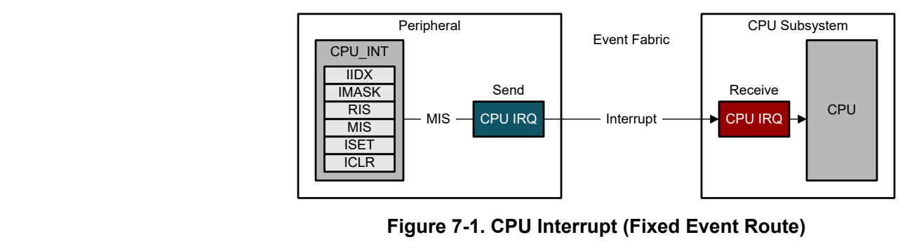
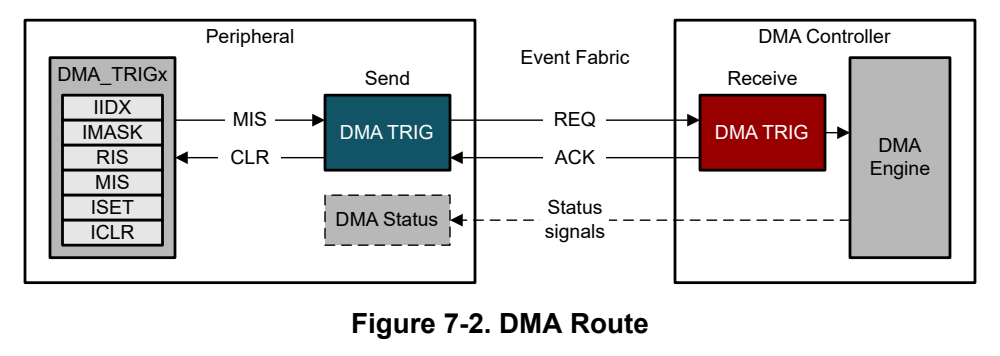
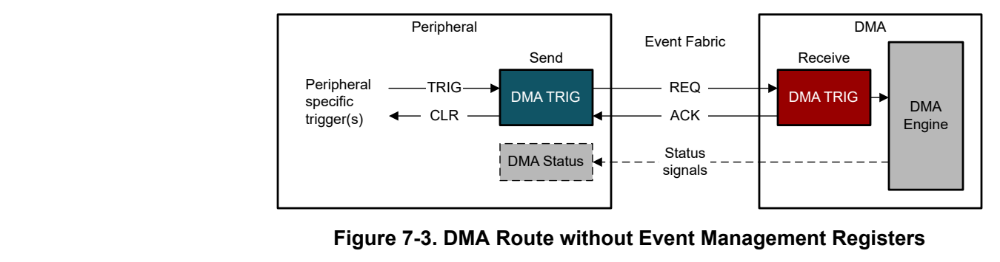
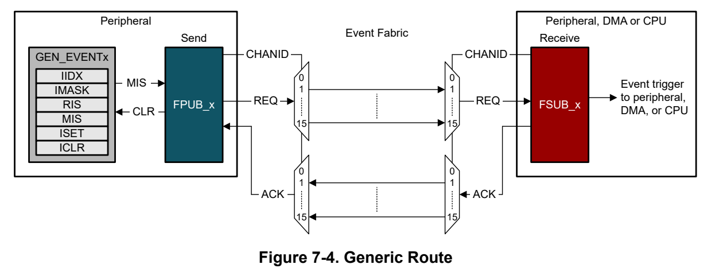
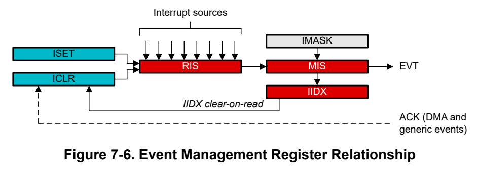

# 7 Events (pp. 411-421)

### 7.1 Events Overview 412 (p. 411)

### 7.2 Events Operation 415 (p. 411)

### 7.1 Events Overview (p. 412)

The event manager transfers digital events from one entity (for example, a peripheral) to another (for example, a second peripheral, the DMA, or the CPU). The event manager implements event transfer through a defined set of event publishers (generators) and subscribers (receivers) which are interconnected through an event fabric containing a combination of fixed (static) and programmable routes.

Events which are transferred by the event manager include:

- Peripheral event transferred to the CPU as an interrupt request (IRQ) – Example: RTC interrupt is sent to the CPU

- Peripheral event transferred to the DMA as a DMA trigger – Example: UART data receive trigger to DMA to request a DMA transfer

- Peripheral event transferred to another peripheral to directly trigger an action in hardware – Example: TIMx timer peripheral publishes a periodic event to the ADC subscriber port, and the ADC uses the event to trigger start-of-sampling

In addition to providing the event transfer logic, the event manager also interfaces with the power management and clock unit ( PMCU) if an event requires the power and/or clock configuration of the device to change to handle the event properly. For example, if a peripheral asserts an event that targets the DMA, and the device is in a STOP or STANDBY operating mode (DMA is disabled), the event manager will handshake with the PMCU to suspend the low power operating mode state temporarily and enable the DMA such that the DMA transfer can be processed.

The event manager configuration is device dependent, as different devices support different peripherals. See the device-specific data sheet for information on the device-specific event implementation.

#### 7.1.1 Event Publisher (p. 412)

An event publisher is the source of an event which is propagated on the event fabric. Peripherals contain event publishers for publishing CPU interrupts, DMA triggers and generic events to the event fabric through the publishing port FPUB_x. Publisher behavior is configured with standardized event management registers.

#### 7.1.2 Event Subscriber (p. 412)

Event subscribers are included within the processor, the DMA, and certain peripherals (see Section 7.1.4). Event subscribers subscribe the events through the subscribing port FSUB_x. Event subscribers enable modules to be able to subscribe to, and take a predefined action upon, events which are published to the event fabric by an event publisher.

#### 7.1.3 Event Fabric Routing (p. 412)

There are three different types of routes through the event fabric which are used to connect a publisher to a subscriber: CPU interrupt events, DMA trigger events, and generic events.

##### 7.1.3.1 CPU Interrupt Event Route (CPU_INT) (p. 412)

A CPU interrupt event route is a fixed, point-to-point connection between one event publisher (inside a peripheral module) and one event subscriber (the CPU subsystem) used to propagate CPU interrupts.

*Figure 7-1. CPU Interrupt (Fixed Event Route) (p. 412)*

For each peripheral which is capable of generating a CPU interrupt, a fixed route is provided from the peripheral's masked interrupt status (MIS) register to the CPU subsystem's interrupt management logic.

If software does not clear the interrupt request in the peripheral's event management registers, the request will remain pending to the CPU subsystem. See Section 7.2.5.3 for guidance on setting and clearing interrupt status with the event management registers.

##### 7.1.3.2 DMA Trigger Event Route (DMA_TRIGx) (p. 413)

A DMA route is a fixed route between a peripheral and the DMA controller, which optionally has additional side-band signals to pass a DMA done condition from the DMA controller back to the triggering peripheral to indicate when a DMA activity has run to completion. The DMA trigger route is shown in Figure 7-2.

*Figure 7-2. DMA Route (p. 413)*

Most peripherals capable of generating a DMA trigger have an additional set of event management registers (in addition to the CPU_INT registers used for the CPU interrupt and any GEN_EVENTx generic route publishers). These registers can be used to select which peripheral condition to use for generating the DMA trigger.

When a trigger is received by the DMA, the DMA acknowledges the request and the peripheral clears the request. The DMA also acknowledges the cleared request, after which a new request can be asserted by the peripheral.

The DMA route can also contain status signals (for specific peripherals) to indicate to the triggering peripheral that a DMA transfer sequence has completed. For example, the DMA can be set up to transfer N number of bytes from an SRAM buffer into the UART TX data register based on the UART TX DMA trigger. Upon each trigger from the UART, the DMA will acknowledge that the transfer was successful. On the Nth byte, the DMA will send a complete status signal to the UART, which the UART can use to propagate a transfer completion interrupt to the CPU.

Special Cases

Certain peripherals (for example, the 12-bit DAC) do not implement an event management register set for managing their DMA triggers. In these cases, the peripheral implements specific DMA configuration logic such that the management registers are not needed to interface with the DMA. Figure 7-3 shows the model when the event management registers are not implemented. See the peripheral-specific section of this document for guidance on how to configure DMA channels in this case.

*Figure 7-3. DMA Route without Event Management Registers (p. 413)*

##### 7.1.3.3 Generic Event Route (GEN_EVENTx) (p. 414)

A generic route is either a point-to-point (1:1) route or a point-to-two (1:2) splitter route in which the peripheral publishing the event uses one of several available generic route channels to publish its event to another entity (or entities, in the case of a splitter route), where an entity can be another peripheral, a generic DMA trigger event, or a generic CPU event, as shown in Figure 7-4.

*Figure 7-4. Generic Route (p. 414)*

Peripherals capable of generating a generic event have an additional group (our groups) of GEN_EVENTx event management registers (in addition to the CPU_INT registers used for the CPU interrupt or DMA_TRIGx for DMA, if present). These registers can be used to select the peripheral condition to use for publishing a generic event. When configured, the event will broadcast out to the generic route channel selected by the FPUB_x register. A second peripheral, the DMA, or the CPU can subscribe to this event by configuring its generic subscriber port (FSUB_x) to listen on the same generic route channel to which the publishing peripheral is connected to.

Generic route channels can be configured with one subscriber (1:1 route) or two subscribers (1:2 splitter route), depending on which channel is selected. See the device data sheet for a complete listing of the available generic route channels and their type (1:1 or 1:2). Generic route channels can only be configured with one publishing peripheral at a time. Once a peripheral subscribes to a 1:1 generic route channel, no other peripheral will be able to select that channel to subscribe to, unless the originally connected peripheral is disconnected first. Generic route channels with splitter capability (1:2) enable exactly two peripherals to subscribe to the channel, after which additional attempts to add subscribers will be blocked by hardware until both of the two connected peripherals are disconnected from the splitter channel.

Each peripheral type has unique capabilities in terms of what can generate an event to publish, and what a subscribed event is capable of triggering within the peripheral. Review the chapter of this guide which corresponds to the peripheral of interest to understand what the publisher and subscriber ports on a given peripheral are capable of.

#### 7.1.4 Event Routing Map (p. 414)

The event capabilities of each peripheral type are shown in Figure 7-5. Peripherals such as UART, SPI, and I2C generate CPU interrupt events which are routed to the CPU, and they also generate DMA trigger events which are routed to the DMA. Peripherals such as GPIO and ADC generate CPU interrupt events as well, but they also support generating and receiving events routed through a generic channel. For example, through the use of a generic event channel, it is possible to directly start an ADC conversion from a GPIO event by connecting a GPIO FPUB_x and ADC FSUB_0 to the same generic event channel.

*Figure 7-5. Event Map (p. 414)*

#### 7.1.5 Event Propagation Latency (p. 415)

Generic route channels implement a four-way hardware handshake between the publishing entity and the subscribing entity. This handshake requires four ULPCLK cycles to complete:

| 1. 2. | Request from publisher to subscriber |
| --- | --- |
| 3. 4. |  |

Acknowledge from subscriber to publisher De-assert of request from publisher to subscriber Acknowledge of de-assert from subscriber to publisher

If the publishing peripheral sends two requests and the first request has not cleared the handshake, the second request is dropped.

### 7.2 Events Operation (p. 415)

This section describes how to configure peripherals to use the event manager. Note that the event manager does not contain any configuration registers. All event configuration is done through the publishing and subscribing peripherals.

| CPU Interrupt | Col 6 |
| --- | --- |
|  | Peripheral interrupt requests use fixed routes, but in addition the CPU subsystem may provide two generic event |

7.2.1

subscriber ports which can be used to trigger CPU interrupts through a generic route. See the device-specific data sheet for the complete list of interrupt assignments for a given device.

Standard CPU Interrupt Requests No special configuration is required for fixed route interrupts. Interrupts can be managed through the peripheral's CPU_INT event management registers (IIDX, IMASK, RIS, MIS, ISET, and ICLR) and through the CPU subsystem interrupt configuration (see Section 3.3).

Generic Event Based CPU Interrupt Requests

The CPU subsystem contains two generic event subscriber ports (FSUB_x) which can be used to source a CPU interrupt from any of the device's generic event channels. This can be used to enable special cases where a particular function on a peripheral generates a dedicated interrupt to the CPU subsystem which is independent from, and in addition to, that peripheral's standard interrupt mechanism.

Consider the GPIO peripheral, which has a standard interrupt request as well as 2 publishers which can route a GPIO event to any of the generic event channels based on a defined state in the GPIO. For example, it can be desirable to have most GPIO events configured to source the standard interrupt, while a single specific GPIO event sources a second dedicated CPU interrupt through a generic route. This enables the application software to have two completely independent interrupt handlers for the GPIO.

To configure the event manager to trigger a CPU interrupt from a generic route, follow the steps below:

1. Configure the GEN_EVENT registers of the peripheral generating the event to select the desired peripheral state as an event generator. 2. Configure the FPUB_x register of the peripheral generating the event with the generic route channel ID which is to be used. This channel must not be in use by another peripheral. 3. Configure the FSUB_x register of the wake up controller (WUC), which captures generic route channel events to forward to the CPU subsystem. 4. Configure the CPU subsystem interrupt management to enable the GENSUBx interrupt.

Note that when generating a CPU interrupt through a generic route, the generic event logic will automatically clear the pending interrupt request as a part of the four-way event handshake. Application software will not be able to read the cause of the interrupt from the peripheral registers, and it does not need to clear any interrupt status bits. Software can only read that the FSUB_x generic event generated an interrupt. This reduces the interrupt overhead.

#### 7.2.2 DMA Trigger (p. 416)

DMA triggers are propagated to the DMA through the event manager. Most DMA triggers use fixed routes, but the DMA does provide two generic event subscriber ports which can be used to trigger DMA transfers through a generic route channel. See the device-specific data sheet for the complete list of DMA trigger assignments for a given device.

Standard DMA Triggers

To determine if a particular peripheral on a device provides a fixed DMA trigger (DMA_TRIGx) from the peripheral directly to the DMA, review the DMA triggers table in the detailed description section of the device-specific data sheet. Certain peripherals can have more than one DMA trigger (for example, to enable a TX trigger and an RX trigger on a serial communication peripheral).

To select the specific peripheral event which triggers a static DMA route, configure the peripheral's DMA_TRIGx event management register set (IIDX, IMASK, RIS, MIS, ISET, and ICLR) which corresponds to the targeted DMA route. To determine which DMA_TRIGx register set corresponds with which DMA trigger, review the relevant chapter of this guide for the corresponding peripheral, or review Section 7.1.4.

Certain peripherals (such as the 12-bit DAC) do not implement a DMA_TRIGx register set for managing DMA triggers. In these cases, the DMA trigger configuration is done through peripheral-specific configuration registers.

Generic Event Based DMA Triggers

The DMA contains two generic event subscriber ports (FSUB_x) which can be used to source a DMA trigger from any of the device's generic event channels. This can be used to enable special cases where a particular function on a peripheral generates a DMA trigger. For example, it can be desirable to trigger a DMA transfer from a timer.

To configure the event manager to trigger a DMA channel from a generic route, follow the steps below: 1. Configure the GEN_EVENTx registers of the peripheral generating the event to select the desired peripheral state as an event generator. 2. Configure the FPUB_x register of the peripheral generating the event with the generic event channel ID which is to be used. This channel must not be in use by another peripheral. 3. Configure the FSUB_x register of the DMA, which captures generic event channel events to be used as triggers in the DMA. 4. Configure the DMA according to the configuration instructions in the DMA chapter.

#### 7.2.3 Peripheral to Peripheral Event (p. 417)

Peripheral to peripheral events enable a condition in one peripheral to trigger an action in a second (or third) peripheral, completely in hardware without any CPU interaction. The device provides a certain number of generic route channels which can be either published to or subscribed to by peripherals which include publisher and subscriber ports. Before establishing a configuration, follow these steps: 1. Review the device specific data sheet to determine the generic route channel count and channel type available on the target device. Select an appropriate channel type (point to point or splitter) based on the desired functionality, and determine the channel number to use for the connection (the channel must not already be used by other peripherals). 2. Review the publisher and subscriber capabilities of the peripherals which are to be connected. Some peripherals have more than one publisher and/or more than one subscriber port, and some peripherals have no publisher or subscriber ports. To understand the available ports for a peripheral, review the peripheral's reference chapter in this guide, or check the generic event channel connections in Section 7.1.4.

Once the channel to be used is determined, and both the publisher and subscriber ports for the peripherals being connected are known, use the steps below to establish the event connection. In this example, a timer triggered ADC application will be configured, using TIMG0 to publish an event to generic channel 1, with ADC0 subscribing to generic channel 1 as a start-of-conversion trigger. 1. Configure the GEN_EVENTx event management registers of TIMG0 to set the event request based on the appropriate timer event (for example, a zero event). 2. Store 0x1 into the FPUB_0 register of TIMG0 to publish the TIMG0 event selected by the GEN_EVENTx registers to generic route channel 1. Channel 1 must not be in use by another peripheral. 3. Store 0x1 the FSUB_0 register of ADC0 so that ADC0 is listening for events published by the timer to channel 1. 4. Configure ADC0 to trigger from the subscriber port according to the configuration instructions in Section 11.2.8. 5. Configure and enable TIMG0.

#### 7.2.4 Extended Module Description Register (p. 417)

The DESC_EX register is a read-only register in the event manager which can be read by application software to determine how many point to point (single) generic route channels and splitter (dual) generic route channels are available on a given device.

#### 7.2.5 Using Event Registers (p. 417)

The event management register group is a set of standard registers which are implemented by all peripherals capable of generating events (CPU interrupts, DMA triggers, or generic events). Each event generator in a peripheral contains its own event management register set. For example, if a peripheral supports generating a CPU interrupt and a DMA trigger, it will have an event management register set for the CPU interrupt (with the

group name of CPU_INT) as well as a second event management register set for the DMA trigger (with the group name of DMA_TRIG).

The event management registers are used to:

- Configure which peripheral conditions are used to generate the event (masking)

- Communicate raw and masked peripheral event status

- Set or clear peripheral event status by software

In the "Registers" section for a given peripheral, the "Group" column displays the Group Name to indicate what functionality is mapped to each event management register group. See Table 7-1 for which event management groups are mapped to specific functions in the group name for a peripheral's "Registers" section.

**Table 7-1. Event Management Group Functionality and Mapping (p. 418)**

| Group Name (in Registers) | Functionality |
| --- | --- |
| CPU_INT | CPU interrupt (fixed route to the CPU subsystem) |
| DMA_TRIGx | DMA trigger (fixed route to the DMA controller) |
| GEN_EVENT | Generic event (programmable route for other module-to-module connections) |

##### 7.2.5.1 Event Registers (p. 418)

The event management register set contains 6 standard registers: RIS, IMASK, MIS, ISET, ICLR, and IIDX, given in Table 7-2. The event registers are interconnected as shown in Figure 7-6.

*Figure 7-6. Event Management Register Relationship (p. 418)*

The peripheral generating the event will contain one or more interrupt source signals which connect to the raw interrupt status (RIS) register. Software can poll RIS at any time to check the raw interrupt status. Software can also clear pending interrupts in the RIS register by writing to the corresponding bit position in the ICLR register. The RIS and IMASK registers are combined through a bit-wise AND function in the MIS register (masked interrupt status). To unmask an interrupt, set the corresponding bit in the IMASK register. Once unmasked, a pending interrupt will be indicated in both the RIS and MIS registers, and an event will be generated. The IIDX register will also be updated with the index of the highest priority pending interrupt.

In the case of a CPU interrupt (CPU_INT) with a CPU interrupt event route, a read of the IIDX register will clear the highest priority pending interrupt in the RIS and MIS registers and return the index of the highest priority pending interrupt to application software.

In the case of a hardware event DMA trigger route (DMA_TRIGx) or generic event route (GEN_EVENTx), the hardware four-way handshake will send an ACK signal to the ICLR mechanism which will clear the pending interrupt in the RIS and MIS registers.

Configuration)

**Table 7-2. Standardized Event Management Registers (Used for CPU_INT, DMA_TRIGx, GEN_EVENTx (pp. 418-419)**

| Register | Description | R/W | Functionality |
| --- | --- | --- | --- |
| RIS | Raw interrupt status | R | Indicates the current pending interrupt status, with one bit provided per interrupt condition. Writing to ICLR will clear the corresponding bit in the RIS register if the interrupt condition is no longer present. |
| IMASK | Interrupt mask | RW | Used by application software to configure which interrupt conditions propagate into an event, with one bit provided per interrupt condition. |
| MIS | Masked interrupt status | R | Indicates the current pending masked interrupt status to software and hardware, with one bit provided per interrupt condition. MIS is the bit-wise AND of the RIS and IMASK registers. Writing to ICLR will clear the corresponding bit in the RIS register if the interrupt condition is no longer present. If RIS is cleared, the corresponding bit in the MIS register is also automatically cleared. |
| ISET | Software interrupt set control | W | Used by application software to force an interrupt condition for diagnostics. Writing to ISET will set the corresponding bit in the RIS register. If the interrupt condition is enabled in IMASK, the corresponding bit in the MIS register is also set. Writing a '1' to a bit location in ISET sets the respective interrupt status. |
| ICLR | Software interrupt clear control | W | Used by application software to clear a pending interrupt status in RIS. Writing a '1' to a bit location in ICLR clears the respective interrupt status. If an interrupt is enabled in IMASK, the corresponding bit location in MIS is also cleared automatically when RIS clears. If the interrupt condition is still present, clearing the status has no effect and the RIS will remain set. |
| IIDX | Pending interrupt index | R | Used by application software to read the highest priority pending interrupt while simultaneously clearing the highest priority interrupt status in RIS and MIS. A read of IIDX returns 0 if no unmasked interrupts are pending (MIS==0), else it returns an index value indicating the highest priority pending interrupt. |

##### 7.2.5.2 Configuring Events (p. 419)

To configure which peripheral interrupt source is to be used to trigger an event, set the bit which corresponds to the desired interrupt source in the IMASK register which corresponds to the desired event. Setting a bit in IMASK will cause the raw interrupt status in the RIS register to propagate to the MIS register. When an interrupt status bit in the MIS register is set (due to the interrupt being unmasked in the IMASK register and a raw interrupt being pending in the RIS register), an event is generated.

Multiple interrupt sources can be enabled for CPU interrupt events, as application software can determine the cause of the interrupt by reading the IIDX or MIS register.

For hardware events such as DMA triggers and generic event publishers, only one interrupt source should be unmasked in IMASK.

##### 7.2.5.3 Responding to CPU Interrupts in Application Software (p. 419)

In the case of an event which generates a CPU interrupt, application software can determine which peripheral interrupt triggered the generation of the event by either reading the IIDX register or by reading the MIS and writing the ICLR registers.

CPU IRQ Interrupt Service Routine using CPU_INT IIDX Register

Application software can read the IIDX register in CPU_INT group to determine and clear the highest priority pending interrupt. A read to IIDX will return an index corresponding to the highest priority interrupt which was both set and unmasked. The read action will also simultaneously clear the RIS and MIS bits corresponding to the highest priority interrupt whose index was returned by the read. The read value from the IIDX register can then be used in a case statement, as shown below.

void ISR_IIDX(void) { switch(IIDX) { case 0: // no IRQ pending break; case 1: // IRQ[0] do_irq0(); break;

case 2: // IRQ[1] do_irq1(); break; default: // out of range illegal(); } }

CPU IRQ Interrupt Service Routine using CPU_INT MIS and ICLR Registers

Alternatively, application software can read the MIS register to determine which bits are set, followed by using the ICLR register to clear the pending interrupt status bits.

void ISR(void) { uint32_t pending = MIS; ICLR = pending; // clear pending IRQ if (pending & 0x01) // IRQ[0] { do_irq0(); } if (pending & 0x02) // IRQ[1] { do_irq1(); } }

##### 7.2.5.4 Hardware Event Handling (p. 420)

In the case of an event which sources a DMA trigger (DMA_TRIG) or a generic event (GEN_EVENT), the IIDX register is not used. A four-way event handshake is performed between the peripheral generating the event and the hardware entity which is subscribed to the event (for example, the DMA or a secondary peripheral). The four-way event handshake will clear the corresponding interrupt status bits in the RIS and MIS registers automatically.

Chapter 8
