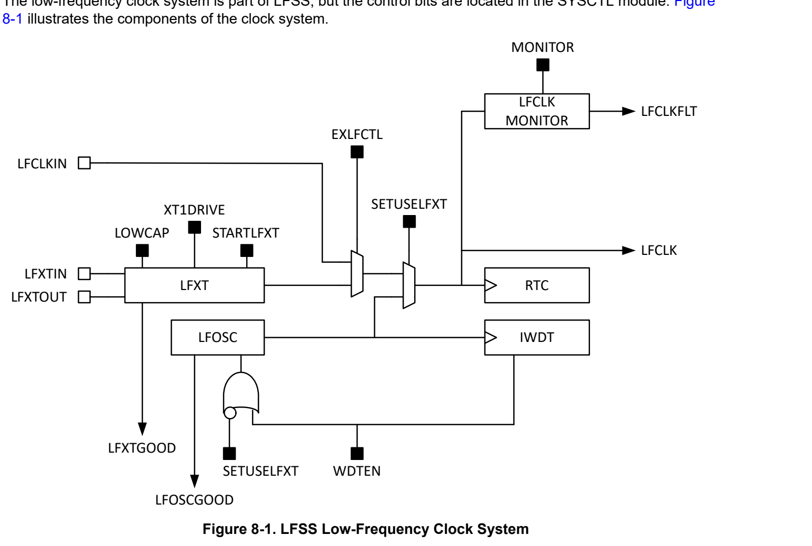

# 8 Low Frequency Subsystem (LFSS_B) (pp. 421-546)

## Low Frequency Subsystem (LFSS_B) (p. 421)

### 8.1 Overview 422 (p. 421)

### 8.2 Clock System 422 (p. 421)

### 8.3 LFSS Reset 423 (p. 421)

### 8.4 Real Time Counter (RTC_x) 423 (p. 421)

### 8.5 Independent Watchdog Timer (IWDT) 424 (p. 421)

### 8.6 Lock Function of RTC and IWDT 424 (p. 421)

### 8.7 LFSS Registers 425 (p. 421)

### 8.1 Overview (p. 422)

The Low-Frequency Subsystem (LFSS) combines several functional peripherals under one shared subsystem. These peripherals are clocked by the low-frequency clock (LFCLK) or need to be active during low-power modes. The low-frequency clock has a typical frequency of 32kHz and is mainly intended for long-term timekeeping. In some devices, the LFSS is powered by a separate battery backup power domain called PDB, and the device will have a physical VBAT power pin present.

Note Not all the features described in this chapter are present in all devices. Refer to the device-specific data sheet to know which features of LFSS are present in the specific device.

The superset version of the LFSS contains following components:

- A dedicated battery backup power domain and a dedicated supply pin (VBAT)

- Real time clock (RTC) with additional prescalar extension and timestamp captures

- An independent watchdog timer (IWDT)

- Tamper detection input/output (TIO) module

- A small scratchpad memory storage (SPM)

### 8.2 Clock System (p. 422)

*Figure 8-1. LFSS Low-Frequency Clock System (p. 422)*

The control bits for LFCLK control is located inside the SYSCTL registers. In case of a power loss of the VDD / VCORE domain, the contents of the registers are lost.

In devices with a dedicated backup power domain (PDB) which remains powered by VBAT:

- The shadow latches will keep the LFCLK configuration active until the power returns

- The shadow latches are not reset on return of power and keep the last configuration status until the device clock configuration is restored by software

In devices without a dedicated backup power domain:

- The LFSS will not be operational without VDD / VCORE present

In both scenarios, the user must reconfigure the LFCLK registers after restoring power on VDD / VCORE to the device.

### 8.3 LFSS Reset (p. 423)

In devices with a dedicated battery backup power domain (PDB) with supply pin (VBAT), the LFSS has its VBAT power management unit (VBAT PMU) and its own reset generation circuit related to the VBAT supply pin.

Note For devices without the PDB and VBAT supply pin, refer to the respective TRM chapters on the supported peripherals (RTC, IWDT)

Two subcircuits are related to the reset of the LFSS.

- The VBAT power-on-reset (POR) circuit is a V th based supply voltage monitor. The POR circuit is used to reset the VBAT PMU and initiate the startup of the cold boot sequence.

- The VBAT brown-out-reset (BOR) circuit is a bandgap reference-based voltage monitor and enables the VBAT PMU LDO when the VBAT supply is large enough to operate the LDO safely. The battery backup power domain (PDB) becomes available after this sequence, and will reset all logic in the PDB.

The battery backup power domain (PDB) does not experience a reset unless the power supply on the VBAT pin drops below the VBAT BOR level. The VDD BOR reset from the Main PMU does not reset the PDB domain while VBAT remains sufficiently powered.

In addition, the LFSS supports an VBAT PMU POR level software-reset request. This reset supports software development and from the LFSS point of view it looks like the VBAT supply was temporary disconnected and reconnected. This also means the PDB domain is brought down and back up and all flops have a full reset.

Note The software POR request is mainly for the software-development to emulate the removal of the external battery from VBAT. After this POR request event, the software needs to re-enable the LFXTAL, switch the LFCLK to the LFXTAL, and finally re-initialize the peripherals within LFSS (RTC, IWDT, TIO, SPM).

After the LFXT and LFSS peripherals are configured and initialized by software, a persistent status bit in the LFSS domain indicates the “running / RTC active” status to the software. On device power-up, the software reads the reset cause table and initializes the device accordingly (for example, initial power up or wake from SHUTDOWN mode). Before initializing the RTC, the software should check the LFXT and RTC good/active status and skip the initialization when already running and active.

### 8.4 Real Time Counter (RTC_x) (p. 423)

The low-frequency subsystem (LFSS) contains a real-time counter (RTC).

In devices for which the LFSS is powered by an independent VBAT supply pin to support the backup-battery power domain (PDB), the RTC variant has extended features and is referred to as RTC_A.

In devices for which the LFSS is powered internally by the main power supply pin VDD, the RTC variant is referred as RTC_B.

The design of the RTC_x instances are intended to be backward compatible with RTC.

For more information on the LFSS real-time counter and various RTC instances, see the RTC chapter.

### 8.5 Independent Watchdog Timer (IWDT) (p. 424)

The low-frequency subsystem (LFSS) contains an independent watchdog timer (IWDT).

- In devices for which the LFSS is powered by an independent VBAT supply pin to support the backup-battery power domain (PDB), the IWDT variant is independent in the sense of having both an independent power supply and an independent, fail-safe clock source.

- In devices for which the LFSS is powered internally by the main power supply pin VDD, the IWDT variant is only independent in the sense of having an independent, fail-safe clock source.

The independent watchdog timer (IWDT) is a device-independent supervisor which monitors code execution and overall hang up scenarios of the device. If the application software does not successfully reset the watchdog within the programmed time, the watchdog generates a POR reset to the device.

For more information on the LFSS independent watchdog timer, see the IWDT chapter.

### 8.6 Lock Function of RTC and IWDT (p. 424)

Safety or secure applications must make sure that the RTC value and IWDT configurations cannot be changed after initial configuration on accident by software or during an address transient error during an intentional write access. Therefore, the RTC counter, LFXT clock configuration, and IWDT configuration registers are protected by a lock bit.

When the lock bit is set, the protected registers cannot be changed even if the correct key is applied. The lock bit is writable and can be unset in case the RTC time needs to be updated or some other configuration needs to be changed. The RTC alarm, RTC timestamp, and IWDT restart function are not affected by the lock bit.

### 8.7 LFSS Registers (p. 425)

Table 8-1 lists the memory-mapped registers for the LFSS registers. All register offset addresses not listed in Table 8-1 should be considered as reserved locations and the register contents should not be modified.

**Table 8-1. LFSS Registers (pp. 425-427)**

| Offset | Acronym | Register Name | Group |
| --- | --- | --- | --- |
| 400h | FSUB_0 | Subsciber Port 0 |  |
| 444h | FPUB_0 | Publisher Port 0 |  |
| 1004h | CLKSEL | Clock Select for Ultra Low Power peripherals |  |
| 1020h | IIDX | Interrupt Index Register |  |
| 1028h | IMASK | Interrupt mask |  |
| 1030h | RIS | Raw interrupt status |  |
| 1038h | MIS | Masked interrupt status |  |
| 1040h | ISET | Interrupt set |  |
| 1048h | ICLR | Interrupt clear |  |
| 1050h | IIDX | Interrupt Index Register |  |
| 1058h | IMASK | Interrupt mask |  |
| 1060h | RIS | Raw interrupt status |  |
| 1068h | MIS | Masked interrupt status |  |
| 1070h | ISET | Interrupt set |  |
| 1078h | ICLR | Interrupt clear |  |
| 10E0h | EVT_MODE | Event Mode |  |
| 10FCh | DESC | LFSS Descriptor Register |  |
| 1100h | CLKCTL | RTC Clock Control Register |  |
| 1104h | DBGCTL | RTC Module Debug Control Register |  |
| 1108h | CTL | RTC Control Register |  |
| 110Ch | STA | RTC Status Register |  |
| 1110h | CAL | RTC Clock Offset Calibration Register |  |
| 1114h | TCMP | RTC Temperature Compensation Register |  |
| 1118h | SEC | RTC Seconds Register - Calendar Mode With Binary / BCD Format |  |
| 111Ch | MIN | RTC Minutes Register - Calendar Mode With Binary / BCD Format |  |
| 1120h | HOUR | RTC Hours Register - Calendar Mode With Binary / BCD Format |  |
| 1124h | DAY | RTC Day Of Week / Month Register - Calendar Mode With Binary / BCD Format |  |
| 1128h | MON | RTC Month Register - Calendar Mode With Binary / BCD Format |  |
| 112Ch | YEAR | RTC Year Register - Calendar Mode With Binary / BCD Format |  |
| 1130h | A1MIN | RTC Minute Alarm Register - Calendar Mode With Binary / BCD Format |  |
| 1134h | A1HOUR | RTC Hours Alarm Register - Calendar Mode With Binary / BCD Format |  |
| 1138h | A1DAY | RTC Alarm Day Of Week / Month Register - Calendar Mode With Binary / BCD Format |  |
| 113Ch | A2MIN | RTC Minute Alarm Register - Calendar Mode With Binary / BCD Format |  |
| 1140h | A2HOUR | RTC Hours Alarm Register - Calendar Mode With Binary / BCD Format |  |
| 1144h | A2DAY | RTC Alarm Day Of Week / Month Register - Calendar Mode With Binary / BCD Format |  |
| 1148h | PSCTL | RTC Prescale Timer 0/1 Control Register |  |
| 114Ch | EXTPSCTL | RTC Prescale Timer 2 Control Register |  |
| 1150h | TSSEC | Time Stamp Seconds Register -Calendar Mode With Binary / BCD Format |  |
| 1154h | TSMIN | Time Stamp Minutes Register -Calendar Mode With Binary / BCD Format |  |
| 1158h | TSHOUR | Time Stamp Hours Register - Calendar Mode With Binary / BCD Format |  |
| 115Ch | TSDAY | Time Stamp Day Of Week / Month Register - Calendar Mode With Binary / BCD Format |  |
| 1160h | TSMON | Time Stamp Month Register - Calendar Mode With Binary / BCD Format |  |
| 1164h | TSYEAR | Time Stamp Years Register - Calendar Mode With Binary / BCD Format |  |
| 1168h | TSSTAT | Time Stamp Status Register |  |
| 116Ch | TSCTL | Time Stamp Control Register |  |
| 1170h | TSCLR | Time Stamp Clear Register |  |
| 11F0h | LFSSRST | Low frequency subsystem reset request |  |
| 11FCh | RTCLOCK | Real time clock lock register |  |
| 1200h + formula | TIOCTL[y] | Tamper I/O Control Register |  |
| 1280h | TOUT3_0 | Tamper Output 3 to 0 |  |
| 1284h | TOUT7_4 | Tamper Output 7 to 4 |  |
| 1288h | TOUT11_8 | Tamper Output 11 to 8 |  |
| 128Ch | TOUT15_12 | Tamper Output 15 to 12 |  |
| 1290h | TOE3_0 | Tamper Output Enable 3 to 0 |  |
| 1294h | TOE7_4 | Tamper Output Enable 7 to 4 |  |
| 1298h | TOE11_8 | Tamper Output Enable 7 to 4 |  |
| 129Ch | TOE15_12 | Tamper Output Enable 7 to 4 |  |
| 12A0h | TIN3_0 | Tamper Input Register |  |
| 12A4h | TIN7_4 | Tamper Input Register |  |
| 12A8h | TIN11_8 | Tamper Input Register |  |
| 12ACh | TIN15_12 | Tamper Input Register |  |
| 12C0h | HEARTBEAT | Heartbeat Register |  |
| 12FCh | TIOLOCK | Tamper I/O lock register |  |
| 1300h | WDTEN | Watchdog Timer Enable Register |  |
| 1304h | WDTDBGCTL | Watchdog Timer Debug Control Register |  |
| 130Ch | WDTCNTRST | Watchdog Timer Counter Reset Register |  |
| 1310h | WDTSTAT | Watchdog Timer Status Register |  |
| 13FCh | WDTLOCK | Watchdog timer lock register |  |
| 1400h + formula | SPMEM[y] | Scratch Pad Memory Data Register |  |
| 1500h | SPMWPROT0 | Scratch Pad Memory Write Protect Register 0 |  |
| 1504h | SPMWPROT1 | Scratch Pad Memory Write Protect Register 1 |  |
| 1508h | SPMWPROT2 | Scratch Pad Memory Write Protect Register 2 |  |
| 150Ch | SPMWPROT3 | Scratch Pad Memory Write Protect Register 3 |  |
| 1510h | SPMWPROT4 | Scratch Pad Memory Write Protect Register 4 |  |
| 1514h | SPMWPROT5 | Scratch Pad Memory Write Protect Register 5 |  |
| 1518h | SPMWPROT6 | Scratch Pad Memory Write Protect Register 6 |  |
| 151Ch | SPMWPROT7 | Scratch Pad Memory Write Protect Register 7 |  |
| 1540h | SPMTERASE0 | Scratch Pad Memory Tamper Erase Register 0 |  |
| 1544h | SPMTERASE1 | Scratch Pad Memory Tamper Erase Register 1 |  |
| 1548h | SPMTERASE2 | Scratch Pad Memory Tamper Erase Register 2 |  |
| 154Ch | SPMTERASE3 | Scratch Pad Memory Tamper Erase Register 3 |  |
| 1550h | SPMTERASE4 | Scratch Pad Memory Tamper Erase Register 4 |  |
| 1554h | SPMTERASE5 | Scratch Pad Memory Tamper Erase Register 5 |  |
| 1558h | SPMTERASE6 | Scratch Pad Memory Tamper Erase Register 6 |  |
| 155Ch | SPMTERASE7 | Scratch Pad Memory Tamper Erase Register 7 |  |

Complex bit access types are encoded to fit into small table cells. Table 8-2 shows the codes that are used for access types in this section.

**Table 8-2. LFSS Access Type Codes (pp. 427-428)**

| Access Type | Code | Description |
| --- | --- | --- |
| Read Type |  |  |
| R | R | Read |
| R-0 | R -0 | Read Returns 0s |
| Rmodify | R modify | Read |
| Write Type |  |  |
| W | W | Write |
| WK | W K | Write Write protected by a key |
| Reset or Default Value |  |  |
| - n |  | Value after reset or the default value |
| Register Array Variables |  |  |
| i,j,k,l,m,n |  | When these variables are used in a register name, an offset, or an address, they refer to the value of a register array where the register is part of a group of repeating registers. The register groups form a hierarchical structure and the array is represented with a formula. |
| y |  | When this variable is used in a register name, an offset, or an address it refers to the value of a register array. |

### 8.7.1 [LFSS.FSUB_0] Offset: 400h | Reset: 00000000h (p. 429)

FSUB_0 is shown in Figure 8-2 and described in Table 8-3.

Subscriber port

> **Bit Map**: `[31-4] RESERVED (R, 0h)` | `[3-0] CHANID (R/W, 0h)`

**Table 8-3. FSUB_0 Field Descriptions (p. 429)**

| Bit | Field | Type | Reset | Description |
| --- | --- | --- | --- | --- |
| 31-4 | RESERVED | R | 0h |  |
| 3-0 | CHANID | R/W | 0h | 0 = disconnected.; 1-15 = connected to channelID = CHANID.; 0h = A value of 0 specifies that the event is not connected; Fh = Consult your device data sheet as the actual allowed maximum may be less than 15. |

### 8.7.2 [LFSS.FPUB_0] Offset: 444h | Reset: 00000000h (p. 430)

FPUB_0 is shown in Figure 8-3 and described in Table 8-4.

Publisher port

> **Bit Map**: `[31-4] RESERVED (R, 0h)` | `[3-0] CHANID (R/W, 0h)`

**Table 8-4. FPUB_0 Field Descriptions (p. 430)**

| Bit | Field | Type | Reset | Description |
| --- | --- | --- | --- | --- |
| 31-4 | RESERVED | R | 0h |  |
| 3-0 | CHANID | R/W | 0h | 0 = disconnected.; 1-15 = connected to channelID = CHANID.; 0h = A value of 0 specifies that the event is not connected; Fh = Consult your device data sheet as the actual allowed maximum may be less than 15. |

### 8.7.3 [LFSS.CLKSEL] Offset: 1004h | Reset: 00000000h (p. 431)

CLKSEL is shown in Figure 8-4 and described in Table 8-5.

Clock source selection for ULP peripherals

> **Bit Map**: `[31-2] RESERVED (R, 0h)` | `[1] LFCLK_SEL (R, 0h)` | `[0] RESERVED (R, 0h)`

**Table 8-5. CLKSEL Field Descriptions (p. 431)**

| Bit | Field | Type | Reset | Description |
| --- | --- | --- | --- | --- |
| 31-2 | RESERVED | R | 0h |  |
| 1 | LFCLK_SEL | R | 0h | Selects LFCLK as clock source if enabled; 0h = LFCLK is disabled; 1h = LFCLK is enabled |
| 0 | RESERVED | R | 0h |  |

### 8.7.4 [LFSS.IIDX] Offset: 1020h | Reset: 00000000h (p. 432)

IIDX is shown in Figure 8-5 and described in Table 8-6.

This register provides the highest priority enabled interrupt index. Value 0x00 means no event pending. Interrupt 1 is the highest priority, IIDX next highest, 4, 8, … IIDX^31 is the least priority. That is, the least bit position that is set to 1 denotes the highest priority pending interrupt. The priority order is fixed. However, users can implement their own prioritization schemes using other registers that expose the full set of interrupts that have occurred. On each read, only one interrupt is indicated. On a read, the current interrupt (highest priority) is automatically cleared by the hardware and the corresponding interrupt flag in [RIS] and [MIS] are cleared as well. After a read from the CPU (not from the debug interface), the register is updated with the next highest priority interrupt, if none are pending, then it should display 0x0.

> **Bit Map**: `[31-8] RESERVED (R, 0h)` | `[7-0] STAT (R, 0h)`

**Table 8-6. IIDX Field Descriptions (p. 432)**

| Bit | Field | Type | Reset | Description |
| --- | --- | --- | --- | --- |
| 31-8 | RESERVED | R | 0h |  |
| 7-0 | STAT | R | 0h | Interrupt index status; 00h = No interrupt pending; 01h = RTC ready; 02h = RTC time event; 03h = RTC alarm 1; 04h = RTC alarm 2; 05h = RTC prescale timer 0; 06h = RTC prescale timer 1; 07h = RTC prescale timer 2; 08h = Time stamp event; 09h = Tamper I/O 0 event; 0Ah = Tamper I/O 1 event; 0Bh = Tamper I/O 2 event; 0Ch = Tamper I/O 3 event; 0Dh = Tamper I/O 4 event; 0Eh = Tamper I/O 5 event; 0Fh = Tamper I/O 6 event; 10h = Tamper I/O 7 event; 11h = Tamper I/O 8 event; 12h = Tamper I/O 9 event; 13h = Tamper I/O 10 event; 14h = Tamper I/O 11 event; 15h = Tamper I/O 12 event; 16h = Tamper I/O 13 event; 17h = Tamper I/O 14 event; 18h = Tamper I/O 15 event |

### 8.7.5 [LFSS.IMASK] Offset: 1028h | Reset: 00000000h (p. 433)

IMASK is shown in Figure 8-6 and described in Table 8-7.

Interrupt Mask. If a bit is set, then corresponding interrupt is unmasked. Unmasking the interrupt causes the raw interrupt to be visible in IIDX, as well as MIS.

> **Bit Map**: `[31-24] RESERVED (R, 0h)` | `[23] TIO15 (R/W, 0h)` | `[22] TIO14 (R/W, 0h)` | `[21] TIO13 (R/W, 0h)` | `[20] TIO12 (R/W, 0h)` | `[19] TIO11 (R/W, 0h)` | `[18] TIO10 (R/W, 0h)` | `[17] TIO9 (R/W, 0h)` | `[16] TIO8 (R/W, 0h)` | `[15] TIO7 (R/W, 0h)` | `[14] TIO6 (R/W, 0h)` | `[13] TIO5 (R/W, 0h)` | `[12] TIO4 (R/W, 0h)` | `[11] TIO3 (R/W, 0h)` | `[10] TIO2 (R/W, 0h)` | `[9] TIO1 (R/W, 0h)` | `[8] TIO0 (R/W, 0h)` | `[7] TSEVT (R/W, 0h)` | `[6] RT2PS (R/W, 0h)` | `[5] RT1PS (R/W, 0h)` | `[4] RT0PS (R/W, 0h)` | `[3] RTCA2 (R/W, 0h)` | `[2] RTCA1 (R/W, 0h)` | `[1] RTCTEV (R/W, 0h)` | `[0] RTCRDY (R/W, 0h)`

**Table 8-7. IMASK Field Descriptions (pp. 433-434)**

| Bit | Field | Type | Reset | Description |
| --- | --- | --- | --- | --- |
| 31-24 | RESERVED | R | 0h |  |
| 23 | TIO15 | R/W | 0h | Tamper I/O 15 event; 0h = Clear Interrupt Mask; 1h = Set Interrupt Mask |
| 22 | TIO14 | R/W | 0h | Tamper I/O 14 event; 0h = Clear Interrupt Mask; 1h = Set Interrupt Mask |
| 21 | TIO13 | R/W | 0h | Tamper I/O 13 event; 0h = Clear Interrupt Mask; 1h = Set Interrupt Mask |
| 20 | TIO12 | R/W | 0h | Tamper I/O 12 event; 0h = Clear Interrupt Mask; 1h = Set Interrupt Mask |
| 19 | TIO11 | R/W | 0h | Tamper I/O 11 event; 0h = Clear Interrupt Mask; 1h = Set Interrupt Mask |
| 18 | TIO10 | R/W | 0h | Tamper I/O 10 event; 0h = Clear Interrupt Mask; 1h = Set Interrupt Mask |
| 17 | TIO9 | R/W | 0h | Tamper I/O 9 event; 0h = Clear Interrupt Mask; 1h = Set Interrupt Mask |
| 16 | TIO8 | R/W | 0h | Tamper I/O 8 event; 0h = Clear Interrupt Mask; 1h = Set Interrupt Mask |
| 15 | TIO7 | R/W | 0h | Tamper I/O 7 event; 0h = Clear Interrupt Mask; 1h = Set Interrupt Mask |
| 14 | TIO6 | R/W | 0h | Tamper I/O 6 event |
| 13 | TIO5 | R/W | 0h | Tamper I/O 5 event; 0h = Clear Interrupt Mask; 1h = Set Interrupt Mask |
| 12 | TIO4 | R/W | 0h | Tamper I/O 4 event; 0h = Clear Interrupt Mask; 1h = Set Interrupt Mask |
| 11 | TIO3 | R/W | 0h | Tamper I/O 3 event; 0h = Clear Interrupt Mask; 1h = Set Interrupt Mask |
| 10 | TIO2 | R/W | 0h | Tamper I/O 2 event; 0h = Clear Interrupt Mask; 1h = Set Interrupt Mask |
| 9 | TIO1 | R/W | 0h | Tamper I/O 1 event; 0h = Clear Interrupt Mask; 1h = Set Interrupt Mask |
| 8 | TIO0 | R/W | 0h | Tamper I/O 0 event; 0h = Clear Interrupt Mask; 1h = Set Interrupt Mask |
| 7 | TSEVT | R/W | 0h | Time stamp event; 0h = Clear Interrupt Mask; 1h = Set Interrupt Mask |
| 6 | RT2PS | R/W | 0h | RTC prescale timer 2; 0h = Clear Interrupt Mask; 1h = Set Interrupt Mask |
| 5 | RT1PS | R/W | 0h | RTC prescale timer 1; 0h = Clear Interrupt Mask; 1h = Set Interrupt Mask |
| 4 | RT0PS | R/W | 0h | RTC prescale timer 0; 0h = Clear Interrupt Mask; 1h = Set Interrupt Mask |
| 3 | RTCA2 | R/W | 0h | RTC alarm 2; 0h = Clear Interrupt Mask; 1h = Set Interrupt Mask |
| 2 | RTCA1 | R/W | 0h | RTC alarm 1; 0h = Clear Interrupt Mask; 1h = Set Interrupt Mask |
| 1 | RTCTEV | R/W | 0h | RTC time event; 0h = Clear Interrupt Mask; 1h = Set Interrupt Mask |
| 0 | RTCRDY | R/W | 0h | RTC ready; 0h = Clear Interrupt Mask; 1h = Set Interrupt Mask |

### 8.7.6 [LFSS.RIS] Offset: 1030h | Reset: 00000000h (p. 435)

RIS is shown in Figure 8-7 and described in Table 8-8.

Raw interrupt status. Reflects all pending interrupts, regardless of masking. The RIS register allows the user to implement a poll scheme. A flag set in this register can be cleared by writing 1 to the ICLR register bit even if the corresponding IMASK bit is not enabled.

> **Bit Map**: `[31-24] RESERVED (R, 0h)` | `[23] TIO15 (R, 0h)` | `[22] TIO14 (R, 0h)` | `[21] TIO13 (R, 0h)` | `[20] TIO12 (R, 0h)` | `[19] TIO11 (R, 0h)` | `[18] TIO10 (R, 0h)` | `[17] TIO9 (R, 0h)` | `[16] TIO8 (R, 0h)` | `[15] TIO7 (R, 0h)` | `[14] TIO6 (R, 0h)` | `[13] TIO5 (R, 0h)` | `[12] TIO4 (R, 0h)` | `[11] TIO3 (R, 0h)` | `[10] TIO2 (R, 0h)` | `[9] TIO1 (R, 0h)` | `[8] TIO0 (R, 0h)` | `[7] TSEVT (R, 0h)` | `[6] RT2PS (R, 0h)` | `[5] RT1PS (R, 0h)` | `[4] RT0PS (R, 0h)` | `[3] RTCA2 (R, 0h)` | `[2] RTCA1 (R, 0h)` | `[1] RTCTEV (R, 0h)` | `[0] RTCRDY (R, 0h)`

**Table 8-8. RIS Field Descriptions (pp. 435-436)**

| Bit | Field | Type | Reset | Description |
| --- | --- | --- | --- | --- |
| 31-24 | RESERVED | R | 0h |  |
| 23 | TIO15 | R | 0h | Tamper I/O 15 event; 0h = Interrupt did not occur; 1h = Interrupt occurred |
| 22 | TIO14 | R | 0h | Tamper I/O 14 event; 0h = Interrupt did not occur; 1h = Interrupt occurred |
| 21 | TIO13 | R | 0h | Tamper I/O 13 event; 0h = Interrupt did not occur; 1h = Interrupt occurred |
| 20 | TIO12 | R | 0h | Tamper I/O 12 event; 0h = Interrupt did not occur; 1h = Interrupt occurred |
| 19 | TIO11 | R | 0h | Tamper I/O 11 event; 0h = Interrupt did not occur; 1h = Interrupt occurred |
| 18 | TIO10 | R | 0h | Tamper I/O 10 event; 0h = Interrupt did not occur; 1h = Interrupt occurred |
| 17 | TIO9 | R | 0h | Tamper I/O 9 event; 0h = Interrupt did not occur; 1h = Interrupt occurred |
| 16 | TIO8 | R | 0h | Tamper I/O 8 event; 0h = Interrupt did not occur; 1h = Interrupt occurred |
| 15 | TIO7 | R | 0h | Tamper I/O 7 event; 0h = Interrupt did not occur; 1h = Interrupt occurred |
| 14 | TIO6 | R | 0h | Tamper I/O 6 event; 0h = Interrupt did not occur; 1h = Interrupt occurred |
| 13 | TIO5 | R | 0h | Tamper I/O 5 event; 0h = Interrupt did not occur; 1h = Interrupt occurred |
| 12 | TIO4 | R | 0h | Tamper I/O 4 event; 0h = Interrupt did not occur; 1h = Interrupt occurred |
| 11 | TIO3 | R | 0h | Tamper I/O 3 event; 0h = Interrupt did not occur; 1h = Interrupt occurred |
| 10 | TIO2 | R | 0h | Tamper I/O 2 event; 0h = Interrupt did not occur; 1h = Interrupt occurred |
| 9 | TIO1 | R | 0h | Tamper I/O 1 event; 0h = Interrupt did not occur; 1h = Interrupt occurred |
| 8 | TIO0 | R | 0h | Tamper I/O 0 event; 0h = Interrupt did not occur; 1h = Interrupt occurred |
| 7 | TSEVT | R | 0h | Time stamp event; 0h = Interrupt did not occur; 1h = Interrupt occurred |
| 6 | RT2PS | R | 0h | RTC prescale timer 2; 0h = Interrupt did not occur; 1h = Interrupt occurred |
| 5 | RT1PS | R | 0h | RTC prescale timer 1; 0h = Interrupt did not occur; 1h = Interrupt occurred |
| 4 | RT0PS | R | 0h | RTC prescale timer 0; 0h = Interrupt did not occur; 1h = Interrupt occurred |
| 3 | RTCA2 | R | 0h | RTC alarm 2; 0h = Interrupt did not occur; 1h = Interrupt occurred |
| 2 | RTCA1 | R | 0h | RTC alarm 1; 0h = Interrupt did not occur; 1h = Interrupt occurred |
| 1 | RTCTEV | R | 0h | RTC time event; 0h = Interrupt did not occur; 1h = Interrupt occurred |
| 0 | RTCRDY | R | 0h | RTC ready; 0h = Interrupt did not occur; 1h = Interrupt occurred |

### 8.7.7 [LFSS.MIS] Offset: 1038h | Reset: 00000000h (p. 437)

MIS is shown in Figure 8-8 and described in Table 8-9.

Masked interrupt status. This is an AND of the IMASK and RIS registers.

> **Bit Map**: `[31-24] RESERVED (R, 0h)` | `[23] TIO15 (R, 0h)` | `[22] TIO14 (R, 0h)` | `[21] TIO13 (R, 0h)` | `[20] TIO12 (R, 0h)` | `[19] TIO11 (R, 0h)` | `[18] TIO10 (R, 0h)` | `[17] TIO9 (R, 0h)` | `[16] TIO8 (R, 0h)` | `[15] TIO7 (R, 0h)` | `[14] TIO6 (R, 0h)` | `[13] TIO5 (R, 0h)` | `[12] TIO4 (R, 0h)` | `[11] TIO3 (R, 0h)` | `[10] TIO2 (R, 0h)` | `[9] TIO1 (R, 0h)` | `[8] TIO0 (R, 0h)` | `[7] TSEVT (R, 0h)` | `[6] RT2PS (R, 0h)` | `[5] RT1PS (R, 0h)` | `[4] RT0PS (R, 0h)` | `[3] RTCA2 (R, 0h)` | `[2] RTCA1 (R, 0h)` | `[1] RTCTEV (R, 0h)` | `[0] RTCRDY (R, 0h)`

**Table 8-9. MIS Field Descriptions (pp. 437-438)**

| Bit | Field | Type | Reset | Description |
| --- | --- | --- | --- | --- |
| 31-24 | RESERVED | R | 0h |  |
| 23 | TIO15 | R | 0h | Tamper I/O 15 event; 0h = Interrupt did not occur or is masked out; 1h = Interrupt occurred |
| 22 | TIO14 | R | 0h | Tamper I/O 14 event; 0h = Interrupt did not occur or is masked out; 1h = Interrupt occurred |
| 21 | TIO13 | R | 0h | Tamper I/O 13 event; 0h = Interrupt did not occur or is masked out; 1h = Interrupt occurred |
| 20 | TIO12 | R | 0h | Tamper I/O 12 event; 0h = Interrupt did not occur or is masked out; 1h = Interrupt occurred |
| 19 | TIO11 | R | 0h | Tamper I/O 11 event; 0h = Interrupt did not occur or is masked out; 1h = Interrupt occurred |
| 18 | TIO10 | R | 0h | Tamper I/O 10 event; 0h = Interrupt did not occur or is masked out; 1h = Interrupt occurred |
| 17 | TIO9 | R | 0h | Tamper I/O 9 event; 0h = Interrupt did not occur or is masked out; 1h = Interrupt occurred |
| 16 | TIO8 | R | 0h | Tamper I/O 8 event; 0h = Interrupt did not occur or is masked out; 1h = Interrupt occurred |
| 15 | TIO7 | R | 0h | Tamper I/O 7 event; 0h = Interrupt did not occur or is masked out; 1h = Interrupt occurred |
| 14 | TIO6 | R | 0h | Tamper I/O 6 event; 0h = Interrupt did not occur or is masked out |
| 13 | TIO5 | R | 0h | Tamper I/O 5 event; 0h = Interrupt did not occur or is masked out; 1h = Interrupt occurred |
| 12 | TIO4 | R | 0h | Tamper I/O 4 event; 0h = Interrupt did not occur or is masked out; 1h = Interrupt occurred |
| 11 | TIO3 | R | 0h | Tamper I/O 3 event; 0h = Interrupt did not occur or is masked out; 1h = Interrupt occurred |
| 10 | TIO2 | R | 0h | Tamper I/O 2 event; 0h = Interrupt did not occur or is masked out; 1h = Interrupt occurred |
| 9 | TIO1 | R | 0h | Tamper I/O 1 event; 0h = Interrupt did not occur or is masked out; 1h = Interrupt occurred |
| 8 | TIO0 | R | 0h | Tamper I/O 0 event; 0h = Interrupt did not occur or is masked out; 1h = Interrupt occurred |
| 7 | TSEVT | R | 0h | Time stamp event; 0h = Interrupt did not occur or is masked out; 1h = Interrupt occurred |
| 6 | RT2PS | R | 0h | RTC prescale timer 2; 0h = Interrupt did not occur or is masked out; 1h = Interrupt occurred |
| 5 | RT1PS | R | 0h | RTC prescale timer 1; 0h = Interrupt did not occur or is masked out; 1h = Interrupt occurred |
| 4 | RT0PS | R | 0h | RTC prescale timer 0; 0h = Interrupt did not occur or is masked out; 1h = Interrupt occurred |
| 3 | RTCA2 | R | 0h | RTC alarm 2; 0h = Interrupt did not occur or is masked out; 1h = Interrupt occurred |
| 2 | RTCA1 | R | 0h | RTC alarm 1; 0h = Interrupt did not occur or is masked out; 1h = Interrupt occurred |
| 1 | RTCTEV | R | 0h | RTC time event; 0h = Interrupt did not occur or is masked out; 1h = Interrupt occurred |
| 0 | RTCRDY | R | 0h | RTC ready; 0h = Interrupt did not occur or is masked out; 1h = Interrupt occurred |

### 8.7.8 [LFSS.ISET] Offset: 1040h | Reset: 00000000h (p. 439)

ISET is shown in Figure 8-9 and described in Table 8-10.

Interrupt set. Allows interrupts to be set by software (useful in diagnostics and safety checks). Writing a 1 to a bit in ISET will set the event and therefore the related RIS bit also gets set. If the interrupt is enabled through the mask, then the corresponding MIS bit is also set.

> **Bit Map**: `[31-24] RESERVED (R, 0h)` | `[23] TIO15 (W, 0h)` | `[22] TIO14 (W, 0h)` | `[21] TIO13 (W, 0h)` | `[20] TIO12 (W, 0h)` | `[19] TIO11 (W, 0h)` | `[18] TIO10 (W, 0h)` | `[17] TIO9 (W, 0h)` | `[16] TIO8 (W, 0h)` | `[15] TIO7 (W, 0h)` | `[14] TIO6 (W, 0h)` | `[13] TIO5 (W, 0h)` | `[12] TIO4 (W, 0h)` | `[11] TIO3 (W, 0h)` | `[10] TIO2 (W, 0h)` | `[9] TIO1 (W, 0h)` | `[8] TIO0 (W, 0h)` | `[7] TSEVT (W, 0h)` | `[6] RT2PS (W, 0h)` | `[5] RT1PS (W, 0h)` | `[4] RT0PS (W, 0h)` | `[3] RTCA2 (W, 0h)` | `[2] RTCA1 (W, 0h)` | `[1] RTCTEV (W, 0h)` | `[0] RTCRDY (W, 0h)`

**Table 8-10. ISET Field Descriptions (pp. 439-440)**

| Bit | Field | Type | Reset | Description |
| --- | --- | --- | --- | --- |
| 31-24 | RESERVED | R | 0h |  |
| 23 | TIO15 | W | 0h | Tamper I/O 15 event; 0h = Writing 0 has no effect; 1h = Set interrupt |
| 22 | TIO14 | W | 0h | Tamper I/O 14 event; 0h = Writing 0 has no effect; 1h = Set interrupt |
| 21 | TIO13 | W | 0h | Tamper I/O 13 event; 0h = Writing 0 has no effect; 1h = Set interrupt |
| 20 | TIO12 | W | 0h | Tamper I/O 12 event; 0h = Writing 0 has no effect; 1h = Set interrupt |
| 19 | TIO11 | W | 0h | Tamper I/O 11 event; 0h = Writing 0 has no effect; 1h = Set interrupt |
| 18 | TIO10 | W | 0h | Tamper I/O 10 event; 0h = Writing 0 has no effect; 1h = Set interrupt |
| 17 | TIO9 | W | 0h | Tamper I/O 9 event; 0h = Writing 0 has no effect; 1h = Set interrupt |
| 16 | TIO8 | W | 0h | Tamper I/O 8 event; 0h = Writing 0 has no effect; 1h = Set interrupt |
| 15 | TIO7 | W | 0h | Tamper I/O 7 event; 0h = Writing 0 has no effect; 1h = Set interrupt |
| 14 | TIO6 | W | 0h | Tamper I/O 6 event; 0h = Writing 0 has no effect; 1h = Set interrupt |
| 13 | TIO5 | W | 0h | Tamper I/O 5 event; 0h = Writing 0 has no effect; 1h = Set interrupt |
| 12 | TIO4 | W | 0h | Tamper I/O 4 event; 0h = Writing 0 has no effect; 1h = Set interrupt |
| 11 | TIO3 | W | 0h | Tamper I/O 3 event; 0h = Writing 0 has no effect; 1h = Set interrupt |
| 10 | TIO2 | W | 0h | Tamper I/O 2 event; 0h = Writing 0 has no effect; 1h = Set interrupt |
| 9 | TIO1 | W | 0h | Tamper I/O 1 event; 0h = Writing 0 has no effect; 1h = Set interrupt |
| 8 | TIO0 | W | 0h | Tamper I/O 0 event; 0h = Writing 0 has no effect; 1h = Set interrupt |
| 7 | TSEVT | W | 0h | Time stamp event; 0h = Writing 0 has no effect; 1h = Set interrupt |
| 6 | RT2PS | W | 0h | RTC prescale timer 2; 0h = Writing 0 has no effect; 1h = Set interrupt |
| 5 | RT1PS | W | 0h | RTC prescale timer 1; 0h = Writing 0 has no effect; 1h = Set interrupt |
| 4 | RT0PS | W | 0h | RTC prescale timer 0; 0h = Writing 0 has no effect; 1h = Set interrupt |
| 3 | RTCA2 | W | 0h | RTC alarm 2; 0h = Writing 0 has no effect; 1h = Set interrupt |
| 2 | RTCA1 | W | 0h | RTC alarm 1; 0h = Writing 0 has no effect; 1h = Set interrupt |
| 1 | RTCTEV | W | 0h | RTC time event; 0h = Writing 0 has no effect; 1h = Set interrupt |
| 0 | RTCRDY | W | 0h | RTC ready; 0h = Writing 0 has no effect; 1h = Set interrupt |

### 8.7.9 [LFSS.ICLR] Offset: 1048h | Reset: 00000000h (p. 441)

ICLR is shown in Figure 8-10 and described in Table 8-11.

Interrupt clear. Write a 1 to clear corresponding Interrupt.

> **Bit Map**: `[31-24] RESERVED (R, 0h)` | `[23] TIO15 (W, 0h)` | `[22] TIO14 (W, 0h)` | `[21] TIO13 (W, 0h)` | `[20] TIO12 (W, 0h)` | `[19] TIO11 (W, 0h)` | `[18] TIO10 (W, 0h)` | `[17] TIO9 (W, 0h)` | `[16] TIO8 (W, 0h)` | `[15] TIO7 (W, 0h)` | `[14] TIO6 (W, 0h)` | `[13] TIO5 (W, 0h)` | `[12] TIO4 (W, 0h)` | `[11] TIO3 (W, 0h)` | `[10] TIO2 (W, 0h)` | `[9] TIO1 (W, 0h)` | `[8] TIO0 (W, 0h)` | `[7] TSEVT (W, 0h)` | `[6] RT2PS (W, 0h)` | `[5] RT1PS (W, 0h)` | `[4] RT0PS (W, 0h)` | `[3] RTCA2 (W, 0h)` | `[2] RTCA1 (W, 0h)` | `[1] RTCTEV (W, 0h)` | `[0] RTCRDY (W, 0h)`

**Table 8-11. ICLR Field Descriptions (pp. 441-442)**

| Bit | Field | Type | Reset | Description |
| --- | --- | --- | --- | --- |
| 31-24 | RESERVED | R | 0h |  |
| 23 | TIO15 | W | 0h | Tamper I/O 15 event; 0h = Writing 0 has no effect; 1h = Clear interrupt |
| 22 | TIO14 | W | 0h | Tamper I/O 14 event; 0h = Writing 0 has no effect; 1h = Clear interrupt |
| 21 | TIO13 | W | 0h | Tamper I/O 13 event; 0h = Writing 0 has no effect; 1h = Clear interrupt |
| 20 | TIO12 | W | 0h | Tamper I/O 12 event; 0h = Writing 0 has no effect; 1h = Clear interrupt |
| 19 | TIO11 | W | 0h | Tamper I/O 11 event; 0h = Writing 0 has no effect; 1h = Clear interrupt |
| 18 | TIO10 | W | 0h | Tamper I/O 10 event; 0h = Writing 0 has no effect; 1h = Clear interrupt |
| 17 | TIO9 | W | 0h | Tamper I/O 9 event; 0h = Writing 0 has no effect; 1h = Clear interrupt |
| 16 | TIO8 | W | 0h | Tamper I/O 8 event; 0h = Writing 0 has no effect; 1h = Clear interrupt |
| 15 | TIO7 | W | 0h | Tamper I/O 7 event; 0h = Writing 0 has no effect; 1h = Clear interrupt |
| 14 | TIO6 | W | 0h | Tamper I/O 6 event; 0h = Writing 0 has no effect |
| 13 | TIO5 | W | 0h | Tamper I/O 5 event; 0h = Writing 0 has no effect; 1h = Clear interrupt |
| 12 | TIO4 | W | 0h | Tamper I/O 4 event; 0h = Writing 0 has no effect; 1h = Clear interrupt |
| 11 | TIO3 | W | 0h | Tamper I/O 3 event; 0h = Writing 0 has no effect; 1h = Clear interrupt |
| 10 | TIO2 | W | 0h | Tamper I/O 2 event; 0h = Writing 0 has no effect; 1h = Clear interrupt |
| 9 | TIO1 | W | 0h | Tamper I/O 1 event; 0h = Writing 0 has no effect; 1h = Clear interrupt |
| 8 | TIO0 | W | 0h | Tamper I/O 0 event; 0h = Writing 0 has no effect; 1h = Clear interrupt |
| 7 | TSEVT | W | 0h | Time stamp event; 0h = Writing 0 has no effect; 1h = Clear interrupt |
| 6 | RT2PS | W | 0h | RTC prescale timer 2; 0h = Writing 0 has no effect; 1h = Clear interrupt |
| 5 | RT1PS | W | 0h | RTC prescale timer 1; 0h = Writing 0 has no effect; 1h = Clear interrupt |
| 4 | RT0PS | W | 0h | RTC prescale timer 0; 0h = Writing 0 has no effect; 1h = Clear interrupt |
| 3 | RTCA2 | W | 0h | RTC alarm 2; 0h = Writing 0 has no effect; 1h = Clear interrupt |
| 2 | RTCA1 | W | 0h | RTC alarm 1; 0h = Writing 0 has no effect; 1h = Clear interrupt |
| 1 | RTCTEV | W | 0h | RTC time event; 0h = Writing 0 has no effect; 1h = Clear interrupt |
| 0 | RTCRDY | W | 0h | RTC ready; 0h = Writing 0 has no effect; 1h = Clear interrupt |

### 8.7.10 [LFSS.IIDX] Offset: 1050h | Reset: 00000000h (p. 443)

IIDX is shown in Figure 8-11 and described in Table 8-12.

This register provides the highest priority enabled interrupt index. Value 0x00 means no event pending. Interrupt 1 is the highest priority, IIDX next highest, 4, 8, … IIDX^31 is the least priority. That is, the least bit position that is set to 1 denotes the highest priority pending interrupt. The priority order is fixed. However, users can implement their own prioritization schemes using other registers that expose the full set of interrupts that have occurred. On each read, only one interrupt is indicated. On a read, the current interrupt (highest priority) is automatically cleared by the hardware and the corresponding interrupt flag in [RIS] and [MIS] are cleared as well. After a read from the CPU (not from the debug interface), the register is updated with the next highest priority interrupt, if none are pending, then it should display 0x0.

> **Bit Map**: `[31-8] RESERVED (R, 0h)` | `[7-0] STAT (R, 0h)`

**Table 8-12. IIDX Field Descriptions (p. 443)**

| Bit | Field | Type | Reset | Description |
| --- | --- | --- | --- | --- |
| 31-8 | RESERVED | R | 0h |  |
| 7-0 | STAT | R | 0h | Interrupt index status; 00h = No interrupt pending; 01h = RTC ready; 02h = RTC time event; 03h = RTC alarm 1; 04h = RTC alarm 2; 05h = RTC prescale timer 0; 06h = RTC prescale timer 1; 07h = RTC prescale timer 2; 08h = Time stamp event; 09h = Tamper I/O 0 event; 0Ah = Tamper I/O 1 event; 0Bh = Tamper I/O 2 event; 0Ch = Tamper I/O 3 event; 0Dh = Tamper I/O 4 event; 0Eh = Tamper I/O 5 event; 0Fh = Tamper I/O 6 event; 10h = Tamper I/O 7 event; 11h = Tamper I/O 8 event; 12h = Tamper I/O 9 event; 13h = Tamper I/O 10 event; 14h = Tamper I/O 11 event; 15h = Tamper I/O 12 event; 16h = Tamper I/O 13 event; 17h = Tamper I/O 14 event; 18h = Tamper I/O 15 event |

### 8.7.11 [LFSS.IMASK] Offset: 1058h | Reset: 00000000h (p. 444)

IMASK is shown in Figure 8-12 and described in Table 8-13.

Interrupt Mask. If a bit is set, then corresponding interrupt is unmasked. Unmasking the interrupt causes the raw interrupt to be visible in IIDX, as well as MIS.

> **Bit Map**: `[31-24] RESERVED (R, 0h)` | `[23] TIO15 (R/W, 0h)` | `[22] TIO14 (R/W, 0h)` | `[21] TIO13 (R/W, 0h)` | `[20] TIO12 (R/W, 0h)` | `[19] TIO11 (R/W, 0h)` | `[18] TIO10 (R/W, 0h)` | `[17] TIO9 (R/W, 0h)` | `[16] TIO8 (R/W, 0h)` | `[15] TIO7 (R/W, 0h)` | `[14] TIO6 (R/W, 0h)` | `[13] TIO5 (R/W, 0h)` | `[12] TIO4 (R/W, 0h)` | `[11] TIO3 (R/W, 0h)` | `[10] TIO2 (R/W, 0h)` | `[9] TIO1 (R/W, 0h)` | `[8] TIO0 (R/W, 0h)` | `[7] TSEVT (R/W, 0h)` | `[6] RT2PS (R/W, 0h)` | `[5] RT1PS (R/W, 0h)` | `[4] RT0PS (R/W, 0h)` | `[3] RTCA2 (R/W, 0h)` | `[2] RTCA1 (R/W, 0h)` | `[1] RTCTEV (R/W, 0h)` | `[0] RTCRDY (R/W, 0h)`

**Table 8-13. IMASK Field Descriptions (pp. 444-445)**

| Bit | Field | Type | Reset | Description |
| --- | --- | --- | --- | --- |
| 31-24 | RESERVED | R | 0h |  |
| 23 | TIO15 | R/W | 0h | Tamper I/O 15 event; 0h = Clear Interrupt Mask; 1h = Set Interrupt Mask |
| 22 | TIO14 | R/W | 0h | Tamper I/O 14 event; 0h = Clear Interrupt Mask; 1h = Set Interrupt Mask |
| 21 | TIO13 | R/W | 0h | Tamper I/O 13 event; 0h = Clear Interrupt Mask; 1h = Set Interrupt Mask |
| 20 | TIO12 | R/W | 0h | Tamper I/O 12 event; 0h = Clear Interrupt Mask; 1h = Set Interrupt Mask |
| 19 | TIO11 | R/W | 0h | Tamper I/O 11 event; 0h = Clear Interrupt Mask; 1h = Set Interrupt Mask |
| 18 | TIO10 | R/W | 0h | Tamper I/O 10 event; 0h = Clear Interrupt Mask; 1h = Set Interrupt Mask |
| 17 | TIO9 | R/W | 0h | Tamper I/O 9 event; 0h = Clear Interrupt Mask; 1h = Set Interrupt Mask |
| 16 | TIO8 | R/W | 0h | Tamper I/O 8 event; 0h = Clear Interrupt Mask; 1h = Set Interrupt Mask |
| 15 | TIO7 | R/W | 0h | Tamper I/O 7 event; 0h = Clear Interrupt Mask; 1h = Set Interrupt Mask |
| 14 | TIO6 | R/W | 0h | Tamper I/O 6 event |
| 13 | TIO5 | R/W | 0h | Tamper I/O 5 event; 0h = Clear Interrupt Mask; 1h = Set Interrupt Mask |
| 12 | TIO4 | R/W | 0h | Tamper I/O 4 event; 0h = Clear Interrupt Mask; 1h = Set Interrupt Mask |
| 11 | TIO3 | R/W | 0h | Tamper I/O 3 event; 0h = Clear Interrupt Mask; 1h = Set Interrupt Mask |
| 10 | TIO2 | R/W | 0h | Tamper I/O 2 event; 0h = Clear Interrupt Mask; 1h = Set Interrupt Mask |
| 9 | TIO1 | R/W | 0h | Tamper I/O 1 event; 0h = Clear Interrupt Mask; 1h = Set Interrupt Mask |
| 8 | TIO0 | R/W | 0h | Tamper I/O 0 event; 0h = Clear Interrupt Mask; 1h = Set Interrupt Mask |
| 7 | TSEVT | R/W | 0h | Time stamp event; 0h = Clear Interrupt Mask; 1h = Set Interrupt Mask |
| 6 | RT2PS | R/W | 0h | RTC prescale timer 2; 0h = Clear Interrupt Mask; 1h = Set Interrupt Mask |
| 5 | RT1PS | R/W | 0h | RTC prescale timer 1; 0h = Clear Interrupt Mask; 1h = Set Interrupt Mask |
| 4 | RT0PS | R/W | 0h | RTC prescale timer 0; 0h = Clear Interrupt Mask; 1h = Set Interrupt Mask |
| 3 | RTCA2 | R/W | 0h | RTC alarm 2; 0h = Clear Interrupt Mask; 1h = Set Interrupt Mask |
| 2 | RTCA1 | R/W | 0h | RTC alarm 1; 0h = Clear Interrupt Mask; 1h = Set Interrupt Mask |
| 1 | RTCTEV | R/W | 0h | RTC time event; 0h = Clear Interrupt Mask; 1h = Set Interrupt Mask |
| 0 | RTCRDY | R/W | 0h | RTC ready; 0h = Clear Interrupt Mask; 1h = Set Interrupt Mask |

### 8.7.12 [LFSS.RIS] Offset: 1060h | Reset: 00000000h (p. 446)

RIS is shown in Figure 8-13 and described in Table 8-14.

Raw interrupt status. Reflects all pending interrupts, regardless of masking. The RIS register allows the user to implement a poll scheme. A flag set in this register can be cleared by writing 1 to the ICLR register bit even if the corresponding IMASK bit is not enabled.

> **Bit Map**: `[31-24] RESERVED (R, 0h)` | `[23] TIO15 (R, 0h)` | `[22] TIO14 (R, 0h)` | `[21] TIO13 (R, 0h)` | `[20] TIO12 (R, 0h)` | `[19] TIO11 (R, 0h)` | `[18] TIO10 (R, 0h)` | `[17] TIO9 (R, 0h)` | `[16] TIO8 (R, 0h)` | `[15] TIO7 (R, 0h)` | `[14] TIO6 (R, 0h)` | `[13] TIO5 (R, 0h)` | `[12] TIO4 (R, 0h)` | `[11] TIO3 (R, 0h)` | `[10] TIO2 (R, 0h)` | `[9] TIO1 (R, 0h)` | `[8] TIO0 (R, 0h)` | `[7] TSEVT (R, 0h)` | `[6] RT2PS (R, 0h)` | `[5] RT1PS (R, 0h)` | `[4] RT0PS (R, 0h)` | `[3] RTCA2 (R, 0h)` | `[2] RTCA1 (R, 0h)` | `[1] RTCTEV (R, 0h)` | `[0] RTCRDY (R, 0h)`

**Table 8-14. RIS Field Descriptions (pp. 446-447)**

| Bit | Field | Type | Reset | Description |
| --- | --- | --- | --- | --- |
| 31-24 | RESERVED | R | 0h |  |
| 23 | TIO15 | R | 0h | Tamper I/O 15 event; 0h = Interrupt did not occur; 1h = Interrupt occurred |
| 22 | TIO14 | R | 0h | Tamper I/O 14 event; 0h = Interrupt did not occur; 1h = Interrupt occurred |
| 21 | TIO13 | R | 0h | Tamper I/O 13 event; 0h = Interrupt did not occur; 1h = Interrupt occurred |
| 20 | TIO12 | R | 0h | Tamper I/O 12 event; 0h = Interrupt did not occur; 1h = Interrupt occurred |
| 19 | TIO11 | R | 0h | Tamper I/O 11 event; 0h = Interrupt did not occur; 1h = Interrupt occurred |
| 18 | TIO10 | R | 0h | Tamper I/O 10 event; 0h = Interrupt did not occur; 1h = Interrupt occurred |
| 17 | TIO9 | R | 0h | Tamper I/O 9 event; 0h = Interrupt did not occur; 1h = Interrupt occurred |
| 16 | TIO8 | R | 0h | Tamper I/O 8 event; 0h = Interrupt did not occur; 1h = Interrupt occurred |
| 15 | TIO7 | R | 0h | Tamper I/O 7 event; 0h = Interrupt did not occur; 1h = Interrupt occurred |
| 14 | TIO6 | R | 0h | Tamper I/O 6 event; 0h = Interrupt did not occur; 1h = Interrupt occurred |
| 13 | TIO5 | R | 0h | Tamper I/O 5 event; 0h = Interrupt did not occur; 1h = Interrupt occurred |
| 12 | TIO4 | R | 0h | Tamper I/O 4 event; 0h = Interrupt did not occur; 1h = Interrupt occurred |
| 11 | TIO3 | R | 0h | Tamper I/O 3 event; 0h = Interrupt did not occur; 1h = Interrupt occurred |
| 10 | TIO2 | R | 0h | Tamper I/O 2 event; 0h = Interrupt did not occur; 1h = Interrupt occurred |
| 9 | TIO1 | R | 0h | Tamper I/O 1 event; 0h = Interrupt did not occur; 1h = Interrupt occurred |
| 8 | TIO0 | R | 0h | Tamper I/O 0 event; 0h = Interrupt did not occur; 1h = Interrupt occurred |
| 7 | TSEVT | R | 0h | Time stamp event; 0h = Interrupt did not occur; 1h = Interrupt occurred |
| 6 | RT2PS | R | 0h | RTC prescale timer 2; 0h = Interrupt did not occur; 1h = Interrupt occurred |
| 5 | RT1PS | R | 0h | RTC prescale timer 1; 0h = Interrupt did not occur; 1h = Interrupt occurred |
| 4 | RT0PS | R | 0h | RTC prescale timer 0; 0h = Interrupt did not occur; 1h = Interrupt occurred |
| 3 | RTCA2 | R | 0h | RTC alarm 2; 0h = Interrupt did not occur; 1h = Interrupt occurred |
| 2 | RTCA1 | R | 0h | RTC alarm 1; 0h = Interrupt did not occur; 1h = Interrupt occurred |
| 1 | RTCTEV | R | 0h | RTC time event; 0h = Interrupt did not occur; 1h = Interrupt occurred |
| 0 | RTCRDY | R | 0h | RTC ready; 0h = Interrupt did not occur; 1h = Interrupt occurred |

### 8.7.13 [LFSS.MIS] Offset: 1068h | Reset: 00000000h (p. 448)

MIS is shown in Figure 8-14 and described in Table 8-15.

Masked interrupt status. This is an AND of the IMASK and RIS registers.

> **Bit Map**: `[31-24] RESERVED (R, 0h)` | `[23] TIO15 (R, 0h)` | `[22] TIO14 (R, 0h)` | `[21] TIO13 (R, 0h)` | `[20] TIO12 (R, 0h)` | `[19] TIO11 (R, 0h)` | `[18] TIO10 (R, 0h)` | `[17] TIO9 (R, 0h)` | `[16] TIO8 (R, 0h)` | `[15] TIO7 (R, 0h)` | `[14] TIO6 (R, 0h)` | `[13] TIO5 (R, 0h)` | `[12] TIO4 (R, 0h)` | `[11] TIO3 (R, 0h)` | `[10] TIO2 (R, 0h)` | `[9] TIO1 (R, 0h)` | `[8] TIO0 (R, 0h)` | `[7] TSEVT (R, 0h)` | `[6] RT2PS (R, 0h)` | `[5] RT1PS (R, 0h)` | `[4] RT0PS (R, 0h)` | `[3] RTCA2 (R, 0h)` | `[2] RTCA1 (R, 0h)` | `[1] RTCTEV (R, 0h)` | `[0] RTCRDY (R, 0h)`

**Table 8-15. MIS Field Descriptions (pp. 448-449)**

| Bit | Field | Type | Reset | Description |
| --- | --- | --- | --- | --- |
| 31-24 | RESERVED | R | 0h |  |
| 23 | TIO15 | R | 0h | Tamper I/O 15 event; 0h = Interrupt did not occur or is masked out; 1h = Interrupt occurred |
| 22 | TIO14 | R | 0h | Tamper I/O 14 event; 0h = Interrupt did not occur or is masked out; 1h = Interrupt occurred |
| 21 | TIO13 | R | 0h | Tamper I/O 13 event; 0h = Interrupt did not occur or is masked out; 1h = Interrupt occurred |
| 20 | TIO12 | R | 0h | Tamper I/O 12 event; 0h = Interrupt did not occur or is masked out; 1h = Interrupt occurred |
| 19 | TIO11 | R | 0h | Tamper I/O 11 event; 0h = Interrupt did not occur or is masked out; 1h = Interrupt occurred |
| 18 | TIO10 | R | 0h | Tamper I/O 10 event; 0h = Interrupt did not occur or is masked out; 1h = Interrupt occurred |
| 17 | TIO9 | R | 0h | Tamper I/O 9 event; 0h = Interrupt did not occur or is masked out; 1h = Interrupt occurred |
| 16 | TIO8 | R | 0h | Tamper I/O 8 event; 0h = Interrupt did not occur or is masked out; 1h = Interrupt occurred |
| 15 | TIO7 | R | 0h | Tamper I/O 7 event; 0h = Interrupt did not occur or is masked out; 1h = Interrupt occurred |
| 14 | TIO6 | R | 0h | Tamper I/O 6 event; 0h = Interrupt did not occur or is masked out |
| 13 | TIO5 | R | 0h | Tamper I/O 5 event; 0h = Interrupt did not occur or is masked out; 1h = Interrupt occurred |
| 12 | TIO4 | R | 0h | Tamper I/O 4 event; 0h = Interrupt did not occur or is masked out; 1h = Interrupt occurred |
| 11 | TIO3 | R | 0h | Tamper I/O 3 event; 0h = Interrupt did not occur or is masked out; 1h = Interrupt occurred |
| 10 | TIO2 | R | 0h | Tamper I/O 2 event; 0h = Interrupt did not occur or is masked out; 1h = Interrupt occurred |
| 9 | TIO1 | R | 0h | Tamper I/O 1 event; 0h = Interrupt did not occur or is masked out; 1h = Interrupt occurred |
| 8 | TIO0 | R | 0h | Tamper I/O 0 event; 0h = Interrupt did not occur or is masked out; 1h = Interrupt occurred |
| 7 | TSEVT | R | 0h | Time stamp event; 0h = Interrupt did not occur or is masked out; 1h = Interrupt occurred |
| 6 | RT2PS | R | 0h | RTC prescale timer 2; 0h = Interrupt did not occur or is masked out; 1h = Interrupt occurred |
| 5 | RT1PS | R | 0h | RTC prescale timer 1; 0h = Interrupt did not occur or is masked out; 1h = Interrupt occurred |
| 4 | RT0PS | R | 0h | RTC prescale timer 0; 0h = Interrupt did not occur or is masked out; 1h = Interrupt occurred |
| 3 | RTCA2 | R | 0h | RTC alarm 2; 0h = Interrupt did not occur or is masked out; 1h = Interrupt occurred |
| 2 | RTCA1 | R | 0h | RTC alarm 1; 0h = Interrupt did not occur or is masked out; 1h = Interrupt occurred |
| 1 | RTCTEV | R | 0h | RTC time event; 0h = Interrupt did not occur or is masked out; 1h = Interrupt occurred |
| 0 | RTCRDY | R | 0h | RTC ready; 0h = Interrupt did not occur or is masked out; 1h = Interrupt occurred |

### 8.7.14 [LFSS.ISET] Offset: 1070h | Reset: 00000000h (p. 450)

ISET is shown in Figure 8-15 and described in Table 8-16.

Interrupt set. Allows interrupts to be set by software (useful in diagnostics and safety checks). Writing a 1 to a bit in ISET will set the event and therefore the related RIS bit also gets set. If the interrupt is enabled through the mask, then the corresponding MIS bit is also set.

> **Bit Map**: `[31-24] RESERVED (R, 0h)` | `[23] TIO15 (W, 0h)` | `[22] TIO14 (W, 0h)` | `[21] TIO13 (W, 0h)` | `[20] TIO12 (W, 0h)` | `[19] TIO11 (W, 0h)` | `[18] TIO10 (W, 0h)` | `[17] TIO9 (W, 0h)` | `[16] TIO8 (W, 0h)` | `[15] TIO7 (W, 0h)` | `[14] TIO6 (W, 0h)` | `[13] TIO5 (W, 0h)` | `[12] TIO4 (W, 0h)` | `[11] TIO3 (W, 0h)` | `[10] TIO2 (W, 0h)` | `[9] TIO1 (W, 0h)` | `[8] TIO0 (W, 0h)` | `[7] TSEVT (W, 0h)` | `[6] RT2PS (W, 0h)` | `[5] RT1PS (W, 0h)` | `[4] RT0PS (W, 0h)` | `[3] RTCA2 (W, 0h)` | `[2] RTCA1 (W, 0h)` | `[1] RTCTEV (W, 0h)` | `[0] RTCRDY (W, 0h)`

**Table 8-16. ISET Field Descriptions (pp. 450-451)**

| Bit | Field | Type | Reset | Description |
| --- | --- | --- | --- | --- |
| 31-24 | RESERVED | R | 0h |  |
| 23 | TIO15 | W | 0h | Tamper I/O 15 event; 0h = Writing 0 has no effect; 1h = Set interrupt |
| 22 | TIO14 | W | 0h | Tamper I/O 14 event; 0h = Writing 0 has no effect; 1h = Set interrupt |
| 21 | TIO13 | W | 0h | Tamper I/O 13 event; 0h = Writing 0 has no effect; 1h = Set interrupt |
| 20 | TIO12 | W | 0h | Tamper I/O 12 event; 0h = Writing 0 has no effect; 1h = Set interrupt |
| 19 | TIO11 | W | 0h | Tamper I/O 11 event; 0h = Writing 0 has no effect; 1h = Set interrupt |
| 18 | TIO10 | W | 0h | Tamper I/O 10 event; 0h = Writing 0 has no effect; 1h = Set interrupt |
| 17 | TIO9 | W | 0h | Tamper I/O 9 event; 0h = Writing 0 has no effect; 1h = Set interrupt |
| 16 | TIO8 | W | 0h | Tamper I/O 8 event; 0h = Writing 0 has no effect; 1h = Set interrupt |
| 15 | TIO7 | W | 0h | Tamper I/O 7 event; 0h = Writing 0 has no effect; 1h = Set interrupt |
| 14 | TIO6 | W | 0h | Tamper I/O 6 event; 0h = Writing 0 has no effect; 1h = Set interrupt |
| 13 | TIO5 | W | 0h | Tamper I/O 5 event; 0h = Writing 0 has no effect; 1h = Set interrupt |
| 12 | TIO4 | W | 0h | Tamper I/O 4 event; 0h = Writing 0 has no effect; 1h = Set interrupt |
| 11 | TIO3 | W | 0h | Tamper I/O 3 event; 0h = Writing 0 has no effect; 1h = Set interrupt |
| 10 | TIO2 | W | 0h | Tamper I/O 2 event; 0h = Writing 0 has no effect; 1h = Set interrupt |
| 9 | TIO1 | W | 0h | Tamper I/O 1 event; 0h = Writing 0 has no effect; 1h = Set interrupt |
| 8 | TIO0 | W | 0h | Tamper I/O 0 event; 0h = Writing 0 has no effect; 1h = Set interrupt |
| 7 | TSEVT | W | 0h | Time stamp event; 0h = Writing 0 has no effect; 1h = Set interrupt |
| 6 | RT2PS | W | 0h | RTC prescale timer 2; 0h = Writing 0 has no effect; 1h = Set interrupt |
| 5 | RT1PS | W | 0h | RTC prescale timer 1; 0h = Writing 0 has no effect; 1h = Set interrupt |
| 4 | RT0PS | W | 0h | RTC prescale timer 0; 0h = Writing 0 has no effect; 1h = Set interrupt |
| 3 | RTCA2 | W | 0h | RTC alarm 2; 0h = Writing 0 has no effect; 1h = Set interrupt |
| 2 | RTCA1 | W | 0h | RTC alarm 1; 0h = Writing 0 has no effect; 1h = Set interrupt |
| 1 | RTCTEV | W | 0h | RTC time event; 0h = Writing 0 has no effect; 1h = Set interrupt |
| 0 | RTCRDY | W | 0h | RTC ready; 0h = Writing 0 has no effect; 1h = Set interrupt |

### 8.7.15 [LFSS.ICLR] Offset: 1078h | Reset: 00000000h (p. 452)

ICLR is shown in Figure 8-16 and described in Table 8-17.

Interrupt clear. Write a 1 to clear corresponding Interrupt.

> **Bit Map**: `[31-24] RESERVED (R, 0h)` | `[23] TIO15 (W, 0h)` | `[22] TIO14 (W, 0h)` | `[21] TIO13 (W, 0h)` | `[20] TIO12 (W, 0h)` | `[19] TIO11 (W, 0h)` | `[18] TIO10 (W, 0h)` | `[17] TIO9 (W, 0h)` | `[16] TIO8 (W, 0h)` | `[15] TIO7 (W, 0h)` | `[14] TIO6 (W, 0h)` | `[13] TIO5 (W, 0h)` | `[12] TIO4 (W, 0h)` | `[11] TIO3 (W, 0h)` | `[10] TIO2 (W, 0h)` | `[9] TIO1 (W, 0h)` | `[8] TIO0 (W, 0h)` | `[7] TSEVT (W, 0h)` | `[6] RT2PS (W, 0h)` | `[5] RT1PS (W, 0h)` | `[4] RT0PS (W, 0h)` | `[3] RTCA2 (W, 0h)` | `[2] RTCA1 (W, 0h)` | `[1] RTCTEV (W, 0h)` | `[0] RTCRDY (W, 0h)`

**Table 8-17. ICLR Field Descriptions (pp. 452-453)**

| Bit | Field | Type | Reset | Description |
| --- | --- | --- | --- | --- |
| 31-24 | RESERVED | R | 0h |  |
| 23 | TIO15 | W | 0h | Tamper I/O 15 event; 0h = Writing 0 has no effect; 1h = Clear interrupt |
| 22 | TIO14 | W | 0h | Tamper I/O 14 event; 0h = Writing 0 has no effect; 1h = Clear interrupt |
| 21 | TIO13 | W | 0h | Tamper I/O 13 event; 0h = Writing 0 has no effect; 1h = Clear interrupt |
| 20 | TIO12 | W | 0h | Tamper I/O 12 event; 0h = Writing 0 has no effect; 1h = Clear interrupt |
| 19 | TIO11 | W | 0h | Tamper I/O 11 event; 0h = Writing 0 has no effect; 1h = Clear interrupt |
| 18 | TIO10 | W | 0h | Tamper I/O 10 event; 0h = Writing 0 has no effect; 1h = Clear interrupt |
| 17 | TIO9 | W | 0h | Tamper I/O 9 event; 0h = Writing 0 has no effect; 1h = Clear interrupt |
| 16 | TIO8 | W | 0h | Tamper I/O 8 event; 0h = Writing 0 has no effect; 1h = Clear interrupt |
| 15 | TIO7 | W | 0h | Tamper I/O 7 event; 0h = Writing 0 has no effect; 1h = Clear interrupt |
| 14 | TIO6 | W | 0h | Tamper I/O 6 event; 0h = Writing 0 has no effect |
| 13 | TIO5 | W | 0h | Tamper I/O 5 event; 0h = Writing 0 has no effect; 1h = Clear interrupt |
| 12 | TIO4 | W | 0h | Tamper I/O 4 event; 0h = Writing 0 has no effect; 1h = Clear interrupt |
| 11 | TIO3 | W | 0h | Tamper I/O 3 event; 0h = Writing 0 has no effect; 1h = Clear interrupt |
| 10 | TIO2 | W | 0h | Tamper I/O 2 event; 0h = Writing 0 has no effect; 1h = Clear interrupt |
| 9 | TIO1 | W | 0h | Tamper I/O 1 event; 0h = Writing 0 has no effect; 1h = Clear interrupt |
| 8 | TIO0 | W | 0h | Tamper I/O 0 event; 0h = Writing 0 has no effect; 1h = Clear interrupt |
| 7 | TSEVT | W | 0h | Time stamp event; 0h = Writing 0 has no effect; 1h = Clear interrupt |
| 6 | RT2PS | W | 0h | RTC prescale timer 2; 0h = Writing 0 has no effect; 1h = Clear interrupt |
| 5 | RT1PS | W | 0h | RTC prescale timer 1; 0h = Writing 0 has no effect; 1h = Clear interrupt |
| 4 | RT0PS | W | 0h | RTC prescale timer 0; 0h = Writing 0 has no effect; 1h = Clear interrupt |
| 3 | RTCA2 | W | 0h | RTC alarm 2; 0h = Writing 0 has no effect; 1h = Clear interrupt |
| 2 | RTCA1 | W | 0h | RTC alarm 1; 0h = Writing 0 has no effect; 1h = Clear interrupt |
| 1 | RTCTEV | W | 0h | RTC time event; 0h = Writing 0 has no effect; 1h = Clear interrupt |
| 0 | RTCRDY | W | 0h | RTC ready; 0h = Writing 0 has no effect; 1h = Clear interrupt |

### 8.7.16 [LFSS.EVT_MODE] Offset: 10E0h | Reset: 00000000h (p. 454)

EVT_MODE is shown in Figure 8-17 and described in Table 8-18.

Event mode register. It is used to select whether each line is disabled, in software mode (software clears the RIS) or in hardware mode (hardware clears the RIS)

> **Bit Map**: `[31-4] RESERVED (R, 0h)` | `[3-2] EVT1_CFG (R, 0h)` | `[1-0] EVT0_CFG (R, 0h)`

**Table 8-18. EVT_MODE Field Descriptions (p. 454)**

| Bit | Field | Type | Reset | Description |
| --- | --- | --- | --- | --- |
| 31-4 | RESERVED | R | 0h |  |
| 3-2 | EVT1_CFG | R | 0h | Event line mode 1 select; 2h = The interrupt or event line is in hardware mode. The hardware (another module) clears automatically the associated RIS flag. |
| 1-0 | EVT0_CFG | R | 0h | Event line mode 0 select; 1h = The interrupt or event line is in software mode. The software ISR clears the associated RIS flag. |

### 8.7.17 [LFSS.DESC] Offset: 10FCh | Reset: 00000000h (p. 455)

DESC is shown in Figure 8-18 and described in Table 8-19.

RTC Descriptor Register

> **Bit Map**: `[31-16] MODULEID (R, 0h)` | `[15-12] FEATUREVER (R, 0h)` | `[11-8] INSTNUM (R, 0h)` | `[7-4] MAJREV (R, 0h)` | `[3-0] MINREV (R, 0h)`

**Table 8-19. DESC Field Descriptions (p. 455)**

| Bit | Field | Type | Reset | Description |
| --- | --- | --- | --- | --- |
| 31-16 | MODULEID | R | 0h | Module identifier. This ID is unique for each module. 0x2911 = Module ID of the LFSS Module; 0h = Smallest value; FFFFh = Highest possible value |
| 15-12 | FEATUREVER | R | 0h | Feature set of this module. Differentiates the complexity of the actually instantiated module if there are differences.; 0h = Smallest value; Fh = Highest possible value |
| 11-8 | INSTNUM | R | 0h | Instantiated version. Describes which instance of the module accessed.; 0h = This is the default, if there is only one instance - like for SSIM |
| 7-4 | MAJREV | R | 0h | Major revision. This number holds the module revision and is incremented by the module developers. n = Major version (see device-specific data sheet); 0h = Smallest value; Fh = Highest possible value |
| 3-0 | MINREV | R | 0h | Minor revision. This number holds the module revision and is incremented by the module developers. n = Minor module revision (see device-specific data sheet); 0h = Smallest value; Fh = Highest possible value |

### 8.7.18 [LFSS.CLKCTL] Offset: 1100h | Reset: 00000000h (p. 456)

CLKCTL is shown in Figure 8-19 and described in Table 8-20.

RTC Clock Control Register. This register can be made read only access by the RTCLOCK register.

> **Bit Map**: `[31] MODCLKEN (R/W, 0h)` | `[30-0] RESERVED (R, 0h)`

**Table 8-20. CLKCTL Field Descriptions (p. 456)**

| Bit | Field | Type | Reset | Description |
| --- | --- | --- | --- | --- |
| 31 | MODCLKEN | R/W | 0h | This bit enables the supply of the 32kHz clock to the RTC. It will not power-up the 32kHz crystal oscillator this needs to be done in the Clock System Module.; 0h = 32kHz clock is not supplied to the RTC.; 1h = 32kHz clock is supplied to the RTC. |
| 30-0 | RESERVED | R | 0h |  |

### 8.7.19 [LFSS.DBGCTL] Offset: 1104h | Reset: 00000000h (p. 457)

DBGCTL is shown in Figure 8-20 and described in Table 8-21.

RTC Module Debug Control Register

> **Bit Map**: `[31-2] RESERVED (R, 0h)` | `[1] DBGINT (R/W, 0h)` | `[0] DBGRUN (R/W, 0h)`

**Table 8-21. DBGCTL Field Descriptions (p. 457)**

| Bit | Field | Type | Reset | Description |
| --- | --- | --- | --- | --- |
| 31-2 | RESERVED | R | 0h |  |
| 1 | DBGINT | R/W | 0h | Debug Interrupt Enable.; 0h = Interrupts of the module will not be captured anymore if CPU is in debug state. Which means no update to the RTCRIS, RTCMISC and RTCIIDX register.; 1h = Interrupts are enabled in debug mode. Interrupt requests are signaled to the interrupt controller. If the flags are required by software (polling mode) the DGBINT bit need to be set to 1. |
| 0 | DBGRUN | R/W | 0h | Debug Run.; 0h = Counter is halted if CPU is in debug state.; 1h = Continue to operate normally ignoring the debug state of the CPU. |

### 8.7.20 [LFSS.CTL] Offset: 1108h | Reset: 00000000h (p. 458)

CTL is shown in Figure 8-21 and described in Table 8-22.

RTC Control Register

> **Bit Map**: `[31-8] RESERVED (R, 0h)` | `[7] RTCBCD (R/W, 0h)` | `[6-2] RESERVED (R, 0h)` | `[1-0] RTCTEVTX (R/W, 0h)`

**Table 8-22. CTL Field Descriptions (p. 458)**

| Bit | Field | Type | Reset | Description |
| --- | --- | --- | --- | --- |
| 31-8 | RESERVED | R | 0h |  |
| 7 | RTCBCD | R/W | 0h | Real-time clock BCD select. Selects BCD counting for real-time clock.; 0h = Binary code selected; 1h = Binary coded decimal (BCD) code selected |
| 6-2 | RESERVED | R | 0h |  |
| 1-0 | RTCTEVTX | R/W | 0h | Real-time clock time event 0x0 = Minute changed 0x1 = Hour changed 0x2 = Every day at midnight (00:00) 0x3 = Every day at noon (12:00); 0h = Generate RTC event every minute.; 1h = Generate RTC event every hour.; 2h = Generate RTC event at midnight.; 3h = Generate RTC event at noon. |

### 8.7.21 [LFSS.STA] Offset: 110Ch | Reset: 00000000h (p. 459)

STA is shown in Figure 8-22 and described in Table 8-23.

RTC Status Register

> **Bit Map**: `[31-3] RESERVED (R, 0h)` | `[2] RTCTCOK (R, 0h)` | `[1] RTCTCRDY (R, 0h)` | `[0] RTCRDY (R, 0h)`

**Table 8-23. STA Field Descriptions (p. 459)**

| Bit | Field | Type | Reset | Description |
| --- | --- | --- | --- | --- |
| 31-3 | RESERVED | R | 0h |  |
| 2 | RTCTCOK | R | 0h | Real-time clock temperature compensation write OK. This is a read-only bit that indicates if the write to RTCTCMP is successful or not.; 0h = Write to RTCTCMPx is unsuccessful; 1h = Write to RTCTCMPx is successful |
| 1 | RTCTCRDY | R | 0h | Real-time clock temperature compensation ready. This is a read only bit that indicates when the RTCTCMPx can be written. Write to RTCTCMPx should be avoided when RTCTCRDY is reset.; 0h = RTC temperature compensation in transition; 1h = RTC temperature compensation ready |
| 0 | RTCRDY | R | 0h | Real-time clock ready. This bit indicates when the real-time clock time values are safe for reading.; 0h = RTC time values in transition; 1h = RTC time values safe for reading. |

### 8.7.22 [LFSS.CAL] Offset: 1110h | Reset: 00000000h (p. 460)

CAL is shown in Figure 8-23 and described in Table 8-24.

RTC Clock Offset Calibration Register

> **Bit Map**: `[31-18] RESERVED (R, 0h)` | `[17-16] RTCCALFX (R/W, 0h)` | `[15] RTCOCALS (R/W, 0h)` | `[14-8] RESERVED (R, 0h)` | `[7-0] RTCOCALX (R/W, 0h)`

**Table 8-24. CAL Field Descriptions (p. 460)**

| Bit | Field | Type | Reset | Description |
| --- | --- | --- | --- | --- |
| 31-18 | RESERVED | R | 0h |  |
| 17-16 | RTCCALFX | R/W | 0h | Real-time clock calibration frequency. Selects frequency output to RTCCLK pin for calibration measurement. The corresponding port must be configured for the peripheral module function.; 0h = 32kHz; 1h = 512Hz; 2h = 256Hz; 3h = 1Hz |
| 15 | RTCOCALS | R/W | 0h | Real-time clock offset error calibration sign. This bit decides the sign of offset error calibration.; 0h = Down calibration. Frequency adjusted down.; 1h = Up calibration. Frequency adjusted up. |
| 14-8 | RESERVED | R | 0h |  |
| 7-0 | RTCOCALX | R/W | 0h | Real-time clock offset error calibration. Each LSB represents approximately +1ppm (RTCOCALXS = 1) or -1ppm (RTCOCALXS = 0) adjustment in frequency. Maximum effective calibration value is +/-240ppm. Excess values written above +/-240ppm will be ignored by hardware.; 0h = Smallest value; FFh = Highest possible value |

### 8.7.23 [LFSS.TCMP] Offset: 1114h | Reset: 00000000h (p. 461)

TCMP is shown in Figure 8-24 and described in Table 8-25.

RTC Temperature Compensation Register

> **Bit Map**: `[31-16] RESERVED (R, 0h)` | `[15] RTCTCMPS (R/W, 0h)` | `[14-8] RESERVED (R, 0h)` | `[7-0] RTCTCMPX (R/W, 0h)`

**Table 8-25. TCMP Field Descriptions (p. 461)**

| Bit | Field | Type | Reset | Description |
| --- | --- | --- | --- | --- |
| 31-16 | RESERVED | R | 0h |  |
| 15 | RTCTCMPS | R/W | 0h | Real-time clock temperature compensation sign. This bit decides the sign of temperature compensation.; 0h = Down calibration. Frequency adjusted down.; 1h = Up calibration. Frequency adjusted up. |
| 14-8 | RESERVED | R | 0h |  |
| 7-0 | RTCTCMPX | R/W | 0h | Real-time clock temperature compensation. Value written into this register is used for temperature compensation of RTC. Each LSB represents approximately +1ppm (RTCTCMPS = 1) or -1ppm (RTCTCMPS = 0) adjustment in frequency. Maximum effective calibration value is +/-240ppm. Excess values written above +/-240ppm are ignored by hardware. Reading from RTCTCMP register at any time returns the cumulative value which is the signed addition of RTCOCALx and RTCTCMPX values, and the updated sign bit (RTCTCMPS) of the addition result.; 00h = Smallest value; FFh = Highest possible value |

### 8.7.24 [LFSS.SEC] Offset: 1118h | Reset: 0000XXXXh (p. 462)

SEC is shown in Figure 8-25 and described in Table 8-26.

RTC Seconds Register - Calendar Mode With Binary / BCD Format. This register can be made read only access by the RTCLOCK register.

> **Bit Map**: `[31-15] RESERVED (R, 0h)` | `[14-12] SECHIGHBCD (R/W, X)` | `[11-8] SECLOWBCD (R/W, X)` | `[7-6] RESERVED (R, 0h)` | `[5-0] SECBIN (R/W, X)`

**Table 8-26. SEC Field Descriptions (p. 462)**

| Bit | Field | Type | Reset | Description |
| --- | --- | --- | --- | --- |
| 31-15 | RESERVED | R | 0h |  |
| 14-12 | SECHIGHBCD | R/W | X | Seconds BCD – high digit (0 to 5). If RTCBCD=0 write to these bits will be ignored and read give the value 0.; 0h = Smallest value; 5h = Highest possible value |
| 11-8 | SECLOWBCD | R/W | X | Seconds BCD – low digit (0 to 9). If RTCBCD=0 write to these bits will be ignored and read give the value 0.; 0h = Smallest value; 9h = Highest possible value |
| 7-6 | RESERVED | R | 0h |  |
| 5-0 | SECBIN | R/W | X | Seconds Binary (0 to 59). If RTCBCD=1 write to these bits will be ignored and read give the value 0.; 00h = Smallest value; 3Bh = Highest possible value |

### 8.7.25 [LFSS.MIN] Offset: 111Ch | Reset: 0000XXXXh (p. 463)

MIN is shown in Figure 8-26 and described in Table 8-27.

RTC Minutes Register - Calendar Mode With Binary / BCD Format. This register can be made read only access by the RTCLOCK register.

> **Bit Map**: `[31-15] RESERVED (R, 0h)` | `[14-12] MINHIGHBCD (R/W, X)` | `[11-8] MINLOWBCD (R/W, X)` | `[7-6] RESERVED (R, 0h)` | `[5-0] MINBIN (R/W, X)`

**Table 8-27. MIN Field Descriptions (p. 463)**

| Bit | Field | Type | Reset | Description |
| --- | --- | --- | --- | --- |
| 31-15 | RESERVED | R | 0h |  |
| 14-12 | MINHIGHBCD | R/W | X | Minutes BCD – high digit (0 to 5). If RTCBCD=0 write to these bits will be ignored and read give the value 0.; 0h = Smallest value; 5h = Highest possible value |
| 11-8 | MINLOWBCD | R/W | X | Minutes BCD – low digit (0 to 9). If RTCBCD=0 write to these bits will be ignored and read give the value 0.; 0h = Smallest value; 9h = Highest possible value |
| 7-6 | RESERVED | R | 0h |  |
| 5-0 | MINBIN | R/W | X | Minutes Binary (0 to 59). If RTCBCD=1 write to these bits will be ignored and read give the value 0.; 00h = Smallest value; 3Bh = Highest possible value |

### 8.7.26 [LFSS.HOUR] Offset: 1120h | Reset: 0000XXXXh (p. 464)

HOUR is shown in Figure 8-27 and described in Table 8-28.

RTC Hours Register - Calendar Mode With Binary / BCD Format. This register can be made read only access by the RTCLOCK register.

> **Bit Map**: `[31-14] RESERVED (R, 0h)` | `[13-12] HOURHIGHBCD (R/W, X)` | `[11-8] HOURLOWBCD (R/W, X)` | `[7-5] RESERVED (R, 0h)` | `[4-0] HOURBIN (R/W, X)`

**Table 8-28. HOUR Field Descriptions (p. 464)**

| Bit | Field | Type | Reset | Description |
| --- | --- | --- | --- | --- |
| 31-14 | RESERVED | R | 0h |  |
| 13-12 | HOURHIGHBCD | R/W | X | Hours BCD – high digit (0 to 2). If RTCBCD=0 write to these bits will be ignored and read give the value 0.; 0h = Smallest value; 2h = Highest possible value |
| 11-8 | HOURLOWBCD | R/W | X | Hours BCD – low digit (0 to 9). If RTCBCD=0 write to these bits will be ignored and read give the value 0.; 0h = Smallest value; 9h = Highest possible value |
| 7-5 | RESERVED | R | 0h |  |
| 4-0 | HOURBIN | R/W | X | Hours Binary (0 to 23). If RTCBCD=1 write to these bits will be ignored and read give the value 0.; 00h = Smallest value; 17h = Highest possible value |

### 8.7.27 [LFSS.DAY] Offset: 1124h | Reset: 00XXXX0Xh (p. 465)

DAY is shown in Figure 8-28 and described in Table 8-29.

RTC Day of Week/Month Register - Calendar Mode With Binary / BCD Format. This register can be made read only access by the RTCLOCK register.

> **Bit Map**: `[31-22] RESERVED (R, 0h)` | `[21-20] DOMHIGHBCD (R/W, X)` | `[19-16] DOMLOWBCD (R/W, X)` | `[15-13] RESERVED (R, 0h)` | `[12-8] DOMBIN (R/W, X)` | `[7-3] RESERVED (R, 0h)` | `[2-0] DOW (R/W, X)`

**Table 8-29. DAY Field Descriptions (p. 465)**

| Bit | Field | Type | Reset | Description |
| --- | --- | --- | --- | --- |
| 31-22 | RESERVED | R | 0h |  |
| 21-20 | DOMHIGHBCD | R/W | X | Day of month BCD – high digit (0 to 3). If RTCBCD=0 write to these bits will be ignored and read give the value 0.; 0h = Smallest value; 3h = Highest possible value |
| 19-16 | DOMLOWBCD | R/W | X | Day of month BCD – low digit (0 to 9). If RTCBCD=0 write to these bits will be ignored and read give the value 0.; 0h = Smallest value; 9h = Highest possible value |
| 15-13 | RESERVED | R | 0h |  |
| 12-8 | DOMBIN | R/W | X | Day of month Binary (1 to 28, 29, 30, 31). If RTCBCD=1 write to these bits will be ignored and read give the value 0.; 00h = Smallest value; 1Fh = Highest possible value |
| 7-3 | RESERVED | R | 0h |  |
| 2-0 | DOW | R/W | X | Day of week (0 to 6). These bits are valid if RTCBCD=1 or RTCBCD=0.; 0h = Smallest value; 6h = Highest possible value |

### 8.7.28 [LFSS.MON] Offset: 1128h | Reset: 0000XX0Xh (p. 466)

MON is shown in Figure 8-29 and described in Table 8-30.

RTC Month Register - Calendar Mode With Binary / BCD Format. This register can be made read only access by the RTCLOCK register.

> **Bit Map**: `[31-13] RESERVED (R, 0h)` | `[12] MONHIGHBCD (R/W, X)` | `[11-8] MONLOWBCD (R/W, X)` | `[7-4] RESERVED (R, 0h)` | `[3-0] MONBIN (R/W, X)`

**Table 8-30. MON Field Descriptions (p. 466)**

| Bit | Field | Type | Reset | Description |
| --- | --- | --- | --- | --- |
| 31-13 | RESERVED | R | 0h |  |
| 12 | MONHIGHBCD | R/W | X | Month BCD – high digit (0 or 1). If RTCBCD=0 write to these bits will be ignored and read give the value 0.; 0h = Smallest value; 1h = Highest possible value |
| 11-8 | MONLOWBCD | R/W | X | Month BCD – low digit (0 to 9). If RTCBCD=0 write to these bits will be ignored and read give the value 0.; 0h = Smallest value; 9h = Highest possible value |
| 7-4 | RESERVED | R | 0h |  |
| 3-0 | MONBIN | R/W | X | Month Binary (1 to 12). If RTCBCD=1 write to these bits will be ignored and read give the value 0.; 0h = Smallest value; Ch = Highest possible value |

### 8.7.29 [LFSS.YEAR] Offset: 112Ch | Reset: XXXX0XXXh (p. 467)

YEAR is shown in Figure 8-30 and described in Table 8-31.

RTC Year Register - Calendar Mode With Binary / BCD Format. This register can be made read only access by the RTCLOCK register.

> **Bit Map**: `[31] RESERVED (R, 0h)` | `[30-28] CENTHIGHBCD (R/W, X)` | `[27-24] CENTLOWBCD (R/W, X)` | `[23-20] DECADEBCD (R/W, X)` | `[19-16] YEARLOWESTBCD (R/W, X)` | `[15-12] RESERVED (R, 0h)` | `[11-8] YEARHIGHBIN (R/W, X)` | `[7-0] YEARLOWBIN (R/W, X)`

**Table 8-31. YEAR Field Descriptions (p. 467)**

| Bit | Field | Type | Reset | Description |
| --- | --- | --- | --- | --- |
| 31 | RESERVED | R | 0h |  |
| 30-28 | CENTHIGHBCD | R/W | X | Century BCD – high digit (0 to 4). If RTCBCD=0 write to these bits will be ignored and read give the value 0.; 0h = Smallest value; 4h = Highest possible value |
| 27-24 | CENTLOWBCD | R/W | X | Century BCD – low digit (0 to 9). If RTCBCD=0 write to these bits will be ignored and read give the value 0.; 0h = Smallest value; 9h = Highest possible value |
| 23-20 | DECADEBCD | R/W | X | Decade BCD (0 to 9). If RTCBCD=0 write to these bits will be ignored and read give the value 0.; 0h = Smallest value; 9h = Highest possible value |
| 19-16 | YEARLOWESTBCD | R/W | X | Year BCD – lowest digit (0 to 9). If RTCBCD=0 write to these bits will be ignored and read give the value 0.; 0h = Smallest value; 9h = Highest possible value |
| 15-12 | RESERVED | R | 0h |  |
| 11-8 | YEARHIGHBIN | R/W | X | Year Binary – high byte. Valid values for Year are 0 to 4095. If RTCBCD=1 write to these bits will be ignored and read give the value 0.; 0h = Smallest value; Fh = Highest possible value |
| 7-0 | YEARLOWBIN | R/W | X | Year Binary – low byte. Valid values for Year are 0 to 4095. If RTCBCD=1 write to these bits will be ignored and read give the value 0.; 00h = Smallest value; FFh = Highest possible value |

### 8.7.30 [LFSS.A1MIN] Offset: 1130h | Reset: 0000XXXXh (p. 468)

A1MIN is shown in Figure 8-31 and described in Table 8-32.

RTC Minutes Alarm Register - Calendar Mode With Binary / BCD Format

> **Bit Map**: `[31-16] RESERVED (R, 0h)` | `[15] AMINAEBCD (R/W, 0h)` | `[14-12] AMINHIGHBCD (R/W, X)` | `[11-8] AMINLOWBCD (R/W, X)` | `[7] AMINAEBIN (R/W, 0h)` | `[6] RESERVED (R, 0h)` | `[5-0] AMINBIN (R/W, X)`

**Table 8-32. A1MIN Field Descriptions (p. 468)**

| Bit | Field | Type | Reset | Description |
| --- | --- | --- | --- | --- |
| 31-16 | RESERVED | R | 0h |  |
| 15 | AMINAEBCD | R/W | 0h | Alarm Minutes BCD enable. If RTCBCD=0 this bit is always 0. Write to this bit will be ignored. 0x0= Alarm disabled. 0x1= Alarm enabled.; 0h = No alarm; 1h = Alarm enabled |
| 14-12 | AMINHIGHBCD | R/W | X | Alarm Minutes BCD – high digit (0 to 5). If RTCBCD=0 write to these bits will be ignored and read give the value 0.; 0h = Smallest value; 5h = Highest possible value |
| 11-8 | AMINLOWBCD | R/W | X | Alarm Minutes BCD – low digit (0 to 9). If RTCBCD=0 write to these bits will be ignored and read give the value 0.; 0h = Smallest value; 9h = Highest possible value |
| 7 | AMINAEBIN | R/W | 0h | Alarm Minutes Binary enable. If RTCBCD=1 this bit is always 0. Write to this bit will be ignored. 0x0= Alarm disabled. 0x1= Alarm enabled.; 0h = No alarm; 1h = Alarm enabled |
| 6 | RESERVED | R | 0h |  |
| 5-0 | AMINBIN | R/W | X | Alarm Minutes Binary (0 to 59). If RTCBCD=1 write to these bits will be ignored and read give the value 0.; 00h = Smallest value; 3Bh = Highest possible value |

### 8.7.31 [LFSS.A1HOUR] Offset: 1134h | Reset: 0000XX0Xh (p. 469)

A1HOUR is shown in Figure 8-32 and described in Table 8-33.

RTC Hours Alarm Register - Calendar Mode With Binary / BCD Format

> **Bit Map**: `[31-16] RESERVED (R, 0h)` | `[15] AHOURAEBCD (R/W, 0h)` | `[14] RESERVED (R, 0h)` | `[13-12] AHOURHIGHBCD (R/W, X)` | `[11-8] AHOURLOWBCD (R/W, X)` | `[7] AHOURAEBIN (R/W, 0h)` | `[6-5] RESERVED (R, 0h)` | `[4-0] AHOURBIN (R/W, X)`

**Table 8-33. A1HOUR Field Descriptions (p. 469)**

| Bit | Field | Type | Reset | Description |
| --- | --- | --- | --- | --- |
| 31-16 | RESERVED | R | 0h |  |
| 15 | AHOURAEBCD | R/W | 0h | Alarm Hours BCD enable. If RTCBCD=0 this bit is always 0. Write to this bit will be ignored. 0x0= Alarm disabled. 0x1= Alarm enabled.; 0h = No alarm; 1h = Alarm enabled |
| 14 | RESERVED | R | 0h |  |
| 13-12 | AHOURHIGHBCD | R/W | X | Alarm Hours BCD – high digit (0 to 2). If RTCBCD=0 write to these bits will be ignored and read give the value 0..; 0h = Smallest value; 2h = Highest possible value |
| 11-8 | AHOURLOWBCD | R/W | X | Alarm Hours BCD – low digit (0 to 9). If RTCBCD=0 write to these bits will be ignored and read give the value 0.; 0h = Smallest value; 9h = Highest possible value |
| 7 | AHOURAEBIN | R/W | 0h | Alarm Hours Binary enable. If RTCBCD=1 this bit is always 0. Write to this bit will be ignored. 0x0= Alarm disabled. 0x1= Alarm enabled.; 0h = No alarm; 1h = Alarm enabled |
| 6-5 | RESERVED | R | 0h |  |
| 4-0 | AHOURBIN | R/W | X | Alarm Hours Binary (0 to 23). If RTCBCD=1 write to these bits will be ignored and read give the value 0.; 0h = Smallest value; 17h = Highest possible value |

### 8.7.32 [LFSS.A1DAY] Offset: 1138h | Reset: 00XXXX0Xh (p. 470)

A1DAY is shown in Figure 8-33 and described in Table 8-34.

RTC Alarm Day Of Week / Month Register - Calendar Mode With Binary / BCD Format

> **Bit Map**: `[31-24] RESERVED (R, 0h)` | `[23] ADOMAEBCD (R/W, 0h)` | `[22] RESERVED (R, 0h)` | `[21-20] ADOMHIGHBCD (R/W, X)` | `[19-16] ADOMLOWBCD (R/W, X)` | `[15] ADOMAEBIN (R/W, 0h)` | `[14-13] RESERVED (R, 0h)` | `[12-8] ADOMBIN (R/W, X)` | `[7] ADOWAE (R/W, 0h)` | `[6-3] RESERVED (R, 0h)` | `[2-0] ADOW (R/W, X)`

**Table 8-34. A1DAY Field Descriptions (pp. 470-471)**

| Bit | Field | Type | Reset | Description |
| --- | --- | --- | --- | --- |
| 31-24 | RESERVED | R | 0h |  |
| 23 | ADOMAEBCD | R/W | 0h | Alarm Day of month BCD enable. If RTCBCD=0 this bit is always 0. Write to this bit will be ignored. 0x0= Alarm disabled. 0x1= Alarm enabled.; 0h = No alarm; 1h = Alarm enabled |
| 22 | RESERVED | R | 0h |  |
| 21-20 | ADOMHIGHBCD | R/W | X | Alarm Day of month BCD – high digit (0 to 3). If RTCBCD=0 write to these bits will be ignored and read give the value 0.; 0h = Smallest value; 3h = Highest possible value |
| 19-16 | ADOMLOWBCD | R/W | X | Alarm Day of month BCD – low digit (0 to 9). If RTCBCD=0 write to these bits will be ignored and read give the value 0.; 0h = Smallest value; 9h = Highest possible value |
| 15 | ADOMAEBIN | R/W | 0h | Alarm Day of month Binary enable. If RTCBCD=1 this bit is always 0. Write to this bit will be ignored. 0x0= Alarm disabled. 0x1= Alarm enabled.; 0h = No alarm; 1h = Alarm enabled |
| 14-13 | RESERVED | R | 0h |  |
| 12-8 | ADOMBIN | R/W | X | Alarm Day of month Binary (1 to 28, 29, 30, 31) If RTCBCD=1 write to these bits will be ignored and read give the value 0.; 00h = Smallest value; 1Fh = Highest possible value |
| 7 | ADOWAE | R/W | 0h | Alarm Day of week enable. This bit are valid if RTCBCD=1 or RTCBCD=0.; 0h = No alarm; 1h = Alarm enabled |
| 6-3 | RESERVED | R | 0h |  |
| 2-0 | ADOW | R/W | X | Alarm Day of week (0 to 6). These bits are valid if RTCBCD=1 or |
|  |  |  |  | RTCBCD=0. |
|  |  |  |  | 0h = Smallest value |
|  |  |  |  | 6h = Highest possible value |

### 8.7.33 [LFSS.A2MIN] Offset: 113Ch | Reset: 0000XXXXh (p. 472)

A2MIN is shown in Figure 8-34 and described in Table 8-35.

RTC Minutes Alarm Register - Calendar Mode With Binary / BCD Format

> **Bit Map**: `[31-16] RESERVED (R, 0h)` | `[15] AMINAEBCD (R/W, 0h)` | `[14-12] AMINHIGHBCD (R/W, X)` | `[11-8] AMINLOWBCD (R/W, X)` | `[7] AMINAEBIN (R/W, 0h)` | `[6] RESERVED (R, 0h)` | `[5-0] AMINBIN (R/W, X)`

**Table 8-35. A2MIN Field Descriptions (p. 472)**

| Bit | Field | Type | Reset | Description |
| --- | --- | --- | --- | --- |
| 31-16 | RESERVED | R | 0h |  |
| 15 | AMINAEBCD | R/W | 0h | Alarm Minutes BCD enable. If RTCBCD=0 this bit is always 0. Write to this bit will be ignored. 0x0= Alarm disabled. 0x1= Alarm enabled.; 0h = No alarm; 1h = Alarm enabled |
| 14-12 | AMINHIGHBCD | R/W | X | Alarm Minutes BCD – high digit (0 to 5). If RTCBCD=0 write to these bits will be ignored and read give the value 0.; 0h = Smallest value; 5h = Highest possible value |
| 11-8 | AMINLOWBCD | R/W | X | Alarm Minutes BCD – low digit (0 to 9). If RTCBCD=0 write to these bits will be ignored and read give the value 0.; 0h = Smallest value; 9h = Highest possible value |
| 7 | AMINAEBIN | R/W | 0h | Alarm Minutes Binary enable. If RTCBCD=1 this bit is always 0. Write to this bit will be ignored. 0x0= Alarm disabled. 0x1= Alarm enabled.; 0h = No alarm; 1h = Alarm enabled |
| 6 | RESERVED | R | 0h |  |
| 5-0 | AMINBIN | R/W | X | Alarm Minutes Binary (0 to 59). If RTCBCD=1 write to these bits will be ignored and read give the value 0.; 00h = Smallest value; 3Bh = Highest possible value |

### 8.7.34 [LFSS.A2HOUR] Offset: 1140h | Reset: 0000XX0Xh (p. 473)

A2HOUR is shown in Figure 8-35 and described in Table 8-36.

RTC Hours Alarm Register - Calendar Mode With Binary / BCD Format

> **Bit Map**: `[31-16] RESERVED (R, 0h)` | `[15] AHOURAEBCD (R/W, 0h)` | `[14] RESERVED (R, 0h)` | `[13-12] AHOURHIGHBCD (R/W, X)` | `[11-8] AHOURLOWBCD (R/W, X)` | `[7] AHOURAEBIN (R/W, 0h)` | `[6-5] RESERVED (R, 0h)` | `[4-0] AHOURBIN (R/W, X)`

**Table 8-36. A2HOUR Field Descriptions (p. 473)**

| Bit | Field | Type | Reset | Description |
| --- | --- | --- | --- | --- |
| 31-16 | RESERVED | R | 0h |  |
| 15 | AHOURAEBCD | R/W | 0h | Alarm Hours BCD enable. If RTCBCD=0 this bit is always 0. Write to this bit will be ignored. 0x0= Alarm disabled. 0x1= Alarm enabled.; 0h = No alarm; 1h = Alarm enabled |
| 14 | RESERVED | R | 0h |  |
| 13-12 | AHOURHIGHBCD | R/W | X | Alarm Hours BCD – high digit (0 to 2). If RTCBCD=0 write to these bits will be ignored and read give the value 0..; 0h = Smallest value; 2h = Highest possible value |
| 11-8 | AHOURLOWBCD | R/W | X | Alarm Hours BCD – low digit (0 to 9). If RTCBCD=0 write to these bits will be ignored and read give the value 0.; 0h = Smallest value; 9h = Highest possible value |
| 7 | AHOURAEBIN | R/W | 0h | Alarm Hours Binary enable. If RTCBCD=1 this bit is always 0. Write to this bit will be ignored. 0x0= Alarm disabled. 0x1= Alarm enabled.; 0h = No alarm; 1h = Alarm enabled |
| 6-5 | RESERVED | R | 0h |  |
| 4-0 | AHOURBIN | R/W | X | Alarm Hours Binary (0 to 23). If RTCBCD=1 write to these bits will be ignored and read give the value 0.; 0h = Smallest value; 17h = Highest possible value |

### 8.7.35 [LFSS.A2DAY] Offset: 1144h | Reset: 00XXXX0Xh (p. 474)

A2DAY is shown in Figure 8-36 and described in Table 8-37.

RTC Alarm Day Of Week / Month Register - Calendar Mode With Binary / BCD Format

> **Bit Map**: `[31-24] RESERVED (R, 0h)` | `[23] ADOMAEBCD (R/W, 0h)` | `[22] RESERVED (R, 0h)` | `[21-20] ADOMHIGHBCD (R/W, X)` | `[19-16] ADOMLOWBCD (R/W, X)` | `[15] ADOMAEBIN (R/W, 0h)` | `[14-13] RESERVED (R, 0h)` | `[12-8] ADOMBIN (R/W, X)` | `[7] ADOWAE (R/W, 0h)` | `[6-3] RESERVED (R, 0h)` | `[2-0] ADOW (R/W, X)`

**Table 8-37. A2DAY Field Descriptions (pp. 474-475)**

| Bit | Field | Type | Reset | Description |
| --- | --- | --- | --- | --- |
| 31-24 | RESERVED | R | 0h |  |
| 23 | ADOMAEBCD | R/W | 0h | Alarm Day of month BCD enable. If RTCBCD=0 this bit is always 0. Write to this bit will be ignored. 0x0= Alarm disabled. 0x1= Alarm enabled.; 0h = No alarm; 1h = Alarm enabled |
| 22 | RESERVED | R | 0h |  |
| 21-20 | ADOMHIGHBCD | R/W | X | Alarm Day of month BCD – high digit (0 to 3). If RTCBCD=0 write to these bits will be ignored and read give the value 0.; 0h = Smallest value; 3h = Highest possible value |
| 19-16 | ADOMLOWBCD | R/W | X | Alarm Day of month BCD – low digit (0 to 9). If RTCBCD=0 write to these bits will be ignored and read give the value 0.; 0h = Smallest value; 9h = Highest possible value |
| 15 | ADOMAEBIN | R/W | 0h | Alarm Day of month Binary enable. If RTCBCD=1 this bit is always 0. Write to this bit will be ignored. 0x0= Alarm disabled. 0x1= Alarm enabled.; 0h = No alarm; 1h = Alarm enabled |
| 14-13 | RESERVED | R | 0h |  |
| 12-8 | ADOMBIN | R/W | X | Alarm Day of month Binary (1 to 28, 29, 30, 31) If RTCBCD=1 write to these bits will be ignored and read give the value 0.; 00h = Smallest value; 1Fh = Highest possible value |
| 7 | ADOWAE | R/W | 0h | Alarm Day of week enable. This bit are valid if RTCBCD=1 or RTCBCD=0.; 0h = No alarm; 1h = Alarm enabled |
| 6-3 | RESERVED | R | 0h |  |
| 2-0 | ADOW | R/W | X | Alarm Day of week (0 to 6). These bits are valid if RTCBCD=1 or |
|  |  |  |  | RTCBCD=0. |
|  |  |  |  | 0h = Smallest value |
|  |  |  |  | 6h = Highest possible value |

### 8.7.36 [LFSS.PSCTL] Offset: 1148h | Reset: 00000008h (p. 476)

PSCTL is shown in Figure 8-37 and described in Table 8-38.

RTC Prescale Timer Control Register

> **Bit Map**: `[31-21] RESERVED (R, 0h)` | `[20-18] RT1IP (R/W, 0h)` | `[17-5] RESERVED (R, 0h)` | `[4-2] RT0IP (R/W, 2h)` | `[1-0] RESERVED (R, 0h)`

**Table 8-38. PSCTL Field Descriptions (p. 476)**

| Bit | Field | Type | Reset | Description |
| --- | --- | --- | --- | --- |
| 31-21 | RESERVED | R | 0h |  |
| 20-18 | RT1IP | R/W | 0h | Prescale timer 1 interrupt interval; 0h = Interval every 15.6 millisecond; 1h = Interval every 31.3 millisecond; 2h = Interval every 62.5 millisecond; 3h = Interval every 125 millisecond; 4h = Interval every 250 millisecond; 5h = Interval every 500 millisecond; 6h = Interval every 1 second; 7h = Interval every 2 second |
| 17-5 | RESERVED | R | 0h |  |
| 4-2 | RT0IP | R/W | 2h | Prescale timer 0 interrupt interval; 2h = Interval every 244 microsecond; 3h = Interval every 488 microsecond; 4h = Interval every 0.98 millisecond; 5h = Interval every 1.95 millisecond; 6h = Interval every 3.91 millisecond; 7h = Interval every 7.81 millisecond |
| 1-0 | RESERVED | R | 0h |  |

### 8.7.37 [LFSS.EXTPSCTL] Offset: 114Ch | Reset: 00000000h (p. 477)

EXTPSCTL is shown in Figure 8-38 and described in Table 8-39.

Extended Prescale Timer Control Register

> **Bit Map**: `[31-4] RESERVED (R, 0h)` | `[3-2] RT2PS (R/W, 0h)` | `[1-0] RESERVED (R, 0h)`

**Table 8-39. EXTPSCTL Field Descriptions (p. 477)**

| Bit | Field | Type | Reset | Description |
| --- | --- | --- | --- | --- |
| 31-4 | RESERVED | R | 0h |  |
| 3-2 | RT2PS | R/W | 0h | Prescale timer 2 interrupt interval; 0h = Interval every 4 second; 1h = Interval every 8 second; 2h = Interval every 16 second |
| 1-0 | RESERVED | R | 0h |  |

### 8.7.38 [LFSS.TSSEC] Offset: 1150h | Reset: 00000000h (p. 478)

TSSEC is shown in Figure 8-39 and described in Table 8-40.

RTC Second Time Stamp Capture - Calendar Mode With Binary / BCD Format

> **Bit Map**: `[31-15] RESERVED (R, 0h)` | `[14-12] SECHIGHBCD (R, 0h)` | `[11-8] SECLOWBCD (R, 0h)` | `[7-6] RESERVED (R, 0h)` | `[5-0] SECBIN (R, 0h)`

**Table 8-40. TSSEC Field Descriptions (p. 478)**

| Bit | Field | Type | Reset | Description |
| --- | --- | --- | --- | --- |
| 31-15 | RESERVED | R | 0h |  |
| 14-12 | SECHIGHBCD | R | 0h | Time Stamp Seconds BCD – high digit (0 to 5). If RTCBCD=0 write to these bits will be ignored and read give the value 0.; 0h = Smallest value; 5h = Highest possible value |
| 11-8 | SECLOWBCD | R | 0h | Time Stamp Seconds BCD – low digit (0 to 9). If RTCBCD=0 write to these bits will be ignored and read give the value 0.; 0h = Smallest value; 9h = Highest possible value |
| 7-6 | RESERVED | R | 0h |  |
| 5-0 | SECBIN | R | 0h | Time Stamp Second Binary (0 to 59). If RTCBCD=1 write to these bits will be ignored and read give the value 0.; 00h = Smallest value; 3Bh = Highest possible value |

### 8.7.39 [LFSS.TSMIN] Offset: 1154h | Reset: 00000000h (p. 479)

TSMIN is shown in Figure 8-40 and described in Table 8-41.

RTC Minutes Time Stamp Capture - Calendar Mode With Binary / BCD Format

> **Bit Map**: `[31-15] RESERVED (R, 0h)` | `[14-12] MINHIGHBCD (R, 0h)` | `[11-8] MINLOWBCD (R, 0h)` | `[7-6] RESERVED (R, 0h)` | `[5-0] MINBIN (R, 0h)`

**Table 8-41. TSMIN Field Descriptions (p. 479)**

| Bit | Field | Type | Reset | Description |
| --- | --- | --- | --- | --- |
| 31-15 | RESERVED | R | 0h |  |
| 14-12 | MINHIGHBCD | R | 0h | Time Stamp Minutes BCD – high digit (0 to 5). If RTCBCD=0 write to these bits will be ignored and read give the value 0.; 0h = Smallest value; 5h = Highest possible value |
| 11-8 | MINLOWBCD | R | 0h | Time Stamp Minutes BCD – low digit (0 to 9). If RTCBCD=0 write to these bits will be ignored and read give the value 0.; 0h = Smallest value; 9h = Highest possible value |
| 7-6 | RESERVED | R | 0h |  |
| 5-0 | MINBIN | R | 0h | Time Stamp Minutes Binary (0 to 59). If RTCBCD=1 write to these bits will be ignored and read give the value 0.; 0h = Smallest value; 3Bh = Highest possible value |

### 8.7.40 [LFSS.TSHOUR] Offset: 1158h | Reset: 00000000h (p. 480)

TSHOUR is shown in Figure 8-41 and described in Table 8-42.

RTC Hours Time Stamp Capture - Calendar Mode With Binary / BCD Format

> **Bit Map**: `[31-14] RESERVED (R, 0h)` | `[13-12] HOURHIGHBCD (R, 0h)` | `[11-8] HOURLOWBCD (R, 0h)` | `[7-5] RESERVED (R, 0h)` | `[4-0] HOURBIN (R, 0h)`

**Table 8-42. TSHOUR Field Descriptions (p. 480)**

| Bit | Field | Type | Reset | Description |
| --- | --- | --- | --- | --- |
| 31-14 | RESERVED | R | 0h |  |
| 13-12 | HOURHIGHBCD | R | 0h | Time Stamp Hours BCD – high digit (0 to 2). If RTCBCD=0 write to these bits will be ignored and read give the value 0.; 00h = Smallest value; 02h = Highest possible value |
| 11-8 | HOURLOWBCD | R | 0h | Time Stamp Hours BCD – low digit (0 to 9). If RTCBCD=0 write to these bits will be ignored and read give the value 0.; 00h = Smallest value; 09h = Highest possible value |
| 7-5 | RESERVED | R | 0h |  |
| 4-0 | HOURBIN | R | 0h | Time Stamp Hours Binary (0 to 23). If RTCBCD=1 write to these bits will be ignored and read give the value 0.; 00h = Smallest value; 17h = Highest possible value |

### 8.7.41 [LFSS.TSDAY] Offset: 115Ch | Reset: 00000000h (p. 481)

TSDAY is shown in Figure 8-42 and described in Table 8-43.

RTC Day Of Week / Month Time Stamp Capture - Calendar Mode With Binary / BCD Format

> **Bit Map**: `[31-22] RESERVED (R, 0h)` | `[21-20] DOMHIGHBCD (R, 0h)` | `[19-16] DOMLOWBCD (R, 0h)` | `[15-13] RESERVED (R, 0h)` | `[12-8] DOMBIN (R, 0h)` | `[7-3] RESERVED (R, 0h)` | `[2-0] DOW (R, 0h)`

**Table 8-43. TSDAY Field Descriptions (p. 481)**

| Bit | Field | Type | Reset | Description |
| --- | --- | --- | --- | --- |
| 31-22 | RESERVED | R | 0h |  |
| 21-20 | DOMHIGHBCD | R | 0h | Time Stamp Day of month BCD – high digit (0 to 3). If RTCBCD=0 write to these bits will be ignored and read give the value 0.; 0h = Smallest value; 3h = Highest possible value |
| 19-16 | DOMLOWBCD | R | 0h | Time Stamp Day of month BCD – low digit (0 to 9). If RTCBCD=0 write to these bits will be ignored and read give the value 0.; 0h = Smallest value; 9h = Highest possible value |
| 15-13 | RESERVED | R | 0h |  |
| 12-8 | DOMBIN | R | 0h | Time Stamp Day of month Binary (1 to 28, 29, 30, 31) If RTCBCD=1 write to these bits will be ignored and read give the value 0.; 00h = Smallest value; 1Fh = Highest possible value |
| 7-3 | RESERVED | R | 0h |  |
| 2-0 | DOW | R | 0h | Time Stamp Day of week (0 to 6). These bits are valid if RTCBCD=1 or RTCBCD=0.; 0h = Smallest value; 6h = Highest possible value |

### 8.7.42 [LFSS.TSMON] Offset: 1160h | Reset: 00000000h (p. 482)

TSMON is shown in Figure 8-43 and described in Table 8-44.

RTC Month Time Stamp Capture - Calendar Mode With Binary / BCD Format

> **Bit Map**: `[31-13] RESERVED (R, 0h)` | `[12] MONHIGHBCD (R, 0h)` | `[11-8] MONLOWBCD (R, 0h)` | `[7-4] RESERVED (R, 0h)` | `[3-0] MONBIN (R, 0h)`

**Table 8-44. TSMON Field Descriptions (p. 482)**

| Bit | Field | Type | Reset | Description |
| --- | --- | --- | --- | --- |
| 31-13 | RESERVED | R | 0h |  |
| 12 | MONHIGHBCD | R | 0h | Time Stamp Month BCD – high digit (0 or 1). If RTCBCD=0 write to these bits will be ignored and read give the value 0.; 0h = Smallest value; 1h = Highest possible value |
| 11-8 | MONLOWBCD | R | 0h | Time Stamp Month BCD – low digit (0 to 9). If RTCBCD=0 write to these bits will be ignored and read give the value 0.; 0h = Smallest value; 9h = Highest possible value |
| 7-4 | RESERVED | R | 0h |  |
| 3-0 | MONBIN | R | 0h | Time Stamp Month Binary (1 to 12). If RTCBCD=1 write to these bits will be ignored and read give the value 0.; 0h = Smallest value; Ch = Highest possible value |

### 8.7.43 [LFSS.TSYEAR] Offset: 1164h | Reset: 00000000h (p. 483)

TSYEAR is shown in Figure 8-44 and described in Table 8-45.

RTC Years Time Stamp Capture - Calendar Mode With Binary / BCD Format

> **Bit Map**: `[31] RESERVED (R, 0h)` | `[30-28] CENTHIGHBCD (R, 0h)` | `[27-24] CENTLOWBCD (R, 0h)` | `[23-20] DECADEBCD (R, 0h)` | `[19-16] YERARLOWESTBCD (R, 0h)` | `[15-12] RESERVED (R, 0h)` | `[11-8] YEARHIGHBIN (R, 0h)` | `[7-0] YEARLOWBIN (R, 0h)`

**Table 8-45. TSYEAR Field Descriptions (p. 483)**

| Bit | Field | Type | Reset | Description |
| --- | --- | --- | --- | --- |
| 31 | RESERVED | R | 0h |  |
| 30-28 | CENTHIGHBCD | R | 0h | Time Stamp Century BCD – high digit (0 to 4). If RTCBCD=0 write to these bits will be ignored and read give the value 0.; 0h = Smallest value; 4h = Highest possible value |
| 27-24 | CENTLOWBCD | R | 0h | Time Stamp Century BCD – low digit (0 to 9). If RTCBCD=0 write to these bits will be ignored and read give the value 0.; 0h = Smallest value; 9h = Highest possible value |
| 23-20 | DECADEBCD | R | 0h | Time Stamp Decade BCD (0 to 9). If RTCBCD=0 write to these bits will be ignored and read give the value 0.; 0h = Smallest value; 9h = Highest possible value |
| 19-16 | YERARLOWESTBCD | R | 0h | Time Stamp Year BCD – lowest digit (0 to 9). If RTCBCD=0 write to these bits will be ignored and read give the value 0.; 0h = Smallest value; 9h = Highest possible value |
| 15-12 | RESERVED | R | 0h |  |
| 11-8 | YEARHIGHBIN | R | 0h | Time Stamp Year Binary – high byte. Valid values for Year are 0 to 4095. If RTCBCD=1 write to these bits will be ignored and read give the value 0.; 0h = Smallest value; Fh = Highest possible value |
| 7-0 | YEARLOWBIN | R | 0h | Time Stamp Year Binary – low byte. Valid values for Year are 0 to 4095. If RTCBCD=1 write to these bits will be ignored and read give the value 0.; 00h = Smallest value; FFh = Highest possible value |

### 8.7.44 [LFSS.TSSTAT] Offset: 1168h | Reset: 00000000h (p. 484)

TSSTAT is shown in Figure 8-45 and described in Table 8-46.

Time Stamp Status

> **Bit Map**: `[31-17] RESERVED (R, 0h)` | `[16] TSVDDEVT (R, 0h)` | `[15] TSTIOEVT15 (R, 0h)` | `[14] TSTIOEVT14 (R, 0h)` | `[13] TSTIOEVT13 (R, 0h)` | `[12] TSTIOEVT12 (R, 0h)` | `[11] TSTIOEVT11 (R, 0h)` | `[10] TSTIOEVT10 (R, 0h)` | `[9] TSTIOEVT9 (R, 0h)` | `[8] TSTIOEVT8 (R, 0h)` | `[7] TSTIOEVT7 (R, 0h)` | `[6] TSTIOEVT6 (R, 0h)` | `[5] TSTIOEVT5 (R, 0h)` | `[4] TSTIOEVT4 (R, 0h)` | `[3] TSTIOEVT3 (R, 0h)` | `[2] TSTIOEVT2 (R, 0h)` | `[1] TSTIOEVT1 (R, 0h)` | `[0] TSTIOEVT0 (R, 0h)`

**Table 8-46. TSSTAT Field Descriptions (pp. 484-485)**

| Bit | Field | Type | Reset | Description |
| --- | --- | --- | --- | --- |
| 31-17 | RESERVED | R | 0h |  |
| 16 | TSVDDEVT | R | 0h | Loss of VDD caused time stamp event; 0h = no event detected; 1h = event detected |
| 15 | TSTIOEVT15 | R | 0h | Tamper I/O 15 caused time stamp event; 0h = no event detected; 1h = event detected |
| 14 | TSTIOEVT14 | R | 0h | Tamper I/O 14 caused time stamp event; 0h = no event detected; 1h = event detected |
| 13 | TSTIOEVT13 | R | 0h | Tamper I/O 13 caused time stamp event; 0h = no event detected; 1h = event detected |
| 12 | TSTIOEVT12 | R | 0h | Tamper I/O 12 caused time stamp event; 0h = no event detected; 1h = event detected |
| 11 | TSTIOEVT11 | R | 0h | Tamper I/O 11 caused time stamp event; 0h = no event detected; 1h = event detected |
| 10 | TSTIOEVT10 | R | 0h | Tamper I/O 10 caused time stamp event; 0h = no event detected; 1h = event detected |
| 9 | TSTIOEVT9 | R | 0h | Tamper I/O 9 caused time stamp event; 0h = no event detected; 1h = event detected |
| 8 | TSTIOEVT8 | R | 0h | Tamper I/O 8 caused time stamp event; 0h = no event detected; 1h = event detected |
| 7 | TSTIOEVT7 | R | 0h | Tamper I/O 7 caused time stamp event; 0h = no event detected; 1h = event detected |
| 6 | TSTIOEVT6 | R | 0h | Tamper I/O 6 caused time stamp event; 0h = no event detected; 1h = event detected |
| 5 | TSTIOEVT5 | R | 0h | Tamper I/O 5 caused time stamp event; 0h = no event detected; 1h = event detected |
| 4 | TSTIOEVT4 | R | 0h | Tamper I/O 4 caused time stamp event; 0h = no event detected; 1h = event detected |
| 3 | TSTIOEVT3 | R | 0h | Tamper I/O 3 caused time stamp event; 0h = no event detected; 1h = event detected |
| 2 | TSTIOEVT2 | R | 0h | Tamper I/O 2 caused time stamp event; 0h = no event detected; 1h = event detected |
| 1 | TSTIOEVT1 | R | 0h | Tamper I/O 1 caused time stamp event; 0h = no event detected; 1h = event detected |
| 0 | TSTIOEVT0 | R | 0h | Tamper I/O 0 caused time stamp event; 0h = no event detected; 1h = event detected |

### 8.7.45 [LFSS.TSCTL] Offset: 116Ch | Reset: 00000000h (p. 486)

TSCTL is shown in Figure 8-46 and described in Table 8-47.

time stamp control register

> **Bit Map**: `[31-24] KEY (R-0/W, 0h)` | `[23-21] RESERVED (R, 0h)` | `[20] TSCAPTURE (R/WK, 0h)` | `[19-17] RESERVED (R, 0h)` | `[16] TSVDDEN (R/WK, 0h)` | `[15] TSTIOEN15 (R/WK, 0h)` | `[14] TSTIOEN14 (R/WK, 0h)` | `[13] TSTIOEN13 (R/WK, 0h)` | `[12] TSTIOEN12 (R/WK, 0h)` | `[11] TSTIOEN11 (R/WK, 0h)` | `[10] TSTIOEN10 (R/WK, 0h)` | `[9] TSTIOEN9 (R/WK, 0h)` | `[8] TSTIOEN8 (R/WK, 0h)` | `[7] TSTIOEN7 (R/WK, 0h)` | `[6] TSTIOEN6 (R/WK, 0h)` | `[5] TSTIOEN5 (R/WK, 0h)` | `[4] TSTIOEN4 (R/WK, 0h)` | `[3] TSTIOEN3 (R/WK, 0h)` | `[2] TSTIOEN2 (R/WK, 0h)` | `[1] TSTIOEN1 (R/WK, 0h)` | `[0] TSTIOEN0 (R/WK, 0h)`

**Table 8-47. TSCTL Field Descriptions (pp. 486-487)**

| Bit | Field | Type | Reset | Description |
| --- | --- | --- | --- | --- |
| 31-24 | KEY | R-0/W | 0h | need to write (KEY=0xC5) to update this register; C5h = This field must be written with 0xC5 to be able to clear any of the enable bits |
| 23-21 | RESERVED | R | 0h |  |
| 20 | TSCAPTURE | R/WK | 0h | Defines the capture method of the RTC timestamp when a time stamp event occurs. KEY must be set to C5h to write to this bit.; 0h = Time stamp holds RTC capture at first occurrence of time stamp event.; 1h = Time stamp holds RTC capture at last occurrence of time stamp event. |
| 19-17 | RESERVED | R | 0h |  |
| 16 | TSVDDEN | R/WK | 0h | Time Stamp by VDD Loss detection enable KEY must be set to C5h to write to this bit.; 0h = function disabled; 1h = function enabled |
| 15 | TSTIOEN15 | R/WK | 0h | Time Stamp by Tamper I/O 15 enable KEY must be set to C5h to write to this bit.; 0h = function disabled; 1h = function enabled |
| 14 | TSTIOEN14 | R/WK | 0h | Time Stamp by Tamper I/O 14 enable KEY must be set to C5h to write to this bit.; 0h = function disabled; 1h = function enabled |
| 13 | TSTIOEN13 | R/WK | 0h | Time Stamp by Tamper I/O 13 enable KEY must be set to C5h to write to this bit.; 0h = function disabled; 1h = function enabled |
| 12 | TSTIOEN12 | R/WK | 0h | Time Stamp by Tamper I/O 12 enable KEY must be set to C5h to write to this bit.; 0h = function disabled; 1h = function enabled |
| 11 | TSTIOEN11 | R/WK | 0h | Time Stamp by Tamper I/O 11 enable KEY must be set to C5h to write to this bit.; 0h = function disabled; 1h = function enabled |
| 10 | TSTIOEN10 | R/WK | 0h | Time Stamp by Tamper I/O 10 enable KEY must be set to C5h to write to this bit.; 0h = function disabled; 1h = function enabled |
| 9 | TSTIOEN9 | R/WK | 0h | Time Stamp by Tamper I/O 9 enable KEY must be set to C5h to write to this bit.; 0h = function disabled; 1h = function enabled |
| 8 | TSTIOEN8 | R/WK | 0h | Time Stamp by Tamper I/O 8 enable KEY must be set to C5h to write to this bit.; 0h = function disabled; 1h = function enabled |
| 7 | TSTIOEN7 | R/WK | 0h | Time Stamp by Tamper I/O 7 enable KEY must be set to C5h to write to this bit.; 0h = function disabled; 1h = function enabled |
| 6 | TSTIOEN6 | R/WK | 0h | Time Stamp by Tamper I/O 6 enable KEY must be set to C5h to write to this bit.; 0h = function disabled; 1h = function enabled |
| 5 | TSTIOEN5 | R/WK | 0h | Time Stamp by Tamper I/O 5 enable KEY must be set to C5h to write to this bit.; 0h = function disabled; 1h = function enabled |
| 4 | TSTIOEN4 | R/WK | 0h | Time Stamp by Tamper I/O 4 enable KEY must be set to C5h to write to this bit.; 0h = function disabled; 1h = function enabled |
| 3 | TSTIOEN3 | R/WK | 0h | Time Stamp by Tamper I/O 3 enable KEY must be set to C5h to write to this bit.; 0h = function disabled; 1h = function enabled |
| 2 | TSTIOEN2 | R/WK | 0h | Time Stamp by Tamper I/O 2 enable KEY must be set to C5h to write to this bit.; 0h = function disabled; 1h = function enabled |
| 1 | TSTIOEN1 | R/WK | 0h | Time Stamp by Tamper I/O 1 enable KEY must be set to C5h to write to this bit.; 0h = function disabled; 1h = function enabled |
| 0 | TSTIOEN0 | R/WK | 0h | Time Stamp by Tamper I/O 0 enable KEY must be set to C5h to write to this bit.; 0h = function disabled; 1h = function enabled |

### 8.7.46 [LFSS.TSCLR] Offset: 1170h | Reset: 00000000h (p. 488)

TSCLR is shown in Figure 8-47 and described in Table 8-48.

time stamp clear register

> **Bit Map**: `[31-24] KEY (R-0/W, 0h)` | `[23-1] RESERVED (R, 0h)` | `[0] CLR (WK, 0h)`

**Table 8-48. TSCLR Field Descriptions (p. 488)**

| Bit | Field | Type | Reset | Description |
| --- | --- | --- | --- | --- |
| 31-24 | KEY | R-0/W | 0h | need to write (KEY=0xE2) to update this register; E2h = This field must be written with 0xE2 to be able to clear any of the enable bits |
| 23-1 | RESERVED | R | 0h |  |
| 0 | CLR | WK | 0h | Clear time stamp and status register. KEY must be set to E2h to write to this bit.; 0h = Writing 0 has no effect; 1h = clear time stamp event |

### 8.7.47 [LFSS.LFSSRST] Offset: 11F0h | Reset: 00000000h (p. 489)

LFSSRST is shown in Figure 8-48 and described in Table 8-49.

Low frequency subsystem reset request. Asserting the VBATPOR bit in this register will issue a power cycle on the battery backup domain. This reset has the same effect as removing and reconnecting the power supply to the VBAT power pin. This register can be write protected by the RTCLOCK register.

> **Bit Map**: `[31-24] KEY (R-0/W, 0h)` | `[23-1] RESERVED (R, 0h)` | `[0] VBATPOR (R/WK, 0h)`

**Table 8-49. LFSSRST Field Descriptions (p. 489)**

| Bit | Field | Type | Reset | Description |
| --- | --- | --- | --- | --- |
| 31-24 | KEY | R-0/W | 0h | need to write (KEY=0x12) to update this register; 12h = This field must be written with 0x12 to be able to request the power on reset. |
| 23-1 | RESERVED | R | 0h |  |
| 0 | VBATPOR | R/WK | 0h | If set, the register bit will request a power on reset to the PMU of the LFSS. KEY must be set to 12h to write to this bit.; 0h = Writing this value has no effect.; 1h = Request power on reset to the LFSS. |

### 8.7.48 [LFSS.RTCLOCK] Offset: 11FCh | Reset: 00000000h (p. 490)

RTCLOCK is shown in Figure 8-49 and described in Table 8-50.

The RTC lock bit protects the CLKCTL, SEC, MIN, HOUR, DAY, MON, YEAR and LFSSRST registers from accidental updates.

> **Bit Map**: `[31-24] KEY (R-0/W, 0h)` | `[23-1] RESERVED (R, 0h)` | `[0] PROTECT (R/WK, 0h)`

**Table 8-50. RTCLOCK Field Descriptions (p. 490)**

| Bit | Field | Type | Reset | Description |
| --- | --- | --- | --- | --- |
| 31-24 | KEY | R-0/W | 0h | need to write (KEY=0x22) to update this register; 22h = This field must be written with 0x22 to be able to update any of the bits. |
| 23-1 | RESERVED | R | 0h |  |
| 0 | PROTECT | R/WK | 0h | If set, the register bit will protect the CLKCTL, SEC, MIN, HOUR, DAY, MON, YEAR and LFSSRST from accidental writes. KEY must be set to 22h to write to this bit.; 0h = RTC counter is writable.; 1h = RTC counter is read only access. |

### 8.7.49 [LFSS.TIOCTL[y]] Offset: 1200h + formula | Reset: 00000000h (p. 491)

TIOCTL[y] is shown in Figure 8-50 and described in Table 8-51.

tamper I/O control register

Offset = 1200h + (y * 4h); where y = 0h to Fh

> **Bit Map**: `[31-20] RESERVED (R, 0h)` | `[19] OUTINV (R/W, 0h)` | `[18] INENA (R/W, 0h)` | `[17] PIPU (R/W, 0h)` | `[16] PIPD (R/W, 0h)` | `[15-14] RESERVED (R, 0h)` | `[13-12] FILTEREN (R/W, 0h)` | `[11-10] RESERVED (R, 0h)` | `[9-8] POLARITY (R/W, 0h)` | `[7-6] RESERVED (R, 0h)` | `[5-4] TOUTSEL (Rmodify/W, 0h)` | `[3-1] RESERVED (R, 0h)` | `[0] IOMUX (R/W, 0h)`

**Table 8-51. TIOCTL[y] Field Descriptions (pp. 491-492)**

| Bit | Field | Type | Reset | Description |
| --- | --- | --- | --- | --- |
| 31-20 | RESERVED | R | 0h |  |
| 19 | OUTINV | R/W | 0h | Output inversion enable; 0h = The output inversion is disabled.; 1h = The output inversion is enabled. |
| 18 | INENA | R/W | 0h | input enable; 0h = The input path is disabled.; 1h = The input path is enabled. |
| 17 | PIPU | R/W | 0h | pull up enable; 0h = The pull-up function is disabled.; 1h = The pull-up function is enabled. |
| 16 | PIPD | R/W | 0h | pull down enable; 0h = The pull-down function is disabled.; 1h = The pull-down function is enabled. |
| 15-14 | RESERVED | R | 0h |  |
| 13-12 | FILTEREN | R/W | 0h | Programmable counter length of digital glitch filter for TIO0; 0h = no filter on the tamper I/O beyond CDC synchronization sample; 1h = 1 FLCLK minimum sample (30us); 2h = 3 LFCLK minimum sample (100us); 3h = 6 LFCLK minimum sample (200us) |
| 11-10 | RESERVED | R | 0h |  |
| 9-8 | POLARITY | R/W | 0h | Enables and configures edge detection polarity for TIO; 0h = Edge detection disabled; 1h = Detects rising edge of input event; 2h = Detects falling edge of input event; 3h = Detects both rising and falling edge of input event |
| 7-6 | RESERVED | R | 0h |  |
| 5-4 | TOUTSEL | Rmodify/W | 0h | Selects the source for TOUT control; 0h = The TOUT register is the source for TOUT; 1h = The LFCLK is the source for TOUT; 2h = The heart beat generator is the source for TOUT; 3h = The time stamp event status is the source for TOUT |
| 3-1 | RESERVED | R | 0h |  |
| 0 | IOMUX | R/W | 0h | tamper I/O is controlled by SoC IOMUX module; 0h = The tamper I/O is controlled by the IOMUX of the SoC and does allow assignment to a peripheral function. In the case the main supply (VDD) is lost, this I/O will go into a Hi-Z state.; 1h = The tamper I/O is controlled by the TIOCTL register and stays functional during loss of the main supply (VDD). |

### 8.7.50 [LFSS.TOUT3_0] Offset: 1280h | Reset: 00000000h (p. 493)

TOUT3_0 is shown in Figure 8-51 and described in Table 8-52.

Tamper I/O output for pins configured as TIO3 to TIO0.

> **Bit Map**: `[31-25] RESERVED (R, 0h)` | `[24] TIO3 (R/W, 0h)` | `[23-17] RESERVED (R, 0h)` | `[16] TIO2 (R/W, 0h)` | `[15-9] RESERVED (R, 0h)` | `[8] TIO1 (R/W, 0h)` | `[7-1] RESERVED (R, 0h)` | `[0] TIO0 (R/W, 0h)`

**Table 8-52. TOUT3_0 Field Descriptions (p. 493)**

| Bit | Field | Type | Reset | Description |
| --- | --- | --- | --- | --- |
| 31-25 | RESERVED | R | 0h |  |
| 24 | TIO3 | R/W | 0h | This bit sets the value of the pin tamper I/O 3 (TIO3) when the output is enabled through TOE3 register.; 0h = Output is set to 0; 1h = Output is set to 1 |
| 23-17 | RESERVED | R | 0h |  |
| 16 | TIO2 | R/W | 0h | This bit sets the value of the pin tamper I/O 2 (TIO0) when the output is enabled through TOE2 register.; 0h = Output is set to 0; 1h = Output is set to 1 |
| 15-9 | RESERVED | R | 0h |  |
| 8 | TIO1 | R/W | 0h | This bit sets the value of the pin tamper I/O 1 (TIO1) when the output is enabled through TOE1 register.; 0h = Output is set to 0; 1h = Output is set to 1 |
| 7-1 | RESERVED | R | 0h |  |
| 0 | TIO0 | R/W | 0h | This bit sets the value of the pin tamper I/O 0 (TIO0) when the output is enabled through TOE0 register.; 0h = Output is set to 0; 1h = Output is set to 1 |

### 8.7.51 [LFSS.TOUT7_4] Offset: 1284h | Reset: 00000000h (p. 494)

TOUT7_4 is shown in Figure 8-52 and described in Table 8-53.

Tamper I/O output for pins configured as TIO7 to TIO4.

> **Bit Map**: `[31-25] RESERVED (R, 0h)` | `[24] TIO7 (R/W, 0h)` | `[23-17] RESERVED (R, 0h)` | `[16] TIO6 (R/W, 0h)` | `[15-9] RESERVED (R, 0h)` | `[8] TIO5 (R/W, 0h)` | `[7-1] RESERVED (R, 0h)` | `[0] TIO4 (R/W, 0h)`

**Table 8-53. TOUT7_4 Field Descriptions (p. 494)**

| Bit | Field | Type | Reset | Description |
| --- | --- | --- | --- | --- |
| 31-25 | RESERVED | R | 0h |  |
| 24 | TIO7 | R/W | 0h | This bit sets the value of the pin tamper I/O 7 (TIO7) when the output is enabled through TOE7 register.; 0h = Output is set to 0; 1h = Output is set to 1 |
| 23-17 | RESERVED | R | 0h |  |
| 16 | TIO6 | R/W | 0h | This bit sets the value of the pin tamper I/O 2 (TIO6) when the output is enabled through TOE6 register.; 0h = Output is set to 0; 1h = Output is set to 1 |
| 15-9 | RESERVED | R | 0h |  |
| 8 | TIO5 | R/W | 0h | This bit sets the value of the pin tamper I/O 5 (TIO5) when the output is enabled through TOE5 register.; 0h = Output is set to 0; 1h = Output is set to 1 |
| 7-1 | RESERVED | R | 0h |  |
| 0 | TIO4 | R/W | 0h | This bit sets the value of the pin tamper I/O 4 (TIO4) when the output is enabled through TOE4 register.; 0h = Output is set to 0; 1h = Output is set to 1 |

### 8.7.52 [LFSS.TOUT11_8] Offset: 1288h | Reset: 00000000h (p. 495)

TOUT11_8 is shown in Figure 8-53 and described in Table 8-54.

Tamper I/O output for pins configured as TIO11 to TIO8.

> **Bit Map**: `[31-25] RESERVED (R, 0h)` | `[24] TIO11 (R/W, 0h)` | `[23-17] RESERVED (R, 0h)` | `[16] TIO10 (R/W, 0h)` | `[15-9] RESERVED (R, 0h)` | `[8] TIO9 (R/W, 0h)` | `[7-1] RESERVED (R, 0h)` | `[0] TIO8 (R/W, 0h)`

**Table 8-54. TOUT11_8 Field Descriptions (p. 495)**

| Bit | Field | Type | Reset | Description |
| --- | --- | --- | --- | --- |
| 31-25 | RESERVED | R | 0h |  |
| 24 | TIO11 | R/W | 0h | This bit sets the value of the pin tamper I/O 11 (TIO11) when the output is enabled through TOE11 register.; 0h = Output is set to 0; 1h = Output is set to 1 |
| 23-17 | RESERVED | R | 0h |  |
| 16 | TIO10 | R/W | 0h | This bit sets the value of the pin tamper I/O 10 (TIO10) when the output is enabled through TOE10 register.; 0h = Output is set to 0; 1h = Output is set to 1 |
| 15-9 | RESERVED | R | 0h |  |
| 8 | TIO9 | R/W | 0h | This bit sets the value of the pin tamper I/O 9 (TIO9) when the output is enabled through TOE9 register.; 0h = Output is set to 0; 1h = Output is set to 1 |
| 7-1 | RESERVED | R | 0h |  |
| 0 | TIO8 | R/W | 0h | This bit sets the value of the pin tamper I/O 8 (TIO8) when the output is enabled through TOE8 register.; 0h = Output is set to 0; 1h = Output is set to 1 |

### 8.7.53 [LFSS.TOUT15_12] Offset: 128Ch | Reset: 00000000h (p. 496)

TOUT15_12 is shown in Figure 8-54 and described in Table 8-55.

Tamper I/O output for pins configured as TIO15 to TIO12.

> **Bit Map**: `[31-25] RESERVED (R, 0h)` | `[24] TIO15 (R/W, 0h)` | `[23-17] RESERVED (R, 0h)` | `[16] TIO14 (R/W, 0h)` | `[15-9] RESERVED (R, 0h)` | `[8] TIO13 (R/W, 0h)` | `[7-1] RESERVED (R, 0h)` | `[0] TIO12 (R/W, 0h)`

**Table 8-55. TOUT15_12 Field Descriptions (p. 496)**

| Bit | Field | Type | Reset | Description |
| --- | --- | --- | --- | --- |
| 31-25 | RESERVED | R | 0h |  |
| 24 | TIO15 | R/W | 0h | This bit sets the value of the pin tamper I/O 15 (TIO15) when the output is enabled through TOE15 register.; 0h = Output is set to 0; 1h = Output is set to 1 |
| 23-17 | RESERVED | R | 0h |  |
| 16 | TIO14 | R/W | 0h | This bit sets the value of the pin tamper I/O 14 (TIO14) when the output is enabled through TOE14 register.; 0h = Output is set to 0; 1h = Output is set to 1 |
| 15-9 | RESERVED | R | 0h |  |
| 8 | TIO13 | R/W | 0h | This bit sets the value of the pin tamper I/O 13 (TIO13) when the output is enabled through TOE13 register.; 0h = Output is set to 0; 1h = Output is set to 1 |
| 7-1 | RESERVED | R | 0h |  |
| 0 | TIO12 | R/W | 0h | This bit sets the value of the pin tamper I/O 12 (TIO12) when the output is enabled through TOE12 register.; 0h = Output is set to 0; 1h = Output is set to 1 |

### 8.7.54 [LFSS.TOE3_0] Offset: 1290h | Reset: 00000000h (p. 497)

TOE3_0 is shown in Figure 8-55 and described in Table 8-56.

Tamper I/O output enable for pins configured as TIO3 to TIO0.

> **Bit Map**: `[31-25] RESERVED (R, 0h)` | `[24] TIO3 (R/W, 0h)` | `[23-17] RESERVED (R, 0h)` | `[16] TIO2 (R/W, 0h)` | `[15-9] RESERVED (R, 0h)` | `[8] TIO1 (R/W, 0h)` | `[7-1] RESERVED (R, 0h)` | `[0] TIO0 (R/W, 0h)`

**Table 8-56. TOE3_0 Field Descriptions (p. 497)**

| Bit | Field | Type | Reset | Description |
| --- | --- | --- | --- | --- |
| 31-25 | RESERVED | R | 0h |  |
| 24 | TIO3 | R/W | 0h | Enables data output for tamper I/O 3; 0h = output disabled; 1h = output enabled |
| 23-17 | RESERVED | R | 0h |  |
| 16 | TIO2 | R/W | 0h | Enables data output for tamper I/O 2; 0h = output disabled; 1h = output enabled |
| 15-9 | RESERVED | R | 0h |  |
| 8 | TIO1 | R/W | 0h | Enables data output for tamper I/O 1; 0h = output disabled; 1h = output enabled |
| 7-1 | RESERVED | R | 0h |  |
| 0 | TIO0 | R/W | 0h | Enables data output for tamper I/O 0; 0h = output disabled; 1h = output enabled |

### 8.7.55 [LFSS.TOE7_4] Offset: 1294h | Reset: 00000000h (p. 498)

TOE7_4 is shown in Figure 8-56 and described in Table 8-57.

Tamper I/O output enable for pins configured as TIO7 to TIO4.

> **Bit Map**: `[31-25] RESERVED (R, 0h)` | `[24] TIO7 (R/W, 0h)` | `[23-17] RESERVED (R, 0h)` | `[16] TIO6 (R/W, 0h)` | `[15-9] RESERVED (R, 0h)` | `[8] TIO5 (R/W, 0h)` | `[7-1] RESERVED (R, 0h)` | `[0] TIO4 (R/W, 0h)`

**Table 8-57. TOE7_4 Field Descriptions (p. 498)**

| Bit | Field | Type | Reset | Description |
| --- | --- | --- | --- | --- |
| 31-25 | RESERVED | R | 0h |  |
| 24 | TIO7 | R/W | 0h | Enables data output for tamper I/O 7; 0h = output disabled; 1h = output enabled |
| 23-17 | RESERVED | R | 0h |  |
| 16 | TIO6 | R/W | 0h | Enables data output for tamper I/O 6; 0h = output disabled; 1h = output enabled |
| 15-9 | RESERVED | R | 0h |  |
| 8 | TIO5 | R/W | 0h | Enables data output for tamper I/O 5; 0h = output disabled; 1h = output enabled |
| 7-1 | RESERVED | R | 0h |  |
| 0 | TIO4 | R/W | 0h | Enables data output for tamper I/O 4; 0h = output disabled; 1h = output enabled |

### 8.7.56 [LFSS.TOE11_8] Offset: 1298h | Reset: 00000000h (p. 499)

TOE11_8 is shown in Figure 8-57 and described in Table 8-58.

Tamper I/O output enable for pins configured as TIO11 to TIO8.

> **Bit Map**: `[31-25] RESERVED (R, 0h)` | `[24] TIO11 (R/W, 0h)` | `[23-17] RESERVED (R, 0h)` | `[16] TIO10 (R/W, 0h)` | `[15-9] RESERVED (R, 0h)` | `[8] TIO9 (R/W, 0h)` | `[7-1] RESERVED (R, 0h)` | `[0] TIO8 (R/W, 0h)`

**Table 8-58. TOE11_8 Field Descriptions (p. 499)**

| Bit | Field | Type | Reset | Description |
| --- | --- | --- | --- | --- |
| 31-25 | RESERVED | R | 0h |  |
| 24 | TIO11 | R/W | 0h | Enables data output for tamper I/O 11; 0h = output disabled; 1h = output enabled |
| 23-17 | RESERVED | R | 0h |  |
| 16 | TIO10 | R/W | 0h | Enables data output for tamper I/O 10; 0h = output disabled; 1h = output enabled |
| 15-9 | RESERVED | R | 0h |  |
| 8 | TIO9 | R/W | 0h | Enables data output for tamper I/O 9; 0h = output disabled; 1h = output enabled |
| 7-1 | RESERVED | R | 0h |  |
| 0 | TIO8 | R/W | 0h | Enables data output for tamper I/O 8; 0h = output disabled; 1h = output enabled |

### 8.7.57 [LFSS.TOE15_12] Offset: 129Ch | Reset: 00000000h (p. 500)

TOE15_12 is shown in Figure 8-58 and described in Table 8-59.

Tamper I/O output enable for pins configured as TIO15 to TIO12.

> **Bit Map**: `[31-25] RESERVED (R, 0h)` | `[24] TIO15 (R/W, 0h)` | `[23-17] RESERVED (R, 0h)` | `[16] TIO14 (R/W, 0h)` | `[15-9] RESERVED (R, 0h)` | `[8] TIO13 (R/W, 0h)` | `[7-1] RESERVED (R, 0h)` | `[0] TIO12 (R/W, 0h)`

**Table 8-59. TOE15_12 Field Descriptions (p. 500)**

| Bit | Field | Type | Reset | Description |
| --- | --- | --- | --- | --- |
| 31-25 | RESERVED | R | 0h |  |
| 24 | TIO15 | R/W | 0h | Enables data output for tamper I/O 15; 0h = output disabled; 1h = output enabled |
| 23-17 | RESERVED | R | 0h |  |
| 16 | TIO14 | R/W | 0h | Enables data output for tamper I/O 14; 0h = output disabled; 1h = output enabled |
| 15-9 | RESERVED | R | 0h |  |
| 8 | TIO13 | R/W | 0h | Enables data output for tamper I/O 13; 0h = output disabled; 1h = output enabled |
| 7-1 | RESERVED | R | 0h |  |
| 0 | TIO12 | R/W | 0h | Enables data output for tamper I/O 12; 0h = output disabled; 1h = output enabled |

### 8.7.58 [LFSS.TIN3_0] Offset: 12A0h | Reset: 00000000h (p. 501)

TIN3_0 is shown in Figure 8-59 and described in Table 8-60.

Tamper I/O inputs for pins configured as TIO3 to TIO0.

> **Bit Map**: `[31-25] RESERVED (R, 0h)` | `[24] TIO3 (R, 0h)` | `[23-17] RESERVED (R, 0h)` | `[16] TIO2 (R, 0h)` | `[15-9] RESERVED (R, 0h)` | `[8] TIO1 (R, 0h)` | `[7-1] RESERVED (R, 0h)` | `[0] TIO0 (R, 0h)`

**Table 8-60. TIN3_0 Field Descriptions (p. 501)**

| Bit | Field | Type | Reset | Description |
| --- | --- | --- | --- | --- |
| 31-25 | RESERVED | R | 0h |  |
| 24 | TIO3 | R | 0h | This bit reads the data input value of tamper I/O 3.; 0h = Input value is 0; 1h = Input value is 1 |
| 23-17 | RESERVED | R | 0h |  |
| 16 | TIO2 | R | 0h | This bit reads the data input value of tamper I/O 2.; 0h = Input value is 0; 1h = Input value is 1 |
| 15-9 | RESERVED | R | 0h |  |
| 8 | TIO1 | R | 0h | This bit reads the data input value of tamper I/O 1.; 0h = Input value is 0; 1h = Input value is 1 |
| 7-1 | RESERVED | R | 0h |  |
| 0 | TIO0 | R | 0h | This bit reads the data input value of tamper I/O 0.; 0h = Input value is 0; 1h = Input value is 1 |

### 8.7.59 [LFSS.TIN7_4] Offset: 12A4h | Reset: 00000000h (p. 502)

TIN7_4 is shown in Figure 8-60 and described in Table 8-61.

Tamper I/O inputs for pins configured as TIO7 to TIO4.

> **Bit Map**: `[31-25] RESERVED (R, 0h)` | `[24] TIO7 (R, 0h)` | `[23-17] RESERVED (R, 0h)` | `[16] TIO6 (R, 0h)` | `[15-9] RESERVED (R, 0h)` | `[8] TIO5 (R, 0h)` | `[7-1] RESERVED (R, 0h)` | `[0] TIO4 (R, 0h)`

**Table 8-61. TIN7_4 Field Descriptions (p. 502)**

| Bit | Field | Type | Reset | Description |
| --- | --- | --- | --- | --- |
| 31-25 | RESERVED | R | 0h |  |
| 24 | TIO7 | R | 0h | This bit reads the data input value of tamper I/O 7.; 0h = Input value is 0; 1h = Input value is 1 |
| 23-17 | RESERVED | R | 0h |  |
| 16 | TIO6 | R | 0h | This bit reads the data input value of tamper I/O 6.; 0h = Input value is 0; 1h = Input value is 1 |
| 15-9 | RESERVED | R | 0h |  |
| 8 | TIO5 | R | 0h | This bit reads the data input value of tamper I/O 5.; 0h = Input value is 0; 1h = Input value is 1 |
| 7-1 | RESERVED | R | 0h |  |
| 0 | TIO4 | R | 0h | This bit reads the data input value of tamper I/O 4.; 0h = Input value is 0; 1h = Input value is 1 |

### 8.7.60 [LFSS.TIN11_8] Offset: 12A8h | Reset: 00000000h (p. 503)

TIN11_8 is shown in Figure 8-61 and described in Table 8-62.

Tamper I/O inputs for pins configured as TIO11 to TIO8.

> **Bit Map**: `[31-25] RESERVED (R, 0h)` | `[24] TIO11 (R, 0h)` | `[23-17] RESERVED (R, 0h)` | `[16] TIO10 (R, 0h)` | `[15-9] RESERVED (R, 0h)` | `[8] TIO9 (R, 0h)` | `[7-1] RESERVED (R, 0h)` | `[0] TIO8 (R, 0h)`

**Table 8-62. TIN11_8 Field Descriptions (p. 503)**

| Bit | Field | Type | Reset | Description |
| --- | --- | --- | --- | --- |
| 31-25 | RESERVED | R | 0h |  |
| 24 | TIO11 | R | 0h | This bit reads the data input value of tamper I/O 11.; 0h = Input value is 0; 1h = Input value is 1 |
| 23-17 | RESERVED | R | 0h |  |
| 16 | TIO10 | R | 0h | This bit reads the data input value of tamper I/O 10.; 0h = Input value is 0; 1h = Input value is 1 |
| 15-9 | RESERVED | R | 0h |  |
| 8 | TIO9 | R | 0h | This bit reads the data input value of tamper I/O 9.; 0h = Input value is 0; 1h = Input value is 1 |
| 7-1 | RESERVED | R | 0h |  |
| 0 | TIO8 | R | 0h | This bit reads the data input value of tamper I/O 8.; 0h = Input value is 0; 1h = Input value is 1 |

### 8.7.61 [LFSS.TIN15_12] Offset: 12ACh | Reset: 00000000h (p. 504)

TIN15_12 is shown in Figure 8-62 and described in Table 8-63.

Tamper I/O inputs for pins configured as TIO15 to TIO12.

> **Bit Map**: `[31-25] RESERVED (R, 0h)` | `[24] TIO15 (R, 0h)` | `[23-17] RESERVED (R, 0h)` | `[16] TIO14 (R, 0h)` | `[15-9] RESERVED (R, 0h)` | `[8] TIO13 (R, 0h)` | `[7-1] RESERVED (R, 0h)` | `[0] TIO12 (R, 0h)`

**Table 8-63. TIN15_12 Field Descriptions (p. 504)**

| Bit | Field | Type | Reset | Description |
| --- | --- | --- | --- | --- |
| 31-25 | RESERVED | R | 0h |  |
| 24 | TIO15 | R | 0h | This bit reads the data input value of tamper I/O 15.; 0h = Input value is 0; 1h = Input value is 1 |
| 23-17 | RESERVED | R | 0h |  |
| 16 | TIO14 | R | 0h | This bit reads the data input value of tamper I/O 14.; 0h = Input value is 0; 1h = Input value is 1 |
| 15-9 | RESERVED | R | 0h |  |
| 8 | TIO13 | R | 0h | This bit reads the data input value of tamper I/O 13.; 0h = Input value is 0; 1h = Input value is 1 |
| 7-1 | RESERVED | R | 0h |  |
| 0 | TIO12 | R | 0h | This bit reads the data input value of tamper I/O 12.; 0h = Input value is 0; 1h = Input value is 1 |

### 8.7.62 [LFSS.HEARTBEAT] Offset: 12C0h | Reset: 00000000h (p. 505)

HEARTBEAT is shown in Figure 8-63 and described in Table 8-64.

The configuration register for the heart beat generator

> **Bit Map**: `[31-18] RESERVED (R, 0h)` | `[17-16] HBMODE (R/W, 0h)` | `[15-11] RESERVED (R, 0h)` | `[10-8] HBWIDTH (R/W, 0h)` | `[7-3] RESERVED (R, 0h)` | `[2-0] HBINTERVAL (R/W, 0h)`

**Table 8-64. HEARTBEAT Field Descriptions (p. 505)**

| Bit | Field | Type | Reset | Description |
| --- | --- | --- | --- | --- |
| 31-18 | RESERVED | R | 0h |  |
| 17-16 | HBMODE | R/W | 0h | Heart beat mode; 0h = Heart beat disabled; 1h = Heart beat always enabled; 2h = Heart beat enabled when time stamp event detected; 3h = Heart beat when VDD has fail condition |
| 15-11 | RESERVED | R | 0h |  |
| 10-8 | HBWIDTH | R/W | 0h | Heart beat interval width; 0h = Heart beat pulse width 1msec; 1h = Heart beat pulse width 2msec; 2h = Heart beat pulse width 4msec; 3h = Heart beat pulse width 8msec; 4h = Heart beat pulse width 16msec; 5h = Heart beat pulse width 32msec; 6h = Heart beat pulse width 64msec; 7h = Heart beat pulse width 128msec |
| 7-3 | RESERVED | R | 0h |  |
| 2-0 | HBINTERVAL | R/W | 0h | Heart beat interval; 0h = Heart beat interval 0.125 sec; 1h = Heart beat interval 0.25 sec; 2h = Heart beat interval 0.5 sec; 3h = Heart beat interval 1 sec; 4h = Heart beat interval 2 sec; 5h = Heart beat interval 4 sec; 6h = Heart beat interval 8 sec; 7h = Heart beat interval 16 sec |

### 8.7.63 [LFSS.TIOLOCK] Offset: 12FCh | Reset: 00000000h (p. 506)

TIOLOCK is shown in Figure 8-64 and described in Table 8-65.

The TIO lock bit protects the TIOCTL and HEARTBEAT registers from accidental updates.

> **Bit Map**: `[31-24] KEY (R-0/W, 0h)` | `[23-1] RESERVED (R, 0h)` | `[0] PROTECT (R/WK, 0h)`

**Table 8-65. TIOLOCK Field Descriptions (p. 506)**

| Bit | Field | Type | Reset | Description |
| --- | --- | --- | --- | --- |
| 31-24 | KEY | R-0/W | 0h | need to write (KEY=0x18) to update this register; 18h = This field must be written with 0x18 to be able to clear any of the enable bits |
| 23-1 | RESERVED | R | 0h |  |
| 0 | PROTECT | R/WK | 0h | If set, the register bit will protect the TIOCTL and HEARTBEAT from accidental writes. KEY must be set to 18h to write to this bit.; 0h = Tamper I/O control is writable.; 1h = Tamper I/O control is read only access. |

### 8.7.64 [LFSS.WDTEN] Offset: 1300h | Reset: 00000000h (p. 507)

WDTEN is shown in Figure 8-65 and described in Table 8-66.

Watchdog Timer Enable Register. This register can be made read only access by the WDTLOCK register.

> **Bit Map**: `[31-24] KEY (R-0/W, 0h)` | `[23-1] RESERVED (R, 0h)` | `[0] ENABLE (R/WK, 0h)`

**Table 8-66. WDTEN Field Descriptions (p. 507)**

| Bit | Field | Type | Reset | Description |
| --- | --- | --- | --- | --- |
| 31-24 | KEY | R-0/W | 0h | KEY to allow write access to this register. Writing to this register with an incorrect key causes a POR level reset. Read as 0.; EEh = This field must be written with 0xEE to be update the enable bit. |
| 23-1 | RESERVED | R | 0h |  |
| 0 | ENABLE | R/WK | 0h | Enable bit for the WDT. KEY must be set to EEh to write to this bit.; 0h = Disable WDT; 1h = Enable WDT |

### 8.7.65 [LFSS.WDTDBGCTL] Offset: 1304h | Reset: 00000000h (p. 508)

WDTDBGCTL is shown in Figure 8-66 and described in Table 8-67.

Watchdog Timer Debug Control

> **Bit Map**: `[31-1] RESERVED (R, 0h)` | `[0] FREE (R/W, 0h)`

**Table 8-67. WDTDBGCTL Field Descriptions (p. 508)**

| Bit | Field | Type | Reset | Description |
| --- | --- | --- | --- | --- |
| 31-1 | RESERVED | R | 0h |  |
| 0 | FREE | R/W | 0h | Free run control; 0h = The WDT freezes functionality while the CPU is Halted during debug and resumes when the CPU is active.; 1h = The WDT ignores the state of the CPU Halted debug state. |

### 8.7.66 [LFSS.WDTCTL] Offset: 1308h | Reset: 00000043h (p. 509)

WDTCTL is shown in Figure 8-67 and described in Table 8-68.

Watchdog Timer Control Register. This register can be made read only access by the WDTLOCK register.

> **Bit Map**: `[31-24] KEY (R-0/W, 0h)` | `[23-7] RESERVED (R, 0h)` | `[6-4] PER (R/WK, 4h)` | `[3] RESERVED (R, 0h)` | `[2-0] CLKDIV (R/WK, 3h)`

**Table 8-68. WDTCTL Field Descriptions (p. 509)**

| Bit | Field | Type | Reset | Description |
| --- | --- | --- | --- | --- |
| 31-24 | KEY | R-0/W | 0h | KEY to allow write access to this register. Writing to this register with an incorrect key causes a POR level reset. Read as 0.; C6h = This field must be written with 0xC6 to be able to write any of the enable bits |
| 23-7 | RESERVED | R | 0h |  |
| 6-4 | PER | R/WK | 4h | Timer Period of the WDT. These bits select the total watchdog timer count. KEY must be set to C6h to write to this bit.; 0h = Total timer count is 2 25; 1h = Total timer count is 2 21; 2h = Total timer count is 2 18; 3h = Total timer count is 2 15; 4h = Total timer count is 2 1210 (default); 5h = Total timer count is 2; 6h = Total timer count is 2 8; 7h = Total timer count is 2 6 |
| 3 | RESERVED | R | 0h |  |
| 2-0 | CLKDIV | R/WK | 3h | Module Clock Divider, Divide the clock source by CLKDIV+1. Divider values from /1 to /8 are possible. KEY must be set to C6h to write to this bit.; 0h = Minimum value; 7h = Maximum value |

### 8.7.67 [LFSS.WDTCNTRST] Offset: 130Ch | Reset: 00000000h (p. 510)

WDTCNTRST is shown in Figure 8-68 and described in Table 8-69.

Watchdog Timer Counter Reset Register

> **Bit Map**: `[31-0] RESTART (R-0/W, 0h)`

**Table 8-69. WDTCNTRST Field Descriptions (p. 510)**

| Bit | Field | Type | Reset | Description |
| --- | --- | --- | --- | --- |
| 31-0 | RESTART | R-0/W | 0h | Writing 03A7h to this register restarts the WDT Counter. Writing any |
|  |  |  |  | other value causes a POR level reset. Read as 0x0h. |
|  |  |  |  | 0h = Minimum value |
|  |  |  |  | 000003A7h = VALUE to restart the WDT counter |
|  |  |  |  | FFFFFFFFh = Maximum value |

### 8.7.68 [LFSS.WDTSTAT] Offset: 1310h | Reset: 00000000h (p. 511)

WDTSTAT is shown in Figure 8-69 and described in Table 8-70.

Watchdog Timer Status Register

> **Bit Map**: `[31-1] RESERVED (R, 0h)` | `[0] RUN (R, 0h)`

**Table 8-70. WDTSTAT Field Descriptions (p. 511)**

| Bit | Field | Type | Reset | Description |
| --- | --- | --- | --- | --- |
| 31-1 | RESERVED | R | 0h |  |
| 0 | RUN | R | 0h | Watchdog running status flag.; 0h = Watchdog counter stopped.; 1h = Watchdog running. |

### 8.7.69 [LFSS.WDTLOCK] Offset: 13FCh | Reset: 00000000h (p. 512)

WDTLOCK is shown in Figure 8-70 and described in Table 8-71.

The WDT lock bit protects the WDTEN and WDTCTL registers from accidental updates.

> **Bit Map**: `[31-24] KEY (R-0/W, 0h)` | `[23-1] RESERVED (R, 0h)` | `[0] PROTECT (R/WK, 0h)`

**Table 8-71. WDTLOCK Field Descriptions (p. 512)**

| Bit | Field | Type | Reset | Description |
| --- | --- | --- | --- | --- |
| 31-24 | KEY | R-0/W | 0h | need to write (KEY=0xBD) to update this register; BDh = This field must be written with 0xBD to be able to clear any of the enable bits |
| 23-1 | RESERVED | R | 0h |  |
| 0 | PROTECT | R/WK | 0h | If set, the register bit will protect the WDTEN and WDTCTL from accidental writes. KEY must be set to BDh to write to this bit.; 0h = Watchdog timer control is writable.; 1h = Watchdog timer control is read only access. |

### 8.7.70 [LFSS.SPMEM[y]] Offset: 1400h + formula | Reset: 00000000h (p. 513)

SPMEM[y] is shown in Figure 8-71 and described in Table 8-72.

Scratch pad memory

Offset = 1400h + (y * 4h); where y = 0h to 1Fh

> **Bit Map**: `[31-24] DATA3 (R/W, 0h)` | `[23-16] DATA2 (R/W, 0h)` | `[15-8] DATA1 (R/W, 0h)` | `[7-0] DATA0 (R/W, 0h)`

**Table 8-72. SPMEM[y] Field Descriptions (p. 513)**

| Bit | Field | Type | Reset | Description |
| --- | --- | --- | --- | --- |
| 31-24 | DATA3 | R/W | 0h | memory data byte 3; 0h = Smallest value; FFh = Highest possible value |
| 23-16 | DATA2 | R/W | 0h | memory data byte 2; 0h = Smallest value; FFh = Highest possible value |
| 15-8 | DATA1 | R/W | 0h | memory data byte 1; 0h = Smallest value; FFh = Highest possible value |
| 7-0 | DATA0 | R/W | 0h | memory data byte 0; 0h = Smallest value; FFh = Highest possible value |

### 8.7.71 [LFSS.SPMWPROT0] Offset: 1500h | Reset: 00000000h (p. 514)

SPMWPROT0 is shown in Figure 8-72 and described in Table 8-73.

Scratch pad memory write protect 0

> **Bit Map**: `[31-24] KEY (R-0/W, 0h)` | `[23-16] RESERVED (R, 0h)` | `[15] WP_3_3 (R/WK, 0h)` | `[14] WP_3_2 (R/WK, 0h)` | `[13] WP_3_1 (R/WK, 0h)` | `[12] WP_3_0 (R/WK, 0h)` | `[11] WP_2_3 (R/WK, 0h)` | `[10] WP_2_2 (R/WK, 0h)` | `[9] WP_2_1 (R/WK, 0h)` | `[8] WP_2_0 (R/WK, 0h)` | `[7] WP_1_3 (R/WK, 0h)` | `[6] WP_1_2 (R/WK, 0h)` | `[5] WP_1_1 (R/WK, 0h)` | `[4] WP_1_0 (R/WK, 0h)` | `[3] WP_0_3 (R/WK, 0h)` | `[2] WP_0_2 (R/WK, 0h)` | `[1] WP_0_1 (R/WK, 0h)` | `[0] WP_0_0 (R/WK, 0h)`

**Table 8-73. SPMWPROT0 Field Descriptions (pp. 514-515)**

| Bit | Field | Type | Reset | Description |
| --- | --- | --- | --- | --- |
| 31-24 | KEY | R-0/W | 0h | need to write (KEY=0xE8) to update this register; E8h = This field must be written with 0xE8 to be update the write protect bits. |
| 23-16 | RESERVED | R | 0h |  |
| 15 | WP_3_3 | R/WK | 0h | write protect SPMEM3 - DATA3 KEY must be set to E8h to write to this bit.; 0h = SPMEM is read and write access; 1h = SPMEM is read only access |
| 14 | WP_3_2 | R/WK | 0h | write protect SPMEM3 - DATA2 KEY must be set to E8h to write to this bit.; 0h = SPMEM is read and write access; 1h = SPMEM is read only access |
| 13 | WP_3_1 | R/WK | 0h | write protect SPMEM3 - DATA1 KEY must be set to E8h to write to this bit.; 0h = SPMEM is read and write access; 1h = SPMEM is read only access |
| 12 | WP_3_0 | R/WK | 0h | write protect SPMEM3 - DATA0 KEY must be set to E8h to write to this bit.; 0h = SPMEM is read and write access; 1h = SPMEM is read only access |
| 11 | WP_2_3 | R/WK | 0h | write protect SPMEM2 - DATA3 KEY must be set to E8h to write to this bit.; 0h = SPMEM is read and write access; 1h = SPMEM is read only access |
| 10 | WP_2_2 | R/WK | 0h | write protect SPMEM2 - DATA2 KEY must be set to E8h to write to this bit.; 0h = SPMEM is read and write access; 1h = SPMEM is read only access |
| 9 | WP_2_1 | R/WK | 0h | write protect SPMEM2 - DATA1 KEY must be set to E8h to write to this bit.; 0h = SPMEM is read and write access; 1h = SPMEM is read only access |
| 8 | WP_2_0 | R/WK | 0h | write protect SPMEM2 - DATA0 KEY must be set to E8h to write to this bit.; 0h = SPMEM is read and write access; 1h = SPMEM is read only access |
| 7 | WP_1_3 | R/WK | 0h | write protect SPMEM1 - DATA3 KEY must be set to E8h to write to this bit.; 0h = SPMEM is read and write access; 1h = SPMEM is read only access |
| 6 | WP_1_2 | R/WK | 0h | write protect SPMEM1 - DATA2 KEY must be set to E8h to write to this bit.; 0h = SPMEM is read and write access; 1h = SPMEM is read only access |
| 5 | WP_1_1 | R/WK | 0h | write protect SPMEM1 - DATA1 KEY must be set to E8h to write to this bit.; 0h = SPMEM is read and write access; 1h = SPMEM is read only access |
| 4 | WP_1_0 | R/WK | 0h | write protect SPMEM1 - DATA0 KEY must be set to E8h to write to this bit.; 0h = SPMEM is read and write access; 1h = SPMEM is read only access |
| 3 | WP_0_3 | R/WK | 0h | write protect SPMEM0 - DATA3 KEY must be set to E8h to write to this bit.; 0h = SPMEM is read and write access; 1h = SPMEM is read only access |
| 2 | WP_0_2 | R/WK | 0h | write protect SPMEM0 - DATA2 KEY must be set to E8h to write to this bit.; 0h = SPMEM is read and write access; 1h = SPMEM is read only access |
| 1 | WP_0_1 | R/WK | 0h | write protect SPMEM0 - DATA1 KEY must be set to E8h to write to this bit.; 0h = SPMEM is read and write access; 1h = SPMEM is read only access |
| 0 | WP_0_0 | R/WK | 0h | write protect SPMEM0 - DATA0 KEY must be set to E8h to write to this bit.; 0h = SPMEM is read and write access; 1h = SPMEM is read only access |

### 8.7.72 [LFSS.SPMWPROT1] Offset: 1504h | Reset: 00000000h (p. 516)

SPMWPROT1 is shown in Figure 8-73 and described in Table 8-74.

Scratch pad memory write protect 1

> **Bit Map**: `[31-24] KEY (R-0/W, 0h)` | `[23-16] RESERVED (R, 0h)` | `[15] WP_7_3 (R/WK, 0h)` | `[14] WP_7_2 (R/WK, 0h)` | `[13] WP_7_1 (R/WK, 0h)` | `[12] WP_7_0 (R/WK, 0h)` | `[11] WP_6_3 (R/WK, 0h)` | `[10] WP_6_2 (R/WK, 0h)` | `[9] WP_6_1 (R/WK, 0h)` | `[8] WP_6_0 (R/WK, 0h)` | `[7] WP_5_3 (R/WK, 0h)` | `[6] WP_5_2 (R/WK, 0h)` | `[5] WP_5_1 (R/WK, 0h)` | `[4] WP_5_0 (R/WK, 0h)` | `[3] WP_4_3 (R/WK, 0h)` | `[2] WP_4_2 (R/WK, 0h)` | `[1] WP_4_1 (R/WK, 0h)` | `[0] WP_4_0 (R/WK, 0h)`

**Table 8-74. SPMWPROT1 Field Descriptions (pp. 516-517)**

| Bit | Field | Type | Reset | Description |
| --- | --- | --- | --- | --- |
| 31-24 | KEY | R-0/W | 0h | need to write (KEY=0xE8) to update this register; E8h = This field must be written with 0xE8 to be update the write protect bits. |
| 23-16 | RESERVED | R | 0h |  |
| 15 | WP_7_3 | R/WK | 0h | write protect SPMEM7 - DATA3 KEY must be set to E8h to write to this bit.; 0h = SPMEM is read and write access; 1h = SPMEM is read only access |
| 14 | WP_7_2 | R/WK | 0h | write protect SPMEM7 - DATA2 KEY must be set to E8h to write to this bit.; 0h = SPMEM is read and write access; 1h = SPMEM is read only access |
| 13 | WP_7_1 | R/WK | 0h | write protect SPMEM7 - DATA1 KEY must be set to E8h to write to this bit.; 0h = SPMEM is read and write access; 1h = SPMEM is read only access |
| 12 | WP_7_0 | R/WK | 0h | write protect SPMEM7 - DATA0 KEY must be set to E8h to write to this bit.; 0h = SPMEM is read and write access; 1h = SPMEM is read only access |
| 11 | WP_6_3 | R/WK | 0h | write protect SPMEM6 - DATA3 KEY must be set to E8h to write to this bit.; 0h = SPMEM is read and write access; 1h = SPMEM is read only access |
| 10 | WP_6_2 | R/WK | 0h | write protect SPMEM6 - DATA2 KEY must be set to E8h to write to this bit.; 0h = SPMEM is read and write access; 1h = SPMEM is read only access |
| 9 | WP_6_1 | R/WK | 0h | write protect SPMEM6 - DATA1 KEY must be set to E8h to write to this bit.; 0h = SPMEM is read and write access; 1h = SPMEM is read only access |
| 8 | WP_6_0 | R/WK | 0h | write protect SPMEM6 - DATA0 KEY must be set to E8h to write to this bit.; 0h = SPMEM is read and write access; 1h = SPMEM is read only access |
| 7 | WP_5_3 | R/WK | 0h | write protect SPMEM5 - DATA3 KEY must be set to E8h to write to this bit.; 0h = SPMEM is read and write access; 1h = SPMEM is read only access |
| 6 | WP_5_2 | R/WK | 0h | write protect SPMEM5 - DATA2 KEY must be set to E8h to write to this bit.; 0h = SPMEM is read and write access; 1h = SPMEM is read only access |
| 5 | WP_5_1 | R/WK | 0h | write protect SPMEM5 - DATA1 KEY must be set to E8h to write to this bit.; 0h = SPMEM is read and write access; 1h = SPMEM is read only access |
| 4 | WP_5_0 | R/WK | 0h | write protect SPMEM5 - DATA0 KEY must be set to E8h to write to this bit.; 0h = SPMEM is read and write access; 1h = SPMEM is read only access |
| 3 | WP_4_3 | R/WK | 0h | write protect SPMEM4 - DATA3 KEY must be set to E8h to write to this bit.; 0h = SPMEM is read and write access; 1h = SPMEM is read only access |
| 2 | WP_4_2 | R/WK | 0h | write protect SPMEM4 - DATA2 KEY must be set to E8h to write to this bit.; 0h = SPMEM is read and write access; 1h = SPMEM is read only access |
| 1 | WP_4_1 | R/WK | 0h | write protect SPMEM4 - DATA1 KEY must be set to E8h to write to this bit.; 0h = SPMEM is read and write access; 1h = SPMEM is read only access |
| 0 | WP_4_0 | R/WK | 0h | write protect SPMEM4 - DATA0 KEY must be set to E8h to write to this bit.; 0h = SPMEM is read and write access; 1h = SPMEM is read only access |

### 8.7.73 [LFSS.SPMWPROT2] Offset: 1508h | Reset: 00000000h (p. 518)

SPMWPROT2 is shown in Figure 8-74 and described in Table 8-75.

Scratch pad memory write protect 2

> **Bit Map**: `[31-24] KEY (R-0/W, 0h)` | `[23-16] RESERVED (R, 0h)` | `[15] WP_11_3 (R/WK, 0h)` | `[14] WP_11_2 (R/WK, 0h)` | `[13] WP_11_1 (R/WK, 0h)` | `[12] WP_11_0 (R/WK, 0h)` | `[11] WP_10_3 (R/WK, 0h)` | `[10] WP_10_2 (R/WK, 0h)` | `[9] WP_10_1 (R/WK, 0h)` | `[8] WP_10_0 (R/WK, 0h)` | `[7] WP_9_3 (R/WK, 0h)` | `[6] WP_9_2 (R/WK, 0h)` | `[5] WP_9_1 (R/WK, 0h)` | `[4] WP_9_0 (R/WK, 0h)` | `[3] WP_8_3 (R/WK, 0h)` | `[2] WP_8_2 (R/WK, 0h)` | `[1] WP_8_1 (R/WK, 0h)` | `[0] WP_8_0 (R/WK, 0h)`

**Table 8-75. SPMWPROT2 Field Descriptions (pp. 518-519)**

| Bit | Field | Type | Reset | Description |
| --- | --- | --- | --- | --- |
| 31-24 | KEY | R-0/W | 0h | need to write (KEY=0xE8) to update this register; E8h = This field must be written with 0xE8 to be update the write protect bits. |
| 23-16 | RESERVED | R | 0h |  |
| 15 | WP_11_3 | R/WK | 0h | write protect SPMEM11 - DATA3 KEY must be set to E8h to write to this bit.; 0h = SPMEM is read and write access; 1h = SPMEM is read only access |
| 14 | WP_11_2 | R/WK | 0h | write protect SPMEM11 - DATA2 KEY must be set to E8h to write to this bit.; 0h = SPMEM is read and write access; 1h = SPMEM is read only access |
| 13 | WP_11_1 | R/WK | 0h | write protect SPMEM11 - DATA1 KEY must be set to E8h to write to this bit.; 0h = SPMEM is read and write access; 1h = SPMEM is read only access |
| 12 | WP_11_0 | R/WK | 0h | write protect SPMEM11 - DATA0 KEY must be set to E8h to write to this bit.; 0h = SPMEM is read and write access; 1h = SPMEM is read only access |
| 11 | WP_10_3 | R/WK | 0h | write protect SPMEM10 - DATA3 KEY must be set to E8h to write to this bit.; 0h = SPMEM is read and write access; 1h = SPMEM is read only access |
| 10 | WP_10_2 | R/WK | 0h | write protect SPMEM610- DATA2 KEY must be set to E8h to write to this bit.; 0h = SPMEM is read and write access; 1h = SPMEM is read only access |
| 9 | WP_10_1 | R/WK | 0h | write protect SPMEM10 - DATA1 KEY must be set to E8h to write to this bit.; 0h = SPMEM is read and write access; 1h = SPMEM is read only access |
| 8 | WP_10_0 | R/WK | 0h | write protect SPMEM10 - DATA0 KEY must be set to E8h to write to this bit.; 0h = SPMEM is read and write access; 1h = SPMEM is read only access |
| 7 | WP_9_3 | R/WK | 0h | write protect SPMEM9 - DATA3 KEY must be set to E8h to write to this bit.; 0h = SPMEM is read and write access; 1h = SPMEM is read only access |
| 6 | WP_9_2 | R/WK | 0h | write protect SPMEM9 - DATA2 KEY must be set to E8h to write to this bit.; 0h = SPMEM is read and write access; 1h = SPMEM is read only access |
| 5 | WP_9_1 | R/WK | 0h | write protect SPMEM9 - DATA1 KEY must be set to E8h to write to this bit.; 0h = SPMEM is read and write access; 1h = SPMEM is read only access |
| 4 | WP_9_0 | R/WK | 0h | write protect SPMEM9 - DATA0 KEY must be set to E8h to write to this bit.; 0h = SPMEM is read and write access; 1h = SPMEM is read only access |
| 3 | WP_8_3 | R/WK | 0h | write protect SPMEM8 - DATA3 KEY must be set to E8h to write to this bit.; 0h = SPMEM is read and write access; 1h = SPMEM is read only access |
| 2 | WP_8_2 | R/WK | 0h | write protect SPMEM8 - DATA2 KEY must be set to E8h to write to this bit.; 0h = SPMEM is read and write access; 1h = SPMEM is read only access |
| 1 | WP_8_1 | R/WK | 0h | write protect SPMEM8 - DATA1 KEY must be set to E8h to write to this bit.; 0h = SPMEM is read and write access; 1h = SPMEM is read only access |
| 0 | WP_8_0 | R/WK | 0h | write protect SPMEM8 - DATA0 KEY must be set to E8h to write to this bit.; 0h = SPMEM is read and write access; 1h = SPMEM is read only access |

### 8.7.74 [LFSS.SPMWPROT3] Offset: 150Ch | Reset: 00000000h (p. 520)

SPMWPROT3 is shown in Figure 8-75 and described in Table 8-76.

Scratch pad memory write protect 3

> **Bit Map**: `[31-24] KEY (R-0/W, 0h)` | `[23-16] RESERVED (R, 0h)` | `[15] WP_15_3 (R/WK, 0h)` | `[14] WP_15_2 (R/WK, 0h)` | `[13] WP_15_1 (R/WK, 0h)` | `[12] WP_15_0 (R/WK, 0h)` | `[11] WP_14_3 (R/WK, 0h)` | `[10] WP_14_2 (R/WK, 0h)` | `[9] WP_14_1 (R/WK, 0h)` | `[8] WP_14_0 (R/WK, 0h)` | `[7] WP_13_3 (R/WK, 0h)` | `[6] WP_13_2 (R/WK, 0h)` | `[5] WP_13_1 (R/WK, 0h)` | `[4] WP_13_0 (R/WK, 0h)` | `[3] WP_12_3 (R/WK, 0h)` | `[2] WP_12_2 (R/WK, 0h)` | `[1] WP_12_1 (R/WK, 0h)` | `[0] WP_12_0 (R/WK, 0h)`

**Table 8-76. SPMWPROT3 Field Descriptions (pp. 520-521)**

| Bit | Field | Type | Reset | Description |
| --- | --- | --- | --- | --- |
| 31-24 | KEY | R-0/W | 0h | need to write (KEY=0xE8) to update this register; E8h = This field must be written with 0xE8 to be update the write protect bits. |
| 23-16 | RESERVED | R | 0h |  |
| 15 | WP_15_3 | R/WK | 0h | write protect SPMEM15 - DATA3 KEY must be set to E8h to write to this bit.; 0h = SPMEM is read and write access; 1h = SPMEM is read only access |
| 14 | WP_15_2 | R/WK | 0h | write protect SPMEM15 - DATA2 KEY must be set to E8h to write to this bit.; 0h = SPMEM is read and write access; 1h = SPMEM is read only access |
| 13 | WP_15_1 | R/WK | 0h | write protect SPMEM15 - DATA1 KEY must be set to E8h to write to this bit.; 0h = SPMEM is read and write access; 1h = SPMEM is read only access |
| 12 | WP_15_0 | R/WK | 0h | write protect SPMEM15 - DATA0 KEY must be set to E8h to write to this bit.; 0h = SPMEM is read and write access; 1h = SPMEM is read only access |
| 11 | WP_14_3 | R/WK | 0h | write protect SPMEM14 - DATA3 KEY must be set to E8h to write to this bit.; 0h = SPMEM is read and write access; 1h = SPMEM is read only access |
| 10 | WP_14_2 | R/WK | 0h | write protect SPMEM14- DATA2 KEY must be set to E8h to write to this bit.; 0h = SPMEM is read and write access; 1h = SPMEM is read only access |
| 9 | WP_14_1 | R/WK | 0h | write protect SPMEM14 - DATA1 KEY must be set to E8h to write to this bit.; 0h = SPMEM is read and write access; 1h = SPMEM is read only access |
| 8 | WP_14_0 | R/WK | 0h | write protect SPMEM14 - DATA0 KEY must be set to E8h to write to this bit.; 0h = SPMEM is read and write access; 1h = SPMEM is read only access |
| 7 | WP_13_3 | R/WK | 0h | write protect SPMEM13 - DATA3 KEY must be set to E8h to write to this bit.; 0h = SPMEM is read and write access; 1h = SPMEM is read only access |
| 6 | WP_13_2 | R/WK | 0h | write protect SPMEM13 - DATA2 KEY must be set to E8h to write to this bit.; 0h = SPMEM is read and write access; 1h = SPMEM is read only access |
| 5 | WP_13_1 | R/WK | 0h | write protect SPMEM13 - DATA1 KEY must be set to E8h to write to this bit.; 0h = SPMEM is read and write access; 1h = SPMEM is read only access |
| 4 | WP_13_0 | R/WK | 0h | write protect SPMEM13 - DATA0 KEY must be set to E8h to write to this bit.; 0h = SPMEM is read and write access; 1h = SPMEM is read only access |
| 3 | WP_12_3 | R/WK | 0h | write protect SPMEM12 - DATA3 KEY must be set to E8h to write to this bit.; 0h = SPMEM is read and write access; 1h = SPMEM is read only access |
| 2 | WP_12_2 | R/WK | 0h | write protect SPMEM12 - DATA2 KEY must be set to E8h to write to this bit.; 0h = SPMEM is read and write access; 1h = SPMEM is read only access |
| 1 | WP_12_1 | R/WK | 0h | write protect SPMEM12 - DATA1 KEY must be set to E8h to write to this bit.; 0h = SPMEM is read and write access; 1h = SPMEM is read only access |
| 0 | WP_12_0 | R/WK | 0h | write protect SPMEM12 - DATA0 KEY must be set to E8h to write to this bit.; 0h = SPMEM is read and write access; 1h = SPMEM is read only access |

### 8.7.75 [LFSS.SPMWPROT4] Offset: 1510h | Reset: 00000000h (p. 522)

SPMWPROT4 is shown in Figure 8-76 and described in Table 8-77.

Scratch pad memory write protect 4

> **Bit Map**: `[31-24] KEY (R-0/W, 0h)` | `[23-16] RESERVED (R, 0h)` | `[15] WP_19_3 (R/WK, 0h)` | `[14] WP_19_2 (R/WK, 0h)` | `[13] WP_19_1 (R/WK, 0h)` | `[12] WP_19_0 (R/WK, 0h)` | `[11] WP_18_3 (R/WK, 0h)` | `[10] WP_18_2 (R/WK, 0h)` | `[9] WP_18_1 (R/WK, 0h)` | `[8] WP_18_0 (R/WK, 0h)` | `[7] WP_17_3 (R/WK, 0h)` | `[6] WP_17_2 (R/WK, 0h)` | `[5] WP_17_1 (R/WK, 0h)` | `[4] WP_17_0 (R/WK, 0h)` | `[3] WP_16_3 (R/WK, 0h)` | `[2] WP_16_2 (R/WK, 0h)` | `[1] WP_16_1 (R/WK, 0h)` | `[0] WP_16_0 (R/WK, 0h)`

**Table 8-77. SPMWPROT4 Field Descriptions (pp. 522-523)**

| Bit | Field | Type | Reset | Description |
| --- | --- | --- | --- | --- |
| 31-24 | KEY | R-0/W | 0h | need to write (KEY=0xE8) to update this register; E8h = This field must be written with 0xE8 to be update the write protect bits. |
| 23-16 | RESERVED | R | 0h |  |
| 15 | WP_19_3 | R/WK | 0h | write protect SPMEM19 - DATA3 KEY must be set to E8h to write to this bit.; 0h = SPMEM is read and write access; 1h = SPMEM is read only access |
| 14 | WP_19_2 | R/WK | 0h | write protect SPMEM19 - DATA2 KEY must be set to E8h to write to this bit.; 0h = SPMEM is read and write access; 1h = SPMEM is read only access |
| 13 | WP_19_1 | R/WK | 0h | write protect SPMEM19 - DATA1 KEY must be set to E8h to write to this bit.; 0h = SPMEM is read and write access; 1h = SPMEM is read only access |
| 12 | WP_19_0 | R/WK | 0h | write protect SPMEM19 - DATA0 KEY must be set to E8h to write to this bit.; 0h = SPMEM is read and write access; 1h = SPMEM is read only access |
| 11 | WP_18_3 | R/WK | 0h | write protect SPMEM18 - DATA3 KEY must be set to E8h to write to this bit.; 0h = SPMEM is read and write access; 1h = SPMEM is read only access |
| 10 | WP_18_2 | R/WK | 0h | write protect SPMEM18- DATA2 KEY must be set to E8h to write to this bit.; 0h = SPMEM is read and write access; 1h = SPMEM is read only access |
| 9 | WP_18_1 | R/WK | 0h | write protect SPMEM18 - DATA1 KEY must be set to E8h to write to this bit.; 0h = SPMEM is read and write access; 1h = SPMEM is read only access |
| 8 | WP_18_0 | R/WK | 0h | write protect SPMEM18 - DATA0 KEY must be set to E8h to write to this bit.; 0h = SPMEM is read and write access; 1h = SPMEM is read only access |
| 7 | WP_17_3 | R/WK | 0h | write protect SPMEM17 - DATA3 KEY must be set to E8h to write to this bit.; 0h = SPMEM is read and write access; 1h = SPMEM is read only access |
| 6 | WP_17_2 | R/WK | 0h | write protect SPMEM17 - DATA2 KEY must be set to E8h to write to this bit.; 0h = SPMEM is read and write access; 1h = SPMEM is read only access |
| 5 | WP_17_1 | R/WK | 0h | write protect SPMEM17 - DATA1 KEY must be set to E8h to write to this bit.; 0h = SPMEM is read and write access; 1h = SPMEM is read only access |
| 4 | WP_17_0 | R/WK | 0h | write protect SPMEM17 - DATA0 KEY must be set to E8h to write to this bit.; 0h = SPMEM is read and write access; 1h = SPMEM is read only access |
| 3 | WP_16_3 | R/WK | 0h | write protect SPMEM16 - DATA3 KEY must be set to E8h to write to this bit.; 0h = SPMEM is read and write access; 1h = SPMEM is read only access |
| 2 | WP_16_2 | R/WK | 0h | write protect SPMEM16 - DATA2 KEY must be set to E8h to write to this bit.; 0h = SPMEM is read and write access; 1h = SPMEM is read only access |
| 1 | WP_16_1 | R/WK | 0h | write protect SPMEM16 - DATA1 KEY must be set to E8h to write to this bit.; 0h = SPMEM is read and write access; 1h = SPMEM is read only access |
| 0 | WP_16_0 | R/WK | 0h | write protect SPMEM16 - DATA0 KEY must be set to E8h to write to this bit.; 0h = SPMEM is read and write access; 1h = SPMEM is read only access |

### 8.7.76 [LFSS.SPMWPROT5] Offset: 1514h | Reset: 00000000h (p. 524)

SPMWPROT5 is shown in Figure 8-77 and described in Table 8-78.

Scratch pad memory write protect 5

> **Bit Map**: `[31-24] KEY (R-0/W, 0h)` | `[23-16] RESERVED (R, 0h)` | `[15] WP_23_3 (R/WK, 0h)` | `[14] WP_23_2 (R/WK, 0h)` | `[13] WP_23_1 (R/WK, 0h)` | `[12] WP_23_0 (R/WK, 0h)` | `[11] WP_22_3 (R/WK, 0h)` | `[10] WP_22_2 (R/WK, 0h)` | `[9] WP_22_1 (R/WK, 0h)` | `[8] WP_22_0 (R/WK, 0h)` | `[7] WP_21_3 (R/WK, 0h)` | `[6] WP_21_2 (R/WK, 0h)` | `[5] WP_21_1 (R/WK, 0h)` | `[4] WP_21_0 (R/WK, 0h)` | `[3] WP_20_3 (R/WK, 0h)` | `[2] WP_20_2 (R/WK, 0h)` | `[1] WP_20_1 (R/WK, 0h)` | `[0] WP_20_0 (R/WK, 0h)`

**Table 8-78. SPMWPROT5 Field Descriptions (pp. 524-525)**

| Bit | Field | Type | Reset | Description |
| --- | --- | --- | --- | --- |
| 31-24 | KEY | R-0/W | 0h | need to write (KEY=0xE8) to update this register; E8h = This field must be written with 0xE8 to be update the write protect bits. |
| 23-16 | RESERVED | R | 0h |  |
| 15 | WP_23_3 | R/WK | 0h | write protect SPMEM23 - DATA3 KEY must be set to E8h to write to this bit.; 0h = SPMEM is read and write access; 1h = SPMEM is read only access |
| 14 | WP_23_2 | R/WK | 0h | write protect SPMEM23 - DATA2 KEY must be set to E8h to write to this bit.; 0h = SPMEM is read and write access; 1h = SPMEM is read only access |
| 13 | WP_23_1 | R/WK | 0h | write protect SPMEM23 - DATA1 KEY must be set to E8h to write to this bit.; 0h = SPMEM is read and write access; 1h = SPMEM is read only access |
| 12 | WP_23_0 | R/WK | 0h | write protect SPMEM23 - DATA0 KEY must be set to E8h to write to this bit.; 0h = SPMEM is read and write access; 1h = SPMEM is read only access |
| 11 | WP_22_3 | R/WK | 0h | write protect SPMEM22 - DATA3 KEY must be set to E8h to write to this bit.; 0h = SPMEM is read and write access; 1h = SPMEM is read only access |
| 10 | WP_22_2 | R/WK | 0h | write protect SPMEM22- DATA2 KEY must be set to E8h to write to this bit.; 0h = SPMEM is read and write access; 1h = SPMEM is read only access |
| 9 | WP_22_1 | R/WK | 0h | write protect SPMEM22 - DATA1 KEY must be set to E8h to write to this bit.; 0h = SPMEM is read and write access; 1h = SPMEM is read only access |
| 8 | WP_22_0 | R/WK | 0h | write protect SPMEM22 - DATA0 KEY must be set to E8h to write to this bit.; 0h = SPMEM is read and write access; 1h = SPMEM is read only access |
| 7 | WP_21_3 | R/WK | 0h | write protect SPMEM21 - DATA3 KEY must be set to E8h to write to this bit.; 0h = SPMEM is read and write access; 1h = SPMEM is read only access |
| 6 | WP_21_2 | R/WK | 0h | write protect SPMEM21 - DATA2 KEY must be set to E8h to write to this bit.; 0h = SPMEM is read and write access; 1h = SPMEM is read only access |
| 5 | WP_21_1 | R/WK | 0h | write protect SPMEM21 - DATA1 KEY must be set to E8h to write to this bit.; 0h = SPMEM is read and write access; 1h = SPMEM is read only access |
| 4 | WP_21_0 | R/WK | 0h | write protect SPMEM21 - DATA0 KEY must be set to E8h to write to this bit.; 0h = SPMEM is read and write access; 1h = SPMEM is read only access |
| 3 | WP_20_3 | R/WK | 0h | write protect SPMEM20 - DATA3 KEY must be set to E8h to write to this bit.; 0h = SPMEM is read and write access; 1h = SPMEM is read only access |
| 2 | WP_20_2 | R/WK | 0h | write protect SPMEM20 - DATA2 KEY must be set to E8h to write to this bit.; 0h = SPMEM is read and write access; 1h = SPMEM is read only access |
| 1 | WP_20_1 | R/WK | 0h | write protect SPMEM20 - DATA1 KEY must be set to E8h to write to this bit.; 0h = SPMEM is read and write access; 1h = SPMEM is read only access |
| 0 | WP_20_0 | R/WK | 0h | write protect SPMEM20 - DATA0 KEY must be set to E8h to write to this bit.; 0h = SPMEM is read and write access; 1h = SPMEM is read only access |

### 8.7.77 [LFSS.SPMWPROT6] Offset: 1518h | Reset: 00000000h (p. 526)

SPMWPROT6 is shown in Figure 8-78 and described in Table 8-79.

Scratch pad memory write protect 6

> **Bit Map**: `[31-24] KEY (R-0/W, 0h)` | `[23-16] RESERVED (R, 0h)` | `[15] WP_27_3 (R/WK, 0h)` | `[14] WP_27_2 (R/WK, 0h)` | `[13] WP_27_1 (R/WK, 0h)` | `[12] WP_27_0 (R/WK, 0h)` | `[11] WP_26_3 (R/WK, 0h)` | `[10] WP_26_2 (R/WK, 0h)` | `[9] WP_26_1 (R/WK, 0h)` | `[8] WP_26_0 (R/WK, 0h)` | `[7] WP_25_3 (R/WK, 0h)` | `[6] WP_25_2 (R/WK, 0h)` | `[5] WP_25_1 (R/WK, 0h)` | `[4] WP_25_0 (R/WK, 0h)` | `[3] WP_24_3 (R/WK, 0h)` | `[2] WP_24_2 (R/WK, 0h)` | `[1] WP_24_1 (R/WK, 0h)` | `[0] WP_24_0 (R/WK, 0h)`

**Table 8-79. SPMWPROT6 Field Descriptions (pp. 526-527)**

| Bit | Field | Type | Reset | Description |
| --- | --- | --- | --- | --- |
| 31-24 | KEY | R-0/W | 0h | need to write (KEY=0xE8) to update this register; E8h = This field must be written with 0xE8 to be update the write protect bits. |
| 23-16 | RESERVED | R | 0h |  |
| 15 | WP_27_3 | R/WK | 0h | write protect SPMEM27 - DATA3 KEY must be set to E8h to write to this bit.; 0h = SPMEM is read and write access; 1h = SPMEM is read only access |
| 14 | WP_27_2 | R/WK | 0h | write protect SPMEM27 - DATA2 KEY must be set to E8h to write to this bit.; 0h = SPMEM is read and write access; 1h = SPMEM is read only access |
| 13 | WP_27_1 | R/WK | 0h | write protect SPMEM27 - DATA1 KEY must be set to E8h to write to this bit.; 0h = SPMEM is read and write access; 1h = SPMEM is read only access |
| 12 | WP_27_0 | R/WK | 0h | write protect SPMEM27 - DATA0 KEY must be set to E8h to write to this bit.; 0h = SPMEM is read and write access; 1h = SPMEM is read only access |
| 11 | WP_26_3 | R/WK | 0h | write protect SPMEM26 - DATA3 KEY must be set to E8h to write to this bit.; 0h = SPMEM is read and write access; 1h = SPMEM is read only access |
| 10 | WP_26_2 | R/WK | 0h | write protect SPMEM26- DATA2 KEY must be set to E8h to write to this bit.; 0h = SPMEM is read and write access; 1h = SPMEM is read only access |
| 9 | WP_26_1 | R/WK | 0h | write protect SPMEM26 - DATA1 KEY must be set to E8h to write to this bit.; 0h = SPMEM is read and write access; 1h = SPMEM is read only access |
| 8 | WP_26_0 | R/WK | 0h | write protect SPMEM26 - DATA0 KEY must be set to E8h to write to this bit.; 0h = SPMEM is read and write access; 1h = SPMEM is read only access |
| 7 | WP_25_3 | R/WK | 0h | write protect SPMEM25 - DATA3 KEY must be set to E8h to write to this bit.; 0h = SPMEM is read and write access; 1h = SPMEM is read only access |
| 6 | WP_25_2 | R/WK | 0h | write protect SPMEM25 - DATA2 KEY must be set to E8h to write to this bit.; 0h = SPMEM is read and write access; 1h = SPMEM is read only access |
| 5 | WP_25_1 | R/WK | 0h | write protect SPMEM25 - DATA1 KEY must be set to E8h to write to this bit.; 0h = SPMEM is read and write access; 1h = SPMEM is read only access |
| 4 | WP_25_0 | R/WK | 0h | write protect SPMEM25 - DATA0 KEY must be set to E8h to write to this bit.; 0h = SPMEM is read and write access; 1h = SPMEM is read only access |
| 3 | WP_24_3 | R/WK | 0h | write protect SPMEM24 - DATA3 KEY must be set to E8h to write to this bit.; 0h = SPMEM is read and write access; 1h = SPMEM is read only access |
| 2 | WP_24_2 | R/WK | 0h | write protect SPMEM24 - DATA2 KEY must be set to E8h to write to this bit.; 0h = SPMEM is read and write access; 1h = SPMEM is read only access |
| 1 | WP_24_1 | R/WK | 0h | write protect SPMEM24 - DATA1 KEY must be set to E8h to write to this bit.; 0h = SPMEM is read and write access; 1h = SPMEM is read only access |
| 0 | WP_24_0 | R/WK | 0h | write protect SPMEM24 - DATA0 KEY must be set to E8h to write to this bit.; 0h = SPMEM is read and write access; 1h = SPMEM is read only access |

### 8.7.78 [LFSS.SPMWPROT7] Offset: 151Ch | Reset: 00000000h (p. 528)

SPMWPROT7 is shown in Figure 8-79 and described in Table 8-80.

Scratch pad memory write protect 7

> **Bit Map**: `[31-24] KEY (R-0/W, 0h)` | `[23-16] RESERVED (R, 0h)` | `[15] WP_31_3 (R/WK, 0h)` | `[14] WP_31_2 (R/WK, 0h)` | `[13] WP_31_1 (R/WK, 0h)` | `[12] WP_31_0 (R/WK, 0h)` | `[11] WP_30_3 (R/WK, 0h)` | `[10] WP_30_2 (R/WK, 0h)` | `[9] WP_30_1 (R/WK, 0h)` | `[8] WP_30_0 (R/WK, 0h)` | `[7] WP_29_3 (R/WK, 0h)` | `[6] WP_29_2 (R/WK, 0h)` | `[5] WP_29_1 (R/WK, 0h)` | `[4] WP_29_0 (R/WK, 0h)` | `[3] WP_28_3 (R/WK, 0h)` | `[2] WP_28_2 (R/WK, 0h)` | `[1] WP_28_1 (R/WK, 0h)` | `[0] WP_28_0 (R/WK, 0h)`

**Table 8-80. SPMWPROT7 Field Descriptions (pp. 528-529)**

| Bit | Field | Type | Reset | Description |
| --- | --- | --- | --- | --- |
| 31-24 | KEY | R-0/W | 0h | need to write (KEY=0xE8) to update this register; E8h = This field must be written with 0xE8 to be update the write protect bits. |
| 23-16 | RESERVED | R | 0h |  |
| 15 | WP_31_3 | R/WK | 0h | write protect SPMEM31 - DATA3 KEY must be set to E8h to write to this bit.; 0h = SPMEM is read and write access; 1h = SPMEM is read only access |
| 14 | WP_31_2 | R/WK | 0h | write protect SPMEM31 - DATA2 KEY must be set to E8h to write to this bit.; 0h = SPMEM is read and write access; 1h = SPMEM is read only access |
| 13 | WP_31_1 | R/WK | 0h | write protect SPMEM31 - DATA1 KEY must be set to E8h to write to this bit.; 0h = SPMEM is read and write access; 1h = SPMEM is read only access |
| 12 | WP_31_0 | R/WK | 0h | write protect SPMEM31 - DATA0 KEY must be set to E8h to write to this bit.; 0h = SPMEM is read and write access; 1h = SPMEM is read only access |
| 11 | WP_30_3 | R/WK | 0h | write protect SPMEM30 - DATA3 KEY must be set to E8h to write to this bit.; 0h = SPMEM is read and write access; 1h = SPMEM is read only access |
| 10 | WP_30_2 | R/WK | 0h | write protect SPMEM30- DATA2 KEY must be set to E8h to write to this bit.; 0h = SPMEM is read and write access; 1h = SPMEM is read only access |
| 9 | WP_30_1 | R/WK | 0h | write protect SPMEM30 - DATA1 KEY must be set to E8h to write to this bit.; 0h = SPMEM is read and write access; 1h = SPMEM is read only access |
| 8 | WP_30_0 | R/WK | 0h | write protect SPMEM30 - DATA0 KEY must be set to E8h to write to this bit.; 0h = SPMEM is read and write access; 1h = SPMEM is read only access |
| 7 | WP_29_3 | R/WK | 0h | write protect SPMEM29 - DATA3 KEY must be set to E8h to write to this bit.; 0h = SPMEM is read and write access; 1h = SPMEM is read only access |
| 6 | WP_29_2 | R/WK | 0h | write protect SPMEM29 - DATA2 KEY must be set to E8h to write to this bit.; 0h = SPMEM is read and write access; 1h = SPMEM is read only access |
| 5 | WP_29_1 | R/WK | 0h | write protect SPMEM29 - DATA1 KEY must be set to E8h to write to this bit.; 0h = SPMEM is read and write access; 1h = SPMEM is read only access |
| 4 | WP_29_0 | R/WK | 0h | write protect SPMEM29 - DATA0 KEY must be set to E8h to write to this bit.; 0h = SPMEM is read and write access; 1h = SPMEM is read only access |
| 3 | WP_28_3 | R/WK | 0h | write protect SPMEM28 - DATA3 KEY must be set to E8h to write to this bit.; 0h = SPMEM is read and write access; 1h = SPMEM is read only access |
| 2 | WP_28_2 | R/WK | 0h | write protect SPMEM28 - DATA2 KEY must be set to E8h to write to this bit.; 0h = SPMEM is read and write access; 1h = SPMEM is read only access |
| 1 | WP_28_1 | R/WK | 0h | write protect SPMEM28 - DATA1 KEY must be set to E8h to write to this bit.; 0h = SPMEM is read and write access; 1h = SPMEM is read only access |
| 0 | WP_28_0 | R/WK | 0h | write protect SPMEM28 - DATA0 KEY must be set to E8h to write to this bit.; 0h = SPMEM is read and write access; 1h = SPMEM is read only access |

### 8.7.79 [LFSS.SPMTERASE0] Offset: 1540h | Reset: 00000000h (p. 530)

SPMTERASE0 is shown in Figure 8-80 and described in Table 8-81.

Scratch pad memory tamper erase enable 0

> **Bit Map**: `[31-24] KEY (R-0/W, 0h)` | `[23-16] RESERVED (R, 0h)` | `[15] TE_3_3 (R/WK, 0h)` | `[14] TE_3_2 (R/WK, 0h)` | `[13] TE_3_1 (R/WK, 0h)` | `[12] TE_3_0 (R/WK, 0h)` | `[11] TE_2_3 (R/WK, 0h)` | `[10] TE_2_2 (R/WK, 0h)` | `[9] TE_2_1 (R/WK, 0h)` | `[8] TE_2_0 (R/WK, 0h)` | `[7] TE_1_3 (R/WK, 0h)` | `[6] TE_1_2 (R/WK, 0h)` | `[5] TE_1_1 (R/WK, 0h)` | `[4] TE_1_0 (R/WK, 0h)` | `[3] TE_0_3 (R/WK, 0h)` | `[2] TE_0_2 (R/WK, 0h)` | `[1] TE_0_1 (R/WK, 0h)` | `[0] TE_0_0 (R/WK, 0h)`

**Table 8-81. SPMTERASE0 Field Descriptions (pp. 530-531)**

| Bit | Field | Type | Reset | Description |
| --- | --- | --- | --- | --- |
| 31-24 | KEY | R-0/W | 0h | need to write (KEY=0xA3) to update this register; A3h = This field must be written with 0xA3 to be update the tamper erase enable bit. |
| 23-16 | RESERVED | R | 0h |  |
| 15 | TE_3_3 | R/WK | 0h | tamper erase enable SPMEM3 - DATA3 KEY must be set to A3h to write to this bit.; 0h = SPMEM is unmodified during tamper event; 1h = SPMEM will be erased with tamper event |
| 14 | TE_3_2 | R/WK | 0h | tamper erase enable SPMEM3 - DATA2 KEY must be set to A3h to write to this bit.; 0h = SPMEM is unmodified during tamper event; 1h = SPMEM will be erased with tamper event |
| 13 | TE_3_1 | R/WK | 0h | tamper erase enable SPMEM3 - DATA1 KEY must be set to A3h to write to this bit.; 0h = SPMEM is unmodified during tamper event; 1h = SPMEM will be erased with tamper event |
| 12 | TE_3_0 | R/WK | 0h | tamper erase enable SPMEM3 - DATA0 KEY must be set to A3h to write to this bit.; 0h = SPMEM is unmodified during tamper event; 1h = SPMEM will be erased with tamper event |
| 11 | TE_2_3 | R/WK | 0h | tamper erase enable SPMEM2 - DATA3 KEY must be set to A3h to write to this bit.; 0h = SPMEM is unmodified during tamper event; 1h = SPMEM will be erased with tamper event |
| 10 | TE_2_2 | R/WK | 0h | tamper erase enable SPMEM2 - DATA2 KEY must be set to A3h to write to this bit.; 0h = SPMEM is unmodified during tamper event; 1h = SPMEM will be erased with tamper event |
| 9 | TE_2_1 | R/WK | 0h | tamper erase enable SPMEM2 - DATA1 KEY must be set to A3h to write to this bit.; 0h = SPMEM is unmodified during tamper event; 1h = SPMEM will be erased with tamper event |
| 8 | TE_2_0 | R/WK | 0h | tamper erase enable SPMEM2 - DATA0 KEY must be set to A3h to write to this bit.; 0h = SPMEM is unmodified during tamper event; 1h = SPMEM will be erased with tamper event |
| 7 | TE_1_3 | R/WK | 0h | tamper erase enable SPMEM1 - DATA3 KEY must be set to A3h to write to this bit.; 0h = SPMEM is unmodified during tamper event; 1h = SPMEM will be erased with tamper event |
| 6 | TE_1_2 | R/WK | 0h | tamper erase enable SPMEM1 - DATA2 KEY must be set to A3h to write to this bit.; 0h = SPMEM is unmodified during tamper event; 1h = SPMEM will be erased with tamper event |
| 5 | TE_1_1 | R/WK | 0h | tamper erase enable SPMEM1 - DATA1 KEY must be set to A3h to write to this bit.; 0h = SPMEM is unmodified during tamper event; 1h = SPMEM will be erased with tamper event |
| 4 | TE_1_0 | R/WK | 0h | tamper erase enable SPMEM1 - DATA0 KEY must be set to A3h to write to this bit.; 0h = SPMEM is unmodified during tamper event; 1h = SPMEM will be erased with tamper event |
| 3 | TE_0_3 | R/WK | 0h | tamper erase enable SPMEM0 - DATA3 KEY must be set to A3h to write to this bit.; 0h = SPMEM is unmodified during tamper event; 1h = SPMEM will be erased with tamper event |
| 2 | TE_0_2 | R/WK | 0h | tamper erase enable SPMEM0 - DATA2 KEY must be set to A3h to write to this bit.; 0h = SPMEM is unmodified during tamper event; 1h = SPMEM will be erased with tamper event |
| 1 | TE_0_1 | R/WK | 0h | tamper erase enable SPMEM0 - DATA1 KEY must be set to A3h to write to this bit.; 0h = SPMEM is unmodified during tamper event; 1h = SPMEM will be erased with tamper event |
| 0 | TE_0_0 | R/WK | 0h | tamper erase enable SPMEM0 - DATA0 KEY must be set to A3h to write to this bit.; 0h = SPMEM is unmodified during tamper event; 1h = SPMEM will be erased with tamper event |

### 8.7.80 [LFSS.SPMTERASE1] Offset: 1544h | Reset: 00000000h (p. 532)

SPMTERASE1 is shown in Figure 8-81 and described in Table 8-82.

Scratch pad memory tamper erase enable 1

> **Bit Map**: `[31-24] KEY (R-0/W, 0h)` | `[23-16] RESERVED (R, 0h)` | `[15] TE_7_3 (R/WK, 0h)` | `[14] TE_7_2 (R/WK, 0h)` | `[13] TE_7_1 (R/WK, 0h)` | `[12] TE_7_0 (R/WK, 0h)` | `[11] TE_6_3 (R/WK, 0h)` | `[10] TE_6_2 (R/WK, 0h)` | `[9] TE_6_1 (R/WK, 0h)` | `[8] TE_6_0 (R/WK, 0h)` | `[7] TE_5_3 (R/WK, 0h)` | `[6] TE_5_2 (R/WK, 0h)` | `[5] TE_5_1 (R/WK, 0h)` | `[4] TE_5_0 (R/WK, 0h)` | `[3] TE_4_3 (R/WK, 0h)` | `[2] TE_4_2 (R/WK, 0h)` | `[1] TE_4_1 (R/WK, 0h)` | `[0] TE_4_0 (R/WK, 0h)`

**Table 8-82. SPMTERASE1 Field Descriptions (pp. 532-533)**

| Bit | Field | Type | Reset | Description |
| --- | --- | --- | --- | --- |
| 31-24 | KEY | R-0/W | 0h | need to write (KEY=0xA3) to update this register; A3h = This field must be written with 0xA3 to be update the tamper erase enable bit. |
| 23-16 | RESERVED | R | 0h |  |
| 15 | TE_7_3 | R/WK | 0h | tamper erase enable SPMEM7 - DATA3 KEY must be set to A3h to write to this bit.; 0h = SPMEM is unmodified during tamper event; 1h = SPMEM will be erased with tamper event |
| 14 | TE_7_2 | R/WK | 0h | tamper erase enable SPMEM7 - DATA2 KEY must be set to A3h to write to this bit.; 0h = SPMEM is unmodified during tamper event; 1h = SPMEM will be erased with tamper event |
| 13 | TE_7_1 | R/WK | 0h | tamper erase enable SPMEM7 - DATA1 KEY must be set to A3h to write to this bit.; 0h = SPMEM is unmodified during tamper event; 1h = SPMEM will be erased with tamper event |
| 12 | TE_7_0 | R/WK | 0h | tamper erase enable SPMEM7 - DATA0 KEY must be set to A3h to write to this bit.; 0h = SPMEM is unmodified during tamper event; 1h = SPMEM will be erased with tamper event |
| 11 | TE_6_3 | R/WK | 0h | tamper erase enable SPMEM6 - DATA3 KEY must be set to A3h to write to this bit.; 0h = SPMEM is unmodified during tamper event; 1h = SPMEM will be erased with tamper event |
| 10 | TE_6_2 | R/WK | 0h | tamper erase enable SPMEM6 - DATA2 KEY must be set to A3h to write to this bit.; 0h = SPMEM is unmodified during tamper event; 1h = SPMEM will be erased with tamper event |
| 9 | TE_6_1 | R/WK | 0h | tamper erase enable SPMEM6 - DATA1 KEY must be set to A3h to write to this bit.; 0h = SPMEM is unmodified during tamper event; 1h = SPMEM will be erased with tamper event |
| 8 | TE_6_0 | R/WK | 0h | tamper erase enable SPMEM6 - DATA0 KEY must be set to A3h to write to this bit.; 0h = SPMEM is unmodified during tamper event; 1h = SPMEM will be erased with tamper event |
| 7 | TE_5_3 | R/WK | 0h | tamper erase enable SPMEM5 - DATA3 KEY must be set to A3h to write to this bit.; 0h = SPMEM is unmodified during tamper event; 1h = SPMEM will be erased with tamper event |
| 6 | TE_5_2 | R/WK | 0h | tamper erase enable SPMEM5 - DATA2 KEY must be set to A3h to write to this bit.; 0h = SPMEM is unmodified during tamper event; 1h = SPMEM will be erased with tamper event |
| 5 | TE_5_1 | R/WK | 0h | tamper erase enable SPMEM5 - DATA1 KEY must be set to A3h to write to this bit.; 0h = SPMEM is unmodified during tamper event; 1h = SPMEM will be erased with tamper event |
| 4 | TE_5_0 | R/WK | 0h | tamper erase enable SPMEM5 - DATA0 KEY must be set to A3h to write to this bit.; 0h = SPMEM is unmodified during tamper event; 1h = SPMEM will be erased with tamper event |
| 3 | TE_4_3 | R/WK | 0h | tamper erase enable SPMEM4 - DATA3 KEY must be set to A3h to write to this bit.; 0h = SPMEM is unmodified during tamper event; 1h = SPMEM will be erased with tamper event |
| 2 | TE_4_2 | R/WK | 0h | tamper erase enable SPMEM4 - DATA2 KEY must be set to A3h to write to this bit.; 0h = SPMEM is unmodified during tamper event; 1h = SPMEM will be erased with tamper event |
| 1 | TE_4_1 | R/WK | 0h | tamper erase enable SPMEM4 - DATA1 KEY must be set to A3h to write to this bit.; 0h = SPMEM is unmodified during tamper event; 1h = SPMEM will be erased with tamper event |
| 0 | TE_4_0 | R/WK | 0h | tamper erase enable SPMEM4 - DATA0 KEY must be set to A3h to write to this bit.; 0h = SPMEM is unmodified during tamper event; 1h = SPMEM will be erased with tamper event |

### 8.7.81 [LFSS.SPMTERASE2] Offset: 1548h | Reset: 00000000h (p. 534)

SPMTERASE2 is shown in Figure 8-82 and described in Table 8-83.

Scratch pad memory tamper erase enable 2

> **Bit Map**: `[31-24] KEY (R-0/W, 0h)` | `[23-16] RESERVED (R, 0h)` | `[15] TE_11_3 (R/WK, 0h)` | `[14] TE_11_2 (R/WK, 0h)` | `[13] TE_11_1 (R/WK, 0h)` | `[12] TE_11_0 (R/WK, 0h)` | `[11] TE_10_3 (R/WK, 0h)` | `[10] TE_10_2 (R/WK, 0h)` | `[9] TE_10_1 (R/WK, 0h)` | `[8] TE_10_0 (R/WK, 0h)` | `[7] TE_9_3 (R/WK, 0h)` | `[6] TE_9_2 (R/WK, 0h)` | `[5] TE_9_1 (R/WK, 0h)` | `[4] TE_9_0 (R/WK, 0h)` | `[3] TE_8_3 (R/WK, 0h)` | `[2] TE_8_2 (R/WK, 0h)` | `[1] TE_8_1 (R/WK, 0h)` | `[0] TE_8_0 (R/WK, 0h)`

**Table 8-83. SPMTERASE2 Field Descriptions (pp. 534-535)**

| Bit | Field | Type | Reset | Description |
| --- | --- | --- | --- | --- |
| 31-24 | KEY | R-0/W | 0h | need to write (KEY=0xA3) to update this register; A3h = This field must be written with 0xA3 to be update the tamper erase enable bit. |
| 23-16 | RESERVED | R | 0h |  |
| 15 | TE_11_3 | R/WK | 0h | tamper erase enable SPMEM11 - DATA3 KEY must be set to A3h to write to this bit.; 0h = SPMEM is unmodified during tamper event; 1h = SPMEM will be erased with tamper event |
| 14 | TE_11_2 | R/WK | 0h | tamper erase enable SPMEM11 - DATA2 KEY must be set to A3h to write to this bit.; 0h = SPMEM is unmodified during tamper event; 1h = SPMEM will be erased with tamper event |
| 13 | TE_11_1 | R/WK | 0h | tamper erase enable SPMEM11 - DATA1 KEY must be set to A3h to write to this bit.; 0h = SPMEM is unmodified during tamper event; 1h = SPMEM will be erased with tamper event |
| 12 | TE_11_0 | R/WK | 0h | tamper erase enable SPMEM11 - DATA0 KEY must be set to A3h to write to this bit.; 0h = SPMEM is unmodified during tamper event; 1h = SPMEM will be erased with tamper event |
| 11 | TE_10_3 | R/WK | 0h | tamper erase enable SPMEM10 - DATA3 KEY must be set to A3h to write to this bit.; 0h = SPMEM is unmodified during tamper event; 1h = SPMEM will be erased with tamper event |
| 10 | TE_10_2 | R/WK | 0h | tamper erase enable SPMEM10 - DATA2 KEY must be set to A3h to write to this bit.; 0h = SPMEM is unmodified during tamper event; 1h = SPMEM will be erased with tamper event |
| 9 | TE_10_1 | R/WK | 0h | tamper erase enable SPMEM10 - DATA1 KEY must be set to A3h to write to this bit.; 0h = SPMEM is unmodified during tamper event; 1h = SPMEM will be erased with tamper event |
| 8 | TE_10_0 | R/WK | 0h | tamper erase enable SPMEM10 - DATA0 KEY must be set to A3h to write to this bit.; 0h = SPMEM is unmodified during tamper event; 1h = SPMEM will be erased with tamper event |
| 7 | TE_9_3 | R/WK | 0h | tamper erase enable SPMEM9 - DATA3 KEY must be set to A3h to write to this bit.; 0h = SPMEM is unmodified during tamper event; 1h = SPMEM will be erased with tamper event |
| 6 | TE_9_2 | R/WK | 0h | tamper erase enable SPMEM9 - DATA2 KEY must be set to A3h to write to this bit.; 0h = SPMEM is unmodified during tamper event; 1h = SPMEM will be erased with tamper event |
| 5 | TE_9_1 | R/WK | 0h | tamper erase enable SPMEM9 - DATA1 KEY must be set to A3h to write to this bit.; 0h = SPMEM is unmodified during tamper event; 1h = SPMEM will be erased with tamper event |
| 4 | TE_9_0 | R/WK | 0h | tamper erase enable SPMEM9 - DATA0 KEY must be set to A3h to write to this bit.; 0h = SPMEM is unmodified during tamper event; 1h = SPMEM will be erased with tamper event |
| 3 | TE_8_3 | R/WK | 0h | tamper erase enable SPMEM8 - DATA3 KEY must be set to A3h to write to this bit.; 0h = SPMEM is unmodified during tamper event; 1h = SPMEM will be erased with tamper event |
| 2 | TE_8_2 | R/WK | 0h | tamper erase enable SPMEM8 - DATA2 KEY must be set to A3h to write to this bit.; 0h = SPMEM is unmodified during tamper event; 1h = SPMEM will be erased with tamper event |
| 1 | TE_8_1 | R/WK | 0h | tamper erase enable SPMEM8 - DATA1 KEY must be set to A3h to write to this bit.; 0h = SPMEM is unmodified during tamper event; 1h = SPMEM will be erased with tamper event |
| 0 | TE_8_0 | R/WK | 0h | tamper erase enable SPMEM8 - DATA0 KEY must be set to A3h to write to this bit.; 0h = SPMEM is unmodified during tamper event; 1h = SPMEM will be erased with tamper event |

### 8.7.82 [LFSS.SPMTERASE3] Offset: 154Ch | Reset: 00000000h (p. 536)

SPMTERASE3 is shown in Figure 8-83 and described in Table 8-84.

Scratch pad memory tamper erase enable 3

> **Bit Map**: `[31-24] KEY (R-0/W, 0h)` | `[23-16] RESERVED (R, 0h)` | `[15] TE_15_3 (R/WK, 0h)` | `[14] TE_15_2 (R/WK, 0h)` | `[13] TE_15_1 (R/WK, 0h)` | `[12] TE_15_0 (R/WK, 0h)` | `[11] TE_14_3 (R/WK, 0h)` | `[10] TE_14_2 (R/WK, 0h)` | `[9] TE_14_1 (R/WK, 0h)` | `[8] TE_14_0 (R/WK, 0h)` | `[7] TE_13_3 (R/WK, 0h)` | `[6] TE_13_2 (R/WK, 0h)` | `[5] TE_13_1 (R/WK, 0h)` | `[4] TE_13_0 (R/WK, 0h)` | `[3] TE_12_3 (R/WK, 0h)` | `[2] TE_12_2 (R/WK, 0h)` | `[1] TE_12_1 (R/WK, 0h)` | `[0] TE_12_0 (R/WK, 0h)`

**Table 8-84. SPMTERASE3 Field Descriptions (pp. 536-537)**

| Bit | Field | Type | Reset | Description |
| --- | --- | --- | --- | --- |
| 31-24 | KEY | R-0/W | 0h | need to write (KEY=0xA3) to update this register; A3h = This field must be written with 0xA3 to be update the tamper erase enable bit. |
| 23-16 | RESERVED | R | 0h |  |
| 15 | TE_15_3 | R/WK | 0h | tamper erase enable SPMEM15 - DATA3 KEY must be set to A3h to write to this bit.; 0h = SPMEM is unmodified during tamper event; 1h = SPMEM will be erased with tamper event |
| 14 | TE_15_2 | R/WK | 0h | tamper erase enable SPMEM15 - DATA2 KEY must be set to A3h to write to this bit.; 0h = SPMEM is unmodified during tamper event; 1h = SPMEM will be erased with tamper event |
| 13 | TE_15_1 | R/WK | 0h | tamper erase enable SPMEM15 - DATA1 KEY must be set to A3h to write to this bit.; 0h = SPMEM is unmodified during tamper event; 1h = SPMEM will be erased with tamper event |
| 12 | TE_15_0 | R/WK | 0h | tamper erase enable SPMEM15 - DATA0 KEY must be set to A3h to write to this bit.; 0h = SPMEM is unmodified during tamper event; 1h = SPMEM will be erased with tamper event |
| 11 | TE_14_3 | R/WK | 0h | tamper erase enable SPMEM14 - DATA3 KEY must be set to A3h to write to this bit.; 0h = SPMEM is unmodified during tamper event; 1h = SPMEM will be erased with tamper event |
| 10 | TE_14_2 | R/WK | 0h | tamper erase enable SPMEM14 - DATA2 KEY must be set to A3h to write to this bit.; 0h = SPMEM is unmodified during tamper event; 1h = SPMEM will be erased with tamper event |
| 9 | TE_14_1 | R/WK | 0h | tamper erase enable SPMEM14 - DATA1 KEY must be set to A3h to write to this bit.; 0h = SPMEM is unmodified during tamper event; 1h = SPMEM will be erased with tamper event |
| 8 | TE_14_0 | R/WK | 0h | tamper erase enable SPMEM14 - DATA0 KEY must be set to A3h to write to this bit.; 0h = SPMEM is unmodified during tamper event; 1h = SPMEM will be erased with tamper event |
| 7 | TE_13_3 | R/WK | 0h | tamper erase enable SPMEM13 - DATA3 KEY must be set to A3h to write to this bit.; 0h = SPMEM is unmodified during tamper event; 1h = SPMEM will be erased with tamper event |
| 6 | TE_13_2 | R/WK | 0h | tamper erase enable SPMEM13 - DATA2 KEY must be set to A3h to write to this bit.; 0h = SPMEM is unmodified during tamper event; 1h = SPMEM will be erased with tamper event |
| 5 | TE_13_1 | R/WK | 0h | tamper erase enable SPMEM13 - DATA1 KEY must be set to A3h to write to this bit.; 0h = SPMEM is unmodified during tamper event; 1h = SPMEM will be erased with tamper event |
| 4 | TE_13_0 | R/WK | 0h | tamper erase enable SPMEM13 - DATA0 KEY must be set to A3h to write to this bit.; 0h = SPMEM is unmodified during tamper event; 1h = SPMEM will be erased with tamper event |
| 3 | TE_12_3 | R/WK | 0h | tamper erase enable SPMEM12 - DATA3 KEY must be set to A3h to write to this bit.; 0h = SPMEM is unmodified during tamper event; 1h = SPMEM will be erased with tamper event |
| 2 | TE_12_2 | R/WK | 0h | tamper erase enable SPMEM12 - DATA2 KEY must be set to A3h to write to this bit.; 0h = SPMEM is unmodified during tamper event; 1h = SPMEM will be erased with tamper event |
| 1 | TE_12_1 | R/WK | 0h | tamper erase enable SPMEM12 - DATA1 KEY must be set to A3h to write to this bit.; 0h = SPMEM is unmodified during tamper event; 1h = SPMEM will be erased with tamper event |
| 0 | TE_12_0 | R/WK | 0h | tamper erase enable SPMEM12 - DATA0 KEY must be set to A3h to write to this bit.; 0h = SPMEM is unmodified during tamper event; 1h = SPMEM will be erased with tamper event |

### 8.7.83 [LFSS.SPMTERASE4] Offset: 1550h | Reset: 00000000h (p. 538)

SPMTERASE4 is shown in Figure 8-84 and described in Table 8-85.

Scratch pad memory tamper erase enable 4

> **Bit Map**: `[31-24] KEY (R-0/W, 0h)` | `[23-16] RESERVED (R, 0h)` | `[15] TE_19_3 (R/WK, 0h)` | `[14] TE_19_2 (R/WK, 0h)` | `[13] TE_19_1 (R/WK, 0h)` | `[12] TE_19_0 (R/WK, 0h)` | `[11] TE_18_3 (R/WK, 0h)` | `[10] TE_18_2 (R/WK, 0h)` | `[9] TE_18_1 (R/WK, 0h)` | `[8] TE_18_0 (R/WK, 0h)` | `[7] TE_17_3 (R/WK, 0h)` | `[6] TE_17_2 (R/WK, 0h)` | `[5] TE_17_1 (R/WK, 0h)` | `[4] TE_17_0 (R/WK, 0h)` | `[3] TE_16_3 (R/WK, 0h)` | `[2] TE_16_2 (R/WK, 0h)` | `[1] TE_16_1 (R/WK, 0h)` | `[0] TE_16_0 (R/WK, 0h)`

**Table 8-85. SPMTERASE4 Field Descriptions (pp. 538-539)**

| Bit | Field | Type | Reset | Description |
| --- | --- | --- | --- | --- |
| 31-24 | KEY | R-0/W | 0h | need to write (KEY=0xA3) to update this register; A3h = This field must be written with 0xA3 to be update the tamper erase enable bit. |
| 23-16 | RESERVED | R | 0h |  |
| 15 | TE_19_3 | R/WK | 0h | tamper erase enable SPMEM19 - DATA3 KEY must be set to A3h to write to this bit.; 0h = SPMEM is unmodified during tamper event; 1h = SPMEM will be erased with tamper event |
| 14 | TE_19_2 | R/WK | 0h | tamper erase enable SPMEM19 - DATA2 KEY must be set to A3h to write to this bit.; 0h = SPMEM is unmodified during tamper event; 1h = SPMEM will be erased with tamper event |
| 13 | TE_19_1 | R/WK | 0h | tamper erase enable SPMEM19 - DATA1 KEY must be set to A3h to write to this bit.; 0h = SPMEM is unmodified during tamper event; 1h = SPMEM will be erased with tamper event |
| 12 | TE_19_0 | R/WK | 0h | tamper erase enable SPMEM19 - DATA0 KEY must be set to A3h to write to this bit.; 0h = SPMEM is unmodified during tamper event; 1h = SPMEM will be erased with tamper event |
| 11 | TE_18_3 | R/WK | 0h | tamper erase enable SPMEM18 - DATA3 KEY must be set to A3h to write to this bit.; 0h = SPMEM is unmodified during tamper event; 1h = SPMEM will be erased with tamper event |
| 10 | TE_18_2 | R/WK | 0h | tamper erase enable SPMEM18 - DATA2 KEY must be set to A3h to write to this bit.; 0h = SPMEM is unmodified during tamper event; 1h = SPMEM will be erased with tamper event |
| 9 | TE_18_1 | R/WK | 0h | tamper erase enable SPMEM18 - DATA1 KEY must be set to A3h to write to this bit.; 0h = SPMEM is unmodified during tamper event; 1h = SPMEM will be erased with tamper event |
| 8 | TE_18_0 | R/WK | 0h | tamper erase enable SPMEM18 - DATA0 KEY must be set to A3h to write to this bit.; 0h = SPMEM is unmodified during tamper event; 1h = SPMEM will be erased with tamper event |
| 7 | TE_17_3 | R/WK | 0h | tamper erase enable SPMEM17 - DATA3 KEY must be set to A3h to write to this bit.; 0h = SPMEM is unmodified during tamper event; 1h = SPMEM will be erased with tamper event |
| 6 | TE_17_2 | R/WK | 0h | tamper erase enable SPMEM17 - DATA2 KEY must be set to A3h to write to this bit.; 0h = SPMEM is unmodified during tamper event; 1h = SPMEM will be erased with tamper event |
| 5 | TE_17_1 | R/WK | 0h | tamper erase enable SPMEM17 - DATA1 KEY must be set to A3h to write to this bit.; 0h = SPMEM is unmodified during tamper event; 1h = SPMEM will be erased with tamper event |
| 4 | TE_17_0 | R/WK | 0h | tamper erase enable SPMEM17 - DATA0 KEY must be set to A3h to write to this bit.; 0h = SPMEM is unmodified during tamper event; 1h = SPMEM will be erased with tamper event |
| 3 | TE_16_3 | R/WK | 0h | tamper erase enable SPMEM16 - DATA3 KEY must be set to A3h to write to this bit.; 0h = SPMEM is unmodified during tamper event; 1h = SPMEM will be erased with tamper event |
| 2 | TE_16_2 | R/WK | 0h | tamper erase enable SPMEM16 - DATA2 KEY must be set to A3h to write to this bit.; 0h = SPMEM is unmodified during tamper event; 1h = SPMEM will be erased with tamper event |
| 1 | TE_16_1 | R/WK | 0h | tamper erase enable SPMEM16 - DATA1 KEY must be set to A3h to write to this bit.; 0h = SPMEM is unmodified during tamper event; 1h = SPMEM will be erased with tamper event |
| 0 | TE_16_0 | R/WK | 0h | tamper erase enable SPMEM16 - DATA0 KEY must be set to A3h to write to this bit.; 0h = SPMEM is unmodified during tamper event; 1h = SPMEM will be erased with tamper event |

### 8.7.84 [LFSS.SPMTERASE5] Offset: 1554h | Reset: 00000000h (p. 540)

SPMTERASE5 is shown in Figure 8-85 and described in Table 8-86.

Scratch pad memory tamper erase enable 5

> **Bit Map**: `[31-24] KEY (R-0/W, 0h)` | `[23-16] RESERVED (R, 0h)` | `[15] TE_23_3 (R/WK, 0h)` | `[14] TE_23_2 (R/WK, 0h)` | `[13] TE_23_1 (R/WK, 0h)` | `[12] TE_23_0 (R/WK, 0h)` | `[11] TE_22_3 (R/WK, 0h)` | `[10] TE_22_2 (R/WK, 0h)` | `[9] TE_22_1 (R/WK, 0h)` | `[8] TE_22_0 (R/WK, 0h)` | `[7] TE_21_3 (R/WK, 0h)` | `[6] TE_21_2 (R/WK, 0h)` | `[5] TE_21_1 (R/WK, 0h)` | `[4] TE_21_0 (R/WK, 0h)` | `[3] TE_20_3 (R/WK, 0h)` | `[2] TE_20_2 (R/WK, 0h)` | `[1] TE_20_1 (R/WK, 0h)` | `[0] TE_20_0 (R/WK, 0h)`

**Table 8-86. SPMTERASE5 Field Descriptions (pp. 540-541)**

| Bit | Field | Type | Reset | Description |
| --- | --- | --- | --- | --- |
| 31-24 | KEY | R-0/W | 0h | need to write (KEY=0xA3) to update this register; A3h = This field must be written with 0xA3 to be update the tamper erase enable bit. |
| 23-16 | RESERVED | R | 0h |  |
| 15 | TE_23_3 | R/WK | 0h | tamper erase enable SPMEM23 - DATA3 KEY must be set to A3h to write to this bit.; 0h = SPMEM is unmodified during tamper event; 1h = SPMEM will be erased with tamper event |
| 14 | TE_23_2 | R/WK | 0h | tamper erase enable SPMEM23 - DATA2 KEY must be set to A3h to write to this bit.; 0h = SPMEM is unmodified during tamper event; 1h = SPMEM will be erased with tamper event |
| 13 | TE_23_1 | R/WK | 0h | tamper erase enable SPMEM23 - DATA1 KEY must be set to A3h to write to this bit.; 0h = SPMEM is unmodified during tamper event; 1h = SPMEM will be erased with tamper event |
| 12 | TE_23_0 | R/WK | 0h | tamper erase enable SPMEM23 - DATA0 KEY must be set to A3h to write to this bit.; 0h = SPMEM is unmodified during tamper event; 1h = SPMEM will be erased with tamper event |
| 11 | TE_22_3 | R/WK | 0h | tamper erase enable SPMEM22 - DATA3 KEY must be set to A3h to write to this bit.; 0h = SPMEM is unmodified during tamper event; 1h = SPMEM will be erased with tamper event |
| 10 | TE_22_2 | R/WK | 0h | tamper erase enable SPMEM22 - DATA2 KEY must be set to A3h to write to this bit.; 0h = SPMEM is unmodified during tamper event; 1h = SPMEM will be erased with tamper event |
| 9 | TE_22_1 | R/WK | 0h | tamper erase enable SPMEM22 - DATA1 KEY must be set to A3h to write to this bit.; 0h = SPMEM is unmodified during tamper event; 1h = SPMEM will be erased with tamper event |
| 8 | TE_22_0 | R/WK | 0h | tamper erase enable SPMEM22 - DATA0 KEY must be set to A3h to write to this bit.; 0h = SPMEM is unmodified during tamper event; 1h = SPMEM will be erased with tamper event |
| 7 | TE_21_3 | R/WK | 0h | tamper erase enable SPMEM21 - DATA3 KEY must be set to A3h to write to this bit.; 0h = SPMEM is unmodified during tamper event; 1h = SPMEM will be erased with tamper event |
| 6 | TE_21_2 | R/WK | 0h | tamper erase enable SPMEM21 - DATA2 KEY must be set to A3h to write to this bit.; 0h = SPMEM is unmodified during tamper event; 1h = SPMEM will be erased with tamper event |
| 5 | TE_21_1 | R/WK | 0h | tamper erase enable SPMEM21 - DATA1 KEY must be set to A3h to write to this bit.; 0h = SPMEM is unmodified during tamper event; 1h = SPMEM will be erased with tamper event |
| 4 | TE_21_0 | R/WK | 0h | tamper erase enable SPMEM21 - DATA0 KEY must be set to A3h to write to this bit.; 0h = SPMEM is unmodified during tamper event; 1h = SPMEM will be erased with tamper event |
| 3 | TE_20_3 | R/WK | 0h | tamper erase enable SPMEM20 - DATA3 KEY must be set to A3h to write to this bit.; 0h = SPMEM is unmodified during tamper event; 1h = SPMEM will be erased with tamper event |
| 2 | TE_20_2 | R/WK | 0h | tamper erase enable SPMEM20 - DATA2 KEY must be set to A3h to write to this bit.; 0h = SPMEM is unmodified during tamper event; 1h = SPMEM will be erased with tamper event |
| 1 | TE_20_1 | R/WK | 0h | tamper erase enable SPMEM20 - DATA1 KEY must be set to A3h to write to this bit.; 0h = SPMEM is unmodified during tamper event; 1h = SPMEM will be erased with tamper event |
| 0 | TE_20_0 | R/WK | 0h | tamper erase enable SPMEM20 - DATA0 KEY must be set to A3h to write to this bit.; 0h = SPMEM is unmodified during tamper event; 1h = SPMEM will be erased with tamper event |

### 8.7.85 [LFSS.SPMTERASE6] Offset: 1558h | Reset: 00000000h (p. 542)

SPMTERASE6 is shown in Figure 8-86 and described in Table 8-87.

Scratch pad memory tamper erase enable 6

> **Bit Map**: `[31-24] KEY (R-0/W, 0h)` | `[23-16] RESERVED (R, 0h)` | `[15] TE_27_3 (R/WK, 0h)` | `[14] TE_27_2 (R/WK, 0h)` | `[13] TE_27_1 (R/WK, 0h)` | `[12] TE_27_0 (R/WK, 0h)` | `[11] TE_26_3 (R/WK, 0h)` | `[10] TE_26_2 (R/WK, 0h)` | `[9] TE_26_1 (R/WK, 0h)` | `[8] TE_26_0 (R/WK, 0h)` | `[7] TE_25_3 (R/WK, 0h)` | `[6] TE_25_2 (R/WK, 0h)` | `[5] TE_25_1 (R/WK, 0h)` | `[4] TE_25_0 (R/WK, 0h)` | `[3] TE_24_3 (R/WK, 0h)` | `[2] TE_24_2 (R/WK, 0h)` | `[1] TE_24_1 (R/WK, 0h)` | `[0] TE_24_0 (R/WK, 0h)`

**Table 8-87. SPMTERASE6 Field Descriptions (pp. 542-543)**

| Bit | Field | Type | Reset | Description |
| --- | --- | --- | --- | --- |
| 31-24 | KEY | R-0/W | 0h | need to write (KEY=0xA3) to update this register; A3h = This field must be written with 0xA3 to be update the tamper erase enable bit. |
| 23-16 | RESERVED | R | 0h |  |
| 15 | TE_27_3 | R/WK | 0h | tamper erase enable SPMEM27 - DATA3 KEY must be set to A3h to write to this bit.; 0h = SPMEM is unmodified during tamper event; 1h = SPMEM will be erased with tamper event |
| 14 | TE_27_2 | R/WK | 0h | tamper erase enable SPMEM27 - DATA2 KEY must be set to A3h to write to this bit.; 0h = SPMEM is unmodified during tamper event; 1h = SPMEM will be erased with tamper event |
| 13 | TE_27_1 | R/WK | 0h | tamper erase enable SPMEM27 - DATA1 KEY must be set to A3h to write to this bit.; 0h = SPMEM is unmodified during tamper event; 1h = SPMEM will be erased with tamper event |
| 12 | TE_27_0 | R/WK | 0h | tamper erase enable SPMEM27 - DATA0 KEY must be set to A3h to write to this bit.; 0h = SPMEM is unmodified during tamper event; 1h = SPMEM will be erased with tamper event |
| 11 | TE_26_3 | R/WK | 0h | tamper erase enable SPMEM26 - DATA3 KEY must be set to A3h to write to this bit.; 0h = SPMEM is unmodified during tamper event; 1h = SPMEM will be erased with tamper event |
| 10 | TE_26_2 | R/WK | 0h | tamper erase enable SPMEM26 - DATA2 KEY must be set to A3h to write to this bit.; 0h = SPMEM is unmodified during tamper event; 1h = SPMEM will be erased with tamper event |
| 9 | TE_26_1 | R/WK | 0h | tamper erase enable SPMEM26 - DATA1 KEY must be set to A3h to write to this bit.; 0h = SPMEM is unmodified during tamper event; 1h = SPMEM will be erased with tamper event |
| 8 | TE_26_0 | R/WK | 0h | tamper erase enable SPMEM26 - DATA0 KEY must be set to A3h to write to this bit.; 0h = SPMEM is unmodified during tamper event; 1h = SPMEM will be erased with tamper event |
| 7 | TE_25_3 | R/WK | 0h | tamper erase enable SPMEM25 - DATA3 KEY must be set to A3h to write to this bit.; 0h = SPMEM is unmodified during tamper event; 1h = SPMEM will be erased with tamper event |
| 6 | TE_25_2 | R/WK | 0h | tamper erase enable SPMEM25 - DATA2 KEY must be set to A3h to write to this bit.; 0h = SPMEM is unmodified during tamper event; 1h = SPMEM will be erased with tamper event |
| 5 | TE_25_1 | R/WK | 0h | tamper erase enable SPMEM25 - DATA1 KEY must be set to A3h to write to this bit.; 0h = SPMEM is unmodified during tamper event; 1h = SPMEM will be erased with tamper event |
| 4 | TE_25_0 | R/WK | 0h | tamper erase enable SPMEM25 - DATA0 KEY must be set to A3h to write to this bit.; 0h = SPMEM is unmodified during tamper event; 1h = SPMEM will be erased with tamper event |
| 3 | TE_24_3 | R/WK | 0h | tamper erase enable SPMEM24 - DATA3 KEY must be set to A3h to write to this bit.; 0h = SPMEM is unmodified during tamper event; 1h = SPMEM will be erased with tamper event |
| 2 | TE_24_2 | R/WK | 0h | tamper erase enable SPMEM24 - DATA2 KEY must be set to A3h to write to this bit.; 0h = SPMEM is unmodified during tamper event; 1h = SPMEM will be erased with tamper event |
| 1 | TE_24_1 | R/WK | 0h | tamper erase enable SPMEM24 - DATA1 KEY must be set to A3h to write to this bit.; 0h = SPMEM is unmodified during tamper event; 1h = SPMEM will be erased with tamper event |
| 0 | TE_24_0 | R/WK | 0h | tamper erase enable SPMEM24 - DATA0 KEY must be set to A3h to write to this bit.; 0h = SPMEM is unmodified during tamper event; 1h = SPMEM will be erased with tamper event |

### 8.7.86 [LFSS.SPMTERASE7] Offset: 155Ch | Reset: 00000000h (p. 544)

SPMTERASE7 is shown in Figure 8-87 and described in Table 8-88.

Scratch pad memory tamper erase enable 7

> **Bit Map**: `[31-24] KEY (R-0/W, 0h)` | `[23-16] RESERVED (R, 0h)` | `[15] TE_31_3 (R/WK, 0h)` | `[14] TE_31_2 (R/WK, 0h)` | `[13] TE_31_1 (R/WK, 0h)` | `[12] TE_31_0 (R/WK, 0h)` | `[11] TE_30_3 (R/WK, 0h)` | `[10] TE_30_2 (R/WK, 0h)` | `[9] TE_30_1 (R/WK, 0h)` | `[8] TE_30_0 (R/WK, 0h)` | `[7] TE_29_3 (R/WK, 0h)` | `[6] TE_29_2 (R/WK, 0h)` | `[5] TE_29_1 (R/WK, 0h)` | `[4] TE_29_0 (R/WK, 0h)` | `[3] TE_28_3 (R/WK, 0h)` | `[2] TE_28_2 (R/WK, 0h)` | `[1] TE_28_1 (R/WK, 0h)` | `[0] TE_28_0 (R/WK, 0h)`

**Table 8-88. SPMTERASE7 Field Descriptions (pp. 544-545)**

| Bit | Field | Type | Reset | Description |
| --- | --- | --- | --- | --- |
| 31-24 | KEY | R-0/W | 0h | need to write (KEY=0xA3) to update this register; A3h = This field must be written with 0xA3 to be update the tamper erase enable bit. |
| 23-16 | RESERVED | R | 0h |  |
| 15 | TE_31_3 | R/WK | 0h | tamper erase enable SPMEM31 - DATA3 KEY must be set to A3h to write to this bit.; 0h = SPMEM is unmodified during tamper event; 1h = SPMEM will be erased with tamper event |
| 14 | TE_31_2 | R/WK | 0h | tamper erase enable SPMEM31 - DATA2 KEY must be set to A3h to write to this bit.; 0h = SPMEM is unmodified during tamper event; 1h = SPMEM will be erased with tamper event |
| 13 | TE_31_1 | R/WK | 0h | tamper erase enable SPMEM31 - DATA1 KEY must be set to A3h to write to this bit.; 0h = SPMEM is unmodified during tamper event; 1h = SPMEM will be erased with tamper event |
| 12 | TE_31_0 | R/WK | 0h | tamper erase enable SPMEM31 - DATA0 KEY must be set to A3h to write to this bit.; 0h = SPMEM is unmodified during tamper event; 1h = SPMEM will be erased with tamper event |
| 11 | TE_30_3 | R/WK | 0h | tamper erase enable SPMEM30 - DATA3 KEY must be set to A3h to write to this bit.; 0h = SPMEM is unmodified during tamper event; 1h = SPMEM will be erased with tamper event |
| 10 | TE_30_2 | R/WK | 0h | tamper erase enable SPMEM30 - DATA2 KEY must be set to A3h to write to this bit.; 0h = SPMEM is unmodified during tamper event; 1h = SPMEM will be erased with tamper event |
| 9 | TE_30_1 | R/WK | 0h | tamper erase enable SPMEM30 - DATA1 KEY must be set to A3h to write to this bit.; 0h = SPMEM is unmodified during tamper event; 1h = SPMEM will be erased with tamper event |
| 8 | TE_30_0 | R/WK | 0h | tamper erase enable SPMEM30 - DATA0 KEY must be set to A3h to write to this bit.; 0h = SPMEM is unmodified during tamper event; 1h = SPMEM will be erased with tamper event |
| 7 | TE_29_3 | R/WK | 0h | tamper erase enable SPMEM29 - DATA3 KEY must be set to A3h to write to this bit.; 0h = SPMEM is unmodified during tamper event; 1h = SPMEM will be erased with tamper event |
| 6 | TE_29_2 | R/WK | 0h | tamper erase enable SPMEM29 - DATA2 KEY must be set to A3h to write to this bit.; 0h = SPMEM is unmodified during tamper event; 1h = SPMEM will be erased with tamper event |
| 5 | TE_29_1 | R/WK | 0h | tamper erase enable SPMEM29 - DATA1 KEY must be set to A3h to write to this bit.; 0h = SPMEM is unmodified during tamper event; 1h = SPMEM will be erased with tamper event |
| 4 | TE_29_0 | R/WK | 0h | tamper erase enable SPMEM29 - DATA0 KEY must be set to A3h to write to this bit.; 0h = SPMEM is unmodified during tamper event; 1h = SPMEM will be erased with tamper event |
| 3 | TE_28_3 | R/WK | 0h | tamper erase enable SPMEM28 - DATA3 KEY must be set to A3h to write to this bit.; 0h = SPMEM is unmodified during tamper event; 1h = SPMEM will be erased with tamper event |
| 2 | TE_28_2 | R/WK | 0h | tamper erase enable SPMEM28 - DATA2 KEY must be set to A3h to write to this bit.; 0h = SPMEM is unmodified during tamper event; 1h = SPMEM will be erased with tamper event |
| 1 | TE_28_1 | R/WK | 0h | tamper erase enable SPMEM28 - DATA1 KEY must be set to A3h to write to this bit.; 0h = SPMEM is unmodified during tamper event; 1h = SPMEM will be erased with tamper event |
| 0 | TE_28_0 | R/WK | 0h | tamper erase enable SPMEM28 - DATA0 KEY must be set to A3h to write to this bit.; 0h = SPMEM is unmodified during tamper event; 1h = SPMEM will be erased with tamper event |

Chapter 9
