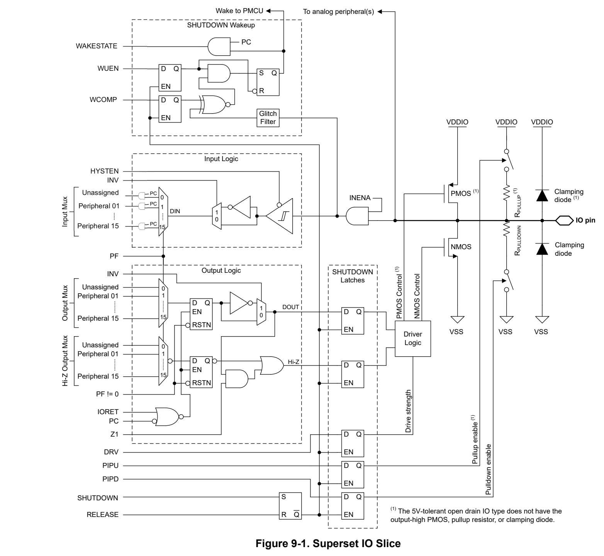
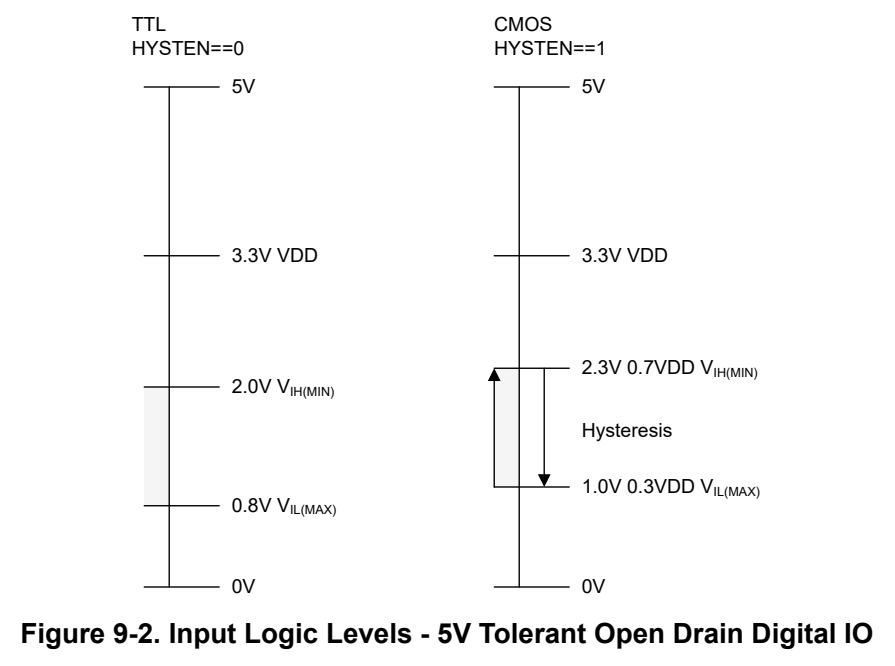

# 9 IOMUX (pp. 546-557)

## IOMUX (p. 546)

The IOMUX controls the configuration of all device pins with digital input-output (IO) functions, including: digital function selection, inversion control, drive strength (if applicable), the pullup or pulldown resistor (if applicable), and wake-up configuration (if applicable on certain IOs for wakeup from SHUTDOWN mode).

### 9.1 IOMUX Overview 547 (p. 546)

### 9.2 IOMUX Operation 550 (p. 546)

### 9.3 IOMUX Registers 554 (p. 546)

### 9.1 IOMUX Overview (p. 547)

The IOMUX manages the configuration of the digital IO. Refer to the device specific datasheet for supported features. Key functions configured by IOMUX include:

- Selection of which peripheral is multiplexed to each digital IO pin (for example, a GPIO or UART peripheral)

- Digital input path configuration – Hysteresis control – Input path enable/disable – Input logic inversion control

- Digital output path configuration – Drive strength control – Output connection enable/disable – Output logic inversion (control shared with input logic inversion) – Logic-high to High-Z output conversion (for open-drain style interfaces) – Retention of "last state" when a peripheral connected to an IO is disabled

- Wakeup configuration (for wakeup from SHUTDOWN mode if present) – Read wake up source from the wakestat bit from the PINCM Register – Wake up compare level – Release SHDNIOREL – Wakeup enable/disable

- Pullup and pulldown resistor control (if present)

#### 9.1.1 IO Types and Analog Sharing (p. 547)

The IOMUX manages the selection of which peripheral function is to be used on a digital IO. It also provides the controls for the output driver, input path, and the wakeup logic for wakeup from SHUTDOWN mode.

Digital IO Types

There are several digital IO types which can be included on a given device. Each digital IO type supports different features. Digital IO Features by IO Type lists the features which are included with each IO type. See the device-specific data sheet for which IO type is used on a given package pin.

**Table 9-1. Digital IO Features by IO Type (p. 547)**

| IO Structure | Inversion Control | Drive Strength Control | Hysteresis Control | Pullup Resistor | Pulldown Resistor | Wakeup Logic |
| --- | --- | --- | --- | --- | --- | --- |
| Standard-drive (SDIO) | Y |  |  | Y | Y |  |
| Standard-drive with wake (SDIO) | Y |  |  | Y | Y | Y |
| High-drive (HDIO) | Y | Y |  | Y | Y | Y |
| High-speed (HSIO) | Y | Y |  | Y | Y |  |
| 5V tolerant open drain (ODIO) | Y |  | Y |  | Y | Y |

Please note that the IOMUX will not support the inversion control and pseudo-open drain (output-high translated to high-impedance) setting on the SPI POCI pins. Also the IOMUX will not support inversion control on the SPI SCLK pins connected on an HSIO pin. Not all devices support pulldown resistors refer to the device specific data sheet.

Digital IO Shared with Analog Functions

Certain pins on a device will be digital only and will not have any analog functions connected to the pin. Other pins can have one or more analog functions connected to the pin in addition to the digital IO functions. Analog functions are never selected within the IOMUX; they are always configured within of the respective analog peripheral. Analog peripherals have no knowledge of, or interaction with, the IOMUX.

In general, when analog functionality is used on a pin which also has digital functions, the IOMUX configuration for that pin should be left in its default (high-Z) state so as to not interfere with the proper operation of the analog function. However, it is possible to have the IOMUX active on a pin when an analog peripheral is also interacting with the pin, provided that the application software ensures that there is not a conflict between the functions. For example, it is possible to have the pullup or pulldown resistor on an IO enabled at the same time that the ADC is running a conversion on the same IO. However, an invalid configuration would be enabling the output driver on an IO at the same time that an analog peripheral is driving the IO (for example, a DAC or OPA output). This would create an IO conflict.

Application software is responsible for ensuring that the IOMUX settings do not conflict with any analog peripheral functions which can be enabled on a shared pad.

IO Slice

The mixed-signal IO pin slice diagram for a full featured IO pin is shown in Superset IO Slice. Not all pins will have analog functions, wake-up logic, drive strength control, and pullup or pulldown resistors available. See the device-specific data sheet for detailed information on what features are supported for a specific pin.

*Figure 9-1. Superset IO Slice (p. 549)*

Default IOMUX State

The initial state of the IOMUX pin slice for all digital IO after a BOOTRST is as follows:

- The digital IO is in a high-impedance state

- The peripheral function selection field (PF) is cleared (no peripheral function selected) and the peripheral connect (PC) and input enable states are cleared (disabled)

- The inversion logic is disabled

- The Hi-Z output high mode is disabled

- The pullup/pulldown resistors (if present) are disabled The input hysteresis control (if present) is disabled to save power

- The wakeup logic (if present) is disabled

Note The SWD pins are a specific exception to the above default state. The SWD debug pins are configured in SWD mode by default, and may be switched to an alternate setting after start-up. See SWD Pins in the SYSCTL section of the PMCU chapter.

### 9.2 IOMUX Operation (p. 550)

Each digital IO on a device has a dedicated 32-bit PINCM register in the IOMUX peripheral register space which is used to configure the digital functions of the respective IO. See the device specific data sheet for determining the PINCM register index which corresponds to the IO to be configured.

#### 9.2.1 Peripheral Function (PF) Assignment (p. 550)

When setting up the initial IOMUX configuration for an IO after a BOOTRST, application software can select which digital peripheral from the supported options is to be connect to an IO by writing the appropriate peripheral select value to the PF field while simultaneously setting the PC and INENA bits in the PINCMx register corresponding to the targeted pin. The IOMUX configurations for a given peripheral must be set before the peripheral connected to the IOs has been initialized for operation.

To change the peripheral function selection for a digital IO at runtime after a peripheral function has already been configured for that IO, the following procedure should be followed:

1. Disable the currently connected peripheral function 2. Clear the PC bit (input/output connect bit) and INENA (input connect bit) in the corresponding PINCMx register 3. Write 0x0 to the PF field in the PINCMx to clear the logic in the data path 4. Select the new peripheral function by writing the peripheral function ID to the PF register 5. Set the PC and INENA bits in the PINCMx register to connect the newly selected peripheral 6. Enable the newly selected peripheral for operation

At runtime, the INENA bit can be used to mask the input from the IO to the peripheral, if desired. When INENA is cleared, a connected peripheral function will see logic low (0) from the IO, regardless of the external state of the IO. If an IO supports wakeup from SHUTDOWN mode, the INENA bit also controls propagation of the IO state to the SHUTDOWN mode wakeup logic.

If a peripheral is assigned to an IO, but the peripheral is itself in a disabled state, the last valid output conditions (output logic level and Hi-Z state) are latched in the IOMUX output logic. When the peripheral is enabled, the IOMUX will release the latched state to allow the (now enabled) peripheral's output state to propagate to the IO. The PMCU indicates to the IOMUX when a peripheral is entering a disabled state via the IORET signal, which is combined with the PC signal via a logic OR to control the output state latches. This mechanism handles preservation of the last valid output state of peripherals in power domain 1 (PD1) when entering STOP or STANDBY mode, as PD1 peripherals are always temporarily disabled upon entry to STOP/STANDBY, and re-enabled upon exit from STOP/STANDBY modes.

When no peripheral function is selected (PF==0) the output latches are put into a reset state, causing the output NMOS and PMOS to be disabled (leaving the IO pin in a Hi-Z state with the exception of any enabled pullup/ pulldown resistors). Note that the pullup/pulldown resistors are never controlled by either a connected peripheral or the peripheral muxing logic. They are only controlled by the IOMUX control bits ( see pullup/pulldown).

#### 9.2.2 Logic High to Hi-Z Conversion (p. 550)

The IOMUX supports translating an output high signal from a connected peripheral into a Hi-Z output state at the IO pin. This functionality is particularly useful for open-drain digital input/output applications. When this functionality is enabled, the IO pin state as a function of the peripheral output is as shown in Table 9-2.

**Table 9-2. Logic High to Hi-Z Truth Table (p. 551)**

| Connected Peripheral Output | IO Pin State (Z1 = 0x0) | IO Pin State (Z1 = 0x1) |
| --- | --- | --- |
| Logic low (0) | Output low | Output low |
| Logic high (1) | Output high | High impedance (Hi-Z) |

To enable logic high to Hi-Z conversion on a digital IO, set the Z1 bit in the corresponding PINCMx register.

Note that for 5V tolerant open-drain IO pins, the Z1 control has no effect as there is no high-side driver present. On these pins, a logic high output from the peripheral to the IO pin always results in a Hi-Z state.

#### 9.2.3 Logic Inversion (p. 551)

The IOMUX supports logic inversion of the digital input/output path. Logic inversion is useful for scenarios where opposite polarity is required for UART functions or SPI chip select functions.

To enable logic inversion on a digital IO, set the INV bit in the corresponding PINCMx register. To disable logic inversion, clear the corresponding bit. Logic inversion is disabled by default.

When logic inversion is enabled for a 5V tolerant open drain IO, a connected peripheral which outputs a logic low state will cause the IO pin to go to a Hi-Z state. When the peripheral applies a logic high state, the IO pin will go to an output low state.

#### 9.2.4 SHUTDOWN Mode Wakeup Logic (p. 551)

In SHUTDOWN mode, the entire regulated core supply of the device is disabled and the device wakes only from a wake-capable IO that is configured for wakeup, from NRST, or from a debug connection. The IO wake mechanism for exiting SHUTDOWN is managed by IOMUX and is level based. The 5V-tolerant open-drain IOs, high-drive IOs, and certain standard-drive IOs include the additional wakeup logic that can be used to wake the device from a SHUTDOWN operating mode upon a level match.

To configure a wake-capable IO for wakeup from SHUTDOWN mode:

1. Set the INENA bit to let the input state propagate from the IO to the wakeup logic. 2. Select the compare level to use for wake by setting or clearing the WCOMP bit in the PINCMx register corresponding to the targeted pin. 3. Enable wakeup by setting the WUEN bit in the PINCMx register corresponding to the targeted pin.

After the previous configuration, SHUTDOWN mode can be entered through the appropriate command in SYSCTL. Pins on the device that contain digital IO controlled by IOMUX retain their current state when the device enters into SHUTDOWN. While the digital IO state is latched upon entry into SHUTDOWN mode, the IOMUX configuration registers (all PINCMx registers) lose their contents as the regulated core supply is shut down.

After SHUTDOWN is entered, a level match on any pin configured for wakeup triggers the exit sequence from SHUTDOWN. When the device exits SHUTDOWN, a BOR-level reset occurs but the state of the digital IO remains latched through the reset, keeping the IO state that was present upon entry into SHUTDOWN. This state is held until the IO are released in SYSCTL. After the BOR, SYSCTL captures the cause of the reset as a SHUTDOWN exit so that software can identify this and take appropriate action to reconfigure the device.

If multiple pins were configured for wakeup from SHUTDOWN, application software can determine which wakeup-configured IO generated the wake by polling the WAKESTATE bit in any IOs that were enabled for wake before the SHUTDOWN exit.

Application software must apply the following process to restore the IO state upon exit from SHUTDOWN:

1. Check which IO triggered the wakeup from SHUTDOWN, if necessary, as follows: a. Reconfigure the PINCMx register corresponding to the IO to be tested for wakeup status and set the peripheral connect (PC) bit (the PC bit gates the WAKESTATE indication).

| Col 1 | b. Test the WAKESTATE bit in the PINCMx register corresponding to the IO to be tested to determine |
| --- | --- |
|  | if that particular IO received a WAKE status based on the previously configured WCOMP and WUEN |
|  | configuration. |
| 2. | Reconfigure any remaining IOMUX PINCM registers to the correct states. |
| 3. | Reconfigure the peripherals that are connected to pins through IOMUX, and enable them. |
| 4. | Release the SHUTDOWN IO lock in SYSCTL. |
| 5. | Clear the WUEN bit in the PINCMx register to reset the WAKESTATE status. |

Note After waking from SHUTDOWN, if the WUEN bit not cleared and the shutdown release bit in SYSCTL is not set, then reentering SHUTDOWN results in an immediate wake event, because the WAKESTATE status was not cleared from the previous wake event.

#### 9.2.5 Pullup/Pulldown Resistors (p. 552)

Programmable pullup/pulldown resistors are provided on most digital IO types, and are connected to VDD/VSS, respectively. The 5V tolerant open drain digital IO does not provide a pullup resistor due to the open drain configuration.

To enable the pullup or pulldown resistor on a digital IO, set the PIPU or PIPD bit, respectively, in the corresponding PINCMx register. To disable the pullup or pulldown resistor, clear the corresponding bit.

The pullup/pulldown resistors can be enabled at any time, and their configuration is independent from the peripheral function configuration. It is possible to enable a pullup/pulldown resistor while changing the selected peripheral function.

#### 9.2.6 Drive Strength Control (p. 552)

The high-drive and high-speed digital IO types have programmable drive strength (low drive and high drive). The default drive strength is low drive. Application software can request high drive by setting the DRV bit in the PINCMx register corresponding to the target digital IO. Drive strength control is not available for standard drive and open drain IO types.

The drive strength control is completely independent of the selected peripheral function (PF) and can be changed by application software at any time.

For detailed electrical specifications on the drive performance in each drive mode for a given IO, see the Digital IO parameters in the device-specific data sheet.

#### 9.2.7 Hysteresis and Logic Level Control (p. 552)

The 5V-tolerant open drain digital IOs provide a hysteresis and logic level control to enable operation in input mode with standard CMOS logic (hysteresis enabled, CMOS logic levels) and TTL logic (hysteresis disabled, TTL logic levels).

The default mode for the 5V-tolerant open drain digital IO is TLL mode (HYSTEN bit in the PINCMx register is cleared). To use a 5V-tolerant open drain digital IO in CMOS mode with hysteresis enabled, set the HYSTEN bit in the PINCMx register which corresponds to the targeted IO.

The input logic level differences between TTL mode (left) and CMOS mode (right) are shown in Figure 9-2.

*Figure 9-2. Input Logic Levels - 5V Tolerant Open Drain Digital IO (p. 553)*

### 9.3 IOMUX Registers (p. 554)

Table 9-3 lists the memory-mapped registers for the IOMUX registers. All register offset addresses not listed in Table 9-3 should be considered as reserved locations and the register contents should not be modified.

**Table 9-3. IOMUX Registers (p. 554)**

| Offset | Acronym | Register Name | Group |
| --- | --- | --- | --- |
| 4h | PINCM | Pin Control Management Register in SECCFG region |  |

Complex bit access types are encoded to fit into small table cells. Table 9-4 shows the codes that are used for access types in this section.

**Table 9-4. IOMUX Access Type Codes (p. 554)**

| Access Type | Code | Description |
| --- | --- | --- |
| Read Type |  |  |
| R | R | Read |
| Write Type |  |  |
| W | W | Write |
| Reset or Default Value |  |  |
| - n |  | Value after reset or the default value |

### 9.3.1 [IOMUX.PINCM] Offset: 4h | Reset: X (p. 555)

PINCM is shown in Figure 9-3 and described in Table 9-5.

Pin Control Management Register

> **Bit Map**: `[31-29] RESERVED (R/W, 0h)` | `[28] WCOMP (R/W, 0h)` | `[27] WUEN (R/W, 0h)` | `[26] INV (R/W, 0h)` | `[25] HIZ1 (R/W, 0h)` | `[24] RESERVED (R/W, 0h)` | `[21] RESERVED (R/W, 0h)` | `[20] DRV (R/W, 0h)` | `[19] HYSTEN (R/W, 0h)` | `[18] INENA (R/W, 0h)` | `[17] PIPU (R/W, 0h)` | `[16] PIPD (R/W, 0h)` | `[13] WAKESTAT (R, 0h)` | `[12-8] RESERVED (R/W, 0h)` | `[7] PC (R/W, 0h)` | `[6] RESERVED (R/W, 0h)` | `[5-0] PF (R/W, 0h)`

**Table 9-5. PINCM Field Descriptions (pp. 555-556)**

| Bit | Field | Type | Reset | Description |
| --- | --- | --- | --- | --- |
| 31-29 | RESERVED | R/W | 0h |  |
| 28 | WCOMP | R/W | 0h | Wakeup Compare Value bit; 0h = Wakeup on a match of 0; 1h = Wakeup on a match of 1 |
| 27 | WUEN | R/W | 0h | Wakeup Enable bit; 0h = wakeup is disabled.; 1h = wakeup is enabled |
| 26 | INV | R/W | 0h | Data inversion selection; 0h = Data inversion is disabled.; 1h = Data inversion is enabled |
| 25 | HIZ1 | R/W | 0h | High output value will tri-state the output when this bit is enabled; 0h = open-drain is disabled.; 1h = open-drain is enabled. |
| 24 | RESERVED | R/W | 0h |  |
| 21 | RESERVED | R/W | 0h |  |
| 20 | DRV | R/W | 0h | Drive strength control selection, for HS IOCELL only; 0h = Drive setting of 0 selected; 1h = Drive setting of 1 selected |
| 19 | HYSTEN | R/W | 0h | Hysteresis Enable Control Selection; 0h = hysteresis is disabled.; 1h = hysteresis is enabled |
| 18 | INENA | R/W | 0h | Input Enable Control Selection; 0h = Input enable is disabled.; 1h = Input enable is enabled. |
| 17 | PIPU | R/W | 0h | Pull Up control selection; 0h = Pull up is disabled.; 1h = Pull up is enabled |
| 16 | PIPD | R/W | 0h | Pull Down control selection; 0h = Pull down is disabled.; 1h = Pull down is enabled |
| 13 | WAKESTAT | R | 0h | This has the IOPAD WAKEUP signal as status bit.; 0h = wakeup source is NOT from this IOCELL; 1h = wakeup source is from this IOCELL |
| 12-8 | RESERVED | R/W | 0h |  |
| 7 | PC | R/W | 0h | Peripheral is “Connected”; 0h = The output of the peripheral (and its output enable) will not propagate to the IOCELL; 1h = The output latch of the dataflow will be “transparent” |
| 6 | RESERVED | R/W | 0h |  |
| 5-0 | PF | R/W | 0h | Peripheral Function selection bits; 0h = Reserved as unconnected; 3Fh = An encoding per function that can be connected to this pin. |

Chapter 10
