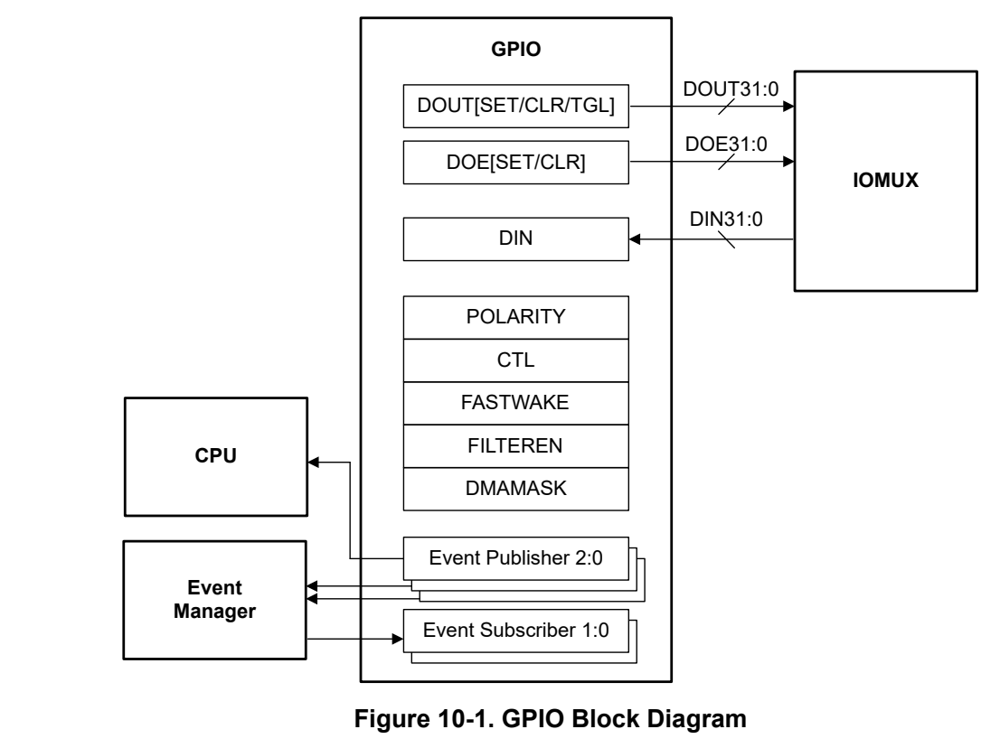
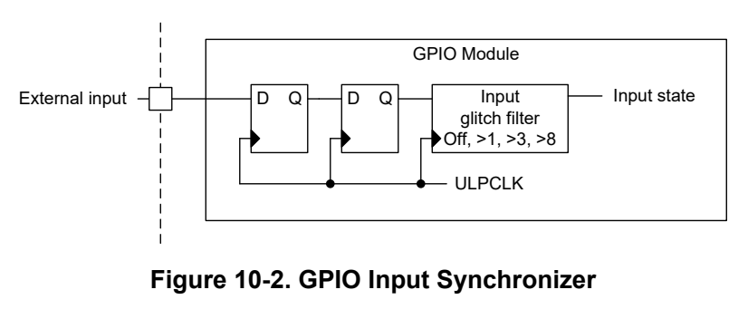
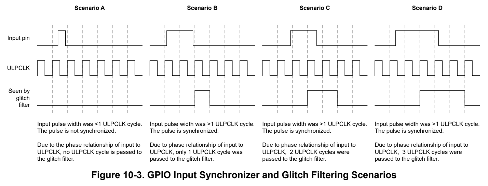

# 10 General-Purpose Input/Output (GPIO) (pp. 557-670)

## General-Purpose Input/Output (GPIO) (p. 557)

The GPIO peripheral provides the user with a means to write data out and read data in to and from the device pins. The GPIO also provides a way to detect wakeup events while the device is in a low power state. This chapter describes the operation of the GPIO peripheral.

### 10.1 GPIO Overview 558 (p. 557)

### 10.2 GPIO Operation 558 (p. 557)

### 10.3 GPIO Registers 562 (p. 557)

### 10.1 GPIO Overview (p. 558)

The GPIO is used to read in digital data from the device pins and to send digital data out to the device pins.

The GPIO module features include:

- Zero wait state MMR access from CPU

- Set/clear/toggle multiple bits without the need of a read-modify-write construct in software

- Direct writes to individual GPIO output bits (DOUT) without the need of a read-modify-write construct in software

- Direct read comparisons of individual GPIO input bits (DIN) without the need to use masking in software

- DOUT serviceable by DMA to generate a predefined output sequence on specified pins

- "FastWake" feature enables low-power wakeup from STOP and STANDBY modes for any GPIO port

- User controlled input filtering (configurable per IO)

- Interconnection to the device event fabric through event publishers and event subscribers (GPIOA instance only)

GPIO Block Diagram shows the block diagram of the GPIO peripheral.

*Figure 10-1. GPIO Block Diagram (p. 558)*

Note The GPIO module for the MSPM0 platform does not manage the complete digital IO functionality (for example, pullup, pulldown, or other functional muxing). For complete digital IO control details, refer to Chapter 9. Similar to any other peripheral, the GPIO has inputs and outputs (with output enable) that allow the GPIO to interface with the IOMUX to make connections to the IO pins.

### 10.2 GPIO Operation (p. 558)

The GPIO peripheral is configured with user software. The setup and operation of the GPIO is discussed in the following sections.

#### 10.2.1 GPIO Ports (p. 559)

An instance of the GPIO peripheral in the MSPM0 platform supports up to 32 data input/output (DIO) bits. For devices with greater than 32 GPIOs, multiple instances of the GPIO peripheral are used to address all of the device pins. The GPIO port and bit names are directly mapped to the signal names associated with each device pin in the Pin Configuration and Functions section of the device data sheet.

**Table 10-1. GPIO Port and Device Pin Mapping (p. 559)**

| GPIO Port and Bit Name | Device Pin Signal Name |
| --- | --- |
| GPIO Port A Bit 0 (DIO0) | PA0 |
| GPIO Port A Bit 1 (DIO1) | PA1 |
| GPIO Port B Bit 0 (DIO0) | PB0 |
| GPIO Port B Bit 1 (DIO1) | PB1 |
| GPIO Port x Bit y (DIOy) | Pxy |

#### 10.2.2 GPIO Read/Write Interface (p. 559)

The GPIO peripheral has features and dedicated registers to allow for advanced bit manipulations without the need to execute a read-modify-write construct in software. These features are outlined below.

#### 10.2.3 GPIO Input Glitch Filtering and Synchronization (p. 559)

The GPIO module evaluates the state of input pins at the ULPCLK (PD0 bus clock) rate, synchronizing the pin state to ULPCLK through a 2-stage synchronizer before passing the GPIO state to the input glitch filter.

*Figure 10-2. GPIO Input Synchronizer (p. 559)*

A programmable input glitch filter is provided for suppressing noise on digital input pins. The glitch filter runs at ULPCLK rate. Four levels of user-specified input filtering are possible:

- Sampled input without filtering (the minimum reliably detected pulse width is one ULPCLK cycle due to synchronization of the pin state with ULPCLK +Delay time from edge of asynchronous request to first MCLK edge in case of fast wake enable for STANDBY0/1, STOP1/2 and SLEEP2 modes)

- Synchronized inputs which are not greater than 1 ULPCLK periods are filtered out

- Synchronized inputs which are not greater than 3 ULPCLK periods are filtered out

- Synchronized inputs which are not greater than 8 ULPCLK periods are filtered out

This feature allows users to easily implement input filtering in hardware for cases where fast switching on the input pin is needed to be filtered out. The bit fields in the FILTEREN31_16 and FILTEREN15_0 registers allow users to configure the level of filtering needed for the corresponding GPIO bit.

Input pulses of the same pulse length can be passed in some cases while being filtered in other cases, due to 1 ULPCLK cycle of uncertainty in the synchronization.

*Figure 10-3. GPIO Input Synchronizer and Glitch Filtering Scenarios (p. 560)*

- In Scenario A, the input pulse is less than one ULPCLK cycle. Pulses less than one ULPCLK cycle may not be captured. To ensure that GPIO inputs are always captured, the GPIO input pulse width must be greater than the ULPCLK period.

- In Scenario B, the input pulse is nearly two ULPCLK cycles in length, but because the rising edge occurs just after the ULPCLK edge, the GPIO synchronizer only views the input pin as having been high for 1 ULPCLK period. This scenario would not be filtered out by the glitch filter when the glitch filter is disabled, but a glitch filter value of >1 would result in this pulse being filtered. Conversely, the same input pulse width in Scenario C results in the input pin being considered high for two ULPCLK periods, as the rising edge occurred just before the ULPCLK edge. In this case, this scenario would not be filtered out when a glitch filter value of >1 is specified.

- In Scenario D, three ULPCLK cycles are passed to the glitch filter. In this case, the scenario would not be filtered out when a glitch filter value of >1 is specified, but it would be filtered out for a glitch filter value of >3 or >8.

Note When the fast wake mode is enabled (SYSOSC is requested asynchronously upon input pin activity), the ULPCLK will switch from off (as would be the case in STANDBY1) or 32kHz (as would be the case in STANDBY0) to 24Mhz/32MHz, resulting in the input synchronization logic and glitch filter running at 24Mhz/32MHz after some latency. See the device specific data sheet for the asynchronous fast clock request wake time, and budget this time into any minimum pulse width calculations when using fast wake.

#### 10.2.4 GPIO Fast Wake (p. 560)

The fast wake feature in the MSPM0 GPIO peripheral allows the GPIO module to stay in a low-power state and detect interrupt events on the device pins without requiring a high-speed clock. This allows the device to support fast wakeup from low-power modes, such as STOP and STANDBY, on any GPIO pin.

Fast wake can be enabled on a bit-wise basis using the FASTWAKE register. Setting a bit in the FASTWAKE register enables the corresponding device pin signal to support fast wakeup functionality. The CTL register contains a bit field named FASTWAKEONLY which allows for global control of the fast wake feature. Setting the FASTWAKEONLY bit enables all of the bits in the corresponding GPIO port to support fast wakeup functionality.

Note Do not enable fast wake in the GPIO while simultaneously blocking asynchronous fast clock requests in SYSCTL. When fast wake is enabled, the GPIO expects to handshake with SYSCTL for the fast clock. If SYSCTL ignores the request, the GPIO does not receive a clock until SYSCTL completes the asynchronous fast clock request handshake.

#### 10.2.5 GPIO DMA Interface (p. 561)

The GPIO peripheral allows the DMA write-access to the DOUT31_0 register. This functionality allows users to generate predefined output sequences on specified device pins. Some applications require preloaded sequences of GPIO pin changes and the MSPM0 platform allows for the DMA to run that sequence so that the CPU can remain asleep and conserve energy.

The DMAMASK register is used to indicate which GPIO bits the DMA is allowed to modify. Setting a bit in the DMAMASK register enables the corresponding DOUT bit to be modified by the DMA.

Note The CPU can write to any DOUT31_0 bit regardless of the DMAMASK value.

In cases where the DMA and the CPU both attempt to access and modify the DOUT31_0 register concurrently, it is the user's responsibility to manage the DMA and CPU bus transactions that are targeting the same bit to be modified.

- If a DMAMASK bit is set, the DMA will be prioritized to modify the corresponding DOUT bit.

- If a DMAMASK bit is cleared, the CPU will be prioritized to modify the corresponding DOUT bit.

#### 10.2.6 Event Publishers and Subscribers (p. 561)

There are three independent event publishers available for GPIOx peripherals:

1. First Event Publisher (CPU_INT)

- Used for generating CPU interrupt

- Interrupt (RIS) flags are cleared upon software reading the IIDX register or writing to the respective ICLR register bits.

- An event to the CPU can be individually specified for each GPIO bit through the POLARITY register: – 0: Disabled – 1: Rise Event – 2: Fall Event – 3: Rise or Fall Event 2. Second Event Publisher (GEN_EVENT0)

- Uses the same POLARITY register definition as CPU_INT

- Applies to GPIO bits 15 down to 0 (DIO15:0) 3. Third Event Publisher (GEN_EVENT1),

- Uses the same POLARITY register definition as CPU_INT

- Applies to GPIO bits 31 down to 16 (DIO31:16)

There are two event subscribers

1. First Event Subscriber (FSUB_0)

- A specific pin can be directed to change state on an event

- A subscriber event can only cause one single bit to have an action

- Applies to GPIO bits 15 down to 0 (DIO15:0)

- SUB0CFG register is used to enable the FSUB_0 event and define the output policy for a specific GPIO pin 2. Second Event Subscriber (FSUB_1)

- A specific pin can be directed to change state on an event

- A subscriber event can only cause one single bit to have an action

- Applies to GPIO bits 31 down to 16 (DIO31:16)

- SUB1CFG register is used to enable the FSUB_1 event and define the output policy for a specific GPIO pin

### 10.3 GPIO Registers (p. 562)

Table 10-2 lists the memory-mapped registers for the GPIO registers. All register offset addresses not listed in Table 10-2 should be considered as reserved locations and the register contents should not be modified.

**Table 10-2. GPIO Registers (pp. 562-563)**

| Offset | Acronym | Register Name | Group |
| --- | --- | --- | --- |
| 400h | FSUB_0 | Subsciber Port 0 |  |
| 404h | FSUB_1 | Subscriber Port 1 |  |
| 444h | FPUB_0 | Publisher Port 0 |  |
| 448h | FPUB_1 | Publisher Port 1 |  |
| 800h | PWREN | Power enable |  |
| 804h | RSTCTL | Reset Control |  |
| 814h | STAT | Status Register |  |
| 1010h | CLKOVR | Clock Override |  |
| 1018h | PDBGCTL | Peripheral Debug Control |  |
| 1020h | IIDX | Interrupt index | CPU_INT |
| 1028h | IMASK | Interrupt mask | CPU_INT |
| 1030h | RIS | Raw interrupt status | CPU_INT |
| 1038h | MIS | Masked interrupt status | CPU_INT |
| 1040h | ISET | Interrupt set | CPU_INT |
| 1048h | ICLR | Interrupt clear | CPU_INT |
| 1050h | IIDX | Interrupt index | GEN_EVENT0 |
| 1058h | IMASK | Interrupt mask | GEN_EVENT0 |
| 1060h | RIS | Raw interrupt status | GEN_EVENT0 |
| 1068h | MIS | Masked interrupt status | GEN_EVENT0 |
| 1070h | ISET | Interrupt set | GEN_EVENT0 |
| 1078h | ICLR | Interrupt clear | GEN_EVENT0 |
| 1080h | IIDX | Interrupt index | GEN_EVENT1 |
| 1088h | IMASK | Interrupt mask | GEN_EVENT1 |
| 1090h | RIS | Raw interrupt status | GEN_EVENT1 |
| 1098h | MIS | Masked interrupt status | GEN_EVENT1 |
| 10A0h | ISET | Interrupt set | GEN_EVENT1 |
| 10A8h | ICLR | Interrupt clear | GEN_EVENT1 |
| 10E0h | EVT_MODE | Event Mode |  |
| 10FCh | DESC | Module Description |  |
| 1200h | DOUT3_0 | Data output 3 to 0 |  |
| 1204h | DOUT7_4 | Data output 7 to 4 |  |
| 1208h | DOUT11_8 | Data output 11 to 8 |  |
| 1210h | DOUT19_16 | Data output 19 to 16 |  |
| 1214h | DOUT23_20 | Data output 23 to 20 |  |
| 1218h | DOUT27_24 | Data output 27 to 24 |  |
| 121Ch | DOUT31_28 | Data output 31 to 28 |  |
| 1280h | DOUT31_0 | Data output 31 to 0 |  |
| 1290h | DOUTSET31_0 | Data output set 31 to 0 |  |
| 12A0h | DOUTCLR31_0 | Data output clear 31 to 0 |  |
| 12B0h | DOUTTGL31_0 | Data output toggle 31 to 0 |  |
| 12C0h | DOE31_0 | Data output enable 31 to 0 |  |
| 12D0h | DOESET31_0 | Data output enable set 31 to 0 |  |
| 12E0h | DOECLR31_0 | Data output enable clear 31 to 0 |  |
| 1300h | DIN3_0 | Data input 3 to 0 |  |
| 1304h | DIN7_4 | Data input 7 to 4 |  |
| 1308h | DIN11_8 | Data input 11 to 8 |  |
| 130Ch | DIN15_12 | Data input 15 to 12 |  |
| 1310h | DIN19_16 | Data input 19 to 16 |  |
| 1314h | DIN23_20 | Data input 23 to 20 |  |
| 1318h | DIN27_24 | Data input 27 to 24 |  |
| 131Ch | DIN31_28 | Data input 31 to 28 |  |
| 1380h | DIN31_0 | Data input 31 to 0 |  |
| 1390h | POLARITY15_0 | Polarity 15 to 0 |  |
| 13A0h | POLARITY31_16 | Polarity 31 to 16 |  |
| 1400h | CTL | FAST WAKE GLOBAL EN |  |
| 1404h | FASTWAKE | FAST WAKE ENABLE |  |
| 1500h | SUB0CFG | Subscriber 0 configuration |  |
| 1508h | FILTEREN15_0 | Filter Enable 15 to 0 |  |
| 150Ch | FILTEREN31_16 | Filter Enable 31 to 16 |  |
| 1510h | DMAMASK | DMA Write MASK |  |
| 1520h | SUB1CFG | Subscriber 1 configuration |  |

Complex bit access types are encoded to fit into small table cells. Table 10-3 shows the codes that are used for access types in this section.

**Table 10-3. GPIO Access Type Codes (p. 563)**

| Access Type | Code | Description |
| --- | --- | --- |
| Read Type |  |  |
| R | R | Read |
| Write Type |  |  |
| K | K | Write protected by a key |
| W | W | Write |
| WK | W K | Write Write protected by a key |
| Reset or Default Value |  |  |
| - n |  | Value after reset or the default value |

### 10.3.1 [GPIO.FSUB_0] Offset: 400h | Reset: 00000000h (p. 564)

FSUB_0 is shown in Figure 10-4 and described in Table 10-4.

Subscriber port

> **Bit Map**: `[31-4] RESERVED (R/W, 0h)` | `[3-0] CHANID (R/W, 0h)`

**Table 10-4. FSUB_0 Field Descriptions (p. 564)**

| Bit | Field | Type | Reset | Description |
| --- | --- | --- | --- | --- |
| 31-4 | RESERVED | R/W | 0h |  |
| 3-0 | CHANID | R/W | 0h | 0 = disconnected.; 1-15 = connected to channelID = CHANID.; 0h = A value of 0 specifies that the event is not connected; Fh = Consult your device data sheet as the actual allowed maximum may be less than 15. |

### 10.3.2 [GPIO.FSUB_1] Offset: 404h | Reset: 00000000h (p. 565)

FSUB_1 is shown in Figure 10-5 and described in Table 10-5.

Subscriber port

> **Bit Map**: `[31-4] RESERVED (R/W, 0h)` | `[3-0] CHANID (R/W, 0h)`

**Table 10-5. FSUB_1 Field Descriptions (p. 565)**

| Bit | Field | Type | Reset | Description |
| --- | --- | --- | --- | --- |
| 31-4 | RESERVED | R/W | 0h |  |
| 3-0 | CHANID | R/W | 0h | 0 = disconnected.; 1-15 = connected to channelID = CHANID.; 0h = A value of 0 specifies that the event is not connected; Fh = Consult your device data sheet as the actual allowed maximum may be less than 15. |

### 10.3.3 [GPIO.FPUB_0] Offset: 444h | Reset: 00000000h (p. 566)

FPUB_0 is shown in Figure 10-6 and described in Table 10-6.

Publisher port

> **Bit Map**: `[31-4] RESERVED (R/W, 0h)` | `[3-0] CHANID (R/W, 0h)`

**Table 10-6. FPUB_0 Field Descriptions (p. 566)**

| Bit | Field | Type | Reset | Description |
| --- | --- | --- | --- | --- |
| 31-4 | RESERVED | R/W | 0h |  |
| 3-0 | CHANID | R/W | 0h | 0 = disconnected.; 1-15 = connected to channelID = CHANID.; 0h = A value of 0 specifies that the event is not connected; Fh = Consult your device data sheet as the actual allowed maximum may be less than 15. |

### 10.3.4 [GPIO.FPUB_1] Offset: 448h | Reset: 00000000h (p. 567)

FPUB_1 is shown in Figure 10-7 and described in Table 10-7.

Publisher port

> **Bit Map**: `[31-4] RESERVED (R/W, 0h)` | `[3-0] CHANID (R/W, 0h)`

**Table 10-7. FPUB_1 Field Descriptions (p. 567)**

| Bit | Field | Type | Reset | Description |
| --- | --- | --- | --- | --- |
| 31-4 | RESERVED | R/W | 0h |  |
| 3-0 | CHANID | R/W | 0h | 0 = disconnected.; 1-15 = connected to channelID = CHANID.; 0h = A value of 0 specifies that the event is not connected; Fh = Consult your device data sheet as the actual allowed maximum may be less than 15. |

### 10.3.5 [GPIO.PWREN] Offset: 800h | Reset: 00000000h (p. 568)

PWREN is shown in Figure 10-8 and described in Table 10-8.

Register to control the power state

> **Bit Map**: `[31-24] KEY (W, 0h)` | `[23-1] RESERVED (R/W, 0h)` | `[0] ENABLE (K, 0h)`

**Table 10-8. PWREN Field Descriptions (p. 568)**

| Bit | Field | Type | Reset | Description |
| --- | --- | --- | --- | --- |
| 31-24 | KEY | W | 0h | KEY to allow Power State Change; 26h = KEY to allow write access to this register |
| 23-1 | RESERVED | R/W | 0h |  |
| 0 | ENABLE | K | 0h | Enable the power KEY must be set to 26h to write to this bit.; 0h = Disable Power; 1h = Enable Power |

### 10.3.6 [GPIO.RSTCTL] Offset: 804h | Reset: 00000000h (p. 569)

RSTCTL is shown in Figure 10-9 and described in Table 10-9.

Register to control reset assertion and de-assertion

> **Bit Map**: `[31-24] KEY (W, 0h)` | `[23-2] RESERVED (W, 0h)` | `[1] RESETSTKYCLR (WK, 0h)` | `[0] RESETASSERT (WK, 0h)`

**Table 10-9. RSTCTL Field Descriptions (p. 569)**

| Bit | Field | Type | Reset | Description |
| --- | --- | --- | --- | --- |
| 31-24 | KEY | W | 0h | Unlock key; B1h = KEY to allow write access to this register |
| 23-2 | RESERVED | W | 0h |  |
| 1 | RESETSTKYCLR | WK | 0h | Clear the RESETSTKY bit in the STAT register KEY must be set to B1h to write to this bit.; 0h = Writing 0 has no effect; 1h = Clear reset sticky bit |
| 0 | RESETASSERT | WK | 0h | Assert reset to the peripheral KEY must be set to B1h to write to this bit.; 0h = Writing 0 has no effect; 1h = Assert reset |

### 10.3.7 [GPIO.STAT] Offset: 814h | Reset: 00000000h (p. 570)

STAT is shown in Figure 10-10 and described in Table 10-10.

peripheral enable and reset status

> **Bit Map**: `[31-17] RESERVED (R, 0h)` | `[16] RESETSTKY (R, 0h)` | `[15-0] RESERVED (R, 0h)`

**Table 10-10. STAT Field Descriptions (p. 570)**

| Bit | Field | Type | Reset | Description |
| --- | --- | --- | --- | --- |
| 31-17 | RESERVED | R | 0h |  |
| 16 | RESETSTKY | R | 0h | This bit indicates, if the peripheral was reset, since this bit was cleared by RESETSTKYCLR in the RSTCTL register; 0h = The peripheral has not been reset since this bit was last cleared by RESETSTKYCLR in the RSTCTL register; 1h = The peripheral was reset since the last bit clear |
| 15-0 | RESERVED | R | 0h |  |

### 10.3.8 [GPIO.CLKOVR] Offset: 1010h | Reset: 00000000h (p. 571)

CLKOVR is shown in Figure 10-11 and described in Table 10-11.

This register overrides the functional clock request by this peripheral to the system

> **Bit Map**: `[31-2] RESERVED (R/W, 0h)` | `[1] RUN_STOP (R/W, 0h)` | `[0] OVERRIDE (R/W, 0h)`

**Table 10-11. CLKOVR Field Descriptions (p. 571)**

| Bit | Field | Type | Reset | Description |
| --- | --- | --- | --- | --- |
| 31-2 | RESERVED | R/W | 0h |  |
| 1 | RUN_STOP | R/W | 0h | If OVERRIDE is enabled, this register is used to manually control the peripheral's clock request to the system; 0h = Run/ungate functional clock; 1h = Stop/gate functional clock |
| 0 | OVERRIDE | R/W | 0h | Unlocks the functionality of RUN_STOP to override the automatic peripheral clock request; 0h = Override disabled; 1h = Override enabled |

### 10.3.9 [GPIO.PDBGCTL] Offset: 1018h | Reset: 00000001h (p. 572)

PDBGCTL is shown in Figure 10-12 and described in Table 10-12.

This register can be used by the software developer to control the behavior of the peripheral relative to the 'Core Halted' input

> **Bit Map**: `[31-1] RESERVED (R/W, 0h)` | `[0] FREE (R/W, 1h)`

**Table 10-12. PDBGCTL Field Descriptions (p. 572)**

| Bit | Field | Type | Reset | Description |
| --- | --- | --- | --- | --- |
| 31-1 | RESERVED | R/W | 0h |  |
| 0 | FREE | R/W | 1h | Free run control; 0h = The peripheral freezes functionality while the Core Halted input is asserted and resumes when it is deasserted.; 1h = The peripheral ignores the state of the Core Halted input |

### 10.3.10 [GPIO.IIDX] Offset: 1020h | Reset: 00000000h (p. 573)

IIDX is shown in Figure 10-13 and described in Table 10-13.

This register provides the highest priority enabled interrupt index. Value 0x00 means no event pending. Interrupt 1 is the highest priority, IIDX next highest, 4, 8, … IIDX^31 is the least priority. That is, the least bit position that is set to 1 denotes the highest priority pending interrupt. The priority order is fixed. However, users can implement their own prioritization schemes using other registers that expose the full set of interrupts that have occurred. On each read, only one interrupt is indicated. On a read, the current interrupt (highest priority) is automatically cleared by the hardware and the corresponding interrupt flag in [RIS] and [MIS] are cleared as well. After a read from the CPU (not from the debug interface), the register is updated with the next highest priority interrupt, if none are pending, then it should display 0x0.

> **Bit Map**: `[31-8] RESERVED (R, 0h)` | `[7-0] STAT (R, 0h)`

**Table 10-13. IIDX Field Descriptions (p. 573)**

| Bit | Field | Type | Reset | Description |
| --- | --- | --- | --- | --- |
| 31-8 | RESERVED | R | 0h |  |
| 7-0 | STAT | R | 0h | Interrupt index status; 0h = No bit is set means there is no pending interrupt request; 1h = DIO0 interrupt; 2h = DIO1 interrupt; 3h = DIO2 interrupt; 4h = DIO3 interrupt; 5h = DIO4 interrupt; 6h = DIO5 interrupt; 7h = DIO6 interrupt; 8h = DIO7 interrupt; 9h = DIO8 interrupt; Ah = DIO9 interrupt; Bh = DIO10 interrupt; Ch = DIO11 interrupt; Dh = DIO12 interrupt; Eh = DIO13 interrupt; Fh = DIO14 interrupt; 10h = DIO15 interrupt; 11h = DIO16 interrupt; 12h = DIO17 interrupt; 13h = DIO18 interrupt; 14h = DIO19 interrupt; 15h = DIO20 interrupt; 16h = DIO21 interrupt; 17h = DIO22 interrupt; 18h = DIO23 interrupt; 19h = DIO24 interrupt; 1Ah = DIO25 interrupt; 1Bh = DIO26 interrupt; 1Ch = DIO27 interrupt; 1Dh = DIO28 interrupt; 1Eh = DIO29 interrupt; 1Fh = DIO30 interrupt; 20h = DIO31 interrupt |

### 10.3.11 [GPIO.IMASK] Offset: 1028h | Reset: 00000000h (p. 574)

IMASK is shown in Figure 10-14 and described in Table 10-14.

Interrupt Mask. If a bit is set, then corresponding interrupt is unmasked. Unmasking the interrupt causes the raw interrupt to be visible in IIDX, as well as MIS.

> **Bit Map**: `[31] DIO31 (R/W, 0h)` | `[30] DIO30 (R/W, 0h)` | `[29] DIO29 (R/W, 0h)` | `[28] DIO28 (R/W, 0h)` | `[27] DIO27 (R/W, 0h)` | `[26] DIO26 (R/W, 0h)` | `[25] DIO25 (R/W, 0h)` | `[24] DIO24 (R/W, 0h)` | `[23] DIO23 (R/W, 0h)` | `[22] DIO22 (R/W, 0h)` | `[21] DIO21 (R/W, 0h)` | `[20] DIO20 (R/W, 0h)` | `[19] DIO19 (R/W, 0h)` | `[18] DIO18 (R/W, 0h)` | `[17] DIO17 (R/W, 0h)` | `[16] DIO16 (R/W, 0h)` | `[15] DIO15 (R/W, 0h)` | `[14] DIO14 (R/W, 0h)` | `[13] DIO13 (R/W, 0h)` | `[12] DIO12 (R/W, 0h)` | `[11] DIO11 (R/W, 0h)` | `[10] DIO10 (R/W, 0h)` | `[9] DIO9 (R/W, 0h)` | `[8] DIO8 (R/W, 0h)` | `[7] DIO7 (R/W, 0h)` | `[6] DIO6 (R/W, 0h)` | `[5] DIO5 (R/W, 0h)` | `[4] DIO4 (R/W, 0h)` | `[3] DIO3 (R/W, 0h)` | `[2] DIO2 (R/W, 0h)` | `[1] DIO1 (R/W, 0h)` | `[0] DIO0 (R/W, 0h)`

**Table 10-14. IMASK Field Descriptions (pp. 574-576)**

| Bit | Field | Type | Reset | Description |
| --- | --- | --- | --- | --- |
| 31 | DIO31 | R/W | 0h | DIO31 event mask; 0h = Event is masked; 1h = Event is unmasked |
| 30 | DIO30 | R/W | 0h | DIO30 event mask; 0h = Event is masked; 1h = Event is unmasked |
| 29 | DIO29 | R/W | 0h | DIO29 event mask; 0h = Event is masked; 1h = Event is unmasked |
| 28 | DIO28 | R/W | 0h | DIO28 event mask; 0h = Event is masked; 1h = Event is unmasked |
| 27 | DIO27 | R/W | 0h | DIO27 event mask; 0h = Event is masked; 1h = Event is unmasked |
| 26 | DIO26 | R/W | 0h | DIO26 event mask; 0h = Event is masked; 1h = Event is unmasked |
| 25 | DIO25 | R/W | 0h | DIO25 event mask; 0h = Event is masked; 1h = Event is unmasked |
| 24 | DIO24 | R/W | 0h | DIO24 event mask; 0h = Event is masked; 1h = Event is unmasked |
| 23 | DIO23 | R/W | 0h | DIO23 event mask; 0h = Event is masked; 1h = Event is unmasked |
| 22 | DIO22 | R/W | 0h | DIO22 event mask; 0h = Event is masked |
| 21 | DIO21 | R/W | 0h | DIO21 event mask; 0h = Event is masked; 1h = Event is unmasked |
| 20 | DIO20 | R/W | 0h | DIO20 event mask; 0h = Event is masked; 1h = Event is unmasked |
| 19 | DIO19 | R/W | 0h | DIO19 event mask; 0h = Event is masked; 1h = Event is unmasked |
| 18 | DIO18 | R/W | 0h | DIO18 event mask; 0h = Event is masked; 1h = Event is unmasked |
| 17 | DIO17 | R/W | 0h | DIO17 event mask; 0h = Event is masked; 1h = Event is unmasked |
| 16 | DIO16 | R/W | 0h | DIO16 event mask; 0h = Event is masked; 1h = Event is unmasked |
| 15 | DIO15 | R/W | 0h | DIO15 event mask; 0h = Event is masked; 1h = Event is unmasked |
| 14 | DIO14 | R/W | 0h | DIO14 event mask; 0h = Event is masked; 1h = Event is unmasked |
| 13 | DIO13 | R/W | 0h | DIO13 event mask; 0h = Event is masked; 1h = Event is unmasked |
| 12 | DIO12 | R/W | 0h | DIO12 event mask; 0h = Event is masked; 1h = Event is unmasked |
| 11 | DIO11 | R/W | 0h | DIO11 event mask; 0h = Event is masked; 1h = Event is unmasked |
| 10 | DIO10 | R/W | 0h | DIO10 event mask; 0h = Event is masked; 1h = Event is unmasked |
| 9 | DIO9 | R/W | 0h | DIO9 event mask; 0h = Event is masked; 1h = Event is unmasked |
| 8 | DIO8 | R/W | 0h | DIO8 event mask; 0h = Event is masked; 1h = Event is unmasked |
| 7 | DIO7 | R/W | 0h | DIO7 event mask; 0h = Event is masked; 1h = Event is unmasked |
| 6 | DIO6 | R/W | 0h | DIO6 event mask; 0h = Event is masked; 1h = Event is unmasked |
| 5 | DIO5 | R/W | 0h | DIO5 event mask; 0h = Event is masked; 1h = Event is unmasked |
| 4 | DIO4 | R/W | 0h | DIO4 event mask; 0h = Event is masked; 1h = Event is unmasked |
| 3 | DIO3 | R/W | 0h | DIO3 event mask; 0h = Event is masked |
| 2 | DIO2 | R/W | 0h | DIO2 event mask; 0h = Event is masked; 1h = Event is unmasked |
| 1 | DIO1 | R/W | 0h | DIO1 event mask; 0h = Event is masked; 1h = Event is unmasked |
| 0 | DIO0 | R/W | 0h | DIO0 event mask; 0h = Event is masked; 1h = Event is unmasked |

### 10.3.12 [GPIO.RIS] Offset: 1030h | Reset: 00000000h (p. 577)

RIS is shown in Figure 10-15 and described in Table 10-15.

Raw interrupt status. Reflects all pending interrupts, regardless of masking. The RIS register allows the user to implement a poll scheme. A flag set in this register can be cleared by writing 1 to the ICLR register bit even if the corresponding IMASK bit is not enabled.

> **Bit Map**: `[31] DIO31 (R, 0h)` | `[30] DIO30 (R, 0h)` | `[29] DIO29 (R, 0h)` | `[28] DIO28 (R, 0h)` | `[27] DIO27 (R, 0h)` | `[26] DIO26 (R, 0h)` | `[25] DIO25 (R, 0h)` | `[24] DIO24 (R, 0h)` | `[23] DIO23 (R, 0h)` | `[22] DIO22 (R, 0h)` | `[21] DIO21 (R, 0h)` | `[20] DIO20 (R, 0h)` | `[19] DIO19 (R, 0h)` | `[18] DIO18 (R, 0h)` | `[17] DIO17 (R, 0h)` | `[16] DIO16 (R, 0h)` | `[15] DIO15 (R, 0h)` | `[14] DIO14 (R, 0h)` | `[13] DIO13 (R, 0h)` | `[12] DIO12 (R, 0h)` | `[11] DIO11 (R, 0h)` | `[10] DIO10 (R, 0h)` | `[9] DIO9 (R, 0h)` | `[8] DIO8 (R, 0h)` | `[7] DIO7 (R, 0h)` | `[6] DIO6 (R, 0h)` | `[5] DIO5 (R, 0h)` | `[4] DIO4 (R, 0h)` | `[3] DIO3 (R, 0h)` | `[2] DIO2 (R, 0h)` | `[1] DIO1 (R, 0h)` | `[0] DIO0 (R, 0h)`

**Table 10-15. RIS Field Descriptions (pp. 577-579)**

| Bit | Field | Type | Reset | Description |
| --- | --- | --- | --- | --- |
| 31 | DIO31 | R | 0h | DIO31 event; 0h = DIO31 event did not occur; 1h = DIO31 event occurred |
| 30 | DIO30 | R | 0h | DIO30 event; 0h = DIO30 event did not occur; 1h = DIO30 event occurred |
| 29 | DIO29 | R | 0h | DIO29 event; 0h = DIO29 event did not occur; 1h = DIO29 event occurred |
| 28 | DIO28 | R | 0h | DIO28 event; 0h = DIO28 event did not occur; 1h = DIO28 event occurred |
| 27 | DIO27 | R | 0h | DIO27 event; 0h = DIO27 event did not occur; 1h = DIO27 event occurred |
| 26 | DIO26 | R | 0h | DIO26 event; 0h = DIO26 event did not occur; 1h = DIO26 event occurred |
| 25 | DIO25 | R | 0h | DIO25 event; 0h = DIO25 event did not occur; 1h = DIO25 event occurred |
| 24 | DIO24 | R | 0h | DIO24 event; 0h = DIO24 event did not occur; 1h = DIO24 event occurred |
| 23 | DIO23 | R | 0h | DIO23 event; 0h = DIO23 event did not occur; 1h = DIO23 event occurred |
| 22 | DIO22 | R | 0h | DIO22 event |
| 21 | DIO21 | R | 0h | DIO21 event; 0h = DIO21 event did not occur; 1h = DIO21 event occurred |
| 20 | DIO20 | R | 0h | DIO20 event; 0h = DIO20 event did not occur; 1h = DIO20 event occurred |
| 19 | DIO19 | R | 0h | DIO19 event; 0h = DIO19 event did not occur; 1h = DIO19 event occurred |
| 18 | DIO18 | R | 0h | DIO18 event; 0h = DIO18 event did not occur; 1h = DIO18 event occurred |
| 17 | DIO17 | R | 0h | DIO17 event; 0h = DIO17 event did not occur; 1h = DIO17 event occurred |
| 16 | DIO16 | R | 0h | DIO16 event; 0h = DIO16 event did not occur; 1h = DIO16 event occurred |
| 15 | DIO15 | R | 0h | DIO15 event; 0h = DIO15 event did not occur; 1h = DIO15 event occurred |
| 14 | DIO14 | R | 0h | DIO14 event; 0h = DIO14 event did not occur; 1h = DIO14 event occurred |
| 13 | DIO13 | R | 0h | DIO13 event; 0h = DIO13 event did not occur; 1h = DIO13 event occurred |
| 12 | DIO12 | R | 0h | DIO12 event; 0h = DIO12 event did not occur; 1h = DIO12 event occurred |
| 11 | DIO11 | R | 0h | DIO11 event; 0h = DIO11 event did not occur; 1h = DIO11 event occurred |
| 10 | DIO10 | R | 0h | DIO10 event; 0h = DIO10 event did not occur; 1h = DIO10 event occurred |
| 9 | DIO9 | R | 0h | DIO9 event; 0h = DIO9 event did not occur; 1h = DIO9 event occurred |
| 8 | DIO8 | R | 0h | DIO8 event; 0h = DIO8 event did not occur; 1h = DIO8 event occurred |
| 7 | DIO7 | R | 0h | DIO7 event; 0h = DIO7 event did not occur; 1h = DIO7 event occurred |
| 6 | DIO6 | R | 0h | DIO6 event; 0h = DIO6 event did not occur; 1h = DIO6 event occurred |
| 5 | DIO5 | R | 0h | DIO5 event; 0h = DIO5 event did not occur; 1h = DIO5 event occurred |
| 4 | DIO4 | R | 0h | DIO4 event; 0h = DIO4 event did not occur; 1h = DIO4 event occurred |
| 3 | DIO3 | R | 0h | DIO3 event |
| 2 | DIO2 | R | 0h | DIO2 event; 0h = DIO2 event did not occur; 1h = DIO2 event occurred |
| 1 | DIO1 | R | 0h | DIO1 event; 0h = DIO1 event did not occur; 1h = DIO1 event occurred |
| 0 | DIO0 | R | 0h | DIO0 event; 0h = DIO0 event did not occur; 1h = DIO0 event occurred |

### 10.3.13 [GPIO.MIS] Offset: 1038h | Reset: 00000000h (p. 580)

MIS is shown in Figure 10-16 and described in Table 10-16.

Masked interrupt status. This is an AND of the IMASK and RIS registers.

> **Bit Map**: `[31] DIO31 (R, 0h)` | `[30] DIO30 (R, 0h)` | `[29] DIO29 (R, 0h)` | `[28] DIO28 (R, 0h)` | `[27] DIO27 (R, 0h)` | `[26] DIO26 (R, 0h)` | `[25] DIO25 (R, 0h)` | `[24] DIO24 (R, 0h)` | `[23] DIO23 (R, 0h)` | `[22] DIO22 (R, 0h)` | `[21] DIO21 (R, 0h)` | `[20] DIO20 (R, 0h)` | `[19] DIO19 (R, 0h)` | `[18] DIO18 (R, 0h)` | `[17] DIO17 (R, 0h)` | `[16] DIO16 (R, 0h)` | `[15] DIO15 (R, 0h)` | `[14] DIO14 (R, 0h)` | `[13] DIO13 (R, 0h)` | `[12] DIO12 (R, 0h)` | `[11] DIO11 (R, 0h)` | `[10] DIO10 (R, 0h)` | `[9] DIO9 (R, 0h)` | `[8] DIO8 (R, 0h)` | `[7] DIO7 (R, 0h)` | `[6] DIO6 (R, 0h)` | `[5] DIO5 (R, 0h)` | `[4] DIO4 (R, 0h)` | `[3] DIO3 (R, 0h)` | `[2] DIO2 (R, 0h)` | `[1] DIO1 (R, 0h)` | `[0] DIO0 (R, 0h)`

**Table 10-16. MIS Field Descriptions (pp. 580-582)**

| Bit | Field | Type | Reset | Description |
| --- | --- | --- | --- | --- |
| 31 | DIO31 | R | 0h | DIO31 event; 0h = DIO31 event did not occur; 1h = DIO31 event occurred |
| 30 | DIO30 | R | 0h | DIO30 event; 0h = DIO30 event did not occur; 1h = DIO30 event occurred |
| 29 | DIO29 | R | 0h | DIO29 event; 0h = DIO29 event did not occur; 1h = DIO29 event occurred |
| 28 | DIO28 | R | 0h | DIO28 event; 0h = DIO28 event did not occur; 1h = DIO28 event occurred |
| 27 | DIO27 | R | 0h | DIO27 event; 0h = DIO27 event did not occur; 1h = DIO27 event occurred |
| 26 | DIO26 | R | 0h | DIO26 event; 0h = DIO26 event did not occur; 1h = DIO26 event occurred |
| 25 | DIO25 | R | 0h | DIO25 event; 0h = DIO25 event did not occur; 1h = DIO25 event occurred |
| 24 | DIO24 | R | 0h | DIO24 event; 0h = DIO24 event did not occur; 1h = DIO24 event occurred |
| 23 | DIO23 | R | 0h | DIO23 event; 0h = DIO23 event did not occur; 1h = DIO23 event occurred |
| 22 | DIO22 | R | 0h | DIO22 event; 0h = DIO22 event did not occur; 1h = DIO22 event occurred |
| 21 | DIO21 | R | 0h | DIO21 event; 0h = DIO21 event did not occur; 1h = DIO21 event occurred |
| 20 | DIO20 | R | 0h | DIO20 event; 0h = DIO20 event did not occur; 1h = DIO20 event occurred |
| 19 | DIO19 | R | 0h | DIO19 event; 0h = DIO19 event did not occur; 1h = DIO19 event occurred |
| 18 | DIO18 | R | 0h | DIO18 event; 0h = DIO18 event did not occur; 1h = DIO18 event occurred |
| 17 | DIO17 | R | 0h | DIO17 event; 0h = DIO17 event did not occur; 1h = DIO17 event occurred |
| 16 | DIO16 | R | 0h | DIO16 event; 0h = DIO16 event did not occur; 1h = DIO16 event occurred |
| 15 | DIO15 | R | 0h | DIO15 event; 0h = DIO15 event did not occur; 1h = DIO15 event occurred |
| 14 | DIO14 | R | 0h | DIO14 event; 0h = DIO14 event did not occur; 1h = DIO14 event occurred |
| 13 | DIO13 | R | 0h | DIO13 event; 0h = DIO13 event did not occur; 1h = DIO13 event occurred |
| 12 | DIO12 | R | 0h | DIO12 event; 0h = DIO12 event did not occur; 1h = DIO12 event occurred |
| 11 | DIO11 | R | 0h | DIO11 event; 0h = DIO11 event did not occur; 1h = DIO11 event occurred |
| 10 | DIO10 | R | 0h | DIO10 event; 0h = DIO10 event did not occur; 1h = DIO10 event occurred |
| 9 | DIO9 | R | 0h | DIO9 event; 0h = DIO9 event did not occur; 1h = DIO9 event occurred |
| 8 | DIO8 | R | 0h | DIO8 event; 0h = DIO8 event did not occur; 1h = DIO8 event occurred |
| 7 | DIO7 | R | 0h | DIO7 event; 0h = DIO7 event did not occur; 1h = DIO7 event occurred |
| 6 | DIO6 | R | 0h | DIO6 event; 0h = DIO6 event did not occur; 1h = DIO6 event occurred |
| 5 | DIO5 | R | 0h | DIO5 event; 0h = DIO5 event did not occur; 1h = DIO5 event occurred |
| 4 | DIO4 | R | 0h | DIO4 event; 0h = DIO4 event did not occur; 1h = DIO4 event occurred |
| 3 | DIO3 | R | 0h | DIO3 event |
| 2 | DIO2 | R | 0h | DIO2 event; 0h = DIO2 event did not occur; 1h = DIO2 event occurred |
| 1 | DIO1 | R | 0h | DIO1 event; 0h = DIO1 event did not occur; 1h = DIO1 event occurred |
| 0 | DIO0 | R | 0h | DIO0 event; 0h = DIO0 event did not occur; 1h = DIO0 event occurred |

### 10.3.14 [GPIO.ISET] Offset: 1040h | Reset: 00000000h (p. 583)

ISET is shown in Figure 10-17 and described in Table 10-17.

Interrupt set. Allows interrupts to be set by software (useful in diagnostics and safety checks). Writing a 1 to a bit in ISET will set the event and therefore the related RIS bit also gets set. If the interrupt is enabled through the mask, then the corresponding MIS bit is also set.

> **Bit Map**: `[31] DIO31 (W, 0h)` | `[30] DIO30 (W, 0h)` | `[29] DIO29 (W, 0h)` | `[28] DIO28 (W, 0h)` | `[27] DIO27 (W, 0h)` | `[26] DIO26 (W, 0h)` | `[25] DIO25 (W, 0h)` | `[24] DIO24 (W, 0h)` | `[23] DIO23 (W, 0h)` | `[22] DIO22 (W, 0h)` | `[21] DIO21 (W, 0h)` | `[20] DIO20 (W, 0h)` | `[19] DIO19 (W, 0h)` | `[18] DIO18 (W, 0h)` | `[17] DIO17 (W, 0h)` | `[16] DIO16 (W, 0h)` | `[15] DIO15 (W, 0h)` | `[14] DIO14 (W, 0h)` | `[13] DIO13 (W, 0h)` | `[12] DIO12 (W, 0h)` | `[11] DIO11 (W, 0h)` | `[10] DIO10 (W, 0h)` | `[9] DIO9 (W, 0h)` | `[8] DIO8 (W, 0h)` | `[7] DIO7 (W, 0h)` | `[6] DIO6 (W, 0h)` | `[5] DIO5 (W, 0h)` | `[4] DIO4 (W, 0h)` | `[3] DIO3 (W, 0h)` | `[2] DIO2 (W, 0h)` | `[1] DIO1 (W, 0h)` | `[0] DIO0 (W, 0h)`

**Table 10-17. ISET Field Descriptions (pp. 583-585)**

| Bit | Field | Type | Reset | Description |
| --- | --- | --- | --- | --- |
| 31 | DIO31 | W | 0h | DIO31 event; 0h = No effect; 1h = Sets DIO31 in RIS register |
| 30 | DIO30 | W | 0h | DIO30 event; 0h = No effect; 1h = Sets DIO30 in RIS register |
| 29 | DIO29 | W | 0h | DIO29 event; 0h = No effect; 1h = Sets DIO29 in RIS register |
| 28 | DIO28 | W | 0h | DIO28 event; 0h = No effect; 1h = Sets DIO28 in RIS register |
| 27 | DIO27 | W | 0h | DIO27 event; 0h = No effect; 1h = Sets DIO27 in RIS register |
| 26 | DIO26 | W | 0h | DIO26 event; 0h = No effect; 1h = Sets DIO26 in RIS register |
| 25 | DIO25 | W | 0h | DIO25 event; 0h = No effect; 1h = Sets DIO25 in RIS register |
| 24 | DIO24 | W | 0h | DIO24 event; 0h = No effect; 1h = Sets DIO24 in RIS register |
| 23 | DIO23 | W | 0h | DIO23 event; 0h = No effect; 1h = Sets DIO23 in RIS register |
| 22 | DIO22 | W | 0h | DIO22 event |
| 21 | DIO21 | W | 0h | DIO21 event; 0h = No effect; 1h = Sets DIO21 in RIS register |
| 20 | DIO20 | W | 0h | DIO20 event; 0h = No effect; 1h = Sets DIO20 in RIS register |
| 19 | DIO19 | W | 0h | DIO19 event; 0h = No effect; 1h = Sets DIO19 in RIS register |
| 18 | DIO18 | W | 0h | DIO18 event; 0h = No effect; 1h = Sets DIO18 in RIS register |
| 17 | DIO17 | W | 0h | DIO17 event; 0h = No effect; 1h = Sets DIO17 in RIS register |
| 16 | DIO16 | W | 0h | DIO16 event; 0h = No effect; 1h = Sets DIO16 in RIS register |
| 15 | DIO15 | W | 0h | DIO15 event; 0h = No effect; 1h = Sets DIO15 in RIS register |
| 14 | DIO14 | W | 0h | DIO14 event; 0h = No effect; 1h = Sets DIO14 in RIS register |
| 13 | DIO13 | W | 0h | DIO13 event; 0h = No effect; 1h = Sets DIO13 in RIS register |
| 12 | DIO12 | W | 0h | DIO12 event; 0h = No effect; 1h = Sets DIO12 in RIS register |
| 11 | DIO11 | W | 0h | DIO11 event; 0h = No effect; 1h = Sets DIO11 in RIS register |
| 10 | DIO10 | W | 0h | DIO10 event; 0h = No effect; 1h = Sets DIO10 in RIS register |
| 9 | DIO9 | W | 0h | DIO9 event; 0h = No effect; 1h = Sets DIO9 in RIS register |
| 8 | DIO8 | W | 0h | DIO8 event; 0h = No effect; 1h = Sets DIO8 in RIS register |
| 7 | DIO7 | W | 0h | DIO7 event; 0h = No effect; 1h = Sets DIO7 in RIS register |
| 6 | DIO6 | W | 0h | DIO6 event; 0h = No effect; 1h = Sets DIO6 in RIS register |
| 5 | DIO5 | W | 0h | DIO5 event; 0h = No effect; 1h = Sets DIO5 in RIS register |
| 4 | DIO4 | W | 0h | DIO4 event; 0h = No effect; 1h = Sets DIO4 in RIS register |
| 3 | DIO3 | W | 0h | DIO3 event |
| 2 | DIO2 | W | 0h | DIO2 event; 0h = No effect; 1h = Sets DIO2 in RIS register |
| 1 | DIO1 | W | 0h | DIO1 event; 0h = No effect; 1h = Sets DIO1 in RIS register |
| 0 | DIO0 | W | 0h | DIO0 event; 0h = No effect; 1h = Sets DIO0 in RIS register |

### 10.3.15 [GPIO.ICLR] Offset: 1048h | Reset: 00000000h (p. 586)

ICLR is shown in Figure 10-18 and described in Table 10-18.

Interrupt clear. Write a 1 to clear corresponding Interrupt.

> **Bit Map**: `[31] DIO31 (W, 0h)` | `[30] DIO30 (W, 0h)` | `[29] DIO29 (W, 0h)` | `[28] DIO28 (W, 0h)` | `[27] DIO27 (W, 0h)` | `[26] DIO26 (W, 0h)` | `[25] DIO25 (W, 0h)` | `[24] DIO24 (W, 0h)` | `[23] DIO23 (W, 0h)` | `[22] DIO22 (W, 0h)` | `[21] DIO21 (W, 0h)` | `[20] DIO20 (W, 0h)` | `[19] DIO19 (W, 0h)` | `[18] DIO18 (W, 0h)` | `[17] DIO17 (W, 0h)` | `[16] DIO16 (W, 0h)` | `[15] DIO15 (W, 0h)` | `[14] DIO14 (W, 0h)` | `[13] DIO13 (W, 0h)` | `[12] DIO12 (W, 0h)` | `[11] DIO11 (W, 0h)` | `[10] DIO10 (W, 0h)` | `[9] DIO9 (W, 0h)` | `[8] DIO8 (W, 0h)` | `[7] DIO7 (W, 0h)` | `[6] DIO6 (W, 0h)` | `[5] DIO5 (W, 0h)` | `[4] DIO4 (W, 0h)` | `[3] DIO3 (W, 0h)` | `[2] DIO2 (W, 0h)` | `[1] DIO1 (W, 0h)` | `[0] DIO0 (W, 0h)`

**Table 10-18. ICLR Field Descriptions (pp. 586-588)**

| Bit | Field | Type | Reset | Description |
| --- | --- | --- | --- | --- |
| 31 | DIO31 | W | 0h | DIO31 event; 0h = No effect; 1h = Clears DIO31 in RIS register |
| 30 | DIO30 | W | 0h | DIO30 event; 0h = No effect; 1h = Clears DIO30 in RIS register |
| 29 | DIO29 | W | 0h | DIO29 event; 0h = No effect; 1h = Clears DIO29 in RIS register |
| 28 | DIO28 | W | 0h | DIO28 event; 0h = No effect; 1h = Clears DIO28 in RIS register |
| 27 | DIO27 | W | 0h | DIO27 event; 0h = No effect; 1h = Clears DIO27 in RIS register |
| 26 | DIO26 | W | 0h | DIO26 event; 0h = No effect; 1h = Clears DIO26 in RIS register |
| 25 | DIO25 | W | 0h | DIO25 event; 0h = No effect; 1h = Clears DIO25 in RIS register |
| 24 | DIO24 | W | 0h | DIO24 event; 0h = No effect; 1h = Clears DIO24 in RIS register |
| 23 | DIO23 | W | 0h | DIO23 event; 0h = No effect; 1h = Clears DIO23 in RIS register |
| 22 | DIO22 | W | 0h | DIO22 event; 0h = No effect; 1h = Clears DIO22 in RIS register |
| 21 | DIO21 | W | 0h | DIO21 event; 0h = No effect; 1h = Clears DIO21 in RIS register |
| 20 | DIO20 | W | 0h | DIO20 event; 0h = No effect; 1h = Clears DIO20 in RIS register |
| 19 | DIO19 | W | 0h | DIO19 event; 0h = No effect; 1h = Clears DIO19 in RIS register |
| 18 | DIO18 | W | 0h | DIO18 event; 0h = No effect; 1h = Clears DIO18 in RIS register |
| 17 | DIO17 | W | 0h | DIO17 event; 0h = No effect; 1h = Clears DIO17 in RIS register |
| 16 | DIO16 | W | 0h | DIO16 event; 0h = No effect; 1h = Clears DIO16 in RIS register |
| 15 | DIO15 | W | 0h | DIO15 event; 0h = No effect; 1h = Clears DIO15 in RIS register |
| 14 | DIO14 | W | 0h | DIO14 event; 0h = No effect; 1h = Clears DIO14 in RIS register |
| 13 | DIO13 | W | 0h | DIO13 event; 0h = No effect; 1h = Clears DIO13 in RIS register |
| 12 | DIO12 | W | 0h | DIO12 event; 0h = No effect; 1h = Clears DIO12 in RIS register |
| 11 | DIO11 | W | 0h | DIO11 event; 0h = No effect; 1h = Clears DIO11 in RIS register |
| 10 | DIO10 | W | 0h | DIO10 event; 0h = No effect; 1h = Clears DIO10 in RIS register |
| 9 | DIO9 | W | 0h | DIO9 event; 0h = No effect; 1h = Clears DIO9 in RIS register |
| 8 | DIO8 | W | 0h | DIO8 event; 0h = No effect; 1h = Clears DIO8 in RIS register |
| 7 | DIO7 | W | 0h | DIO7 event; 0h = No effect; 1h = Clears DIO7 in RIS register |
| 6 | DIO6 | W | 0h | DIO6 event; 0h = No effect; 1h = Clears DIO6 in RIS register |
| 5 | DIO5 | W | 0h | DIO5 event; 0h = No effect; 1h = Clears DIO5 in RIS register |
| 4 | DIO4 | W | 0h | DIO4 event; 0h = No effect; 1h = Clears DIO4 in RIS register |
| 3 | DIO3 | W | 0h | DIO3 event; 1h = Clears DIO3 in RIS register |
| 2 | DIO2 | W | 0h | DIO2 event; 0h = No effect; 1h = Clears DIO2 in RIS register |
| 1 | DIO1 | W | 0h | DIO1 event; 0h = No effect; 1h = Clears DIO1 in RIS register |
| 0 | DIO0 | W | 0h | DIO0 event; 0h = No effect; 1h = Clears DIO0 in RIS register |

### 10.3.16 [GPIO.IIDX] Offset: 1050h | Reset: 00000000h (p. 589)

IIDX is shown in Figure 10-19 and described in Table 10-19.

This register provides the highest priority enabled interrupt index. Value 0x00 means no event pending. Interrupt 1 is the highest priority, IIDX next highest, 4, 8, … IIDX^31 is the least priority. That is, the least bit position that is set to 1 denotes the highest priority pending interrupt. The priority order is fixed. However, users can implement their own prioritization schemes using other registers that expose the full set of interrupts that have occurred. On each read, only one interrupt is indicated. On a read, the current interrupt (highest priority) is automatically cleared by the hardware and the corresponding interrupt flag in [RIS] and [MIS] are cleared as well. After a read from the CPU (not from the debug interface), the register is updated with the next highest priority interrupt, if none are pending, then it should display 0x0.

> **Bit Map**: `[31-8] RESERVED (R, 0h)` | `[7-0] STAT (R, 0h)`

**Table 10-19. IIDX Field Descriptions (p. 589)**

| Bit | Field | Type | Reset | Description |
| --- | --- | --- | --- | --- |
| 31-8 | RESERVED | R | 0h |  |
| 7-0 | STAT | R | 0h | Interrupt index status; 0h = No bit is set means there is no pending interrupt request; 1h = DIO0 interrupt; 2h = DIO1 interrupt; 3h = DIO2 interrupt; 4h = DIO3 interrupt; 5h = DIO4 interrupt; 6h = DIO5 interrupt; 7h = DIO6 interrupt; 8h = DIO7 interrupt; 9h = DIO8 interrupt; Ah = DIO9 interrupt; Bh = DIO10 interrupt; Ch = DIO11 interrupt; Dh = DIO12 interrupt; Eh = DIO13 interrupt; Fh = DIO14 interrupt; 10h = DIO15 interrupt |

### 10.3.17 [GPIO.IMASK] Offset: 1058h | Reset: 00000000h (p. 590)

IMASK is shown in Figure 10-20 and described in Table 10-20.

Interrupt Mask. If a bit is set, then corresponding interrupt is unmasked. Unmasking the interrupt causes the raw interrupt to be visible in IIDX, as well as MIS.

> **Bit Map**: `[31-16] RESERVED (R/W, 0h)` | `[15] DIO15 (R/W, 0h)` | `[14] DIO14 (R/W, 0h)` | `[13] DIO13 (R/W, 0h)` | `[12] DIO12 (R/W, 0h)` | `[11] DIO11 (R/W, 0h)` | `[10] DIO10 (R/W, 0h)` | `[9] DIO9 (R/W, 0h)` | `[8] DIO8 (R/W, 0h)` | `[7] DIO7 (R/W, 0h)` | `[6] DIO6 (R/W, 0h)` | `[5] DIO5 (R/W, 0h)` | `[4] DIO4 (R/W, 0h)` | `[3] DIO3 (R/W, 0h)` | `[2] DIO2 (R/W, 0h)` | `[1] DIO1 (R/W, 0h)` | `[0] DIO0 (R/W, 0h)`

**Table 10-20. IMASK Field Descriptions (pp. 590-591)**

| Bit | Field | Type | Reset | Description |
| --- | --- | --- | --- | --- |
| 31-16 | RESERVED | R/W | 0h |  |
| 15 | DIO15 | R/W | 0h | DIO15 event mask; 0h = Event is masked; 1h = Event is unmasked |
| 14 | DIO14 | R/W | 0h | DIO14 event mask; 0h = Event is masked; 1h = Event is unmasked |
| 13 | DIO13 | R/W | 0h | DIO13 event mask; 0h = Event is masked; 1h = Event is unmasked |
| 12 | DIO12 | R/W | 0h | DIO12 event mask; 0h = Event is masked; 1h = Event is unmasked |
| 11 | DIO11 | R/W | 0h | DIO11 event mask; 0h = Event is masked; 1h = Event is unmasked |
| 10 | DIO10 | R/W | 0h | DIO10 event mask; 0h = Event is masked; 1h = Event is unmasked |
| 9 | DIO9 | R/W | 0h | DIO9 event mask; 0h = Event is masked; 1h = Event is unmasked |
| 8 | DIO8 | R/W | 0h | DIO8 event mask; 0h = Event is masked; 1h = Event is unmasked |
| 7 | DIO7 | R/W | 0h | DIO7 event mask; 0h = Event is masked; 1h = Event is unmasked |
| 6 | DIO6 | R/W | 0h | DIO6 event mask; 0h = Event is masked |
| 5 | DIO5 | R/W | 0h | DIO5 event mask; 0h = Event is masked; 1h = Event is unmasked |
| 4 | DIO4 | R/W | 0h | DIO4 event mask; 0h = Event is masked; 1h = Event is unmasked |
| 3 | DIO3 | R/W | 0h | DIO3 event mask; 0h = Event is masked; 1h = Event is unmasked |
| 2 | DIO2 | R/W | 0h | DIO2 event mask; 0h = Event is masked; 1h = Event is unmasked |
| 1 | DIO1 | R/W | 0h | DIO1 event mask; 0h = Event is masked; 1h = Event is unmasked |
| 0 | DIO0 | R/W | 0h | DIO0 event mask; 0h = Event is masked; 1h = Event is unmasked |

### 10.3.18 [GPIO.RIS] Offset: 1060h | Reset: 00000000h (p. 592)

RIS is shown in Figure 10-21 and described in Table 10-21.

Raw interrupt status. Reflects all pending interrupts, regardless of masking. The RIS register allows the user to implement a poll scheme. A flag set in this register can be cleared by writing 1 to the ICLR register bit even if the corresponding IMASK bit is not enabled.

> **Bit Map**: `[31-16] RESERVED (R, 0h)` | `[15] DIO15 (R, 0h)` | `[14] DIO14 (R, 0h)` | `[13] DIO13 (R, 0h)` | `[12] DIO12 (R, 0h)` | `[11] DIO11 (R, 0h)` | `[10] DIO10 (R, 0h)` | `[9] DIO9 (R, 0h)` | `[8] DIO8 (R, 0h)` | `[7] DIO7 (R, 0h)` | `[6] DIO6 (R, 0h)` | `[5] DIO5 (R, 0h)` | `[4] DIO4 (R, 0h)` | `[3] DIO3 (R, 0h)` | `[2] DIO2 (R, 0h)` | `[1] DIO1 (R, 0h)` | `[0] DIO0 (R, 0h)`

**Table 10-21. RIS Field Descriptions (pp. 592-593)**

| Bit | Field | Type | Reset | Description |
| --- | --- | --- | --- | --- |
| 31-16 | RESERVED | R | 0h |  |
| 15 | DIO15 | R | 0h | DIO15 event; 0h = DIO15 event did not occur; 1h = DIO15 event occurred |
| 14 | DIO14 | R | 0h | DIO14 event; 0h = DIO14 event did not occur; 1h = DIO14 event occurred |
| 13 | DIO13 | R | 0h | DIO13 event; 0h = DIO13 event did not occur; 1h = DIO13 event occurred |
| 12 | DIO12 | R | 0h | DIO12 event; 0h = DIO12 event did not occur; 1h = DIO12 event occurred |
| 11 | DIO11 | R | 0h | DIO11 event; 0h = DIO11 event did not occur; 1h = DIO11 event occurred |
| 10 | DIO10 | R | 0h | DIO10 event; 0h = DIO10 event did not occur; 1h = DIO10 event occurred |
| 9 | DIO9 | R | 0h | DIO9 event; 0h = DIO9 event did not occur; 1h = DIO9 event occurred |
| 8 | DIO8 | R | 0h | DIO8 event; 0h = DIO8 event did not occur; 1h = DIO8 event occurred |
| 7 | DIO7 | R | 0h | DIO7 event; 0h = DIO7 event did not occur; 1h = DIO7 event occurred |
| 6 | DIO6 | R | 0h | DIO6 event; 0h = DIO6 event did not occur; 1h = DIO6 event occurred |
| 5 | DIO5 | R | 0h | DIO5 event; 0h = DIO5 event did not occur; 1h = DIO5 event occurred |
| 4 | DIO4 | R | 0h | DIO4 event; 0h = DIO4 event did not occur; 1h = DIO4 event occurred |
| 3 | DIO3 | R | 0h | DIO3 event; 0h = DIO3 event did not occur; 1h = DIO3 event occurred |
| 2 | DIO2 | R | 0h | DIO2 event; 0h = DIO2 event did not occur; 1h = DIO2 event occurred |
| 1 | DIO1 | R | 0h | DIO1 event; 0h = DIO1 event did not occur; 1h = DIO1 event occurred |
| 0 | DIO0 | R | 0h | DIO0 event; 0h = DIO0 event did not occur; 1h = DIO0 event occurred |

### 10.3.19 [GPIO.MIS] Offset: 1068h | Reset: 00000000h (p. 594)

MIS is shown in Figure 10-22 and described in Table 10-22.

Masked interrupt status. This is an AND of the IMASK and RIS registers.

> **Bit Map**: `[31-16] RESERVED (R, 0h)` | `[15] DIO15 (R, 0h)` | `[14] DIO14 (R, 0h)` | `[13] DIO13 (R, 0h)` | `[12] DIO12 (R, 0h)` | `[11] DIO11 (R, 0h)` | `[10] DIO10 (R, 0h)` | `[9] DIO9 (R, 0h)` | `[8] DIO8 (R, 0h)` | `[7] DIO7 (R, 0h)` | `[6] DIO6 (R, 0h)` | `[5] DIO5 (R, 0h)` | `[4] DIO4 (R, 0h)` | `[3] DIO3 (R, 0h)` | `[2] DIO2 (R, 0h)` | `[1] DIO1 (R, 0h)` | `[0] DIO0 (R, 0h)`

**Table 10-22. MIS Field Descriptions (pp. 594-595)**

| Bit | Field | Type | Reset | Description |
| --- | --- | --- | --- | --- |
| 31-16 | RESERVED | R | 0h |  |
| 15 | DIO15 | R | 0h | DIO15 event; 0h = DIO15 event did not occur; 1h = DIO15 event occurred |
| 14 | DIO14 | R | 0h | DIO14 event; 0h = DIO14 event did not occur; 1h = DIO14 event occurred |
| 13 | DIO13 | R | 0h | DIO13 event; 0h = DIO13 event did not occur; 1h = DIO13 event occurred |
| 12 | DIO12 | R | 0h | DIO12 event; 0h = DIO12 event did not occur; 1h = DIO12 event occurred |
| 11 | DIO11 | R | 0h | DIO11 event; 0h = DIO11 event did not occur; 1h = DIO11 event occurred |
| 10 | DIO10 | R | 0h | DIO10 event; 0h = DIO10 event did not occur; 1h = DIO10 event occurred |
| 9 | DIO9 | R | 0h | DIO9 event; 0h = DIO9 event did not occur; 1h = DIO9 event occurred |
| 8 | DIO8 | R | 0h | DIO8 event; 0h = DIO8 event did not occur; 1h = DIO8 event occurred |
| 7 | DIO7 | R | 0h | DIO7 event; 0h = DIO7 event did not occur; 1h = DIO7 event occurred |
| 6 | DIO6 | R | 0h | DIO6 event; 0h = DIO6 event did not occur |
| 5 | DIO5 | R | 0h | DIO5 event; 0h = DIO5 event did not occur; 1h = DIO5 event occurred |
| 4 | DIO4 | R | 0h | DIO4 event; 0h = DIO4 event did not occur; 1h = DIO4 event occurred |
| 3 | DIO3 | R | 0h | DIO3 event; 0h = DIO3 event did not occur; 1h = DIO3 event occurred |
| 2 | DIO2 | R | 0h | DIO2 event; 0h = DIO2 event did not occur; 1h = DIO2 event occurred |
| 1 | DIO1 | R | 0h | DIO1 event; 0h = DIO1 event did not occur; 1h = DIO1 event occurred |
| 0 | DIO0 | R | 0h | DIO0 event; 0h = DIO0 event did not occur; 1h = DIO0 event occurred |

### 10.3.20 [GPIO.ISET] Offset: 1070h | Reset: 00000000h (p. 596)

ISET is shown in Figure 10-23 and described in Table 10-23.

Interrupt set. Allows interrupts to be set by software (useful in diagnostics and safety checks). Writing a 1 to a bit in ISET will set the event and therefore the related RIS bit also gets set. If the interrupt is enabled through the mask, then the corresponding MIS bit is also set.

> **Bit Map**: `[31-16] RESERVED (W, 0h)` | `[15] DIO15 (W, 0h)` | `[14] DIO14 (W, 0h)` | `[13] DIO13 (W, 0h)` | `[12] DIO12 (W, 0h)` | `[11] DIO11 (W, 0h)` | `[10] DIO10 (W, 0h)` | `[9] DIO9 (W, 0h)` | `[8] DIO8 (W, 0h)` | `[7] DIO7 (W, 0h)` | `[6] DIO6 (W, 0h)` | `[5] DIO5 (W, 0h)` | `[4] DIO4 (W, 0h)` | `[3] DIO3 (W, 0h)` | `[2] DIO2 (W, 0h)` | `[1] DIO1 (W, 0h)` | `[0] DIO0 (W, 0h)`

**Table 10-23. ISET Field Descriptions (pp. 596-597)**

| Bit | Field | Type | Reset | Description |
| --- | --- | --- | --- | --- |
| 31-16 | RESERVED | W | 0h |  |
| 15 | DIO15 | W | 0h | DIO15 event; 0h = No effect; 1h = Sets DIO15 in RIS register |
| 14 | DIO14 | W | 0h | DIO14 event; 0h = No effect; 1h = Sets DIO14 in RIS register |
| 13 | DIO13 | W | 0h | DIO13 event; 0h = No effect; 1h = Sets DIO13 in RIS register |
| 12 | DIO12 | W | 0h | DIO12 event; 0h = No effect; 1h = Sets DIO12 in RIS register |
| 11 | DIO11 | W | 0h | DIO11 event; 0h = No effect; 1h = Sets DIO11 in RIS register |
| 10 | DIO10 | W | 0h | DIO10 event; 0h = No effect; 1h = Sets DIO10 in RIS register |
| 9 | DIO9 | W | 0h | DIO9 event; 0h = No effect; 1h = Sets DIO9 in RIS register |
| 8 | DIO8 | W | 0h | DIO8 event; 0h = No effect; 1h = Sets DIO8 in RIS register |
| 7 | DIO7 | W | 0h | DIO7 event; 0h = No effect; 1h = Sets DIO7 in RIS register |
| 6 | DIO6 | W | 0h | DIO6 event; 0h = No effect; 1h = Sets DIO6 in RIS register |
| 5 | DIO5 | W | 0h | DIO5 event; 0h = No effect; 1h = Sets DIO5 in RIS register |
| 4 | DIO4 | W | 0h | DIO4 event; 0h = No effect; 1h = Sets DIO4 in RIS register |
| 3 | DIO3 | W | 0h | DIO3 event; 0h = No effect; 1h = Sets DIO3 in RIS register |
| 2 | DIO2 | W | 0h | DIO2 event; 0h = No effect; 1h = Sets DIO2 in RIS register |
| 1 | DIO1 | W | 0h | DIO1 event; 0h = No effect; 1h = Sets DIO1 in RIS register |
| 0 | DIO0 | W | 0h | DIO0 event; 0h = No effect; 1h = Sets DIO0 in RIS register |

### 10.3.21 [GPIO.ICLR] Offset: 1078h | Reset: 00000000h (p. 598)

ICLR is shown in Figure 10-24 and described in Table 10-24.

Interrupt clear. Write a 1 to clear corresponding Interrupt.

> **Bit Map**: `[31-16] RESERVED (W, 0h)` | `[15] DIO15 (W, 0h)` | `[14] DIO14 (W, 0h)` | `[13] DIO13 (W, 0h)` | `[12] DIO12 (W, 0h)` | `[11] DIO11 (W, 0h)` | `[10] DIO10 (W, 0h)` | `[9] DIO9 (W, 0h)` | `[8] DIO8 (W, 0h)` | `[7] DIO7 (W, 0h)` | `[6] DIO6 (W, 0h)` | `[5] DIO5 (W, 0h)` | `[4] DIO4 (W, 0h)` | `[3] DIO3 (W, 0h)` | `[2] DIO2 (W, 0h)` | `[1] DIO1 (W, 0h)` | `[0] DIO0 (W, 0h)`

**Table 10-24. ICLR Field Descriptions (pp. 598-599)**

| Bit | Field | Type | Reset | Description |
| --- | --- | --- | --- | --- |
| 31-16 | RESERVED | W | 0h |  |
| 15 | DIO15 | W | 0h | DIO15 event; 0h = No effect; 1h = Clears DIO15 in RIS register |
| 14 | DIO14 | W | 0h | DIO14 event; 0h = No effect; 1h = Clears DIO14 in RIS register |
| 13 | DIO13 | W | 0h | DIO13 event; 0h = No effect; 1h = Clears DIO13 in RIS register |
| 12 | DIO12 | W | 0h | DIO12 event; 0h = No effect; 1h = Clears DIO12 in RIS register |
| 11 | DIO11 | W | 0h | DIO11 event; 0h = No effect; 1h = Clears DIO11 in RIS register |
| 10 | DIO10 | W | 0h | DIO10 event; 0h = No effect; 1h = Clears DIO10 in RIS register |
| 9 | DIO9 | W | 0h | DIO9 event; 0h = No effect; 1h = Clears DIO9 in RIS register |
| 8 | DIO8 | W | 0h | DIO8 event; 0h = No effect; 1h = Clears DIO8 in RIS register |
| 7 | DIO7 | W | 0h | DIO7 event; 0h = No effect; 1h = Clears DIO7 in RIS register |
| 6 | DIO6 | W | 0h | DIO6 event; 0h = No effect; 1h = Clears DIO6 in RIS register |
| 5 | DIO5 | W | 0h | DIO5 event; 0h = No effect; 1h = Clears DIO5 in RIS register |
| 4 | DIO4 | W | 0h | DIO4 event; 0h = No effect; 1h = Clears DIO4 in RIS register |
| 3 | DIO3 | W | 0h | DIO3 event; 0h = No effect; 1h = Clears DIO3 in RIS register |
| 2 | DIO2 | W | 0h | DIO2 event; 0h = No effect; 1h = Clears DIO2 in RIS register |
| 1 | DIO1 | W | 0h | DIO1 event; 0h = No effect; 1h = Clears DIO1 in RIS register |
| 0 | DIO0 | W | 0h | DIO0 event; 0h = No effect; 1h = Clears DIO0 in RIS register |

### 10.3.22 [GPIO.IIDX] Offset: 1080h | Reset: 00000000h (p. 600)

IIDX is shown in Figure 10-25 and described in Table 10-25.

This register provides the highest priority enabled interrupt index. Value 0x00 means no event pending. Interrupt 1 is the highest priority, IIDX next highest, 4, 8, … IIDX^31 is the least priority. That is, the least bit position that is set to 1 denotes the highest priority pending interrupt. The priority order is fixed. However, users can implement their own prioritization schemes using other registers that expose the full set of interrupts that have occurred. On each read, only one interrupt is indicated. On a read, the current interrupt (highest priority) is automatically cleared by the hardware and the corresponding interrupt flag in [RIS] and [MIS] are cleared as well. After a read from the CPU (not from the debug interface), the register is updated with the next highest priority interrupt, if none are pending, then it should display 0x0.

> **Bit Map**: `[31-8] RESERVED (R, 0h)` | `[7-0] STAT (R, 0h)`

**Table 10-25. IIDX Field Descriptions (p. 600)**

| Bit | Field | Type | Reset | Description |
| --- | --- | --- | --- | --- |
| 31-8 | RESERVED | R | 0h |  |
| 7-0 | STAT | R | 0h | Interrupt index status; 0h = No bit is set means there is no pending interrupt request; 1h = DIO0 interrupt; 2h = DIO1 interrupt; 3h = DIO2 interrupt; 4h = DIO3 interrupt; 5h = DIO4 interrupt; 6h = DIO5 interrupt; 7h = DIO6 interrupt; 8h = DIO7 interrupt; 9h = DIO8 interrupt; Ah = DIO9 interrupt; Bh = DIO10 interrupt; Ch = DIO11 interrupt; Dh = DIO12 interrupt; Eh = DIO13 interrupt; Fh = DIO14 interrupt; 10h = DIO15 interrupt |

### 10.3.23 [GPIO.IMASK] Offset: 1088h | Reset: 00000000h (p. 601)

IMASK is shown in Figure 10-26 and described in Table 10-26.

Interrupt Mask. If a bit is set, then corresponding interrupt is unmasked. Unmasking the interrupt causes the raw interrupt to be visible in IIDX, as well as MIS.

> **Bit Map**: `[31] DIO31 (R/W, 0h)` | `[30] DIO30 (R/W, 0h)` | `[29] DIO29 (R/W, 0h)` | `[28] DIO28 (R/W, 0h)` | `[27] DIO27 (R/W, 0h)` | `[26] DIO26 (R/W, 0h)` | `[25] DIO25 (R/W, 0h)` | `[24] DIO24 (R/W, 0h)` | `[23] DIO23 (R/W, 0h)` | `[22] DIO22 (R/W, 0h)` | `[21] DIO21 (R/W, 0h)` | `[20] DIO20 (R/W, 0h)` | `[19] DIO19 (R/W, 0h)` | `[18] DIO18 (R/W, 0h)` | `[17] DIO17 (R/W, 0h)` | `[16] DIO16 (R/W, 0h)` | `[15-0] RESERVED (R/W, 0h)`

**Table 10-26. IMASK Field Descriptions (pp. 601-602)**

| Bit | Field | Type | Reset | Description |
| --- | --- | --- | --- | --- |
| 31 | DIO31 | R/W | 0h | DIO31 event mask; 0h = Event is masked; 1h = Event is unmasked |
| 30 | DIO30 | R/W | 0h | DIO30 event mask; 0h = Event is masked; 1h = Event is unmasked |
| 29 | DIO29 | R/W | 0h | DIO29 event mask; 0h = Event is masked; 1h = Event is unmasked |
| 28 | DIO28 | R/W | 0h | DIO28 event mask; 0h = Event is masked; 1h = Event is unmasked |
| 27 | DIO27 | R/W | 0h | DIO27 event mask; 0h = Event is masked; 1h = Event is unmasked |
| 26 | DIO26 | R/W | 0h | DIO26 event mask; 0h = Event is masked; 1h = Event is unmasked |
| 25 | DIO25 | R/W | 0h | DIO25 event mask; 0h = Event is masked; 1h = Event is unmasked |
| 24 | DIO24 | R/W | 0h | DIO24 event mask; 0h = Event is masked; 1h = Event is unmasked |
| 23 | DIO23 | R/W | 0h | DIO23 event mask; 0h = Event is masked; 1h = Event is unmasked |
| 22 | DIO22 | R/W | 0h | DIO22 event mask; 0h = Event is masked |
| 21 | DIO21 | R/W | 0h | DIO21 event mask; 0h = Event is masked; 1h = Event is unmasked |
| 20 | DIO20 | R/W | 0h | DIO20 event mask; 0h = Event is masked; 1h = Event is unmasked |
| 19 | DIO19 | R/W | 0h | DIO19 event mask; 0h = Event is masked; 1h = Event is unmasked |
| 18 | DIO18 | R/W | 0h | DIO18 event mask; 0h = Event is masked; 1h = Event is unmasked |
| 17 | DIO17 | R/W | 0h | DIO17 event mask; 0h = Event is masked; 1h = Event is unmasked |
| 16 | DIO16 | R/W | 0h | DIO16 event mask; 0h = Event is masked; 1h = Event is unmasked |
| 15-0 | RESERVED | R/W | 0h |  |

### 10.3.24 [GPIO.RIS] Offset: 1090h | Reset: 00000000h (p. 603)

RIS is shown in Figure 10-27 and described in Table 10-27.

Raw interrupt status. Reflects all pending interrupts, regardless of masking. The RIS register allows the user to implement a poll scheme. A flag set in this register can be cleared by writing 1 to the ICLR register bit even if the corresponding IMASK bit is not enabled.

> **Bit Map**: `[31] DIO31 (R, 0h)` | `[30] DIO30 (R, 0h)` | `[29] DIO29 (R, 0h)` | `[28] DIO28 (R, 0h)` | `[27] DIO27 (R, 0h)` | `[26] DIO26 (R, 0h)` | `[25] DIO25 (R, 0h)` | `[24] DIO24 (R, 0h)` | `[23] DIO23 (R, 0h)` | `[22] DIO22 (R, 0h)` | `[21] DIO21 (R, 0h)` | `[20] DIO20 (R, 0h)` | `[19] DIO19 (R, 0h)` | `[18] DIO18 (R, 0h)` | `[17] DIO17 (R, 0h)` | `[16] DIO16 (R, 0h)` | `[15-0] RESERVED (R, 0h)`

**Table 10-27. RIS Field Descriptions (pp. 603-604)**

| Bit | Field | Type | Reset | Description |
| --- | --- | --- | --- | --- |
| 31 | DIO31 | R | 0h | DIO31 event; 0h = DIO31 event did not occur; 1h = DIO31 event occurred |
| 30 | DIO30 | R | 0h | DIO30 event; 0h = DIO30 event did not occur; 1h = DIO30 event occurred |
| 29 | DIO29 | R | 0h | DIO29 event; 0h = DIO29 event did not occur; 1h = DIO29 event occurred |
| 28 | DIO28 | R | 0h | DIO28 event; 0h = DIO28 event did not occur; 1h = DIO28 event occurred |
| 27 | DIO27 | R | 0h | DIO27 event; 0h = DIO27 event did not occur; 1h = DIO27 event occurred |
| 26 | DIO26 | R | 0h | DIO26 event; 0h = DIO26 event did not occur; 1h = DIO26 event occurred |
| 25 | DIO25 | R | 0h | DIO25 event; 0h = DIO25 event did not occur; 1h = DIO25 event occurred |
| 24 | DIO24 | R | 0h | DIO24 event; 0h = DIO24 event did not occur; 1h = DIO24 event occurred |
| 23 | DIO23 | R | 0h | DIO23 event; 0h = DIO23 event did not occur; 1h = DIO23 event occurred |
| 22 | DIO22 | R | 0h | DIO22 event |
| 21 | DIO21 | R | 0h | DIO21 event; 0h = DIO21 event did not occur; 1h = DIO21 event occurred |
| 20 | DIO20 | R | 0h | DIO20 event; 0h = DIO20 event did not occur; 1h = DIO20 event occurred |
| 19 | DIO19 | R | 0h | DIO19 event; 0h = DIO19 event did not occur; 1h = DIO19 event occurred |
| 18 | DIO18 | R | 0h | DIO18 event; 0h = DIO18 event did not occur; 1h = DIO18 event occurred |
| 17 | DIO17 | R | 0h | DIO17 event; 0h = DIO17 event did not occur; 1h = DIO17 event occurred |
| 16 | DIO16 | R | 0h | DIO16 event; 0h = DIO16 event did not occur; 1h = DIO16 event occurred |
| 15-0 | RESERVED | R | 0h |  |

### 10.3.25 [GPIO.MIS] Offset: 1098h | Reset: 00000000h (p. 605)

MIS is shown in Figure 10-28 and described in Table 10-28.

Masked interrupt status. This is an AND of the IMASK and RIS registers.

> **Bit Map**: `[31] DIO31 (R, 0h)` | `[30] DIO30 (R, 0h)` | `[29] DIO29 (R, 0h)` | `[28] DIO28 (R, 0h)` | `[27] DIO27 (R, 0h)` | `[26] DIO26 (R, 0h)` | `[25] DIO25 (R, 0h)` | `[24] DIO24 (R, 0h)` | `[23] DIO23 (R, 0h)` | `[22] DIO22 (R, 0h)` | `[21] DIO21 (R, 0h)` | `[20] DIO20 (R, 0h)` | `[19] DIO19 (R, 0h)` | `[18] DIO18 (R, 0h)` | `[17] DIO17 (R, 0h)` | `[16] DIO16 (R, 0h)` | `[15-0] RESERVED (R, 0h)`

**Table 10-28. MIS Field Descriptions (pp. 605-606)**

| Bit | Field | Type | Reset | Description |
| --- | --- | --- | --- | --- |
| 31 | DIO31 | R | 0h | DIO31 event; 0h = DIO31 event did not occur; 1h = DIO31 event occurred |
| 30 | DIO30 | R | 0h | DIO30 event; 0h = DIO30 event did not occur; 1h = DIO30 event occurred |
| 29 | DIO29 | R | 0h | DIO29 event; 0h = DIO29 event did not occur; 1h = DIO29 event occurred |
| 28 | DIO28 | R | 0h | DIO28 event; 0h = DIO28 event did not occur; 1h = DIO28 event occurred |
| 27 | DIO27 | R | 0h | DIO27 event; 0h = DIO27 event did not occur; 1h = DIO27 event occurred |
| 26 | DIO26 | R | 0h | DIO26 event; 0h = DIO26 event did not occur; 1h = DIO26 event occurred |
| 25 | DIO25 | R | 0h | DIO25 event; 0h = DIO25 event did not occur; 1h = DIO25 event occurred |
| 24 | DIO24 | R | 0h | DIO24 event; 0h = DIO24 event did not occur; 1h = DIO24 event occurred |
| 23 | DIO23 | R | 0h | DIO23 event; 0h = DIO23 event did not occur; 1h = DIO23 event occurred |
| 22 | DIO22 | R | 0h | DIO22 event; 0h = DIO22 event did not occur; 1h = DIO22 event occurred |
| 21 | DIO21 | R | 0h | DIO21 event; 0h = DIO21 event did not occur; 1h = DIO21 event occurred |
| 20 | DIO20 | R | 0h | DIO20 event; 0h = DIO20 event did not occur; 1h = DIO20 event occurred |
| 19 | DIO19 | R | 0h | DIO19 event; 0h = DIO19 event did not occur; 1h = DIO19 event occurred |
| 18 | DIO18 | R | 0h | DIO18 event; 0h = DIO18 event did not occur; 1h = DIO18 event occurred |
| 17 | DIO17 | R | 0h | DIO17 event; 0h = DIO17 event did not occur; 1h = DIO17 event occurred |
| 16 | DIO16 | R | 0h | DIO16 event; 0h = DIO16 event did not occur; 1h = DIO16 event occurred |
| 15-0 | RESERVED | R | 0h |  |

### 10.3.26 [GPIO.ISET] Offset: 10A0h | Reset: 00000000h (p. 607)

ISET is shown in Figure 10-29 and described in Table 10-29.

Interrupt set. Allows interrupts to be set by software (useful in diagnostics and safety checks). Writing a 1 to a bit in ISET will set the event and therefore the related RIS bit also gets set. If the interrupt is enabled through the mask, then the corresponding MIS bit is also set.

> **Bit Map**: `[31] DIO31 (W, 0h)` | `[30] DIO30 (W, 0h)` | `[29] DIO29 (W, 0h)` | `[28] DIO28 (W, 0h)` | `[27] DIO27 (W, 0h)` | `[26] DIO26 (W, 0h)` | `[25] DIO25 (W, 0h)` | `[24] DIO24 (W, 0h)` | `[23] DIO23 (W, 0h)` | `[22] DIO22 (W, 0h)` | `[21] DIO21 (W, 0h)` | `[20] DIO20 (W, 0h)` | `[19] DIO19 (W, 0h)` | `[18] DIO18 (W, 0h)` | `[17] DIO17 (W, 0h)` | `[16] DIO16 (W, 0h)` | `[15-0] RESERVED (W, 0h)`

**Table 10-29. ISET Field Descriptions (pp. 607-608)**

| Bit | Field | Type | Reset | Description |
| --- | --- | --- | --- | --- |
| 31 | DIO31 | W | 0h | DIO31 event; 0h = No effect; 1h = Sets DIO31 in RIS register |
| 30 | DIO30 | W | 0h | DIO30 event; 0h = No effect; 1h = Sets DIO30 in RIS register |
| 29 | DIO29 | W | 0h | DIO29 event; 0h = No effect; 1h = Sets DIO29 in RIS register |
| 28 | DIO28 | W | 0h | DIO28 event; 0h = No effect; 1h = Sets DIO28 in RIS register |
| 27 | DIO27 | W | 0h | DIO27 event; 0h = No effect; 1h = Sets DIO27 in RIS register |
| 26 | DIO26 | W | 0h | DIO26 event; 0h = No effect; 1h = Sets DIO26 in RIS register |
| 25 | DIO25 | W | 0h | DIO25 event; 0h = No effect; 1h = Sets DIO25 in RIS register |
| 24 | DIO24 | W | 0h | DIO24 event; 0h = No effect; 1h = Sets DIO24 in RIS register |
| 23 | DIO23 | W | 0h | DIO23 event; 0h = No effect; 1h = Sets DIO23 in RIS register |
| 22 | DIO22 | W | 0h | DIO22 event |
| 21 | DIO21 | W | 0h | DIO21 event; 0h = No effect; 1h = Sets DIO21 in RIS register |
| 20 | DIO20 | W | 0h | DIO20 event; 0h = No effect; 1h = Sets DIO20 in RIS register |
| 19 | DIO19 | W | 0h | DIO19 event; 0h = No effect; 1h = Sets DIO19 in RIS register |
| 18 | DIO18 | W | 0h | DIO18 event; 0h = No effect; 1h = Sets DIO18 in RIS register |
| 17 | DIO17 | W | 0h | DIO17 event; 0h = No effect; 1h = Sets DIO17 in RIS register |
| 16 | DIO16 | W | 0h | DIO16 event; 0h = No effect; 1h = Sets DIO16 in RIS register |
| 15-0 | RESERVED | W | 0h |  |

### 10.3.27 [GPIO.ICLR] Offset: 10A8h | Reset: 00000000h (p. 609)

ICLR is shown in Figure 10-30 and described in Table 10-30.

Interrupt clear. Write a 1 to clear corresponding Interrupt.

> **Bit Map**: `[31] DIO31 (W, 0h)` | `[30] DIO30 (W, 0h)` | `[29] DIO29 (W, 0h)` | `[28] DIO28 (W, 0h)` | `[27] DIO27 (W, 0h)` | `[26] DIO26 (W, 0h)` | `[25] DIO25 (W, 0h)` | `[24] DIO24 (W, 0h)` | `[23] DIO23 (W, 0h)` | `[22] DIO22 (W, 0h)` | `[21] DIO21 (W, 0h)` | `[20] DIO20 (W, 0h)` | `[19] DIO19 (W, 0h)` | `[18] DIO18 (W, 0h)` | `[17] DIO17 (W, 0h)` | `[16] DIO16 (W, 0h)` | `[15-0] RESERVED (W, 0h)`

**Table 10-30. ICLR Field Descriptions (pp. 609-610)**

| Bit | Field | Type | Reset | Description |
| --- | --- | --- | --- | --- |
| 31 | DIO31 | W | 0h | DIO31 event; 0h = No effect; 1h = Clears DIO31 in RIS register |
| 30 | DIO30 | W | 0h | DIO30 event; 0h = No effect; 1h = Clears DIO30 in RIS register |
| 29 | DIO29 | W | 0h | DIO29 event; 0h = No effect; 1h = Clears DIO29 in RIS register |
| 28 | DIO28 | W | 0h | DIO28 event; 0h = No effect; 1h = Clears DIO28 in RIS register |
| 27 | DIO27 | W | 0h | DIO27 event; 0h = No effect; 1h = Clears DIO27 in RIS register |
| 26 | DIO26 | W | 0h | DIO26 event; 0h = No effect; 1h = Clears DIO26 in RIS register |
| 25 | DIO25 | W | 0h | DIO25 event; 0h = No effect; 1h = Clears DIO25 in RIS register |
| 24 | DIO24 | W | 0h | DIO24 event; 0h = No effect; 1h = Clears DIO24 in RIS register |
| 23 | DIO23 | W | 0h | DIO23 event; 0h = No effect; 1h = Clears DIO23 in RIS register |
| 22 | DIO22 | W | 0h | DIO22 event; 0h = No effect; 1h = Clears DIO22 in RIS register |
| 21 | DIO21 | W | 0h | DIO21 event; 0h = No effect; 1h = Clears DIO21 in RIS register |
| 20 | DIO20 | W | 0h | DIO20 event; 0h = No effect; 1h = Clears DIO20 in RIS register |
| 19 | DIO19 | W | 0h | DIO19 event; 0h = No effect; 1h = Clears DIO19 in RIS register |
| 18 | DIO18 | W | 0h | DIO18 event; 0h = No effect; 1h = Clears DIO18 in RIS register |
| 17 | DIO17 | W | 0h | DIO17 event; 0h = No effect; 1h = Clears DIO17 in RIS register |
| 16 | DIO16 | W | 0h | DIO16 event; 0h = No effect; 1h = Clears DIO16 in RIS register |
| 15-0 | RESERVED | W | 0h |  |

### 10.3.28 [GPIO.EVT_MODE] Offset: 10E0h | Reset: 00000029h (p. 611)

EVT_MODE is shown in Figure 10-31 and described in Table 10-31.

Event mode register. It is used to select whether each line is disabled, in software mode (software clears the RIS) or in hardware mode (hardware clears the RIS)

> **Bit Map**: `[31-6] RESERVED (R/W, 0h)` | `[5-4] EVT2_CFG (R, 2h)` | `[3-2] EVT1_CFG (R, 2h)` | `[1-0] INT0_CFG (R, 1h)`

**Table 10-31. EVT_MODE Field Descriptions (p. 611)**

| Bit | Field | Type | Reset | Description |
| --- | --- | --- | --- | --- |
| 31-6 | RESERVED | R/W | 0h |  |
| 5-4 | EVT2_CFG | R | 2h | Event line mode select for event corresponding to none.GEN_EVENT1; 0h = The interrupt or event line is disabled.; 1h = The interrupt or event line is in software mode. Software must clear the RIS.; 2h = The interrupt or event line is in hardware mode. The hardware (another module) clears automatically the associated RIS flag. |
| 3-2 | EVT1_CFG | R | 2h | Event line mode select for event corresponding to none.GEN_EVENT0; 0h = The interrupt or event line is disabled.; 1h = The interrupt or event line is in software mode. Software must clear the RIS.; 2h = The interrupt or event line is in hardware mode. The hardware (another module) clears automatically the associated RIS flag. |
| 1-0 | INT0_CFG | R | 1h | Event line mode select for event corresponding to none.CPU_INT; 0h = The interrupt or event line is disabled.; 1h = The interrupt or event line is in software mode. Software must clear the RIS.; 2h = The interrupt or event line is in hardware mode. The hardware (another module) clears automatically the associated RIS flag. |

### 10.3.29 [GPIO.DESC] Offset: 10FCh | Reset: 16110000h (p. 612)

DESC is shown in Figure 10-32 and described in Table 10-32.

This register identifies the peripheral and its exact version.

> **Bit Map**: `[31-16] MODULEID (R, 1611h)` | `[15-12] FEATUREVER (R, 0h)` | `[11-8] RESERVED (R, 0h)` | `[7-4] MAJREV (R, 0h)` | `[3-0] MINREV (R, 0h)`

**Table 10-32. DESC Field Descriptions (p. 612)**

| Bit | Field | Type | Reset | Description |
| --- | --- | --- | --- | --- |
| 31-16 | MODULEID | R | 1611h | Module identification contains a unique peripheral identification number. The assignments are maintained in a central database for all of the platform modules to ensure uniqueness.; 0h = Smallest value; FFFFh = Highest possible value |
| 15-12 | FEATUREVER | R | 0h | Feature Set for the module *instance*; 0h = Smallest value; Fh = Highest possible value |
| 11-8 | RESERVED | R | 0h |  |
| 7-4 | MAJREV | R | 0h | Major rev of the IP; 0h = Smallest value; Fh = Highest possible value |
| 3-0 | MINREV | R | 0h | Minor rev of the IP; 0h = Smallest value; Fh = Highest possible value |

### 10.3.30 [GPIO.DOUT3_0] Offset: 1200h | Reset: 00000000h (p. 613)

DOUT3_0 is shown in Figure 10-33 and described in Table 10-33.

Data output for pins configured as DIO3 to DIO0. This is an alias register for byte access to bits 3 to 0 in DOUT31_0 register.

> **Bit Map**: `[31-25] RESERVED (W, 0h)` | `[24] DIO3 (W, 0h)` | `[23-17] RESERVED (W, 0h)` | `[16] DIO2 (W, 0h)` | `[15-9] RESERVED (W, 0h)` | `[8] DIO1 (W, 0h)` | `[7-1] RESERVED (W, 0h)` | `[0] DIO0 (W, 0h)`

**Table 10-33. DOUT3_0 Field Descriptions (p. 613)**

| Bit | Field | Type | Reset | Description |
| --- | --- | --- | --- | --- |
| 31-25 | RESERVED | W | 0h |  |
| 24 | DIO3 | W | 0h | This bit sets the value of the pin configured as DIO3 when the output is enabled through DOE31_0 register.; 0h = Output is set to 0; 1h = Output is set to 1 |
| 23-17 | RESERVED | W | 0h |  |
| 16 | DIO2 | W | 0h | This bit sets the value of the pin configured as DIO2 when the output is enabled through DOE31_0 register.; 0h = Output is set to 0; 1h = Output is set to 1 |
| 15-9 | RESERVED | W | 0h |  |
| 8 | DIO1 | W | 0h | This bit sets the value of the pin configured as DIO1 when the output is enabled through DOE31_0 register.; 0h = Output is set to 0; 1h = Output is set to 1 |
| 7-1 | RESERVED | W | 0h |  |
| 0 | DIO0 | W | 0h | This bit sets the value of the pin configured as DIO0 when the output is enabled through DOE31_0 register.; 0h = Output is set to 0; 1h = Output is set to 1 |

### 10.3.31 [GPIO.DOUT7_4] Offset: 1204h | Reset: 00000000h (p. 614)

DOUT7_4 is shown in Figure 10-34 and described in Table 10-34.

Data output for pins configured as DIO7 to DIO4. This is an alias register for byte access to bits 7 to 4 in DOUT31_0 register.

> **Bit Map**: `[31-25] RESERVED (W, 0h)` | `[24] DIO7 (W, 0h)` | `[23-17] RESERVED (W, 0h)` | `[16] DIO6 (W, 0h)` | `[15-9] RESERVED (W, 0h)` | `[8] DIO5 (W, 0h)` | `[7-1] RESERVED (W, 0h)` | `[0] DIO4 (W, 0h)`

**Table 10-34. DOUT7_4 Field Descriptions (p. 614)**

| Bit | Field | Type | Reset | Description |
| --- | --- | --- | --- | --- |
| 31-25 | RESERVED | W | 0h |  |
| 24 | DIO7 | W | 0h | This bit sets the value of the pin configured as DIO7 when the output is enabled through DOE31_0 register.; 0h = Output is set to 0; 1h = Output is set to 1 |
| 23-17 | RESERVED | W | 0h |  |
| 16 | DIO6 | W | 0h | This bit sets the value of the pin configured as DIO6 when the output is enabled through DOE31_0 register.; 0h = Output is set to 0; 1h = Output is set to 1 |
| 15-9 | RESERVED | W | 0h |  |
| 8 | DIO5 | W | 0h | This bit sets the value of the pin configured as DIO5 when the output is enabled through DOE31_0 register.; 0h = Output is set to 0; 1h = Output is set to 1 |
| 7-1 | RESERVED | W | 0h |  |
| 0 | DIO4 | W | 0h | This bit sets the value of the pin configured as DIO4 when the output is enabled through DOE31_0 register.; 0h = Output is set to 0; 1h = Output is set to 1 |

### 10.3.32 [GPIO.DOUT11_8] Offset: 1208h | Reset: 00000000h (p. 615)

DOUT11_8 is shown in Figure 10-35 and described in Table 10-35.

Data output for pins configured as DIO11 to DIO8. This is an alias register for byte access to bits 11 to 8 in DOUT31_0 register.

> **Bit Map**: `[31-25] RESERVED (W, 0h)` | `[24] DIO11 (W, 0h)` | `[23-17] RESERVED (W, 0h)` | `[16] DIO10 (W, 0h)` | `[15-9] RESERVED (W, 0h)` | `[8] DIO9 (W, 0h)` | `[7-1] RESERVED (W, 0h)` | `[0] DIO8 (W, 0h)`

**Table 10-35. DOUT11_8 Field Descriptions (p. 615)**

| Bit | Field | Type | Reset | Description |
| --- | --- | --- | --- | --- |
| 31-25 | RESERVED | W | 0h |  |
| 24 | DIO11 | W | 0h | This bit sets the value of the pin configured as DIO11 when the output is enabled through DOE31_0 register.; 0h = Output is set to 0; 1h = Output is set to 1 |
| 23-17 | RESERVED | W | 0h |  |
| 16 | DIO10 | W | 0h | This bit sets the value of the pin configured as DIO10 when the output is enabled through DOE31_0 register.; 0h = Output is set to 0; 1h = Output is set to 1 |
| 15-9 | RESERVED | W | 0h |  |
| 8 | DIO9 | W | 0h | This bit sets the value of the pin configured as DIO9 when the output is enabled through DOE31_0 register.; 0h = Output is set to 0; 1h = Output is set to 1 |
| 7-1 | RESERVED | W | 0h |  |
| 0 | DIO8 | W | 0h | This bit sets the value of the pin configured as DIO8 when the output is enabled through DOE31_0 register.; 0h = Output is set to 0; 1h = Output is set to 1 |

### 10.3.33 [GPIO.DOUT15_12] Offset: 120Ch | Reset: 00000000h (p. 616)

DOUT15_12 is shown in Figure 10-36 and described in Table 10-36.

Data output for pins configured as DIO15 to DIO12. This is an alias register for byte access to bits 15 to 12 in DOUT31_0 register.

> **Bit Map**: `[31-25] RESERVED (W, 0h)` | `[24] DIO15 (W, 0h)` | `[23-17] RESERVED (W, 0h)` | `[16] DIO14 (W, 0h)` | `[15-9] RESERVED (W, 0h)` | `[8] DIO13 (W, 0h)` | `[7-1] RESERVED (W, 0h)` | `[0] DIO12 (W, 0h)`

**Table 10-36. DOUT15_12 Field Descriptions (p. 616)**

| Bit | Field | Type | Reset | Description |
| --- | --- | --- | --- | --- |
| 31-25 | RESERVED | W | 0h |  |
| 24 | DIO15 | W | 0h | This bit sets the value of the pin configured as DIO15 when the output is enabled through DOE31_0 register.; 0h = Output is set to 0; 1h = Output is set to 1 |
| 23-17 | RESERVED | W | 0h |  |
| 16 | DIO14 | W | 0h | This bit sets the value of the pin configured as DIO14 when the output is enabled through DOE31_0 register.; 0h = Output is set to 0; 1h = Output is set to 1 |
| 15-9 | RESERVED | W | 0h |  |
| 8 | DIO13 | W | 0h | This bit sets the value of the pin configured as DIO13 when the output is enabled through DOE31_0 register.; 0h = Output is set to 0; 1h = Output is set to 1 |
| 7-1 | RESERVED | W | 0h |  |
| 0 | DIO12 | W | 0h | This bit sets the value of the pin configured as DIO12 when the output is enabled through DOE31_0 register.; 0h = Output is set to 0; 1h = Output is set to 1 |

### 10.3.34 [GPIO.DOUT19_16] Offset: 1210h | Reset: 00000000h (p. 617)

DOUT19_16 is shown in Figure 10-37 and described in Table 10-37.

Data output for pins configured as DIO19 to DIO16. This is an alias register for byte access to bits 19 to 16 in DOUT31_0 register.

> **Bit Map**: `[31-25] RESERVED (W, 0h)` | `[24] DIO19 (W, 0h)` | `[23-17] RESERVED (W, 0h)` | `[16] DIO18 (W, 0h)` | `[15-9] RESERVED (W, 0h)` | `[8] DIO17 (W, 0h)` | `[7-1] RESERVED (W, 0h)` | `[0] DIO16 (W, 0h)`

**Table 10-37. DOUT19_16 Field Descriptions (p. 617)**

| Bit | Field | Type | Reset | Description |
| --- | --- | --- | --- | --- |
| 31-25 | RESERVED | W | 0h |  |
| 24 | DIO19 | W | 0h | This bit sets the value of the pin configured as DIO19 when the output is enabled through DOE31_0 register.; 0h = Output is set to 0; 1h = Output is set to 1 |
| 23-17 | RESERVED | W | 0h |  |
| 16 | DIO18 | W | 0h | This bit sets the value of the pin configured as DIO18 when the output is enabled through DOE31_0 register.; 0h = Output is set to 0; 1h = Output is set to 1 |
| 15-9 | RESERVED | W | 0h |  |
| 8 | DIO17 | W | 0h | This bit sets the value of the pin configured as DIO17 when the output is enabled through DOE31_0 register.; 0h = Output is set to 0; 1h = Output is set to 1 |
| 7-1 | RESERVED | W | 0h |  |
| 0 | DIO16 | W | 0h | This bit sets the value of the pin configured as DIO16 when the output is enabled through DOE31_0 register.; 0h = Output is set to 0; 1h = Output is set to 1 |

### 10.3.35 [GPIO.DOUT23_20] Offset: 1214h | Reset: 00000000h (p. 618)

DOUT23_20 is shown in Figure 10-38 and described in Table 10-38.

Data output for pins configured as DIO23 to DIO20. This is an alias register for byte access to bits 23 to 20 in DOUT31_0 register.

> **Bit Map**: `[31-25] RESERVED (W, 0h)` | `[24] DIO23 (W, 0h)` | `[23-17] RESERVED (W, 0h)` | `[16] DIO22 (W, 0h)` | `[15-9] RESERVED (W, 0h)` | `[8] DIO21 (W, 0h)` | `[7-1] RESERVED (W, 0h)` | `[0] DIO20 (W, 0h)`

**Table 10-38. DOUT23_20 Field Descriptions (p. 618)**

| Bit | Field | Type | Reset | Description |
| --- | --- | --- | --- | --- |
| 31-25 | RESERVED | W | 0h |  |
| 24 | DIO23 | W | 0h | This bit sets the value of the pin configured as DIO23 when the output is enabled through DOE31_0 register.; 0h = Output is set to 0; 1h = Output is set to 1 |
| 23-17 | RESERVED | W | 0h |  |
| 16 | DIO22 | W | 0h | This bit sets the value of the pin configured as DIO22 when the output is enabled through DOE31_0 register.; 0h = Output is set to 0; 1h = Output is set to 1 |
| 15-9 | RESERVED | W | 0h |  |
| 8 | DIO21 | W | 0h | This bit sets the value of the pin configured as DIO21 when the output is enabled through DOE31_0 register.; 0h = Output is set to 0; 1h = Output is set to 1 |
| 7-1 | RESERVED | W | 0h |  |
| 0 | DIO20 | W | 0h | This bit sets the value of the pin configured as DIO20 when the output is enabled through DOE31_0 register.; 0h = Output is set to 0; 1h = Output is set to 1 |

### 10.3.36 [GPIO.DOUT27_24] Offset: 1218h | Reset: 00000000h (p. 619)

DOUT27_24 is shown in Figure 10-39 and described in Table 10-39.

Data output for pins configured as DIO27 to DIO24. This is an alias register for byte access to bits 27 to 24 in DOUT31_0 register.

> **Bit Map**: `[31-25] RESERVED (W, 0h)` | `[24] DIO27 (W, 0h)` | `[23-17] RESERVED (W, 0h)` | `[16] DIO26 (W, 0h)` | `[15-9] RESERVED (W, 0h)` | `[8] DIO25 (W, 0h)` | `[7-1] RESERVED (W, 0h)` | `[0] DIO24 (W, 0h)`

**Table 10-39. DOUT27_24 Field Descriptions (p. 619)**

| Bit | Field | Type | Reset | Description |
| --- | --- | --- | --- | --- |
| 31-25 | RESERVED | W | 0h |  |
| 24 | DIO27 | W | 0h | This bit sets the value of the pin configured as DIO27 when the output is enabled through DOE31_0 register.; 0h = Output is set to 0; 1h = Output is set to 1 |
| 23-17 | RESERVED | W | 0h |  |
| 16 | DIO26 | W | 0h | This bit sets the value of the pin configured as DIO26 when the output is enabled through DOE31_0 register.; 0h = Output is set to 0; 1h = Output is set to 1 |
| 15-9 | RESERVED | W | 0h |  |
| 8 | DIO25 | W | 0h | This bit sets the value of the pin configured as DIO25 when the output is enabled through DOE31_0 register.; 0h = Output is set to 0; 1h = Output is set to 1 |
| 7-1 | RESERVED | W | 0h |  |
| 0 | DIO24 | W | 0h | This bit sets the value of the pin configured as DIO24 when the output is enabled through DOE31_0 register.; 0h = Output is set to 0; 1h = Output is set to 1 |

### 10.3.37 [GPIO.DOUT31_28] Offset: 121Ch | Reset: 00000000h (p. 620)

DOUT31_28 is shown in Figure 10-40 and described in Table 10-40.

Data output for pins configured as DIO31 to DIO28. This is an alias register for byte access to bits 31 to 28 in DOUT31_0 register.

> **Bit Map**: `[31-25] RESERVED (W, 0h)` | `[24] DIO31 (W, 0h)` | `[23-17] RESERVED (W, 0h)` | `[16] DIO30 (W, 0h)` | `[15-9] RESERVED (W, 0h)` | `[8] DIO29 (W, 0h)` | `[7-1] RESERVED (W, 0h)` | `[0] DIO28 (W, 0h)`

**Table 10-40. DOUT31_28 Field Descriptions (p. 620)**

| Bit | Field | Type | Reset | Description |
| --- | --- | --- | --- | --- |
| 31-25 | RESERVED | W | 0h |  |
| 24 | DIO31 | W | 0h | This bit sets the value of the pin configured as DIO31 when the output is enabled through DOE31_0 register.; 0h = Output is set to 0; 1h = Output is set to 1 |
| 23-17 | RESERVED | W | 0h |  |
| 16 | DIO30 | W | 0h | This bit sets the value of the pin configured as DIO30 when the output is enabled through DOE31_0 register.; 0h = Output is set to 0; 1h = Output is set to 1 |
| 15-9 | RESERVED | W | 0h |  |
| 8 | DIO29 | W | 0h | This bit sets the value of the pin configured as DIO29 when the output is enabled through DOE31_0 register.; 0h = Output is set to 0; 1h = Output is set to 1 |
| 7-1 | RESERVED | W | 0h |  |
| 0 | DIO28 | W | 0h | This bit sets the value of the pin configured as DIO28 when the output is enabled through DOE31_0 register.; 0h = Output is set to 0; 1h = Output is set to 1 |

### 10.3.38 [GPIO.DOUT31_0] Offset: 1280h | Reset: 00000000h (p. 621)

DOUT31_0 is shown in Figure 10-41 and described in Table 10-41.

Data output for pins configured as DIO31 to DIO0.

> **Bit Map**: `[31] DIO31 (R/W, 0h)` | `[30] DIO30 (R/W, 0h)` | `[29] DIO29 (R/W, 0h)` | `[28] DIO28 (R/W, 0h)` | `[27] DIO27 (R/W, 0h)` | `[26] DIO26 (R/W, 0h)` | `[25] DIO25 (R/W, 0h)` | `[24] DIO24 (R/W, 0h)` | `[23] DIO23 (R/W, 0h)` | `[22] DIO22 (R/W, 0h)` | `[21] DIO21 (R/W, 0h)` | `[20] DIO20 (R/W, 0h)` | `[19] DIO19 (R/W, 0h)` | `[18] DIO18 (R/W, 0h)` | `[17] DIO17 (R/W, 0h)` | `[16] DIO16 (R/W, 0h)` | `[15] DIO15 (R/W, 0h)` | `[14] DIO14 (R/W, 0h)` | `[13] DIO13 (R/W, 0h)` | `[12] DIO12 (R/W, 0h)` | `[11] DIO11 (R/W, 0h)` | `[10] DIO10 (R/W, 0h)` | `[9] DIO9 (R/W, 0h)` | `[8] DIO8 (R/W, 0h)` | `[7] DIO7 (R/W, 0h)` | `[6] DIO6 (R/W, 0h)` | `[5] DIO5 (R/W, 0h)` | `[4] DIO4 (R/W, 0h)` | `[3] DIO3 (R/W, 0h)` | `[2] DIO2 (R/W, 0h)` | `[1] DIO1 (R/W, 0h)` | `[0] DIO0 (R/W, 0h)`

**Table 10-41. DOUT31_0 Field Descriptions (pp. 621-623)**

| Bit | Field | Type | Reset | Description |
| --- | --- | --- | --- | --- |
| 31 | DIO31 | R/W | 0h | This bit sets the value of the pin configured as DIO31 when the output is enabled through DOE31_0 register.; 0h = Output is set to 0; 1h = Output is set to 1 |
| 30 | DIO30 | R/W | 0h | This bit sets the value of the pin configured as DIO30 when the output is enabled through DOE31_0 register.; 0h = Output is set to 0; 1h = Output is set to 1 |
| 29 | DIO29 | R/W | 0h | This bit sets the value of the pin configured as DIO29 when the output is enabled through DOE31_0 register.; 0h = Output is set to 0; 1h = Output is set to 1 |
| 28 | DIO28 | R/W | 0h | This bit sets the value of the pin configured as DIO28 when the output is enabled through DOE31_0 register.; 0h = Output is set to 0; 1h = Output is set to 1 |
| 27 | DIO27 | R/W | 0h | This bit sets the value of the pin configured as DIO27 when the output is enabled through DOE31_0 register.; 0h = Output is set to 0; 1h = Output is set to 1 |
| 26 | DIO26 | R/W | 0h | This bit sets the value of the pin configured as DIO26 when the output is enabled through DOE31_0 register.; 0h = Output is set to 0; 1h = Output is set to 1 |
| 25 | DIO25 | R/W | 0h | This bit sets the value of the pin configured as DIO25 when the output is enabled through DOE31_0 register.; 0h = Output is set to 0; 1h = Output is set to 1 |
| 24 | DIO24 | R/W | 0h | This bit sets the value of the pin configured as DIO24 when the output is enabled through DOE31_0 register.; 0h = Output is set to 0; 1h = Output is set to 1 |
| 23 | DIO23 | R/W | 0h | This bit sets the value of the pin configured as DIO23 when the output is enabled through DOE31_0 register.; 0h = Output is set to 0; 1h = Output is set to 1 |
| 22 | DIO22 | R/W | 0h | This bit sets the value of the pin configured as DIO22 when the output is enabled through DOE31_0 register.; 0h = Output is set to 0; 1h = Output is set to 1 |
| 21 | DIO21 | R/W | 0h | This bit sets the value of the pin configured as DIO21 when the output is enabled through DOE31_0 register.; 0h = Output is set to 0; 1h = Output is set to 1 |
| 20 | DIO20 | R/W | 0h | This bit sets the value of the pin configured as DIO20 when the output is enabled through DOE31_0 register.; 0h = Output is set to 0; 1h = Output is set to 1 |
| 19 | DIO19 | R/W | 0h | This bit sets the value of the pin configured as DIO19 when the output is enabled through DOE31_0 register.; 0h = Output is set to 0; 1h = Output is set to 1 |
| 18 | DIO18 | R/W | 0h | This bit sets the value of the pin configured as DIO18 when the output is enabled through DOE31_0 register.; 0h = Output is set to 0; 1h = Output is set to 1 |
| 17 | DIO17 | R/W | 0h | This bit sets the value of the pin configured as DIO17 when the output is enabled through DOE31_0 register.; 0h = Output is set to 0; 1h = Output is set to 1 |
| 16 | DIO16 | R/W | 0h | This bit sets the value of the pin configured as DIO16 when the output is enabled through DOE31_0 register.; 0h = Output is set to 0; 1h = Output is set to 1 |
| 15 | DIO15 | R/W | 0h | This bit sets the value of the pin configured as DIO15 when the output is enabled through DOE31_0 register.; 0h = Output is set to 0; 1h = Output is set to 1 |
| 14 | DIO14 | R/W | 0h | This bit sets the value of the pin configured as DIO14 when the output is enabled through DOE31_0 register.; 0h = Output is set to 0; 1h = Output is set to 1 |
| 13 | DIO13 | R/W | 0h | This bit sets the value of the pin configured as DIO13 when the output is enabled through DOE31_0 register.; 0h = Output is set to 0; 1h = Output is set to 1 |
| 12 | DIO12 | R/W | 0h | This bit sets the value of the pin configured as DIO12 when the output is enabled through DOE31_0 register.; 0h = Output is set to 0; 1h = Output is set to 1 |
| 11 | DIO11 | R/W | 0h | This bit sets the value of the pin configured as DIO11 when the output is enabled through DOE31_0 register.; 0h = Output is set to 0; 1h = Output is set to 1 |
| 10 | DIO10 | R/W | 0h | This bit sets the value of the pin configured as DIO10 when the output is enabled through DOE31_0 register.; 0h = Output is set to 0; 1h = Output is set to 1 |
| 9 | DIO9 | R/W | 0h | This bit sets the value of the pin configured as DIO9 when the output is enabled through DOE31_0 register.; 0h = Output is set to 0; 1h = Output is set to 1 |
| 8 | DIO8 | R/W | 0h | This bit sets the value of the pin configured as DIO8 when the output is enabled through DOE31_0 register.; 0h = Output is set to 0; 1h = Output is set to 1 |
| 7 | DIO7 | R/W | 0h | This bit sets the value of the pin configured as DIO7 when the output is enabled through DOE31_0 register.; 0h = Output is set to 0; 1h = Output is set to 1 |
| 6 | DIO6 | R/W | 0h | This bit sets the value of the pin configured as DIO6 when the output is enabled through DOE31_0 register.; 0h = Output is set to 0; 1h = Output is set to 1 |
| 5 | DIO5 | R/W | 0h | This bit sets the value of the pin configured as DIO5 when the output is enabled through DOE31_0 register.; 0h = Output is set to 0; 1h = Output is set to 1 |
| 4 | DIO4 | R/W | 0h | This bit sets the value of the pin configured as DIO4 when the output is enabled through DOE31_0 register.; 0h = Output is set to 0; 1h = Output is set to 1 |
| 3 | DIO3 | R/W | 0h | This bit sets the value of the pin configured as DIO3 when the output is enabled through DOE31_0 register.; 0h = Output is set to 0; 1h = Output is set to 1 |
| 2 | DIO2 | R/W | 0h | This bit sets the value of the pin configured as DIO2 when the output is enabled through DOE31_0 register.; 0h = Output is set to 0; 1h = Output is set to 1 |
| 1 | DIO1 | R/W | 0h | This bit sets the value of the pin configured as DIO1 when the output is enabled through DOE31_0 register.; 0h = Output is set to 0; 1h = Output is set to 1 |
| 0 | DIO0 | R/W | 0h | This bit sets the value of the pin configured as DIO0 when the output is enabled through DOE31_0 register.; 0h = Output is set to 0; 1h = Output is set to 1 |

### 10.3.39 [GPIO.DOUTSET31_0] Offset: 1290h | Reset: 00000000h (p. 624)

DOUTSET31_0 is shown in Figure 10-42 and described in Table 10-42.

Writing 1 to a bit position in this register sets the corresponding bit in the DOUT31_0 register.

> **Bit Map**: `[31] DIO31 (W, 0h)` | `[30] DIO30 (W, 0h)` | `[29] DIO29 (W, 0h)` | `[28] DIO28 (W, 0h)` | `[27] DIO27 (W, 0h)` | `[26] DIO26 (W, 0h)` | `[25] DIO25 (W, 0h)` | `[24] DIO24 (W, 0h)` | `[23] DIO23 (W, 0h)` | `[22] DIO22 (W, 0h)` | `[21] DIO21 (W, 0h)` | `[20] DIO20 (W, 0h)` | `[19] DIO19 (W, 0h)` | `[18] DIO18 (W, 0h)` | `[17] DIO17 (W, 0h)` | `[16] DIO16 (W, 0h)` | `[15] DIO15 (W, 0h)` | `[14] DIO14 (W, 0h)` | `[13] DIO13 (W, 0h)` | `[12] DIO12 (W, 0h)` | `[11] DIO11 (W, 0h)` | `[10] DIO10 (W, 0h)` | `[9] DIO9 (W, 0h)` | `[8] DIO8 (W, 0h)` | `[7] DIO7 (W, 0h)` | `[6] DIO6 (W, 0h)` | `[5] DIO5 (W, 0h)` | `[4] DIO4 (W, 0h)` | `[3] DIO3 (W, 0h)` | `[2] DIO2 (W, 0h)` | `[1] DIO1 (W, 0h)` | `[0] DIO0 (W, 0h)`

**Table 10-42. DOUTSET31_0 Field Descriptions (pp. 624-626)**

| Bit | Field | Type | Reset | Description |
| --- | --- | --- | --- | --- |
| 31 | DIO31 | W | 0h | Writing 1 to this bit sets the DIO31 bit in the DOUT31_0 register. Writing 0 has no effect.; 0h = No effect; 1h = Sets DIO31 in DOUT31_0 |
| 30 | DIO30 | W | 0h | Writing 1 to this bit sets the DIO30 bit in the DOUT31_0 register. Writing 0 has no effect.; 0h = No effect; 1h = Sets DIO30 in DOUT31_0 |
| 29 | DIO29 | W | 0h | Writing 1 to this bit sets the DIO29 bit in the DOUT31_0 register. Writing 0 has no effect.; 0h = No effect; 1h = Sets DIO29 in DOUT31_0 |
| 28 | DIO28 | W | 0h | Writing 1 to this bit sets the DIO28 bit in the DOUT31_0 register. Writing 0 has no effect.; 0h = No effect; 1h = Sets DIO28 in DOUT31_0 |
| 27 | DIO27 | W | 0h | Writing 1 to this bit sets the DIO27 bit in the DOUT31_0 register. Writing 0 has no effect.; 0h = No effect; 1h = Sets DIO27 in DOUT31_0 |
| 26 | DIO26 | W | 0h | Writing 1 to this bit sets the DIO26 bit in the DOUT31_0 register. Writing 0 has no effect.; 0h = No effect; 1h = Sets DIO26 in DOUT31_0 |
| 25 | DIO25 | W | 0h | Writing 1 to this bit sets the DIO25 bit in the DOUT31_0 register. Writing 0 has no effect.; 0h = No effect; 1h = Sets DIO25 in DOUT31_0 |
| 24 | DIO24 | W | 0h | Writing 1 to this bit sets the DIO24 bit in the DOUT31_0 register. Writing 0 has no effect.; 0h = No effect; 1h = Sets DIO24 in DOUT31_0 |
| 23 | DIO23 | W | 0h | Writing 1 to this bit sets the DIO23 bit in the DOUT31_0 register. Writing 0 has no effect.; 0h = No effect; 1h = Sets DIO23 in DOUT31_0 |
| 22 | DIO22 | W | 0h | Writing 1 to this bit sets the DIO22 bit in the DOUT31_0 register. Writing 0 has no effect.; 0h = No effect; 1h = Sets DIO22 in DOUT31_0 |
| 21 | DIO21 | W | 0h | Writing 1 to this bit sets the DIO21 bit in the DOUT31_0 register. Writing 0 has no effect.; 0h = No effect; 1h = Sets DIO21 in DOUT31_0 |
| 20 | DIO20 | W | 0h | Writing 1 to this bit sets the DIO20 bit in the DOUT31_0 register. Writing 0 has no effect.; 0h = No effect; 1h = Sets DIO20 in DOUT31_0 |
| 19 | DIO19 | W | 0h | Writing 1 to this bit sets the DIO19 bit in the DOUT31_0 register. Writing 0 has no effect.; 0h = No effect; 1h = Sets DIO19 in DOUT31_0 |
| 18 | DIO18 | W | 0h | Writing 1 to this bit sets the DIO18 bit in the DOUT31_0 register. Writing 0 has no effect.; 0h = No effect; 1h = Sets DIO18 in DOUT31_0 |
| 17 | DIO17 | W | 0h | Writing 1 to this bit sets the DIO17 bit in the DOUT31_0 register. Writing 0 has no effect.; 0h = No effect; 1h = Sets DIO17 in DOUT31_0 |
| 16 | DIO16 | W | 0h | Writing 1 to this bit sets the DIO16 bit in the DOUT31_0 register. Writing 0 has no effect.; 0h = No effect; 1h = Sets DIO16 in DOUT31_0 |
| 15 | DIO15 | W | 0h | Writing 1 to this bit sets the DIO15 bit in the DOUT31_0 register. Writing 0 has no effect.; 0h = No effect; 1h = Sets DIO15 in DOUT31_0 |
| 14 | DIO14 | W | 0h | Writing 1 to this bit sets the DIO14 bit in the DOUT31_0 register. Writing 0 has no effect.; 0h = No effect; 1h = Sets DIO14 in DOUT31_0 |
| 13 | DIO13 | W | 0h | Writing 1 to this bit sets the DIO13 bit in the DOUT31_0 register. Writing 0 has no effect.; 0h = No effect; 1h = Sets DIO13 in DOUT31_0 |
| 12 | DIO12 | W | 0h | Writing 1 to this bit sets the DIO12 bit in the DOUT31_0 register. Writing 0 has no effect.; 0h = No effect; 1h = Sets DIO12 in DOUT31_0 |
| 11 | DIO11 | W | 0h | Writing 1 to this bit sets the DIO11 bit in the DOUT31_0 register. Writing 0 has no effect.; 0h = No effect; 1h = Sets DIO11 in DOUT31_0 |
| 10 | DIO10 | W | 0h | Writing 1 to this bit sets the DIO10 bit in the DOUT31_0 register. Writing 0 has no effect.; 0h = No effect; 1h = Sets DIO10 in DOUT31_0 |
| 9 | DIO9 | W | 0h | Writing 1 to this bit sets the DIO9 bit in the DOUT31_0 register. Writing 0 has no effect.; 0h = No effect; 1h = Sets DIO9 in DOUT31_0 |
| 8 | DIO8 | W | 0h | Writing 1 to this bit sets the DIO8 bit in the DOUT31_0 register. Writing 0 has no effect.; 0h = No effect; 1h = Sets DIO8 in DOUT31_0 |
| 7 | DIO7 | W | 0h | Writing 1 to this bit sets the DIO7 bit in the DOUT31_0 register. Writing 0 has no effect.; 0h = No effect; 1h = Sets DIO7 in DOUT31_0 |
| 6 | DIO6 | W | 0h | Writing 1 to this bit sets the DIO6 bit in the DOUT31_0 register. Writing 0 has no effect.; 0h = No effect; 1h = Sets DIO6 in DOUT31_0 |
| 5 | DIO5 | W | 0h | Writing 1 to this bit sets the DIO5 bit in the DOUT31_0 register. Writing 0 has no effect.; 0h = No effect; 1h = Sets DIO5 in DOUT31_0 |
| 4 | DIO4 | W | 0h | Writing 1 to this bit sets the DIO4 bit in the DOUT31_0 register. Writing 0 has no effect.; 0h = No effect; 1h = Sets DIO4 in DOUT31_0 |
| 3 | DIO3 | W | 0h | Writing 1 to this bit sets the DIO3 bit in the DOUT31_0 register. Writing 0 has no effect.; 0h = No effect; 1h = Sets DIO3 in DOUT31_0 |
| 2 | DIO2 | W | 0h | Writing 1 to this bit sets the DIO2 bit in the DOUT31_0 register. Writing 0 has no effect.; 0h = No effect; 1h = Sets DIO2 in DOUT31_0 |
| 1 | DIO1 | W | 0h | Writing 1 to this bit sets the DIO1 bit in the DOUT31_0 register. Writing 0 has no effect.; 0h = No effect; 1h = Sets DIO1 in DOUT31_0 |
| 0 | DIO0 | W | 0h | Writing 1 to this bit sets the DIO0 bit in the DOUT31_0 register. Writing 0 has no effect.; 0h = No effect; 1h = Sets DIO0 in DOUT31_0 |

### 10.3.40 [GPIO.DOUTCLR31_0] Offset: 12A0h | Reset: 00000000h (p. 627)

DOUTCLR31_0 is shown in Figure 10-43 and described in Table 10-43.

Writing 1 to a bit position in this register clears the corresponding bit in the DOUT31_0 register.

> **Bit Map**: `[31] DIO31 (W, 0h)` | `[30] DIO30 (W, 0h)` | `[29] DIO29 (W, 0h)` | `[28] DIO28 (W, 0h)` | `[27] DIO27 (W, 0h)` | `[26] DIO26 (W, 0h)` | `[25] DIO25 (W, 0h)` | `[24] DIO24 (W, 0h)` | `[23] DIO23 (W, 0h)` | `[22] DIO22 (W, 0h)` | `[21] DIO21 (W, 0h)` | `[20] DIO20 (W, 0h)` | `[19] DIO19 (W, 0h)` | `[18] DIO18 (W, 0h)` | `[17] DIO17 (W, 0h)` | `[16] DIO16 (W, 0h)` | `[15] DIO15 (W, 0h)` | `[14] DIO14 (W, 0h)` | `[13] DIO13 (W, 0h)` | `[12] DIO12 (W, 0h)` | `[11] DIO11 (W, 0h)` | `[10] DIO10 (W, 0h)` | `[9] DIO9 (W, 0h)` | `[8] DIO8 (W, 0h)` | `[7] DIO7 (W, 0h)` | `[6] DIO6 (W, 0h)` | `[5] DIO5 (W, 0h)` | `[4] DIO4 (W, 0h)` | `[3] DIO3 (W, 0h)` | `[2] DIO2 (W, 0h)` | `[1] DIO1 (W, 0h)` | `[0] DIO0 (W, 0h)`

**Table 10-43. DOUTCLR31_0 Field Descriptions (pp. 627-629)**

| Bit | Field | Type | Reset | Description |
| --- | --- | --- | --- | --- |
| 31 | DIO31 | W | 0h | Writing 1 to this bit clears the DIO31 bit in the DOUT31_0 register. Writing 0 has no effect.; 0h = No effect; 1h = Clears DIO31 in DOUT31_0 |
| 30 | DIO30 | W | 0h | Writing 1 to this bit clears the DIO30 bit in the DOUT31_0 register. Writing 0 has no effect.; 0h = No effect; 1h = Clears DIO30 in DOUT31_0 |
| 29 | DIO29 | W | 0h | Writing 1 to this bit clears the DIO29 bit in the DOUT31_0 register. Writing 0 has no effect.; 0h = No effect; 1h = Clears DIO29 in DOUT31_0 |
| 28 | DIO28 | W | 0h | Writing 1 to this bit clears the DIO28 bit in the DOUT31_0 register. Writing 0 has no effect.; 0h = No effect; 1h = Clears DIO28 in DOUT31_0 |
| 27 | DIO27 | W | 0h | Writing 1 to this bit clears the DIO27 bit in the DOUT31_0 register. Writing 0 has no effect.; 0h = No effect; 1h = Clears DIO27 in DOUT31_0 |
| 26 | DIO26 | W | 0h | Writing 1 to this bit clears the DIO26 bit in the DOUT31_0 register. Writing 0 has no effect.; 0h = No effect; 1h = Clears DIO26 in DOUT31_0 |
| 25 | DIO25 | W | 0h | Writing 1 to this bit clears the DIO25 bit in the DOUT31_0 register. Writing 0 has no effect.; 0h = No effect; 1h = Clears DIO25 in DOUT31_0 |
| 24 | DIO24 | W | 0h | Writing 1 to this bit clears the DIO24 bit in the DOUT31_0 register. Writing 0 has no effect.; 0h = No effect; 1h = Clears DIO24 in DOUT31_0 |
| 23 | DIO23 | W | 0h | Writing 1 to this bit clears the DIO23 bit in the DOUT31_0 register. Writing 0 has no effect.; 0h = No effect; 1h = Clears DIO23 in DOUT31_0 |
| 22 | DIO22 | W | 0h | Writing 1 to this bit clears the DIO22 bit in the DOUT31_0 register. Writing 0 has no effect.; 0h = No effect; 1h = Clears DIO22 in DOUT31_0 |
| 21 | DIO21 | W | 0h | Writing 1 to this bit clears the DIO21 bit in the DOUT31_0 register. Writing 0 has no effect.; 0h = No effect; 1h = Clears DIO21 in DOUT31_0 |
| 20 | DIO20 | W | 0h | Writing 1 to this bit clears the DIO20 bit in the DOUT31_0 register. Writing 0 has no effect.; 0h = No effect; 1h = Clears DIO20 in DOUT31_0 |
| 19 | DIO19 | W | 0h | Writing 1 to this bit clears the DIO19 bit in the DOUT31_0 register. Writing 0 has no effect.; 0h = No effect; 1h = Clears DIO19 in DOUT31_0 |
| 18 | DIO18 | W | 0h | Writing 1 to this bit clears the DIO18 bit in the DOUT31_0 register. Writing 0 has no effect.; 0h = No effect; 1h = Clears DIO18 in DOUT31_0 |
| 17 | DIO17 | W | 0h | Writing 1 to this bit clears the DIO17 bit in the DOUT31_0 register. Writing 0 has no effect.; 0h = No effect; 1h = Clears DIO17 in DOUT31_0 |
| 16 | DIO16 | W | 0h | Writing 1 to this bit clears the DIO16 bit in the DOUT31_0 register. Writing 0 has no effect.; 0h = No effect; 1h = Clears DIO16 in DOUT31_0 |
| 15 | DIO15 | W | 0h | Writing 1 to this bit clears the DIO15 bit in the DOUT31_0 register. Writing 0 has no effect.; 0h = No effect; 1h = Clears DIO15 in DOUT31_0 |
| 14 | DIO14 | W | 0h | Writing 1 to this bit clears the DIO14 bit in the DOUT31_0 register. Writing 0 has no effect.; 0h = No effect; 1h = Clears DIO14 in DOUT31_0 |
| 13 | DIO13 | W | 0h | Writing 1 to this bit clears the DIO13 bit in the DOUT31_0 register. Writing 0 has no effect.; 0h = No effect; 1h = Clears DIO13 in DOUT31_0 |
| 12 | DIO12 | W | 0h | Writing 1 to this bit clears the DIO12 bit in the DOUT31_0 register. Writing 0 has no effect.; 0h = No effect; 1h = Clears DIO12 in DOUT31_0 |
| 11 | DIO11 | W | 0h | Writing 1 to this bit clears the DIO11 bit in the DOUT31_0 register. Writing 0 has no effect.; 0h = No effect; 1h = Clears DIO11 in DOUT31_0 |
| 10 | DIO10 | W | 0h | Writing 1 to this bit clears the DIO10 bit in the DOUT31_0 register. Writing 0 has no effect.; 0h = No effect; 1h = Clears DIO10 in DOUT31_0 |
| 9 | DIO9 | W | 0h | Writing 1 to this bit clears the DIO9 bit in the DOUT31_0 register. Writing 0 has no effect.; 0h = No effect; 1h = Clears DIO9 in DOUT31_0 |
| 8 | DIO8 | W | 0h | Writing 1 to this bit clears the DIO8 bit in the DOUT31_0 register. Writing 0 has no effect.; 0h = No effect; 1h = Clears DIO8 in DOUT31_0 |
| 7 | DIO7 | W | 0h | Writing 1 to this bit clears the DIO7 bit in the DOUT31_0 register. Writing 0 has no effect.; 0h = No effect; 1h = Clears DIO7 in DOUT31_0 |
| 6 | DIO6 | W | 0h | Writing 1 to this bit clears the DIO6 bit in the DOUT31_0 register. Writing 0 has no effect.; 0h = No effect; 1h = Clears DIO6 in DOUT31_0 |
| 5 | DIO5 | W | 0h | Writing 1 to this bit clears the DIO5 bit in the DOUT31_0 register. Writing 0 has no effect.; 0h = No effect; 1h = Clears DIO5 in DOUT31_0 |
| 4 | DIO4 | W | 0h | Writing 1 to this bit clears the DIO4 bit in the DOUT31_0 register. Writing 0 has no effect.; 0h = No effect; 1h = Clears DIO4 in DOUT31_0 |
| 3 | DIO3 | W | 0h | Writing 1 to this bit clears the DIO3 bit in the DOUT31_0 register. Writing 0 has no effect.; 0h = No effect; 1h = Clears DIO3 in DOUT31_0 |
| 2 | DIO2 | W | 0h | Writing 1 to this bit clears the DIO2 bit in the DOUT31_0 register. Writing 0 has no effect.; 0h = No effect; 1h = Clears DIO2 in DOUT31_0 |
| 1 | DIO1 | W | 0h | Writing 1 to this bit clears the DIO1 bit in the DOUT31_0 register. Writing 0 has no effect.; 0h = No effect; 1h = Clears DIO1 in DOUT31_0 |
| 0 | DIO0 | W | 0h | Writing 1 to this bit clears the DIO0 bit in the DOUT31_0 register. Writing 0 has no effect.; 0h = No effect; 1h = Clears DIO0 in DOUT31_0 |

### 10.3.41 [GPIO.DOUTTGL31_0] Offset: 12B0h | Reset: 00000000h (p. 630)

DOUTTGL31_0 is shown in Figure 10-44 and described in Table 10-44.

Writing 1 to a bit position in this register will invert the corresponding DIO output.

> **Bit Map**: `[31] DIO31 (W, 0h)` | `[30] DIO30 (W, 0h)` | `[29] DIO29 (W, 0h)` | `[28] DIO28 (W, 0h)` | `[27] DIO27 (W, 0h)` | `[26] DIO26 (W, 0h)` | `[25] DIO25 (W, 0h)` | `[24] DIO24 (W, 0h)` | `[23] DIO23 (W, 0h)` | `[22] DIO22 (W, 0h)` | `[21] DIO21 (W, 0h)` | `[20] DIO20 (W, 0h)` | `[19] DIO19 (W, 0h)` | `[18] DIO18 (W, 0h)` | `[17] DIO17 (W, 0h)` | `[16] DIO16 (W, 0h)` | `[15] DIO15 (W, 0h)` | `[14] DIO14 (W, 0h)` | `[13] DIO13 (W, 0h)` | `[12] DIO12 (W, 0h)` | `[11] DIO11 (W, 0h)` | `[10] DIO10 (W, 0h)` | `[9] DIO9 (W, 0h)` | `[8] DIO8 (W, 0h)` | `[7] DIO7 (W, 0h)` | `[6] DIO6 (W, 0h)` | `[5] DIO5 (W, 0h)` | `[4] DIO4 (W, 0h)` | `[3] DIO3 (W, 0h)` | `[2] DIO2 (W, 0h)` | `[1] DIO1 (W, 0h)` | `[0] DIO0 (W, 0h)`

**Table 10-44. DOUTTGL31_0 Field Descriptions (pp. 630-632)**

| Bit | Field | Type | Reset | Description |
| --- | --- | --- | --- | --- |
| 31 | DIO31 | W | 0h | This bit is used to toggle DIO31 output.; 0h = No effect; 1h = Toggle output |
| 30 | DIO30 | W | 0h | This bit is used to toggle DIO30 output.; 0h = No effect; 1h = Toggle output |
| 29 | DIO29 | W | 0h | This bit is used to toggle DIO29 output.; 0h = No effect; 1h = Toggle output |
| 28 | DIO28 | W | 0h | This bit is used to toggle DIO28 output.; 0h = No effect; 1h = Toggle output |
| 27 | DIO27 | W | 0h | This bit is used to toggle DIO27 output.; 0h = No effect; 1h = Toggle output |
| 26 | DIO26 | W | 0h | This bit is used to toggle DIO26 output.; 0h = No effect; 1h = Toggle output |
| 25 | DIO25 | W | 0h | This bit is used to toggle DIO25 output.; 0h = No effect; 1h = Toggle output |
| 24 | DIO24 | W | 0h | This bit is used to toggle DIO24 output.; 0h = No effect; 1h = Toggle output |
| 23 | DIO23 | W | 0h | This bit is used to toggle DIO23 output.; 0h = No effect; 1h = Toggle output |
| 22 | DIO22 | W | 0h | This bit is used to toggle DIO22 output.; 0h = No effect; 1h = Toggle output |
| 21 | DIO21 | W | 0h | This bit is used to toggle DIO21 output.; 0h = No effect; 1h = Toggle output |
| 20 | DIO20 | W | 0h | This bit is used to toggle DIO20 output.; 0h = No effect; 1h = Toggle output |
| 19 | DIO19 | W | 0h | This bit is used to toggle DIO19 output.; 0h = No effect; 1h = Toggle output |
| 18 | DIO18 | W | 0h | This bit is used to toggle DIO18 output.; 0h = No effect; 1h = Toggle output |
| 17 | DIO17 | W | 0h | This bit is used to toggle DIO17 output.; 0h = No effect; 1h = Toggle output |
| 16 | DIO16 | W | 0h | This bit is used to toggle DIO16 output.; 0h = No effect; 1h = Toggle output |
| 15 | DIO15 | W | 0h | This bit is used to toggle DIO15 output.; 0h = No effect; 1h = Toggle output |
| 14 | DIO14 | W | 0h | This bit is used to toggle DIO14 output.; 0h = No effect; 1h = Toggle output |
| 13 | DIO13 | W | 0h | This bit is used to toggle DIO13 output.; 0h = No effect; 1h = Toggle output |
| 12 | DIO12 | W | 0h | This bit is used to toggle DIO12 output.; 0h = No effect; 1h = Toggle output |
| 11 | DIO11 | W | 0h | This bit is used to toggle DIO11 output.; 0h = No effect; 1h = Toggle output |
| 10 | DIO10 | W | 0h | This bit is used to toggle DIO10 output.; 0h = No effect; 1h = Toggle output |
| 9 | DIO9 | W | 0h | This bit is used to toggle DIO9 output.; 0h = No effect; 1h = Toggle output |
| 8 | DIO8 | W | 0h | This bit is used to toggle DIO8 output.; 0h = No effect; 1h = Toggle output |
| 7 | DIO7 | W | 0h | This bit is used to toggle DIO7 output.; 0h = No effect; 1h = Toggle output |
| 6 | DIO6 | W | 0h | This bit is used to toggle DIO6 output.; 0h = No effect; 1h = Toggle output |
| 5 | DIO5 | W | 0h | This bit is used to toggle DIO5 output.; 0h = No effect; 1h = Toggle output |
| 4 | DIO4 | W | 0h | This bit is used to toggle DIO4 output.; 0h = No effect; 1h = Toggle output |
| 3 | DIO3 | W | 0h | This bit is used to toggle DIO3 output.; 1h = Toggle output |
| 2 | DIO2 | W | 0h | This bit is used to toggle DIO2 output.; 0h = No effect; 1h = Toggle output |
| 1 | DIO1 | W | 0h | This bit is used to toggle DIO1 output.; 0h = No effect; 1h = Toggle output |
| 0 | DIO0 | W | 0h | This bit is used to toggle DIO0 output.; 0h = No effect; 1h = Toggle output |

### 10.3.42 [GPIO.DOE31_0] Offset: 12C0h | Reset: 00000000h (p. 633)

DOE31_0 is shown in Figure 10-45 and described in Table 10-45.

This register is used to enable the data outputs for DIO31 to DIO0.

> **Bit Map**: `[31] DIO31 (R/W, 0h)` | `[30] DIO30 (R/W, 0h)` | `[29] DIO29 (R/W, 0h)` | `[28] DIO28 (R/W, 0h)` | `[27] DIO27 (R/W, 0h)` | `[26] DIO26 (R/W, 0h)` | `[25] DIO25 (R/W, 0h)` | `[24] DIO24 (R/W, 0h)` | `[23] DIO23 (R/W, 0h)` | `[22] DIO22 (R/W, 0h)` | `[21] DIO21 (R/W, 0h)` | `[20] DIO20 (R/W, 0h)` | `[19] DIO19 (R/W, 0h)` | `[18] DIO18 (R/W, 0h)` | `[17] DIO17 (R/W, 0h)` | `[16] DIO16 (R/W, 0h)` | `[15] DIO15 (R/W, 0h)` | `[14] DIO14 (R/W, 0h)` | `[13] DIO13 (R/W, 0h)` | `[12] DIO12 (R/W, 0h)` | `[11] DIO11 (R/W, 0h)` | `[10] DIO10 (R/W, 0h)` | `[9] DIO9 (R/W, 0h)` | `[8] DIO8 (R/W, 0h)` | `[7] DIO7 (R/W, 0h)` | `[6] DIO6 (R/W, 0h)` | `[5] DIO5 (R/W, 0h)` | `[4] DIO4 (R/W, 0h)` | `[3] DIO3 (R/W, 0h)` | `[2] DIO2 (R/W, 0h)` | `[1] DIO1 (R/W, 0h)` | `[0] DIO0 (R/W, 0h)`

**Table 10-45. DOE31_0 Field Descriptions (pp. 633-635)**

| Bit | Field | Type | Reset | Description |
| --- | --- | --- | --- | --- |
| 31 | DIO31 | R/W | 0h | Enables data output for DIO31.; 0h = Output disabled; 1h = Output enabled |
| 30 | DIO30 | R/W | 0h | Enables data output for DIO30.; 0h = Output disabled; 1h = Output enabled |
| 29 | DIO29 | R/W | 0h | Enables data output for DIO29.; 0h = Output disabled; 1h = Output enabled |
| 28 | DIO28 | R/W | 0h | Enables data output for DIO28.; 0h = Output disabled; 1h = Output enabled |
| 27 | DIO27 | R/W | 0h | Enables data output for DIO27.; 0h = Output disabled; 1h = Output enabled |
| 26 | DIO26 | R/W | 0h | Enables data output for DIO26.; 0h = Output disabled; 1h = Output enabled |
| 25 | DIO25 | R/W | 0h | Enables data output for DIO25.; 0h = Output disabled; 1h = Output enabled |
| 24 | DIO24 | R/W | 0h | Enables data output for DIO24.; 0h = Output disabled; 1h = Output enabled |
| 23 | DIO23 | R/W | 0h | Enables data output for DIO23.; 0h = Output disabled; 1h = Output enabled |
| 22 | DIO22 | R/W | 0h | Enables data output for DIO22.; 0h = Output disabled; 1h = Output enabled |
| 21 | DIO21 | R/W | 0h | Enables data output for DIO21.; 0h = Output disabled; 1h = Output enabled |
| 20 | DIO20 | R/W | 0h | Enables data output for DIO20.; 0h = Output disabled; 1h = Output enabled |
| 19 | DIO19 | R/W | 0h | Enables data output for DIO19.; 0h = Output disabled; 1h = Output enabled |
| 18 | DIO18 | R/W | 0h | Enables data output for DIO18.; 0h = Output disabled; 1h = Output enabled |
| 17 | DIO17 | R/W | 0h | Enables data output for DIO17.; 0h = Output disabled; 1h = Output enabled |
| 16 | DIO16 | R/W | 0h | Enables data output for DIO16.; 0h = Output disabled; 1h = Output enabled |
| 15 | DIO15 | R/W | 0h | Enables data output for DIO15.; 0h = Output disabled; 1h = Output enabled |
| 14 | DIO14 | R/W | 0h | Enables data output for DIO14.; 0h = Output disabled; 1h = Output enabled |
| 13 | DIO13 | R/W | 0h | Enables data output for DIO13.; 0h = Output disabled; 1h = Output enabled |
| 12 | DIO12 | R/W | 0h | Enables data output for DIO12.; 0h = Output disabled; 1h = Output enabled |
| 11 | DIO11 | R/W | 0h | Enables data output for DIO11.; 0h = Output disabled; 1h = Output enabled |
| 10 | DIO10 | R/W | 0h | Enables data output for DIO10.; 0h = Output disabled; 1h = Output enabled |
| 9 | DIO9 | R/W | 0h | Enables data output for DIO9.; 0h = Output disabled; 1h = Output enabled |
| 8 | DIO8 | R/W | 0h | Enables data output for DIO8.; 0h = Output disabled; 1h = Output enabled |
| 7 | DIO7 | R/W | 0h | Enables data output for DIO7.; 0h = Output disabled; 1h = Output enabled |
| 6 | DIO6 | R/W | 0h | Enables data output for DIO6.; 0h = Output disabled; 1h = Output enabled |
| 5 | DIO5 | R/W | 0h | Enables data output for DIO5.; 0h = Output disabled; 1h = Output enabled |
| 4 | DIO4 | R/W | 0h | Enables data output for DIO4.; 0h = Output disabled; 1h = Output enabled |
| 3 | DIO3 | R/W | 0h | Enables data output for DIO3.; 0h = Output disabled; 1h = Output enabled |
| 2 | DIO2 | R/W | 0h | Enables data output for DIO2.; 0h = Output disabled; 1h = Output enabled |
| 1 | DIO1 | R/W | 0h | Enables data output for DIO1.; 0h = Output disabled; 1h = Output enabled |
| 0 | DIO0 | R/W | 0h | Enables data output for DIO0.; 0h = Output disabled; 1h = Output enabled |

### 10.3.43 [GPIO.DOESET31_0] Offset: 12D0h | Reset: 00000000h (p. 636)

DOESET31_0 is shown in Figure 10-46 and described in Table 10-46.

Writing 1 to a bit position in this register sets the corresponding bit in the DOE31_0 register.

> **Bit Map**: `[31] DIO31 (W, 0h)` | `[30] DIO30 (W, 0h)` | `[29] DIO29 (W, 0h)` | `[28] DIO28 (W, 0h)` | `[27] DIO27 (W, 0h)` | `[26] DIO26 (W, 0h)` | `[25] DIO25 (W, 0h)` | `[24] DIO24 (W, 0h)` | `[23] DIO23 (W, 0h)` | `[22] DIO22 (W, 0h)` | `[21] DIO21 (W, 0h)` | `[20] DIO20 (W, 0h)` | `[19] DIO19 (W, 0h)` | `[18] DIO18 (W, 0h)` | `[17] DIO17 (W, 0h)` | `[16] DIO16 (W, 0h)` | `[15] DIO15 (W, 0h)` | `[14] DIO14 (W, 0h)` | `[13] DIO13 (W, 0h)` | `[12] DIO12 (W, 0h)` | `[11] DIO11 (W, 0h)` | `[10] DIO10 (W, 0h)` | `[9] DIO9 (W, 0h)` | `[8] DIO8 (W, 0h)` | `[7] DIO7 (W, 0h)` | `[6] DIO6 (W, 0h)` | `[5] DIO5 (W, 0h)` | `[4] DIO4 (W, 0h)` | `[3] DIO3 (W, 0h)` | `[2] DIO2 (W, 0h)` | `[1] DIO1 (W, 0h)` | `[0] DIO0 (W, 0h)`

**Table 10-46. DOESET31_0 Field Descriptions (pp. 636-638)**

| Bit | Field | Type | Reset | Description |
| --- | --- | --- | --- | --- |
| 31 | DIO31 | W | 0h | Writing 1 to this bit sets the DIO31 bit in the DOE31_0 register. Writing 0 has no effect.; 0h = No effect; 1h = Sets DIO31 in DOE31_0 |
| 30 | DIO30 | W | 0h | Writing 1 to this bit sets the DIO30 bit in the DOE31_0 register. Writing 0 has no effect.; 0h = No effect; 1h = Sets DIO30 in DOE31_0 |
| 29 | DIO29 | W | 0h | Writing 1 to this bit sets the DIO29 bit in the DOE31_0 register. Writing 0 has no effect.; 0h = No effect; 1h = Sets DIO29 in DOE31_0 |
| 28 | DIO28 | W | 0h | Writing 1 to this bit sets the DIO28 bit in the DOE31_0 register. Writing 0 has no effect.; 0h = No effect; 1h = Sets DIO28 in DOE31_0 |
| 27 | DIO27 | W | 0h | Writing 1 to this bit sets the DIO27 bit in the DOE31_0 register. Writing 0 has no effect.; 0h = No effect; 1h = Sets DIO27 in DOE31_0 |
| 26 | DIO26 | W | 0h | Writing 1 to this bit sets the DIO26 bit in the DOE31_0 register. Writing 0 has no effect.; 0h = No effect; 1h = Sets DIO26 in DOE31_0 |
| 25 | DIO25 | W | 0h | Writing 1 to this bit sets the DIO25 bit in the DOE31_0 register. Writing 0 has no effect.; 0h = No effect; 1h = Sets DIO25 in DOE31_0 |
| 24 | DIO24 | W | 0h | Writing 1 to this bit sets the DIO24 bit in the DOE31_0 register. Writing 0 has no effect.; 0h = No effect; 1h = Sets DIO24 in DOE31_0 |
| 23 | DIO23 | W | 0h | Writing 1 to this bit sets the DIO23 bit in the DOE31_0 register. Writing 0 has no effect.; 0h = No effect; 1h = Sets DIO23 in DOE31_0 |
| 22 | DIO22 | W | 0h | Writing 1 to this bit sets the DIO22 bit in the DOE31_0 register. Writing 0 has no effect.; 0h = No effect; 1h = Sets DIO22 in DOE31_0 |
| 21 | DIO21 | W | 0h | Writing 1 to this bit sets the DIO21 bit in the DOE31_0 register. Writing 0 has no effect.; 0h = No effect; 1h = Sets DIO21 in DOE31_0 |
| 20 | DIO20 | W | 0h | Writing 1 to this bit sets the DIO20 bit in the DOE31_0 register. Writing 0 has no effect.; 0h = No effect; 1h = Sets DIO20 in DOE31_0 |
| 19 | DIO19 | W | 0h | Writing 1 to this bit sets the DIO19 bit in the DOE31_0 register. Writing 0 has no effect.; 0h = No effect; 1h = Sets DIO19 in DOE31_0 |
| 18 | DIO18 | W | 0h | Writing 1 to this bit sets the DIO18 bit in the DOE31_0 register. Writing 0 has no effect.; 0h = No effect; 1h = Sets DIO18 in DOE31_0 |
| 17 | DIO17 | W | 0h | Writing 1 to this bit sets the DIO17 bit in the DOE31_0 register. Writing 0 has no effect.; 0h = No effect; 1h = Sets DIO17 in DOE31_0 |
| 16 | DIO16 | W | 0h | Writing 1 to this bit sets the DIO16 bit in the DOE31_0 register. Writing 0 has no effect.; 0h = No effect; 1h = Sets DIO16 in DOE31_0 |
| 15 | DIO15 | W | 0h | Writing 1 to this bit sets the DIO15 bit in the DOE31_0 register. Writing 0 has no effect.; 0h = No effect; 1h = Sets DIO15 in DOE31_0 |
| 14 | DIO14 | W | 0h | Writing 1 to this bit sets the DIO14 bit in the DOE31_0 register. Writing 0 has no effect.; 0h = No effect; 1h = Sets DIO14 in DOE31_0 |
| 13 | DIO13 | W | 0h | Writing 1 to this bit sets the DIO13 bit in the DOE31_0 register. Writing 0 has no effect.; 0h = No effect; 1h = Sets DIO13 in DOE31_0 |
| 12 | DIO12 | W | 0h | Writing 1 to this bit sets the DIO12 bit in the DOE31_0 register. Writing 0 has no effect.; 0h = No effect; 1h = Sets DIO12 in DOE31_0 |
| 11 | DIO11 | W | 0h | Writing 1 to this bit sets the DIO11 bit in the DOE31_0 register. Writing 0 has no effect.; 0h = No effect; 1h = Sets DIO11 in DOE31_0 |
| 10 | DIO10 | W | 0h | Writing 1 to this bit sets the DIO10 bit in the DOE31_0 register. Writing 0 has no effect.; 0h = No effect; 1h = Sets DIO10 in DOE31_0 |
| 9 | DIO9 | W | 0h | Writing 1 to this bit sets the DIO9 bit in the DOE31_0 register. Writing 0 has no effect.; 0h = No effect; 1h = Sets DIO9 in DOE31_0 |
| 8 | DIO8 | W | 0h | Writing 1 to this bit sets the DIO8 bit in the DOE31_0 register. Writing 0 has no effect.; 0h = No effect; 1h = Sets DIO8 in DOE31_0 |
| 7 | DIO7 | W | 0h | Writing 1 to this bit sets the DIO7 bit in the DOE31_0 register. Writing 0 has no effect.; 0h = No effect; 1h = Sets DIO7 in DOE31_0 |
| 6 | DIO6 | W | 0h | Writing 1 to this bit sets the DIO6 bit in the DOE31_0 register. Writing 0 has no effect.; 0h = No effect; 1h = Sets DIO6 in DOE31_0 |
| 5 | DIO5 | W | 0h | Writing 1 to this bit sets the DIO5 bit in the DOE31_0 register. Writing 0 has no effect.; 0h = No effect; 1h = Sets DIO5 in DOE31_0 |
| 4 | DIO4 | W | 0h | Writing 1 to this bit sets the DIO4 bit in the DOE31_0 register. Writing 0 has no effect.; 0h = No effect; 1h = Sets DIO4 in DOE31_0 |
| 3 | DIO3 | W | 0h | Writing 1 to this bit sets the DIO3 bit in the DOE31_0 register. Writing 0 has no effect.; 0h = No effect; 1h = Sets DIO3 in DOE31_0 |
| 2 | DIO2 | W | 0h | Writing 1 to this bit sets the DIO2 bit in the DOE31_0 register. Writing 0 has no effect.; 0h = No effect; 1h = Sets DIO2 in DOE31_0 |
| 1 | DIO1 | W | 0h | Writing 1 to this bit sets the DIO1 bit in the DOE31_0 register. Writing 0 has no effect.; 0h = No effect; 1h = Sets DIO1 in DOE31_0 |
| 0 | DIO0 | W | 0h | Writing 1 to this bit sets the DIO0 bit in the DOE31_0 register. Writing 0 has no effect.; 0h = No effect; 1h = Sets DIO0 in DOE31_0 |

### 10.3.44 [GPIO.DOECLR31_0] Offset: 12E0h | Reset: 00000000h (p. 639)

DOECLR31_0 is shown in Figure 10-47 and described in Table 10-47.

Writing 1 to a bit position in this register clears the corresponding bit in the DOE31_0 register.

> **Bit Map**: `[31] DIO31 (W, 0h)` | `[30] DIO30 (W, 0h)` | `[29] DIO29 (W, 0h)` | `[28] DIO28 (W, 0h)` | `[27] DIO27 (W, 0h)` | `[26] DIO26 (W, 0h)` | `[25] DIO25 (W, 0h)` | `[24] DIO24 (W, 0h)` | `[23] DIO23 (W, 0h)` | `[22] DIO22 (W, 0h)` | `[21] DIO21 (W, 0h)` | `[20] DIO20 (W, 0h)` | `[19] DIO19 (W, 0h)` | `[18] DIO18 (W, 0h)` | `[17] DIO17 (W, 0h)` | `[16] DIO16 (W, 0h)` | `[15] DIO15 (W, 0h)` | `[14] DIO14 (W, 0h)` | `[13] DIO13 (W, 0h)` | `[12] DIO12 (W, 0h)` | `[11] DIO11 (W, 0h)` | `[10] DIO10 (W, 0h)` | `[9] DIO9 (W, 0h)` | `[8] DIO8 (W, 0h)` | `[7] DIO7 (W, 0h)` | `[6] DIO6 (W, 0h)` | `[5] DIO5 (W, 0h)` | `[4] DIO4 (W, 0h)` | `[3] DIO3 (W, 0h)` | `[2] DIO2 (W, 0h)` | `[1] DIO1 (W, 0h)` | `[0] DIO0 (W, 0h)`

**Table 10-47. DOECLR31_0 Field Descriptions (pp. 639-641)**

| Bit | Field | Type | Reset | Description |
| --- | --- | --- | --- | --- |
| 31 | DIO31 | W | 0h | Writing 1 to this bit clears the DIO31 bit in the DOE31_0 register. Writing 0 has no effect.; 0h = No effect; 1h = Clears DIO31 in DOE31_0 |
| 30 | DIO30 | W | 0h | Writing 1 to this bit clears the DIO30 bit in the DOE31_0 register. Writing 0 has no effect.; 0h = No effect; 1h = Clears DIO30 in DOE31_0 |
| 29 | DIO29 | W | 0h | Writing 1 to this bit clears the DIO29 bit in the DOE31_0 register. Writing 0 has no effect.; 0h = No effect; 1h = Clears DIO29 in DOE31_0 |
| 28 | DIO28 | W | 0h | Writing 1 to this bit clears the DIO28 bit in the DOE31_0 register. Writing 0 has no effect.; 0h = No effect; 1h = Clears DIO28 in DOE31_0 |
| 27 | DIO27 | W | 0h | Writing 1 to this bit clears the DIO27 bit in the DOE31_0 register. Writing 0 has no effect.; 0h = No effect; 1h = Clears DIO27 in DOE31_0 |
| 26 | DIO26 | W | 0h | Writing 1 to this bit clears the DIO26 bit in the DOE31_0 register. Writing 0 has no effect.; 0h = No effect; 1h = Clears DIO26 in DOE31_0 |
| 25 | DIO25 | W | 0h | Writing 1 to this bit clears the DIO25 bit in the DOE31_0 register. Writing 0 has no effect.; 0h = No effect; 1h = Clears DIO25 in DOE31_0 |
| 24 | DIO24 | W | 0h | Writing 1 to this bit clears the DIO24 bit in the DOE31_0 register. Writing 0 has no effect.; 0h = No effect; 1h = Clears DIO24 in DOE31_0 |
| 23 | DIO23 | W | 0h | Writing 1 to this bit clears the DIO23 bit in the DOE31_0 register. Writing 0 has no effect.; 0h = No effect; 1h = Clears DIO23 in DOE31_0 |
| 22 | DIO22 | W | 0h | Writing 1 to this bit clears the DIO22 bit in the DOE31_0 register. Writing 0 has no effect.; 0h = No effect; 1h = Clears DIO22 in DOE31_0 |
| 21 | DIO21 | W | 0h | Writing 1 to this bit clears the DIO21 bit in the DOE31_0 register. Writing 0 has no effect.; 0h = No effect; 1h = Clears DIO21 in DOE31_0 |
| 20 | DIO20 | W | 0h | Writing 1 to this bit clears the DIO20 bit in the DOE31_0 register. Writing 0 has no effect.; 0h = No effect; 1h = Clears DIO20 in DOE31_0 |
| 19 | DIO19 | W | 0h | Writing 1 to this bit clears the DIO19 bit in the DOE31_0 register. Writing 0 has no effect.; 0h = No effect; 1h = Clears DIO19 in DOE31_0 |
| 18 | DIO18 | W | 0h | Writing 1 to this bit clears the DIO18 bit in the DOE31_0 register. Writing 0 has no effect.; 0h = No effect; 1h = Clears DIO18 in DOE31_0 |
| 17 | DIO17 | W | 0h | Writing 1 to this bit clears the DIO17 bit in the DOE31_0 register. Writing 0 has no effect.; 0h = No effect; 1h = Clears DIO17 in DOE31_0 |
| 16 | DIO16 | W | 0h | Writing 1 to this bit clears the DIO16 bit in the DOE31_0 register. Writing 0 has no effect.; 0h = No effect; 1h = Clears DIO16 in DOE31_0 |
| 15 | DIO15 | W | 0h | Writing 1 to this bit clears the DIO15 bit in the DOE31_0 register. Writing 0 has no effect.; 0h = No effect; 1h = Clears DIO15 in DOE31_0 |
| 14 | DIO14 | W | 0h | Writing 1 to this bit clears the DIO14 bit in the DOE31_0 register. Writing 0 has no effect.; 0h = No effect; 1h = Clears DIO14 in DOE31_0 |
| 13 | DIO13 | W | 0h | Writing 1 to this bit clears the DIO13 bit in the DOE31_0 register. Writing 0 has no effect.; 0h = No effect; 1h = Clears DIO13 in DOE31_0 |
| 12 | DIO12 | W | 0h | Writing 1 to this bit clears the DIO12 bit in the DOE31_0 register. Writing 0 has no effect.; 0h = No effect; 1h = Clears DIO12 in DOE31_0 |
| 11 | DIO11 | W | 0h | Writing 1 to this bit clears the DIO11 bit in the DOE31_0 register. Writing 0 has no effect.; 0h = No effect; 1h = Clears DIO11 in DOE31_0 |
| 10 | DIO10 | W | 0h | Writing 1 to this bit clears the DIO10 bit in the DOE31_0 register. Writing 0 has no effect.; 0h = No effect; 1h = Clears DIO10 in DOE31_0 |
| 9 | DIO9 | W | 0h | Writing 1 to this bit clears the DIO9 bit in the DOE31_0 register. Writing 0 has no effect.; 0h = No effect; 1h = Clears DIO9 in DOE31_0 |
| 8 | DIO8 | W | 0h | Writing 1 to this bit clears the DIO8 bit in the DOE31_0 register. Writing 0 has no effect.; 0h = No effect; 1h = Clears DIO8 in DOE31_0 |
| 7 | DIO7 | W | 0h | Writing 1 to this bit clears the DIO7 bit in the DOE31_0 register. Writing 0 has no effect.; 0h = No effect; 1h = Clears DIO7 in DOE31_0 |
| 6 | DIO6 | W | 0h | Writing 1 to this bit clears the DIO6 bit in the DOE31_0 register. Writing 0 has no effect.; 0h = No effect; 1h = Clears DIO6 in DOE31_0 |
| 5 | DIO5 | W | 0h | Writing 1 to this bit clears the DIO5 bit in the DOE31_0 register. Writing 0 has no effect.; 0h = No effect; 1h = Clears DIO5 in DOE31_0 |
| 4 | DIO4 | W | 0h | Writing 1 to this bit clears the DIO4 bit in the DOE31_0 register. Writing 0 has no effect.; 0h = No effect; 1h = Clears DIO4 in DOE31_0 |
| 3 | DIO3 | W | 0h | Writing 1 to this bit clears the DIO3 bit in the DOE31_0 register. Writing 0 has no effect.; 0h = No effect; 1h = Clears DIO3 in DOE31_0 |
| 2 | DIO2 | W | 0h | Writing 1 to this bit clears the DIO2 bit in the DOE31_0 register. Writing 0 has no effect.; 0h = No effect; 1h = Clears DIO2 in DOE31_0 |
| 1 | DIO1 | W | 0h | Writing 1 to this bit clears the DIO1 bit in the DOE31_0 register. Writing 0 has no effect.; 0h = No effect; 1h = Clears DIO1 in DOE31_0 |
| 0 | DIO0 | W | 0h | Writing 1 to this bit clears the DIO0 bit in the DOE31_0 register. Writing 0 has no effect.; 0h = No effect; 1h = Clears DIO0 in DOE31_0 |

### 10.3.45 [GPIO.DIN3_0] Offset: 1300h | Reset: 00000000h (p. 642)

DIN3_0 is shown in Figure 10-48 and described in Table 10-48.

Data input from pins configured as DIO3 to DIO0. This is an alias register for byte access to bits 3 to 0 in DIN31_0 register.

> **Bit Map**: `[31-25] RESERVED (R, 0h)` | `[24] DIO3 (R, 0h)` | `[23-17] RESERVED (R, 0h)` | `[16] DIO2 (R, 0h)` | `[15-9] RESERVED (R, 0h)` | `[8] DIO1 (R, 0h)` | `[7-1] RESERVED (R, 0h)` | `[0] DIO0 (R, 0h)`

**Table 10-48. DIN3_0 Field Descriptions (p. 642)**

| Bit | Field | Type | Reset | Description |
| --- | --- | --- | --- | --- |
| 31-25 | RESERVED | R | 0h |  |
| 24 | DIO3 | R | 0h | This bit reads the data input value of DIO3.; 0h = Input value is 0; 1h = Input value is 1 |
| 23-17 | RESERVED | R | 0h |  |
| 16 | DIO2 | R | 0h | This bit reads the data input value of DIO2.; 0h = Input value is 0; 1h = Input value is 1 |
| 15-9 | RESERVED | R | 0h |  |
| 8 | DIO1 | R | 0h | This bit reads the data input value of DIO1.; 0h = Input value is 0; 1h = Input value is 1 |
| 7-1 | RESERVED | R | 0h |  |
| 0 | DIO0 | R | 0h | This bit reads the data input value of DIO0.; 0h = Input value is 0; 1h = Input value is 1 |

### 10.3.46 [GPIO.DIN7_4] Offset: 1304h | Reset: 00000000h (p. 643)

DIN7_4 is shown in Figure 10-49 and described in Table 10-49.

Data input from pins configured as DIO7 to DIO4. This is an alias register for byte access to bits 7 to 4 in DIN31_0 register.

> **Bit Map**: `[31-25] RESERVED (R, 0h)` | `[24] DIO7 (R, 0h)` | `[23-17] RESERVED (R, 0h)` | `[16] DIO6 (R, 0h)` | `[15-9] RESERVED (R, 0h)` | `[8] DIO5 (R, 0h)` | `[7-1] RESERVED (R, 0h)` | `[0] DIO4 (R, 0h)`

**Table 10-49. DIN7_4 Field Descriptions (p. 643)**

| Bit | Field | Type | Reset | Description |
| --- | --- | --- | --- | --- |
| 31-25 | RESERVED | R | 0h |  |
| 24 | DIO7 | R | 0h | This bit reads the data input value of DIO7.; 0h = Input value is 0; 1h = Input value is 1 |
| 23-17 | RESERVED | R | 0h |  |
| 16 | DIO6 | R | 0h | This bit reads the data input value of DIO6.; 0h = Input value is 0; 1h = Input value is 1 |
| 15-9 | RESERVED | R | 0h |  |
| 8 | DIO5 | R | 0h | This bit reads the data input value of DIO5.; 0h = Input value is 0; 1h = Input value is 1 |
| 7-1 | RESERVED | R | 0h |  |
| 0 | DIO4 | R | 0h | This bit reads the data input value of DIO4.; 0h = Input value is 0; 1h = Input value is 1 |

### 10.3.47 [GPIO.DIN11_8] Offset: 1308h | Reset: 00000000h (p. 644)

DIN11_8 is shown in Figure 10-50 and described in Table 10-50.

Data input from pins configured as DIO11 to DIO8. This is an alias register for byte access to bits 11 to 8 in DIN31_0 register.

> **Bit Map**: `[31-25] RESERVED (R, 0h)` | `[24] DIO11 (R, 0h)` | `[23-17] RESERVED (R, 0h)` | `[16] DIO10 (R, 0h)` | `[15-9] RESERVED (R, 0h)` | `[8] DIO9 (R, 0h)` | `[7-1] RESERVED (R, 0h)` | `[0] DIO8 (R, 0h)`

**Table 10-50. DIN11_8 Field Descriptions (p. 644)**

| Bit | Field | Type | Reset | Description |
| --- | --- | --- | --- | --- |
| 31-25 | RESERVED | R | 0h |  |
| 24 | DIO11 | R | 0h | This bit reads the data input value of DIO11.; 0h = Input value is 0; 1h = Input value is 1 |
| 23-17 | RESERVED | R | 0h |  |
| 16 | DIO10 | R | 0h | This bit reads the data input value of DIO10.; 0h = Input value is 0; 1h = Input value is 1 |
| 15-9 | RESERVED | R | 0h |  |
| 8 | DIO9 | R | 0h | This bit reads the data input value of DIO9.; 0h = Input value is 0; 1h = Input value is 1 |
| 7-1 | RESERVED | R | 0h |  |
| 0 | DIO8 | R | 0h | This bit reads the data input value of DIO8.; 0h = Input value is 0; 1h = Input value is 1 |

### 10.3.48 [GPIO.DIN15_12] Offset: 130Ch | Reset: 00000000h (p. 645)

DIN15_12 is shown in Figure 10-51 and described in Table 10-51.

Data input from pins configured as DIO15 to DIO12. This is an alias register for byte access to bits 15 to 12 in DIN31_0 register.

> **Bit Map**: `[31-25] RESERVED (R, 0h)` | `[24] DIO15 (R, 0h)` | `[23-17] RESERVED (R, 0h)` | `[16] DIO14 (R, 0h)` | `[15-9] RESERVED (R, 0h)` | `[8] DIO13 (R, 0h)` | `[7-1] RESERVED (R, 0h)` | `[0] DIO12 (R, 0h)`

**Table 10-51. DIN15_12 Field Descriptions (p. 645)**

| Bit | Field | Type | Reset | Description |
| --- | --- | --- | --- | --- |
| 31-25 | RESERVED | R | 0h |  |
| 24 | DIO15 | R | 0h | This bit reads the data input value of DIO15.; 0h = Input value is 0; 1h = Input value is 1 |
| 23-17 | RESERVED | R | 0h |  |
| 16 | DIO14 | R | 0h | This bit reads the data input value of DIO14.; 0h = Input value is 0; 1h = Input value is 1 |
| 15-9 | RESERVED | R | 0h |  |
| 8 | DIO13 | R | 0h | This bit reads the data input value of DIO13.; 0h = Input value is 0; 1h = Input value is 1 |
| 7-1 | RESERVED | R | 0h |  |
| 0 | DIO12 | R | 0h | This bit reads the data input value of DIO12.; 0h = Input value is 0; 1h = Input value is 1 |

### 10.3.49 [GPIO.DIN19_16] Offset: 1310h | Reset: 00000000h (p. 646)

DIN19_16 is shown in Figure 10-52 and described in Table 10-52.

Data input from pins configured as DIO19 to DIO16. This is an alias register for byte access to bits 19 to 16 in DIN31_0 register.

> **Bit Map**: `[31-25] RESERVED (R, 0h)` | `[24] DIO19 (R, 0h)` | `[23-17] RESERVED (R, 0h)` | `[16] DIO18 (R, 0h)` | `[15-9] RESERVED (R, 0h)` | `[8] DIO17 (R, 0h)` | `[7-1] RESERVED (R, 0h)` | `[0] DIO16 (R, 0h)`

**Table 10-52. DIN19_16 Field Descriptions (p. 646)**

| Bit | Field | Type | Reset | Description |
| --- | --- | --- | --- | --- |
| 31-25 | RESERVED | R | 0h |  |
| 24 | DIO19 | R | 0h | This bit reads the data input value of DIO19.; 0h = Input value is 0; 1h = Input value is 1 |
| 23-17 | RESERVED | R | 0h |  |
| 16 | DIO18 | R | 0h | This bit reads the data input value of DIO18.; 0h = Input value is 0; 1h = Input value is 1 |
| 15-9 | RESERVED | R | 0h |  |
| 8 | DIO17 | R | 0h | This bit reads the data input value of DIO17.; 0h = Input value is 0; 1h = Input value is 1 |
| 7-1 | RESERVED | R | 0h |  |
| 0 | DIO16 | R | 0h | This bit reads the data input value of DIO16.; 0h = Input value is 0; 1h = Input value is 1 |

### 10.3.50 [GPIO.DIN23_20] Offset: 1314h | Reset: 00000000h (p. 647)

DIN23_20 is shown in Figure 10-53 and described in Table 10-53.

Data input from pins configured as DIO23 to DIO20. This is an alias register for byte access to bits 23 to 20 in DIN31_0 register.

> **Bit Map**: `[31-25] RESERVED (R, 0h)` | `[24] DIO23 (R, 0h)` | `[23-17] RESERVED (R, 0h)` | `[16] DIO22 (R, 0h)` | `[15-9] RESERVED (R, 0h)` | `[8] DIO21 (R, 0h)` | `[7-1] RESERVED (R, 0h)` | `[0] DIO20 (R, 0h)`

**Table 10-53. DIN23_20 Field Descriptions (p. 647)**

| Bit | Field | Type | Reset | Description |
| --- | --- | --- | --- | --- |
| 31-25 | RESERVED | R | 0h |  |
| 24 | DIO23 | R | 0h | This bit reads the data input value of DIO23.; 0h = Input value is 0; 1h = Input value is 1 |
| 23-17 | RESERVED | R | 0h |  |
| 16 | DIO22 | R | 0h | This bit reads the data input value of DIO22.; 0h = Input value is 0; 1h = Input value is 1 |
| 15-9 | RESERVED | R | 0h |  |
| 8 | DIO21 | R | 0h | This bit reads the data input value of DIO21.; 0h = Input value is 0; 1h = Input value is 1 |
| 7-1 | RESERVED | R | 0h |  |
| 0 | DIO20 | R | 0h | This bit reads the data input value of DIO20.; 0h = Input value is 0; 1h = Input value is 1 |

### 10.3.51 [GPIO.DIN27_24] Offset: 1318h | Reset: 00000000h (p. 648)

DIN27_24 is shown in Figure 10-54 and described in Table 10-54.

Data input from pins configured as DIO27 to DIO24. This is an alias register for byte access to bits 27 to 24 in DIN31_0 register.

> **Bit Map**: `[31-25] RESERVED (R, 0h)` | `[24] DIO27 (R, 0h)` | `[23-17] RESERVED (R, 0h)` | `[16] DIO26 (R, 0h)` | `[15-9] RESERVED (R, 0h)` | `[8] DIO25 (R, 0h)` | `[7-1] RESERVED (R, 0h)` | `[0] DIO24 (R, 0h)`

**Table 10-54. DIN27_24 Field Descriptions (p. 648)**

| Bit | Field | Type | Reset | Description |
| --- | --- | --- | --- | --- |
| 31-25 | RESERVED | R | 0h |  |
| 24 | DIO27 | R | 0h | This bit reads the data input value of DIO27.; 0h = Input value is 0; 1h = Input value is 1 |
| 23-17 | RESERVED | R | 0h |  |
| 16 | DIO26 | R | 0h | This bit reads the data input value of DIO26.; 0h = Input value is 0; 1h = Input value is 1 |
| 15-9 | RESERVED | R | 0h |  |
| 8 | DIO25 | R | 0h | This bit reads the data input value of DIO25.; 0h = Input value is 0; 1h = Input value is 1 |
| 7-1 | RESERVED | R | 0h |  |
| 0 | DIO24 | R | 0h | This bit reads the data input value of DIO24.; 0h = Input value is 0; 1h = Input value is 1 |

### 10.3.52 [GPIO.DIN31_28] Offset: 131Ch | Reset: 00000000h (p. 649)

DIN31_28 is shown in Figure 10-55 and described in Table 10-55.

Data input from pins configured as DIO31 to DIO28. This is an alias register for byte access to bits 31 to 28 in DIN31_0 register.

> **Bit Map**: `[31-25] RESERVED (R, 0h)` | `[24] DIO31 (R, 0h)` | `[23-17] RESERVED (R, 0h)` | `[16] DIO30 (R, 0h)` | `[15-9] RESERVED (R, 0h)` | `[8] DIO29 (R, 0h)` | `[7-1] RESERVED (R, 0h)` | `[0] DIO28 (R, 0h)`

**Table 10-55. DIN31_28 Field Descriptions (p. 649)**

| Bit | Field | Type | Reset | Description |
| --- | --- | --- | --- | --- |
| 31-25 | RESERVED | R | 0h |  |
| 24 | DIO31 | R | 0h | This bit reads the data input value of DIO31.; 0h = Input value is 0; 1h = Input value is 1 |
| 23-17 | RESERVED | R | 0h |  |
| 16 | DIO30 | R | 0h | This bit reads the data input value of DIO30.; 0h = Input value is 0; 1h = Input value is 1 |
| 15-9 | RESERVED | R | 0h |  |
| 8 | DIO29 | R | 0h | This bit reads the data input value of DIO29.; 0h = Input value is 0; 1h = Input value is 1 |
| 7-1 | RESERVED | R | 0h |  |
| 0 | DIO28 | R | 0h | This bit reads the data input value of DIO28.; 0h = Input value is 0; 1h = Input value is 1 |

### 10.3.53 [GPIO.DIN31_0] Offset: 1380h | Reset: 00000000h (p. 650)

DIN31_0 is shown in Figure 10-56 and described in Table 10-56.

Data input value for pins configured as DIO31 to DIO0.

> **Bit Map**: `[31] DIO31 (R, 0h)` | `[30] DIO30 (R, 0h)` | `[29] DIO29 (R, 0h)` | `[28] DIO28 (R, 0h)` | `[27] DIO27 (R, 0h)` | `[26] DIO26 (R, 0h)` | `[25] DIO25 (R, 0h)` | `[24] DIO24 (R, 0h)` | `[23] DIO23 (R, 0h)` | `[22] DIO22 (R, 0h)` | `[21] DIO21 (R, 0h)` | `[20] DIO20 (R, 0h)` | `[19] DIO19 (R, 0h)` | `[18] DIO18 (R, 0h)` | `[17] DIO17 (R, 0h)` | `[16] DIO16 (R, 0h)` | `[15] DIO15 (R, 0h)` | `[14] DIO14 (R, 0h)` | `[13] DIO13 (R, 0h)` | `[12] DIO12 (R, 0h)` | `[11] DIO11 (R, 0h)` | `[10] DIO10 (R, 0h)` | `[9] DIO9 (R, 0h)` | `[8] DIO8 (R, 0h)` | `[7] DIO7 (R, 0h)` | `[6] DIO6 (R, 0h)` | `[5] DIO5 (R, 0h)` | `[4] DIO4 (R, 0h)` | `[3] DIO3 (R, 0h)` | `[2] DIO2 (R, 0h)` | `[1] DIO1 (R, 0h)` | `[0] DIO0 (R, 0h)`

**Table 10-56. DIN31_0 Field Descriptions (pp. 650-652)**

| Bit | Field | Type | Reset | Description |
| --- | --- | --- | --- | --- |
| 31 | DIO31 | R | 0h | This bit reads the data input value of DIO31.; 0h = Input value is 0; 1h = Input value is 1 |
| 30 | DIO30 | R | 0h | This bit reads the data input value of DIO30.; 0h = Input value is 0; 1h = Input value is 1 |
| 29 | DIO29 | R | 0h | This bit reads the data input value of DIO29.; 0h = Input value is 0; 1h = Input value is 1 |
| 28 | DIO28 | R | 0h | This bit reads the data input value of DIO28.; 0h = Input value is 0; 1h = Input value is 1 |
| 27 | DIO27 | R | 0h | This bit reads the data input value of DIO27.; 0h = Input value is 0; 1h = Input value is 1 |
| 26 | DIO26 | R | 0h | This bit reads the data input value of DIO26.; 0h = Input value is 0; 1h = Input value is 1 |
| 25 | DIO25 | R | 0h | This bit reads the data input value of DIO25.; 0h = Input value is 0; 1h = Input value is 1 |
| 24 | DIO24 | R | 0h | This bit reads the data input value of DIO24.; 0h = Input value is 0; 1h = Input value is 1 |
| 23 | DIO23 | R | 0h | This bit reads the data input value of DIO23.; 0h = Input value is 0; 1h = Input value is 1 |
| 22 | DIO22 | R | 0h | This bit reads the data input value of DIO22.; 0h = Input value is 0; 1h = Input value is 1 |
| 21 | DIO21 | R | 0h | This bit reads the data input value of DIO21.; 0h = Input value is 0; 1h = Input value is 1 |
| 20 | DIO20 | R | 0h | This bit reads the data input value of DIO20.; 0h = Input value is 0; 1h = Input value is 1 |
| 19 | DIO19 | R | 0h | This bit reads the data input value of DIO19.; 0h = Input value is 0; 1h = Input value is 1 |
| 18 | DIO18 | R | 0h | This bit reads the data input value of DIO18.; 0h = Input value is 0; 1h = Input value is 1 |
| 17 | DIO17 | R | 0h | This bit reads the data input value of DIO17.; 0h = Input value is 0; 1h = Input value is 1 |
| 16 | DIO16 | R | 0h | This bit reads the data input value of DIO16.; 0h = Input value is 0; 1h = Input value is 1 |
| 15 | DIO15 | R | 0h | This bit reads the data input value of DIO15.; 0h = Input value is 0; 1h = Input value is 1 |
| 14 | DIO14 | R | 0h | This bit reads the data input value of DIO14.; 0h = Input value is 0; 1h = Input value is 1 |
| 13 | DIO13 | R | 0h | This bit reads the data input value of DIO13.; 0h = Input value is 0; 1h = Input value is 1 |
| 12 | DIO12 | R | 0h | This bit reads the data input value of DIO12.; 0h = Input value is 0; 1h = Input value is 1 |
| 11 | DIO11 | R | 0h | This bit reads the data input value of DIO11.; 0h = Input value is 0; 1h = Input value is 1 |
| 10 | DIO10 | R | 0h | This bit reads the data input value of DIO10.; 0h = Input value is 0; 1h = Input value is 1 |
| 9 | DIO9 | R | 0h | This bit reads the data input value of DIO9.; 0h = Input value is 0; 1h = Input value is 1 |
| 8 | DIO8 | R | 0h | This bit reads the data input value of DIO8.; 0h = Input value is 0; 1h = Input value is 1 |
| 7 | DIO7 | R | 0h | This bit reads the data input value of DIO7.; 0h = Input value is 0; 1h = Input value is 1 |
| 6 | DIO6 | R | 0h | This bit reads the data input value of DIO6.; 0h = Input value is 0; 1h = Input value is 1 |
| 5 | DIO5 | R | 0h | This bit reads the data input value of DIO5.; 0h = Input value is 0; 1h = Input value is 1 |
| 4 | DIO4 | R | 0h | This bit reads the data input value of DIO4.; 0h = Input value is 0; 1h = Input value is 1 |
| 3 | DIO3 | R | 0h | This bit reads the data input value of DIO3.; 0h = Input value is 0; 1h = Input value is 1 |
| 2 | DIO2 | R | 0h | This bit reads the data input value of DIO2.; 0h = Input value is 0; 1h = Input value is 1 |
| 1 | DIO1 | R | 0h | This bit reads the data input value of DIO1.; 0h = Input value is 0; 1h = Input value is 1 |
| 0 | DIO0 | R | 0h | This bit reads the data input value of DIO0.; 0h = Input value is 0; 1h = Input value is 1 |

### 10.3.54 [GPIO.POLARITY15_0] Offset: 1390h | Reset: 00000000h (p. 653)

POLARITY15_0 is shown in Figure 10-57 and described in Table 10-57.

This register is used to enable and configure the polarity for input edge detection on DIO15 to DIO0. The corresponding DIO bits in RIS register will be set when the input event matches the configured polarity.

> **Bit Map**: `[31-30] DIO15 (R/W, 0h)` | `[29-28] DIO14 (R/W, 0h)` | `[27-26] DIO13 (R/W, 0h)` | `[25-24] DIO12 (R/W, 0h)` | `[23-22] DIO11 (R/W, 0h)` | `[21-20] DIO10 (R/W, 0h)` | `[19-18] DIO9 (R/W, 0h)` | `[17-16] DIO8 (R/W, 0h)` | `[15-14] DIO7 (R/W, 0h)` | `[13-12] DIO6 (R/W, 0h)` | `[11-10] DIO5 (R/W, 0h)` | `[9-8] DIO4 (R/W, 0h)` | `[7-6] DIO3 (R/W, 0h)` | `[5-4] DIO2 (R/W, 0h)` | `[3-2] DIO1 (R/W, 0h)` | `[1-0] DIO0 (R/W, 0h)`

**Table 10-57. POLARITY15_0 Field Descriptions (pp. 653-654)**

| Bit | Field | Type | Reset | Description |
| --- | --- | --- | --- | --- |
| 31-30 | DIO15 | R/W | 0h | Enables and configures edge detection polarity for DIO15.; 0h = Edge detection disabled; 1h = Detects rising edge of input event; 2h = Detects falling edge of input event; 3h = Detects both rising and falling edge of input event |
| 29-28 | DIO14 | R/W | 0h | Enables and configures edge detection polarity for DIO14.; 0h = Edge detection disabled; 1h = Detects rising edge of input event; 2h = Detects falling edge of input event; 3h = Detects both rising and falling edge of input event |
| 27-26 | DIO13 | R/W | 0h | Enables and configures edge detection polarity for DIO13.; 0h = Edge detection disabled; 1h = Detects rising edge of input event; 2h = Detects falling edge of input event; 3h = Detects both rising and falling edge of input event |
| 25-24 | DIO12 | R/W | 0h | Enables and configures edge detection polarity for DIO12.; 0h = Edge detection disabled; 1h = Detects rising edge of input event; 2h = Detects falling edge of input event; 3h = Detects both rising and falling edge of input event |
| 23-22 | DIO11 | R/W | 0h | Enables and configures edge detection polarity for DIO11.; 0h = Edge detection disabled; 1h = Detects rising edge of input event; 2h = Detects falling edge of input event; 3h = Detects both rising and falling edge of input event |
| 21-20 | DIO10 | R/W | 0h | Enables and configures edge detection polarity for DIO10.; 0h = Edge detection disabled; 1h = Detects rising edge of input event; 2h = Detects falling edge of input event; 3h = Detects both rising and falling edge of input event |
| 19-18 | DIO9 | R/W | 0h | Enables and configures edge detection polarity for DIO9.; 0h = Edge detection disabled; 1h = Detects rising edge of input event; 2h = Detects falling edge of input event; 3h = Detects both rising and falling edge of input event |
| 17-16 | DIO8 | R/W | 0h | Enables and configures edge detection polarity for DIO8.; 0h = Edge detection disabled; 1h = Detects rising edge of input event; 2h = Detects falling edge of input event; 3h = Detects both rising and falling edge of input event |
| 15-14 | DIO7 | R/W | 0h | Enables and configures edge detection polarity for DIO7.; 0h = Edge detection disabled; 1h = Detects rising edge of input event; 2h = Detects falling edge of input event; 3h = Detects both rising and falling edge of input event |
| 13-12 | DIO6 | R/W | 0h | Enables and configures edge detection polarity for DIO6.; 0h = Edge detection disabled; 1h = Detects rising edge of input event; 2h = Detects falling edge of input event; 3h = Detects both rising and falling edge of input event |
| 11-10 | DIO5 | R/W | 0h | Enables and configures edge detection polarity for DIO5.; 0h = Edge detection disabled; 1h = Detects rising edge of input event; 2h = Detects falling edge of input event; 3h = Detects both rising and falling edge of input event |
| 9-8 | DIO4 | R/W | 0h | Enables and configures edge detection polarity for DIO4.; 0h = Edge detection disabled; 1h = Detects rising edge of input event; 2h = Detects falling edge of input event; 3h = Detects both rising and falling edge of input event |
| 7-6 | DIO3 | R/W | 0h | Enables and configures edge detection polarity for DIO3.; 0h = Edge detection disabled; 1h = Detects rising edge of input event; 2h = Detects falling edge of input event; 3h = Detects both rising and falling edge of input event |
| 5-4 | DIO2 | R/W | 0h | Enables and configures edge detection polarity for DIO2.; 0h = Edge detection disabled; 1h = Detects rising edge of input event; 2h = Detects falling edge of input event; 3h = Detects both rising and falling edge of input event |
| 3-2 | DIO1 | R/W | 0h | Enables and configures edge detection polarity for DIO1.; 0h = Edge detection disabled; 1h = Detects rising edge of input event; 2h = Detects falling edge of input event; 3h = Detects both rising and falling edge of input event |
| 1-0 | DIO0 | R/W | 0h | Enables and configures edge detection polarity for DIO0.; 0h = Edge detection disabled; 1h = Detects rising edge of input event; 2h = Detects falling edge of input event; 3h = Detects both rising and falling edge of input event |

### 10.3.55 [GPIO.POLARITY31_16] Offset: 13A0h | Reset: 00000000h (p. 655)

POLARITY31_16 is shown in Figure 10-58 and described in Table 10-58.

This register is used to enable and configure the polarity for input edge detection on DIO31 to DIO16. The corresponding DIO bits in RIS register will be set when the input event matches the configured polarity.

> **Bit Map**: `[31-30] DIO31 (R/W, 0h)` | `[29-28] DIO30 (R/W, 0h)` | `[27-26] DIO29 (R/W, 0h)` | `[25-24] DIO28 (R/W, 0h)` | `[23-22] DIO27 (R/W, 0h)` | `[21-20] DIO26 (R/W, 0h)` | `[19-18] DIO25 (R/W, 0h)` | `[17-16] DIO24 (R/W, 0h)` | `[15-14] DIO23 (R/W, 0h)` | `[13-12] DIO22 (R/W, 0h)` | `[11-10] DIO21 (R/W, 0h)` | `[9-8] DIO20 (R/W, 0h)` | `[7-6] DIO19 (R/W, 0h)` | `[5-4] DIO18 (R/W, 0h)` | `[3-2] DIO17 (R/W, 0h)` | `[1-0] DIO16 (R/W, 0h)`

**Table 10-58. POLARITY31_16 Field Descriptions (pp. 655-656)**

| Bit | Field | Type | Reset | Description |
| --- | --- | --- | --- | --- |
| 31-30 | DIO31 | R/W | 0h | Enables and configures edge detection polarity for DIO31.; 0h = Edge detection disabled; 1h = Detects rising edge of input event; 2h = Detects falling edge of input event; 3h = Detects both rising and falling edge of input event |
| 29-28 | DIO30 | R/W | 0h | Enables and configures edge detection polarity for DIO30.; 0h = Edge detection disabled; 1h = Detects rising edge of input event; 2h = Detects falling edge of input event; 3h = Detects both rising and falling edge of input event |
| 27-26 | DIO29 | R/W | 0h | Enables and configures edge detection polarity for DIO29.; 0h = Edge detection disabled; 1h = Detects rising edge of input event; 2h = Detects falling edge of input event; 3h = Detects both rising and falling edge of input event |
| 25-24 | DIO28 | R/W | 0h | Enables and configures edge detection polarity for DIO28.; 0h = Edge detection disabled; 1h = Detects rising edge of input event; 2h = Detects falling edge of input event; 3h = Detects both rising and falling edge of input event |
| 23-22 | DIO27 | R/W | 0h | Enables and configures edge detection polarity for DIO27.; 0h = Edge detection disabled; 1h = Detects rising edge of input event; 2h = Detects falling edge of input event; 3h = Detects both rising and falling edge of input event |
| 21-20 | DIO26 | R/W | 0h | Enables and configures edge detection polarity for DIO26.; 0h = Edge detection disabled; 1h = Detects rising edge of input event; 2h = Detects falling edge of input event; 3h = Detects both rising and falling edge of input event |
| 19-18 | DIO25 | R/W | 0h | Enables and configures edge detection polarity for DIO25.; 0h = Edge detection disabled; 1h = Detects rising edge of input event; 2h = Detects falling edge of input event; 3h = Detects both rising and falling edge of input event |
| 17-16 | DIO24 | R/W | 0h | Enables and configures edge detection polarity for DIO24.; 0h = Edge detection disabled; 1h = Detects rising edge of input event; 2h = Detects falling edge of input event; 3h = Detects both rising and falling edge of input event |
| 15-14 | DIO23 | R/W | 0h | Enables and configures edge detection polarity for DIO23.; 0h = Edge detection disabled; 1h = Detects rising edge of input event; 2h = Detects falling edge of input event; 3h = Detects both rising and falling edge of input event |
| 13-12 | DIO22 | R/W | 0h | Enables and configures edge detection polarity for DIO22.; 0h = Edge detection disabled; 1h = Detects rising edge of input event; 2h = Detects falling edge of input event; 3h = Detects both rising and falling edge of input event |
| 11-10 | DIO21 | R/W | 0h | Enables and configures edge detection polarity for DIO21.; 0h = Edge detection disabled; 1h = Detects rising edge of input event; 2h = Detects falling edge of input event; 3h = Detects both rising and falling edge of input event |
| 9-8 | DIO20 | R/W | 0h | Enables and configures edge detection polarity for DIO20.; 0h = Edge detection disabled; 1h = Detects rising edge of input event; 2h = Detects falling edge of input event; 3h = Detects both rising and falling edge of input event |
| 7-6 | DIO19 | R/W | 0h | Enables and configures edge detection polarity for DIO19.; 0h = Edge detection disabled; 1h = Detects rising edge of input event; 2h = Detects falling edge of input event; 3h = Detects both rising and falling edge of input event |
| 5-4 | DIO18 | R/W | 0h | Enables and configures edge detection polarity for DIO18.; 0h = Edge detection disabled; 1h = Detects rising edge of input event; 2h = Detects falling edge of input event; 3h = Detects both rising and falling edge of input event |
| 3-2 | DIO17 | R/W | 0h | Enables and configures edge detection polarity for DIO17.; 0h = Edge detection disabled; 1h = Detects rising edge of input event; 2h = Detects falling edge of input event; 3h = Detects both rising and falling edge of input event |
| 1-0 | DIO16 | R/W | 0h | Enables and configures edge detection polarity for DIO16.; 0h = Edge detection disabled; 1h = Detects rising edge of input event; 2h = Detects falling edge of input event; 3h = Detects both rising and falling edge of input event |

### 10.3.56 [GPIO.CTL] Offset: 1400h | Reset: 00000000h (p. 657)

CTL is shown in Figure 10-59 and described in Table 10-59.

GPIO Control Register

> **Bit Map**: `[31-1] RESERVED (R/W, 0h)` | `[0] FASTWAKEONLY (R/W, 0h)`

**Table 10-59. CTL Field Descriptions (p. 657)**

| Bit | Field | Type | Reset | Description |
| --- | --- | --- | --- | --- |
| 31-1 | RESERVED | R/W | 0h |  |
| 0 | FASTWAKEONLY | R/W | 0h | FASTWAKEONLY for the global control of fastwake; 0h = The global control of fastwake is not enabled, per bit fast wake feature depends on FASTWAKE.DIN; 1h = The global control of fastwake is enabled |

### 10.3.57 [GPIO.FASTWAKE] Offset: 1404h | Reset: 00000000h (p. 658)

FASTWAKE is shown in Figure 10-60 and described in Table 10-60.

This is per bit fast wake enable for the bit slice, allows the GPIO module to stay in a low power state and not require high speed clocking of the input synchronizer or filter

> **Bit Map**: `[31] DIN31 (R/W, 0h)` | `[30] DIN30 (R/W, 0h)` | `[29] DIN29 (R/W, 0h)` | `[28] DIN28 (R/W, 0h)` | `[27] DIN27 (R/W, 0h)` | `[26] DIN26 (R/W, 0h)` | `[25] DIN25 (R/W, 0h)` | `[24] DIN24 (R/W, 0h)` | `[23] DIN23 (R/W, 0h)` | `[22] DIN22 (R/W, 0h)` | `[21] DIN21 (R/W, 0h)` | `[20] DIN20 (R/W, 0h)` | `[19] DIN19 (R/W, 0h)` | `[18] DIN18 (R/W, 0h)` | `[17] DIN17 (R/W, 0h)` | `[16] DIN16 (R/W, 0h)` | `[15] DIN15 (R/W, 0h)` | `[14] DIN14 (R/W, 0h)` | `[13] DIN13 (R/W, 0h)` | `[12] DIN12 (R/W, 0h)` | `[11] DIN11 (R/W, 0h)` | `[10] DIN10 (R/W, 0h)` | `[9] DIN9 (R/W, 0h)` | `[8] DIN8 (R/W, 0h)` | `[7] DIN7 (R/W, 0h)` | `[6] DIN6 (R/W, 0h)` | `[5] DIN5 (R/W, 0h)` | `[4] DIN4 (R/W, 0h)` | `[3] DIN3 (R/W, 0h)` | `[2] DIN2 (R/W, 0h)` | `[1] DIN1 (R/W, 0h)` | `[0] DIN0 (R/W, 0h)`

**Table 10-60. FASTWAKE Field Descriptions (pp. 658-660)**

| Bit | Field | Type | Reset | Description |
| --- | --- | --- | --- | --- |
| 31 | DIN31 | R/W | 0h | Enable fastwake feature for DIN31; 0h = fastwake feature is disabled; 1h = fastwake feature is enabled |
| 30 | DIN30 | R/W | 0h | Enable fastwake feature for DIN30; 0h = fastwake feature is disabled; 1h = fastwake feature is enabled |
| 29 | DIN29 | R/W | 0h | Enable fastwake feature for DIN29; 0h = fastwake feature is disabled; 1h = fastwake feature is enabled |
| 28 | DIN28 | R/W | 0h | Enable fastwake feature for DIN29; 0h = fastwake feature is disabled; 1h = fastwake feature is enabled |
| 27 | DIN27 | R/W | 0h | Enable fastwake feature for DIN27; 0h = fastwake feature is disabled; 1h = fastwake feature is enabled |
| 26 | DIN26 | R/W | 0h | Enable fastwake feature for DIN26; 0h = fastwake feature is disabled; 1h = fastwake feature is enabled |
| 25 | DIN25 | R/W | 0h | Enable fastwake feature for DIN25; 0h = fastwake feature is disabled; 1h = fastwake feature is enabled |
| 24 | DIN24 | R/W | 0h | Enable fastwake feature for DIN24; 0h = fastwake feature is disabled; 1h = fastwake feature is enabled |
| 23 | DIN23 | R/W | 0h | Enable fastwake feature for DIN23; 0h = fastwake feature is disabled; 1h = fastwake feature is enabled |
| 22 | DIN22 | R/W | 0h | Enable fastwake feature for DIN22; 0h = fastwake feature is disabled; 1h = fastwake feature is enabled |
| 21 | DIN21 | R/W | 0h | Enable fastwake feature for DIN21; 0h = fastwake feature is disabled; 1h = fastwake feature is enabled |
| 20 | DIN20 | R/W | 0h | Enable fastwake feature for DIN20; 0h = fastwake feature is disabled; 1h = fastwake feature is enabled |
| 19 | DIN19 | R/W | 0h | Enable fastwake feature for DIN19; 0h = fastwake feature is disabled; 1h = fastwake feature is enabled |
| 18 | DIN18 | R/W | 0h | Enable fastwake feature for DIN18; 0h = fastwake feature is disabled; 1h = fastwake feature is enabled |
| 17 | DIN17 | R/W | 0h | Enable fastwake feature for DIN17; 0h = fastwake feature is disabled; 1h = fastwake feature is enabled |
| 16 | DIN16 | R/W | 0h | Enable fastwake feature for DIN16; 0h = fastwake feature is disabled; 1h = fastwake feature is enabled |
| 15 | DIN15 | R/W | 0h | Enable fastwake feature for DIN15; 0h = fastwake feature is disabled; 1h = fastwake feature is enabled |
| 14 | DIN14 | R/W | 0h | Enable fastwake feature for DIN14; 0h = fastwake feature is disabled; 1h = fastwake feature is enabled |
| 13 | DIN13 | R/W | 0h | Enable fastwake feature for DIN13; 0h = fastwake feature is disabled; 1h = fastwake feature is enabled |
| 12 | DIN12 | R/W | 0h | Enable fastwake feature for DIN12; 0h = fastwake feature is disabled; 1h = fastwake feature is enabled |
| 11 | DIN11 | R/W | 0h | Enable fastwake feature for DIN11; 0h = fastwake feature is disabled; 1h = fastwake feature is enabled |
| 10 | DIN10 | R/W | 0h | Enable fastwake feature for DIN10; 0h = fastwake feature is disabled; 1h = fastwake feature is enabled |
| 9 | DIN9 | R/W | 0h | Enable fastwake feature for DIN9; 0h = fastwake feature is disabled; 1h = fastwake feature is enabled |
| 8 | DIN8 | R/W | 0h | Enable fastwake feature for DIN8; 0h = fastwake feature is disabled; 1h = fastwake feature is enabled |
| 7 | DIN7 | R/W | 0h | Enable fastwake feature for DIN7; 0h = fastwake feature is disabled; 1h = fastwake feature is enabled |
| 6 | DIN6 | R/W | 0h | Enable fastwake feature for DIN6; 0h = fastwake feature is disabled; 1h = fastwake feature is enabled |
| 5 | DIN5 | R/W | 0h | Enable fastwake feature for DIN5; 0h = fastwake feature is disabled; 1h = fastwake feature is enabled |
| 4 | DIN4 | R/W | 0h | Enable fastwake feature for DIN4; 0h = fastwake feature is disabled; 1h = fastwake feature is enabled |
| 3 | DIN3 | R/W | 0h | Enable fastwake feature for DIN3; 0h = fastwake feature is disabled; 1h = fastwake feature is enabled |
| 2 | DIN2 | R/W | 0h | Enable fastwake feature for DIN2; 0h = fastwake feature is disabled; 1h = fastwake feature is enabled |
| 1 | DIN1 | R/W | 0h | Enable fastwake feature for DIN1; 0h = fastwake feature is disabled; 1h = fastwake feature is enabled |
| 0 | DIN0 | R/W | 0h | Enable fastwake feature for DIN0; 0h = fastwake feature is disabled; 1h = fastwake feature is enabled |

### 10.3.58 [GPIO.SUB0CFG] Offset: 1500h | Reset: 00000000h (p. 661)

SUB0CFG is shown in Figure 10-61 and described in Table 10-61.

This register is used to enable the subscriber 0 event and define the output policy on the selected DIO 0-15 pins.

> **Bit Map**: `[31-20] RESERVED (R/W, 0h)` | `[19-16] INDEX (R/W, 0h)` | `[15-10] RESERVED (R/W, 0h)` | `[9-8] OUTPOLICY (R/W, 0h)` | `[7-1] RESERVED (R/W, 0h)` | `[0] ENABLE (R/W, 0h)`

**Table 10-61. SUB0CFG Field Descriptions (p. 661)**

| Bit | Field | Type | Reset | Description |
| --- | --- | --- | --- | --- |
| 31-20 | RESERVED | R/W | 0h |  |
| 19-16 | INDEX | R/W | 0h | Indicates the specific bit among lower 16 bits that is targeted by the subscriber action; 0h = specific bit targeted by the subscriber action is bit0; Fh = specific bit targeted by the subscriber action is bit15 |
| 15-10 | RESERVED | R/W | 0h |  |
| 9-8 | OUTPOLICY | R/W | 0h | These bits configure the output policy for subscriber 0 event.; 0h = Selected DIO pins are set; 1h = Selected DIO pins are cleared; 2h = Selected DIO pins are toggled |
| 7-1 | RESERVED | R/W | 0h |  |
| 0 | ENABLE | R/W | 0h | This bit is used to enable subscriber 0 event.; 0h = Subscriber 0 event is disabled; 1h = Subscriber 0 event is enabled |

### 10.3.59 [GPIO.FILTEREN15_0] Offset: 1508h | Reset: 00000000h (p. 662)

FILTEREN15_0 is shown in Figure 10-62 and described in Table 10-62.

Programmable counter length of digital glitch filter for DIN0-DIN15

> **Bit Map**: `[31-30] DIN15 (R/W, 0h)` | `[29-28] DIN14 (R/W, 0h)` | `[27-26] DIN13 (R/W, 0h)` | `[25-24] DIN12 (R/W, 0h)` | `[23-22] DIN11 (R/W, 0h)` | `[21-20] DIN10 (R/W, 0h)` | `[19-18] DIN9 (R/W, 0h)` | `[17-16] DIN8 (R/W, 0h)` | `[15-14] DIN7 (R/W, 0h)` | `[13-12] DIN6 (R/W, 0h)` | `[11-10] DIN5 (R/W, 0h)` | `[9-8] DIN4 (R/W, 0h)` | `[7-6] DIN3 (R/W, 0h)` | `[5-4] DIN2 (R/W, 0h)` | `[3-2] DIN1 (R/W, 0h)` | `[1-0] DIN0 (R/W, 0h)`

**Table 10-62. FILTEREN15_0 Field Descriptions (pp. 662-663)**

| Bit | Field | Type | Reset | Description |
| --- | --- | --- | --- | --- |
| 31-30 | DIN15 | R/W | 0h | Programmable counter length of digital glitch filter for DIN15; 0h = No additional filter beyond the CDC synchronization sample; 1h = 1 ULPCLK minimum sample; 2h = 3 ULPCLK minimum sample; 3h = 8 ULPCLK minimum sample |
| 29-28 | DIN14 | R/W | 0h | Programmable counter length of digital glitch filter for DIN14; 0h = No additional filter beyond the CDC synchronization sample; 1h = 1 ULPCLK minimum sample; 2h = 3 ULPCLK minimum sample; 3h = 8 ULPCLK minimum sample |
| 27-26 | DIN13 | R/W | 0h | Programmable counter length of digital glitch filter for DIN13; 0h = No additional filter beyond the CDC synchronization sample; 1h = 1 ULPCLK minimum sample; 2h = 3 ULPCLK minimum sample; 3h = 8 ULPCLK minimum sample |
| 25-24 | DIN12 | R/W | 0h | Programmable counter length of digital glitch filter for DIN12; 0h = No additional filter beyond the CDC synchronization sample; 1h = 1 ULPCLK minimum sample; 2h = 3 ULPCLK minimum sample; 3h = 8 ULPCLK minimum sample |
| 23-22 | DIN11 | R/W | 0h | Programmable counter length of digital glitch filter for DIN11; 0h = No additional filter beyond the CDC synchronization sample; 1h = 1 ULPCLK minimum sample; 2h = 3 ULPCLK minimum sample; 3h = 8 ULPCLK minimum sample |
| 21-20 | DIN10 | R/W | 0h | Programmable counter length of digital glitch filter for DIN10; 0h = No additional filter beyond the CDC synchronization sample; 1h = 1 ULPCLK minimum sample; 2h = 3 ULPCLK minimum sample; 3h = 8 ULPCLK minimum sample |
| 19-18 | DIN9 | R/W | 0h | Programmable counter length of digital glitch filter for DIN9; 0h = No additional filter beyond the CDC synchronization sample; 1h = 1 ULPCLK minimum sample; 2h = 3 ULPCLK minimum sample; 3h = 8 ULPCLK minimum sample |
| 17-16 | DIN8 | R/W | 0h | Programmable counter length of digital glitch filter for DIN8; 0h = No additional filter beyond the CDC synchronization sample; 1h = 1 ULPCLK minimum sample; 2h = 3 ULPCLK minimum sample; 3h = 8 ULPCLK minimum sample |
| 15-14 | DIN7 | R/W | 0h | Programmable counter length of digital glitch filter for DIN7; 0h = No additional filter beyond the CDC synchronization sample; 1h = 1 ULPCLK minimum sample; 2h = 3 ULPCLK minimum sample; 3h = 8 ULPCLK minimum sample |
| 13-12 | DIN6 | R/W | 0h | Programmable counter length of digital glitch filter for DIN6; 0h = No additional filter beyond the CDC synchronization sample; 1h = 1 ULPCLK minimum sample; 2h = 3 ULPCLK minimum sample; 3h = 8 ULPCLK minimum sample |
| 11-10 | DIN5 | R/W | 0h | Programmable counter length of digital glitch filter for DIN5; 0h = No additional filter beyond the CDC synchronization sample; 1h = 1 ULPCLK minimum sample; 2h = 3 ULPCLK minimum sample; 3h = 8 ULPCLK minimum sample |
| 9-8 | DIN4 | R/W | 0h | Programmable counter length of digital glitch filter for DIN4; 0h = No additional filter beyond the CDC synchronization sample; 1h = 1 ULPCLK minimum sample; 2h = 3 ULPCLK minimum sample; 3h = 8 ULPCLK minimum sample |
| 7-6 | DIN3 | R/W | 0h | Programmable counter length of digital glitch filter for DIN3; 0h = No additional filter beyond the CDC synchronization sample; 1h = 1 ULPCLK minimum sample; 2h = 3 ULPCLK minimum sample; 3h = 8 ULPCLK minimum sample |
| 5-4 | DIN2 | R/W | 0h | Programmable counter length of digital glitch filter for DIN2; 0h = No additional filter beyond the CDC synchronization sample; 1h = 1 ULPCLK minimum sample; 2h = 3 ULPCLK minimum sample; 3h = 8 ULPCLK minimum sample |
| 3-2 | DIN1 | R/W | 0h | Programmable counter length of digital glitch filter for DIN1; 0h = No additional filter beyond the CDC synchronization sample; 1h = 1 ULPCLK minimum sample; 2h = 3 ULPCLK minimum sample; 3h = 8 ULPCLK minimum sample |
| 1-0 | DIN0 | R/W | 0h | Programmable counter length of digital glitch filter for DIN0; 0h = No additional filter beyond the CDC synchronization sample; 1h = 1 ULPCLK minimum sample; 2h = 3 ULPCLK minimum sample; 3h = 8 ULPCLK minimum sample |

### 10.3.60 [GPIO.FILTEREN31_16] Offset: 150Ch | Reset: 00000000h (p. 664)

FILTEREN31_16 is shown in Figure 10-63 and described in Table 10-63.

Programmable counter length of digital glitch filter for DIN16-DIN31

> **Bit Map**: `[31-30] DIN31 (R/W, 0h)` | `[29-28] DIN30 (R/W, 0h)` | `[27-26] DIN29 (R/W, 0h)` | `[25-24] DIN28 (R/W, 0h)` | `[23-22] DIN27 (R/W, 0h)` | `[21-20] DIN26 (R/W, 0h)` | `[19-18] DIN25 (R/W, 0h)` | `[17-16] DIN24 (R/W, 0h)` | `[15-14] DIN23 (R/W, 0h)` | `[13-12] DIN22 (R/W, 0h)` | `[11-10] DIN21 (R/W, 0h)` | `[9-8] DIN20 (R/W, 0h)` | `[7-6] DIN19 (R/W, 0h)` | `[5-4] DIN18 (R/W, 0h)` | `[3-2] DIN17 (R/W, 0h)` | `[1-0] DIN16 (R/W, 0h)`

**Table 10-63. FILTEREN31_16 Field Descriptions (pp. 664-665)**

| Bit | Field | Type | Reset | Description |
| --- | --- | --- | --- | --- |
| 31-30 | DIN31 | R/W | 0h | Programmable counter length of digital glitch filter for DIN31; 0h = No additional filter beyond the CDC synchronization sample; 1h = 1 ULPCLK minimum sample; 2h = 3 ULPCLK minimum sample; 3h = 8 ULPCLK minimum sample |
| 29-28 | DIN30 | R/W | 0h | Programmable counter length of digital glitch filter for DIN30; 0h = No additional filter beyond the CDC synchronization sample; 1h = 1 ULPCLK minimum sample; 2h = 3 ULPCLK minimum sample; 3h = 8 ULPCLK minimum sample |
| 27-26 | DIN29 | R/W | 0h | Programmable counter length of digital glitch filter for DIN29; 0h = No additional filter beyond the CDC synchronization sample; 1h = 1 ULPCLK minimum sample; 2h = 3 ULPCLK minimum sample; 3h = 8 ULPCLK minimum sample |
| 25-24 | DIN28 | R/W | 0h | Programmable counter length of digital glitch filter for DIN28; 0h = No additional filter beyond the CDC synchronization sample; 1h = 1 ULPCLK minimum sample; 2h = 3 ULPCLK minimum sample; 3h = 8 ULPCLK minimum sample |
| 23-22 | DIN27 | R/W | 0h | Programmable counter length of digital glitch filter for DIN27; 0h = No additional filter beyond the CDC synchronization sample; 1h = 1 ULPCLK minimum sample; 2h = 3 ULPCLK minimum sample; 3h = 8 ULPCLK minimum sample |
| 21-20 | DIN26 | R/W | 0h | Programmable counter length of digital glitch filter for DIN26; 0h = No additional filter beyond the CDC synchronization sample; 1h = 1 ULPCLK minimum sample; 2h = 3 ULPCLK minimum sample; 3h = 8 ULPCLK minimum sample |
| 19-18 | DIN25 | R/W | 0h | Programmable counter length of digital glitch filter for DIN25; 0h = No additional filter beyond the CDC synchronization sample; 1h = 1 ULPCLK minimum sample; 2h = 3 ULPCLK minimum sample; 3h = 8 ULPCLK minimum sample |
| 17-16 | DIN24 | R/W | 0h | Programmable counter length of digital glitch filter for DIN24; 0h = No additional filter beyond the CDC synchronization sample; 1h = 1 ULPCLK minimum sample; 2h = 3 ULPCLK minimum sample; 3h = 8 ULPCLK minimum sample |
| 15-14 | DIN23 | R/W | 0h | Programmable counter length of digital glitch filter for DIN23; 0h = No additional filter beyond the CDC synchronization sample; 1h = 1 ULPCLK minimum sample; 2h = 3 ULPCLK minimum sample; 3h = 8 ULPCLK minimum sample |
| 13-12 | DIN22 | R/W | 0h | Programmable counter length of digital glitch filter for DIN22; 0h = No additional filter beyond the CDC synchronization sample; 1h = 1 ULPCLK minimum sample; 2h = 3 ULPCLK minimum sample; 3h = 8 ULPCLK minimum sample |
| 11-10 | DIN21 | R/W | 0h | Programmable counter length of digital glitch filter for DIN21; 0h = No additional filter beyond the CDC synchronization sample; 1h = 1 ULPCLK minimum sample; 2h = 3 ULPCLK minimum sample; 3h = 8 ULPCLK minimum sample |
| 9-8 | DIN20 | R/W | 0h | Programmable counter length of digital glitch filter for DIN20; 0h = No additional filter beyond the CDC synchronization sample; 1h = 1 ULPCLK minimum sample; 2h = 3 ULPCLK minimum sample; 3h = 8 ULPCLK minimum sample |
| 7-6 | DIN19 | R/W | 0h | Programmable counter length of digital glitch filter for DIN19; 0h = No additional filter beyond the CDC synchronization sample; 1h = 1 ULPCLK minimum sample; 2h = 3 ULPCLK minimum sample; 3h = 8 ULPCLK minimum sample |
| 5-4 | DIN18 | R/W | 0h | Programmable counter length of digital glitch filter for DIN18; 0h = No additional filter beyond the CDC synchronization sample; 1h = 1 ULPCLK minimum sample; 2h = 3 ULPCLK minimum sample; 3h = 8 ULPCLK minimum sample |
| 3-2 | DIN17 | R/W | 0h | Programmable counter length of digital glitch filter for DIN17; 0h = No additional filter beyond the CDC synchronization sample; 1h = 1 ULPCLK minimum sample; 2h = 3 ULPCLK minimum sample; 3h = 8 ULPCLK minimum sample |
| 1-0 | DIN16 | R/W | 0h | Programmable counter length of digital glitch filter for DIN16; 0h = No additional filter beyond the CDC synchronization sample; 1h = 1 ULPCLK minimum sample; 2h = 3 ULPCLK minimum sample; 3h = 8 ULPCLK minimum sample |

### 10.3.61 [GPIO.DMAMASK] Offset: 1510h | Reset: 00000000h (p. 666)

DMAMASK is shown in Figure 10-64 and described in Table 10-64.

DMA MASK which indicates which bit lanes the DMA is allowed to modify.

> **Bit Map**: `[31] DOUT31 (R/W, 0h)` | `[30] DOUT30 (R/W, 0h)` | `[29] DOUT29 (R/W, 0h)` | `[28] DOUT28 (R/W, 0h)` | `[27] DOUT27 (R/W, 0h)` | `[26] DOUT26 (R/W, 0h)` | `[25] DOUT25 (R/W, 0h)` | `[24] DOUT24 (R/W, 0h)` | `[23] DOUT23 (R/W, 0h)` | `[22] DOUT22 (R/W, 0h)` | `[21] DOUT21 (R/W, 0h)` | `[20] DOUT20 (R/W, 0h)` | `[19] DOUT19 (R/W, 0h)` | `[18] DOUT18 (R/W, 0h)` | `[17] DOUT17 (R/W, 0h)` | `[16] DOUT16 (R/W, 0h)` | `[15] DOUT15 (R/W, 0h)` | `[14] DOUT14 (R/W, 0h)` | `[13] DOUT13 (R/W, 0h)` | `[12] DOUT12 (R/W, 0h)` | `[11] DOUT11 (R/W, 0h)` | `[10] DOUT10 (R/W, 0h)` | `[9] DOUT9 (R/W, 0h)` | `[8] DOUT8 (R/W, 0h)` | `[7] DOUT7 (R/W, 0h)` | `[6] DOUT6 (R/W, 0h)` | `[5] DOUT5 (R/W, 0h)` | `[4] DOUT4 (R/W, 0h)` | `[3] DOUT3 (R/W, 0h)` | `[2] DOUT2 (R/W, 0h)` | `[1] DOUT1 (R/W, 0h)` | `[0] DOUT0 (R/W, 0h)`

**Table 10-64. DMAMASK Field Descriptions (pp. 666-668)**

| Bit | Field | Type | Reset | Description |
| --- | --- | --- | --- | --- |
| 31 | DOUT31 | R/W | 0h | DMA is allowed to modify DOUT31; 0h = DMA is not allowed to modify this bit lane; 1h = DMA is allowed to modify this bit lane |
| 30 | DOUT30 | R/W | 0h | DMA is allowed to modify DOUT30; 0h = DMA is not allowed to modify this bit lane; 1h = DMA is allowed to modify this bit lane |
| 29 | DOUT29 | R/W | 0h | DMA is allowed to modify DOUT29; 0h = DMA is not allowed to modify this bit lane; 1h = DMA is allowed to modify this bit lane |
| 28 | DOUT28 | R/W | 0h | DMA is allowed to modify DOUT28; 0h = DMA is not allowed to modify this bit lane; 1h = DMA is allowed to modify this bit lane |
| 27 | DOUT27 | R/W | 0h | DMA is allowed to modify DOUT27; 0h = DMA is not allowed to modify this bit lane; 1h = DMA is allowed to modify this bit lane |
| 26 | DOUT26 | R/W | 0h | DMA is allowed to modify DOUT26; 0h = DMA is not allowed to modify this bit lane; 1h = DMA is allowed to modify this bit lane |
| 25 | DOUT25 | R/W | 0h | DMA is allowed to modify DOUT25; 0h = DMA is not allowed to modify this bit lane; 1h = DMA is allowed to modify this bit lane |
| 24 | DOUT24 | R/W | 0h | DMA is allowed to modify DOUT24; 0h = DMA is not allowed to modify this bit lane; 1h = DMA is allowed to modify this bit lane |
| 23 | DOUT23 | R/W | 0h | DMA is allowed to modify DOUT23; 0h = DMA is not allowed to modify this bit lane; 1h = DMA is allowed to modify this bit lane |
| 22 | DOUT22 | R/W | 0h | DMA is allowed to modify DOUT22; 0h = DMA is not allowed to modify this bit lane; 1h = DMA is allowed to modify this bit lane |
| 21 | DOUT21 | R/W | 0h | DMA is allowed to modify DOUT21; 0h = DMA is not allowed to modify this bit lane; 1h = DMA is allowed to modify this bit lane |
| 20 | DOUT20 | R/W | 0h | DMA is allowed to modify DOUT20; 0h = DMA is not allowed to modify this bit lane; 1h = DMA is allowed to modify this bit lane |
| 19 | DOUT19 | R/W | 0h | DMA is allowed to modify DOUT19; 0h = DMA is not allowed to modify this bit lane; 1h = DMA is allowed to modify this bit lane |
| 18 | DOUT18 | R/W | 0h | DMA is allowed to modify DOUT18; 0h = DMA is not allowed to modify this bit lane; 1h = DMA is allowed to modify this bit lane |
| 17 | DOUT17 | R/W | 0h | DMA is allowed to modify DOUT17; 0h = DMA is not allowed to modify this bit lane; 1h = DMA is allowed to modify this bit lane |
| 16 | DOUT16 | R/W | 0h | DMA is allowed to modify DOUT16; 0h = DMA is not allowed to modify this bit lane; 1h = DMA is allowed to modify this bit lane |
| 15 | DOUT15 | R/W | 0h | DMA is allowed to modify DOUT15; 0h = DMA is not allowed to modify this bit lane; 1h = DMA is allowed to modify this bit lane |
| 14 | DOUT14 | R/W | 0h | DMA is allowed to modify DOUT14; 0h = DMA is not allowed to modify this bit lane; 1h = DMA is allowed to modify this bit lane |
| 13 | DOUT13 | R/W | 0h | DMA is allowed to modify DOUT13; 0h = DMA is not allowed to modify this bit lane; 1h = DMA is allowed to modify this bit lane |
| 12 | DOUT12 | R/W | 0h | DMA is allowed to modify DOUT12; 0h = DMA is not allowed to modify this bit lane; 1h = DMA is allowed to modify this bit lane |
| 11 | DOUT11 | R/W | 0h | DMA is allowed to modify DOUT11; 0h = DMA is not allowed to modify this bit lane; 1h = DMA is allowed to modify this bit lane |
| 10 | DOUT10 | R/W | 0h | DMA is allowed to modify DOUT10; 0h = DMA is not allowed to modify this bit lane; 1h = DMA is allowed to modify this bit lane |
| 9 | DOUT9 | R/W | 0h | DMA is allowed to modify DOUT9; 0h = DMA is not allowed to modify this bit lane; 1h = DMA is allowed to modify this bit lane |
| 8 | DOUT8 | R/W | 0h | DMA is allowed to modify DOUT8; 0h = DMA is not allowed to modify this bit lane; 1h = DMA is allowed to modify this bit lane |
| 7 | DOUT7 | R/W | 0h | DMA is allowed to modify DOUT7; 0h = DMA is not allowed to modify this bit lane; 1h = DMA is allowed to modify this bit lane |
| 6 | DOUT6 | R/W | 0h | DMA is allowed to modify DOUT6; 0h = DMA is not allowed to modify this bit lane; 1h = DMA is allowed to modify this bit lane |
| 5 | DOUT5 | R/W | 0h | DMA is allowed to modify DOUT5; 0h = DMA is not allowed to modify this bit lane; 1h = DMA is allowed to modify this bit lane |
| 4 | DOUT4 | R/W | 0h | DMA is allowed to modify DOUT4; 0h = DMA is not allowed to modify this bit lane; 1h = DMA is allowed to modify this bit lane |
| 3 | DOUT3 | R/W | 0h | DMA is allowed to modify DOUT3; 0h = DMA is not allowed to modify this bit lane; 1h = DMA is allowed to modify this bit lane |
| 2 | DOUT2 | R/W | 0h | DMA is allowed to modify DOUT2; 0h = DMA is not allowed to modify this bit lane; 1h = DMA is allowed to modify this bit lane |
| 1 | DOUT1 | R/W | 0h | DMA is allowed to modify DOUT1; 0h = DMA is not allowed to modify this bit lane; 1h = DMA is allowed to modify this bit lane |
| 0 | DOUT0 | R/W | 0h | DMA is allowed to modify DOUT0; 0h = DMA is not allowed to modify this bit lane; 1h = DMA is allowed to modify this bit lane |

### 10.3.62 [GPIO.SUB1CFG] Offset: 1520h | Reset: 00000000h (p. 669)

SUB1CFG is shown in Figure 10-65 and described in Table 10-65.

This register is used to enable the subscriber 1 event and define the output policy on the selected DIO 16-31 pins.

> **Bit Map**: `[31-20] RESERVED (R/W, 0h)` | `[19-16] INDEX (R/W, 0h)` | `[15-10] RESERVED (R/W, 0h)` | `[9-8] OUTPOLICY (R/W, 0h)` | `[7-1] RESERVED (R/W, 0h)` | `[0] ENABLE (R/W, 0h)`

**Table 10-65. SUB1CFG Field Descriptions (p. 669)**

| Bit | Field | Type | Reset | Description |
| --- | --- | --- | --- | --- |
| 31-20 | RESERVED | R/W | 0h |  |
| 19-16 | INDEX | R/W | 0h | indicates the specific bit in the upper 16 bits that is targeted by the subscriber action; 0h = specific bit targeted by the subscriber action is bit16; Fh = specific bit targeted by the subscriber action is bit31 |
| 15-10 | RESERVED | R/W | 0h |  |
| 9-8 | OUTPOLICY | R/W | 0h | These bits configure the output policy for subscriber 1 event.; 0h = Selected DIO pins are set; 1h = Selected DIO pins are cleared; 2h = Selected DIO pins are toggled |
| 7-1 | RESERVED | R/W | 0h |  |
| 0 | ENABLE | R/W | 0h | This bit is used to enable subscriber 1 event.; 0h = Subscriber 1 event is disabled; 1h = Subscriber 1 event is enabled |

| Chapter 11 | 11 |
| --- | --- |
| ADC |  |
| The ADC is a high-performance successive-approximation-register (SAR) analog-to-digital converter. This |  |
| chapter describes the features and operation of the ADC peripheral. |  |
