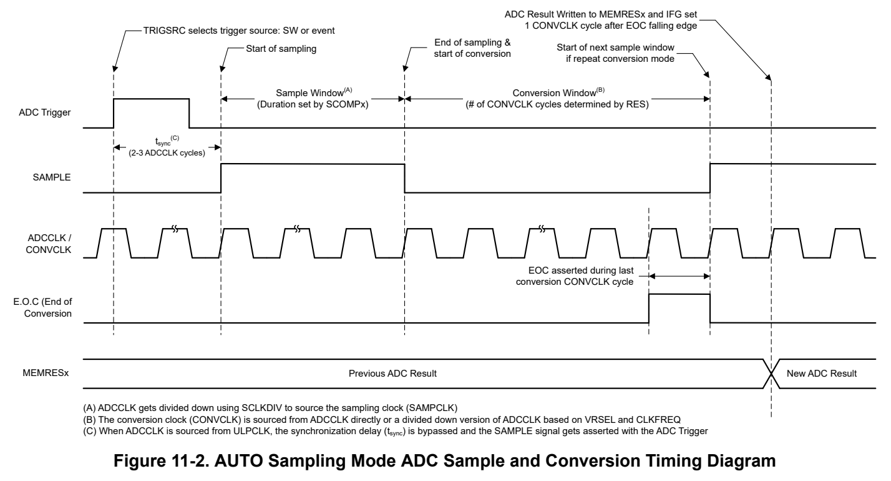
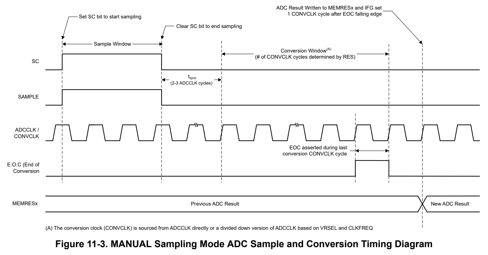
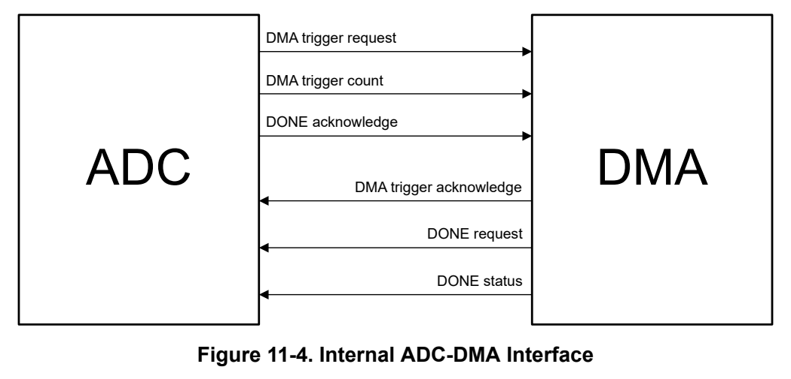

# 11 ADC (pp. 670-733)

### 11.1 ADC Overview 671 (p. 670)

### 11.2 ADC Operation 672 (p. 670)

### 11.3 ADC0 Registers 687 (p. 670)

### 11.1 ADC Overview (p. 671)

The ADC supports measure analog signals and convert them to a digital representation with minimal CPU intervention.

The ADC supports fast 12-, 10-, and 8-bit analog-to-digital conversions. It implements a 12-bit SAR core, sample and conversion mode control, and up to 4 independent conversion-and-control buffers. The ADC allows up to 4 independent analog-to-digital converter (ADC) samples to be converted and stored without any CPU intervention.

ADC features include:

- 1.5-Msps conversion rate at a resolution of 12 bits

- Integrated hardware oversampling for averaging up to 128 samples

- Full-scale ADC operating voltage range

- Sample-and-hold with programmable sampling periods controlled by software or timers

- Two sampling trigger sources: software trigger and event trigger

- Software-selectable on-chip reference voltage of 1.4V or 2.5V

- Configurable ADC reference source: VDD, internal reference (VREF)

- Up to 10 individually configurable analog input channels

- Internal conversion channels for temperature sensing, supply monitoring, and analog signal chain (see the device-specific data sheet for availability and channel mapping)

- Configurable ADC clock source

- Single-channel, repeat-single-channel, sequence (autoscan), and repeat-sequence (repeated autoscan) conversion modes

- 4 conversion-result storage registers (MEMRES0:3)

- Window comparator for low-power monitoring of input signals from conversion-result registers

- DMA support with interrupt event generation on completion of transfer

- Operates in RUN, SLEEP, and STOP modes

- Can be triggered in any operating mode except for SHUTDOWN

- Automatic power, reference, and clock control for low-power operation

- Semi-automatic calibration of CDAC trim values

Figure 11-1 shows the functional block diagram of the ADC peripheral.

Figure 11-1. ADC Block Diagram

### 11.2 ADC Operation (p. 672)

The ADC is configured with user software. The following sections describe the setup and operation of the ADC.

Note The ADC result registers (MEMRES) are aliased between two address regions on the device:

- The primary region, through which all ADC registers can be accessed by the CPU or DMA at the ULPCLK rate

- The aliased region, through which the ADC MEMRES registers can be accessed by the CPU or DMA at the MCLK rate for fast read-out of ADC results

On devices which run MCLK and ULPCLK at the same frequency, there is not a performance benefit to accessing the ADC MEMRES registers through the aliased region. On device configurations where MCLK is greater than ULPCLK, the aliased region is recommended to be used. However, application software can use the aliased region on all devices for MEMRES access to keep the software implementation consistent.

#### 11.2.1 ADC Core (p. 672)

The ADC core converts an analog input to its digital representation. The core uses two voltage levels (V R+ and

signal is equal to or higher than V R+, and is zero when the input signal is equal to or lower than V R-. The input channel and the positive reference voltage level (V R+) are defined in the conversion-control memory.

Equation 2 below shows the conversion formula for the ADC result, N ADC, for n-bit resolution mode.

n Vin + 0 . 5LSB - VR - VR + - VR - N ADC = 2 - 1 × VR + - VR - Where, LSB = 2 n (2)

Note The supported V R- for this ADC is 0V. All subsequent equations and sections will reflect this inherent property.

| Given that V R- | Col 2 | Col 3 | is 0V in this ADC, the equation for N | ADC becomes: |
| --- | --- | --- | --- | --- |
|  | n |  | Vin + 0 . 5LSB | VR + |
| N ADC = | n 2 - 1 | × | in VR + | R + Where, LSB = 2 n (3) |
| Equation 4 |  |  |  | below describes the input voltage at which the ADC output saturates: |
| V in = V R + | R + - | 1 . 5LSB |  | (4) |

Note The ADC is NOT functional in STANDBY or SHUTDOWN mode.

#### 11.2.2 Voltage Reference Options (p. 673)

The ADC voltage reference (V R+) can be configured through the VRSEL bits in the MEMCTL register. Different reference sources can be selected for conversion on different channels. There are three options available for supplying a reference voltage to the ADC:

- MCU supply voltage (VDD)

- Configurable internal reference voltage (INTREF) of 1.4V and 2.5V from

VREF module

When supplying an external reference to the ADC, connect the VREF+ pin to the reference source with the appropriate decoupling circuitry, and connect the VREF- pin to ground.

The internal reference (VREF) is a dedicated voltage reference module for the ADC peripheral and does not require external decoupling circuitry to operate. When supplying the internal reference as the reference to the ADC, the maximum ADC sampling rate is limited to approximately 1 Msps.

#### 11.2.3 Generic Resolution Modes (p. 673)

The ADC supports operation in 12-bit (default), 10-bit, and 8-bit resolution modes. The resolution mode is configured using the RES bits in the CTL2 register.

- When 12-bit mode is selected, the conversion phase requires a total of 14 conversion clock cycles

- When 10-bit mode is selected, the conversion phase requires a total of 12 conversion clock cycles

- When 8-bit mode is selected, the conversion phase requires a total of 9 conversion clock cycles

#### 11.2.4 Hardware Averaging (p. 673)

This ADC implements digital sample averaging in hardware (HW averaging) to efficiently increase the effective resolution of the ADC without the need for SW or CPU intervention. The HW averaging functionality is configured using the AVGN and AVGD bits in the CTL1 register.

- AVGN defines the number of conversions to accumulate for the current MEMCTLx

Note The MEMRES result register is a maximum of 16 bits long. If not shifted appropriately, the result will be truncated.

**Table 11-1. Available Hardware Averaging Settings (p. 674)**

| Bit Field Value | AVGN Settings (number of samples accumulated) | AVGD Settings (number of bits to right shift) |
| --- | --- | --- |
| 0x0 | 0 | 0 |
| 0x1 | 2 | 1 |
| 0x2 | 4 | 2 |
| 0x3 | 8 | 3 |
| 0x4 | 16 | 4 |
| 0x5 | 32 | 5 |
| 0x6 | 64 | 6 |
| 0x7 | 128 | 7 |

The averaging configuration is global and it holds for any channel that enables the averaging feature. It is not possible to have different averaging configurations defined per channel. The averaging feature for each individual channel can be enabled though the AVGEN bit in the MEMCTL register. When the sample trigger is received for a channel with averaging enabled, the required number of conversions are performed automatically back-to-back and the final averaged value is stored in the MEMRES register or FIFODAT.

Note The data format must be selected as unsigned binary while using the hardware averaging feature.

#### 11.2.5 ADC Clocking (p. 674)

The ADC peripheral clock (ADCCLK) is provided by the Section 2.4 and is used for both sampling and conversion. SYSOSC , HFCLK and ULPCLK are the available clock sources available for ADCCLK, which can support up to 24Mhz. Refer to the device-specific data sheet for supported ADCCLK frequencies. Using the ULPCLK, which is the bus clock for all peripherals, is very useful for deterministic start of sampling. The ADC clock source can be selected by programming the SAMPCLK bits in the CLKCFG register.

SYSOSC needs to be active for the ADC to operate properly. If SYSOSC is not running and the ADC is triggered, the ADC will automatically request SYSCTL to enable and set SYSOSC to base frequency during the conversion. If SYSOSC is already enabled, it will remain the same frequency. The only exception to this is in STOP1 operating mode where SYSOSC will go to base frequency when the ADC is triggered.

In order to provide a way to ensure predictable sample rate operation between power modes, the CCONRUN and CCONSTOP bits can be set to signal the ADC that it can expect that the SYSOSC will already be ON when the device is in RUN and STOP modes respectively. When these bits are set, the ADC will not wait for an ACK from SYSCTL to make sure SYSOSC is running before starting sampling. This feature gives users the flexibility to save power in applications where deterministic sample timing is not a requirement. Refer to Section 11.2.6 for examples on how to properly use the CCONRUN and CCONSTOP control bits.

The user must configure the FRANGE bits in the CLKFREQ register to the appropriate setting based on the expected ADCCLK frequency. See the following table for more details on how to properly configure the CLKFREQ register.

**Table 11-2. CLKFREQ Register Configuration (pp. 674-675)**

| CLKFREQ.FRANGE Values | Col 2 | ADCCLK Frequency Range (MHz) |
| --- | --- | --- |
|  | 0 | >1 to 4 |
|  | 1 | >4 to 8 |
|  | 3 | >16 to 20 |
|  | 4 | >20 to 24 |

When the internal voltage reference is used for ADC operation, the ADCCLK is divided by 2 and then used as the conversion clock (CONVCLK), it means CONVCLK frequency is not to exceed 12MHz.

#### 11.2.6 Common ADC Use Cases (p. 675)

There are many ADC use-cases from an operating mode and clocking standpoint but the majority of them fit into one of the items below:

- Triggers in RUN or SLEEP mode – If ADC is triggered to start a conversion (software or Event), and the device is in RUN0 or RUN1 or SLEEP0 or SLEEP1 mode, then:

- Sample clock can be ULPCLK, HFCLK, or SYSOSC in this mode

- SYSOSC is the clock source of the conversion. If the internal reference is used, the conversion clock frequency CONVCLK frequency is not to exceed 12MHz. – If ADC is triggered to start a conversion (software or Event), and the device is in RUN2 or SLEEP2 mode (SYSOSC is disabled, MCLK = LFCLK = 32kHz), then:

- Sample clock can be ULPCLK or SYSOSC in this mode

- SYSCTL interprets the ADC CLK REQ as an asynchronous fast clock request, enabling SYSOSC at 24MHz and forcing MCLK or ULPCLK to 24MHz MHz until the ADC de-asserts the request

- CCONRUN must be cleared in this use case

- CCONSTOP must be cleared in this use case

- Triggers in STOP mode – Sample clock can be ULPCLK or SYSOSC in this mode – If ADC is triggered to start a conversion (Event), and the device is in STOP0 mode (ULPCLK = 4MHz), then:

- SYSOSC is the clock source of the conversion. If the internal reference is used, the conversion clock frequency CONVCLK frequency is not to exceed 12MHz. – If ADC is triggered to start a conversion (Event), and the device is in STOP2 mode (SYSOSC disabled), then:

- The trigger event propagates through the event fabric at 32kHz, the ADC receives the trigger and assert the ADC CLK REQ (CPCLK REQ) to SYSCTL, and SYSCTL receives the ADC CLK REQ as an asynchronous fast clock request, suspending STOP, enabling SYSOSC at 24MHz, and forcing MCLK or ULPCLK to 24MHz until the ADC de-asserts the ADC CLK REQ

- CCONRUN must be cleared

- CCONSTOP must be cleared

- Triggers in STANDBY mode – Sample clock can be ULPCLK or SYSOSC in this mode – If ADC is triggered to start a conversion (Event), and the device is in STANDBY0 mode (SYSOSC is disabled but ULPCLK is running), then:

- The trigger event propagates through event fabric at 32kHz, the ADC receives the trigger and asserts the ADC CLK REQ (CPCLK REQ) to SYSCTL, and SYSCTL interprets the ADC CLK REQ as an asynchronous fast clock request, suspending STANDBY, enabling SYSOSC at 24MHz, and forcing MCLK/ULPCLK to 24MHz until the ADC de-asserts the ADC CLK REQ

- CCONRUN must be cleared

- CCONSTOP must be cleared – If ADC is triggered to start a conversion (Event-TIMG8), and the device is in STANDBY1 (ULPCLK is gated with STOPCLKSTBY set), then:

- The TIMG0 or TIMG1 event triggers an asynchronous fast clock request to suspend STANDBY mode,

for the TIMG0 or TIMG1 event to proceed through the event fabric and for the ADC to capture the timer event and assert the ADC CLK REQ to hold the SYSOSC enabled to run the conversion

- When the ADC de-asserts the ADC CLK REQ, ULPCLK runs for 41 additional cycles to allow any ADC event (DMA request or IRQ) to propagate, after which SYSCTL resumes STANDBY with STOPCLKSTBY (STANDBY1)

- CCONRUN must be cleared

- CCONSTOP must be cleared

#### 11.2.7 Power Down Behavior (p. 676)

The ENABLE bit in the PWREN register enables or disables the ADC peripheral. The ADC should be disabled when it is not in use to save power. The PWRDN bit in the CTL0 register selects the ADC power down policy between AUTO and MANUAL. This takes effect when the ADC operates in RUN, SLEEP, and STOP MCU power modes.

PWRDN should be configured based on the max ADC sampling rate required and the operational needs in different MCU power modes. ADC hardware does not force the power down policy to AUTO during operation in STOP mode. It follows the user setting irrespective of the device power modes.

The reset value of PWRDN is 0, which has the default behavior of automatic power down of the ADC peripheral at the end of a conversion and when the next sample signal is not required to be asserted immediately. When the PWRDN bit is set to ‘1’ it selects manual power down behavior. In this setting, the ADC is not powered down at the end of a conversion and remains enabled. This means that the ADC peripheral would only be powered down using the PWREN register.

Note Refer to the device-specific data sheet for specifications on the ADC wakeup and enable time.

#### 11.2.8 Sampling Trigger Sources and Sampling Modes (p. 676)

Sample Triggers

There are two sampling trigger sources available which can be selected through the TRIGSRC bit in the CTL1 register; one is a software trigger and the other is an event trigger.

When the software trigger is selected as the source, the application software can set the SC bit in the CTL1 register to initiate the sample phase. When the event trigger is selected as the source, a rising edge on the selected event from the event manager will initiate the sample phase. An event is always edge triggered.

Sampling Modes

There are two sampling modes available, AUTO and MANUAL, which can be selected through the SAMPMODE bit in the CTL1 register.

##### 11.2.8.1 AUTO Sampling Mode (p. 676)

In AUTO mode, the sample signal is generated synchronous to the sampling clock (SAMPCLK) and can be programmed using an internal sampling timer to determine the duration of the sampling window. The sample timer is 10-bits wide and there are two sample time compare registers (SCOMPx) available to account for various source impedances to measure signals from. One of these two SCOMP registers can be selected using the STIME bit in the MEMCTL register.

There is a 2-3 cycle latency from when the sampling is triggered and when the sampling period starts. This latency can be bypassed by setting ULPCLK as the source for ADCCLK. This synchronization bypass feature is very useful for deterministic sampling

Figure 11-2 shows the ADC sample and conversion timing diagram when the ADC is configured in AUTO sampling mode.

*Figure 11-2. AUTO Sampling Mode ADC Sample and Conversion Timing Diagram (p. 677)*

Note When the reset value of PWRDN is set as ‘0’ which has the default behavior of automatic power down, ADC wakeup/enable time needs to be considered in each sample window. Refer to the device-specific data sheet for specifications on the ADC wakeup/enable time. For example, if the maximum ADC wakeup/enable time is 5uS, it means the duration set by SCOMPx should be > (5uS + Duration for sample window).

##### 11.2.8.2 MANUAL Sampling Mode (p. 677)

In MANUAL mode, the sample signal is generated when the SC bit is set which can be asynchronous to the sampling clock. The duration of the sampling window is controlled by software by holding the SC bit high. Because an event is always edge triggered, manual mode with event trigger is not supported for any of the conversion modes. Software trigger with manual sampling mode is supported only for single channel single conversion mode and it is not supported for any of the other three conversion modes.

There is a 2-3 cycle synchronization latency from when the sample window ends to when the conversion window begins.

Figure 11-3 shows the ADC sample and conversion timing diagram when the ADC is configured in MANUAL sampling mode:

*Figure 11-3. MANUAL Sampling Mode ADC Sample and Conversion Timing Diagram (p. 678)*

Note 1. In MANUAL sampling mode the CCONRUN bit in the CLKCFG register must be set to 1. 2. When the reset value of PWRDN is set as ‘0’ which has the default behavior of automatic power down, ADC wakeup/enable time needs to be considered before sample window. It means that after setting ENABLE bit in the PWREN register to enable ADC, then application software should set up a delay to wait the ADC wakeup/enable time before starting sampling. Refer to the device-specific data sheet for specifications on the ADC wakeup/enable time. 3. Once SC bit set by software, the SC bit is automatically cleared by hardware after the sample duration, which is the duration during which the analog signal is sampled. If the software attempts to set the SC bit before the sample duration + 2-3 cycles synchronization latency, TOVIFG flag will not be set.

#### 11.2.9 Sampling Period (p. 678)

The sampling clock source is selected in the SYSCTL module using the SAMPCLK bits in the CLKCFG register. The desired sampling period for ADC operation can be generated using the internal clock divider and/or

| Col 2 | the sample timer, which applies to AUTO sampling mode. The internal clock divider is configured using the | the sample timer, which applies to AUTO sampling mode. The internal clock divider is configured using the |
| --- | --- | --- |
| SCLKDIV bits in the CTL0 register and has divide options of 1, 2, 4, 8, 16, 24, 32, and 48. |  |  |

The duration of the sampling period can be programmed to one of two user-defined values set by the SCOMP0 and SCOMP1 sample timer registers. The value in SCOMPx configures the sampling period by defining the number of sample time clocks to set the sample window to. The default SCOMPx sample timer value translates to 1 cycle wide sample pulse which allows the sampling period to be solely based on the sample clock and SCLKDIV. In general, there are three knobs that can be leveraged to control the sample period: SCOMPx, SCLKDIV, and the source of the sample clock.

When AUTO power down mode is selected using PWRDN=0, the module enable signal to the ADC peripheral is generated one sampling clock cycle after the sample signal is asserted. This should be considered by the user in the sample window calculation in addition to the ADC power time or settling time needs of other analog modules such as the Temperature Sensor, VREF, etc.

#### 11.2.10 Conversion Modes (p. 679)

There are four conversion modes available in the ADC:

1. Single channel single conversion

- The channel can be selected using MEMCTL

- The selected channel is sampled and converted only once

- Multiple conversions are performed when HW averaging is enabled 2. Repeat single channel conversion

- The channel can be selected using MEMCTL

- The selected channel is repeatedly sampled and converted until ENC is cleared by software – If the TRIG bit is set, a trigger is needed to move to the next conversion

- Multiple conversions are performed when HW averaging is enabled 3. Sequence of channels conversion

- Groups of channels can be formed using STARTADD, ENDADD, and MEMCTL registers

- Each of the channels in the group is sampled and converted only once

- Multiple conversions are performed on a channel during the sequence when HW averaging is enabled

- The sequence will complete even if ENC is cleared in the middle of the sequence 4. Repeat sequence of channels conversion

- Groups of channels can be formed using STARTADD, ENDADD, and MEMCTL registers

- The group of channels are sampled and converted repeatedly until ENC is cleared by software – If the TRIG bit is set, a trigger is needed to move to the next conversion

- When ENC is cleared the operation stops at the end of the last conversion

- Multiple conversions are performed on a channel during a sequence when averaging is enabled

The following steps outline the recommended process for configuring the ADC for a desired conversion mode:

1. Use the CONSEQ bits in the CTL1 register to select the desired ADC conversion mode 2. Use the STARTADD bits in the CTL2 register to select which MEMCTLx is used for single conversion or as first MEMCTL for a sequence mode 3. If using a sequence mode, use the ENDADD bits in the CTL2 register to select which MEMCTLx is used for the last conversion of the sequence 4. Assign an ADC input channel to the appropriate MEMCTLx register using the CHANSEL bits

- For sequence modes, you must assign an ADC input channel for each MEMCTLx that is part of the configured sequence 5. Select HW or SW trigger using the TRIGSRC bit in the CTL1 register 6. Select AUTO or MANUAL sampling mode using the SAMPMODE bit in the CTL1 register

- If using AUTO mode, program the desired sample timer value in the SCOMPx register and use the STIME bits in the MEMCTLx register to select the appropriate sample timer source (SCOMP0 or SCOMP1) 7. If using repeat single channel or sequence conversion modes, program the TRIG bit in each MEMCTLx register to indicate if a trigger will be needed to step to the next MEMCTL in the sequence 8. Set the ENC bit in the CTL1 register to enable ADC conversions 9. The following table matrix depicts the next step of ADC configuration and usage based on the selected trigger and sampling modes:

**Table 11-3. Trigger and Sample Mode ADC Usage Matrix (p. 679)**

| Trigger Mode | Trigger Mode |
| --- | --- |
| SW Trigger | Event Trigger |

Table 11-3. Trigger and Sample Mode ADC Usage Matrix (continued)

- Set SC bit to start the sample phase (duration determined by sample timer) • HW trigger starts the sample phase (duration

- Conversion starts once sample phase is over determined by sample timer)

- In single channel single conversion, ENC is • Conversion starts once sample phase is over cleared when conversion is over • In single channel single conversion, ENC is AUTO

- SC bit is automatically cleared once the trigger is cleared when conversion is over captured • For repeat and sequence modes, ADC waits

- For repeat and sequence modes, if TRIG is set for HW trigger or automatically starts the next in MEMCTL, the SC bit needs to be set for the conversion based on TRIG setting Sampling next conversion to proceed

| Mode | Col 2 | • | Set SC bit to start the sample phase (SC bit is | Col 5 |
| --- | --- | --- | --- | --- |
|  |  |  | not automatically reset) |  |
|  |  | • | Clear the SC bit to end the sample phase and |  |
|  |  |  | start the conversion |  |
|  | MANUAL | • | In single channel single conversion, ENC bit is | ADC operation is NOT supported in this |
|  |  |  | cleared when conversion is over | configuration |
|  |  | • | Repeated/sequential conversion modes and |  |
|  |  |  | HW averaging are NOT supported in this |  |
|  |  |  | configuration |  |

10. The ADC results are stored in the MEMRES register of the associated MEMCTL (for example, the MEMCTL0 result is stored in MEMRES0).

- For repeat conversion modes, the result in MEMRES is updated after every associated MEMCTL conversion 11. For repeated conversion modes, clear the ENC bit to stop ADC operation

#### 11.2.11 Data Format (p. 680)

The ADC supports two data formats – unsigned binary and 2’s complement signed binary. Unsigned binary results are stored right-justified in the MEMRES register or FIFO. Signed binary results are stored left justified in the MEMRES register or FIFO.

**Table 11-4. ADC Data Formats (p. 680)**

| Data Format | Resolution | Result Range (decimal) | Result Range (hex) |
| --- | --- | --- | --- |
|  | 8-bit | 0 to 255 | 0000h to 00FFh |
| Unsigned | 10-bit | 0 to 1023 | 0000h to 03FFh |
|  | 12-bit | 0 to 4095 | 0000h 0FFFh |
|  | 8-bit | -128 to 127 | 8000h to 7F00h |
| Signed | 10-bit | -512 to 511 | 8000h to 7FC0h |
|  | 12-bit | -2048 to 2047 | 8000h to 7FF0h |

#### 11.2.12 Advanced Features (p. 680)

The following sections describe the additional features and benefits provided with the ADC peripheral and how to leverage them in an application.

##### 11.2.12.1 Window Comparator (p. 680)

There is one window comparator unit available in the ADC which can be used to check if the input signal is within predefined threshold values set by software. The ADC result that goes into MEMRES or FIFO is what gets checked against the threshold values of the window comparator.

Based on the comparison it can generate 3 interrupt conditions:

2. HIGHIFG – Conversion result is above the High threshold (WCHIGH) 3. INIFG – Conversion result is in between or equal to the Low and High thresholds

The window comparator low and high threshold values are global for all channels and the window comparison feature can be enabled for each channel as needed using the WINCOMP bit in the MEMCTL register.

When the ADC result data format (CTL2.DF) or resolution (CTL2.RES) configuration is changed, the window comparator threshold values are not reset by hardware and are retained as is. The software application is expected to reconfigure the threshold values as appropriate after changing the data format and/or resolution configuration.

##### 11.2.12.2 DMA and FIFO Operation (p. 681)

The ADC has a dedicated interface for communicating to and from the DMA. This interface is useful to offload work from the CPU by using the DMA to store ADC results to memory automatically. Figure 11-4 shows the signals that make up this interface:

*Figure 11-4. Internal ADC-DMA Interface (p. 681)*

Note The “DMA trigger count” signal indicates the number of samples that can be transferred by the DMA upon one trigger request. The “DONE status” signal is used by the ADC to generate the DMA DONE interrupt and it indicates if the DMA data transfer of programmed block size is completed.

The DMAEN bit in the CTL2 register is used to enable the DMA for ADC data transfer. The DMAEN bit is cleared by ADC hardware when the DMA “DONE status” signal is asserted. Software is expected to re-enable the DMA using DMAEN to arm the ADC to generate the next DMA trigger.

The ADC also incorporates an optional First-In-First-Out buffer to provide a way for ADC results to be stored for future use, such as transferring to memory by the DMA. Either the CPU or the DMA can be used to move data from the ADC regardless of whether the FIFO is enabled or disabled. The memory result flags in the RIS register of the third event publisher serve as the FIFO threshold and can be unmasked to generate the DMA trigger.

The following sections explain the details of using the ADC+DMA/CPU in various conversion modes and with the FIFO enabled or disabled

ADC-DMA/CPU Operation in Non-FIFO Mode (FIFOEN=0)

ADC-DMA/CPU Operation in Non-FIFO Mode (FIFOEN=0)

- Single Conversion and Repeat Single Conversion – Configure STARTADD bits to select the desired MEMCTLx register

- MEMCTLx is correlated to MEMRESx

– Configure MEMCTL CHANSEL bits to select the desired ADC channel

– Conversion data is available in MEMRESx – MEMRESIFGx can be set to generate a CPU interrupt or the DMA trigger – SAMPCNT must be programmed to 1 by SW for DMA operation – The conversion overflow flag OVIFG is set when the ADC updates MEMRESx before the previous sample is read by the CPU or DMA – The conversion underflow flag UVIFG is set when the CPU or DMA reads the MEMRESx register before the next conversion result is available

- Sequence Conversion and Repeat Sequence Conversion – Configure STARTADD bits to select the first MEMCTL in the sequence – Configure ENDADD bits to select the last MEMCTL in the sequence

- MEMCTLx is correlated to MEMRESx

- MEMRESx is correlated to MEMRESIFGx – Configure each MEMCTLx CHANSEL bits to select the desired ADC channels – Conversion data is available in MEMRESx – MEMRESIFGx can be set to generate a CPU interrupt or the DMA trigger – SAMPCNT must be programmed by SW to a suitable value based on threshold setting by SW for DMA operation – The conversion overflow flag OVIFG is set when the ADC updates MEMRESx before the previous sample is read by the CPU or DMA – The conversion underflow flag UVIFG is set when the CPU or DMA reads the MEMRESx register before the next conversion result is available

Note For DMA based operation, the MEMCTL start address should be smaller than the end address for single sequence conversion as DMA source does not roll back. Repeat sequence conversion mode does not support DMA based data transfer because the DMA does not support circular addressing mode.

ADC-DMA/CPU Operation in FIFO Mode (FIFOEN=1)

- Single Conversion and Repeat Single Conversion – Configure STARTADD bits to select the desired MEMCTLx register

- MEMCTLx is NOT correlated to MEMRESx

- MEMRESx is correlated to MEMRESIFGx – Configure MEMCTL CHANSEL bits to select the desired ADC channel – Conversion data is loaded sequentially into MEMRES0,1,2,….N (organized as a FIFO) – The CPU or DMA must read ADC samples from the dedicated FIFODAT register and not from MEMRES registers directly

- Data in the FIFO is always compacted with two samples and provided as 32-bit data upon a FIFODAT read by CPU or DMA – MEMRESIFGx can be used as a threshold condition to generate a CPU interrupt or DMA trigger

- For full use of the FIFO, the last MEMRESIFG can be used – SAMPCNT must be programmed by SW to a suitable value based on threshold setting for DMA operation – The conversion overflow flag OVIFG is set when the ADC updates MEMRESx before the previous sample is read by the CPU or DMA – The conversion underflow flag UVIFG is set when the CPU or DMA reads the FIFODAT register before the conversion result is available in the MEMRESx registers.

Note Single conversion mode with FIFO enabled is not recommended for CPU or DMA based operation. It will lead to underflow condition and unwanted 16-bit data will have to be discarded in software.

– Configure STARTADD bits to select the first MEMCTL in the sequence

– Configure ENDADD bits to select the last MEMCTL in the sequence

- MEMCTLx is NOT correlated to MEMRESx

- MEMRESx is correlated to MEMRESIFGx – Configure each MEMCTLx CHANSEL bits to select the desired ADC channels – Conversion data is loaded sequentially into MEMRES0,1,2,….N (organized as a FIFO) – The CPU or DMA must read ADC samples from the dedicated FIFODAT register and not from MEMRES registers directly

- Data in the FIFO is always compacted with two samples and provided as 32-bit data upon a FIFODAT read by CPU or DMA – MEMRESIFGx can be used as a threshold condition to generate a CPU interrupt or DMA trigger

- For full use of the FIFO, the last MEMRESIFG can be used – SAMPCNT must be programmed by SW to a suitable value based on threshold setting for DMA operation – The conversion overflow flag OVIFG is set when the ADC updates MEMRESx before the previous sample is read by the CPU or DMA – The conversion underflow flag UVIFG is set when the CPU or DMA reads the FIFODAT register before the conversion result is available in the MEMRESx registers

> **Note:**

- The data in FIFODAT register won't be cleared automatically after CPU or DMA reads. New conversion data overwrites the previous data in FIFODAT register.

- To ensure synchronized reading of bytes from the 32-bit FIFO, which stores 16-bit samples, specific DMA triggers can be used. In particular, selecting MEMRES1 and MEMRES3 will synchronize the reading of bytes from the FIFO with the corresponding MEMRESx bytes.

- If the ADC is disabled during either the repeat sequence mode or normal repeat mode, it's worth noting that an additional conversion may occur before the ADC completely stops.

**Table 11-5. ADC-DMA/CPU Operation Summary Matrix (p. 683)**

| Conversion Mode | FIFO Disabled (FIFOEN=0) Samples not compacted Read from MEMRESx registers directly | Col 3 | FIFO Enabled (FIFOEN=1) Samples always compacted Read from FIFODAT register only | Col 5 |
| --- | --- | --- | --- | --- |
|  | CPU Read/Write | DMA Read/Write | CPU Read/Write | DMA Read/Write |
| Single | Supported | Supported SAMPCNT=1 Sample in 16 bits | Not recommended Underflow flag will set Unwanted 16-bits should be ignored | Not recommended Underflow flag will set Unwanted 16-bits should be ignored |
| Repeat Single | Supported | Supported SAMPCNT=1 Sample in 16 bits | Supported MEMRESIFG=CPU interrupt FIFODAT read in 32-bits | Supported MEMRESIFG=DMA trigger SAMPCNT=Samples in 32-bits |
| Sequence | Supported | Supported SAMPCNT=Sample in 16 bits STARTADD<ENDADD | Supported MEMRESIFG=CPU interrupt FIFODAT read in 32-bits | Supported MEMRESIFG=DMA trigger SAMPCNT=Samples in 32-bits |
| Repeat Sequence | Supported | Not Supported | Supported MEMRESIFG=CPU interrupt FIFODAT read in 32-bits | Supported MEMRESIFG=DMA trigger SAMPCNT=Samples in 32-bits |

##### 11.2.12.3 Analog Peripheral Interconnection (p. 683)

The MSPM0 platform of MCUs provides a rich set of high-performance analog peripherals which can interact with each other to perform various analog signal chain functions. The items below describe how the ADC interacts with the other on-board analog peripherals:

ADC with Internal Reference Module (VREF)

The ADC has a dedicated enable request and ready interface with the internal voltage reference module. VREF enable is asserted upon sample trigger while internal reference buffer is selected for ADC operation. The ready response from VREF is captured in the ADC status register (REFBUFRDY).

The ready response from VREF does not gate the sample phase in the ADC. The ADC sample window is started upon the sample trigger and the settling time of the internal reference buffer needs to be considered in the sample period as appropriate. Software can enable the VREF module using the software enable bit so that it is already settled by the time the ADC starts sampling the input channel. In this case, the sampling time can be smaller and does not have to account for the enable time of VREF.

ADC with Temperature Sensor

The temperature sensor module enable signal is generated by the ADC when the temp sense channel is selected. The settling time of the temperature sensor should be accounted for in the sample period as there is no ready response from the temperature sensor.

#### 11.2.13 Status Register (p. 684)

The ADC status register, STATUS, contains two bits – REFBUFRDY and BUSY.

- REFBUFRDY is set when the ADC receives the ready signal from the internal reference buffer (VREF/ REFBUF) after asserting the enable request

- BUSY equaling ‘1’ indicates that the ADC is busy performing a sample or convert operation – For single channel single conversion, it signals that a trigger has been received and sample or conversion is ongoing. BUSY will be cleared when the conversion completes – For repeat single conversion, it signals that repeat single operation has begun and has not ended. BUSY will be cleared when ENC is written ‘0’ and the last conversion completes – For sequence of channels conversion, it signals that the sequence of channels conversion has started. BUSY will be cleared at the end of the sequence – For repeat sequence of channels conversion, it signals the repeat sequence is ongoing. BUSY will be cleared when ENC is written ‘0’ and the last conversion completes

#### 11.2.14 ADC Events (p. 684)

The ADC peripheral contains three event publishers and one event subscriber.

One event publisher (CPU_INT) manages ADC interrupt requests (IRQs) to the CPU subsystem through a static event route. The second event publisher (GEN_EVENT) can be used to publish ADC events to a subscriber through a generic event route channel. The third event publisher (DMA_TRIG) can be used as an ADC-to- DMA trigger to send ADC events directly to the DMA through a DMA event route.

The event subscriber (FSUB_0) can be used to subscribe to events which are published to the event fabric through a generic event route channel.

The ADC events are summarized in Table 11-6.

**Table 11-6. ADC Events (pp. 684-685)**

| Event | Type | Source | Destination | Route | Configuration | Functionality |
| --- | --- | --- | --- | --- | --- | --- |
| CPU interrupt event | Publisher | ADC | CPU Subsystem | Static route | CPU_INT registers | Fixed interrupt route from ADC to CPU |
| Generic publisher event | Publisher | ADC | Generic event channel | Generic route (FPUB_0) | GEN_EVENT registers, FPUB_0 register | Trigger generic event channel from ADC |
| DMA trigger event | Publisher | ADC | DMA | DMA route | DMA_TRIG registers | Fixed trigger route from ADC to DMA |
| Generic subscriber event | Subscriber | Other peripherals | ADC | Generic route (FSUB_0) | FSUB_0 | ADC subscription to generic event channel |

##### 11.2.14.1 CPU Interrupt Event Publisher (CPU_INT) (p. 685)

The ADC peripheral provides many interrupt sources which can be configured to source a CPU interrupt event. In order of decreasing interrupt priority, the CPU interrupt events from the ADC are given in Table 11-7.

**Table 11-7. ADC CPU Interrupt Event Conditions (CPU_INT) (p. 685)**

| Index (IIDX) | Name | Description |
| --- | --- | --- |
| 0x0 | NO_INTR | No bit set (IIDX.STAT = 0) means there is no pending interrupt request |
| 0x1 | OVIFG | Conversion overflow interrupt flag is set when the ADC updates MEMRESx before the previous sample is read by the CPU or DMA |
| 0x2 | TOVIFG | Sequence conversion time overflow interrupt flag is set when the ADC receives a new sampling trigger while the previous sample+conversion is still in progress |
| 0x3 | HIGHIFG | High threshold compare interrupt flag is set when the MEMRESx result register is higher than the WCHIGH threshold of the window comparator |
| 0x4 | LOWIFG | Low threshold compare interrupt flag is set when the MEMRESx result register is lower than the WCLOW threshold of the window comparator |
| 0x5 | INIFG | In-range comparator interrupt flag is set when the MEMRESx result register is within the range of WCLOW and WCHIGH of the window comparator |
| 0x6 | DMADONE | DMA done interrupt flag is set when the DMA data transfer of programmed block size is completed |
| 0x7 | UVIFG | Conversion underflow interrupt flag, the UVIFG flag is set when the CPU or DMA reads the MEMRESx register before the next conversion result is available |
| 0x9 up to 0x20 | MEMRESIFG[0 up to 24] (1) | Memory register interrupt flag is set when MEMRESx is loaded with a new conversion result |

(1) Refer to the device-specific data sheet to see how many conversion-result storage registers (MEMRES) your device supports.

The CPU interrupt event configuration is managed with the CPU_INT event management registers. Interrupt (RIS) flags are cleared upon software reading the IIDX register or writing to the respective ICLR register bits. See Section 7.2.5 for guidance on configuring the Event registers for CPU interrupts.

##### 11.2.14.2 Generic Event Publisher (GEN_EVENT) (p. 685)

The ADC peripheral provides 4 interrupt sources, one of which can be configured to publish an event to a generic event route channel. Table 11-8 lists these interrupt sources.

**Table 11-8. ADC Generic Event Publisher Conditions (GEN_EVENT) (p. 685)**

| Index | Name | Description |
| --- | --- | --- |
| 0x0 | NO_INTR | No bit set means there is no pending interrupt request |
| 0x3 | HIGHIFG | High threshold compare interrupt flag is set when the MEMRESx result register is higher than the WCHIGH threshold of the window comparator |
| 0x4 | LOWIFG | Low threshold compare interrupt flag is set when the MEMRESx result register is lower than the WCLOW threshold of the window comparator |
| 0x5 | INIFG | In-range comparator interrupt flag is set when the MEMRESx result register is within the range of WCLOW and WCHIGH of the window comparator |
| 0x9 | MEMRESIFG0 | Memory register interrupt flag is set when MEMRES0 is loaded with a new conversion result |

The generic event publisher configuration is managed with the GEN_EVENT event management registers. Interrupt (RIS) flags are cleared based on acknowledgment (ACK) signal from the subscriber module received over the event fabric. See Section 7.2.5 for guidance on configuring the Event registers for generic event publishers.

The generic event channel which GEN_EVENT is to publish to must be selected by writing the target generic channel ID to the FPUB_0 register in the ADC. See Section 7.1.3.3 for guidance on configuring generic event routes.

If this publisher is not used in an application, the FPUB_0 register can be left in a disconnected state (set equal to zero) and no events should be unmasked through the MIS register in the ADC GEN_EVENT register set.

##### 11.2.14.3 DMA Trigger Event Publisher (DMA_TRIG) (p. 686)

The ADC module provides many interrupt sources which can be configured to source the DMA trigger. In order of decreasing interrupt priority, the DMA trigger events from the ADC are given in Table 11-9. When the DMA channel is needed by the ADC, the DMA trigger should be unmasked in the IMASK register of DMA_TRIG and the DMA should be configured as needed to support the ADC operation.

**Table 11-9. ADC DMA Trigger Event Conditions (DMA_TRIG) (p. 686)**

| Index (IIDX) | Name | Description |
| --- | --- | --- |
| 0x0 | NO_INTR | No bit set (IIDX.STAT = 0) means there is no pending interrupt request |
| 0x9 up to 0x20 | MEMRESIFG[0 up to(1) 24] | Memory register interrupt flag is set when MEMRESx is loaded with a new conversion result |

(1) Check the device-specific data sheet to see how many conversion-result storage registers (MEMRES) your device supports.

The DMA trigger event configuration is managed with the DMA_TRIG event management registers. The interrupt (RIS) flags are cleared based on ACK from DMA. See Section 7.2.5 for guidance on configuring the Event registers for DMA triggers.

##### 11.2.14.4 Generic Event Subscriber (FSUB_0) (p. 686)

The ADC peripheral supports receiving events routed through a generic channel from other peripherals. Refer to Section 7.1.3.3 and Section 7.2.3 for how generic event route works.

Once the channel to be used is determined, and both the publisher and subscriber ports for the peripherals being connected are known, use the steps below to establish the event connection. In this example, a GPIO triggered ADC application will be configured, using GPIO Port A to publish an event to generic channel 1, with ADC0 subscribing to generic channel 1 as a start-of-conversion trigger.

1. Configure the GEN_EVENT registers of GPIO Port A to set the event request based on the appropriate event (for example, a DIN rise event). 2. Store 0x1 into the FPUB_0 register of GPIO Port A to publish the GPIO event selected by the GEN_EVENT registers to generic route channel 1. Channel 1 must not be in use by another peripheral. 3. Store 0x1 the FSUB_0 register of ADC0 so that ADC0 is listening for events published by the timer to channel 1. 4. Configure ADC0 to trigger from the subscriber port according to the configuration instructions in Section 11.2.8 5. Configure and enable the appropriate GPIO pin to monitor input voltage events

### 11.3 ADC0 Registers (p. 687)

Table 11-10 lists the memory-mapped registers for the ADC0 registers. All register offset addresses not listed in Table 11-10 should be considered as reserved locations and the register contents should not be modified.

**Table 11-10. ADC0 Registers (p. 687)**

| Offset | Acronym | Register Name | Section |
| --- | --- | --- | --- |
| 400h | FSUB_0 | Subscriber Configuration Register. | Section 11.3.1 |
| 444h | FPUB_1 | Publisher Configuration Register. | Section 11.3.2 |
| 800h | PWREN | Power enable | Section 11.3.3 |
| 804h | RSTCTL | Reset Control | Section 11.3.4 |
| 808h | CLKCFG | ADC clock configuration Register | Section 11.3.5 |
| 814h | STAT | Status Register | Section 11.3.6 |
| 1028h | IMASK | Interrupt mask | Section 11.3.7 |
| 1030h | RIS | Raw interrupt status | Section 11.3.8 |
| 1038h | MIS | Masked interrupt status | Section 11.3.9 |
| 1040h | ISET | Interrupt set | Section 11.3.10 |
| 1048h | ICLR | Interrupt clear | Section 11.3.11 |
| 1058h | IMASK | Interrupt mask | Section 11.3.12 |
| 1060h | RIS | Raw interrupt status | Section 11.3.13 |
| 1068h | MIS | Masked interrupt status | Section 11.3.14 |
| 1070h | ISET | Interrupt set | Section 11.3.15 |
| 1078h | ICLR | Interrupt clear | Section 11.3.16 |
| 1088h | IMASK | Interrupt mask extension | Section 11.3.17 |
| 1090h | RIS | Raw interrupt status extension | Section 11.3.18 |
| 1098h | MIS | Masked interrupt status extension | Section 11.3.19 |
| 10A0h | ISET | Interrupt set extension | Section 11.3.20 |
| 10A8h | ICLR | Interrupt clear extension | Section 11.3.21 |
| 1100h | CTL0 | Control Register 0 | Section 11.3.22 |
| 1104h | CTL1 | Control Register 1 | Section 11.3.23 |
| 1108h | CTL2 | Control Register 2 | Section 11.3.24 |
| 110Ch | CTL3 | Control Register 3 | Section 11.3.25 |
| 1114h | SCOMP0 | Sample Time Compare 0 Register | Section 11.3.26 |
| 1118h | SCOMP1 | Sample Time Compare 1 Register | Section 11.3.27 |
| 111Ch | REFCFG | Reference Buffer Configuration Register | Section 11.3.28 |
| 1148h | WCLOW | Window Comparator Low Threshold Register | Section 11.3.29 |
| 1150h | WCHIGH | Window Comparator High Threshold Register | Section 11.3.30 |
| 1160h | FIFODATA | FIFO Data Register | Section 11.3.31 |
| 1170h | ASCRES | ASC Result Register | Section 11.3.32 |
| 1180h + formula | MEMCTL_y | Conversion Memory Control Register | Section 11.3.33 |
| 1280h + formula | MEMRES_y | Memory Result Register | Section 11.3.34 |
| 1340h | STATUS | Status Register | Section 11.3.35 |

Complex bit access types are encoded to fit into small table cells. Table 11-11 shows the codes that are used for access types in this section.

**Table 11-11. ADC0 Access Type Codes (p. 688)**

| Access Type | Code | Description |
| --- | --- | --- |
| Read Type |  |  |
| R | R | Read |
| RH | R H | Read Set or cleared by hardware |
| Write Type |  |  |
| W | W | Write |
| WK | W K | Write Write protected by a key |
| Reset or Default Value |  |  |
| - n |  | Value after reset or the default value |
| Register Array Variables |  |  |
| i,j,k,l,m,n |  | When these variables are used in a register name, an offset, or an address, they refer to the value of a register array where the register is part of a group of repeating registers. The register groups form a hierarchical structure and the array is represented with a formula. |
| y |  | When this variable is used in a register name, an offset, or an address it refers to the value of a register array. |

### 11.3.1 [ADC0.FSUB_0] Offset: 400h | Reset: 00000000h (p. 689)

FSUB_0 is shown in Figure 11-5 and described in Table 11-12.

Subscriber port

> **Bit Map**: `[31-4] RESERVED (R, 0h)` | `[3-0] CHANID (R/W, 0h)`

**Table 11-12. FSUB_0 Register Field Descriptions (p. 689)**

| Bit | Field | Type | Reset | Description |
| --- | --- | --- | --- | --- |
| 31-4 | RESERVED | R | 0h |  |
| 3-0 | CHANID | R/W | 0h | 0 = disconnected.; 1-15 = connected to channelID = CHANID.; 0h = A value of 0 specifies that the event is not connected; Fh = Consult your device data sheet as the actual allowed maximum may be less than 255. |

### 11.3.2 [ADC0.FPUB_1] Offset: 444h | Reset: 00000000h (p. 690)

FPUB_1 is shown in Figure 11-6 and described in Table 11-13.

Publisher port

> **Bit Map**: `[31-4] RESERVED (R, 0h)` | `[3-0] CHANID (R/W, 0h)`

**Table 11-13. FPUB_1 Register Field Descriptions (p. 690)**

| Bit | Field | Type | Reset | Description |
| --- | --- | --- | --- | --- |
| 31-4 | RESERVED | R | 0h |  |
| 3-0 | CHANID | R/W | 0h | 0 = disconnected.; 1-15 = connected to channelID = CHANID.; 0h = A value of 0 specifies that the event is not connected; Fh = Consult your device data sheet as the actual allowed maximum may be less than 255. |

### 11.3.3 [ADC0.PWREN] Offset: 800h | Reset: 00000000h (p. 691)

PWREN is shown in Figure 11-7 and described in Table 11-14.

Register to control the power state

> **Bit Map**: `[31-24] KEY (W, 0h)` | `[23-1] RESERVED (R, 0h)` | `[0] ENABLE (R/WK, 0h)`

**Table 11-14. PWREN Register Field Descriptions (p. 691)**

| Bit | Field | Type | Reset | Description |
| --- | --- | --- | --- | --- |
| 31-24 | KEY | W | 0h | KEY to allow Power State Change; 26h = KEY to allow write access to this register |
| 23-1 | RESERVED | R | 0h |  |
| 0 | ENABLE | R/WK | 0h | Enable the power KEY must be set to 26h to write to this bit.; 0h = Disable Power; 1h = Enable Power |

### 11.3.4 [ADC0.RSTCTL] Offset: 804h | Reset: 00000000h (p. 692)

RSTCTL is shown in Figure 11-8 and described in Table 11-15.

Register to control reset assertion and de-assertion

> **Bit Map**: `[31-24] KEY (W, 0h)` | `[23-2] RESERVED (R, 0h)` | `[1] RESETSTKYCLR (WK, 0h)` | `[0] RESETASSERT (WK, 0h)`

**Table 11-15. RSTCTL Register Field Descriptions (p. 692)**

| Bit | Field | Type | Reset | Description |
| --- | --- | --- | --- | --- |
| 31-24 | KEY | W | 0h | Unlock key; B1h = KEY to allow write access to this register |
| 23-2 | RESERVED | R | 0h |  |
| 1 | RESETSTKYCLR | WK | 0h | Clear the RESETSTKY bit in the STAT register KEY must be set to B1h to write to this bit.; 0h = Writing 0 has no effect; 1h = Clear reset sticky bit |
| 0 | RESETASSERT | WK | 0h | Assert reset to the peripheral KEY must be set to B1h to write to this bit.; 0h = Writing 0 has no effect; 1h = Assert reset |

### 11.3.5 [ADC0.CLKCFG] Offset: 808h | Reset: 00000000h (p. 693)

CLKCFG is shown in Figure 11-9 and described in Table 11-16.

ADC clock configuration

> **Bit Map**: `[31-24] KEY (W, 0h)` | `[23-6] RESERVED (R, 0h)` | `[5] CCONSTOP (R/W, 0h)` | `[4] CCONRUN (R/W, 0h)` | `[3-2] RESERVED (R, 0h)` | `[1-0] SAMPCLK (R/W, 0h)`

**Table 11-16. CLKCFG Register Field Descriptions (p. 693)**

| Bit | Field | Type | Reset | Description |
| --- | --- | --- | --- | --- |
| 31-24 | KEY | W | 0h | Unlock key; A9h = KEY to allow write access to this register |
| 23-6 | RESERVED | R | 0h |  |
| 5 | CCONSTOP | R/W | 0h | CCONSTOP: Forces SYSOSC to run at base frequency when device is in STOP mode which can be used as ADC sample or conversion clock source.; 0h = ADC conversion clock source is not kept continuously on during STOP mode.; 1h = ADC conversion clock source kept continuously on during STOP mode. |
| 4 | CCONRUN | R/W | 0h | CCONRUN: Forces SYSOSC to run at base frequency when device is in RUN mode which can be used as ADC sample or conversion clock source.; 0h = ADC conversion clock source is not kept continuously on during RUN mode.; 1h = ADC conversion clock source kept continuously on during RUN mode. |
| 3-2 | RESERVED | R | 0h |  |
| 1-0 | SAMPCLK | R/W | 0h | ADC sample clock source selection.; 0h = ULPCLK is the source of ADC sample clock.; 1h = SYSOSC is the source of ADC sample clock.; 2h = HFCLK clock is the source of ADC sample clock. Note : HFCLK may not be available on all the devices. |

### 11.3.6 [ADC0.STAT] Offset: 814h | Reset: 000X0000h (p. 694)

STAT is shown in Figure 11-10 and described in Table 11-17.

peripheral enable and reset status

> **Bit Map**: `[31-17] RESERVED (R, 0h)` | `[16] RESETSTKY (R, X)` | `[15-0] RESERVED (R, 0h)`

**Table 11-17. STAT Register Field Descriptions (p. 694)**

| Bit | Field | Type | Reset | Description |
| --- | --- | --- | --- | --- |
| 31-17 | RESERVED | R | 0h |  |
| 16 | RESETSTKY | R | X | This bit indicates, if the peripheral was reset, since this bit was cleared by RESETSTKYCLR in the RSTCTL register; 0h = The peripheral has not been reset since this bit was last cleared by RESETSTKYCLR in the RSTCTL register; 1h = The peripheral was reset since the last bit clear |
| 15-0 | RESERVED | R | 0h |  |

### 11.3.7 [ADC0.IMASK] Offset: 1028h | Reset: 00000000h (p. 695)

IMASK is shown in Figure 11-11 and described in Table 11-18.

Interrupt Mask. If a bit is set, then corresponding interrupt is unmasked. Unmasking the interrupt causes the raw interrupt to be visible in IIDX, as well as MIS.

> **Bit Map**: `[31-12] RESERVED (R, 0h)` | `[11] MEMRESIFG3 (R/W, 0h)` | `[10] MEMRESIFG2 (R/W, 0h)` | `[9] MEMRESIFG1 (R/W, 0h)` | `[8] MEMRESIFG0 (R/W, 0h)` | `[7] ASCDONE (R, 0h)` | `[6] UVIFG (R/W, 0h)` | `[5] DMADONE (R, 0h)` | `[4] INIFG (R/W, 0h)` | `[3] LOWIFG (R/W, 0h)` | `[2] HIGHIFG (R/W, 0h)` | `[1] TOVIFG (R/W, 0h)` | `[0] OVIFG (R/W, 0h)`

**Table 11-18. IMASK Register Field Descriptions (pp. 695-696)**

| Bit | Field | Type | Reset | Description |
| --- | --- | --- | --- | --- |
| 31-12 | RESERVED | R | 0h |  |
| 11 | MEMRESIFG3 | R/W | 0h | Raw interrupt status for MEMRES3. This bit is set to 1 when MEMRES3 is loaded with a new conversion result. Reading MEMRES3 register will clear this bit, or when the corresponding bit in ICLR is set to 1; 0h = No new data ready.; 1h = A new data is ready to be read. |
| 10 | MEMRESIFG2 | R/W | 0h | Raw interrupt status for MEMRES2. This bit is set to 1 when MEMRES2 is loaded with a new conversion result. Reading MEMRES2 register will clear this bit, or when the corresponding bit in ICLR is set to 1; 0h = No new data ready.; 1h = A new data is ready to be read. |
| 9 | MEMRESIFG1 | R/W | 0h | Raw interrupt status for MEMRES1. This bit is set to 1 when MEMRES1 is loaded with a new conversion result. Reading MEMRES1 register will clear this bit, or when the corresponding bit in ICLR is set to 1; 0h = No new data ready.; 1h = A new data is ready to be read. |
| 8 | MEMRESIFG0 | R/W | 0h | Raw interrupt status for MEMRES0. This bit is set to 1 when MEMRES0 is loaded with a new conversion result. Reading MEMRES0 register will clear this bit, or when the corresponding bit in ICLR is set to 1; 0h = No new data ready.; 1h = A new data is ready to be read. |
| 7 | ASCDONE | R | 0h | Mask for ASC done raw interrupt flag; 0h = Interrupt is not pending.; 1h = Interrupt is pending. |
| 6 | UVIFG | R/W | 0h | Raw interrupt flag for MEMRESx underflow. This bit is reset to 0 by IIDX read or when corresponding bit in ICLR is set to 1.; 0h = Interrupt is not pending.; 1h = Interrupt is pending. |
| 5 | DMADONE | R | 0h | Raw interrupt flag for DMADONE. This bit is reset to 0 by IIDX read or when corresponding bit in ICLR_EX is set to 1.; 0h = Interrupt is not pending.; 1h = Interrupt is pending. |
| 4 | INIFG | R/W | 0h | Mask INIFG in MIS_EX register.; 0h = Interrupt is not pending.; 1h = Interrupt is pending. |
| 3 | LOWIFG | R/W | 0h | Raw interrupt flag for the MEMRESx result register being below than the WCLOWx threshold of the window comparator. This bit is reset to 0 by IIDX read or when corresponding bit in ICLR_EX is set to 1.; 0h = Interrupt is not pending.; 1h = Interrupt is pending. |
| 2 | HIGHIFG | R/W | 0h | Raw interrupt flag for the MEMRESx result register being higher than the WCHIGHx threshold of the window comparator. This bit is reset to 0 by IIDX read or when corresponding bit in ICLR_EX is set to 1.; 0h = Interrupt is not pending.; 1h = Interrupt is pending. |
| 1 | TOVIFG | R/W | 0h | Raw interrupt flag for sequence conversion timeout overflow. This bit is reset to 0 by IIDX read or when corresponding bit in ICLR_EX is set to 1.; 0h = Interrupt is not pending.; 1h = Interrupt is pending. |
| 0 | OVIFG | R/W | 0h | Raw interrupt flag for MEMRESx overflow. This bit is reset to 0 by IIDX read or when corresponding bit in ICLR_EX is set to 1.; 0h = Interrupt is not pending.; 1h = Interrupt is pending. |

### 11.3.8 [ADC0.RIS] Offset: 1030h | Reset: 00000000h (p. 697)

RIS is shown in Figure 11-12 and described in Table 11-19.

Raw interrupt status. Reflects all pending interrupts, regardless of masking. The RIS register allows the user to implement a poll scheme. A flag set in this register can be cleared by writing 1 to the ICLR register bit even if the corresponding IMASK bit is not enabled.

> **Bit Map**: `[31-12] RESERVED (R, 0h)` | `[11] MEMRESIFG3 (R/W, 0h)` | `[10] MEMRESIFG2 (R/W, 0h)` | `[9] MEMRESIFG1 (R/W, 0h)` | `[8] MEMRESIFG0 (R/W, 0h)` | `[7] ASCDONE (R, 0h)` | `[6] UVIFG (R/W, 0h)` | `[5] DMADONE (R, 0h)` | `[4] INIFG (R/W, 0h)` | `[3] LOWIFG (R/W, 0h)` | `[2] HIGHIFG (R/W, 0h)` | `[1] TOVIFG (R/W, 0h)` | `[0] OVIFG (R/W, 0h)`

**Table 11-19. RIS Register Field Descriptions (pp. 697-698)**

| Bit | Field | Type | Reset | Description |
| --- | --- | --- | --- | --- |
| 31-12 | RESERVED | R | 0h |  |
| 11 | MEMRESIFG3 | R/W | 0h | Raw interrupt status for MEMRES3. This bit is set to 1 when MEMRES3 is loaded with a new conversion result. Reading MEMRES3 register will clear this bit, or when the corresponding bit in ICLR is set to 1; 0h = No new data ready.; 1h = A new data is ready to be read. |
| 10 | MEMRESIFG2 | R/W | 0h | Raw interrupt status for MEMRES2. This bit is set to 1 when MEMRES2 is loaded with a new conversion result. Reading MEMRES2 register will clear this bit, or when the corresponding bit in ICLR is set to 1; 0h = No new data ready.; 1h = A new data is ready to be read. |
| 9 | MEMRESIFG1 | R/W | 0h | Raw interrupt status for MEMRES1. This bit is set to 1 when MEMRES1 is loaded with a new conversion result. Reading MEMRES1 register will clear this bit, or when the corresponding bit in ICLR is set to 1; 0h = No new data ready.; 1h = A new data is ready to be read. |
| 8 | MEMRESIFG0 | R/W | 0h | Raw interrupt status for MEMRES0. This bit is set to 1 when MEMRES0 is loaded with a new conversion result. Reading MEMRES0 register will clear this bit, or when the corresponding bit in ICLR is set to 1; 0h = No new data ready.; 1h = A new data is ready to be read. |
| 7 | ASCDONE | R | 0h | Raw interrupt flag for ASC done; 0h = Interrupt is not pending.; 1h = Interrupt is pending. |
| 6 | UVIFG | R/W | 0h | Raw interrupt flag for MEMRESx underflow. This bit is reset to 0 by IIDX read or when corresponding bit in ICLR is set to 1.; 0h = Interrupt is not pending.; 1h = Interrupt is pending. |
| 5 | DMADONE | R | 0h | Raw interrupt flag for DMADONE. This bit is reset to 0 by IIDX read or when corresponding bit in ICLR_EX is set to 1.; 0h = Interrupt is not pending.; 1h = Interrupt is pending. |
| 4 | INIFG | R/W | 0h | Mask INIFG in MIS_EX register.; 0h = Interrupt is not pending.; 1h = Interrupt is pending. |
| 3 | LOWIFG | R/W | 0h | Raw interrupt flag for the MEMRESx result register being below than the WCLOWx threshold of the window comparator. This bit is reset to 0 by IIDX read or when corresponding bit in ICLR_EX is set to 1.; 0h = Interrupt is not pending.; 1h = Interrupt is pending. |
| 2 | HIGHIFG | R/W | 0h | Raw interrupt flag for the MEMRESx result register being higher than the WCHIGHx threshold of the window comparator. This bit is reset to 0 by IIDX read or when corresponding bit in ICLR_EX is set to 1.; 0h = Interrupt is not pending.; 1h = Interrupt is pending. |
| 1 | TOVIFG | R/W | 0h | Raw interrupt flag for sequence conversion trigger overflow. This bit is reset to 0 by IIDX read or when corresponding bit in ICLR_EX is set to 1.; 0h = Interrupt is not pending.; 1h = Interrupt is pending. |
| 0 | OVIFG | R/W | 0h | Raw interrupt flag for MEMRESx overflow. This bit is reset to 0 by IIDX read or when corresponding bit in ICLR_EX is set to 1.; 0h = Interrupt is not pending.; 1h = Interrupt is pending. |

### 11.3.9 [ADC0.MIS] Offset: 1038h | Reset: 00000000h (p. 699)

MIS is shown in Figure 11-13 and described in Table 11-20.

Masked interrupt status. This is an AND of the IMASK and RIS registers.

> **Bit Map**: `[31-12] RESERVED (R, 0h)` | `[11] MEMRESIFG3 (R/W, 0h)` | `[10] MEMRESIFG2 (R/W, 0h)` | `[9] MEMRESIFG1 (R/W, 0h)` | `[8] MEMRESIFG0 (R/W, 0h)` | `[7] ASCDONE (R, 0h)` | `[6] UVIFG (R/W, 0h)` | `[5] DMADONE (R, 0h)` | `[4] INIFG (R/W, 0h)` | `[3] LOWIFG (R/W, 0h)` | `[2] HIGHIFG (R/W, 0h)` | `[1] TOVIFG (R/W, 0h)` | `[0] OVIFG (R/W, 0h)`

**Table 11-20. MIS Register Field Descriptions (pp. 699-700)**

| Bit | Field | Type | Reset | Description |
| --- | --- | --- | --- | --- |
| 31-12 | RESERVED | R | 0h |  |
| 11 | MEMRESIFG3 | R/W | 0h | Raw interrupt status for MEMRES3. This bit is set to 1 when MEMRES3 is loaded with a new conversion result. Reading MEMRES3 register will clear this bit, or when the corresponding bit in ICLR is set to 1; 0h = No new data ready.; 1h = A new data is ready to be read. |
| 10 | MEMRESIFG2 | R/W | 0h | Raw interrupt status for MEMRES2. This bit is set to 1 when MEMRES2 is loaded with a new conversion result. Reading MEMRES2 register will clear this bit, or when the corresponding bit in ICLR is set to 1; 0h = No new data ready.; 1h = A new data is ready to be read. |
| 9 | MEMRESIFG1 | R/W | 0h | Raw interrupt status for MEMRES1. This bit is set to 1 when MEMRES1 is loaded with a new conversion result. Reading MEMRES1 register will clear this bit, or when the corresponding bit in ICLR is set to 1; 0h = No new data ready.; 1h = A new data is ready to be read. |
| 8 | MEMRESIFG0 | R/W | 0h | Raw interrupt status for MEMRES0. This bit is set to 1 when MEMRES0 is loaded with a new conversion result. Reading MEMRES0 register will clear this bit, or when the corresponding bit in ICLR is set to 1; 0h = No new data ready.; 1h = A new data is ready to be read. |
| 7 | ASCDONE | R | 0h | Masked interrupt status for ASC done; 0h = Interrupt is not pending.; 1h = Interrupt is pending. |
| 6 | UVIFG | R/W | 0h | Raw interrupt flag for MEMRESx underflow. This bit is reset to 0 by IIDX read or when corresponding bit in ICLR is set to 1.; 0h = Interrupt is not pending.; 1h = Interrupt is pending. |
| 5 | DMADONE | R | 0h | Raw interrupt flag for DMADONE. This bit is reset to 0 by IIDX read or when corresponding bit in ICLR_EX is set to 1.; 0h = Interrupt is not pending.; 1h = Interrupt is pending. |
| 4 | INIFG | R/W | 0h | Mask INIFG in MIS_EX register.; 0h = Interrupt is not pending.; 1h = Interrupt is pending. |
| 3 | LOWIFG | R/W | 0h | Raw interrupt flag for the MEMRESx result register being below than the WCLOWx threshold of the window comparator. This bit is reset to 0 by IIDX read or when corresponding bit in ICLR_EX is set to 1.; 0h = Interrupt is not pending.; 1h = Interrupt is pending. |
| 2 | HIGHIFG | R/W | 0h | Raw interrupt flag for the MEMRESx result register being higher than the WCHIGHx threshold of the window comparator. This bit is reset to 0 by IIDX read or when corresponding bit in ICLR_EX is set to 1.; 0h = Interrupt is not pending.; 1h = Interrupt is pending. |
| 1 | TOVIFG | R/W | 0h | Raw interrupt flag for sequence conversion timeout overflow. This bit is reset to 0 by IIDX read or when corresponding bit in ICLR_EX is set to 1.; 0h = Interrupt is not pending.; 1h = Interrupt is pending. |
| 0 | OVIFG | R/W | 0h | Raw interrupt flag for MEMRESx overflow. This bit is reset to 0 by IIDX read or when corresponding bit in ICLR_EX is set to 1.; 0h = Interrupt is not pending.; 1h = Interrupt is pending. |

### 11.3.10 [ADC0.ISET] Offset: 1040h | Reset: 00000000h (p. 701)

ISET is shown in Figure 11-14 and described in Table 11-21.

Interrupt set. Allows interrupts to be set by software (useful in diagnostics and safety checks). Writing a 1 to a bit in ISET will set the event and therefore the related RIS bit also gets set. If the interrupt is enabled through the mask, then the corresponding MIS bit is also set.

> **Bit Map**: `[31-12] RESERVED (R, 0h)` | `[11] MEMRESIFG3 (R/W, 0h)` | `[10] MEMRESIFG2 (R/W, 0h)` | `[9] MEMRESIFG1 (R/W, 0h)` | `[8] MEMRESIFG0 (R/W, 0h)` | `[7] ASCDONE (R, 0h)` | `[6] UVIFG (R/W, 0h)` | `[5] DMADONE (R, 0h)` | `[4] INIFG (R/W, 0h)` | `[3] LOWIFG (R/W, 0h)` | `[2] HIGHIFG (R/W, 0h)` | `[1] TOVIFG (R/W, 0h)` | `[0] OVIFG (R/W, 0h)`

**Table 11-21. ISET Register Field Descriptions (pp. 701-702)**

| Bit | Field | Type | Reset | Description |
| --- | --- | --- | --- | --- |
| 31-12 | RESERVED | R | 0h |  |
| 11 | MEMRESIFG3 | R/W | 0h | Raw interrupt status for MEMRES3. This bit is set to 1 when MEMRES3 is loaded with a new conversion result. Reading MEMRES3 register will clear this bit, or when the corresponding bit in ICLR is set to 1; 0h = No new data ready.; 1h = A new data is ready to be read. |
| 10 | MEMRESIFG2 | R/W | 0h | Raw interrupt status for MEMRES2. This bit is set to 1 when MEMRES2 is loaded with a new conversion result. Reading MEMRES2 register will clear this bit, or when the corresponding bit in ICLR is set to 1; 0h = No new data ready.; 1h = A new data is ready to be read. |
| 9 | MEMRESIFG1 | R/W | 0h | Raw interrupt status for MEMRES1. This bit is set to 1 when MEMRES1 is loaded with a new conversion result. Reading MEMRES1 register will clear this bit, or when the corresponding bit in ICLR is set to 1; 0h = No new data ready.; 1h = A new data is ready to be read. |
| 8 | MEMRESIFG0 | R/W | 0h | Raw interrupt status for MEMRES0. This bit is set to 1 when MEMRES0 is loaded with a new conversion result. Reading MEMRES0 register will clear this bit, or when the corresponding bit in ICLR is set to 1; 0h = No new data ready.; 1h = A new data is ready to be read. |
| 7 | ASCDONE | R | 0h | Set ASC done flag in RIS; 0h = Interrupt is not pending.; 1h = Interrupt is pending. |
| 6 | UVIFG | R/W | 0h | Raw interrupt flag for MEMRESx underflow. This bit is reset to 0 by IIDX read or when corresponding bit in ICLR_EX is set to 1.; 0h = Interrupt is not pending.; 1h = Interrupt is pending. |
| 5 | DMADONE | R | 0h | Raw interrupt flag for DMADONE. This bit is reset to 0 by IIDX read or when corresponding bit in ICLR_EX is set to 1.; 0h = Interrupt is not pending.; 1h = Interrupt is pending. |
| 4 | INIFG | R/W | 0h | Mask INIFG in MIS_EX register.; 0h = Interrupt is not pending.; 1h = Interrupt is pending. |
| 3 | LOWIFG | R/W | 0h | Raw interrupt flag for the MEMRESx result register being below than the WCLOWx threshold of the window comparator. This bit is reset to 0 by IIDX read or when corresponding bit in ICLR_EX is set to 1.; 0h = Interrupt is not pending.; 1h = Interrupt is pending. |
| 2 | HIGHIFG | R/W | 0h | Raw interrupt flag for the MEMRESx result register being higher than the WCHIGHx threshold of the window comparator. This bit is reset to 0 by IIDX read or when corresponding bit in ICLR_EX is set to 1.; 0h = Interrupt is not pending.; 1h = Interrupt is pending. |
| 1 | TOVIFG | R/W | 0h | Raw interrupt flag for sequence conversion timeout overflow. This bit is reset to 0 by IIDX read or when corresponding bit in ICLR_EX is set to 1.; 0h = Interrupt is not pending.; 1h = Interrupt is pending. |
| 0 | OVIFG | R/W | 0h | Raw interrupt flag for MEMRESx overflow. This bit is reset to 0 by IIDX read or when corresponding bit in ICLR_EX is set to 1.; 0h = Interrupt is not pending.; 1h = Interrupt is pending. |

### 11.3.11 [ADC0.ICLR] Offset: 1048h | Reset: 00000000h (p. 703)

ICLR is shown in Figure 11-15 and described in Table 11-22.

Interrupt clear. Write a 1 to clear corresponding Interrupt.

> **Bit Map**: `[31-12] RESERVED (R, 0h)` | `[11] MEMRESIFG3 (R/W, 0h)` | `[10] MEMRESIFG2 (R/W, 0h)` | `[9] MEMRESIFG1 (R/W, 0h)` | `[8] MEMRESIFG0 (R/W, 0h)` | `[7] ASCDONE (R, 0h)` | `[6] UVIFG (R/W, 0h)` | `[5] DMADONE (R/W, 0h)` | `[4] INIFG (R/W, 0h)` | `[3] LOWIFG (R/W, 0h)` | `[2] HIGHIFG (R/W, 0h)` | `[1] TOVIFG (R/W, 0h)` | `[0] OVIFG (R/W, 0h)`

**Table 11-22. ICLR Register Field Descriptions (pp. 703-704)**

| Bit | Field | Type | Reset | Description |
| --- | --- | --- | --- | --- |
| 31-12 | RESERVED | R | 0h |  |
| 11 | MEMRESIFG3 | R/W | 0h | Raw interrupt status for MEMRES3. This bit is set to 1 when MEMRES3 is loaded with a new conversion result. Reading MEMRES3 register will clear this bit, or when the corresponding bit in ICLR is set to 1; 0h = No new data ready.; 1h = A new data is ready to be read. |
| 10 | MEMRESIFG2 | R/W | 0h | Raw interrupt status for MEMRES2. This bit is set to 1 when MEMRES2 is loaded with a new conversion result. Reading MEMRES2 register will clear this bit, or when the corresponding bit in ICLR is set to 1; 0h = No new data ready.; 1h = A new data is ready to be read. |
| 9 | MEMRESIFG1 | R/W | 0h | Raw interrupt status for MEMRES1. This bit is set to 1 when MEMRES1 is loaded with a new conversion result. Reading MEMRES1 register will clear this bit, or when the corresponding bit in ICLR is set to 1; 0h = No new data ready.; 1h = A new data is ready to be read. |
| 8 | MEMRESIFG0 | R/W | 0h | Raw interrupt status for MEMRES0. This bit is set to 1 when MEMRES0 is loaded with a new conversion result. Reading MEMRES0 register will clear this bit, or when the corresponding bit in ICLR is set to 1; 0h = No new data ready.; 1h = A new data is ready to be read. |
| 7 | ASCDONE | R | 0h | Clear ASC done flag in RIS; 0h = Interrupt is not pending.; 1h = Interrupt is pending. |
| 6 | UVIFG | R/W | 0h | Raw interrupt flag for MEMRESx underflow. This bit is reset to 0 by IIDX read or when corresponding bit in ICLR_EX is set to 1.; 0h = Interrupt is not pending.; 1h = Interrupt is pending. |
| 5 | DMADONE | R/W | 0h | Raw interrupt flag for DMADONE. This bit is reset to 0 by IIDX read or when corresponding bit in ICLR_EX is set to 1.; 0h = Interrupt is not pending.; 1h = Interrupt is pending. |
| 4 | INIFG | R/W | 0h | Mask INIFG in MIS_EX register.; 0h = Interrupt is not pending.; 1h = Interrupt is pending. |
| 3 | LOWIFG | R/W | 0h | Raw interrupt flag for the MEMRESx result register being below than the WCLOWx threshold of the window comparator. This bit is reset to 0 by IIDX read or when corresponding bit in ICLR_EX is set to 1.; 0h = Interrupt is not pending.; 1h = Interrupt is pending. |
| 2 | HIGHIFG | R/W | 0h | Raw interrupt flag for the MEMRESx result register being higher than the WCHIGHx threshold of the window comparator. This bit is reset to 0 by IIDX read or when corresponding bit in ICLR_EX is set to 1.; 0h = Interrupt is not pending.; 1h = Interrupt is pending. |
| 1 | TOVIFG | R/W | 0h | Raw interrupt flag for sequence conversion timeout overflow. This bit is reset to 0 by IIDX read or when corresponding bit in ICLR_EX is set to 1.; 0h = Interrupt is not pending.; 1h = Interrupt is pending. |
| 0 | OVIFG | R/W | 0h | Raw interrupt flag for MEMRESx overflow. This bit is reset to 0 by IIDX read or when corresponding bit in ICLR_EX is set to 1.; 0h = Interrupt is not pending.; 1h = Interrupt is pending. |

### 11.3.12 [ADC0.IMASK] Offset: 1058h | Reset: 00000000h (p. 705)

IMASK is shown in Figure 11-16 and described in Table 11-23.

Interrupt Mask. If a bit is set, then corresponding interrupt is unmasked. Unmasking the interrupt causes the raw interrupt to be visible in IIDX, as well as MIS.

> **Bit Map**: `[31-9] RESERVED (R, 0h)` | `[8] MEMRESIFG0 (R/W, 0h)` | `[7-5] RESERVED (R, 0h)` | `[4] INIFG (R/W, 0h)` | `[3] LOWIFG (R/W, 0h)` | `[2] HIGHIFG (R/W, 0h)` | `[1-0] RESERVED (R, 0h)`

**Table 11-23. IMASK Register Field Descriptions (p. 705)**

| Bit | Field | Type | Reset | Description |
| --- | --- | --- | --- | --- |
| 31-9 | RESERVED | R | 0h |  |
| 8 | MEMRESIFG0 | R/W | 0h | Raw interrupt status for MEMRES0. This bit is set to 1 when MEMRES0 is loaded with a new conversion result. Reading MEMRES0 register will clear this bit, or when the corresponding bit in ICLR is set to 1; 0h = No new data ready.; 1h = A new data is ready to be read. |
| 7-5 | RESERVED | R | 0h |  |
| 4 | INIFG | R/W | 0h | Mask INIFG in MIS_EX register.; 0h = Interrupt is not pending.; 1h = Interrupt is pending. |
| 3 | LOWIFG | R/W | 0h | Raw interrupt flag for the MEMRESx result register being below than the WCLOWx threshold of the window comparator. This bit is reset to 0 by IIDX read or when corresponding bit in ICLR_EX is set to 1.; 0h = Interrupt is not pending.; 1h = Interrupt is pending. |
| 2 | HIGHIFG | R/W | 0h | Raw interrupt flag for the MEMRESx result register being higher than the WCHIGHx threshold of the window comparator. This bit is reset to 0 by IIDX read or when corresponding bit in ICLR_EX is set to 1.; 0h = Interrupt is not pending.; 1h = Interrupt is pending. |
| 1-0 | RESERVED | R | 0h |  |

### 11.3.13 [ADC0.RIS] Offset: 1060h | Reset: 00000000h (p. 706)

RIS is shown in Figure 11-17 and described in Table 11-24.

Raw interrupt status. Reflects all pending interrupts, regardless of masking. The RIS register allows the user to implement a poll scheme. A flag set in this register can be cleared by writing 1 to the ICLR register bit even if the corresponding IMASK bit is not enabled.

> **Bit Map**: `[31-9] RESERVED (R, 0h)` | `[8] MEMRESIFG0 (R/W, 0h)` | `[7-5] RESERVED (R, 0h)` | `[4] INIFG (R/W, 0h)` | `[3] LOWIFG (R/W, 0h)` | `[2] HIGHIFG (R/W, 0h)` | `[1-0] RESERVED (R, 0h)`

**Table 11-24. RIS Register Field Descriptions (p. 706)**

| Bit | Field | Type | Reset | Description |
| --- | --- | --- | --- | --- |
| 31-9 | RESERVED | R | 0h |  |
| 8 | MEMRESIFG0 | R/W | 0h | Raw interrupt status for MEMRES0. This bit is set to 1 when MEMRES0 is loaded with a new conversion result. Reading MEMRES0 register will clear this bit, or when the corresponding bit in ICLR is set to 1; 0h = No new data ready.; 1h = A new data is ready to be read. |
| 7-5 | RESERVED | R | 0h |  |
| 4 | INIFG | R/W | 0h | Mask INIFG in MIS_EX register.; 0h = Interrupt is not pending.; 1h = Interrupt is pending. |
| 3 | LOWIFG | R/W | 0h | Raw interrupt flag for the MEMRESx result register being below than the WCLOWx threshold of the window comparator. This bit is reset to 0 by IIDX read or when corresponding bit in ICLR_EX is set to 1.; 0h = Interrupt is not pending.; 1h = Interrupt is pending. |
| 2 | HIGHIFG | R/W | 0h | Raw interrupt flag for the MEMRESx result register being higher than the WCHIGHx threshold of the window comparator. This bit is reset to 0 by IIDX read or when corresponding bit in ICLR_EX is set to 1.; 0h = Interrupt is not pending.; 1h = Interrupt is pending. |
| 1-0 | RESERVED | R | 0h |  |

### 11.3.14 [ADC0.MIS] Offset: 1068h | Reset: 00000000h (p. 707)

MIS is shown in Figure 11-18 and described in Table 11-25.

Masked interrupt status. This is an AND of the IMASK and RIS registers.

> **Bit Map**: `[31-9] RESERVED (R, 0h)` | `[8] MEMRESIFG0 (R/W, 0h)` | `[7-5] RESERVED (R, 0h)` | `[4] INIFG (R/W, 0h)` | `[3] LOWIFG (R/W, 0h)` | `[2] HIGHIFG (R/W, 0h)` | `[1-0] RESERVED (R, 0h)`

**Table 11-25. MIS Register Field Descriptions (p. 707)**

| Bit | Field | Type | Reset | Description |
| --- | --- | --- | --- | --- |
| 31-9 | RESERVED | R | 0h |  |
| 8 | MEMRESIFG0 | R/W | 0h | Raw interrupt status for MEMRES0. This bit is set to 1 when MEMRES0 is loaded with a new conversion result. Reading MEMRES0 register will clear this bit, or when the corresponding bit in ICLR is set to 1; 0h = No new data ready.; 1h = A new data is ready to be read. |
| 7-5 | RESERVED | R | 0h |  |
| 4 | INIFG | R/W | 0h | Mask INIFG in MIS_EX register.; 0h = Interrupt is not pending.; 1h = Interrupt is pending. |
| 3 | LOWIFG | R/W | 0h | Raw interrupt flag for the MEMRESx result register being below than the WCLOWx threshold of the window comparator. This bit is reset to 0 by IIDX read or when corresponding bit in ICLR_EX is set to 1.; 0h = Interrupt is not pending.; 1h = Interrupt is pending. |
| 2 | HIGHIFG | R/W | 0h | Raw interrupt flag for the MEMRESx result register being higher than the WCHIGHx threshold of the window comparator. This bit is reset to 0 by IIDX read or when corresponding bit in ICLR_EX is set to 1.; 0h = Interrupt is not pending.; 1h = Interrupt is pending. |
| 1-0 | RESERVED | R | 0h |  |

### 11.3.15 [ADC0.ISET] Offset: 1070h | Reset: 00000000h (p. 708)

ISET is shown in Figure 11-19 and described in Table 11-26.

Interrupt set. Allows interrupts to be set by software (useful in diagnostics and safety checks). Writing a 1 to a bit in ISET will set the event and therefore the related RIS bit also gets set. If the interrupt is enabled through the mask, then the corresponding MIS bit is also set.

> **Bit Map**: `[31-9] RESERVED (R, 0h)` | `[8] MEMRESIFG0 (R/W, 0h)` | `[7-5] RESERVED (R, 0h)` | `[4] INIFG (R/W, 0h)` | `[3] LOWIFG (R/W, 0h)` | `[2] HIGHIFG (R/W, 0h)` | `[1-0] RESERVED (R, 0h)`

**Table 11-26. ISET Register Field Descriptions (p. 708)**

| Bit | Field | Type | Reset | Description |
| --- | --- | --- | --- | --- |
| 31-9 | RESERVED | R | 0h |  |
| 8 | MEMRESIFG0 | R/W | 0h | Raw interrupt status for MEMRES0. This bit is set to 1 when MEMRES0 is loaded with a new conversion result. Reading MEMRES0 register will clear this bit, or when the corresponding bit in ICLR is set to 1; 0h = No new data ready.; 1h = A new data is ready to be read. |
| 7-5 | RESERVED | R | 0h |  |
| 4 | INIFG | R/W | 0h | Mask INIFG in MIS_EX register.; 0h = Interrupt is not pending.; 1h = Interrupt is pending. |
| 3 | LOWIFG | R/W | 0h | Raw interrupt flag for the MEMRESx result register being below than the WCLOWx threshold of the window comparator. This bit is reset to 0 by IIDX read or when corresponding bit in ICLR_EX is set to 1.; 0h = Interrupt is not pending.; 1h = Interrupt is pending. |
| 2 | HIGHIFG | R/W | 0h | Raw interrupt flag for the MEMRESx result register being higher than the WCHIGHx threshold of the window comparator. This bit is reset to 0 by IIDX read or when corresponding bit in ICLR_EX is set to 1.; 0h = Interrupt is not pending.; 1h = Interrupt is pending. |
| 1-0 | RESERVED | R | 0h |  |

### 11.3.16 [ADC0.ICLR] Offset: 1078h | Reset: 00000000h (p. 709)

ICLR is shown in Figure 11-20 and described in Table 11-27.

Interrupt clear. Write a 1 to clear corresponding Interrupt.

> **Bit Map**: `[31-9] RESERVED (R, 0h)` | `[8] MEMRESIFG0 (R/W, 0h)` | `[7-5] RESERVED (R, 0h)` | `[4] INIFG (R/W, 0h)` | `[3] LOWIFG (R/W, 0h)` | `[2] HIGHIFG (R/W, 0h)` | `[1-0] RESERVED (R, 0h)`

**Table 11-27. ICLR Register Field Descriptions (p. 709)**

| Bit | Field | Type | Reset | Description |
| --- | --- | --- | --- | --- |
| 31-9 | RESERVED | R | 0h |  |
| 8 | MEMRESIFG0 | R/W | 0h | Raw interrupt status for MEMRES0. This bit is set to 1 when MEMRES0 is loaded with a new conversion result. Reading MEMRES0 register will clear this bit, or when the corresponding bit in ICLR is set to 1; 0h = No new data ready.; 1h = A new data is ready to be read. |
| 7-5 | RESERVED | R | 0h |  |
| 4 | INIFG | R/W | 0h | Mask INIFG in MIS_EX register.; 0h = Interrupt is not pending.; 1h = Interrupt is pending. |
| 3 | LOWIFG | R/W | 0h | Raw interrupt flag for the MEMRESx result register being below than the WCLOWx threshold of the window comparator. This bit is reset to 0 by IIDX read or when corresponding bit in ICLR_EX is set to 1.; 0h = Interrupt is not pending.; 1h = Interrupt is pending. |
| 2 | HIGHIFG | R/W | 0h | Raw interrupt flag for the MEMRESx result register being higher than the WCHIGHx threshold of the window comparator. This bit is reset to 0 by IIDX read or when corresponding bit in ICLR_EX is set to 1.; 0h = Interrupt is not pending.; 1h = Interrupt is pending. |
| 1-0 | RESERVED | R | 0h |  |

### 11.3.17 [ADC0.IMASK] Offset: 1088h | Reset: 00000000h (p. 710)

IMASK is shown in Figure 11-21 and described in Table 11-28.

Interrupt Mask. If a bit is set, then corresponding interrupt is unmasked. Unmasking the interrupt causes the raw interrupt to be visible in IIDX, as well as MIS.

> **Bit Map**: `[31-12] RESERVED (R, 0h)` | `[11] MEMRESIFG3 (R/W, 0h)` | `[10] MEMRESIFG2 (R/W, 0h)` | `[9] MEMRESIFG1 (R/W, 0h)` | `[8] MEMRESIFG0 (R/W, 0h)` | `[7-0] RESERVED (R, 0h)`

**Table 11-28. IMASK Register Field Descriptions (p. 710)**

| Bit | Field | Type | Reset | Description |
| --- | --- | --- | --- | --- |
| 31-12 | RESERVED | R | 0h |  |
| 11 | MEMRESIFG3 | R/W | 0h | Raw interrupt status for MEMRES3. This bit is set to 1 when MEMRES3 is loaded with a new conversion result. Reading MEMRES3 register will clear this bit, or when the corresponding bit in ICLR is set to 1; 0h = No new data ready.; 1h = A new data is ready to be read. |
| 10 | MEMRESIFG2 | R/W | 0h | Raw interrupt status for MEMRES2. This bit is set to 1 when MEMRES2 is loaded with a new conversion result. Reading MEMRES2 register will clear this bit, or when the corresponding bit in ICLR is set to 1; 0h = No new data ready.; 1h = A new data is ready to be read. |
| 9 | MEMRESIFG1 | R/W | 0h | Raw interrupt status for MEMRES1. This bit is set to 1 when MEMRES1 is loaded with a new conversion result. Reading MEMRES1 register will clear this bit, or when the corresponding bit in ICLR is set to 1; 0h = No new data ready.; 1h = A new data is ready to be read. |
| 8 | MEMRESIFG0 | R/W | 0h | Raw interrupt status for MEMRES0. This bit is set to 1 when MEMRES0 is loaded with a new conversion result. Reading MEMRES0 register will clear this bit, or when the corresponding bit in ICLR is set to 1; 0h = No new data ready.; 1h = A new data is ready to be read. |
| 7-0 | RESERVED | R | 0h |  |

### 11.3.18 [ADC0.RIS] Offset: 1090h | Reset: 00000000h (p. 711)

RIS is shown in Figure 11-22 and described in Table 11-29.

Raw interrupt status. Reflects all pending interrupts, regardless of masking. The RIS register allows the user to implement a poll scheme. A flag set in this register can be cleared by writing 1 to the ICLR register bit even if the corresponding IMASK bit is not enabled.

> **Bit Map**: `[31-12] RESERVED (R, 0h)` | `[11] MEMRESIFG3 (R/W, 0h)` | `[10] MEMRESIFG2 (R/W, 0h)` | `[9] MEMRESIFG1 (R/W, 0h)` | `[8] MEMRESIFG0 (R/W, 0h)` | `[7-0] RESERVED (R, 0h)`

**Table 11-29. RIS Register Field Descriptions (p. 711)**

| Bit | Field | Type | Reset | Description |
| --- | --- | --- | --- | --- |
| 31-12 | RESERVED | R | 0h |  |
| 11 | MEMRESIFG3 | R/W | 0h | Raw interrupt status for MEMRES3. This bit is set to 1 when MEMRES3 is loaded with a new conversion result. Reading MEMRES3 register will clear this bit, or when the corresponding bit in ICLR is set to 1; 0h = No new data ready.; 1h = A new data is ready to be read. |
| 10 | MEMRESIFG2 | R/W | 0h | Raw interrupt status for MEMRES2. This bit is set to 1 when MEMRES2 is loaded with a new conversion result. Reading MEMRES2 register will clear this bit, or when the corresponding bit in ICLR is set to 1; 0h = No new data ready.; 1h = A new data is ready to be read. |
| 9 | MEMRESIFG1 | R/W | 0h | Raw interrupt status for MEMRES1. This bit is set to 1 when MEMRES1 is loaded with a new conversion result. Reading MEMRES1 register will clear this bit, or when the corresponding bit in ICLR is set to 1; 0h = No new data ready.; 1h = A new data is ready to be read. |
| 8 | MEMRESIFG0 | R/W | 0h | Raw interrupt status for MEMRES0. This bit is set to 1 when MEMRES0 is loaded with a new conversion result. Reading MEMRES0 register will clear this bit, or when the corresponding bit in ICLR is set to 1; 0h = No new data ready.; 1h = A new data is ready to be read. |
| 7-0 | RESERVED | R | 0h |  |

### 11.3.19 [ADC0.MIS] Offset: 1098h | Reset: 00000000h (p. 712)

MIS is shown in Figure 11-23 and described in Table 11-30.

Extension of Masked interrupt status. This is an AND of the IMASK and RIS registers.

> **Bit Map**: `[31-12] RESERVED (R, 0h)` | `[11] MEMRESIFG3 (R/W, 0h)` | `[10] MEMRESIFG2 (R/W, 0h)` | `[9] MEMRESIFG1 (R/W, 0h)` | `[8] MEMRESIFG0 (R/W, 0h)` | `[7-0] RESERVED (R, 0h)`

**Table 11-30. MIS Register Field Descriptions (p. 712)**

| Bit | Field | Type | Reset | Description |
| --- | --- | --- | --- | --- |
| 31-12 | RESERVED | R | 0h |  |
| 11 | MEMRESIFG3 | R/W | 0h | Raw interrupt status for MEMRES3. This bit is set to 1 when MEMRES3 is loaded with a new conversion result. Reading MEMRES3 register will clear this bit, or when the corresponding bit in ICLR is set to 1; 0h = No new data ready.; 1h = A new data is ready to be read. |
| 10 | MEMRESIFG2 | R/W | 0h | Raw interrupt status for MEMRES2. This bit is set to 1 when MEMRES2 is loaded with a new conversion result. Reading MEMRES2 register will clear this bit, or when the corresponding bit in ICLR is set to 1; 0h = No new data ready.; 1h = A new data is ready to be read. |
| 9 | MEMRESIFG1 | R/W | 0h | Raw interrupt status for MEMRES1. This bit is set to 1 when MEMRES1 is loaded with a new conversion result. Reading MEMRES1 register will clear this bit, or when the corresponding bit in ICLR is set to 1; 0h = No new data ready.; 1h = A new data is ready to be read. |
| 8 | MEMRESIFG0 | R/W | 0h | Raw interrupt status for MEMRES0. This bit is set to 1 when MEMRES0 is loaded with a new conversion result. Reading MEMRES0 register will clear this bit, or when the corresponding bit in ICLR is set to 1; 0h = No new data ready.; 1h = A new data is ready to be read. |
| 7-0 | RESERVED | R | 0h |  |

### 11.3.20 [ADC0.ISET] Offset: 10A0h | Reset: 00000000h (p. 713)

ISET is shown in Figure 11-24 and described in Table 11-31.

Interrupt set. Allows interrupts to be set by software (useful in diagnostics and safety checks). Writing a 1 to a bit in ISET will set the event and therefore the related RIS bit also gets set. If the interrupt is enabled through the mask, then the corresponding MIS bit is also set.

> **Bit Map**: `[31-12] RESERVED (R, 0h)` | `[11] MEMRESIFG3 (R/W, 0h)` | `[10] MEMRESIFG2 (R/W, 0h)` | `[9] MEMRESIFG1 (R/W, 0h)` | `[8] MEMRESIFG0 (R/W, 0h)` | `[7-0] RESERVED (R, 0h)`

**Table 11-31. ISET Register Field Descriptions (p. 713)**

| Bit | Field | Type | Reset | Description |
| --- | --- | --- | --- | --- |
| 31-12 | RESERVED | R | 0h |  |
| 11 | MEMRESIFG3 | R/W | 0h | Raw interrupt status for MEMRES3. This bit is set to 1 when MEMRES3 is loaded with a new conversion result. Reading MEMRES3 register will clear this bit, or when the corresponding bit in ICLR is set to 1; 0h = No new data ready.; 1h = A new data is ready to be read. |
| 10 | MEMRESIFG2 | R/W | 0h | Raw interrupt status for MEMRES2. This bit is set to 1 when MEMRES2 is loaded with a new conversion result. Reading MEMRES2 register will clear this bit, or when the corresponding bit in ICLR is set to 1; 0h = No new data ready.; 1h = A new data is ready to be read. |
| 9 | MEMRESIFG1 | R/W | 0h | Raw interrupt status for MEMRES1. This bit is set to 1 when MEMRES1 is loaded with a new conversion result. Reading MEMRES1 register will clear this bit, or when the corresponding bit in ICLR is set to 1; 0h = No new data ready.; 1h = A new data is ready to be read. |
| 8 | MEMRESIFG0 | R/W | 0h | Raw interrupt status for MEMRES0. This bit is set to 1 when MEMRES0 is loaded with a new conversion result. Reading MEMRES0 register will clear this bit, or when the corresponding bit in ICLR is set to 1; 0h = No new data ready.; 1h = A new data is ready to be read. |
| 7-0 | RESERVED | R | 0h |  |

### 11.3.21 [ADC0.ICLR] Offset: 10A8h | Reset: 00000000h (p. 714)

ICLR is shown in Figure 11-25 and described in Table 11-32.

Interrupt clear. Write a 1 to clear corresponding Interrupt.

> **Bit Map**: `[31-12] RESERVED (R, 0h)` | `[11] MEMRESIFG3 (R/W, 0h)` | `[10] MEMRESIFG2 (R/W, 0h)` | `[9] MEMRESIFG1 (R/W, 0h)` | `[8] MEMRESIFG0 (R/W, 0h)` | `[7-0] RESERVED (R, 0h)`

**Table 11-32. ICLR Register Field Descriptions (p. 714)**

| Bit | Field | Type | Reset | Description |
| --- | --- | --- | --- | --- |
| 31-12 | RESERVED | R | 0h |  |
| 11 | MEMRESIFG3 | R/W | 0h | Raw interrupt status for MEMRES3. This bit is set to 1 when MEMRES3 is loaded with a new conversion result. Reading MEMRES3 register will clear this bit, or when the corresponding bit in ICLR is set to 1; 0h = No new data ready.; 1h = A new data is ready to be read. |
| 10 | MEMRESIFG2 | R/W | 0h | Raw interrupt status for MEMRES2. This bit is set to 1 when MEMRES2 is loaded with a new conversion result. Reading MEMRES2 register will clear this bit, or when the corresponding bit in ICLR is set to 1; 0h = No new data ready.; 1h = A new data is ready to be read. |
| 9 | MEMRESIFG1 | R/W | 0h | Raw interrupt status for MEMRES1. This bit is set to 1 when MEMRES1 is loaded with a new conversion result. Reading MEMRES1 register will clear this bit, or when the corresponding bit in ICLR is set to 1; 0h = No new data ready.; 1h = A new data is ready to be read. |
| 8 | MEMRESIFG0 | R/W | 0h | Raw interrupt status for MEMRES0. This bit is set to 1 when MEMRES0 is loaded with a new conversion result. Reading MEMRES0 register will clear this bit, or when the corresponding bit in ICLR is set to 1; 0h = No new data ready.; 1h = A new data is ready to be read. |
| 7-0 | RESERVED | R | 0h |  |

### 11.3.22 [ADC0.CTL0] Offset: 1100h | Reset: 00000000h (p. 715)

CTL0 is shown in Figure 11-26 and described in Table 11-33.

Control Register 0

> **Bit Map**: `[31-27] RESERVED (R, 0h)` | `[26-24] SCLKDIV (R/W, 0h)` | `[23-17] RESERVED (R, 0h)` | `[16] PWRDN (R/W, 0h)` | `[15-1] RESERVED (R, 0h)` | `[0] ENC (RH/W, 0h)`

**Table 11-33. CTL0 Register Field Descriptions (p. 715)**

| Bit | Field | Type | Reset | Description |
| --- | --- | --- | --- | --- |
| 31-27 | RESERVED | R | 0h |  |
| 26-24 | SCLKDIV | R/W | 0h | Sample clock divider; 0h = Do not divide clock source; 1h = Divide clock source by 2; 2h = Divide clock source by 4; 3h = Divide clock source by 8; 4h = Divide clock source by 16; 5h = Divide clock source by 24; 6h = Divide clock source by 32; 7h = Divide clock source by 48 |
| 23-17 | RESERVED | R | 0h |  |
| 16 | PWRDN | R/W | 0h | Power down policy; 0h = ADC is powered down on completion of a conversion if there is no pending trigger; 1h = ADC remains powered on as long as it is enabled through software. |
| 15-1 | RESERVED | R | 0h |  |
| 0 | ENC | RH/W | 0h | Enable conversion; 0h = Conversion disabled. ENC change from ON to OFF will abort single or repeat sequence on a MEMCTLx boundary. The current conversion will finish and result stored in corresponding MEMRESx.; 1h = Conversion enabled. ADC sequencer waits for valid trigger (software or hardware). |

### 11.3.23 [ADC0.CTL1] Offset: 1104h | Reset: 00000000h (p. 716)

CTL1 is shown in Figure 11-27 and described in Table 11-34.

Control Register 1

> **Bit Map**: `[31] RESERVED (R, 0h)` | `[30-28] AVGD (R/W, 0h)` | `[27] RESERVED (R, 0h)` | `[26-24] AVGN (R/W, 0h)` | `[23-21] RESERVED (R, 0h)` | `[20] SAMPMODE (R/W, 0h)` | `[19-18] RESERVED (R, 0h)` | `[17-16] CONSEQ (R/W, 0h)` | `[15-9] RESERVED (R, 0h)` | `[8] SC (RH/W, 0h)` | `[7-1] RESERVED (R, 0h)` | `[0] TRIGSRC (R/W, 0h)`

**Table 11-34. CTL1 Register Field Descriptions (pp. 716-717)**

| Bit | Field | Type | Reset | Description |
| --- | --- | --- | --- | --- |
| 31 | RESERVED | R | 0h |  |
| 30-28 | AVGD | R/W | 0h | Hardware averager denominator. The number to divide the accumulated value by (this is a shift). Note result register is maximum of 16-bits long so if not shifted appropriately result will be truncated. 0h (R/W) = No shift 1h (R/W) = 1 bit shift 2h (R/W) = 2 bit shift 3h (R/W) = 3 bit shift 4h (R/W) = 4 bit shift 5h (R/W) = 5 bit shift 6h (R/W) = 6 bit shift 7h (R/W) = 7 bit shift |
| 27 | RESERVED | R | 0h |  |
| 26-24 | AVGN | R/W | 0h | Hardware averager numerator. Selects number of conversions to accumulate for current MEMCTLx and then it is divided by AVGD. Result will be stored in MEMRESx. 0h (R/W) = Disables averager 1h (R/W) = Averages 2 conversions before storing in MEMRESx register 2h (R/W) = Averages 4 conversions before storing in MEMRESx register 3h (R/W) = Averages 8 conversions before storing in MEMRESx register 4h (R/W) = Averages 16 conversions before storing in MEMRESx register 5h (R/W) = Averages 32 conversions before storing in MEMRESx register 6h (R/W) = Averages 64 conversions before storing in MEMRESx register 7h (R/W) = Averages 128 conversions before storing in MEMRESx register |
| 23-21 | RESERVED | R | 0h |  |
| 20 | SAMPMODE | R/W | 0h | Sample mode. This bit selects the source of the sampling signal. MANUAL option is not valid when TRIGSRC is selected as hardware event trigger.; 0h = AUTO; 1h = MANUAL |
| 19-18 | RESERVED | R | 0h |  |
| 17-16 | CONSEQ | R/W | 0h | Conversion sequence mode; 0h = ADC channel in MEMCTLx pointed by STARTADD will be converted once; 1h = ADC channel sequence pointed by STARTADD and ENDADD will be converted once; 2h = ADC channel in MEMCTLx pointed by STARTADD will be converted repeatedly; 3h = ADC channel sequence pointed by STARTADD and ENDADD will be converted repeatedly |
| 15-9 | RESERVED | R | 0h |  |
| 8 | SC | RH/W | 0h | Start of conversion; 0h = When SAMPMODE is set to MANUAL, clearing this bit will end the sample phase and the conversion phase will start. When SAMPMODE is set to AUTO, writing 0 has no effect.; 1h = When SAMPMODE is set to MANUAL, setting this bit will start the sample phase. Sample phase will last as long as this bit is set. When SAMPMODE is set to AUTO, setting this bit will trigger the timer based sample time. |
| 7-1 | RESERVED | R | 0h |  |
| 0 | TRIGSRC | R/W | 0h | Sample trigger source; 0h = Software trigger; 1h = Hardware event trigger |

### 11.3.24 [ADC0.CTL2] Offset: 1108h | Reset: 00000000h (p. 718)

CTL2 is shown in Figure 11-28 and described in Table 11-35.

Control Register 2

> **Bit Map**: `[31-29] RESERVED (R, 0h)` | `[28-24] ENDADD (R/W, 0h)` | `[23-21] RESERVED (R, 0h)` | `[20-16] STARTADD (R/W, 0h)` | `[15-11] SAMPCNT (R/W, 0h)` | `[10] FIFOEN (R/W, 0h)` | `[9] RESERVED (R, 0h)` | `[8] DMAEN (RH/W, 0h)` | `[7-3] RESERVED (R, 0h)` | `[2-1] RES (R/W, 0h)` | `[0] DF (R/W, 0h)`

**Table 11-35. CTL2 Register Field Descriptions (pp. 718-719)**

| Bit | Field | Type | Reset | Description |
| --- | --- | --- | --- | --- |
| 31-29 | RESERVED | R | 0h |  |
| 28-24 | ENDADD | R/W | 0h | Sequence end address. These bits select which MEMCTLx is the last one for the sequence mode. The value of ENDADD is 0x00 to 0x17, corresponding to MEMRES0 to MEMRES23.; 00h = MEMCTL0 is selected as end address of sequence.; 01h = MEMCTL1 is selected as end address of sequence.; 02h = MEMCTL2 is selected as end address of sequence.; 03h = MEMCTL3 is selected as end address of sequence. |
| 23-21 | RESERVED | R | 0h |  |
| 20-16 | STARTADD | R/W | 0h | Sequencer start address. These bits select which MEMCTLx is used for single conversion or as first MEMCTL for sequence mode. The value of STARTADD is 0x00 to 0x17, corresponding to MEMRES0 to MEMRES23.; 00h = MEMCTL0 is selected as start address of a sequence or for a single conversion.; 01h = MEMCTL1 is selected as start address of a sequence or for a single conversion.; 02h = MEMCTL2 is selected as start address of a sequence or for a single conversion.; 03h = MEMCTL3 is selected as start address of a sequence or for a single conversion. |
| 15-11 | SAMPCNT | R/W | 0h | Number of ADC converted samples to be transferred on a DMA trigger; 0h = Minimum value; 18h = Maximum value |
| 10 | FIFOEN | R/W | 0h | Enable FIFO based operation; 0h = Disable; 1h = Enable |
| 9 | RESERVED | R | 0h |  |
| 8 | DMAEN | RH/W | 0h | Enable DMA trigger for data transfer. Note: DMAEN bit is cleared by hardware based on DMA done signal at the end of data transfer. Software has to re-enable DMAEN bit for ADC to generate DMA triggers. 0h (R/W) = DMA trigger not enabled 1h (R/W) = DMA trigger enabled |
| 7-3 | RESERVED | R | 0h |  |
| 2-1 | RES | R/W | 0h | Resolution. These bits define the resolution of ADC conversion result. Note : A value of 3 defaults to 12-bits resolution.; 0h = 12-bits resolution; 1h = 10-bits resolution; 2h = 8-bits resolution |
| 0 | DF | R/W | 0h | Data read-back format. Data is always stored in binary unsigned format.; 0h = Digital result reads as Binary Unsigned.; 1h = Digital result reads Signed Binary. (2s complement), left aligned. |

### 11.3.25 [ADC0.CTL3] Offset: 110Ch | Reset: 00000000h (p. 720)

CTL3 is shown in Figure 11-29 and described in Table 11-36.

Control Register 3. This register is used to configure ADC for ad-hoc single conversion.

> **Bit Map**: `[31-14] RESERVED (R, 0h)` | `[13-12] ASCVRSEL (R/W, 0h)` | `[11-9] RESERVED (R, 0h)` | `[8] ASCSTIME (R/W, 0h)` | `[7-5] RESERVED (R, 0h)` | `[4-0] ASCCHSEL (R/W, 0h)`

**Table 11-36. CTL3 Register Field Descriptions (pp. 720-721)**

| Bit | Field | Type | Reset | Description |
| --- | --- | --- | --- | --- |
| 31-14 | RESERVED | R | 0h |  |
| 13-12 | ASCVRSEL | R/W | 0h | Selects voltage reference for ASC operation. VEREFM must be connected to on-board ground when external reference option is selected. Note: Writing value 0x3 defaults to INTREF.; 0h = VDDA reference.; 1h = EXTREF pin reference.; 2h = Internal reference. |
| 11-9 | RESERVED | R | 0h |  |
| 8 | ASCSTIME | R/W | 0h | ASC sample time compare value select. This is used to select between SCOMP0 and SCOMP1 registers for ASC operation.; 0h = Select SCOMP0; 1h = Select SCOMP1 |
| 7-5 | RESERVED | R | 0h |  |
| 4-0 | ASCCHSEL | R/W | 0h | ASC channel select |
|  |  |  |  | 00h = Selects channel 0 |
|  |  |  |  | 01h = Selects channel 1 |
|  |  |  |  | 02h = Selects channel 2 |
|  |  |  |  | 03h = Selects channel 3 |
|  |  |  |  | 04h = Selects channel 4 |
|  |  |  |  | 05h = Selects channel 5 |
|  |  |  |  | 06h = Selects channel 6 |
|  |  |  |  | 07h = Selects channel 7 |
|  |  |  |  | 08h = Selects channel 8 |
|  |  |  |  | 09h = Selects channel 9 |
|  |  |  |  | 0Ah = Selects channel 10 |
|  |  |  |  | 0Bh = Selects channel 11 |
|  |  |  |  | 0Ch = Selects channel 12 |
|  |  |  |  | 0Dh = Selects channel 13 |
|  |  |  |  | 0Eh = Selects channel 14 |
|  |  |  |  | 0Fh = Selects channel 15 |
|  |  |  |  | 10h = Selects channel 16 |
|  |  |  |  | 11h = Selects channel 17 |
|  |  |  |  | 12h = Selects channel 18 |
|  |  |  |  | 13h = Selects channel 19 |
|  |  |  |  | 14h = Selects channel 20 |
|  |  |  |  | 15h = Selects channel 21 |
|  |  |  |  | 16h = Selects channel 22 |
|  |  |  |  | 17h = Selects channel 23 |
|  |  |  |  | 18h = Selects channel 24 |
|  |  |  |  | 19h = Selects channel 25 |
|  |  |  |  | 1Ah = Selects channel 26 |
|  |  |  |  | 1Bh = Selects channel 27 |
|  |  |  |  | 1Ch = Selects channel 28 |
|  |  |  |  | 1Dh = Selects channel 29 |
|  |  |  |  | 1Eh = Selects channel 30 |
|  |  |  |  | 1Fh = Selects channel 31 |

### 11.3.26 [ADC0.SCOMP0] Offset: 1114h | Reset: 00000000h (p. 722)

SCOMP0 is shown in Figure 11-30 and described in Table 11-37.

Sample time compare 0 register. Specifies the sample time, in number of ADC sample clock cycles. CTL0.ENC must be 0 to write to this register.

> **Bit Map**: `[31-10] RESERVED (R, 0h)` | `[9-0] VAL (R/W, 0h)`

**Table 11-37. SCOMP0 Register Field Descriptions (p. 722)**

| Bit | Field | Type | Reset | Description |
| --- | --- | --- | --- | --- |
| 31-10 | RESERVED | R | 0h |  |
| 9-0 | VAL | R/W | 0h | Specifies the number of sample clocks. When VAL = 0 or 1, number of sample clocks = Sample clock divide value. When VAL > 1, number of sample clocks = VAL x Sample clock divide value. Note: Sample clock divide value is not the value written to SCLKDIV but the actual divide value (SCLKDIV = 2 implies divide value is 4). Example: VAL = 4, SCLKDIV = 3 implies 32 sample clock cycles. |

### 11.3.27 [ADC0.SCOMP1] Offset: 1118h | Reset: 00000000h (p. 723)

SCOMP1 is shown in Figure 11-31 and described in Table 11-38.

Sample time compare 1 register. Specifies the sample time, in number of ADC sample clock cycles. CTL0.ENC must be 0 to write to this register.

> **Bit Map**: `[31-10] RESERVED (R, 0h)` | `[9-0] VAL (R/W, 0h)`

**Table 11-38. SCOMP1 Register Field Descriptions (p. 723)**

| Bit | Field | Type | Reset | Description |
| --- | --- | --- | --- | --- |
| 31-10 | RESERVED | R | 0h |  |
| 9-0 | VAL | R/W | 0h | Specifies the number of sample clocks. When VAL = 0 or 1, number of sample clocks = Sample clock divide value. When VAL > 1, number of sample clocks = VAL x Sample clock divide value. Note: Sample clock divide value is not the value written to SCLKDIV but the actual divide value (SCLKDIV = 2 implies divide value is 4). Example: VAL = 4, SCLKDIV = 3 implies 32 sample clock cycles. |

### 11.3.28 [ADC0.REFCFG] Offset: 111Ch | Reset: 00000000h (p. 724)

REFCFG is shown in Figure 11-32 and described in Table 11-39.

Reference buffer configuration register

> **Bit Map**: `[31-5] RESERVED (R, 0h)` | `[4-3] IBPROG (R/W, 0h)` | `[2] RESERVED (R, 0h)` | `[1] REFVSEL (R/W, 0h)` | `[0] REFEN (R/W, 0h)`

**Table 11-39. REFCFG Register Field Descriptions (p. 724)**

| Bit | Field | Type | Reset | Description |
| --- | --- | --- | --- | --- |
| 31-5 | RESERVED | R | 0h |  |
| 4-3 | IBPROG | R/W | 0h | Configures reference buffer bias current output value; 0h = 1uA; 1h = 0.5uA; 2h = 2uA; 3h = 0.67uA |
| 2 | RESERVED | R | 0h |  |
| 1 | REFVSEL | R/W | 0h | Configures reference buffer output voltage; 0h = Reference buffer generates 2.5V output; 1h = Reference buffer generates 1.4V output |
| 0 | REFEN | R/W | 0h | Reference buffer enable; 0h = Disable; 1h = Enable |

### 11.3.29 [ADC0.WCLOW] Offset: 1148h | Reset: 00000000h (p. 725)

WCLOW is shown in Figure 11-33 and described in Table 11-40.

Window Comparator Low Threshold Register. The data format that is used to write and read WCLOW depends on the value of DF bit in CTL2 register. CTL0.ENC must be 0 to write to this register. Note: Change in ADC data format or resolution does not reset WCLOW.

> **Bit Map**: `[31-16] RESERVED (R, 0h)` | `[15-0] DATA (R/W, 0h)`

**Table 11-40. WCLOW Register Field Descriptions (p. 725)**

| Bit | Field | Type | Reset | Description |
| --- | --- | --- | --- | --- |
| 31-16 | RESERVED | R | 0h |  |
| 15-0 | DATA | R/W | 0h | If DF = 0, unsigned binary format has to be used. The value based on the resolution has to be right aligned with the MSB on the left. For 10-bits and 8-bits resolution, unused bits have to be 0s. If DF = 1, 2s-complement format has to be used. The value based on the resolution has to be left aligned with the LSB on the right. For 10-bits and 8-bits resolution, unused bits have to be 0s. |

### 11.3.30 [ADC0.WCHIGH] Offset: 1150h | Reset: 00000000h (p. 726)

WCHIGH is shown in Figure 11-34 and described in Table 11-41.

Window Comparator High Threshold Register. The data format that is used to write and read WCHIGH depends on the value of DF bit in CTL2 register. CTL0.ENC must be 0 to write to this register. Note: Change in ADC data format or resolution does not reset WCHIGH.

> **Bit Map**: `[31-16] RESERVED (R, 0h)` | `[15-0] DATA (R/W, 0h)`

**Table 11-41. WCHIGH Register Field Descriptions (p. 726)**

| Bit | Field | Type | Reset | Description |
| --- | --- | --- | --- | --- |
| 31-16 | RESERVED | R | 0h |  |
| 15-0 | DATA | R/W | 0h | If DF = 0, unsigned binary format has to be used. The threshold value has to be right aligned, with the MSB on the left. For 10-bits and 8-bits resolution, unused bit have to be 0s. If DF = 1, 2s-complement format has to be used. The value based on the resolution has to be left aligned with the LSB on the right. For 10-bits and 8-bits resolution, unused bit have to be 0s. |

### 11.3.31 [ADC0.FIFODATA] Offset: 1160h | Reset: 00000000h (p. 727)

FIFODATA is shown in Figure 11-35 and described in Table 11-42.

FIFO data register. This is a virtual register used to do read from FIFO.

> **Bit Map**: `[31-0] DATA (R/W, 0h)`

**Table 11-42. FIFODATA Register Field Descriptions (p. 727)**

| Bit | Field | Type | Reset | Description |
| --- | --- | --- | --- | --- |
| 31-0 | DATA | R/W | 0h | Read from this data field returns the ADC sample from FIFO. |

### 11.3.32 [ADC0.ASCRES] Offset: 1170h | Reset: 00000000h (p. 728)

ASCRES is shown in Figure 11-36 and described in Table 11-43.

ASC result register

> **Bit Map**: `[31-16] RESERVED (R, 0h)` | `[15-0] DATA (R, 0h)`

**Table 11-43. ASCRES Register Field Descriptions (p. 728)**

| Bit | Field | Type | Reset | Description |
| --- | --- | --- | --- | --- |
| 31-16 | RESERVED | R | 0h |  |
| 15-0 | DATA | R | 0h | Result of ADC ad-hoc single conversion. If DF = 0, unsigned binary: The conversion result is right aligned. In 10 and 8 bit modes, the unused MSB bits are forced to 0. If DF = 1, 2s-complement format: The conversion result is left aligned. In 10 and 8 bit modes, the unused LSB bits are forced to 0. The data is stored in the right-justified format and is converted to the left-justified 2s-complement format during read back. |

### 11.3.33 [ADC0.MEMCTL_y] Offset: 1180h + formula | Reset: 00000000h (p. 729)

MEMCTL_y is shown in Figure 11-37 and described in Table 11-44.

Conversion Memory Control Register. CTL0.ENC must be 0 to write to this register.

Offset = 1180h + (y * 4h); where y = 0h to 17h

> **Bit Map**: `[31-29] RESERVED (R, 0h)` | `[28] WINCOMP (R/W, 0h)` | `[27-25] RESERVED (R, 0h)` | `[24] TRIG (R/W, 0h)` | `[23-21] RESERVED (R, 0h)` | `[20] BCSEN (R/W, 0h)` | `[19-17] RESERVED (R, 0h)` | `[16] AVGEN (R/W, 0h)` | `[15-13] RESERVED (R, 0h)` | `[12] STIME (R/W, 0h)` | `[11-10] RESERVED (R, 0h)` | `[9-8] VRSEL (R/W, 0h)` | `[7-5] RESERVED (R, 0h)` | `[4-0] CHANSEL (R/W, 0h)`

**Table 11-44. MEMCTL_y Register Field Descriptions (pp. 729-730)**

| Bit | Field | Type | Reset | Description |
| --- | --- | --- | --- | --- |
| 31-29 | RESERVED | R | 0h |  |
| 28 | WINCOMP | R/W | 0h | Enable window comparator.; 0h = Disable; 1h = Enable |
| 27-25 | RESERVED | R | 0h |  |
| 24 | TRIG | R/W | 0h | Trigger policy. Indicates if a trigger will be needed to step to the next MEMCTL in the sequence or to perform next conversion in the case of repeat single channel conversions.; 0h = Next conversion is automatic; 1h = Next conversion requires a trigger |
| 23-21 | RESERVED | R | 0h |  |
| 20 | BCSEN | R/W | 0h | Enable burn out current source.; 0h = Disable; 1h = Enable |
| 19-17 | RESERVED | R | 0h |  |
| 16 | AVGEN | R/W | 0h | Enable hardware averaging. 0h (R/W) = Averaging disabled.; 1h = Averaging enabled. |
| 15-13 | RESERVED | R | 0h |  |
| 12 | STIME | R/W | 0h | Selects the source of sample timer period between SCOMP0 and SCOMP1.; 0h = Select SCOMP0; 1h = Select SCOMP1 |
| 11-10 | RESERVED | R | 0h |  |
| 9-8 | VRSEL | R/W | 0h | Voltage reference selection. VEREFM must be connected to on-board ground when external reference option is selected. Note: Writing value 0x3 defaults to INTREF.; 0h = VDDA reference; 1h = External reference from pin; 2h = Internal reference |
| 7-5 | RESERVED | R | 0h |  |
| 4-0 | CHANSEL | R/W | 0h | Input channel select.; 00h = Selects channel 0; 01h = Selects channel 1; 02h = Selects channel 2; 03h = Selects channel 3; 04h = Selects channel 4; 05h = Selects channel 5; 06h = Selects channel 6; 07h = Selects channel 7; 08h = Selects channel 8; 09h = Selects channel 9; 0Ah = Selects channel 10; 0Bh = Selects channel 11; 0Ch = Selects channel 12; 0Dh = Selects channel 13; 0Eh = Selects channel 14; 0Fh = Selects channel 15; 10h = Selects channel 16; 11h = Selects channel 17; 12h = Selects channel 18; 13h = Selects channel 19; 14h = Selects channel 20; 15h = Selects channel 21; 16h = Selects channel 22; 17h = Selects channel 23; 18h = Selects channel 24; 19h = Selects channel 25; 1Ah = Selects channel 26; 1Bh = Selects channel 27; 1Ch = Selects channel 28; 1Dh = Selects channel 29; 1Eh = Selects channel 30; 1Fh = Selects channel 31 |

### 11.3.34 [ADC0.MEMRES_y] Offset: 1280h + formula | Reset: 00000000h (p. 731)

MEMRES_y is shown in Figure 11-38 and described in Table 11-45.

Memory Result Register

Offset = 1280h + (y * 4h); where y = 0h to 17h

> **Bit Map**: `[31-16] RESERVED (R, 0h)` | `[15-0] DATA (R, 0h)`

**Table 11-45. MEMRES_y Register Field Descriptions (p. 731)**

| Bit | Field | Type | Reset | Description |
| --- | --- | --- | --- | --- |
| 31-16 | RESERVED | R | 0h |  |
| 15-0 | DATA | R | 0h | MEMRES result register. If DF = 0, unsigned binary: The conversion results are right aligned. In 10 and 8 bit modes, the unused MSB bits are forced to 0. If DF = 1, 2s-complement format: The conversion results are left aligned. In 10 and 8 bit modes, the unused LSB bits are forced to 0. The data is stored in the right-justified format and is converted to the left-justified 2s-complement format during read back. |

### 11.3.35 [ADC0.STATUS] Offset: 1340h | Reset: 00000000h (p. 732)

STATUS is shown in Figure 11-39 and described in Table 11-46.

Status Register

> **Bit Map**: `[31-3] RESERVED (R, 0h)` | `[2] ASCACT (R, 0h)` | `[1] REFBUFRDY (R, 0h)` | `[0] BUSY (R, 0h)`

**Table 11-46. STATUS Register Field Descriptions (p. 732)**

| Bit | Field | Type | Reset | Description |
| --- | --- | --- | --- | --- |
| 31-3 | RESERVED | R | 0h |  |
| 2 | ASCACT | R | 0h | ASC active; 0h = Idle or done; 1h = ASC active |
| 1 | REFBUFRDY | R | 0h | Indicates reference buffer is powered up and ready.; 0h = Not ready; 1h = Ready |
| 0 | BUSY | R | 0h | Busy. This bit indicates that an active ADC sample or conversion operation is in progress.; 0h = No ADC sampling or conversion in progress.; 1h = ADC sampling or conversion is in progress. |

Chapter 12
