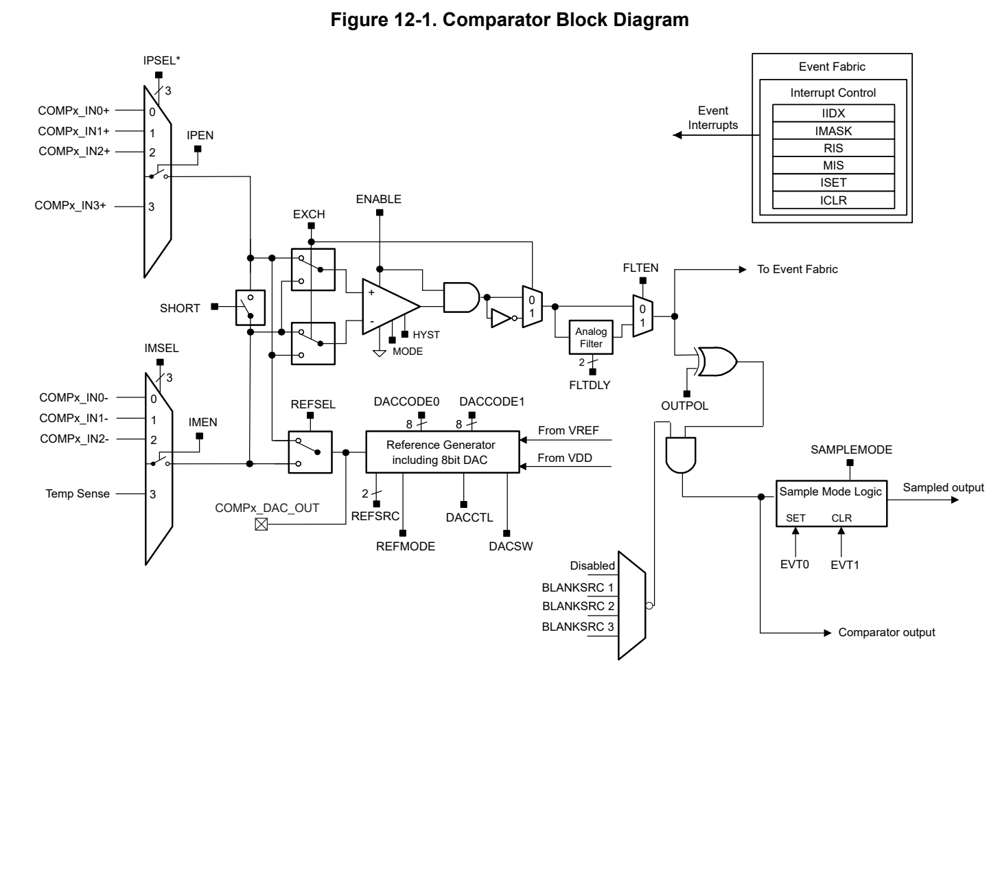
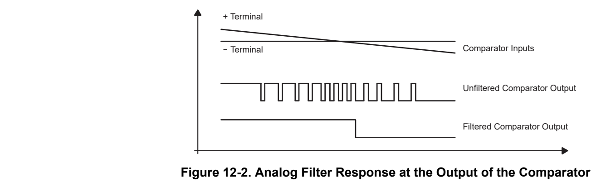
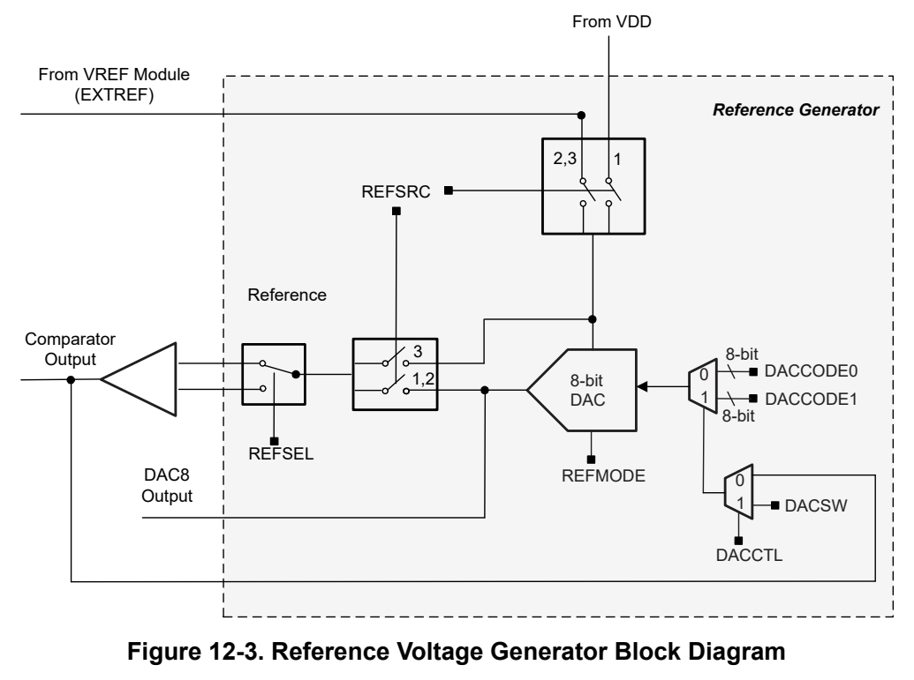
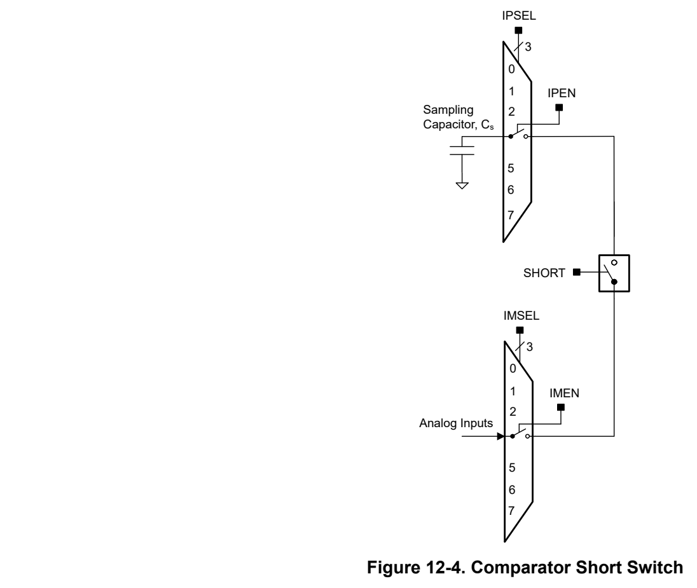

# 12 COMP (pp. 733-771)

## COMP (p. 733)

The comparator module (COMP) is an analog voltage comparator with general comparator functionality. This chapter describes the operation of the comparator module.

### 12.1 Comparator Overview 734 (p. 733)

### 12.2 Comparator Operation 735 (p. 733)

### 12.3 COMP0 Registers 742 (p. 733)

### 12.1 Comparator Overview (p. 734)

The comparator module can be useful for supply voltage supervision and monitoring of external analog signals.

Features of comparator include:

- Fast and ultra-low-power modes of operation

- Inverting and noninverting terminal input multiplexer

- Inverting and noninverting terminal short and exchange capabilities

- Software-selectable analog filter for the comparator output

- Programmable hysteresis

- Reference voltage from internal voltage reference, VDD or from external reference pin

- Configurable reference voltage generator from integrated 8-bit DAC with two input codes

- Output connected to event system

- Interrupt driven measurement system for low-power operation

Figure 12-1 shows the comparator block diagram.

*Figure 12-1. Comparator Block Diagram (p. 734)*

### 12.2 Comparator Operation (p. 735)

The comparator module is configured by user software. The setup and operation of comparator is discussed in the following sections.

#### 12.2.1 Comparator Configuration (p. 735)

The comparator compares the analog voltages at the positive (+) and negative (–) input terminals. If the + terminal is more positive than the – terminal, the comparator output is high. The polarity of the comparator output can be configured by using the OUTPOL bit in COMPx.CTL1 register. The comparator can be switched on or off using ENABLE bit in COMPx.CTL1 register. The comparator should be switched off when not in use to reduce current consumption. When the comparator is off, OUT is low when OUTPOL bit is set to 0, and OUT is high when OUTPOL bit is set to 1.

The comparator can be configured in fast or ultra-low-power mode using MODE bit in COMPx.CTL1 register. The default value of MODE bit is 0 which configures the comparator in fast mode. When MODE bit is set to 1 the comparator is configured in ultra-low-power mode. In the fast mode the comparator consumes higher current but the response time is faster. In the ultra-low power mode the comparator consumes very low current but response time is slower. To optimize current consumption for the application, the power mode that meets the comparator speed requirements should be selected (please see the device-specific data sheet for the comparator propagation delay).

The clock control for comparator is managed by System Controller (SYSCTL), SYSCTL knows if comparator module is enabled and it also knows if it is in ultra-low-power mode or fast mode. User needs to ensure the proper bus clock is selected for different comparator operation mode:

- For ultra-low-power mode comparator, bus clock can be LFCLK or any of the high speed clocks.

- For fast mode comparator, bus clock cannot be LFCLK, system will generate a clock error interrupt in SYSCTL if you enable a comparator in fast mode and the bus clock is LFCLK.

#### 12.2.2 Comparator Channels Selection (p. 735)

The comparator channels on positive terminal is selected through IPSEL bits and enabled through IPEN bit in the register COMPx.CTL0. Similarly the comparator channels on negative terminal is selected through IMSEL bits and enabled through IMEN bit. The IPSEL and IMSEL bits can be used to select the comparator channel inputs from device pins or from internal analog modules. The switches in the comparator input channels multiplexer on positive and negative terminals are implemented using break-before-make arrangement to minimize the cross talk when the channel selection changes.

The IPSEL and IMSEL bits allow:

- Connection of an external signal to the positive and negative terminals of the comparator

- Connection of an internal analog signal (like OPA) to the positive and negative terminals of the comparator

- Connection of one comparator positive terminal signal to another comparator positive terminal in window compare mode

The EXCH bit in COMPx.CTL1 register controls the input multiplexer, exchange the input signals of the comparator positive and negative terminals. Additionally, when the comparator terminals are exchanged, the output signal from the comparator is inverted too. This allows the user to determine or compensate for the comparator input offset voltage.

> **Note:**

Comparator Input Connection

Please see the device data sheet COMP section for the input channel selection configuration.

When the comparator is on, the input terminals should be connected to a signal, power, or ground. Otherwise, floating levels can cause unexpected interrupts and increased current consumption.

Comparator Configuration

The configuration of the comparator must not change while it is in operation except for changes in IPSEL, IMSEL and EXCH settings in the register COMPx.CTL0. To change the configuration of the comparator it must be first disabled, reconfigured as needed and then re-enabled.

#### 12.2.3 Comparator Output (p. 736)

The comparator output is readable from the OUT bit in COMPx.STAT register. The output is also brought out on device pin. For successful connection of comparator output with the device pin, it is necessary for the software to configure the corresponding device pin in IOMUX module. The comparator output also goes to the Event Interface to generate CPU interrupt event and generic publisher event for internal connects with other modules.

#### 12.2.4 Output Filter (p. 736)

The output of the comparator can be used with or without internal filtering. Output filtering can only be enabled while Comparator is in fast mode (COMPx.CTL1.MODE = 0). When FLTEN bit in COMPx.CTL1 register is set, the output is filtered with an on-chip analog filter. The delay of the filter can be adjusted in four different steps using the FLTDLY bits in COMPx.CTL1 register (see Table 12-1).

**Table 12-1. Typical Output Filter Delay Settings (p. 736)**

| FLTDLY bit in COMPx.CTL1 | Typical filter delay |
| --- | --- |
| 0 | 70ns |
| 1 | 500ns |
| 2 | 1200ns |
| 3 | 2700ns |

Filter delay settings are an addition to propagation delay outlined in device specific data sheet.

The comparator output oscillates if the voltage difference across the input terminals is small (see Figure 12-2). Internal and external parasitic effects and cross coupling on and between signal lines, power supply lines, and other parts of the system result in this behavior. The comparator output oscillation reduces the accuracy and resolution of the comparison result. Selecting the output filter can reduce errors associated with comparator oscillation.

*Figure 12-2. Analog Filter Response at the Output of the Comparator (p. 736)*

> **Note:**

The output filter only works for the comparator when it operates in fast mode.

#### 12.2.5 Sampled Output Mode (p. 737)

Sampled mode is a method of operation for the comparator, which compares input signals at discrete time intervals or samples, producing output signals that change only at the sampling points. The SAMPMODE bit in the register CTL2 enables or disables the sampled mode.

To define the sampling window, two events, EVT0 and EVT1, are generated from the timer. The sampling window can be aligned to less noisy phases with the use of these events. EVT0 sets the sampling window, while EVT1 clears it.

In sampled mode, the output of the comparator is captured only when the sampling window is high, and the output is not captured at other times. The captured output is used for interrupt and event generation.

By using sampled mode, the comparator can reduce the effects of noise in the input signals, resulting in more accurate and reliable comparisons. The use of EVT0 and EVT1 to define the sampling window allows for greater flexibility in aligning the window to the least noisy phases of the input signals, further improving the accuracy of the comparisons.

Please note following when internal DAC8 is used in sampled mode and user wants to enter Standby0 mode; for comparator output to work as expected, it is to be ensured that COMP is ready by polling the OUTRDYIFG flag before SoC enters Standby0 mode.

User can follow the below sequence for this scenario. 1. In run/active mode, do all the necessary COMP configurations (DAC8 in sampled mode, COMP in ULP mode, etc.) 2. Set power policy to standby0 (DL_SYSCTL_setPowerPolicySTANDBY0) 3. Enable COMP (CTL1.EN bit to be written) 4. Wait for COMP OUTRDYIFG to be set (wait for bit number 3 in RIS register to be 1) 5. Enter Standby0 low power mode (using __WFI() function)

#### 12.2.6 Blanking Mode (p. 737)

Due to the noise or other interference, the input signal may fluctuate around the threshold voltage, causing the output to switch rapidly and erratically. This can lead to false triggering. Comparator blanking mode introduces a brief delay between the time the input signal crosses the threshold voltage and the time the output changes state.

During this delay period, the comparator ignores any further changes in the input signal and maintains its current output state. This feature is mainly for uses cases like PWM waves indicated by a timer in motor drive, power control, and so on.

The control bits BLANKSRC in the register CTL2 can be used to configure disable or which source should be working on blanking mode. Refer to the data sheet of the device to see the specific blanking sources supported.

Note The timer is used as the source of comparator blanking mode, there is typically a 1 TIMCLK cycle delay between the timer output and the comparator output.

#### 12.2.7 Reference Voltage Generator (p. 737)

Figure 12-3 shows the block diagram of the comparator reference voltage generator. The comparator reference voltage generator consists of a 8-bit DAC along with some configuration options. The REFSRC bits in COMPx.CTL2 register are used to select the reference source for the comparator.

- When REFSRC = 0, the reference voltage generator is disabled and the reference voltage generator cannot be used for comparator operation.

- When REFSRC = 1, the analog supply VDDA is selected as the reference input for the DAC and the DAC output is used as reference voltage for the comparator.

- When REFSRC = 2, the external reference is selected as the reference input for the DAC and the DAC output is used as reference voltage for the comparator.

- When REFSRC = 3, the external reference is used directly as reference voltage for the comparator and the DAC is switched off.

The reference voltage generator output can be applied to either the positive terminal or negative terminal of the comparator using the REFSEL bit COMPx.CTL2 register. If external signals are applied to both comparator input terminals, turn off the internal reference voltage generator to reduce current consumption.

When the reference voltage generator output is applied on a comparator terminal using REFSEL bit COMPx.CTL2 register and the comparator channel (from device pins or from internal analog modules) is also selected on the same terminal using IPSEL/IPEN or IMSEL/IMEN bits in COMPx.CTL0 register then the comparator channel selection takes precedence.

*Figure 12-3. Reference Voltage Generator Block Diagram (p. 738)*

Integrated 8-bit DAC

The 8-bit DAC input code can be provided through DACCODE0 or DACCODE1 bits in COMPx.CTL3 register. The DACCTL bit in COMPx.CTL2 register determines if the comparator output or a software control bit DACSW in COMPx.CTL2 register selects DACCODE0 or DACCODE1 bits as input to DAC.

- When DACCTL is 0 the comparator output value selects DACCODE0 or DACCODE1. If the comparator output value is 0, DACCODE0 will be the input to DAC. And DACCODE1 will be the input to DAC if the comparator output value is 1.

- When DACCTL is 1 the DACSW bit value that is programmed by software selects DACCODE0 or DACCODE1. If DACSW is 0, DACCODE0 will be the input to DAC. And DACCODE1 will be the input to DAC if DACSW is 1. With this provision it is possible to generate desired hysteresis levels for the comparator without using external components.

- The REFMODE bit in COMPx.CTL2 register determines if the comparator requests for internal VREF operation in fast or ultra-low-power and also the mode of operation of the 8-bit DAC. When REFMODE bit is

0, the internal VREF is requested for operation in fast mode and the 8-bit DAC in comparator is configured in fast mode as well. When REFMODE bit is 1, the internal VREF is requested for operation in ultra-low-power and the 8-bit DAC in comparator in comparator is configured in ultra-low-power. Operation in fast mode offers higher accuracy but consumes higher current while the ultra-low-power operation consumes lower current but with relaxed reference voltage accuracy. Refer to comparator electrical specifications in device-specific data sheet for details.

#### 12.2.8 Comparator Hysteresis (p. 739)

The comparator supports programmable hysteresis voltages for fast and ultra-low-power modes to avoid spurious output transitions in case of noisy input signals. When HYST bits in COMPx.CTL1 register are 0, the comparator generates no hysteresis. 10mV, 20mV, and 30mV typical hysteresis voltages are generated by the comparator for HYST bits values 1, 2, and 3 respectively.

The hysteresis can also be implemented by using the internal 8-bit DAC. The input of the reference generator 8-bit DAC can be provided by two values DACCODE0 and DACCODE1 in COMPx.CTL3 register. User can configure the DACCTL bit in COMPx.CTL2 register to 1 and the comparator output value will select the DAC input between DACCODE0 and DACCODE1 values. With this provision it is possible to generate desired hysteresis levels for the comparator without using external components. For more information about this configuration please refer to Integrated 8-bit DAC section.

#### 12.2.9 Input SHORT Switch (p. 739)

The SHORT bit shorts the comparator inputs. This can be used to build a simple sample-and-hold for the comparator (see Figure 12-4)

*Figure 12-4. Comparator Short Switch (p. 739)*

The required sampling time is proportional to the size of the sampling capacitor (CS), the resistance of the input switches in series with the short switch (RI) and the resistance of the external source (RS). The sampling

capacitor CS should be greater than 100pF. The time constant, Tau, to charge the sampling capacitor CS can be calculated with Equation 5.

T au = (R I + R S)x C S (5)

Depending on the required accuracy, use 3 to 10 Tau as the sampling time. With 3 Tau the sampling capacitor is charged to approximately 95% of the input signals voltage level, with 5 Tau it is charged to more than 99%, and with 10 Tau the sampled voltage is sufficient for 12-bit accuracy.

#### 12.2.10 Interrupt and Events Support (p. 740)

The comparator module contains two event publishers and two event subscribers. One event publisher (CPU_INT) manages comparator interrupt requests (IRQs) to the CPU subsystem through a static event route. The second event publisher (GEN_EVENT) is used to setup the generic event publisher through Generic route.

The two event subscribers are used to define the start and stop points in sampled output mode.

The comparator events are summarized in Table 12-2.

**Table 12-2. Comparator Events (p. 740)**

| Event | Type | Source | Destination | Route | Configuration | Functionality |
| --- | --- | --- | --- | --- | --- | --- |
| CPU interrupt | Publisher | Comparator | CPU Subsystem | Static route | CPU_INT registers | Fixed interrupt route from comparator to CPU |
| Generic publisher event | Publisher | Comparator | Other peripherals | Generic route | GEN_EVENT FPUB_1 registers | Configurable route from comparator to other peripherals |
| Generic subscriber event | Subscriber | Other peripherals | Comparator | Generic route | GEN_EVENT FSUB_0 registers | Configurable route from other peripherals to the comparator start of sample window |
| Generic subscriber event | Subscriber | Other peripherals | Comparator | Generic route | GEN_EVENT FSUB_1 registers | Configurable route from other peripherals to the comparator stop sampling window |

##### 12.2.10.1 CPU Interrupt Event Publisher (CPU_INT) (p. 740)

The comparator module provides 3 interrupt sources which can be configured to source a CPU interrupt event. In order of decreasing interrupt priority, the CPU interrupt events from the comparator are:

**Table 12-3. Comparator CPU Interrupt Event Conditions (CPU_INT) (pp. 740-741)**

| IIDX STAT | Name | Description |
| --- | --- | --- |
| 0x01 | COMPIFG | The interrupt flags COMPIFG and COMPINVIFG are set either on the rising or falling edge of the comparator output, selected by the IES bit. When IES bit is 0, rising edge of the comparator output sets the COMPIFG and falling edge sets the COMPINVIFG. When IES bit is 1, falling edge of the comparator output sets the COMPIFG and rising edge sets the COMPINVIFG. |
| 0x02 | COMPINVIFG | The interrupt flags COMPIFG and COMPINVIFG are set either on the rising or falling edge of the comparator output, selected by the IES bit. When IES bit is 0, rising edge of the comparator output sets the COMPIFG and falling edge sets the COMPINVIFG. When IES bit is 1, falling edge of the comparator output sets the COMPIFG and rising edge sets the COMPINVIFG. |
| 0x03 | OUTRDYIFG | Comparator output ready interrupt. This bit is set when the comparator output is valid. |

The CPU interrupt event configuration is managed with the CPU_INT event management registers. See Section 7.2.5 for guidance on configuring the Event registers for CPU interrupts.

##### 12.2.10.2 Generic Event Publisher (GEN_EVENT) (p. 741)

A generic route is a route in which the comparator peripheral publishing the event is configured to use one of several available generic route channels to publish its event to another entity (or entities, in the case of a splitter route), where an entity can be another peripheral, a generic DMA trigger event, or a generic CPU event.

The GEN_EVENT register is used to select a peripheral condition ( Table 12-4) to use for publishing an event. FPUB_1 is the publisher port register and it is used to configure which generic route channel to use to broadcast the event. A second peripheral, the DMA, or the CPU can subscribe to this event by configuring its subscriber port to listen on the same generic route channel which the publishing peripheral is connected to.

For example, through the use of a generic event channel, it is possible to directly trigger a timer capture from a comparator event, by connecting a comparator FPUB_1 and TIM FSUB_x to the same generic event channel. Refer to Section 7.1.3.3 and Section 7.2.3 for how generic event route works.

**Table 12-4. Comparator Generic Event Conditions (GEN_EVENT) (p. 741)**

| IIDX STAT | Name | Description |
| --- | --- | --- |
| 0x01 | COMPIFG | The interrupt flags COMPIFG and COMPINVIFG are set either on the rising or falling edge of the comparator output, selected by the IES bit. When IES bit is 0, rising edge of the comparator output sets the COMPIFG and falling edge sets the COMPINVIFG. When IES bit is 1, falling edge of the comparator output sets the COMPIFG and rising edge sets the COMPINVIFG. |
| 0x02 | COMPINVIFG | The interrupt flags COMPIFG and COMPINVIFG are set either on the rising or falling edge of the comparator output, selected by the IES bit. When IES bit is 0, rising edge of the comparator output sets the COMPIFG and falling edge sets the COMPINVIFG. When IES bit is 1, falling edge of the comparator output sets the COMPIFG and rising edge sets the COMPINVIFG. |
| 0x03 | OUTRDYIFG | Comparator output ready interrupt. This bit is set when the comparator output is valid. |

See Section 7.2.5 for guidance on configuring the Event registers.

##### 12.2.10.3 Generic Event Subscribers (p. 741)

The two event subscribers are used to establish the sampling start and stop times when the comparator is used in the sampled output mode.

- FSUB_0 selects the generic event route at the device level on which the start of sampling window event is sent.

- FSUB_1 selects the generic event route at the device level on which the stop of sampling window event is sent.

As the sampling window is driven from generic event routes, any peripheral module with generic publisher capabilities can set the comparator sampling window, including timers and GPIO.

### 12.3 COMP0 Registers (p. 742)

Table 12-5 lists the memory-mapped registers for the COMP0 registers. All register offset addresses not listed in Table 12-5 should be considered as reserved locations and the register contents should not be modified.

**Table 12-5. COMP0 Registers (p. 742)**

| Offset | Acronym | Register Name | Section |
| --- | --- | --- | --- |
| 400h | FSUB_0 | Subscriber Port 0 | Section 12.3.1 |
| 404h | FSUB_1 | Subscriber Port 1 | Section 12.3.2 |
| 444h | FPUB_1 | Publisher port 1 | Section 12.3.3 |
| 800h | PWREN | Power enable | Section 12.3.4 |
| 804h | RSTCTL | Reset Control | Section 12.3.5 |
| 808h | CLKCFG | Peripheral Clock Configuration Register | Section 12.3.6 |
| 814h | STAT | Status Register | Section 12.3.7 |
| 1020h | IIDX | Interrupt index | Section 12.3.8 |
| 1028h | IMASK | Interrupt mask | Section 12.3.9 |
| 1030h | RIS | Raw interrupt status | Section 12.3.10 |
| 1038h | MIS | Masked interrupt status | Section 12.3.11 |
| 1040h | ISET | Interrupt set | Section 12.3.12 |
| 1048h | ICLR | Interrupt clear | Section 12.3.13 |
| 1050h | IIDX | Interrupt index | Section 12.3.14 |
| 1058h | IMASK | Interrupt mask | Section 12.3.15 |
| 1060h | RIS | Raw interrupt status | Section 12.3.16 |
| 1068h | MIS | Masked interrupt status | Section 12.3.17 |
| 1070h | ISET | Interrupt set | Section 12.3.18 |
| 1078h | ICLR | Interrupt clear | Section 12.3.19 |
| 10E0h | EVT_MODE | Event Mode | Section 12.3.20 |
| 10FCh | DESC | Module Description | Section 12.3.21 |
| 1100h | CTL0 | Control 0 | Section 12.3.22 |
| 1104h | CTL1 | Control 1 | Section 12.3.23 |
| 1108h | CTL2 | Control 2 | Section 12.3.24 |
| 110Ch | CTL3 | Control 3 | Section 12.3.25 |
| 1120h | STAT | Status | Section 12.3.26 |

Complex bit access types are encoded to fit into small table cells. Table 12-6 shows the codes that are used for access types in this section.

**Table 12-6. COMP0 Access Type Codes (p. 742)**

| Access Type | Code | Description |
| --- | --- | --- |
| Read Type |  |  |
| R | R | Read |
| Write Type |  |  |
| W | W | Write |
| WK | W K | Write Write protected by a key |
| Reset or Default Value |  |  |
| - n |  | Value after reset or the default value |

### 12.3.1 [COMP0.FSUB_0] Offset: 400h | Reset: 00000000h (p. 743)

FSUB_0 is shown in Figure 12-5 and described in Table 12-7.

Subscriber port

> **Bit Map**: `[31-4] RESERVED (R, 0h)` | `[3-0] CHANID (R/W, 0h)`

**Table 12-7. FSUB_0 Register Field Descriptions (p. 743)**

| Bit | Field | Type | Reset | Description |
| --- | --- | --- | --- | --- |
| 31-4 | RESERVED | R | 0h |  |
| 3-0 | CHANID | R/W | 0h | 0 = disconnected.; 1-15 = connected to channelID = CHANID.; 0h = A value of 0 specifies that the event is not connected; Fh = Consult your device datasheet as the actual allowed maximum may be less than 15. |

### 12.3.2 [COMP0.FSUB_1] Offset: 404h | Reset: 00000000h (p. 744)

FSUB_1 is shown in Figure 12-6 and described in Table 12-8.

Subscriber port

> **Bit Map**: `[31-4] RESERVED (R, 0h)` | `[3-0] CHANID (R/W, 0h)`

**Table 12-8. FSUB_1 Register Field Descriptions (p. 744)**

| Bit | Field | Type | Reset | Description |
| --- | --- | --- | --- | --- |
| 31-4 | RESERVED | R | 0h |  |
| 3-0 | CHANID | R/W | 0h | 0 = disconnected.; 1-15 = connected to channelID = CHANID.; 0h = A value of 0 specifies that the event is not connected; Fh = Consult your device datasheet as the actual allowed maximum may be less than 15. |

### 12.3.3 [COMP0.FPUB_1] Offset: 444h | Reset: 00000000h (p. 745)

FPUB_1 is shown in Figure 12-7 and described in Table 12-9.

Publisher port

> **Bit Map**: `[31-4] RESERVED (R, 0h)` | `[3-0] CHANID (R/W, 0h)`

**Table 12-9. FPUB_1 Register Field Descriptions (p. 745)**

| Bit | Field | Type | Reset | Description |
| --- | --- | --- | --- | --- |
| 31-4 | RESERVED | R | 0h |  |
| 3-0 | CHANID | R/W | 0h | 0 = disconnected.; 1-15 = connected to channelID = CHANID.; 0h = A value of 0 specifies that the event is not connected; Fh = Consult your device datasheet as the actual allowed maximum may be less than 15. |

### 12.3.4 [COMP0.PWREN] Offset: 800h | Reset: 00000000h (p. 746)

PWREN is shown in Figure 12-8 and described in Table 12-10.

Register to control the power state

> **Bit Map**: `[31-24] KEY (W, 0h)` | `[23-1] RESERVED (R, 0h)` | `[0] ENABLE (R/WK, 0h)`

**Table 12-10. PWREN Register Field Descriptions (p. 746)**

| Bit | Field | Type | Reset | Description |
| --- | --- | --- | --- | --- |
| 31-24 | KEY | W | 0h | KEY to allow Power State Change; 26h = KEY to allow write access to this register |
| 23-1 | RESERVED | R | 0h |  |
| 0 | ENABLE | R/WK | 0h | Enable the power KEY must be set to 26h to write to this bit.; 0h = Disable Power; 1h = Enable Power |

### 12.3.5 [COMP0.RSTCTL] Offset: 804h | Reset: 00000000h (p. 747)

RSTCTL is shown in Figure 12-9 and described in Table 12-11.

Register to control reset assertion and de-assertion

> **Bit Map**: `[31-24] KEY (W, 0h)` | `[23-2] RESERVED (R, 0h)` | `[1] RESETSTKYCLR (WK, 0h)` | `[0] RESETASSERT (WK, 0h)`

**Table 12-11. RSTCTL Register Field Descriptions (p. 747)**

| Bit | Field | Type | Reset | Description |
| --- | --- | --- | --- | --- |
| 31-24 | KEY | W | 0h | Unlock key; B1h = KEY to allow write access to this register |
| 23-2 | RESERVED | R | 0h |  |
| 1 | RESETSTKYCLR | WK | 0h | Clear the RESETSTKY bit in the STAT register KEY must be set to B1h to write to this bit.; 0h = Writing 0 has no effect; 1h = Clear reset sticky bit |
| 0 | RESETASSERT | WK | 0h | Assert reset to the peripheral KEY must be set to B1h to write to this bit.; 0h = Writing 0 has no effect; 1h = Assert reset |

### 12.3.6 [COMP0.CLKCFG] Offset: 808h | Reset: 00000000h (p. 748)

CLKCFG is shown in Figure 12-10 and described in Table 12-12.

Peripheral Clock Configuration Register

> **Bit Map**: `[31-24] KEY (W, 0h)` | `[23-9] RESERVED (R, 0h)` | `[8] BLOCKASYNC (R/W, 0h)` | `[7-0] RESERVED (R, 0h)`

**Table 12-12. CLKCFG Register Field Descriptions (p. 748)**

| Bit | Field | Type | Reset | Description |
| --- | --- | --- | --- | --- |
| 31-24 | KEY | W | 0h | KEY to Allow State Change -- 0xA9; A9h = Key value to be used in writing to this register for the write to take effect. |
| 23-9 | RESERVED | R | 0h |  |
| 8 | BLOCKASYNC | R/W | 0h | Async Clock Request is blocked from starting SYSOSC or forcing bus clock to 32MHz; 0h = disable COMP to request SYSOSC; 1h = enable COMP to request SYSOSC |
| 7-0 | RESERVED | R | 0h |  |

### 12.3.7 [COMP0.STAT] Offset: 814h | Reset: 00000000h (p. 749)

STAT is shown in Figure 12-11 and described in Table 12-13.

peripheral enable and reset status

> **Bit Map**: `[31-17] RESERVED (R, 0h)` | `[16] RESETSTKY (R, 0h)` | `[15-0] RESERVED (R, 0h)`

**Table 12-13. STAT Register Field Descriptions (p. 749)**

| Bit | Field | Type | Reset | Description |
| --- | --- | --- | --- | --- |
| 31-17 | RESERVED | R | 0h |  |
| 16 | RESETSTKY | R | 0h | This bit indicates, if the peripheral was reset, since this bit was cleared by RESETSTKYCLR in the RSTCTL register; 0h = The peripheral has not been reset since this bit was last cleared by RESETSTKYCLR in the RSTCTL register; 1h = The peripheral was reset since the last bit clear |
| 15-0 | RESERVED | R | 0h |  |

### 12.3.8 [COMP0.IIDX] Offset: 1020h | Reset: 00000000h (p. 750)

IIDX is shown in Figure 12-12 and described in Table 12-14.

Interrupt index register. This read-only register provides the interrupt index of the pending interrupt with the highest priority. It also indicates if no interrupt is pending. The priority order is fixed: lower index equals higher priority. Alternatively to the use of IIDX, users can implement their own prioritization schemes using other registers that expose the full set of interrupts that have occurred. On each read, only one interrupt is indicated. On a read, the current interrupt (highest priority) is automatically cleared by the hardware and the corresponding interrupt flags in the RIS and MIS are cleared as well. After a read from the CPU (not from the debug interface), the register must be updated with the next highest priority interrupt or indicate that no interrupt is pending. Only interrupts which are selected via IMASK are indicated.

> **Bit Map**: `[31-2] RESERVED (R, 0h)` | `[1-0] STAT (R, 0h)`

**Table 12-14. IIDX Register Field Descriptions (p. 750)**

| Bit | Field | Type | Reset | Description |
| --- | --- | --- | --- | --- |
| 31-2 | RESERVED | R | 0h |  |
| 1-0 | STAT | R | 0h | Interrupt index status; 0h = No pending interrupt; 2h = Comparator output interrupt; 3h = Comparator output inverted interrupt; 4h = Comparator output ready interrupt |

### 12.3.9 [COMP0.IMASK] Offset: 1028h | Reset: 00000000h (p. 751)

IMASK is shown in Figure 12-13 and described in Table 12-15.

Interrupt Mask. If a bit is set, then corresponding interrupt is un-masked. Un-masking the interrupt causes the raw interrupt to be visible in IIDX, as well as MIS.”

> **Bit Map**: `[31-4] RESERVED (R, 0h)` | `[3] OUTRDYIFG (R/W, 0h)` | `[2] COMPINVIFG (R/W, 0h)` | `[1] COMPIFG (R/W, 0h)` | `[0] RESERVED (R, 0h)`

**Table 12-15. IMASK Register Field Descriptions (p. 751)**

| Bit | Field | Type | Reset | Description |
| --- | --- | --- | --- | --- |
| 31-4 | RESERVED | R | 0h |  |
| 3 | OUTRDYIFG | R/W | 0h | Masks OUTRDYIFG; 0h = Interrupt is masked out; 1h = Interrupt will request an interrupt service routine and corresponding bit in MIS will be set |
| 2 | COMPINVIFG | R/W | 0h | Masks COMPINVIFG; 0h = Interrupt is masked out; 1h = Interrupt will request an interrupt service routine and corresponding bit in MIS will be set |
| 1 | COMPIFG | R/W | 0h | Masks COMPIFG; 0h = Interrupt is masked out; 1h = Interrupt will request an interrupt service routine and corresponding bit in MIS will be set |
| 0 | RESERVED | R | 0h |  |

### 12.3.10 [COMP0.RIS] Offset: 1030h | Reset: 00000000h (p. 752)

RIS is shown in Figure 12-14 and described in Table 12-16.

Raw interrupt status. Reflects all pending interrupts, regardless of masking. The RIS register allows the user to implement a poll scheme. A flag set in this register can be cleared by writing 1 to the ICLR register bit even if the corresponding IMASK bit is not enabled.

> **Bit Map**: `[31-4] RESERVED (R, 0h)` | `[3] OUTRDYIFG (R, 0h)` | `[2] COMPINVIFG (R, 0h)` | `[1] COMPIFG (R, 0h)` | `[0] RESERVED (R, 0h)`

**Table 12-16. RIS Register Field Descriptions (p. 752)**

| Bit | Field | Type | Reset | Description |
| --- | --- | --- | --- | --- |
| 31-4 | RESERVED | R | 0h |  |
| 3 | OUTRDYIFG | R | 0h | Raw interrupt status for comparator output ready interrupt flag. This bit is set when the comparator output is valid.; 0h = No interrupt pending; 1h = Interrupt pending |
| 2 | COMPINVIFG | R | 0h | Raw interrupt status for comparator output inverted interrupt flag. The IES bit defines the transition of the comparator output setting this bit.; 0h = No interrupt pending; 1h = Interrupt pending |
| 1 | COMPIFG | R | 0h | Raw interrupt status for comparator output interrupt flag. The IES bit defines the transition of the comparator output setting this bit.; 0h = No interrupt pending; 1h = Interrupt pending |
| 0 | RESERVED | R | 0h |  |

### 12.3.11 [COMP0.MIS] Offset: 1038h | Reset: 00000000h (p. 753)

MIS is shown in Figure 12-15 and described in Table 12-17.

Masked interrupt status. This is an AND of the IMASK and RIS registers.

> **Bit Map**: `[31-4] RESERVED (R, 0h)` | `[3] OUTRDYIFG (R, 0h)` | `[2] COMPINVIFG (R, 0h)` | `[1] COMPIFG (R, 0h)` | `[0] RESERVED (R, 0h)`

**Table 12-17. MIS Register Field Descriptions (p. 753)**

| Bit | Field | Type | Reset | Description |
| --- | --- | --- | --- | --- |
| 31-4 | RESERVED | R | 0h |  |
| 3 | OUTRDYIFG | R | 0h | Masked interrupt status for OUTRDYIFG; 0h = OUTRDYIFG does not request an interrupt service routine; 1h = OUTRDYIFG requests an interrupt service routine |
| 2 | COMPINVIFG | R | 0h | Masked interrupt status for COMPINVIFG; 0h = COMPINVIFG does not request an interrupt service routine; 1h = COMPINVIFG requests an interrupt service routine |
| 1 | COMPIFG | R | 0h | Masked interrupt status for COMPIFG; 0h = COMPIFG does not request an interrupt service routine; 1h = COMPIFG requests an interrupt service routine |
| 0 | RESERVED | R | 0h |  |

### 12.3.12 [COMP0.ISET] Offset: 1040h | Reset: 00000000h (p. 754)

ISET is shown in Figure 12-16 and described in Table 12-18.

Interrupt set. Allows interrupts to be set by software (useful in diagnostics and safety checks). Writing a 1 to a bit in ISET will set the event and therefore the related RIS bit also gets set. If the interrupt is enabled through the mask, then the corresponding MIS bit is also set.

> **Bit Map**: `[31-4] RESERVED (R, 0h)` | `[3] OUTRDYIFG (W, 0h)` | `[2] COMPINVIFG (W, 0h)` | `[1] COMPIFG (W, 0h)` | `[0] RESERVED (R, 0h)`

**Table 12-18. ISET Register Field Descriptions (p. 754)**

| Bit | Field | Type | Reset | Description |
| --- | --- | --- | --- | --- |
| 31-4 | RESERVED | R | 0h |  |
| 3 | OUTRDYIFG | W | 0h | Sets OUTRDYIFG in RIS register; 0h = Writing a 0 has no effect; 1h = RIS bit corresponding to OUTRDYIFG is set |
| 2 | COMPINVIFG | W | 0h | Sets COMPINVIFG in RIS register; 0h = Writing a 0 has no effect; 1h = RIS bit corresponding to COMPINVIFG is set |
| 1 | COMPIFG | W | 0h | Sets COMPIFG in RIS register; 0h = Writing a 0 has no effect; 1h = RIS bit corresponding to COMPIFG is set |
| 0 | RESERVED | R | 0h |  |

### 12.3.13 [COMP0.ICLR] Offset: 1048h | Reset: 00000000h (p. 755)

ICLR is shown in Figure 12-17 and described in Table 12-19.

Interrupt clear. Write a 1 to clear corresponding Interrupt.

> **Bit Map**: `[31-4] RESERVED (R, 0h)` | `[3] OUTRDYIFG (W, 0h)` | `[2] COMPINVIFG (W, 0h)` | `[1] COMPIFG (W, 0h)` | `[0] RESERVED (R, 0h)`

**Table 12-19. ICLR Register Field Descriptions (p. 755)**

| Bit | Field | Type | Reset | Description |
| --- | --- | --- | --- | --- |
| 31-4 | RESERVED | R | 0h |  |
| 3 | OUTRDYIFG | W | 0h | Clears OUTRDYIFG in RIS register; 0h = Writing a 0 has no effect; 1h = RIS bit corresponding to OUTRDYIFG is cleared |
| 2 | COMPINVIFG | W | 0h | Clears COMPINVIFG in RIS register; 0h = Writing a 0 has no effect; 1h = RIS bit corresponding to COMPINVIFG is cleared |
| 1 | COMPIFG | W | 0h | Clears COMPIFG in RIS register; 0h = Writing a 0 has no effect; 1h = RIS bit corresponding to COMPIFG is cleared |
| 0 | RESERVED | R | 0h |  |

### 12.3.14 [COMP0.IIDX] Offset: 1050h | Reset: 00000000h (p. 756)

IIDX is shown in Figure 12-18 and described in Table 12-20.

Interrupt index register. This read-only register provides the interrupt index of the pending interrupt with the highest priority. It also indicates if no interrupt is pending. The priority order is fixed: lower index equals higher priority. Alternatively to the use of IIDX, users can implement their own prioritization schemes using other registers that expose the full set of interrupts that have occurred. On each read, only one interrupt is indicated. On a read, the current interrupt (highest priority) is automatically cleared by the hardware and the corresponding interrupt flags in the RIS and MIS are cleared as well. After a read from the CPU (not from the debug interface), the register must be updated with the next highest priority interrupt or indicate that no interrupt is pending. Only interrupts which are selected via IMASK are indicated.

> **Bit Map**: `[31-2] RESERVED (R, 0h)` | `[1-0] STAT (R, 0h)`

**Table 12-20. IIDX Register Field Descriptions (p. 756)**

| Bit | Field | Type | Reset | Description |
| --- | --- | --- | --- | --- |
| 31-2 | RESERVED | R | 0h |  |
| 1-0 | STAT | R | 0h | Interrupt index status; 0h = No pending interrupt; 2h = Comparator output interrupt; 3h = Comparator output inverted interrupt; 4h = Comparator output ready interrupt |

### 12.3.15 [COMP0.IMASK] Offset: 1058h | Reset: 00000000h (p. 757)

IMASK is shown in Figure 12-19 and described in Table 12-21.

Interrupt Mask. If a bit is set, then corresponding interrupt is un-masked. Un-masking the interrupt causes the raw interrupt to be visible in IIDX, as well as MIS.”

> **Bit Map**: `[31-4] RESERVED (R, 0h)` | `[3] OUTRDYIFG (R/W, 0h)` | `[2] COMPINVIFG (R/W, 0h)` | `[1] COMPIFG (R/W, 0h)` | `[0] RESERVED (R, 0h)`

**Table 12-21. IMASK Register Field Descriptions (p. 757)**

| Bit | Field | Type | Reset | Description |
| --- | --- | --- | --- | --- |
| 31-4 | RESERVED | R | 0h |  |
| 3 | OUTRDYIFG | R/W | 0h | Masks OUTRDYIFG; 0h = Interrupt is masked out; 1h = Interrupt will request an interrupt service routine and corresponding bit in MIS will be set |
| 2 | COMPINVIFG | R/W | 0h | Masks COMPINVIFG; 0h = Interrupt is masked out; 1h = Interrupt will request an interrupt service routine and corresponding bit in MIS will be set |
| 1 | COMPIFG | R/W | 0h | Masks COMPIFG; 0h = Interrupt is masked out; 1h = Interrupt will request an interrupt service routine and corresponding bit in MIS will be set |
| 0 | RESERVED | R | 0h |  |

### 12.3.16 [COMP0.RIS] Offset: 1060h | Reset: 00000000h (p. 758)

RIS is shown in Figure 12-20 and described in Table 12-22.

Raw interrupt status. Reflects all pending interrupts, regardless of masking. The RIS register allows the user to implement a poll scheme. A flag set in this register can be cleared by writing 1 to the ICLR register bit even if the corresponding IMASK bit is not enabled.

> **Bit Map**: `[31-4] RESERVED (R, 0h)` | `[3] OUTRDYIFG (R, 0h)` | `[2] COMPINVIFG (R, 0h)` | `[1] COMPIFG (R, 0h)` | `[0] RESERVED (R, 0h)`

**Table 12-22. RIS Register Field Descriptions (p. 758)**

| Bit | Field | Type | Reset | Description |
| --- | --- | --- | --- | --- |
| 31-4 | RESERVED | R | 0h |  |
| 3 | OUTRDYIFG | R | 0h | Raw interrupt status for comparator output ready interrupt flag. This bit is set when the comparator output is valid.; 0h = No interrupt pending; 1h = Interrupt pending |
| 2 | COMPINVIFG | R | 0h | Raw interrupt status for comparator output inverted interrupt flag. The IES bit defines the transition of the comparator output setting this bit.; 0h = No interrupt pending; 1h = Interrupt pending |
| 1 | COMPIFG | R | 0h | Raw interrupt status for comparator output interrupt flag. The IES bit defines the transition of the comparator output setting this bit.; 0h = No interrupt pending; 1h = Interrupt pending |
| 0 | RESERVED | R | 0h |  |

### 12.3.17 [COMP0.MIS] Offset: 1068h | Reset: 00000000h (p. 759)

MIS is shown in Figure 12-21 and described in Table 12-23.

Masked interrupt status. This is an AND of the IMASK and RIS registers.

> **Bit Map**: `[31-4] RESERVED (R, 0h)` | `[3] OUTRDYIFG (R, 0h)` | `[2] COMPINVIFG (R, 0h)` | `[1] COMPIFG (R, 0h)` | `[0] RESERVED (R, 0h)`

**Table 12-23. MIS Register Field Descriptions (p. 759)**

| Bit | Field | Type | Reset | Description |
| --- | --- | --- | --- | --- |
| 31-4 | RESERVED | R | 0h |  |
| 3 | OUTRDYIFG | R | 0h | Masked interrupt status for OUTRDYIFG; 0h = OUTRDYIFG does not request an interrupt service routine; 1h = OUTRDYIFG requests an interrupt service routine |
| 2 | COMPINVIFG | R | 0h | Masked interrupt status for COMPINVIFG; 0h = COMPINVIFG does not request an interrupt service routine; 1h = COMPINVIFG requests an interrupt service routine |
| 1 | COMPIFG | R | 0h | Masked interrupt status for COMPIFG; 0h = COMPIFG does not request an interrupt service routine; 1h = COMPIFG requests an interrupt service routine |
| 0 | RESERVED | R | 0h |  |

### 12.3.18 [COMP0.ISET] Offset: 1070h | Reset: 00000000h (p. 760)

ISET is shown in Figure 12-22 and described in Table 12-24.

Interrupt set. Allows interrupts to be set by software (useful in diagnostics and safety checks). Writing a 1 to a bit in ISET will set the event and therefore the related RIS bit also gets set. If the interrupt is enabled through the mask, then the corresponding MIS bit is also set.

> **Bit Map**: `[31-4] RESERVED (R, 0h)` | `[3] OUTRDYIFG (W, 0h)` | `[2] COMPINVIFG (W, 0h)` | `[1] COMPIFG (W, 0h)` | `[0] RESERVED (R, 0h)`

**Table 12-24. ISET Register Field Descriptions (p. 760)**

| Bit | Field | Type | Reset | Description |
| --- | --- | --- | --- | --- |
| 31-4 | RESERVED | R | 0h |  |
| 3 | OUTRDYIFG | W | 0h | Sets OUTRDYIFG in RIS register; 0h = Writing a 0 has no effect; 1h = RIS bit corresponding to OUTRDYIFG is set |
| 2 | COMPINVIFG | W | 0h | Sets COMPINVIFG in RIS register; 0h = Writing a 0 has no effect; 1h = RIS bit corresponding to COMPINVIFG is set |
| 1 | COMPIFG | W | 0h | Sets COMPIFG in RIS register; 0h = Writing a 0 has no effect; 1h = RIS bit corresponding to COMPIFG is set |
| 0 | RESERVED | R | 0h |  |

### 12.3.19 [COMP0.ICLR] Offset: 1078h | Reset: 00000000h (p. 761)

ICLR is shown in Figure 12-23 and described in Table 12-25.

Interrupt clear. Write a 1 to clear corresponding Interrupt.

> **Bit Map**: `[31-4] RESERVED (R, 0h)` | `[3] OUTRDYIFG (W, 0h)` | `[2] COMPINVIFG (W, 0h)` | `[1] COMPIFG (W, 0h)` | `[0] RESERVED (R, 0h)`

**Table 12-25. ICLR Register Field Descriptions (p. 761)**

| Bit | Field | Type | Reset | Description |
| --- | --- | --- | --- | --- |
| 31-4 | RESERVED | R | 0h |  |
| 3 | OUTRDYIFG | W | 0h | Clears OUTRDYIFG in RIS register; 0h = Writing a 0 has no effect; 1h = RIS bit corresponding to OUTRDYIFG is cleared |
| 2 | COMPINVIFG | W | 0h | Clears COMPINVIFG in RIS register; 0h = Writing a 0 has no effect; 1h = RIS bit corresponding to COMPINVIFG is cleared |
| 1 | COMPIFG | W | 0h | Clears COMPIFG in RIS register; 0h = Writing a 0 has no effect; 1h = RIS bit corresponding to COMPIFG is cleared |
| 0 | RESERVED | R | 0h |  |

### 12.3.20 [COMP0.EVT_MODE] Offset: 10E0h | Reset: 00000009h (p. 762)

EVT_MODE is shown in Figure 12-24 and described in Table 12-26.

Event mode register. It is used to select whether each line is disabled, in software mode (software clears the RIS) or in hardware mode (hardware clears the RIS)

> **Bit Map**: `[31-4] RESERVED (R, 0h)` | `[3-2] EVT1_CFG (R, 2h)` | `[1-0] INT0_CFG (R, 1h)`

**Table 12-26. EVT_MODE Register Field Descriptions (p. 762)**

| Bit | Field | Type | Reset | Description |
| --- | --- | --- | --- | --- |
| 31-4 | RESERVED | R | 0h |  |
| 3-2 | EVT1_CFG | R | 2h | Event line mode select for event corresponding to GEN_EVENT; 0h = The interrupt or event line is disabled.; 1h = Event handled by software. Software must clear the associated RIS flag.; 2h = Event handled by hardware. The hardware (another module) clears automatically the associated RIS flag. |
| 1-0 | INT0_CFG | R | 1h | Event line mode select for event corresponding to CPU_INT; 0h = The interrupt or event line is disabled.; 1h = Event handled by software. Software must clear the associated RIS flag.; 2h = Event handled by hardware. The hardware (another module) clears automatically the associated RIS flag. |

### 12.3.21 [COMP0.DESC] Offset: 10FCh | Reset: 00000000h (p. 763)

DESC is shown in Figure 12-25 and described in Table 12-27.

This register identifies the peripheral and its exact version.

> **Bit Map**: `[31-16] MODULEID (R, 611h)` | `[15-12] FEATUREVER (R, 0h)` | `[11-8] RESERVED (R, 0h)` | `[7-4] MAJREV (R, 0h)` | `[3-0] MINREV (R, 0h)`

**Table 12-27. DESC Register Field Descriptions (p. 763)**

| Bit | Field | Type | Reset | Description |
| --- | --- | --- | --- | --- |
| 31-16 | MODULEID | R | 611h | Module identification contains a unique peripheral identification number. The assignments are maintained in a central database for all of the platform modules to ensure uniqueness. |
| 15-12 | FEATUREVER | R | 0h | Feature Set for the module *instance* |
| 11-8 | RESERVED | R | 0h |  |
| 7-4 | MAJREV | R | 0h | Major rev of the IP |
| 3-0 | MINREV | R | 0h | Minor rev of the IP |

### 12.3.22 [COMP0.CTL0] Offset: 1100h | Reset: 00000000h (p. 764)

CTL0 is shown in Figure 12-26 and described in Table 12-28.

Control 0 register.

> **Bit Map**: `[31] IMEN (R/W, 0h)` | `[30-19] RESERVED (R, 0h)` | `[18-16] IMSEL (R/W, 0h)` | `[15] IPEN (R/W, 0h)` | `[14-3] RESERVED (R, 0h)` | `[2-0] IPSEL (R/W, 0h)`

**Table 12-28. CTL0 Register Field Descriptions (p. 764)**

| Bit | Field | Type | Reset | Description |
| --- | --- | --- | --- | --- |
| 31 | IMEN | R/W | 0h | Channel input enable for the negative terminal of the comparator.; 0h = Selected analog input channel for negative terminal is disabled; 1h = Selected analog input channel for negative terminal is enabled |
| 30-19 | RESERVED | R | 0h |  |
| 18-16 | IMSEL | R/W | 0h | Channel input selected for the negative terminal of the comparator if IMEN is set to 1.; 0h = Channel 0 selected; 1h = Channel 1 selected; 2h = Channel 2 selected; 3h = Channel 3 selected; 4h = Channel 4 selected; 5h = Channel 5 selected; 6h = Channel 6 selected; 7h = Channel 7 selected |
| 15 | IPEN | R/W | 0h | Channel input enable for the positive terminal of the comparator.; 0h = Selected analog input channel for positive terminal is disabled; 1h = Selected analog input channel for positive terminal is enabled |
| 14-3 | RESERVED | R | 0h |  |
| 2-0 | IPSEL | R/W | 0h | Channel input selected for the positive terminal of the comparator if IPEN is set to 1.; 0h = Channel 0 selected; 1h = Channel 1 selected; 2h = Channel 2 selected; 3h = Channel 3 selected; 4h = Channel 4 selected; 5h = Channel 5 selected; 6h = Channel 6 selected; 7h = Channel 7 selected |

### 12.3.23 [COMP0.CTL1] Offset: 1104h | Reset: 00000000h (p. 765)

CTL1 is shown in Figure 12-27 and described in Table 12-29.

Control 1 register.

> **Bit Map**: `[31-13] RESERVED (R, 0h)` | `[12] WINCOMPEN (R/W, 0h)` | `[11] DACOUTEN (R/W, 0h)` | `[10-9] FLTDLY (R/W, 0h)` | `[8] FLTEN (R/W, 0h)` | `[7] OUTPOL (R/W, 0h)` | `[6-5] HYST (R/W, 0h)` | `[4] IES (R/W, 0h)` | `[3] SHORT (R/W, 0h)` | `[2] EXCH (R/W, 0h)` | `[1] MODE (R/W, 0h)` | `[0] ENABLE (R/W, 0h)`

**Table 12-29. CTL1 Register Field Descriptions (pp. 765-766)**

| Bit | Field | Type | Reset | Description |
| --- | --- | --- | --- | --- |
| 31-13 | RESERVED | R | 0h |  |
| 12 | WINCOMPEN | R/W | 0h | This bit enables window comparator operation of comparator.; 0h = window comparator is disable; 1h = window comparator is enable |
| 11 | DACOUTEN | R/W | 0h | This bit enables DAC8 output to be connected to the pin. Please consult the device-specific datasheet to determine if this feature is present.; 0h = Disable the DAC8 output connectivity to pin.; 1h = Enable the DAC8 output connectivity to pin. |
| 10-9 | FLTDLY | R/W | 0h | These bits select the comparator output filter delay. See the device-specific data sheet for specific values on comparator propagation delay for different filter delay settings.; 0h = Typical filter delay of 70 ns; 1h = Typical filter delay of 500 ns; 2h = Typical filter delay of 1200 ns; 3h = Typical filter delay of 2700 ns |
| 8 | FLTEN | R/W | 0h | This bit enables the analog filter at comparator output.; 0h = Comparator output filter is disabled; 1h = Comparator output filter is enabled |
| 7 | OUTPOL | R/W | 0h | This bit selects the comparator output polarity.; 0h = Comparator output is non-inverted; 1h = Comparator output is inverted |
| 6-5 | HYST | R/W | 0h | These bits select the hysteresis setting of the comparator.; 0h = No hysteresis; 1h = Low hysteresis, typical 10mV; 2h = Medium hysteresis, typical 20mV; 3h = High hysteresis, typical 30mV |
| 4 | IES | R/W | 0h | This bit selected the interrupt edge for COMPIFG and COMPINVIFG.; 0h = Rising edge sets COMPIFG and falling edge sets COMPINVIFG; 1h = Falling edge sets COMPIFG and rising edge sets COMPINVIFG |
| 3 | SHORT | R/W | 0h | This bit shorts the positive and negative input terminals of the comparator.; 0h = Comparator positive and negative input terminals are not shorted; 1h = Comparator positive and negative input terminals are shorted |
| 2 | EXCH | R/W | 0h | This bit exchanges the comparator inputs and inverts the comparator output.; 0h = Comparator inputs not exchanged and output not inverted; 1h = Comparator inputs exchanged and output inverted |
| 1 | MODE | R/W | 0h | This bit selects the comparator operating mode.; 0h = Comparator is in fast mode; 1h = Comparator is in ultra-low power mode |
| 0 | ENABLE | R/W | 0h | This bit turns on the comparator. When the comparator is turned off it consumes no power.; 0h = Comparator is off; 1h = Comparator is on |

### 12.3.24 [COMP0.CTL2] Offset: 1108h | Reset: 00000000h (p. 767)

CTL2 is shown in Figure 12-28 and described in Table 12-30.

Control 2 register.

> **Bit Map**: `[31-25] RESERVED (R, 0h)` | `[24] SAMPMODE (R/W, 0h)` | `[23-18] RESERVED (R, 0h)` | `[17] DACSW (R/W, 0h)` | `[16] DACCTL (R/W, 0h)` | `[15-11] RESERVED (R, 0h)` | `[10-8] BLANKSRC (R/W, 0h)` | `[7] REFSEL (R/W, 0h)` | `[6] RESERVED (R, 0h)` | `[5-3] REFSRC (R/W, 0h)` | `[2-1] RESERVED (R, 0h)` | `[0] REFMODE (R/W, 0h)`

**Table 12-30. CTL2 Register Field Descriptions (pp. 767-768)**

| Bit | Field | Type | Reset | Description |
| --- | --- | --- | --- | --- |
| 31-25 | RESERVED | R | 0h |  |
| 24 | SAMPMODE | R/W | 0h | Enable sampled mode of comparator.; 0h = Sampled mode disabled; 1h = Sampled mode enabled |
| 23-18 | RESERVED | R | 0h |  |
| 17 | DACSW | R/W | 0h | This bit selects between DACCODE0 and DACCODE1 to 8-bit DAC when DACCTL bit is 1.; 0h = DACCODE0 selected for 8-bit DAC; 1h = DACCODE1 selected for 8-bit DAC |
| 16 | DACCTL | R/W | 0h | This bit determines if the comparator output or DACSW bit controls the selection between DACCODE0 and DACCODE1.; 0h = Comparator output controls selection between DACCODE0 and DACCODE1; 1h = DACSW bit controls selection between DACCODE0 and DACCODE1 |
| 15-11 | RESERVED | R | 0h |  |
| 10-8 | BLANKSRC | R/W | 0h | These bits select the blanking source for the comparator.; 0h = Blanking source disabled; 1h = Select Blanking Source 1; 2h = Select Blanking Source 2; 3h = Select Blanking Source 3; 4h = Select Blanking Source 4; 5h = Select Blanking Source 5; 6h = Select Blanking Source 6 |
| 7 | REFSEL | R/W | 0h | This bit selects if the selected reference voltage is applied to positive or negative terminal of the comparator.; 0h = If EXCH bit is 0, the selected reference is applied to positive terminal. If EXCH bit is 1, the selected reference is applied to negative terminal.; 1h = If EXCH bit is 0, the selected reference is applied to negative terminal. If EXCH bit is 1, the selected reference is applied to positive terminal. |
| 6 | RESERVED | R | 0h |  |
| 5-3 | REFSRC | R/W | 0h | These bits select the reference source for the comparator.; 0h = Reference voltage generator is disabled (local reference buffer as well as DAC).; 1h = VDDA selected as the reference source to DAC and DAC output applied as reference to comparator.; 2h = VREF selected as reference to DAC and DAC output applied as reference to comparator. If the device supports internal VREF, then configuring CTL0 register of VREF module to 1 selects internal VREF. Otherwise, external VREF is selected. For more details, refer to the Reference Voltage Generator section of the COMP chapter of the TRM.; 3h = VREF is applied as reference to comparator. DAC is switched off. If the device supports internal VREF, then configuring CTL0 register of VREF module to 1 selects internal VREF. Otherwise, external VREF is selected. For more details, refer to the Reference Voltage Generator section of the COMP chapter of the TRM.; 5h = VDDA is used as comparator reference.; 6h = VDDA selected as the reference source to DAC and DAC output applied as reference to comparator. Note: This feature is present only in certain devices. Please consult the device-specific datasheet to confirm if this feature is present.; 7h = VDDA is used as the source of comparator. Note: This feature is present only in certain devices. Please consult the device-specific datasheet to confirm if this feature is present. |
| 2-1 | RESERVED | R | 0h |  |
| 0 | REFMODE | R/W | 0h | This bit requests ULP_REF bandgap operation in fast mode(static) or low power mode (sampled). The local reference buffer and 8-bit DAC inside comparator module are also configured accordingly. Fast mode operation offers higher accuracy but consumes higher current. Low power operation consumes lower current but with relaxed reference voltage accuracy. Comparator requests for reference voltage from ULP_REF only when REFLVL > 0.; 0h = ULP_REF bandgap, local reference buffer and 8-bit DAC inside comparator operate in static mode.; 1h = ULP_REF bandgap, local reference buffer and 8-bit DAC inside comparator operate in sampled mode. |

### 12.3.25 [COMP0.CTL3] Offset: 110Ch | Reset: 00000000h (p. 769)

CTL3 is shown in Figure 12-29 and described in Table 12-31.

Control 3 register.

> **Bit Map**: `[31-24] RESERVED (R, 0h)` | `[23-16] DACCODE1 (R/W, 0h)` | `[15-8] RESERVED (R, 0h)` | `[7-0] DACCODE0 (R/W, 0h)`

**Table 12-31. CTL3 Register Field Descriptions (p. 769)**

| Bit | Field | Type | Reset | Description |
| --- | --- | --- | --- | --- |
| 31-24 | RESERVED | R | 0h |  |
| 23-16 | DACCODE1 | R/W | 0h | This is the second 8-bit DAC code. When the DAC code is 0x0 the DAC output will be selected reference voltage x 1/256 V. When the DAC code is 0xFF the DAC output will be selected reference voltage x 255/256 V.; 0h = Minimum DAC code value; FFh = Minimum DAC code value |
| 15-8 | RESERVED | R | 0h |  |
| 7-0 | DACCODE0 | R/W | 0h | This is the first 8-bit DAC code. When the DAC code is 0x0 the DAC output will be selected reference voltage x 1/256 V. When the DAC code is 0xFF the DAC output will be selected reference voltage x 255/256 V.; 0h = Minimum DAC code value; FFh = Minimum DAC code value |

### 12.3.26 [COMP0.STAT] Offset: 1120h | Reset: 00000000h (p. 770)

STAT is shown in Figure 12-30 and described in Table 12-32.

Status register.

> **Bit Map**: `[31-1] RESERVED (R, 0h)` | `[0] OUT (R, 0h)`

**Table 12-32. STAT Register Field Descriptions (p. 770)**

| Bit | Field | Type | Reset | Description |
| --- | --- | --- | --- | --- |
| 31-1 | RESERVED | R | 0h |  |
| 0 | OUT | R | 0h | This bit reflects the value of the comparator output. Writing to this bit has no effect on the comparator output.; 0h = Comparator output is low; 1h = Comparator output is high |

Chapter 13
