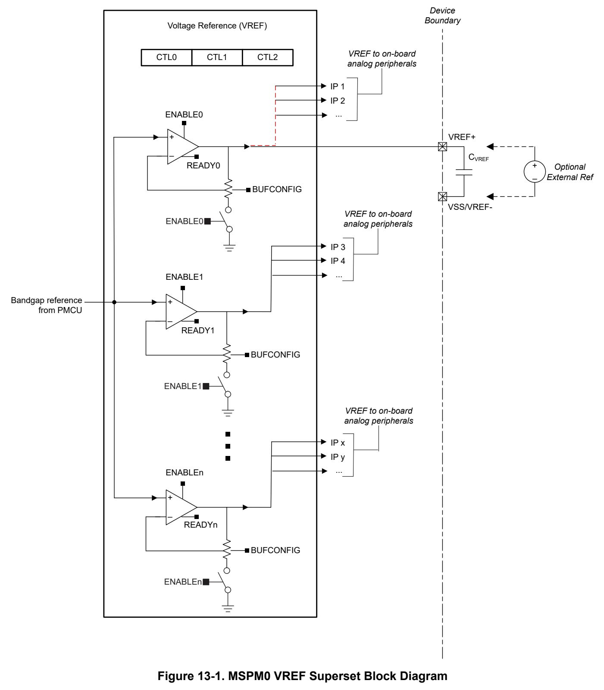

# 13 VREF (pp. 771-784)

## VREF (p. 771)

The VREF module contains a configurable voltage reference buffer which allows users to supply a stable internal reference to on-board analog peripherals. It also supports bringing in an external reference for applications where higher accuracy is required. This chapter describes the features and operation of the VREF module.

### 13.1 VREF Overview 772 (p. 771)

### 13.2 VREF Operation 773 (p. 771)

### 13.3 VREF Registers 775 (p. 771)

### 13.1 VREF Overview (p. 772)

VREF allows users to choose between using an internally generated reference voltage or using an externally provided reference voltage from outside the MCU. Please reference the device data sheet for specifics about its VREF configuration.

The VREF module features include:

- 1.4V and 2.5V user-selectable internal references

- Support for receiving external reference on VREF+/- device pins

- Sample and hold mode supports VREF operation down to STANDBY operating mode

- Internal reference supports ADC opeation. Refer to the device datasheet for the max supported sampling frequency

*Figure 13-1. MSPM0 VREF Superset Block Diagram (p. 773)*

### 13.2 VREF Operation (p. 773)

The VREF module is configured with user software. The setup and operation of VREF is discussed in the following sections.

#### 13.2.1 Internal Reference Generation (p. 774)

To use VREF to generate an internal voltage reference, the user must first enable register write access to the module using the ENABLE control bit in the PWREN register, and then enable the reference buffer using the ENABLE control bit in the CTL0 register. The VREF module generates voltage references based on the factory trimmed bandgap coming from the PMU. The bandgap reference is buffered through a noninverting amplifier to generate an internal reference voltage (1.4V or 2.5V). Only one voltage can be selected at a time using the BUFCONFIG control bit in CTL0.

After it is enabled and settled, the internal reference can be used as an accurate and stable voltage reference for the on-board ADC. Refer to the the ADC chapter for more info on how can leverage this reference voltage.

The VREF provides a READY indication bit in the CTL1 register. The first time the VREF is enabled, the READY bit will remain cleared until the VREF is started and settled, after which the READY bit will be set by hardware. If the VREF is disabled, the READY bit will be cleared back to zero by hardware. If the VREF is re-enabled later, the READY bit will not be set, and application software must manage the VREF startup time.

#### 13.2.2 External Reference Input (p. 774)

For circumstances where accuracy is a key requirement, an external reference can be brought in to the MCU from the VREF+ and VREF- device pins. When supplying the MCU with an external reference, it is recommended to connect a decoupling capacitor on the reference pins with a value based on the voltage source.

#### 13.2.3 Analog Peripheral Interface (p. 774)

VREF to ADC

The ADC peripheral can leverage the internal configurable reference or an external reference using the VRSEL control bits in the ADC MEMCTL register.

The user must make sure that the VREF reference buffer has settled before triggering an ADC conversion when using an internal reference as the ADC voltage reference (VR+). Refer to the device-specific data sheet for VREF settling times and refer to the ADC chapter for more details on all of the reference options available for the ADC peripheral.

VREF to COMP

The comparator peripheral can leverage the external reference using the REFSRC control bits within the CTL2 register associated with the COMP.

Refer to the COMP chapter for more details on all of the reference options available for the comparator peripheral.

VREF to OPA

The OPA peripheral can leverage the external reference for setting a voltage bias on the noninverting input terminal of the amplifier using the PSEL control bits in the CFG register.

Refer to the OPA chapter for more details on all of the channels available for the noninverting amplifier input terminal of the amplifier.

### 13.3 VREF Registers (p. 775)

Table 13-1 lists the memory-mapped registers for the VREF registers. All register offset addresses not listed in Table 13-1 should be considered as reserved locations and the register contents should not be modified.

**Table 13-1. VREF Registers (p. 775)**

| Offset | Acronym | Register Name | Group |
| --- | --- | --- | --- |
| 800h | PWREN | Power enable |  |
| 804h | RSTCTL | Reset Control |  |
| 814h | STAT | Status Register |  |
| 1000h | CLKDIV | Clock Divider |  |
| 1008h | CLKSEL | Clock Selection |  |
| 1100h | CTL0 | Control 0 |  |
| 1104h | CTL1 | Control 1 |  |
| 1108h | CTL2 | Control 2 |  |

Complex bit access types are encoded to fit into small table cells. Table 13-2 shows the codes that are used for access types in this section.

**Table 13-2. VREF Access Type Codes (p. 775)**

| Access Type | Code | Description |
| --- | --- | --- |
| Read Type |  |  |
| R | R | Read |
| Write Type |  |  |
| W | W | Write |
| WK | W K | Write Write protected by a key |
| Reset or Default Value |  |  |
| - n |  | Value after reset or the default value |

### 13.3.1 [VREF.PWREN] Offset: 800h | Reset: 00000000h (p. 776)

PWREN is shown in Figure 13-2 and described in Table 13-3.

Register to control the power state

> **Bit Map**: `[31-24] KEY (W, 0h)` | `[23-1] RESERVED (R, 0h)` | `[0] ENABLE (R/WK, 0h)`

**Table 13-3. PWREN Field Descriptions (p. 776)**

| Bit | Field | Type | Reset | Description |
| --- | --- | --- | --- | --- |
| 31-24 | KEY | W | 0h | KEY to allow Power State Change; 26h = KEY to allow write access to this register |
| 23-1 | RESERVED | R | 0h |  |
| 0 | ENABLE | R/WK | 0h | Enable the power KEY must be set to 26h to write to this bit.; 0h = Disable Power; 1h = Enable Power |

### 13.3.2 [VREF.RSTCTL] Offset: 804h | Reset: 00000000h (p. 777)

RSTCTL is shown in Figure 13-3 and described in Table 13-4.

Register to control reset assertion and de-assertion

> **Bit Map**: `[31-24] KEY (W, 0h)` | `[23-2] RESERVED (R, 0h)` | `[1] RESETSTKYCLR (WK, 0h)` | `[0] RESETASSERT (WK, 0h)`

**Table 13-4. RSTCTL Field Descriptions (p. 777)**

| Bit | Field | Type | Reset | Description |
| --- | --- | --- | --- | --- |
| 31-24 | KEY | W | 0h | Unlock key; B1h = KEY to allow write access to this register |
| 23-2 | RESERVED | R | 0h |  |
| 1 | RESETSTKYCLR | WK | 0h | Clear the RESETSTKY bit in the STAT register KEY must be set to B1h to write to this bit.; 0h = Writing 0 has no effect; 1h = Clear reset sticky bit |
| 0 | RESETASSERT | WK | 0h | Assert reset to the peripheral KEY must be set to B1h to write to this bit.; 0h = Writing 0 has no effect; 1h = Assert reset |

### 13.3.3 [VREF.STAT] Offset: 814h | Reset: 00000000h (p. 778)

STAT is shown in Figure 13-4 and described in Table 13-5.

peripheral enable and reset status

> **Bit Map**: `[31-17] RESERVED (R, 0h)` | `[16] RESETSTKY (R, 0h)` | `[15-0] RESERVED (R, 0h)`

**Table 13-5. STAT Field Descriptions (p. 778)**

| Bit | Field | Type | Reset | Description |
| --- | --- | --- | --- | --- |
| 31-17 | RESERVED | R | 0h |  |
| 16 | RESETSTKY | R | 0h | This bit indicates, if the peripheral was reset, since this bit was cleared by RESETSTKYCLR in the RSTCTL register; 0h = The peripheral has not been reset since this bit was last cleared by RESETSTKYCLR in the RSTCTL register; 1h = The peripheral was reset since the last bit clear |
| 15-0 | RESERVED | R | 0h |  |

### 13.3.4 [VREF.CLKDIV] Offset: 1000h | Reset: 00000000h (p. 779)

CLKDIV is shown in Figure 13-5 and described in Table 13-6.

Clock Divider

> **Bit Map**: `[31-3] RESERVED (R, 0h)` | `[2-0] RATIO (R/W, 0h)`

**Table 13-6. CLKDIV Field Descriptions (p. 779)**

| Bit | Field | Type | Reset | Description |
| --- | --- | --- | --- | --- |
| 31-3 | RESERVED | R | 0h |  |
| 2-0 | RATIO | R/W | 0h | Selects divide ratio of module clock to be used in sample and hold logic |

### 13.3.5 [VREF.CLKSEL] Offset: 1008h | Reset: 00000000h (p. 780)

CLKSEL is shown in Figure 13-6 and described in Table 13-7.

Clock Selection

> **Bit Map**: `[31-4] RESERVED (R, 0h)` | `[3] BUSCLK_SEL (R/W, 0h)` | `[2] MFCLK_SEL (R/W, 0h)` | `[1] LFCLK_SEL (R/W, 0h)` | `[0] RESERVED (R, 0h)`

**Table 13-7. CLKSEL Field Descriptions (p. 780)**

| Bit | Field | Type | Reset | Description |
| --- | --- | --- | --- | --- |
| 31-4 | RESERVED | R | 0h |  |
| 3 | BUSCLK_SEL | R/W | 0h | Selects BUSCLK as clock source if enabled |
| 2 | MFCLK_SEL | R/W | 0h | Selects MFCLK as clock source if enabled |
| 1 | LFCLK_SEL | R/W | 0h | Selects LFCLK as clock source if enabled |
| 0 | RESERVED | R | 0h |  |

### 13.3.6 [VREF.CTL0] Offset: 1100h | Reset: 00000000h (p. 781)

CTL0 is shown in Figure 13-7 and described in Table 13-8.

Control 0 register.

> **Bit Map**: `[31-9] RESERVED (R, 0h)` | `[8] SHMODE (R/W, 0h)` | `[7] BUFCONFIG (R/W, 0h)` | `[6-3] RESERVED (R, 0h)` | `[2] ENABLE2 (R/W, 0h)` | `[1] ENABLE1 (R/W, 0h)` | `[0] ENABLE0 (R/W, 0h)`

**Table 13-8. CTL0 Field Descriptions (p. 781)**

| Bit | Field | Type | Reset | Description |
| --- | --- | --- | --- | --- |
| 31-9 | RESERVED | R | 0h |  |
| 8 | SHMODE | R/W | 0h | This bit enable sample and hold mode; 0h = Sample and hold mode is disable; 1h = Sample and hold mode is enable |
| 7 | BUFCONFIG | R/W | 0h | These bits configure output buffer.; 0h = output 2p5v : Configure Output Buffer to 2.5v; 1h = output 1p4v : Configure Output Buffer to 1.4v |
| 6-3 | RESERVED | R | 0h |  |
| 2 | ENABLE2 | R/W | 0h | This bit enables the VREF reference buffer 2.; 0h = VREF buffer is disabled; 1h = VREF buffer is enabled |
| 1 | ENABLE1 | R/W | 0h | This bit enables the VREF reference buffer 1.; 0h = VREF buffer is disabled; 1h = VREF buffer is enabled |
| 0 | ENABLE0 | R/W | 0h | This bit enables the VREF reference buffer 0.; 0h = VREF buffer is disabled; 1h = VREF buffer is enabled |

### 13.3.7 [VREF.CTL1] Offset: 1104h | Reset: 00000000h (p. 782)

CTL1 is shown in Figure 13-8 and described in Table 13-9.

Control 1 register.

> **Bit Map**: `[31-1] RESERVED (R, 0h)` | `[0] READY (R, 0h)`

**Table 13-9. CTL1 Field Descriptions (p. 782)**

| Bit | Field | Type | Reset | Description |
| --- | --- | --- | --- | --- |
| 31-1 | RESERVED | R | 0h |  |
| 0 | READY | R | 0h | These bits defines status of VREF; 0h = VREF output is not ready; 1h = VREF output is ready |

### 13.3.8 [VREF.CTL2] Offset: 1108h | Reset: 00000000h (p. 783)

CTL2 is shown in Figure 13-9 and described in Table 13-10.

Control 2 register.

> **Bit Map**: `[31-16] HCYCLE (R/W, 0h)` | `[15-0] SHCYCLE (R/W, 0h)`

**Table 13-10. CTL2 Field Descriptions (p. 783)**

| Bit | Field | Type | Reset | Description |
| --- | --- | --- | --- | --- |
| 31-16 | HCYCLE | R/W | 0h | Hold cycle count Total cycles of module clock for hold phase when VREF is working in sample and hold mode in STANDBY to save power. Please refer VREF section of datasheet for recommended values of sample and hold times.; 0h = smallest hold cycle; FFFFh = largest hold cycle |
| 15-0 | SHCYCLE | R/W | 0h | Sample and Hold cycle count Total cycles of module clock for sample and hold phase when VREF is working in sample and hold mode in STANDBY to save power. This field should be greater than HCYCLE field. The difference between this field and HCYCLE gives the number of cycles of sample phase. Please refer VREF section of datasheet for recommended values of sample and hold times.; 0h = smallest sample and hold cycle count; FFFFh = largest sample and hold cycle |

Chapter 14
