# 14 UART (pp. 784-862)

## UART (p. 784)

The universal asynchronous receiver-transmitter (UART) module provides an interface for serial communication protocols.

### 14.1 UART Overview 785 (p. 784)

### 14.2 UART Operation 786 (p. 784)

### 14.3 UART Registers 805 (p. 784)

### 14.1 UART Overview (p. 785)

#### 14.1.1 Purpose of the Peripheral (p. 785)

This interface can be used transfer data between a MSPM0 device and another device with an asynchronous serial communication protocol like LIN (local interconnection network), ISO7816 (Smart card protocol), IrDA (infrared data association), hardware flow control (CTS/RTS) and multiprocessor communications are supported.

#### 14.1.2 Features (p. 785)

The UART controller includes the following features:

- Fully programmable serial interface – 5, 6, 7 or 8 data bits – Even, odd, stick, or no-parity bit generation and detection – 1 or 2 stop bit generation – LSB-first or MSB-first data transmit and receive – Line-break detection – Glitch filter on the input signals – Programmable baud-rate generation with oversampling by 16, 8 or 3

- Separated transmit and receive 4 depth FIFOs reduce CPU interrupt service loading

- Supports DMA data transfer

- Standard FIFO-level and End-of-Transmission interrupts

- Active in all low-power mode including stop and standby mode

- Support for waking up SYSOSC via an asynchronous fast clock request upon start bit detection when operating in low power modes (supports up to 19200B rates when using SYSOSC in FCL mode (1% accuracy)

- Support loopback mode operation

- Support hardware flow control

- Support 9-bit multi-drop configuration

- Protocols supported: – Local Interconnect Network (LIN) support – DALI – IrDA – ISO7816 Smart card – RS485 – Manchester coding – Idle-Line Multiprocessor

There are two types of UART instances: Extend and Main. The following table compares the features of UART Extend and UART Main.

#### 14.1.3 Functional Block Diagram (p. 786)

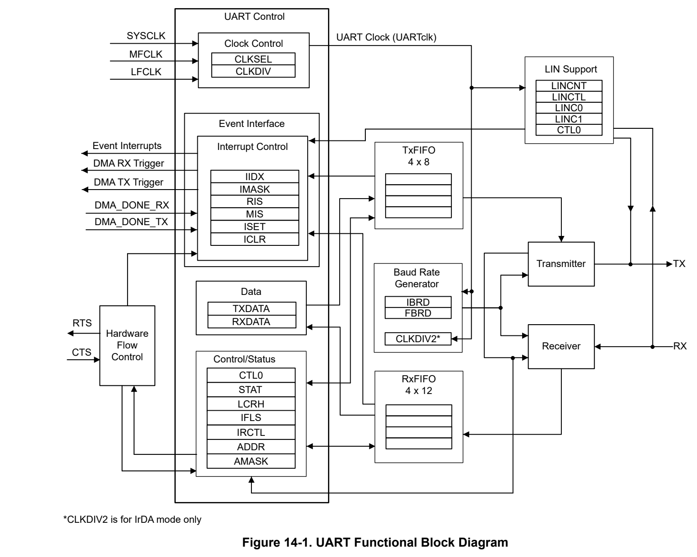
*Figure 14-1. UART Functional Block Diagram (p. 786)*

### 14.2 UART Operation (p. 786)

This section describes the operation of the UART peripheral.

#### 14.2.1 Clock Control (p. 786)

The UART internal functional clock is selected and divided from the functional clock of the IP.

- Use UARTx.CLKSEL register to select the source of the UART functional clock. – BUSSCLK: the current bus clock is selected as the source for UART. The current bus clock depends on power domain. If the UART instance is in power domain 1 ( PD1) refer to MCLK, if the UART instance is in power domain 0 ( PD0) refer to ULPCLK. – MFCLK: MFCLK is selected as the source for UART, refer to MFCLK. – LFCLK: LFCLK is selected as the source for UART, refer to LFCLK

- Use UARTx.CLKDIV register to select the divide ratio of the UART function clock,options are from divide by 1 to 8. For UART Extend, there is a CLKDIV2 register to further divide the UART function clock to support the IrDA mode. When using IrDA mode, CLKDIV2.RATIO must be set to 1h for proper IrDA clocking.

The selected source clock is always available and the frequency depends on the power mode, for more information, see the Clock Module (CKM) section. After enabling the UART module by setting the ENABLE bit, the module will be ready to start receiving and transmitting data.

#### 14.2.2 Signal Descriptions (p. 787)

UART communications require two pins: Receive Data (RX) and Transmit Data (TX):

- RX (Receive Data): RX is the serial data input. Glitch filter and oversampling techniques are used on the receive signal to ensure accurate incoming data.

- TX (Transmit Data): TX is the serial data output. When the transmitter is enabled and no data needs to be transmitted, the TX pin will be held high. In some bidirectional protocols like ISO7816 Smart card, this pin is also used to receive data.

In hardware flow control mode, the following pins are also used:

- CTS (Clear To Send): when driven high by external signal, this signal blocks the data transmission at the end of the current transfer.

- RTS (Request To Send): when low, this signal indicates that the UART is ready to receive data.

#### 14.2.3 General Architecture and Protocol (p. 787)

UART transmits and receives characters at a bit rate that is asynchronous to another device. Timing for each character is based on the selected baud-rate. The transmit and receive functions use the same baud-rate frequency.

In general, control registers should only be programmed when the UART is disabled (ENABLE bit in the UARTx.CTL0 register is cleared). If the UART is operating and gets disabled during transmit or receive operation, the current transaction gets completed before the UART stops. The baud-rate divisor registers (UARTx.IBRD and UARTx.FBRD) can be modified without disabling the UART.

##### 14.2.3.1 Transmit Receive Logic (p. 787)

The transmit logic performs parallel-to-serial conversion on the data read from the transmit FIFO. The control logic outputs the serial bit stream beginning with a start bit and followed by the data bits (LSB first), parity bit, and the stop bits according to the programmed configuration.

The receive logic performs serial-to-parallel conversion on the received bit stream after a valid start pulse has been detected. Overrun, parity, frame error checking, and line-break detection are also performed, and their status accompanies the data that is written to the receive FIFO, this is the reason for 12-bit receive FIFO.

UARTx.CTL0.ENABLE bit is used to enable and disable the UART module, UARTx.CTL0.TXE and RXE bits are used to enable the transmit and receive mode, UARTx.LCRH.WLEN bit is used to configure the number of data bits transmitted or received in a frame, UARTx.LCRH.PEN is used to enable parity and UARTx.LCRH.STP2 is used to send two stop bits.

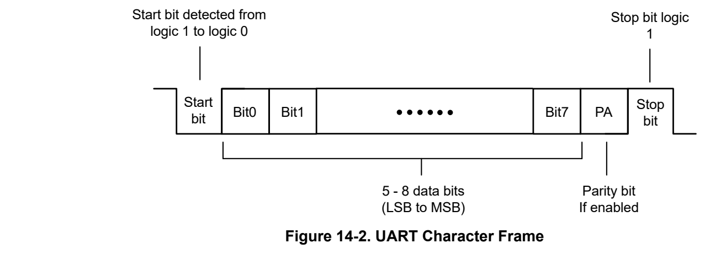
*Figure 14-2. UART Character Frame (p. 787)*

14.2.3.2 Bit Sampling

By default, UARTx.CTL0.HSE is set to 0 and 16 oversampling is selected and receiving bits are expected to have the length of 16 UART clock UARTclk cycles and is sampled on the 8th UARTclk cycle.

Setting the UARTx.CTL0.HSE bit to 1 selects the 8 oversampling where the receiving bits are expected to have the length of 8 UART clock UARTclk cycles and is sampled on the 4th UARTclk cycle.

Setting the UARTx.CTL0.HSE bit to 2 selects the 3 oversampling, the receiving bits are expected to have the length of 3 UART clock UARTclk cycles and are sampled on the 2nd UARTclk cycle.

The aforementioned scenarios assume an IBRD =1 and FBRD =0.

Depending on the application:

- Select oversampling by 3 or 8 to achieve higher speed with UARTclk/8 or UARTclk/3. In this case the receiver tolerance to clock deviation is reduced.

- Select oversampling by 16 to increase the tolerance of the receiver to clock deviations. The maximum speed is limited to UARTclk/16.

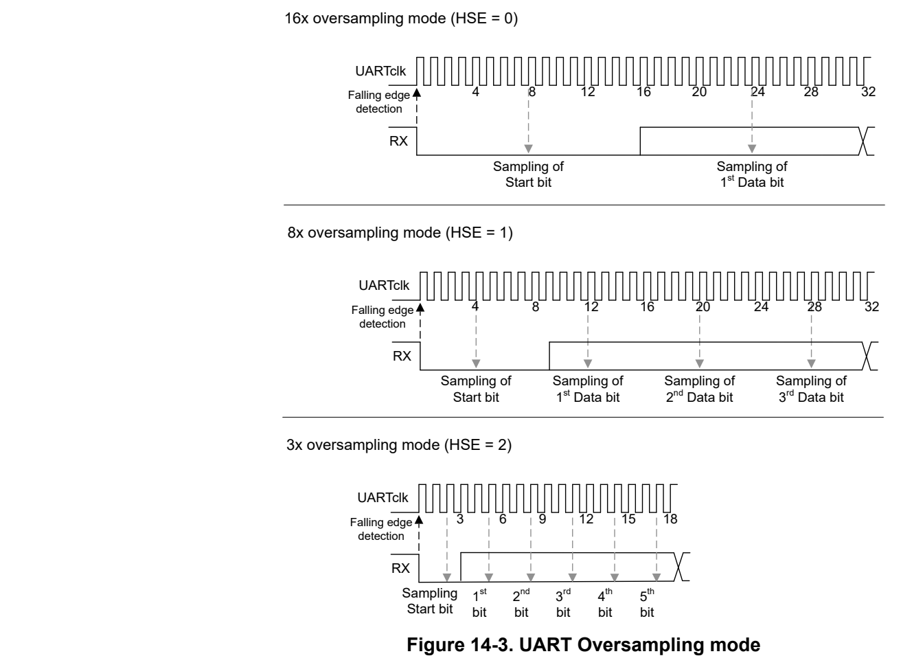
*Figure 14-3. UART Oversampling mode (p. 788)*

##### 14.2.3.3 Majority Voting Feature (p. 789)

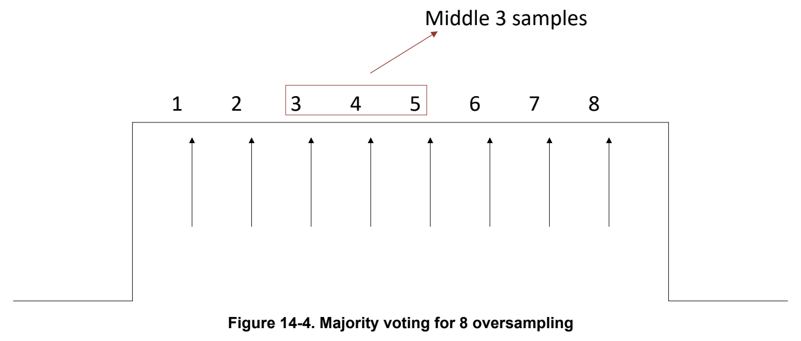
*Figure 14-4. Majority voting for 8 oversampling (p. 789)*

The majority voting feature of the UART provides noise immunity by sampling each bit 3 times in the center of the bit period. For example, in the case when the UARTx.CTL0.HSE is set to 0 with 16 oversampling; the 7th, 8th and 9th bit are sampled and the majority value is considered as final value to be sampled. When the UARTx.CTL0.HSE is set to 1 with 8 oversampling; then the 3rd ,4th and 5th bits are sampled and majority value is considered as final value to be sampled. The oversampling is only applicable for 16 and 8 oversampling. When the 3 samples used for majority vote are not equal; the RIS.NE (noise error bit) is set. The received data is transferred despite the noise error. The NE bit will get appended to the received data before storing it in the RXDATA register at bit position 12. Please note that the majority voting feature is implemented only for data bits. One can select majority voting or single sample using the MAJVOTE control bit in the CTL0 register.

Note Even though UART instances have noise filters, this feature provides an extra layer of noise immunity for longer glitches

##### 14.2.3.4 Baud Rate Generation (p. 789)

The baud-rate divisor is a 22-bit number consisting of a 16-bit integer and a 6-bit fractional part. The number formed by these two values is used by the baud-rate generator to determine the bit sample period. Having a fractional baud-rate divisor allows the UART to generate all of the standard baud-rates very accurately

The 16-bit integer is loaded through the UART Integer Baud-Rate Divisor UARTx.IBRD register and the 6-bit fractional part is loaded with the UART Fractional Baud-Rate Divisor UARTx.FBRD register.

The baud-rate divisor can be calculated by using the following formula:

BRD = UART Clock / (Oversampling x Baud rate) (6)

UART clock is the clock output of the UART clock control logic, configured by CLKSEL and CLKDIV. Oversampling is selected by the HSE bit in the UARTx.CTL0 register and it can be 16, 8 or 3.

- UARTx.IBRD = INT(BRD), integer part of the BRD

- UARTx.FBRD = BRD % 64 , fractional part

The integer part of BRD is loaded into UARTx.IBRD register. The 6-bit fractional number must be loaded into the UARTx.FBRD register.

Note When IBRD = 0, FBRD is ignored and no data gets transferred by the UART. Similarly, when IBRD = 65535 (that is 0xFFFF), then FBRD must not be greater than zero. If this is exceeded it results in an aborted transmission or reception.

The following example shows a simple method to calculate IBRD.DIVINT and FBRD.DIVFRAC for a baud rate of 19200 bit/s:

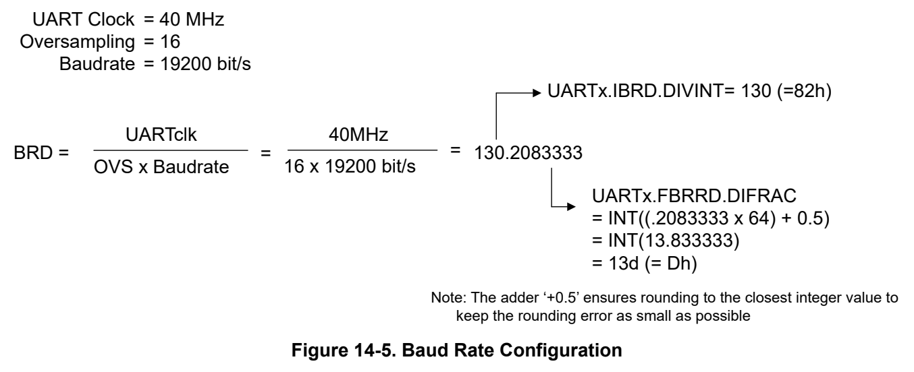
*Figure 14-5. Baud Rate Configuration (p. 790)*

When updating the baud-rate divisor (UARTx.IBRD or UARTx.IFRD), the UART.LCRH register must also be written, so any changes to the baud-rate divisor must be followed by a write to the LCRH register for the changes to take effect. The contents of the UART.IBRD and UART.FBRD registers are not updated until transmission or reception of the current character is complete.

##### 14.2.3.5 Data Transmission (p. 790)

Data received or transmitted is stored in two FIFOs, though the receive FIFO has an extra four bits per character for status information.

Transmit data:

For transmission, data is written into the transmit FIFO. If the UART is enabled, it causes a data frame to start transmitting with the parameters indicated in the UARTx.LCRH register. Data continues to be transmitted until there is no data left in the transmit FIFO. The BUSY bit in the UARTx.STAT register is asserted as soon as data is written to the transmit FIFO (that is, if the FIFO is nonempty) and remains asserted while data is being transmitted. The BUSY bit is negated only when the transmit FIFO is empty, and the last character has been transmitted to the shift register, including the stop bits. The UART can indicate that it is busy even though the UART can no longer be enabled. BUSY also is set during the generation of a BREAK signal.

Receive data:

When the receiver is idle (the RX signal is continuously 1), and the data input goes low (a start bit has been received), the receive counter begins running and data is sampled on the different cycle based on the oversampling setting of the HSE bit in UARTx.CTL0 register .The start bit is valid and recognized if the RX signal is still low after certain number for cycles based on the oversampling setting. After a valid start bit is detected, successive data bits are sampled according to the programmed length of the data characters. The parity bit is then checked if parity mode is enabled. Data length and parity are defined in the UART.LCRH register. Oversampling is explained in Section 14.2.3.2.

Lastly, a valid stop bit is confirmed if the RXD signal is high, otherwise a framing error has occurred. When a full word is received, the data is stored in the receive FIFO along with any error bits associated with that word.

##### 14.2.3.6 Error and Status (p. 791)

For received data, the data byte and the 4-bit status (break, frame, parity, and overrun) is pushed onto the 12-bit wide receive FIFO. The error and status can be can be retrieved by reading UARTx.RXDATA register as showing in Table 14-1.

**Table 14-1. UART Error and Conditions (p. 791)**

| Error Condition (1) | Bit Field | Description |
| --- | --- | --- |
| Framing error | FRMERR | A framing error occurs when a low stop bit is detected. When two stop bits are used, both stop bits are checked for framing error. When a framing error is detected, the FRMERR bit is set. |
| Parity error | PARERR | A parity error is a mismatch between the number of 1s in a character and the value of the parity bit. When an address bit is included in the character, it is included in the parity calculation. When a parity error is detected, the PARERR bit is set. |
| Receive overrun | OVRERR | An overrun error occurs when a character is loaded into RXDATA/FIFO before the prior character has been read. When an overrun occurs, the OVRERR bit is set. |
| Break condition | BRKERR | A break is detected when all received data, parity, and stop bits are 0. When a break condition is detected, the BRKERR bit is set. A break condition can also set the interrupt flag RXINT if the break interrupt enable IMASK.BRKERR bit is set. |

(1) Framing error and break condition are not set when LIN mode is enabled, this pattern is used to signal a Sync frame for LIN. Break detection is not available for IRDA, Manchester and Dali mode.

UART module flag status can also be checked by reading UARTx.STAT register as showing in Table 14-2.

**Table 14-2. UART Flag Status (p. 791)**

| Bit Field | Description |
| --- | --- |
| BUSY | This bit is set as soon as the transmit FIFO becomes nonempty (regardless of whether UART is enabled). In IDLE_Line mode the busy signal also stays set during the idle time generation. |
| RXFE | This bit is set when receive FIFO is empty. If the FIFO is disabled (FEN is 0), the receive holding register is full. If the FIFO is enabled (FEN is 1), the receive FIFO is full. |
| RXFF | This bit is set when receive FIFO is full. If the FIFO is disabled (FEN is 0), the receive holding register is empty. If the FIFO is enabled (FEN is 1), the receive FIFO is empty. |
| TXFE | This bit is set when transmit FIFO is empty. If the FIFO is disabled (FEN is 0), the transmit holding register is full. If the FIFO is enabled (FEN is 1), the transmit FIFO is full. |
| TXFF | This bit is set when transmit FIFO is full. If the FIFO is disabled (FEN is 0), the transmit holding register is empty. If the FIFO is enabled (FEN is 1), the transmit FIFO is empty. |
| CTS | This bit is set when CTS signal is asserted (low) and cleared when CTS signal is not asserted (high). |
| IDLE | IDLE mode has been detected in idle line multiprocessor mode. The IDLE bit is used as an address tag for each block of characters. In idle line multiprocessor format, this bit is set when a received character is an address. |

##### 14.2.3.7 Local Interconnect Network (LIN) Support (p. 791)

This section is only relevant for UART Extend, which supports LIN mode. Refer to the device data sheet for the device-specific configuration of UART extend and UART main.

For supporting local interconnect network (LIN) protocol, the following hardware enhancements are implemented in the UART module:

- 16 bit up-counter (LINCNT) clocked by the UART clock.

- Interrupt capability on counter overflow (CPU_INT.IMASK.LINOVF).

- 16 bit capture register (LINC0) with two configurable modes – Capture of LINCNT value on RXD falling edge. Interrupt capability on capture. – Compare of LINCNT with interrupt capability on match.

- 16 bit capture register (LINC1) can be configured: – Capture LINCNT value on RXD rising edge. Interrupt capability on capture.

LIN transmission

Sending the break signal can be done by setting the BRK bit in UARTx.LCRH register. This bit needs to be set before the data is written into the FIFO or transmit data register TXDATA.

To generate LIN responder signals such as wake signals, the TX pin can be configured by TXD_OUT and TXD_CTL_EN bits in register UARTx.CTL0 to be software controlled. By setting TXD_CTL_EN bit to 1, the TX output pin can be controlled by the TXD_OUT bit if the UART transmit is disabled (CTL0.TXE is cleared).

LIN reception

LIN commander issues a break field and sync field at the start of every frame. Hardware must be added such that the LIN responder software driver can reasonably detect BREAK-SYNC and measure the necessary timing parameters to adjust the baud rate or determine an error.

For LIN reception, break field detection and compare mode are needed. To configure these features:

1. Initialize LIN counter to 0 (UARTx.LINCNT = 0) 2. Enable counter compare match mode (UARTx.LINCTL.LINC0_MATCH = 1) 3. Load UARTx.LINC0 (counter capture 0 register) with counter value corresponding to 9.5 x T bit (refer to LIN Specification for details on this timing). 4. Enable LINC0 match interrupt (CPU_INT.IMASK.LINC0 = 1) 5. Setup LIN count control (UARTx.LINCTL):

- Enable count while low signal on RXD (LINCTL.CNTRXLOW = 1)

- Enable LIN counter clearing on RXD falling edge (LINCTL.ZERONE = 1)

- Enable LIN counter (LINCTL.CTRENA = 1)

Optional:

- User can enable the rising edge on UART TX signal interrupt (CPU_INT.IMASK.RXPE = 1), when the RXPE interrupt fires, the software can read the LINCTR directly to see the BREAK field timing.

- User can enable the LIN counter overflow interrupt (CPU_INT.IMASK.LINOVF = 1) to detect the BREAK16 field is too long and overflows 16bit counter. The timeout can be calculated as t Timeout = 2 / UART clock.

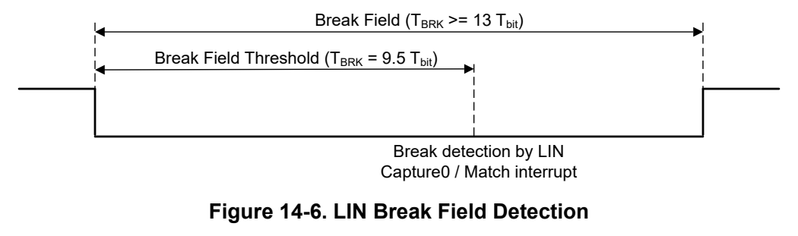
*Figure 14-6. LIN Break Field Detection (p. 792)*

Sync field validation is required to ensure accuracy of this LIN header part and to calculate the commander baud rate. The synch field consists of the data 0x55 inside a byte field (see Figure 14-7). After software detects a valid BREAK, it can then set the counter to measure the SYNC field. Both capture registers in LIN counter are used so that software sees fewer interrupts. Figure 14-7 shows the SYNC byte format. The LINCTR should be set to 0 on the start bit falling edge and count continuously. The LINC0 capture or RX falling edge interrupts fire at the falling edges of the RX line. During the interrupt processing, software can measure the individual HIGH-LOW times of the bits themselves using the values in the LINC0 and LINC1 registers to make sure all of the timings are valid.

The following flow describes a possible LIN sync field validation procedure:

1. Initialize LIN counter to 0 (UARTx.LINCNT = 0) after detecting a valid break field. 2. Enable interrupt on RX falling edge (CPU_INT.IMASK.RXNE = 1) 3. Setup LIN count control (LINCTL):

- Enable LIN counter capture on raising RX edge (LINCTL.LINC1CAP = 1)

- Enable LIN counter capture on falling RX edge (LINCTL.LINC0CAP = 1) Enable LIN counter clearing on RX falling edge (LINCTL.ZERONE = 1)

- Enable LIN counter (LINCTL.CTRENA = 1)

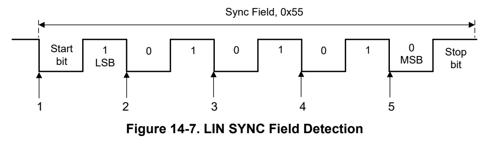
*Figure 14-7. LIN SYNC Field Detection (p. 793)*

Actions at each falling edge of the RX line for the sync field as showing below:

1. LIN counter is set to 0 and start counting on the falling RX edge. (LINCTL.ZERONE = 1) 2. RX falling edge interrupt trigger (RXNE):

- Read capture register LINC0 (falling edge) and LINC1 (rising edge) values

- Verify bit times 3. RX falling edge interrupt trigger (RXNE):

- Read capture register LINC0 (falling edge) and LINC1 (rising edge) values

- Verify bit times 4. RX falling edge interrupt trigger (RXNE):

- Read capture register LINC0 (falling edge) and LINC1 (rising edge) values

- Verify bit times 5. RX falling edge interrupt trigger (RXNE):

- Read capture register LINC0 (falling edge) and LINC1 (rising edge) values

- Verify bit times

- Calculate the proper baud rate to set. Software must set the baud rate before the start bit of the PID field after sync field.

On each interrupt occurrence, the capture registers must be read and the bit times need to be validated by the application software. In case of a bit time verification error, the sync field analysis process must be aborted and the application software must switch back to break detection.

In case of errors like a breaking commander communication during sync field detection, a timeout interrupt can be generated by enabling the LIN counter overflow (IMASK.LINOVF = 1). When the counter overflows, the interrupt handler can abort the sync field analysis and switch back to break detection. The time the counter16 overflow interrupt occurs can be calculated as t Timeout = 2 / UART clock.

Note The sync field is automatically stored in the RX FIFO and can be misread as the PID. Therefore, flush the RX FIFO after the sync field is received and before the PID is received.

###### 14.2.3.7.1 LIN Responder Transmission Delay (p. 793)

The interrupt RXINT for starting the transmission on the responder line always occurs at the mid-point of the commander STOP bit. Depending on the BUSCLK and baud-rate; there might not be enough response space between the STOP bit of commander and START bit of the responder; and the data transmission can start before end of STOP bit.

To overcome this, a delay of half the STOP bit period can be added as response space time to make sure that there is sufficient delay time between STOP and START bit, before start of responder data transmission.

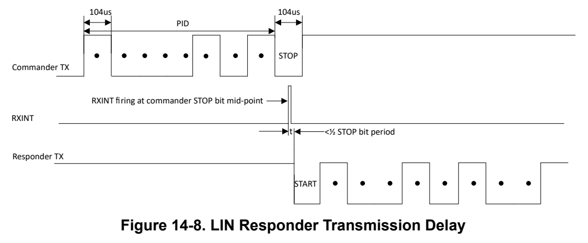
*Figure 14-8. LIN Responder Transmission Delay (p. 794)*

##### 14.2.3.8 Flow Control (p. 794)

Flow control can be accomplished by hardware and the following sections describe the implementation method.

In UART mode (CTL0.MODE set to 0), hardware flow control between two devices is accomplished by connecting the RTS output to the CTS input on the receiving device, and connecting the RTS output on the receiving device to the CTS input. The RTS output signal is low active, the CTS input expects a low signal on a send request as shown in Figure 14-9.

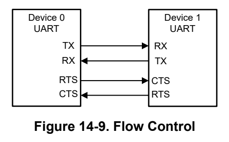
*Figure 14-9. Flow Control (p. 794)*

The CTS input controls the transmitter, the Device 0 and Device 1 transmitter can only transmit data when their CTS input is asserted low. When RTS flow control is enabled, the RTS output signal indicates the state of the receive FIFO. For example, the CTS of the Device 1 remains asserted low until the preprogrammed RX FIFO level of Device 0 is reached, indicating that the receive FIFO of Device 0 has no space to store additional characters.

The CTSEN and RTSEN bits in the UART.CTL0 register specify the flow control mode as shown in Table 14-3.

**Table 14-3. Flow Control Enable (p. 794)**

| CTSEN | RTSEN | Description |
| --- | --- | --- |
| 1 | 1 | RTS and CTS flow control enabled |
| 1 | 0 | Only CTS flow control enabled |
| 0 | 1 | Only RTS flow control enabled |
| 0 | 0 | Both RTS and CTS flow control disabled |

When RTSEN is set to 1, the value of the CTL0.RTS bit is ignored and the RTS output signal is generated by the hardware trigger levels as described below. When RTSEN bit is cleared, the RTS signal output is controlled by the CTL0.RTS bit for SW control.

RTS flow control:

The RTS flow control logic is linked to the programmable receive FIFO watermark levels, it can be configured using UARTx.IFLS register. When RTS flow control is enabled, the RTS is asserted (low) until the receive FIFO is filled up to the watermark level. When the receive FIFO watermark level is reached, the RTS signal is de-asserted (high), indicating that there is no more room to receive any more data. The transmission of data is

expected to cease after the current character has been transmitted. The RTS signal is reasserted (low) when data has been read out of the receive FIFO so that it is filled to less than the watermark level. If RTS flow control is disabled and the UART is still enabled, then data is received until the receive FIFO is full, or no more data is transmitted to it.

As the RTS signal is de-asserted when the FIFO watermark level is reached by putting the last received character into the FIFO. This means on a back to back transmit another character transfer could already been started by the sender. Therefore, in such cases the watermark level should be set to one level lower to ensure all data can be received and put into the FIFO.

CTS flow control:

If CTS flow control is enabled, then the transmitter checks the CTS signal before transmitting the next byte. If the CTS signal is asserted (low), it transmits the byte otherwise transmission does not occur. The data continues to be transmitted while CTS is asserted (low), and the transmit FIFO is not empty. If the transmit FIFO is empty and the CTS signal is asserted (low) no data is transmitted. If the CTS signal is de-asserted (high) and CTS flow control is enabled, then the current character transmission is completed before stopping. If CTS flow control is disabled and the UART is enabled, then the data continues to be transmitted until the transmit FIFO is empty.

##### 14.2.3.9 Idle-Line Multiprocessor (p. 795)

When IDLELINE is set in the CTL0.MODE register bits, the idle-line multiprocessor format is selected. Blocks of data are separated by an idle time on the transmit or receive lines ( Figure 14-10). An idle receive line is detected when ten or more continuous ones (marks) are received after the one or two stop bits of a character. The baud-rate generator is switched off after reception of an idle line until the next start edge is detected. When an idle line is detected, the IDLE bit in UARTx.STAT is set. In Idle-Line mode the UART receiver operates in no parity mode and the UART word length (UARTx.LCRH.WLEN) must be set to 8bit.

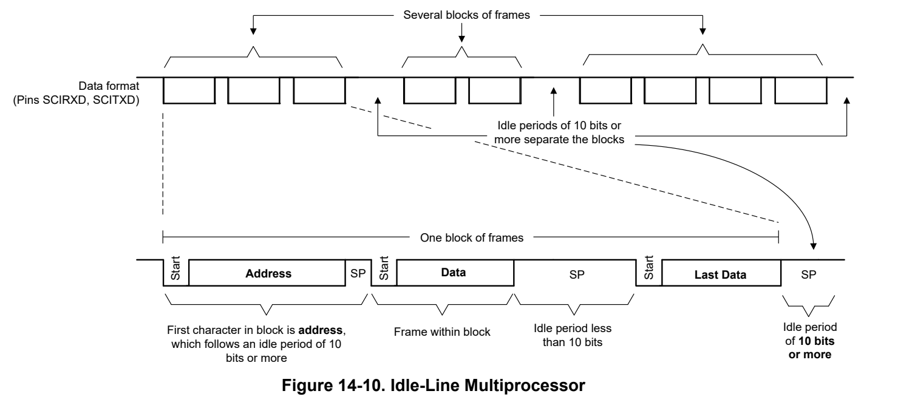
*Figure 14-10. Idle-Line Multiprocessor (p. 795)*

The first character received after an idle period is an address character. The IDLE bit in UARTx.STAT register is used as an address tag for each block of characters. In idle-line multiprocessor format, this bit is set when a received character is an address.

If an address character is received it is compared against the ADDR register with the AMASK applied. If the received character matches, the address character and all following received characters are transferred into the RXDATA buffer and interrupts/flags are generated until the next address without a match is received. The IDLE bit in UARTx.STAT register is automatically cleared when the address does match; otherwise the IDLE bit is set until the address is matched.

When the SENDIDLE bit in UARTx.LCRH register is set the UART inserts an idle period of 11 bit times on the bus, an ongoing transfer is finished first. The next transfer will be delayed till this idle period has finished. Then the next transfer can start with an address character.

The following procedure sends out an idle frame to indicate an address character followed by associated data:

1. Set SENDIDLE then write the address character to TXDATA. TXDATA must be ready for new data (TXINT interrupt must be 1). This generates an idle period of exactly 11 bits followed by the address character. SENDIDLE is reset automatically when the address character has been transferred (all bits are sent out of shift register). 2. Write desired data characters to TXDATA. TXDATA must be ready for new data (TXINT interrupt must be 1). The data written to TXDATA is transferred to the shift register and transmitted as soon as the shift register is ready for new data.

The idle-line time must not be exceeded between address and data transmission or between data transmissions. Otherwise, the transmitted data is misinterpreted as an address.

BUSY bit in IDLELINE mode:

- TX: BUSY is set during the generation of an IDLELINE signal and while the address and data bytes are sent

- RX: The BUSY signal set during the receive of data and till first 10 idle bits are received.

14.2.3.10 9-Bit UART Mode

9-bit mode is enabled by setting MODE bit to ADDR9BIT in the UARTx.CTL0 register. This feature is useful in a multi-drop configuration of the UART where a single controller connected to multiple peripherals can communicate with a particular peripheral through its address or set of addresses along with a qualifier for an address byte. In 9-bit UART mode, the parity enable/mode bits are ignored and the UART word length (UARTx.LCRH.WLEN) must be set to 8 bit.

Receive Transaction:

In 9-bit mode, a peripheral checks for the address qualifier at the location of the parity bit. If set, the received byte is compared with the preprogrammed address in UARTx.ADDR register:

- If the address matches, a 9-bit mode address match interrupt (ADDR_MATCH) is generated, if enabled and further data get received.

- If the address does not match, the address byte and the subsequent data bytes get dropped. .

The address can be predefined in the UART.ADDR register to match with the received byte. The matching can be extended to a set of addresses using the address mask in the UART.AMASK register. By default, the UART.AMASK is 0xFF, meaning that only the specified address must match

Transmit Transaction:

All the send transactions in 9-bit UART mode are interpreted as:

- Address bytes, if the 9th bit is set

- Data bytes, if the 9th bit is cleared

In 9-bit mode, the 9th bit can be controlled by software. The EPS bit setting of the LCRH register reflects the 9th bit for transmit transactions. To indicate an address byte, the software must set the EPS bit before the byte transmission. For data byte transmissions, the EPS bit must be cleared before the byte transmission. For a complete transmit transaction, the address byte must be transmitted as a single byte transaction with EPS bit set, followed by a data byte burst with EPS bit cleared. 9 th bit handling:

**Table 14-4. 9th Bit Handling (pp. 796-797)**

| PEN | SPS | EPS | 9 th Bit (Transmitted or Verified) |
| --- | --- | --- | --- |
| 0 | X | X | Not transmitted or verified |
| 1 | 1 | 1 | 1 (= Address) |

##### 14.2.3.11 RS485 Support (p. 797)

RS485 is a standard used in serial communications systems. This standard can be used effectively over long distances and in electrically noisy environments. Multiple receivers can be connected to such a network. These characteristics make RS-485 useful in industrial control systems and similar applications.

With the RS485 direction signal an external RS485 PHY can be controlled. The RTS I/O is used in this mode for the direction signal. The signal is set automatically to high once a data transmit is started. It will stay set between bytes if they are sent back to back. If a data receive is ongoing a new transmit should be delayed till this data has been received and the direction signal has been set to transmit.

Data exchange sequence as show in Figure 14-11:

- Wait till an ongoing receive has been finished.

- Activate direction signal to transmit on RTS Pin

- Send data (one or more Bytes)

- Wait till an ongoing receive has been finished.

- Deactivate direction signal to transmit on RTS Pin

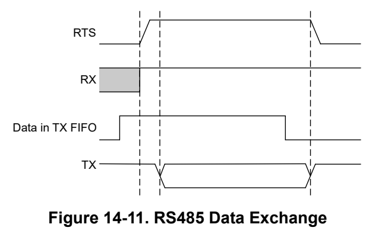
*Figure 14-11. RS485 Data Exchange (p. 797)*

Two bit fields to the LCRH register define the setup and hold time of the external driver direction control:

- EXTDIR_SETUP bits defines the number of UART clock ticks the signal to control the external driver for the RS485 will be set before the START bit is send. The generated setup time will be between EXDIR_SETUP value and EXDIR_SETUP + one baud rate cycle

- EXTDIR_HOLD bits defines the number of UART clock ticks the signal to control the external driver for the RS485 will be reset after the beginning of the stop bit. (If 2 STOP bits are enabled the beginning of the 2nd STOP bit.)

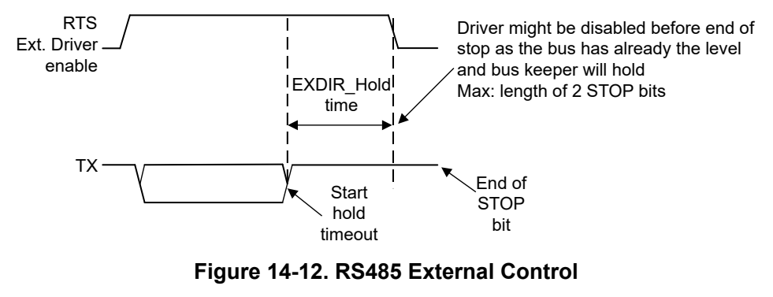
*Figure 14-12. RS485 External Control (p. 797)*

##### 14.2.3.12 DALI Protocol (p. 798)

DALI stands for Digital Addressable Lighting Interface. It is an International Standard (IEC 62386) lighting control system, providing a single interface for all electronic control gear (light sources) and electronic control devices (lighting controllers).

The UART module supports the low level DALI Protocol sending and receiving the bit streams for forward and backward frames. The timing between any forward and backward frame sequence needs to be handled and checked by software.

Transmitting a forward or backward frame:

When transmitting a forward frame user needs to ensure to write second byte to buffer before first byte has been shifted out. The hardware will then send the two bytes without inserting the stop bits in-between. Otherwise the stop bits will be sent and the data will be handled like a backward frame.

Receiving data:

The UART module in DALI mode will check the 9th bit after the start bit to detect a Forward frame or backward frame. If this bit does have a change of the phase (= no stop bit) a forward frame is detected and:

- Address compare is done in software or hardware depending on MASK

- Address and data are always transferred into the RX Buffer

Otherwise a backward frame is detected and the data is transferred into the RX Buffer without setting the ADDR_MATCH interrupt.

The AMASK register can be used as group assignment used during multicast operation with the MSB to indicate if the device is part of a DALI group. To enable the UART in DALI mode to respond on all ADDRESS the AMASK register needs to be cleared.

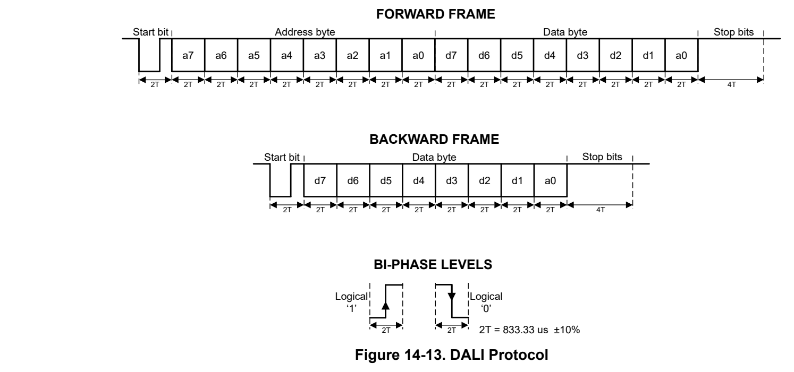
*Figure 14-13. DALI Protocol (p. 798)*

The limits for the times T shall be: 334 µs < T < 500 µs according to standard IEC 62386-102. DALI mode requires Manchester encoding to be enabled. When using DALI mode (CTL0.MODE set to DALI), the CTL0 and LCRH register must be set to:

- 8-bit word length (WLEN bit)

- No parity / 2 Stop Bit

- Manchester encoding enabled

##### 14.2.3.13 Manchester Encoding and Decoding (p. 799)

UART provides option to receive and transmit Manchester encoded data. The function is enabled by the MENC bit in CTL0 register to generate the IEEE 802.3 compliant waveform. With the invert function in GPIO control module the output signals can be inverted to generate the G. E. Thomas compliant waveform.

The output signal is generated by XORing the data with UART clock signal. The UART clock needs to be double the speed of the baud-rate. So for the data transmit there is an edge at the beginning and the middle of each data bit. For the receive signal the edge in the middle of the bit is detected to decode the RX data.

##### 14.2.3.14 IrDA Encoding and Decoding (p. 799)

When IREN bit in UARTx.IRCTL register is set, the IrDA encoder and decoder are enabled and provide hardware bit shaping for IrDA communication. IrDA en/decoding should only be used with UART mode (UARTx.CTL0.MODE is 0)

IrDA Encoding

The encoder sends a pulse for every zero bit in the transmit bit stream coming from the UART (see Figure 14-14). The pulse duration is defined by IRTXPL bits specifying the number of one-half clock periods of the clock selected by IRTXCLK bit.

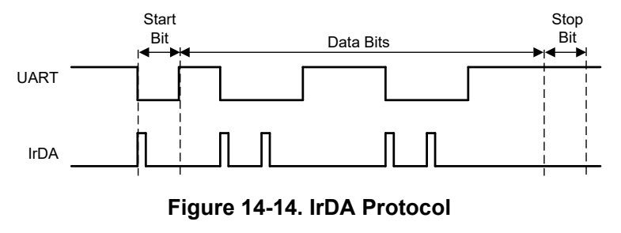
*Figure 14-14. IrDA Protocol (p. 799)*

(more information will be added in next revision)

IrDA Decoding

The decoder detects high pulses when IRRXPL = 0. Otherwise, it detects low pulses.

A programmable digital filter stage can be enabled by setting UARTx.GFCTL.DGFSEL > 0. When IRCTL.IREN is set, also the digital glitch filter should be set so that only pulses longer than the programmed filter length are passed and shorter pulses are discarded. (See the Glitch Suppression chapter on how to set the filter.)

##### 14.2.3.15 ISO7816 Smart Card Support (p. 799)

The UART offers basic support to allow communication with an ISO7816 smart card. When configuring the MODE bits to smart card (0x4) of the UARTx.CTL0 register, the TXD signal is used as a bit clock, and the RXD signal is used as the half-duplex communication line connected to the smart card. Further smart card signals are not supported by the UART.

The clock rate of the UART clock in ISO7816 mode must be in the range of 1MHz to 5MHz when using ISO7816 mode, the UARTx.LCRH register must be set to:

- 8-bit word length (WLEN bits configured to 0x3)

- Even parity (PEN set and EPS set)

- No stick parity (SPS cleared)

In ISO7816 mode, the UART automatically uses 2 stop bits; therefore the STP2 bit of the LCRH register is ignored.

If a parity error is detected during a transmission, RXD is pulled low during the second stop bit. In this case, the UART aborts the transmission, it flushes the transmit FIFO and discards any data it contains. Additionally it raises a parity error interrupt, allowing the software to detect the problem and initiate retransmission of the affected data, as the UART does not support automatic retransmission in this case. The UART does not

support automatic retransmission on parity errors. If a parity error is detected on transmission, all further transmit operations are aborted and software must handle retransmission of the affected byte or message.

In Smartcard Mode, the receiver in case of parity error will drive the line low and a parity interrupt flag is asserted. The transmitter responds based on the value of this bit.

##### 14.2.3.16 Address Detection (p. 800)

The UARTx.ADDR register is used to set the specific address that should be matched with receiving address byte. This register is used in conjunction with UARTx.AMASK register to form a match for address-byte received. Only bits where the AMASK is set to '1' are considered. So for full address the AMASK register is set to 0xFF. This feature is used in DALI, UART 9-Bit or Idle-Line mode.

**Table 14-5. Address Detection (p. 800)**

| Condition | DALI Mode | Idle Line Mode | 9-Bit Mode |
| --- | --- | --- | --- |
| Address match | Address and Data is moved to RXDATA | Address and Data is moved to RXDATA | Address and Data is moved to RXDATA |
| Address mismatch | Address and Data will be dropped | Address and Data will be dropped | Address and Data will be dropped |

##### 14.2.3.17 FIFO Operation (p. 800)

The UART has two FIFOs with a depth of 4 entries, one for transmit and one for receive. The FIFOs are accessed through the UART Data (TXDATA/RXDATA) registers. Read operations of the RXDATA register return a 12-bit value consisting of 8 data bits and 4 error flags. Write operations to TXDATA place 8-bit data in the transmit FIFO.

Out of reset, both FIFOs are disabled and act as 1-byte-deep holding registers. The FIFOs are enabled by setting the FEN bit in UARTx.CTL0. FIFO status can be monitored through the UARTx.STAT register and the interrupt events.

Hardware monitors empty, full and overrun conditions

The UARTx.STAT register contains empty and full flags (TXFE, TXFF, RXFE, and RXFF bits), and the CPU_INT.RIS register shows overrun status of the receive FIFO through the OVRERR bit. There is no indicator for a transmit FIFO overrun. A write is just lost, in case it overruns the transmit FIFO. If the FIFOs are disabled, the empty and full flags are set according to the status of the 1-byte-deep holding registers. When receiving more data than the FIFO can capture the oldest data will be overwritten with the received data.

The trigger point at which the FIFOs generate interrupts is controlled through the UARTx.IFLS register. Both FIFOs can be individually configured to trigger interrupts at different levels. Available configurations for transmit FIFO include 3/4, 1/2, 1/4 and empty, for receive FIFO 1/4, 1/2, 3/4 and full. For example, if the 3/4 option is selected for the receive FIFO, the UART generates a receive interrupt after 3 data bytes are received. Out of reset, both FIFOs are configured to trigger an interrupt at the 1/2 mark. The FIFO integrity is indeterminate under the following conditions:

- After a UART Send Break has been initiated (LCRH.BRK = 1)

- If the software disables the UART in the middle of a transmission with data in the FIFO, and then re-enables it.

##### 14.2.3.18 Loopback Operation (p. 800)

The UART can be placed into an internal loopback mode for diagnostic or debug work by setting the LBE bit in the UART.CTL0 register. In loopback mode, the UART operates with the following behavior:

- Data transmitted on the TX output is received on the RX input

- Data transmitted on the TX output is not propagated to the TX IO pin

- Data received on the RX IO pin is ignored

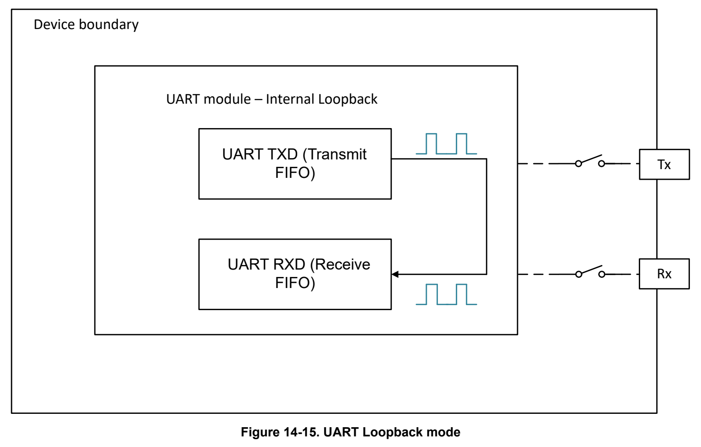
*Figure 14-15. UART Loopback mode (p. 801)*

##### 14.2.3.19 Glitch Suppression (p. 801)

Digital filter

Digital filter is based on the UART functional clock. The DGFSEL bits in the UARTx.GFCTL register can

| Col 2 | suppression value is in terms of functional clocks. All signals are delayed internally when glitch suppression is | suppression value is in terms of functional clocks. All signals are delayed internally when glitch suppression is |
| --- | --- | --- |
|  |  | nonzero. For example, if DGFSEL is set to 0x5, 5 clocks should be added onto the calculation for the expected |
|  | transaction time. The DGFSEL need to be configured for the glitch suppression pulse width to be shorter than 1/3 of a normal data pulse, to avoid a normal pulse is filtered unexpectedly. | transaction time. The DGFSEL need to be configured for the glitch suppression pulse width to be shorter than |
|  | 1/3 of a normal data pulse, to avoid a normal pulse is filtered unexpectedly. |  |
| Analog filter |  |  |
|  | AGFSEL bits in the UARTx.GFCTL register. See data sheet for the select-able glitch filter values. The analog | The analog glitch suppression on the RX line is based on the analog glitch filter and it can be selected with the AGFSEL bits in the UARTx.GFCTL register. See data sheet for the select-able glitch filter values. The analog |

glitch filter is enabled with the AGFEN, if not set the input signals will be passed through to the UART module without filtering.

#### 14.2.4 Low Power Operation (p. 801)

(More information will be added in next revision)

#### 14.2.5 Reset Considerations (p. 801)

| Software Reset Considerations | Col 2 | Col 3 |
| --- | --- | --- |
|  | A software reset can be executed with setting the RESETASSERT together with the KEY in the RSTCTL |  |
|  | register. An ongoing transfer will be terminated immediately and can leave the software in an undefined state. | register. An ongoing transfer will be terminated immediately and can leave the software in an undefined state. |
|  | Therefore, before requesting a reset an ongoing transfer should be terminated. |  |
| Hardware Reset Considerations |  |  |

A hardware reset also initializes the IO configuration. This sets the IOs to a high impedance state and the data lines can float. If this is critical for the application or connected devices on the UART interface external pull up or down resistors might be required.

#### 14.2.6 Initialization (p. 802)

Before the UART is setup or configuration changes, the ENABLE bit should be cleared to avoid unpredictable behavior during the updates or for the first data receive or transmitted afterward.

To enable and initialize the UART, use the following steps:

1. Configure RX and TX pin functions by using the IOMUX registers. 2. Reset the peripheral using UARTx.RSTCTL register 3. Enable the power to UART peripheral using the UARTx.PWREN register 4. Select the UART function clock source and divide options using UART.CLKSEL and UART.CLKDIV registers. 5. Disable the UART by clearing the UART.CTL0.ENABLE bit. 6. Use the baud-rate equation in Section 14.2.3.4 to calculate the UARTx.IBRD and UARTx.FBRD registers. 7. Write the integer portion of the BRD to the UART.IBRD register. 8. Write the fractional portion of the BRD to the UART.FBRD register. 9. Write the desired oversampling and FIFO configuration to the UART.CTL0 register 10. Write the desired serial parameters to the UART.LCRH register. 11. Enable the UART by setting the UART.CTL0.ENABLE bit.

#### 14.2.7 Interrupt and Events Support (p. 802)

The UART module contains three event publishers and no event subscribers. One event publisher (CPU_INT) manages UART interrupt requests (IRQs) to the CPU subsystem through a static event route. The second and third event publishers (DMA_TRIG_RX, DMA_TRIG_TX) are used to setup the trigger signaling for the DMA through DMA event route.

The UART events are summarized in Table 14-6.

**Table 14-6. UART Events (p. 802)**

| Event | Type | Source | Destination | Route | Configuration | Functionality |
| --- | --- | --- | --- | --- | --- | --- |
| CPU interrupt | Publisher | UART | CPU Subsystem | Static route | CPU_INT registers | Fixed interrupt route from UART to CPU |
| DMA trigger | Publisher | UART | DMA | DMA event route | DMA_TRIG_RX registers | Fixed interrupt route from UART to DMA |
| DMA trigger | Publisher | UART | DMA | DMA event route | DMA_TRIG_TX registers | Fixed interrupt route from UART to DMA |

##### 14.2.7.1 CPU Interrupt Event Publisher (CPU_INT) (p. 802)

The UART module provides 18 interrupt sources which can be configured to source a CPU interrupt event. In order of decreasing interrupt priority, the CPU interrupt events from the UART are:

**Table 14-7. UART CPU Interrupt Event Conditions (CPU_INT) (pp. 802-803)**

| IIDX STAT | Name | Description |
| --- | --- | --- |
| 0x01 | RTOUT | UART receive timeout interrupt, This interrupt is asserted when the receive FIFO is not empty, and no further data is received specified time in the UARTx.IFLS.RXTOSEL bits. More information provided below. |
| 0x02 | FRMERR | UART framing error interrupt, see Section 14.2.3.6 for more information. |
| 0x04 | BRKERR | UART break error interrupt, see Section 14.2.3.6 for more information. |
| 0x05 | OVRERR | UART receive overrun error interrupt, see Section 14.2.3.6 for more information. |
| 0x06 | RXNE | Falling edge on RX interrupt, this interrupt triggers when there is a falling edge on RX line. |
| 0x07 | RXPE | Rising edge on RX interrupt, this interrupt triggers when there is a rising edge on RX line. |
| 0x08 | LINC0 | LIN capture 0 match interrupt, this interrupt triggers when the defined capture 0 value is reached in LIN counter. |
| 0x09 | LINC1 | LIN capture 1 match interrupt, this interrupt triggers when the defined capture 1 value is reached in LIN counter. |
| 0x0A | LINOVF | LIN counter overflow interrupt, this interrupt triggers when the 16bit LIN counter overflows. |
| 0x0B | RXINT | UART receive interrupt. More information provided below. |
| 0x0C | TXINT | UART transmit interrupt. More information provided below. |
| 0x0D | EOT | UART end of transmission interrupt, it indicates that the last bit of all transmitted data and status has left the serializer and without any further data in the TX FIFO. |
| 0x0E | ADDR_MATCH | Address match interrupt, used in protocols with address to indicate address match happened. |
| 0x0F | CTS | UART clear to send interrupt, indicate the CTS signal status. |
| 0x10 | DMA_DONE_RX | This interrupt is set if the RX DMA channel sends the DONE signal. |
| 0x11 | DMA_DONE_TX | This interrupt is set if the TX DMA channel sends the DONE signal. |

The CPU interrupt event configuration is managed with the CPU_INT event management registers. See Section 7.2.5 for guidance on configuring the Event registers for CPU interrupts.

The receive timeout interrupt is asserted when the receive FIFO is not empty, and no further data is received specified time in the IFLS.RXTOSEL bits. The receive timeout interrupt is cleared either when the FIFO becomes empty through reading all the data (or by reading the holding register), by reading the interrupt index from IIDX or when a 1 is written to the corresponding bit in the ICLR register.

The receive interrupt (RXINT, 0x0B) changes state when one of the following events occurs:

- If the FIFOs are enabled and the receive FIFO reaches the programmed trigger level, the RXINT bit is set. The receive interrupt is cleared by reading data from the receive FIFO until it becomes less than the trigger level, by reading the interrupt index from IIDX or by writing a 1 to the RXINT bit in ICLR.

- If the FIFOs are disabled (have a depth of one location) and data is received thereby filling the location, the RXINT bit is set. The receive interrupt is cleared by performing a single read of the receive FIFO, by reading the interrupt index from IIDX or by writing a 1 to the RXINT bit in ICLR.

The transmit interrupt (TXINT, 0x0C) changes state when one of the following events occurs:

- If the FIFOs are enabled and the transmit FIFO progresses through the programmed trigger level, the TXINT bit is set. The transmit interrupt is based on a transition through level, therefore the FIFO must be written past the programmed trigger level otherwise no further transmit interrupts will be generated. The transmit interrupt is cleared by writing data to the transmit FIFO until it becomes greater than the trigger level, by reading the interrupt index from IIDX or by writing a 1 to the TXINT bit in ICLR.

- If the FIFOs are disabled (have a depth of one location) and there is no data present in the transmitters single location, the TXINT bit is set. It is cleared by performing a single write to the transmit FIFO, by reading the interrupt index from IIDX or by writing a 1 to the TXINT bit in ICLR.

##### 14.2.7.2 DMA Trigger Publisher (DMA_TRIG_RX, DMA_TRIG_TX) (p. 803)

DMA_TRIG_RX and DMA_TRIG_TX registers are used to setup the trigger signaling for the DMA. This can be setup in a flexible way to trigger the DMA for receive or transmit events with the trigger conditions in Table 14-8 and Table 14-9.

DMA_TRIG_RX is used for triggering the DMA to do a receive data transfer and DMA_TRIG_TX is used for triggering the DMA to do a transmit data transfer.

**Table 14-8. UART DMA Trigger Condition (DMA_TRIG_RX) (p. 804)**

| IIDX STAT | Name | Description |
| --- | --- | --- |
| 0x01 | RTOUT | UART receive timeout interrupt, This interrupt is asserted when the receive FIFO is not empty, and no further data is received specified time in the UARTx.IFLS.RXTOSEL bits. More information provided below. |
| 0x0B | RXINT | UART receive interrupt. More information provided below. |

The receive timeout interrupt is asserted when the receive FIFO is not empty, and no further data is received specified time in the IFLS.RXTOSEL bits. The receive timeout interrupt is cleared either when the FIFO becomes empty through reading all the data (or by reading the holding register), by reading the interrupt index from IIDX or when a 1 is written to the corresponding bit in the ICLR register.

The receive interrupt (RXINT, 0x0B) changes state when one of the following events occurs:

- If the FIFOs are enabled and the receive FIFO reaches the programmed trigger level, the RXINT bit is set. The receive interrupt is cleared by reading data from the receive FIFO until it becomes less than the trigger level, by reading the interrupt index from IIDX or by writing a 1 to the RXINT bit in ICLR.

- If the FIFOs are disabled (have a depth of one location) and data is received thereby filling the location, the RXINT bit is set. The receive interrupt is cleared by performing a single read of the receive FIFO, by reading the interrupt index from IIDX or by writing a 1 to the RXINT bit in ICLR.

**Table 14-9. UART DMA Trigger Condition (DMA_TRIG_TX) (p. 804)**

| IIDX STAT | Name | Description |
| --- | --- | --- |
| 0x0C | TXINT | UART transmit interrupt. More information provided below. |

The transmit interrupt (TXINT, 0x0C) changes state when one of the following events occurs:

- If the FIFOs are enabled and the transmit FIFO progresses through the programmed trigger level, the TXINT bit is set. The transmit interrupt is based on a transition through level, therefore the FIFO must be written past the programmed trigger level otherwise no further transmit interrupts will be generated. The transmit interrupt is cleared by writing data to the transmit FIFO until it becomes greater than the trigger level, by reading the interrupt index from IIDX or by writing a 1 to the TXINT bit in ICLR.

- If the FIFOs are disabled (have a depth of one location) and there is no data present in the transmitters single location, the TXINT bit is set. It is cleared by performing a single write to the transmit FIFO, by reading the interrupt index from IIDX or by writing a 1 to the TXINT bit in ICLR.

The DMA trigger event configuration is managed with the DMA_TRIG_RX and DMA_TRIG_TX event management registers. See Section 7.2.5 for guidance on configuring the Event registers and Section 7.1.3.2 for on how DMA trigger event works.

#### 14.2.8 Emulation Modes (p. 804)

The module behavior while the device is in debug mode is controlled by the FREE and SOFT bits in PDBGCTL register.

When the device is in debug mode and set into halt mode below behavior can be configured.

**Table 14-10. Debug Mode Peripheral Behavior (p. 804)**

| PDBGCTL.FREE | PDBGCTL.SOFT | Function |
| --- | --- | --- |
| 1 | x | Modules continues operation |
| 0 | 0 | Module stops immediately |
| 0 | 1 | Module stops after the next transfer has been finished |

### 14.3 UART Registers (p. 805)

Table 14-11 lists the memory-mapped registers for the UART registers. All register offset addresses not listed in Table 14-11 should be considered as reserved locations and the register contents should not be modified.

**Table 14-11. UART Registers (pp. 805-806)**

| Offset | Acronym | Register Name | Group |
| --- | --- | --- | --- |
| 800h | PWREN | Power enable |  |
| 804h | RSTCTL | Reset Control |  |
| 808h | CLKCFG | Peripheral Clock Configuration Register |  |
| 814h | STAT | Status Register |  |
| 1000h | CLKDIV | Clock Divider |  |
| 1008h | CLKSEL | Clock Select for Ultra Low Power peripherals |  |
| 1018h | PDBGCTL | Peripheral Debug Control |  |
| 1020h | IIDX | Interrupt index | CPU_INT |
| 1028h | IMASK | Interrupt mask | CPU_INT |
| 1030h | RIS | Raw interrupt status | CPU_INT |
| 1038h | MIS | Masked interrupt status | CPU_INT |
| 1040h | ISET | Interrupt set | CPU_INT |
| 1048h | ICLR | Interrupt clear | CPU_INT |
| 1050h | IIDX | Interrupt index | DMA_TRIG_RX |
| 1058h | IMASK | Interrupt mask | DMA_TRIG_RX |
| 1060h | RIS | Raw interrupt status | DMA_TRIG_RX |
| 1068h | MIS | Masked interrupt status | DMA_TRIG_RX |
| 1070h | ISET | Interrupt set | DMA_TRIG_RX |
| 1078h | ICLR | Interrupt clear | DMA_TRIG_RX |
| 1080h | IIDX | Interrupt index | DMA_TRIG_TX |
| 1088h | IMASK | Interrupt mask | DMA_TRIG_TX |
| 1090h | RIS | Raw interrupt status | DMA_TRIG_TX |
| 1098h | MIS | Masked interrupt status | DMA_TRIG_TX |
| 10A0h | ISET | Interrupt set | DMA_TRIG_TX |
| 10A8h | ICLR | Interrupt clear | DMA_TRIG_TX |
| 10E0h | EVT_MODE | Event Mode |  |
| 10E4h | INTCTL | Interrupt control register |  |
| 1100h | CTL0 | UART Control Register 0 |  |
| 1104h | LCRH | UART Line Control Register |  |
| 1108h | STAT | UART Status Register |  |
| 110Ch | IFLS | UART Interrupt FIFO Level Select Register |  |
| 1114h | FBRD | UART Fractional Baud-Rate Divisor Register |  |
| 1118h | GFCTL | Glitch Filter Control |  |
| 1120h | TXDATA | UART Transmit Data Register |  |
| 1124h | RXDATA | UART Receive Data Register |  |
| 1130h | LINCNT | UART LIN Mode Counter Register |  |
| 1134h | LINCTL | UART LIN Mode Control Register |  |
| 1138h | LINC0 | UART LIN Mode Capture 0 Register |  |
| 113Ch | LINC1 | UART LIN Mode Capture 1 Register |  |
| 1140h | IRCTL | eUSCI_Ax IrDA Control Word Register |  |
| 1148h | AMASK | Self Address Mask Register |  |
| 114Ch | ADDR | Self Address Register |  |
| 1160h | CLKDIV2 | Clock Divider |  |

Complex bit access types are encoded to fit into small table cells. Table 14-12 shows the codes that are used for access types in this section.

**Table 14-12. UART Access Type Codes (p. 806)**

| Access Type | Code | Description |
| --- | --- | --- |
| Read Type |  |  |
| R | R | Read |
| Write Type |  |  |
| W | W | Write |
| WK | W K | Write Write protected by a key |
| Reset or Default Value |  |  |
| - n |  | Value after reset or the default value |

### 14.3.1 [UART.PWREN] Offset: 800h | Reset: 00000000h (p. 807)

PWREN is shown in Figure 14-16 and described in Table 14-13.

Register to control the power state

> **Bit Map**: `[31-24] KEY (W, 0h)` | `[23-1] RESERVED (R/W, 0h)` | `[0] ENABLE (R/WK, 0h)`

**Table 14-13. PWREN Field Descriptions (p. 807)**

| Bit | Field | Type | Reset | Description |
| --- | --- | --- | --- | --- |
| 31-24 | KEY | W | 0h | KEY to allow Power State Change; 26h = KEY to allow write access to this register |
| 23-1 | RESERVED | R/W | 0h |  |
| 0 | ENABLE | R/WK | 0h | Enable the power KEY must be set to 26h to write to this bit.; 0h = Disable Power; 1h = Enable Power |

### 14.3.2 [UART.RSTCTL] Offset: 804h | Reset: 00000000h (p. 808)

RSTCTL is shown in Figure 14-17 and described in Table 14-14.

Register to control reset assertion and de-assertion

> **Bit Map**: `[31-24] KEY (W, 0h)` | `[23-2] RESERVED (W, 0h)` | `[1] RESETSTKYCLR (WK, 0h)` | `[0] RESETASSERT (WK, 0h)`

**Table 14-14. RSTCTL Field Descriptions (p. 808)**

| Bit | Field | Type | Reset | Description |
| --- | --- | --- | --- | --- |
| 31-24 | KEY | W | 0h | Unlock key; B1h = KEY to allow write access to this register |
| 23-2 | RESERVED | W | 0h |  |
| 1 | RESETSTKYCLR | WK | 0h | Clear the RESETSTKY bit in the STAT register KEY must be set to B1h to write to this bit.; 0h = Writing 0 has no effect; 1h = Clear reset sticky bit |
| 0 | RESETASSERT | WK | 0h | Assert reset to the peripheral KEY must be set to B1h to write to this bit.; 0h = Writing 0 has no effect; 1h = Assert reset |

### 14.3.3 [UART.CLKCFG] Offset: 808h | Reset: 00000000h (p. 809)

CLKCFG is shown in Figure 14-18 and described in Table 14-15.

Peripheral Clock Configuration Register

> **Bit Map**: `[31-24] KEY (W, 0h)` | `[23-9] RESERVED (R/W, 0h)` | `[8] BLOCKASYNC (R/W, 0h)` | `[7-0] RESERVED (R/W, 0h)`

**Table 14-15. CLKCFG Field Descriptions (p. 809)**

| Bit | Field | Type | Reset | Description |
| --- | --- | --- | --- | --- |
| 31-24 | KEY | W | 0h | KEY to Allow State Change -- 0xA9; A9h = 0xA9 |
| 23-9 | RESERVED | R/W | 0h |  |
| 8 | BLOCKASYNC | R/W | 0h | Async Clock Request is blocked from starting SYSOSC or forcing bus clock to 32MHz; 0h = 0; 1h = 1 |
| 7-0 | RESERVED | R/W | 0h |  |

### 14.3.4 [UART.STAT] Offset: 814h | Reset: 00000000h (p. 810)

STAT is shown in Figure 14-19 and described in Table 14-16.

Reset status register

> **Bit Map**: `[31-17] RESERVED (R, 0h)` | `[16] RESETSTKY (R, 0h)` | `[15-0] RESERVED (R, 0h)`

**Table 14-16. STAT Field Descriptions (p. 810)**

| Bit | Field | Type | Reset | Description |
| --- | --- | --- | --- | --- |
| 31-17 | RESERVED | R | 0h |  |
| 16 | RESETSTKY | R | 0h | This bit indicates, if the peripheral was reset, since this bit was cleared by RESETSTKYCLR in the RSTCTL register; 0h = The peripheral has not been reset since this bit was last cleared by RESETSTKYCLR in the RSTCTL register; 1h = The peripheral was reset since the last bit clear |
| 15-0 | RESERVED | R | 0h |  |

### 14.3.5 [UART.CLKDIV] Offset: 1000h | Reset: 00000000h (p. 811)

CLKDIV is shown in Figure 14-20 and described in Table 14-17.

This register is used to specify module-specific divide ratio of the functional clock

> **Bit Map**: `[31-3] RESERVED (R/W, 0h)` | `[2-0] RATIO (R/W, 0h)`

**Table 14-17. CLKDIV Field Descriptions (p. 811)**

| Bit | Field | Type | Reset | Description |
| --- | --- | --- | --- | --- |
| 31-3 | RESERVED | R/W | 0h |  |
| 2-0 | RATIO | R/W | 0h | Selects divide ratio of module clock; 0h = Do not divide clock source; 1h = Divide clock source by 2; 2h = Divide clock source by 3; 3h = Divide clock source by 4; 4h = Divide clock source by 5; 5h = Divide clock source by 6; 6h = Divide clock source by 7; 7h = Divide clock source by 8 |

### 14.3.6 [UART.CLKSEL] Offset: 1008h | Reset: 00000000h (p. 812)

CLKSEL is shown in Figure 14-21 and described in Table 14-18.

Clock source selection for peripherals

> **Bit Map**: `[31-4] RESERVED (R/W, 0h)` | `[3] BUSCLK_SEL (R/W, 0h)` | `[2] MFCLK_SEL (R/W, 0h)` | `[1] LFCLK_SEL (R/W, 0h)` | `[0] RESERVED (R/W, 0h)`

**Table 14-18. CLKSEL Field Descriptions (p. 812)**

| Bit | Field | Type | Reset | Description |
| --- | --- | --- | --- | --- |
| 31-4 | RESERVED | R/W | 0h |  |
| 3 | BUSCLK_SEL | R/W | 0h | Selects BUS CLK as clock source if enabled; 0h = Does not select this clock as a source; 1h = Select this clock as a source |
| 2 | MFCLK_SEL | R/W | 0h | Selects MFCLK as clock source if enabled; 0h = Does not select this clock as a source; 1h = Select this clock as a source |
| 1 | LFCLK_SEL | R/W | 0h | Selects LFCLK as clock source if enabled; 0h = Does not select this clock as a source; 1h = Select this clock as a source |
| 0 | RESERVED | R/W | 0h |  |

### 14.3.7 [UART.PDBGCTL] Offset: 1018h | Reset: 00000003h (p. 813)

PDBGCTL is shown in Figure 14-22 and described in Table 14-19.

This register can be used by the software developer to control the behavior of the peripheral relative to the 'Core Halted' input

> **Bit Map**: `[31-2] RESERVED (R/W, 0h)` | `[1] SOFT (R/W, 1h)` | `[0] FREE (R/W, 1h)`

**Table 14-19. PDBGCTL Field Descriptions (p. 813)**

| Bit | Field | Type | Reset | Description |
| --- | --- | --- | --- | --- |
| 31-2 | RESERVED | R/W | 0h |  |
| 1 | SOFT | R/W | 1h | Soft halt boundary control. This function is only available, if FREE is set to 'STOP'; 0h = The peripheral will halt immediately, even if the resultant state will result in corruption if the system is restarted; 1h = The peripheral blocks the debug freeze until it has reached a boundary where it can resume without corruption |
| 0 | FREE | R/W | 1h | Free run control; 0h = The peripheral freezes functionality while the Core Halted input is asserted and resumes when it is deasserted.; 1h = The peripheral ignores the state of the Core Halted input |

### 14.3.8 [UART.IIDX] Offset: 1020h | Reset: 00000000h (p. 814)

IIDX is shown in Figure 14-23 and described in Table 14-20.

This register provides the highest priority enabled interrupt index. Value 0x00 means no event pending. Interrupt 1 is the highest priority, IIDX next highest, 4, 8, … IIDX^31 is the least priority. That is, the least bit position that is set to 1 denotes the highest priority pending interrupt. The priority order is fixed. However, users can implement their own prioritization schemes using other registers that expose the full set of interrupts that have occurred. On each read, only one interrupt is indicated. On a read, the current interrupt (highest priority) is automatically cleared by the hardware and the corresponding interrupt flag in [RIS] and [MIS] are cleared as well. After a read from the CPU (not from the debug interface), the register is updated with the next highest priority interrupt, if none are pending, then it should display 0x0.

> **Bit Map**: `[31-8] RESERVED (R, 0h)` | `[7-0] STAT (R, 0h)`

**Table 14-20. IIDX Field Descriptions (p. 814)**

| Bit | Field | Type | Reset | Description |
| --- | --- | --- | --- | --- |
| 31-8 | RESERVED | R | 0h |  |
| 7-0 | STAT | R | 0h | UART Module Interrupt Vector Value. This register provides the highest priority interrupt index. A read clears the corresponding interrupt flag in RIS and MIS registers. 15h-1Fh = Reserved; 00h = No interrupt pending; 01h = UART receive time-out interrupt; Interrupt Flag: RT; Interrupt Priority: Highest; 02h = UART framing error interrupt; Interrupt Flag: FE; 03h = UART parity error interrupt; Interrupt Flag: PE; 04h = UART break error interrupt; Interrupt Flag: BE; 05h = UART receive overrun error interrupt; Interrupt Flag: OE; 06h = Negative edge on UARTxRXD interrupt; Interrupt Flag: RXNE; 07h = Positive edge on UARTxRXD interrupt; Interrupt Flag: RXPE; 08h = LIN capture 0 / match interrupt; Interrupt Flag: LINC0; 09h = LIN capture 1 interrupt; Interrupt Flag: LINC1; 0Ah = LIN hardware counter overflow interrupt; Interrupt Flag: LINOVF; 0Bh = UART receive interrupt; Interrupt Flag: RX; 0Ch = UART transmit interrupt; Interrupt Flag: TX; 0Dh = UART end of transmission interrupt (transmit serializer empty); Interrupt Flag: EOT; 0Eh = 9-bit mode address match interrupt; Interrupt Flag: MODE_9B; Fh = UART Clear to Send Modem interrupt; Interrupt Flag: CTS; 10h = DMA DONE on RX; 11h = DMA DONE on TX; 12h = Noise Error Event |

### 14.3.9 [UART.IMASK] Offset: 1028h | Reset: 00000000h (p. 815)

IMASK is shown in Figure 14-24 and described in Table 14-21.

Interrupt Mask. If a bit is set, then corresponding interrupt is unmasked. Unmasking the interrupt causes the raw interrupt to be visible in IIDX, as well as MIS.

> **Bit Map**: `[31-18] RESERVED (R/W, 0h)` | `[17] NERR (R/W, 0h)` | `[16] DMA_DONE_TX (R/W, 0h)` | `[15] DMA_DONE_RX (R/W, 0h)` | `[14] CTS (R/W, 0h)` | `[13] ADDR_MATCH (R/W, 0h)` | `[12] EOT (R/W, 0h)` | `[11] TXINT (R/W, 0h)` | `[10] RXINT (R/W, 0h)` | `[9] LINOVF (R/W, 0h)` | `[8] LINC1 (R/W, 0h)` | `[7] LINC0 (R/W, 0h)` | `[6] RXPE (R/W, 0h)` | `[5] RXNE (R/W, 0h)` | `[4] OVRERR (R/W, 0h)` | `[3] BRKERR (R/W, 0h)` | `[2] PARERR (R/W, 0h)` | `[1] FRMERR (R/W, 0h)` | `[0] RTOUT (R/W, 0h)`

**Table 14-21. IMASK Field Descriptions (pp. 815-816)**

| Bit | Field | Type | Reset | Description |
| --- | --- | --- | --- | --- |
| 31-18 | RESERVED | R/W | 0h |  |
| 17 | NERR | R/W | 0h | Noise Error on triple voting. Asserted when the 3 samples of majority voting are not equal; 0h = Clear Interrupt Mask; 1h = Set Interrupt Mask |
| 16 | DMA_DONE_TX | R/W | 0h | Enable DMA Done on TX Event Channel Interrupt; 0h = Interrupt disabled; 1h = Set Interrupt Mask |
| 15 | DMA_DONE_RX | R/W | 0h | Enable DMA Done on RX Event Channel Interrupt; 0h = Interrupt disabled; 1h = Set Interrupt Mask |
| 14 | CTS | R/W | 0h | Enable UART Clear to Send Modem Interrupt.; 0h = Interrupt disabled; 1h = Set Interrupt Mask |
| 13 | ADDR_MATCH | R/W | 0h | Enable Address Match Interrupt.; 0h = Clear Interrupt Mask; 1h = Set Interrupt Mask |
| 12 | EOT | R/W | 0h | Enable UART End of Transmission Interrupt Indicates that the last bit of all transmitted data and flags has left the serializer and without any further Data in the TX FIFO or Buffer.; 0h = Clear Interrupt Mask; 1h = Set Interrupt Mask |
| 11 | TXINT | R/W | 0h | Enable UART Transmit Interrupt.; 0h = Clear Interrupt Mask; 1h = Set Interrupt Mask |
| 10 | RXINT | R/W | 0h | Enable UART Receive Interrupt.; 0h = Clear Interrupt Mask; 1h = Set Interrupt Mask |
| 9 | LINOVF | R/W | 0h | Enable LIN Hardware Counter Overflow Interrupt.; 0h = Clear Interrupt Mask; 1h = Set Interrupt Mask |
| 8 | LINC1 | R/W | 0h | Enable LIN Capture 1 Interrupt.; 0h = Clear Interrupt Mask; 1h = Set Interrupt Mask |
| 7 | LINC0 | R/W | 0h | Enable LIN Capture 0 / Match Interrupt .; 0h = Clear Interrupt Mask; 1h = Set Interrupt Mask |
| 6 | RXPE | R/W | 0h | Enable Positive Edge on UARTxRXD Interrupt.; 0h = Clear Interrupt Mask; 1h = Set Interrupt Mask |
| 5 | RXNE | R/W | 0h | Enable Negative Edge on UARTxRXD Interrupt.; 0h = Clear Interrupt Mask; 1h = Set Interrupt Mask |
| 4 | OVRERR | R/W | 0h | Enable UART Receive Overrun Error Interrupt.; 0h = Clear Interrupt Mask; 1h = Set Interrupt Mask |
| 3 | BRKERR | R/W | 0h | Enable UART Break Error Interrupt.; 0h = Clear Interrupt Mask; 1h = Set Interrupt Mask |
| 2 | PARERR | R/W | 0h | Enable UART Parity Error Interrupt.; 0h = Clear Interrupt Mask; 1h = Set Interrupt Mask |
| 1 | FRMERR | R/W | 0h | Enable UART Framing Error Interrupt.; 0h = Clear Interrupt Mask; 1h = Set Interrupt Mask |
| 0 | RTOUT | R/W | 0h | Enable UARTOUT Receive Time-Out Interrupt.; 0h = Clear Interrupt Mask; 1h = Set Interrupt Mask |

### 14.3.10 [UART.RIS] Offset: 1030h | Reset: 00000000h (p. 817)

RIS is shown in Figure 14-25 and described in Table 14-22.

Raw interrupt status. Reflects all pending interrupts, regardless of masking. The RIS register allows the user to implement a poll scheme. A flag set in this register can be cleared by writing 1 to the ICLR register bit even if the corresponding IMASK bit is not enabled.

> **Bit Map**: `[31-18] RESERVED (R, 0h)` | `[17] NERR (R, 0h)` | `[16] DMA_DONE_TX (R, 0h)` | `[15] DMA_DONE_RX (R, 0h)` | `[14] CTS (R, 0h)` | `[13] ADDR_MATCH (R, 0h)` | `[12] EOT (R, 0h)` | `[11] TXINT (R, 0h)` | `[10] RXINT (R, 0h)` | `[9] LINOVF (R, 0h)` | `[8] LINC1 (R, 0h)` | `[7] LINC0 (R, 0h)` | `[6] RXPE (R, 0h)` | `[5] RXNE (R, 0h)` | `[4] OVRERR (R, 0h)` | `[3] BRKERR (R, 0h)` | `[2] PARERR (R, 0h)` | `[1] FRMERR (R, 0h)` | `[0] RTOUT (R, 0h)`

**Table 14-22. RIS Field Descriptions (pp. 817-818)**

| Bit | Field | Type | Reset | Description |
| --- | --- | --- | --- | --- |
| 31-18 | RESERVED | R | 0h |  |
| 17 | NERR | R | 0h | Noise Error on triple voting. Asserted when the 3 samples of majority voting are not equal; 0h = Interrupt did not occur; 1h = Interrupt occurred |
| 16 | DMA_DONE_TX | R | 0h | DMA Done on TX Event Channel Interrupt; 0h = Interrupt disabled; 1h = Interrupt occurred |
| 15 | DMA_DONE_RX | R | 0h | DMA Done on RX Event Channel Interrupt; 0h = Interrupt disabled; 1h = Interrupt occurred |
| 14 | CTS | R | 0h | UART Clear to Send Modem Interrupt.; 0h = Interrupt disabled; 1h = Interrupt occurred |
| 13 | ADDR_MATCH | R | 0h | Address Match Interrupt.; 0h = Interrupt did not occur; 1h = Interrupt occurred |
| 12 | EOT | R | 0h | UART End of Transmission Interrupt Indicates that the last bit of all transmitted data and flags has left the serializer and without any further Data in the TX FIFO or Buffer.; 0h = Interrupt did not occur; 1h = Interrupt occurred |
| 11 | TXINT | R | 0h | UART Transmit Interrupt.; 0h = Interrupt did not occur; 1h = Interrupt occurred |
| 10 | RXINT | R | 0h | UART Receive Interrupt.; 0h = Interrupt did not occur |
| 9 | LINOVF | R | 0h | LIN Hardware Counter Overflow Interrupt.; 0h = Interrupt did not occur; 1h = Interrupt occurred |
| 8 | LINC1 | R | 0h | LIN Capture 1 Interrupt.; 0h = Interrupt did not occur; 1h = Interrupt occurred |
| 7 | LINC0 | R | 0h | LIN Capture 0 / Match Interrupt .; 0h = Interrupt did not occur; 1h = Interrupt occurred |
| 6 | RXPE | R | 0h | Positive Edge on UARTxRXD Interrupt.; 0h = Interrupt did not occur; 1h = Interrupt occurred |
| 5 | RXNE | R | 0h | Negative Edge on UARTxRXD Interrupt.; 0h = Interrupt did not occur; 1h = Interrupt occurred |
| 4 | OVRERR | R | 0h | UART Receive Overrun Error Interrupt.; 0h = Interrupt did not occur; 1h = Interrupt occurred |
| 3 | BRKERR | R | 0h | UART Break Error Interrupt.; 0h = Interrupt did not occur; 1h = Interrupt occurred |
| 2 | PARERR | R | 0h | UART Parity Error Interrupt.; 0h = Interrupt did not occur; 1h = Interrupt occurred |
| 1 | FRMERR | R | 0h | UART Framing Error Interrupt.; 0h = Interrupt did not occur; 1h = Interrupt occurred |
| 0 | RTOUT | R | 0h | UARTOUT Receive Time-Out Interrupt.; 0h = Interrupt did not occur; 1h = Interrupt occurred |

### 14.3.11 [UART.MIS] Offset: 1038h | Reset: 00000000h (p. 819)

MIS is shown in Figure 14-26 and described in Table 14-23.

Masked interrupt status. This is an AND of the IMASK and RIS registers.

> **Bit Map**: `[31-18] RESERVED (R, 0h)` | `[17] NERR (R, 0h)` | `[16] DMA_DONE_TX (R, 0h)` | `[15] DMA_DONE_RX (R, 0h)` | `[14] CTS (R, 0h)` | `[13] ADDR_MATCH (R, 0h)` | `[12] EOT (R, 0h)` | `[11] TXINT (R, 0h)` | `[10] RXINT (R, 0h)` | `[9] LINOVF (R, 0h)` | `[8] LINC1 (R, 0h)` | `[7] LINC0 (R, 0h)` | `[6] RXPE (R, 0h)` | `[5] RXNE (R, 0h)` | `[4] OVRERR (R, 0h)` | `[3] BRKERR (R, 0h)` | `[2] PARERR (R, 0h)` | `[1] FRMERR (R, 0h)` | `[0] RTOUT (R, 0h)`

**Table 14-23. MIS Field Descriptions (pp. 819-820)**

| Bit | Field | Type | Reset | Description |
| --- | --- | --- | --- | --- |
| 31-18 | RESERVED | R | 0h |  |
| 17 | NERR | R | 0h | Noise Error on triple voting. Asserted when the 3 samples of majority voting are not equal; 0h = Interrupt did not occur; 1h = Interrupt occurred |
| 16 | DMA_DONE_TX | R | 0h | Masked DMA Done on TX Event Channel Interrupt; 0h = Interrupt did not occur; 1h = Interrupt occurred |
| 15 | DMA_DONE_RX | R | 0h | Masked DMA Done on RX Event Channel Interrupt; 0h = Interrupt did not occur; 1h = Interrupt occurred |
| 14 | CTS | R | 0h | Masked UART Clear to Send Modem Interrupt.; 0h = Interrupt did not occur; 1h = Interrupt occurred |
| 13 | ADDR_MATCH | R | 0h | Masked Address Match Interrupt.; 0h = Interrupt did not occur; 1h = Interrupt occurred |
| 12 | EOT | R | 0h | UART End of Transmission Interrupt Indicates that the last bit of all transmitted data and flags has left the serializer and without any further Data in the TX FIFO or Buffer.; 0h = Interrupt did not occur; 1h = Interrupt occurred |
| 11 | TXINT | R | 0h | Masked UART Transmit Interrupt.; 0h = Interrupt did not occur; 1h = Interrupt occurred |
| 10 | RXINT | R | 0h | Masked UART Receive Interrupt.; 0h = Interrupt did not occur; 1h = Interrupt occurred |
| 9 | LINOVF | R | 0h | Masked LIN Hardware Counter Overflow Interrupt.; 0h = Interrupt did not occur; 1h = Interrupt occurred |
| 8 | LINC1 | R | 0h | Masked LIN Capture 1 Interrupt.; 0h = Interrupt did not occur; 1h = Interrupt occurred |
| 7 | LINC0 | R | 0h | Masked LIN Capture 0 / Match Interrupt .; 0h = Interrupt did not occur; 1h = Interrupt occurred |
| 6 | RXPE | R | 0h | Masked Positive Edge on UARTxRXD Interrupt.; 0h = Interrupt did not occur; 1h = Interrupt occurred |
| 5 | RXNE | R | 0h | Masked Negative Edge on UARTxRXD Interrupt.; 0h = Interrupt did not occur; 1h = Interrupt occurred |
| 4 | OVRERR | R | 0h | Masked UART Receive Overrun Error Interrupt.; 0h = Interrupt did not occur; 1h = Interrupt occurred |
| 3 | BRKERR | R | 0h | Masked UART Break Error Interrupt.; 0h = Interrupt did not occur; 1h = Interrupt occurred |
| 2 | PARERR | R | 0h | Masked UART Parity Error Interrupt.; 0h = Interrupt did not occur; 1h = Interrupt occurred |
| 1 | FRMERR | R | 0h | Masked UART Framing Error Interrupt.; 0h = Interrupt did not occur; 1h = Interrupt occurred |
| 0 | RTOUT | R | 0h | Masked UARTOUT Receive Time-Out Interrupt.; 0h = Interrupt did not occur; 1h = Interrupt occurred |

### 14.3.12 [UART.ISET] Offset: 1040h | Reset: 00000000h (p. 821)

ISET is shown in Figure 14-27 and described in Table 14-24.

Interrupt set. Allows interrupts to be set by software (useful in diagnostics and safety checks). Writing a 1 to a bit in ISET will set the event and therefore the related RIS bit also gets set. If the interrupt is enabled through the mask, then the corresponding MIS bit is also set.

> **Bit Map**: `[31-18] RESERVED (W, 0h)` | `[17] NERR (W, 0h)` | `[16] DMA_DONE_TX (W, 0h)` | `[15] DMA_DONE_RX (W, 0h)` | `[14] CTS (W, 0h)` | `[13] ADDR_MATCH (W, 0h)` | `[12] EOT (W, 0h)` | `[11] TXINT (W, 0h)` | `[10] RXINT (W, 0h)` | `[9] LINOVF (W, 0h)` | `[8] LINC1 (W, 0h)` | `[7] LINC0 (W, 0h)` | `[6] RXPE (W, 0h)` | `[5] RXNE (W, 0h)` | `[4] OVRERR (W, 0h)` | `[3] BRKERR (W, 0h)` | `[2] PARERR (W, 0h)` | `[1] FRMERR (W, 0h)` | `[0] RTOUT (W, 0h)`

**Table 14-24. ISET Field Descriptions (pp. 821-822)**

| Bit | Field | Type | Reset | Description |
| --- | --- | --- | --- | --- |
| 31-18 | RESERVED | W | 0h |  |
| 17 | NERR | W | 0h | Noise Error on triple voting. Asserted when the 3 samples of majority voting are not equal; 0h = Writing this has no effect; 1h = Set the interrupt |
| 16 | DMA_DONE_TX | W | 0h | Set DMA Done on TX Event Channel Interrupt; 0h = Interrupt disabled; 1h = Set Interrupt |
| 15 | DMA_DONE_RX | W | 0h | Set DMA Done on RX Event Channel Interrupt; 0h = Interrupt disabled; 1h = Set Interrupt |
| 14 | CTS | W | 0h | Set UART Clear to Send Modem Interrupt.; 0h = Writing 0 has no effect; 1h = Set Interrupt |
| 13 | ADDR_MATCH | W | 0h | Set Address Match Interrupt.; 0h = Writing 0 has no effect; 1h = Set Interrupt |
| 12 | EOT | W | 0h | Set UART End of Transmission Interrupt Indicates that the last bit of all transmitted data and flags has left the serializer and without any further Data in the TX FIFO or Buffer.; 0h = Writing 0 has no effect; 1h = Set Interrupt |
| 11 | TXINT | W | 0h | Set UART Transmit Interrupt.; 0h = Writing 0 has no effect; 1h = Set Interrupt |
| 10 | RXINT | W | 0h | Set UART Receive Interrupt.; 0h = Writing 0 has no effect |
| 9 | LINOVF | W | 0h | Set LIN Hardware Counter Overflow Interrupt.; 0h = Writing 0 has no effect; 1h = Set Interrupt |
| 8 | LINC1 | W | 0h | Set LIN Capture 1 Interrupt.; 0h = Writing 0 has no effect; 1h = Set Interrupt |
| 7 | LINC0 | W | 0h | Set LIN Capture 0 / Match Interrupt .; 0h = Writing 0 has no effect; 1h = Set Interrupt |
| 6 | RXPE | W | 0h | Set Positive Edge on UARTxRXD Interrupt.; 0h = Writing 0 has no effect; 1h = Set Interrupt |
| 5 | RXNE | W | 0h | Set Negative Edge on UARTxRXD Interrupt.; 0h = Writing 0 has no effect; 1h = Set Interrupt |
| 4 | OVRERR | W | 0h | Set UART Receive Overrun Error Interrupt.; 0h = Writing 0 has no effect; 1h = Set Interrupt |
| 3 | BRKERR | W | 0h | Set UART Break Error Interrupt.; 0h = Writing 0 has no effect; 1h = Set Interrupt |
| 2 | PARERR | W | 0h | Set UART Parity Error Interrupt.; 0h = Writing 0 has no effect; 1h = Set Interrupt |
| 1 | FRMERR | W | 0h | Set UART Framing Error Interrupt.; 0h = Writing 0 has no effect; 1h = Set Interrupt |
| 0 | RTOUT | W | 0h | Set UARTOUT Receive Time-Out Interrupt.; 0h = Writing 0 has no effect; 1h = Set Interrupt |

### 14.3.13 [UART.ICLR] Offset: 1048h | Reset: 00000000h (p. 823)

ICLR is shown in Figure 14-28 and described in Table 14-25.

Interrupt clear. Write a 1 to clear corresponding Interrupt.

> **Bit Map**: `[31-18] RESERVED (W, 0h)` | `[17] NERR (W, 0h)` | `[16] DMA_DONE_TX (W, 0h)` | `[15] DMA_DONE_RX (W, 0h)` | `[14] CTS (W, 0h)` | `[13] ADDR_MATCH (W, 0h)` | `[12] EOT (W, 0h)` | `[11] TXINT (W, 0h)` | `[10] RXINT (W, 0h)` | `[9] LINOVF (W, 0h)` | `[8] LINC1 (W, 0h)` | `[7] LINC0 (W, 0h)` | `[6] RXPE (W, 0h)` | `[5] RXNE (W, 0h)` | `[4] OVRERR (W, 0h)` | `[3] BRKERR (W, 0h)` | `[2] PARERR (W, 0h)` | `[1] FRMERR (W, 0h)` | `[0] RTOUT (W, 0h)`

**Table 14-25. ICLR Field Descriptions (pp. 823-824)**

| Bit | Field | Type | Reset | Description |
| --- | --- | --- | --- | --- |
| 31-18 | RESERVED | W | 0h |  |
| 17 | NERR | W | 0h | Noise Error on triple voting. Asserted when the 3 samples of majority voting are not equal; 0h = Writing 0 has no effect; 1h = Clear Interrupt |
| 16 | DMA_DONE_TX | W | 0h | Clear DMA Done on TX Event Channel Interrupt; 0h = Interrupt disabled; 1h = Clear Interrupt |
| 15 | DMA_DONE_RX | W | 0h | Clear DMA Done on RX Event Channel Interrupt; 0h = Interrupt disabled; 1h = Clear Interrupt |
| 14 | CTS | W | 0h | Clear UART Clear to Send Modem Interrupt.; 0h = Writing 0 has no effect; 1h = Clear Interrupt |
| 13 | ADDR_MATCH | W | 0h | Clear Address Match Interrupt.; 0h = Writing 0 has no effect; 1h = Clear Interrupt |
| 12 | EOT | W | 0h | Clear UART End of Transmission Interrupt Indicates that the last bit of all transmitted data and flags has left the serializer and without any further Data in the TX FIFO or Buffer.; 0h = Writing 0 has no effect; 1h = Clear Interrupt |
| 11 | TXINT | W | 0h | Clear UART Transmit Interrupt.; 0h = Writing 0 has no effect; 1h = Clear Interrupt |
| 10 | RXINT | W | 0h | Clear UART Receive Interrupt.; 0h = Writing 0 has no effect; 1h = Clear Interrupt |
| 9 | LINOVF | W | 0h | Clear LIN Hardware Counter Overflow Interrupt.; 0h = Writing 0 has no effect; 1h = Clear Interrupt |
| 8 | LINC1 | W | 0h | Clear LIN Capture 1 Interrupt.; 0h = Writing 0 has no effect; 1h = Clear Interrupt |
| 7 | LINC0 | W | 0h | Clear LIN Capture 0 / Match Interrupt .; 0h = Writing 0 has no effect; 1h = Clear Interrupt |
| 6 | RXPE | W | 0h | Clear Positive Edge on UARTxRXD Interrupt.; 0h = Writing 0 has no effect; 1h = Clear Interrupt |
| 5 | RXNE | W | 0h | Clear Negative Edge on UARTxRXD Interrupt.; 0h = Writing 0 has no effect; 1h = Clear Interrupt |
| 4 | OVRERR | W | 0h | Clear UART Receive Overrun Error Interrupt.; 0h = Writing 0 has no effect; 1h = Clear Interrupt |
| 3 | BRKERR | W | 0h | Clear UART Break Error Interrupt.; 0h = Writing 0 has no effect; 1h = Clear Interrupt |
| 2 | PARERR | W | 0h | Clear UART Parity Error Interrupt.; 0h = Writing 0 has no effect; 1h = Clear Interrupt |
| 1 | FRMERR | W | 0h | Clear UART Framing Error Interrupt.; 0h = Writing 0 has no effect; 1h = Clear Interrupt |
| 0 | RTOUT | W | 0h | Clear UARTOUT Receive Time-Out Interrupt.; 0h = Writing 0 has no effect; 1h = Clear Interrupt |

### 14.3.14 [UART.IIDX] Offset: 1050h | Reset: 00000000h (p. 825)

IIDX is shown in Figure 14-29 and described in Table 14-26.

This register provides the highest priority enabled interrupt index. Value 0x00 means no event pending. Interrupt 1 is the highest priority, IIDX next highest, 4, 8, … IIDX^31 is the least priority. That is, the least bit position that is set to 1 denotes the highest priority pending interrupt. The priority order is fixed. However, users can implement their own prioritization schemes using other registers that expose the full set of interrupts that have occurred. On each read, only one interrupt is indicated. On a read, the current interrupt (highest priority) is automatically cleared by the hardware and the corresponding interrupt flag in [RIS] and [MIS] are cleared as well. After a read from the CPU (not from the debug interface), the register is updated with the next highest priority interrupt, if none are pending, then it should display 0x0.

> **Bit Map**: `[31-8] RESERVED (R, 0h)` | `[7-0] STAT (R, 0h)`

**Table 14-26. IIDX Field Descriptions (p. 825)**

| Bit | Field | Type | Reset | Description |
| --- | --- | --- | --- | --- |
| 31-8 | RESERVED | R | 0h |  |
| 7-0 | STAT | R | 0h | UART Module Interrupt Vector Value. This register provides the highest priority interrupt index. A read clears the corresponding interrupt flag in UARTRIS and UARTMISC. 15h-1Fh = Reserved; 00h = No interrupt pending; 01h = UART receive time-out interrupt; Interrupt Flag: RT; Interrupt Priority: Highest; 0Bh = UART receive interrupt; Interrupt Flag: RX |

### 14.3.15 [UART.IMASK] Offset: 1058h | Reset: 00000000h (p. 826)

IMASK is shown in Figure 14-30 and described in Table 14-27.

Interrupt Mask. If a bit is set, then corresponding interrupt is unmasked. Unmasking the interrupt causes the raw interrupt to be visible in IIDX, as well as MIS.

> **Bit Map**: `[31-11] RESERVED (R/W, 0h)` | `[10] RXINT (R/W, 0h)` | `[9-1] RESERVED (R/W, 0h)` | `[0] RTOUT (R/W, 0h)`

**Table 14-27. IMASK Field Descriptions (p. 826)**

| Bit | Field | Type | Reset | Description |
| --- | --- | --- | --- | --- |
| 31-11 | RESERVED | R/W | 0h |  |
| 10 | RXINT | R/W | 0h | Enable UART Receive Interrupt.; 0h = Clear Interrupt Mask; 1h = Set Interrupt Mask |
| 9-1 | RESERVED | R/W | 0h |  |
| 0 | RTOUT | R/W | 0h | Enable UARTOUT Receive Time-Out Interrupt.; 0h = Clear Interrupt Mask; 1h = Set Interrupt Mask |

### 14.3.16 [UART.RIS] Offset: 1060h | Reset: 00000000h (p. 827)

RIS is shown in Figure 14-31 and described in Table 14-28.

Raw interrupt status. Reflects all pending interrupts, regardless of masking. The RIS register allows the user to implement a poll scheme. A flag set in this register can be cleared by writing 1 to the ICLR register bit even if the corresponding IMASK bit is not enabled.

> **Bit Map**: `[31-11] RESERVED (R, 0h)` | `[10] RXINT (R, 0h)` | `[9-1] RESERVED (R, 0h)` | `[0] RTOUT (R, 0h)`

**Table 14-28. RIS Field Descriptions (p. 827)**

| Bit | Field | Type | Reset | Description |
| --- | --- | --- | --- | --- |
| 31-11 | RESERVED | R | 0h |  |
| 10 | RXINT | R | 0h | UART Receive Interrupt.; 0h = Interrupt did not occur; 1h = Interrupt occurred |
| 9-1 | RESERVED | R | 0h |  |
| 0 | RTOUT | R | 0h | UARTOUT Receive Time-Out Interrupt.; 0h = Interrupt did not occur; 1h = Interrupt occurred |

### 14.3.17 [UART.MIS] Offset: 1068h | Reset: 00000000h (p. 828)

MIS is shown in Figure 14-32 and described in Table 14-29.

Masked interrupt status. This is an AND of the IMASK and RIS registers.

> **Bit Map**: `[31-11] RESERVED (R, 0h)` | `[10] RXINT (R, 0h)` | `[9-1] RESERVED (R, 0h)` | `[0] RTOUT (R, 0h)`

**Table 14-29. MIS Field Descriptions (p. 828)**

| Bit | Field | Type | Reset | Description |
| --- | --- | --- | --- | --- |
| 31-11 | RESERVED | R | 0h |  |
| 10 | RXINT | R | 0h | Masked UART Receive Interrupt.; 0h = Interrupt did not occur; 1h = Interrupt occurred |
| 9-1 | RESERVED | R | 0h |  |
| 0 | RTOUT | R | 0h | Masked UARTOUT Receive Time-Out Interrupt.; 0h = Interrupt did not occur; 1h = Interrupt occurred |

### 14.3.18 [UART.ISET] Offset: 1070h | Reset: 00000000h (p. 829)

ISET is shown in Figure 14-33 and described in Table 14-30.

Interrupt set. Allows interrupts to be set by software (useful in diagnostics and safety checks). Writing a 1 to a bit in ISET will set the event and therefore the related RIS bit also gets set. If the interrupt is enabled through the mask, then the corresponding MIS bit is also set.

> **Bit Map**: `[31-11] RESERVED (W, 0h)` | `[10] RXINT (W, 0h)` | `[9-1] RESERVED (W, 0h)` | `[0] RTOUT (W, 0h)`

**Table 14-30. ISET Field Descriptions (p. 829)**

| Bit | Field | Type | Reset | Description |
| --- | --- | --- | --- | --- |
| 31-11 | RESERVED | W | 0h |  |
| 10 | RXINT | W | 0h | Set UART Receive Interrupt.; 0h = Writing 0 has no effect; 1h = Set Interrupt |
| 9-1 | RESERVED | W | 0h |  |
| 0 | RTOUT | W | 0h | Set UARTOUT Receive Time-Out Interrupt.; 0h = Writing 0 has no effect; 1h = Set Interrupt |

### 14.3.19 [UART.ICLR] Offset: 1078h | Reset: 00000000h (p. 830)

ICLR is shown in Figure 14-34 and described in Table 14-31.

Interrupt clear. Write a 1 to clear corresponding Interrupt.

> **Bit Map**: `[31-11] RESERVED (W, 0h)` | `[10] RXINT (W, 0h)` | `[9-1] RESERVED (W, 0h)` | `[0] RTOUT (W, 0h)`

**Table 14-31. ICLR Field Descriptions (p. 830)**

| Bit | Field | Type | Reset | Description |
| --- | --- | --- | --- | --- |
| 31-11 | RESERVED | W | 0h |  |
| 10 | RXINT | W | 0h | Clear UART Receive Interrupt.; 0h = Writing 0 has no effect; 1h = Clear Interrupt |
| 9-1 | RESERVED | W | 0h |  |
| 0 | RTOUT | W | 0h | Clear UARTOUT Receive Time-Out Interrupt.; 0h = Writing 0 has no effect; 1h = Clear Interrupt |

### 14.3.20 [UART.IIDX] Offset: 1080h | Reset: 00000000h (p. 831)

IIDX is shown in Figure 14-35 and described in Table 14-32.

This register provides the highest priority enabled interrupt index. Value 0x00 means no event pending. Interrupt 1 is the highest priority, IIDX next highest, 4, 8, … IIDX^31 is the least priority. That is, the least bit position that is set to 1 denotes the highest priority pending interrupt. The priority order is fixed. However, users can implement their own prioritization schemes using other registers that expose the full set of interrupts that have occurred. On each read, only one interrupt is indicated. On a read, the current interrupt (highest priority) is automatically cleared by the hardware and the corresponding interrupt flag in [RIS] and [MIS] are cleared as well. After a read from the CPU (not from the debug interface), the register is updated with the next highest priority interrupt, if none are pending, then it should display 0x0.

> **Bit Map**: `[31-8] RESERVED (R, 0h)` | `[7-0] STAT (R, 0h)`

**Table 14-32. IIDX Field Descriptions (p. 831)**

| Bit | Field | Type | Reset | Description |
| --- | --- | --- | --- | --- |
| 31-8 | RESERVED | R | 0h |  |
| 7-0 | STAT | R | 0h | UART Module Interrupt Vector Value. This register provides the highest priority interrupt index. A read clears the corresponding interrupt flag in UARTRIS and UARTMISC. 15h-1Fh = Reserved; 00h = No interrupt pending; 0Ch = UART transmit interrupt; Interrupt Flag: TX |

### 14.3.21 [UART.IMASK] Offset: 1088h | Reset: 00000000h (p. 832)

IMASK is shown in Figure 14-36 and described in Table 14-33.

Interrupt Mask. If a bit is set, then corresponding interrupt is unmasked. Unmasking the interrupt causes the raw interrupt to be visible in IIDX, as well as MIS.

> **Bit Map**: `[31-12] RESERVED (R/W, 0h)` | `[11] TXINT (R/W, 0h)` | `[10-0] RESERVED (R/W, 0h)`

**Table 14-33. IMASK Field Descriptions (p. 832)**

| Bit | Field | Type | Reset | Description |
| --- | --- | --- | --- | --- |
| 31-12 | RESERVED | R/W | 0h |  |
| 11 | TXINT | R/W | 0h | Enable UART Transmit Interrupt.; 0h = Clear Interrupt Mask; 1h = Set Interrupt Mask |
| 10-0 | RESERVED | R/W | 0h |  |

### 14.3.22 [UART.RIS] Offset: 1090h | Reset: 00000000h (p. 833)

RIS is shown in Figure 14-37 and described in Table 14-34.

Raw interrupt status. Reflects all pending interrupts, regardless of masking. The RIS register allows the user to implement a poll scheme. A flag set in this register can be cleared by writing 1 to the ICLR register bit even if the corresponding IMASK bit is not enabled.

> **Bit Map**: `[31-12] RESERVED (R, 0h)` | `[11] TXINT (R, 0h)` | `[10-0] RESERVED (R, 0h)`

**Table 14-34. RIS Field Descriptions (p. 833)**

| Bit | Field | Type | Reset | Description |
| --- | --- | --- | --- | --- |
| 31-12 | RESERVED | R | 0h |  |
| 11 | TXINT | R | 0h | UART Transmit Interrupt.; 0h = Interrupt did not occur; 1h = Interrupt occurred |
| 10-0 | RESERVED | R | 0h |  |

### 14.3.23 [UART.MIS] Offset: 1098h | Reset: 00000000h (p. 834)

MIS is shown in Figure 14-38 and described in Table 14-35.

Masked interrupt status. This is an AND of the IMASK and RIS registers.

> **Bit Map**: `[31-12] RESERVED (R, 0h)` | `[11] TXINT (R, 0h)` | `[10-0] RESERVED (R, 0h)`

**Table 14-35. MIS Field Descriptions (p. 834)**

| Bit | Field | Type | Reset | Description |
| --- | --- | --- | --- | --- |
| 31-12 | RESERVED | R | 0h |  |
| 11 | TXINT | R | 0h | Masked UART Transmit Interrupt.; 0h = Interrupt did not occur; 1h = Interrupt occurred |
| 10-0 | RESERVED | R | 0h |  |

### 14.3.24 [UART.ISET] Offset: 10A0h | Reset: 00000000h (p. 835)

ISET is shown in Figure 14-39 and described in Table 14-36.

Interrupt set. Allows interrupts to be set by software (useful in diagnostics and safety checks). Writing a 1 to a bit in ISET will set the event and therefore the related RIS bit also gets set. If the interrupt is enabled through the mask, then the corresponding MIS bit is also set.

> **Bit Map**: `[31-12] RESERVED (W, 0h)` | `[11] TXINT (W, 0h)` | `[10-0] RESERVED (W, 0h)`

**Table 14-36. ISET Field Descriptions (p. 835)**

| Bit | Field | Type | Reset | Description |
| --- | --- | --- | --- | --- |
| 31-12 | RESERVED | W | 0h |  |
| 11 | TXINT | W | 0h | Set UART Transmit Interrupt.; 0h = Writing 0 has no effect; 1h = Set Interrupt |
| 10-0 | RESERVED | W | 0h |  |

### 14.3.25 [UART.ICLR] Offset: 10A8h | Reset: 00000000h (p. 836)

ICLR is shown in Figure 14-40 and described in Table 14-37.

Interrupt clear. Write a 1 to clear corresponding Interrupt.

> **Bit Map**: `[31-12] RESERVED (W, 0h)` | `[11] TXINT (W, 0h)` | `[10-0] RESERVED (W, 0h)`

**Table 14-37. ICLR Field Descriptions (p. 836)**

| Bit | Field | Type | Reset | Description |
| --- | --- | --- | --- | --- |
| 31-12 | RESERVED | W | 0h |  |
| 11 | TXINT | W | 0h | Clear UART Transmit Interrupt.; 0h = Writing 0 has no effect; 1h = Clear Interrupt |
| 10-0 | RESERVED | W | 0h |  |

### 14.3.26 [UART.EVT_MODE] Offset: 10E0h | Reset: 00000029h (p. 837)

EVT_MODE is shown in Figure 14-41 and described in Table 14-38.

Event mode register. It is used to select whether each line is disabled, in software mode (software clears the RIS) or in hardware mode (hardware clears the RIS)

> **Bit Map**: `[31-6] RESERVED (R/W, 0h)` | `[5-4] INT2_CFG (R, 2h)` | `[3-2] INT1_CFG (R, 2h)` | `[1-0] INT0_CFG (R, 1h)`

**Table 14-38. EVT_MODE Field Descriptions (p. 837)**

| Bit | Field | Type | Reset | Description |
| --- | --- | --- | --- | --- |
| 31-6 | RESERVED | R/W | 0h |  |
| 5-4 | INT2_CFG | R | 2h | Event line mode select for event corresponding to DMA_TRIG_TX; 0h = The interrupt or event line is disabled.; 1h = The interrupt or event line is in software mode. Software must clear the RIS.; 2h = The interrupt or event line is in hardware mode. The hardware (another module) clears automatically the associated RIS flag. |
| 3-2 | INT1_CFG | R | 2h | Event line mode select for event corresponding to DMA_TRIG_RX; 0h = The interrupt or event line is disabled.; 1h = The interrupt or event line is in software mode. Software must clear the RIS.; 2h = The interrupt or event line is in hardware mode. The hardware (another module) clears automatically the associated RIS flag. |
| 1-0 | INT0_CFG | R | 1h | Event line mode select for event corresponding to CPU_INT; 0h = The interrupt or event line is disabled.; 1h = The interrupt or event line is in software mode. Software must clear the RIS.; 2h = The interrupt or event line is in hardware mode. The hardware (another module) clears automatically the associated RIS flag. |

### 14.3.27 [UART.INTCTL] Offset: 10E4h | Reset: 00000000h (p. 838)

INTCTL is shown in Figure 14-42 and described in Table 14-39.

Interrupt control register

> **Bit Map**: `[31-1] RESERVED (R/W, 0h)` | `[0] INTEVAL (W, 0h)`

**Table 14-39. INTCTL Field Descriptions (p. 838)**

| Bit | Field | Type | Reset | Description |
| --- | --- | --- | --- | --- |
| 31-1 | RESERVED | R/W | 0h |  |
| 0 | INTEVAL | W | 0h | Writing a 1 to this field re-evaluates the interrupt sources.; 0h = The interrupt or event line is disabled.; 1h = The interrupt or event line is in software mode. Software must clear the RIS. |

### 14.3.28 [UART.CTL0] Offset: 1100h | Reset: 00000038h (p. 839)

CTL0 is shown in Figure 14-43 and described in Table 14-40.

UART Control Register The CTL0 register is the control register. All the bits are cleared on reset except for the Transmit Enable (TXE) and Receive Enable (RXE) bits, which are set. To enable the UART module, the UARTEN bit must be set. If software requires a configuration change in the module, the UARTEN bit must be cleared before the configuration changes are written. If the UART is disabled during a transmit or receive operation, the current transaction is completed prior to the UART stopping. NOTE: The CTL0 register should not be changed while the UART is enabled or else the results are unpredictable. The following sequence is recommended for making changes to the CTL0 register. 1. Disable the UART. 2. Wait for the end of transmission or reception of the current character. 3. Flush the transmit FIFO by clearing bit FEN in the UART control register CTL0. 4. Reprogram the control register. 5. Enable the UART.

> **Bit Map**: `[31-20] RESERVED (R/W, 0h)` | `[19] MSBFIRST (R/W, 0h)` | `[18] MAJVOTE (R/W, 0h)` | `[17] FEN (R/W, 0h)` | `[16-15] HSE (R/W, 0h)` | `[14] CTSEN (R/W, 0h)` | `[13] RTSEN (R/W, 0h)` | `[12] RTS (R/W, 0h)` | `[11] RESERVED (R/W, 0h)` | `[10-8] MODE (R/W, 0h)` | `[7] MENC (R/W, 0h)` | `[6] TXD_OUT (R/W, 0h)` | `[5] TXD_OUT_EN (R/W, 1h)` | `[4] TXE (R/W, 1h)` | `[3] RXE (R/W, 1h)` | `[2] LBE (R/W, 0h)` | `[1] RESERVED (R/W, 0h)` | `[0] ENABLE (R/W, 0h)`

**Table 14-40. CTL0 Field Descriptions (pp. 839-841)**

| Bit | Field | Type | Reset | Description |
| --- | --- | --- | --- | --- |
| 31-20 | RESERVED | R/W | 0h |  |
| 19 | MSBFIRST | R/W | 0h | Most Significant Bit First This bit has effect both on the way protocol byte is transmitted and received. Notes: User needs to match the protocol to the correct value of this bit to send MSb or LSb first. The hardware engine will send the byte entirely based on this bit.; 0h = Least significant bit is sent first in the protocol packet; 1h = Most significant bit is sent first in the protocol packet |
| 18 | MAJVOTE | R/W | 0h | Majority Vote Enable When Majority Voting is enabled, the three center bits are used to determine received sample value. In case of error (all 3 bits are not the same), noise error is detected and bits RIS.NERR and register RXDATA.NERR are set. Oversampling of 16 : bits 7, 8, 9 are used Oversampling of 8 : bits 3, 4, 5 are used Disabled : Single sample value (center value) used; 0h = Majority voting is disabled; 1h = Majority voting is enabled |
| 17 | FEN | R/W | 0h | UART Enable FIFOs; 0h = The FIFOs are disabled (Character mode). The FIFOs become 1-byte-deep holding registers.; 1h = The transmit and receive FIFO buffers are enabled (FIFO mode). |
| 16-15 | HSE | R/W | 0h | High-Speed Bit Oversampling Enable NOTE: The bit oversampling influences the UART baud-rate configuration. The state of this bit has no effect on clock generation in ISO7816 smart card mode (the SMART bit is set).; 0h = 16x oversampling.; 1h = 8x oversampling.; 2h = 3x oversampling. IrDA, Manchester and DALI not supported when 3x oversampling is enabled. |
| 14 | CTSEN | R/W | 0h | Enable Clear To Send; 0h = CTS hardware flow control is disabled.; 1h = CTS hardware flow control is enabled. Data is only transmitted when the UARTxCTS signal is asserted. |
| 13 | RTSEN | R/W | 0h | Enable hardware controlled Request to Send; 0h = RTS hardware flow control is disabled.; 1h = RTS hardware flow control is enabled. Data is only requested (by asserting UARTxRTS) when the receive FIFO has available entries. |
| 12 | RTS | R/W | 0h | Request to Send If RTSEN is set the RTS output signals is controlled by the hardware logic using the FIFO fill level or TXDATA buffer. If RTSEN is cleared the RTS output is controlled by the RTS bit. The bit is the complement of the UART request to send, RTS modem status output.; 0h = Signal not RTS; 1h = Signal RTS |
| 11 | RESERVED | R/W | 0h |  |
| 10-8 | MODE | R/W | 0h | Set the communication mode and protocol used. (Not defined settings uses the default setting: 0); 0h = Normal operation; 1h = RS485 mode: UART needs to be IDLE with receiving data for the in EXTDIR_HOLD set time. EXTDIR_SETUP defines the time the RTS line is set to high before sending. When the buffer is empty the RTS line is set low again. A transmit will be delayed as long the UART is receiving data.; 2h = The UART operates in IDLE Line Mode; 3h = The UART operates in 9 Bit Address mode; 4h = ISO7816 Smart Card Support The application must ensure that it sets 8-bit word length (WLEN set to 3h) and even parity (PEN set to 1, EPS set to 1, SPS set to 0) in UARTLCRH when using ISO7816 mode. The value of the STP2 bit in UARTLCRH is ignored and the number of stop bits is forced to 2.; 5h = DALI Mode: |
| 7 | MENC | R/W | 0h | Manchester Encode enable; 0h = Disable Manchester Encoding; 1h = Enable Manchester Encoding |
| 6 | TXD_OUT | R/W | 0h | TXD Pin Control Controls the TXD pin when TXD_OUT_EN = 1 and TXE = 0.; 0h = TXD pin is low; 1h = TXD pin is high |
| 5 | TXD_OUT_EN | R/W | 1h | TXD Pin Control Enable. When the transmit section of the UART is disabled (TXE = 0), the TXD pin can be controlled by the TXD_OUT bit.; 0h = TXD pin can not be controlled by TXD_OUT; 1h = TXD pin can be controlled by TXD_OUT |
| 4 | TXE | R/W | 1h | UART Transmit Enable If the UART is disabled in the middle of a transmission, it completes the current character before stopping. NOTE: To enable transmission, the UARTEN bit must be set.; 0h = The transmit section of the UART is disabled. The UARTxTXD pin of the UART can be controlled by the TXD_CTL bit when enabled.; 1h = The transmit section of the UART is enabled. |
| 3 | RXE | R/W | 1h | UART Receive Enable If the UART is disabled in the middle of a receive, it completes the current character before stopping. NOTE: To enable reception, the UARTEN bit must be set.; 0h = The receive section of the UART is disabled.; 1h = The receive section of the UART is enabled. |
| 2 | LBE | R/W | 0h | UART Loop Back Enable; 0h = Normal operation.; 1h = The UARTxTX path is fed through the UARTxRX path internally. |
| 1 | RESERVED | R/W | 0h |  |
| 0 | ENABLE | R/W | 0h | UART Module Enable. If the UART is disabled in the middle of transmission or reception, it completes the current character before stopping. If the ENABLE bit is not set, all registers can still be accessed and updated. It is recommended to setup and change the UART operation mode with having the ENABLE bit cleared to avoid unpredictable behavior during the setup or update. If disabled the UART module will not send or receive any data and the logic is held in reset state.; 0h = Disable Module; 1h = Enable module |

### 14.3.29 [UART.LCRH] Offset: 1104h | Reset: 00000000h (p. 842)

LCRH is shown in Figure 14-44 and described in Table 14-41.

UART Line Control Register The LCRH register is the line control register. Serial parameters such as data length, parity, and stop bit selection are implemented in this register. When updating the baud-rate divisor (UARTIBRD or UARTIFRD), the LCRH register must also be written. The write strobe for the baud-rate divisor registers is tied to the LCRH register.

> **Bit Map**: `[31-26] RESERVED (R/W, 0h)` | `[25-21] EXTDIR_HOLD (R/W, 0h)` | `[20-16] EXTDIR_SETUP (R/W, 0h)` | `[15-8] RESERVED (R/W, 0h)` | `[7] SENDIDLE (R/W, 0h)` | `[6] SPS (R/W, 0h)` | `[5-4] WLEN (R/W, 0h)` | `[3] STP2 (R/W, 0h)` | `[2] EPS (R/W, 0h)` | `[1] PEN (R/W, 0h)` | `[0] BRK (R/W, 0h)`

**Table 14-41. LCRH Field Descriptions (pp. 842-843)**

| Bit | Field | Type | Reset | Description |
| --- | --- | --- | --- | --- |
| 31-26 | RESERVED | R/W | 0h |  |
| 25-21 | EXTDIR_HOLD | R/W | 0h | Defines the number of UARTclk ticks the signal to control the external driver for the RS485 will be reset after the beginning of the stop bit. (If 2 STOP bits are enabled the beginning of the 2nd STOP bit.); 0h = Smallest value; 1Fh = Highest possible value |
| 20-16 | EXTDIR_SETUP | R/W | 0h | Defines the number of UARTclk ticks the signal to control the external driver for the RS485 will be set before the START bit is send; 0h = Smallest value; 1Fh = Highest possible value |
| 15-8 | RESERVED | R/W | 0h |  |
| 7 | SENDIDLE | R/W | 0h | UART send IDLE pattern. When this bit is set an SENDIDLE period of 11 bit times will be sent on the TX line. The bit is cleared by hardware afterward.; 0h = Disable Send Idle Pattern; 1h = Enable Send Idle Pattern |
| 6 | SPS | R/W | 0h | UART Stick Parity Select The Stick Parity Select (SPS) bit is used to set either a permanent '1' or a permanent '0' as parity when transmitting or receiving data. Its purpose is to typically indicate the first byte of a package or to mark an address byte, for example in a multi-drop RS-485 network. When bits PEN, EPS, and SPS of UARTLCRH are set, the parity bit is transmitted and checked as a 0. When bits PEN and SPS are set and EPS is cleared, the parity bit is transmitted and checked as a 1.; 0h = Disable Stick Parity; 1h = Enable Stick Parity |
| 5-4 | WLEN | R/W | 0h | UART Word Length The bits indicate the number of data bits transmitted or received in a frame as follows:; 0h = 5 bits (default); 1h = 6 bits; 2h = 7 bits; 3h = 8 bits |
| 3 | STP2 | R/W | 0h | UART Two Stop Bits Select When in 7816 smart card mode (the SMART bit is set in the UARTCTL register), the number of stop bits is forced to 2.; 0h = One stop bit is transmitted at the end of a frame.; 1h = Two stop bits are transmitted at the end of a frame. The receive logic checks for two stop bits being received and provide Frame Error if either is invalid. |
| 2 | EPS | R/W | 0h | UART Even Parity Select This bit has no effect when parity is disabled by the PEN bit. For 9-Bit UART Mode transmissions, this bit controls the address byte and data byte indication (9th bit). 0 = The transferred byte is a data byte 1 = The transferred byte is an address byte; 0h = Odd parity is performed, which checks for an odd number of 1s.; 1h = Even parity generation and checking is performed during transmission and reception, which checks for an even number of 1s in data and parity bits. |
| 1 | PEN | R/W | 0h | UART Parity Enable; 0h = Parity is disabled and no parity bit is added to the data frame.; 1h = Parity checking and generation is enabled. |
| 0 | BRK | R/W | 0h | UART Send Break (for LIN Protocol); 0h = Normal use.; 1h = A low level is continually output on the UARTxTXD signal, after completing transmission of the current character. For the proper execution of the break command, software must set this bit for at least two frames (character periods). |

### 14.3.30 [UART.STAT] Offset: 1108h | Reset: 00000144h (p. 844)

STAT is shown in Figure 14-45 and described in Table 14-42.

UART Status Register

> **Bit Map**: `[31-10] RESERVED (R, 0h)` | `[9] IDLE (R, 0h)` | `[8] CTS (R, 1h)` | `[7] TXFF (R, 0h)` | `[6] TXFE (R, 1h)` | `[5-4] RESERVED (R, 0h)` | `[3] RXFF (R, 0h)` | `[2] RXFE (R, 1h)` | `[1] RESERVED (R, 0h)` | `[0] BUSY (R, 0h)`

**Table 14-42. STAT Field Descriptions (pp. 844-845)**

| Bit | Field | Type | Reset | Description |
| --- | --- | --- | --- | --- |
| 31-10 | RESERVED | R | 0h |  |
| 9 | IDLE | R | 0h | IDLE mode has been detected in Idleline-Multiprocessor-Mode. The IDLE bit is used as an address tag for each block of characters. In idle-line multiprocessor format, this bit is set when a received character is an address.; 0h = IDLE has not been detected before last received character. (In idle-line multiprocessor mode).; 1h = IDLE has been detected before last received character. (In idle-line multiprocessor mode). |
| 8 | CTS | R | 1h | Clear To Send; 0h = The CTS signal is not asserted (high).; 1h = The CTS signal is asserted (low). |
| 7 | TXFF | R | 0h | UART Transmit FIFO Full The meaning of this bit depends on the state of the FEN bit in the CTL0 register.; 0h = The transmitter is not full.; 1h = If the FIFO is disabled (FEN is 0), the transmit holding register is full. If the FIFO is enabled (FEN is 1), the transmit FIFO is full. |
| 6 | TXFE | R | 1h | UART Transmit FIFO Empty The meaning of this bit depends on the state of the FEN bit in the CTL0 register.; 0h = The transmitter has data to transmit.; 1h = If the FIFO is disabled (FEN is 0), the transmit holding register is empty. If the FIFO is enabled (FEN is 1), the transmit FIFO is empty. |
| 5-4 | RESERVED | R | 0h |  |
| 3 | RXFF | R | 0h | UART Receive FIFO Full The meaning of this bit depends on the state of the FEN bit in the CTL0 register.; 0h = The receiver can receive data.; 1h = If the FIFO is disabled (FEN is 0), the receive holding register is full. If the FIFO is enabled (FEN is 1), the receive FIFO is full. |
| 2 | RXFE | R | 1h | UART Receive FIFO Empty The meaning of this bit depends on the state of the FEN bit in the CTL0 register.; 0h = The receiver is not empty.; 1h = If the FIFO is disabled (FEN is 0), the receive holding register is empty. If the FIFO is enabled (FEN is 1), the receive FIFO is empty. |
| 1 | RESERVED | R | 0h |  |
| 0 | BUSY | R | 0h | UART Busy This bit is set as soon as the transmit FIFO or TXDATA register becomes nonempty (regardless of whether UART is enabled) or if a receive data is currently ongoing (after the start edge have been detected until a complete byte, including all stop bits, has been received by the shift register). In IDLE_Line mode the Busy signal also stays set during the idle time generation.; 0h = The UART is not busy.; 1h = The UART is busy transmitting data. This bit remains set until the complete byte, including all stop bits, has been sent/received from/into the shift register. |

### 14.3.31 [UART.IFLS] Offset: 110Ch | Reset: 00000022h (p. 846)

IFLS is shown in Figure 14-46 and described in Table 14-43.

The IFLS register is the interrupt FIFO level select register. You can use this register to define the levels at which the TX, RX and timeout interrupt flags are triggered. The interrupts are generated based on a transition through a level rather than being based on the level. That is, the interrupts are generated when the fill level progresses through the trigger level. For example, if the receive trigger level is set to the half-way mark, the interrupt is triggered when the receive FIFO is filled with two or more characters. Out of reset, the TXIFLSEL and RXIFLSEL bits are configured so that the FIFOs trigger an interrupt at the half-way mark.

> **Bit Map**: `[31-12] RESERVED (R/W, 0h)` | `[11-8] RXTOSEL (R/W, 0h)` | `[7] RESERVED (R/W, 0h)` | `[6-4] RXIFLSEL (R/W, 2h)` | `[3] RESERVED (R/W, 0h)` | `[2-0] TXIFLSEL (R/W, 2h)`

**Table 14-43. IFLS Field Descriptions (pp. 846-847)**

| Bit | Field | Type | Reset | Description |
| --- | --- | --- | --- | --- |
| 31-12 | RESERVED | R/W | 0h |  |
| 11-8 | RXTOSEL | R/W | 0h | UART Receive Interrupt Timeout Select. When receiving no start edge for an additional character within the set bit times a RX interrupt is set even if the FIFO level is not reached. A value of 0 disables this function.; 0h = Smallest value; Fh = Highest possible value |
| 7 | RESERVED | R/W | 0h |  |
| 6-4 | RXIFLSEL | R/W | 2h | UART Receive Interrupt FIFO Level Select The trigger points for the receive interrupt are as follows: Note: In ULP domain the trigger levels are used for: 0: LVL_1_4 4: LVL_FULL For undefined settings the default configuration is used.; 0h = RX FIFO >= 1/4 full Note: For ULP Domain; 1h = RX FIFO >= 1/4 full; 2h = RX FIFO >= 1/2 full (default); 3h = RX FIFO >= 3/4 full; 4h = RX FIFO is full Note: For ULP Domain; 5h = RX FIFO is full; 7h = RX FIFO >= 1 entry available Note: esp. required for DMA Trigger |
| 3 | RESERVED | R/W | 0h |  |
| 2-0 | TXIFLSEL | R/W | 2h | UART Transmit Interrupt FIFO Level Select The trigger points for the |
|  |  |  |  | transmit interrupt are as follows: |
|  |  |  |  | Note: for undefined settings the default configuration is used. |
|  |  |  |  | 1h = TX FIFO <= 3/4 empty |
|  |  |  |  | 2h = TX FIFO <= 1/2 empty (default) |
|  |  |  |  | 3h = TX FIFO <= 1/4 empty |
|  |  |  |  | 5h = TX FIFO is empty |
|  |  |  |  | 7h = TX FIFO >= 1 entry free |
|  |  |  |  | Note: esp. required for DMA Trigger |

### 14.3.32 [UART.IBRD] Offset: 1110h | Reset: 00000000h (p. 848)

IBRD is shown in Figure 14-47 and described in Table 14-44.

When changing the IBRD register, the new value does not take effect until transmission/reception of the current character is complete. Any changes to the baud-rate divisor must be followed by a write to the UARTLCRH register. See Baud-Rate Generation chapter for configuration details.

> **Bit Map**: `[31-16] RESERVED (R/W, 0h)` | `[15-0] DIVINT (R/W, 0h)`

**Table 14-44. IBRD Field Descriptions (p. 848)**

| Bit | Field | Type | Reset | Description |
| --- | --- | --- | --- | --- |
| 31-16 | RESERVED | R/W | 0h |  |
| 15-0 | DIVINT | R/W | 0h | Integer Baud-Rate Divisor; 0h = Smallest value; FFFFh = Highest possible value |

### 14.3.33 [UART.FBRD] Offset: 1114h | Reset: 00000000h (p. 849)

FBRD is shown in Figure 14-48 and described in Table 14-45.

UART Fractional Baud-Rate Divisor Register The FBRD register is the fractional part of the baud-rate divisor value. All the bits are cleared on reset. When changing the FBRD register, the new value does not take effect until transmission/reception of the current character is complete. Any changes to the baud-rate divisor must be followed by a write to the UARTLCRH register. See Baud-Rate Generation chapter for configuration details.

> **Bit Map**: `[31-6] RESERVED (R/W, 0h)` | `[5-0] DIVFRAC (R/W, 0h)`

**Table 14-45. FBRD Field Descriptions (p. 849)**

| Bit | Field | Type | Reset | Description |
| --- | --- | --- | --- | --- |
| 31-6 | RESERVED | R/W | 0h |  |
| 5-0 | DIVFRAC | R/W | 0h | Fractional Baud-Rate Divisor; 0h = Smallest value; 3Fh = Highest possible value |

### 14.3.34 [UART.GFCTL] Offset: 1118h | Reset: X (p. 850)

GFCTL is shown in Figure 14-49 and described in Table 14-46.

This register control the glitch filter on the RX input.

> **Bit Map**: `[31-12] RESERVED (R/W, 0h)` | `[11] CHAIN (R/W, 0h)` | `[10-9] AGFSEL (R/W, 0h)` | `[8] AGFEN (R/W, 0h)` | `[7-6] RESERVED (R/W, 0h)` | `[5-0] DGFSEL (R/W, 0h)`

**Table 14-46. GFCTL Field Descriptions (p. 850)**

| Bit | Field | Type | Reset | Description |
| --- | --- | --- | --- | --- |
| 31-12 | RESERVED | R/W | 0h |  |
| 11 | CHAIN | R/W | 0h | Analog and digital noise filters chaining enable. 0 DISABLE: When 0, chaining is disabled and only digital filter output is available to IP logic for sampling 1 ENABLE: When 1, analog and digital glitch filters are chained and the output of the combination is made available to IP logic for sampling; 0h = Disabled; 1h = Enabled |
| 10-9 | AGFSEL | R/W | 0h | Analog Glitch Suppression Pulse Width This field controls the pulse width select for the analog glitch suppression on the RX line. See device data sheet for exact values.; 0h = Pulses shorter then 5ns length are filtered.; 1h = Pulses shorter then 10ns length are filtered.; 2h = Pulses shorter then 25ns length are filtered.; 3h = Pulses shorter then 50ns length are filtered. |
| 8 | AGFEN | R/W | 0h | Analog Glitch Suppression Enable; 0h = Analog Glitch Filter disable; 1h = Analog Glitch Filter enable |
| 7-6 | RESERVED | R/W | 0h |  |
| 5-0 | DGFSEL | R/W | 0h | Glitch Suppression Pulse Width This field controls the pulse width select for glitch suppression on the RX line. The value programmed in this field gives the number of cycles of functional clock up to which the glitch has to be suppressed on the RX line. In IRDA mode: The minimum pulse length for receive is given by: t(MIN) = (DGFSEL) / f(IRTXCLK); 0h = Bypass GF; 3Fh = Highest Possible Value |

### 14.3.35 [UART.TXDATA] Offset: 1120h | Reset: 00000000h (p. 851)

TXDATA is shown in Figure 14-50 and described in Table 14-47.

UART Transmit Data Register. This register is the transmit data register (the interface to the FIFOs). For transmitted data, if the FIFO is enabled, data written to this location is pushed onto the transmit FIFO. If the FIFO is disabled, data is stored in the transmitter holding register (the bottom word of the transmit FIFO). A write to this register initiates a transmission from the UART.

> **Bit Map**: `[31-8] RESERVED (R/W, 0h)` | `[7-0] DATA (R/W, 0h)`

**Table 14-47. TXDATA Field Descriptions (p. 851)**

| Bit | Field | Type | Reset | Description |
| --- | --- | --- | --- | --- |
| 31-8 | RESERVED | R/W | 0h |  |
| 7-0 | DATA | R/W | 0h | Data Transmitted or Received Data that is to be transmitted via the UART is written to this field. When read, this field contains the data that was received by the UART.; 0h = Smallest value; FFh = Highest possible value |

### 14.3.36 [UART.RXDATA] Offset: 1124h | Reset: 00000000h (p. 852)

RXDATA is shown in Figure 14-51 and described in Table 14-48.

UART Receive Data Register. This register is the data receive register (the interface to the FIFOs). For received data, if the FIFO is enabled, the data byte and the 4-bit status (break, frame, parity, and overrun) is pushed onto the 12-bit wide receive FIFO. If the FIFO is disabled, the data byte and status are stored in the receiving holding register (the bottom word of the receive FIFO). The received data can be retrieved by reading this register.

> **Bit Map**: `[31-13] RESERVED (R, 0h)` | `[12] NERR (R, 0h)` | `[11] OVRERR (R, 0h)` | `[10] BRKERR (R, 0h)` | `[9] PARERR (R, 0h)` | `[8] FRMERR (R, 0h)` | `[7-0] DATA (R, 0h)`

**Table 14-48. RXDATA Field Descriptions (pp. 852-853)**

| Bit | Field | Type | Reset | Description |
| --- | --- | --- | --- | --- |
| 31-13 | RESERVED | R | 0h |  |
| 12 | NERR | R | 0h | Noise Error. Writing to this bit has no effect. The flag is cleared by writing 1 to the NERR bit in the UART EVENT ICLR register.; 0h = No noise error occurred; 1h = Noise error occurred during majority voting |
| 11 | OVRERR | R | 0h | UART Receive Overrun Error Writing to this bit has no effect. The flag is cleared by writing 1 to the OVRERR bit in the UART EVENT ICLR register. In case of a receive FIFO overflow, the FIFO contents remain valid because no further data is written when the FIFO is full. Only the contents of the shift register are overwritten. The CPU must read the data to empty the FIFO.; 0h = No data has been lost due to a receive overrun.; 1h = New data was received but could not be stored, because the previous data was not read (resulting in data loss). |
| 10 | BRKERR | R | 0h | UART Break Error Writing to this bit has no effect. The flag is cleared by writing 1 to the BRKERR bit in the UART EVENT ICLR register. This error is associated with the character at the top of the FIFO. When a break occurs, only one 0 character is loaded into the FIFO. The next character is only enabled after the receive data input goes to a 1 (marking state) and the next valid start bit is received.; 0h = No break condition has occurred; 1h = A break condition has been detected, indicating that the receive data input was held low for longer than a full-word transmission time (defined as start, data, parity, and stop bits). |
| 9 | PARERR | R | 0h | UART Parity Error Writing to this bit has no effect. The flag is cleared by writing 1 to the PARERR bit in the UART EVENT ICLR register.; 0h = No parity error has occurred; 1h = The parity of the received data character does not match the parity defined by bits 2 and 7 of the UARTLCRH register. |
| 8 | FRMERR | R | 0h | UART Framing Error Writing to this bit has no effect. The flag is cleared by writing 1 to the FRMERR bit in the UART EVENT ICLR register. This error is associated with the character at the top of the FIFO.; 0h = No framing error has occurred; 1h = The received character does not have a valid stop bit sequence, which is one or two stop bits depending on the UARTLCRH.STP2 setting (a valid stop bit is 1). |
| 7-0 | DATA | R | 0h | Received Data. When read, this field contains the data that was received by the UART.; 0h = Smallest value; FFh = Highest possible value |

### 14.3.37 [UART.LINCNT] Offset: 1130h | Reset: 00000000h (p. 854)

LINCNT is shown in Figure 14-52 and described in Table 14-49.

UART LIN Mode Counter Register

> **Bit Map**: `[31-16] RESERVED (R/W, 0h)` | `[15-0] VALUE (R/W, 0h)`

**Table 14-49. LINCNT Field Descriptions (p. 854)**

| Bit | Field | Type | Reset | Description |
| --- | --- | --- | --- | --- |
| 31-16 | RESERVED | R/W | 0h |  |
| 15-0 | VALUE | R/W | 0h | 16 bit up counter clocked by the functional clock of the UART.; 0h = Smallest value; FFFFh = Highest possible value |

### 14.3.38 [UART.LINCTL] Offset: 1134h | Reset: 00000000h (p. 855)

LINCTL is shown in Figure 14-53 and described in Table 14-50.

UART LIN Mode Control Register

> **Bit Map**: `[31-7] RESERVED (R/W, 0h)` | `[6] LINC0_MATCH (R/W, 0h)` | `[5] LINC1CAP (R/W, 0h)` | `[4] LINC0CAP (R/W, 0h)` | `[3] RESERVED (R/W, 0h)` | `[2] CNTRXLOW (R/W, 0h)` | `[1] ZERONE (R/W, 0h)` | `[0] CTRENA (R/W, 0h)`

**Table 14-50. LINCTL Field Descriptions (p. 855)**

| Bit | Field | Type | Reset | Description |
| --- | --- | --- | --- | --- |
| 31-7 | RESERVED | R/W | 0h |  |
| 6 | LINC0_MATCH | R/W | 0h | Counter Compare Match Mode When this bit is set to 1 a counter compare match with LINC0 register triggers an LINC0 interrupt when enabled.; 0h = Counter compare match mode disabled (capture mode enabled); 1h = Counter compare match enabled (capture mode disabled) |
| 5 | LINC1CAP | R/W | 0h | Capture Counter on positive RXD Edge. When enabled the counter value is captured to LINC1 register on each positive RXD edge. A LINC1 interrupt is triggered when enabled.; 0h = Capture counter on positive UARTxRXD edge disabled; 1h = Capture counter on positive UARTxRXD edge enabled |
| 4 | LINC0CAP | R/W | 0h | Capture Counter on negative RXD Edge. When enabled the counter value is captured to LINC0 register on each negative RXD edge. A LINC0 interrupt is triggered when enabled.; 0h = Capture counter on negative UARTxRXD edge disabled; 1h = Capture counter on negative UARTxRXD edge enabled |
| 3 | RESERVED | R/W | 0h |  |
| 2 | CNTRXLOW | R/W | 0h | Count while low Signal on RXD When counter is enabled and the signal on RXD is low, the counter increments.; 0h = Count while low Signal on UARTxRXD disabled; 1h = Count while low Signal on UARTxRXD enabled |
| 1 | ZERONE | R/W | 0h | Zero on negative Edge of RXD. When enabled the counter is set to 0 and starts counting on a negative edge of RXD; 0h = Zero on negative edge disabled; 1h = Zero on negative edge enabled |
| 0 | CTRENA | R/W | 0h | LIN Counter Enable. LIN counter will only count when enabled.; 0h = Counter disabled; 1h = Counter enabled |

### 14.3.39 [UART.LINC0] Offset: 1138h | Reset: 00000000h (p. 856)

LINC0 is shown in Figure 14-54 and described in Table 14-51.

UART LIN Mode Capture 0 Register

> **Bit Map**: `[31-16] RESERVED (R/W, 0h)` | `[15-0] DATA (R/W, 0h)`

**Table 14-51. LINC0 Field Descriptions (p. 856)**

| Bit | Field | Type | Reset | Description |
| --- | --- | --- | --- | --- |
| 31-16 | RESERVED | R/W | 0h |  |
| 15-0 | DATA | R/W | 0h | 16 Bit Capture / Compare Register Captures current LINCTR value on RXD falling edge and can generate a LINC0 interrupt when capture is enabled (LINC0CAP = 1). If compare mode is enabled (LINC0_MATCH = 1), a counter match can generate a LINC0 interrupt.; 0h = Smallest value; FFFFh = Highest possible value |

### 14.3.40 [UART.LINC1] Offset: 113Ch | Reset: 00000000h (p. 857)

LINC1 is shown in Figure 14-55 and described in Table 14-52.

UART LIN Mode Capture 1 Register

> **Bit Map**: `[31-16] RESERVED (R/W, 0h)` | `[15-0] DATA (R/W, 0h)`

**Table 14-52. LINC1 Field Descriptions (p. 857)**

| Bit | Field | Type | Reset | Description |
| --- | --- | --- | --- | --- |
| 31-16 | RESERVED | R/W | 0h |  |
| 15-0 | DATA | R/W | 0h | 16 Bit Capture / Compare Register Captures current LINCTR value on RXD rising edge and can generate a LINC1 interrupt when capture is enabled (LINC1CAP = 1); 0h = Smallest value; FFFFh = Highest possible value |

### 14.3.41 [UART.IRCTL] Offset: 1140h | Reset: X (p. 858)

IRCTL is shown in Figure 14-56 and described in Table 14-53.

IrDA Control Register

> **Bit Map**: `[31-10] RESERVED (R/W, 0h)` | `[9] IRRXPL (R/W, 0h)` | `[8] RESERVED (R/W, 0h)` | `[7-2] IRTXPL (R/W, 0h)` | `[1] IRTXCLK (R/W, 0h)` | `[0] IREN (R/W, 0h)`

**Table 14-53. IRCTL Field Descriptions (p. 858)**

| Bit | Field | Type | Reset | Description |
| --- | --- | --- | --- | --- |
| 31-10 | RESERVED | R/W | 0h |  |
| 9 | IRRXPL | R/W | 0h | IrDA receive input UCAxRXD polarity; 0h = HIGH : IrDA transceiver delivers a high pulse when a light pulse is seen; 1h = LOW : IrDA transceiver delivers a low pulse when a light pulse is seen |
| 8 | RESERVED | R/W | 0h |  |
| 7-2 | IRTXPL | R/W | 0h | Transmit pulse length. Pulse length t(PULSE) = (IRTXPLx + 1) / [2 * f(IRTXCLK)] (IRTXCLK = functional clock of the UART); 0h = Smallest value; 3Fh = Highest possible value |
| 1 | IRTXCLK | R/W | 0h | IrDA transmit pulse clock select 0h (R/W) = IrDA encode data is based on the functional clock. 1h (R/W) = IrDA encode data is based on the Baud Rate clock< when select 8x oversampling, the IRTXPL cycle should less 8; when select 16x oversampling, the IRTXPL cycle should less 16. |
| 0 | IREN | R/W | 0h | IrDA encoder/decoder enable 0h (R/W) = IrDA encoder/decoder disabled 1h (R/W) = IrDA encoder/decoder enabled |

### 14.3.42 [UART.AMASK] Offset: 1148h | Reset: 000000FFh (p. 859)

AMASK is shown in Figure 14-57 and described in Table 14-54.

Self Address Mask Register The AMASK register is used to enable the address mask for 9-bit or Idle-Line mode. The address bits are masked to create a set of addresses to be matched with the received address byte. Used in DALI, UART 9-Bit or Idle-Line mode.

> **Bit Map**: `[31-8] RESERVED (R/W, 0h)` | `[7-0] VALUE (R/W, FFh)`

**Table 14-54. AMASK Field Descriptions (p. 859)**

| Bit | Field | Type | Reset | Description |
| --- | --- | --- | --- | --- |
| 31-8 | RESERVED | R/W | 0h |  |
| 7-0 | VALUE | R/W | FFh | Self Address Mask for 9-Bit Mode This field contains the address mask that creates a set of addresses that should be matched. A 0 bit in the MSK bit field configures, that the corresponding bit in the ADDR bit field of the UARTxADDR register is don't care. A 1 bit in the MSK bit field configures, that the corresponding bit in the ADDR bit field of the UARTxADDR register must match.; 0h = Smallest value; FFh = Highest possible value |

### 14.3.43 [UART.ADDR] Offset: 114Ch | Reset: 00000000h (p. 860)

ADDR is shown in Figure 14-58 and described in Table 14-55.

Self Address Register The ADDR register is used to write the specific address that should be matched with the receiving byte when the Address Mask (AMASK) is set to FFh. This register is used in conjunction with AMASK to form a match for address-byte received. Used in DALI, UART 9-Bit or Idle-Line mode.

> **Bit Map**: `[31-8] RESERVED (R/W, 0h)` | `[7-0] VALUE (R/W, 0h)`

**Table 14-55. ADDR Field Descriptions (p. 860)**

| Bit | Field | Type | Reset | Description |
| --- | --- | --- | --- | --- |
| 31-8 | RESERVED | R/W | 0h |  |
| 7-0 | VALUE | R/W | 0h | Self Address for 9-Bit Mode This field contains the address that should be matched when UARTxAMASK is FFh.; 0h = Smallest value; FFh = Highest possible value |

### 14.3.44 [UART.CLKDIV2] Offset: 1160h | Reset: 00000000h (p. 861)

CLKDIV2 is shown in Figure 14-59 and described in Table 14-56.

This register is used to specify module-specific divide ratio of the functional clock (only in UART extended).

> **Bit Map**: `[31-3] RESERVED (R/W, 0h)` | `[2-0] RATIO (R/W, 0h)`

**Table 14-56. CLKDIV2 Field Descriptions (p. 861)**

| Bit | Field | Type | Reset | Description |
| --- | --- | --- | --- | --- |
| 31-3 | RESERVED | R/W | 0h |  |
| 2-0 | RATIO | R/W | 0h | Selects divide ratio of module clock; 0h = Do not divide clock source; 1h = Divide clock source by 2; 2h = Divide clock source by 3; 3h = Divide clock source by 4; 4h = Divide clock source by 5; 5h = Divide clock source by 6; 6h = Divide clock source by 7; 7h = Divide clock source by 8 |

Chapter 15

## SPI (p. 862)

The serial peripheral interface (SPI) module provides a standardized serial interface to transfer data between MSPM0 devices and other external devices with SPI interface.
