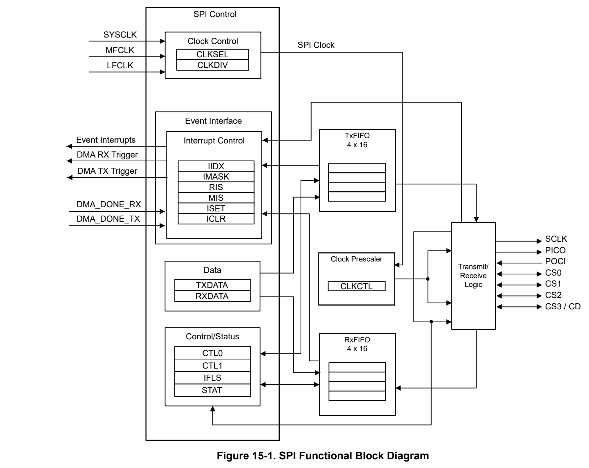
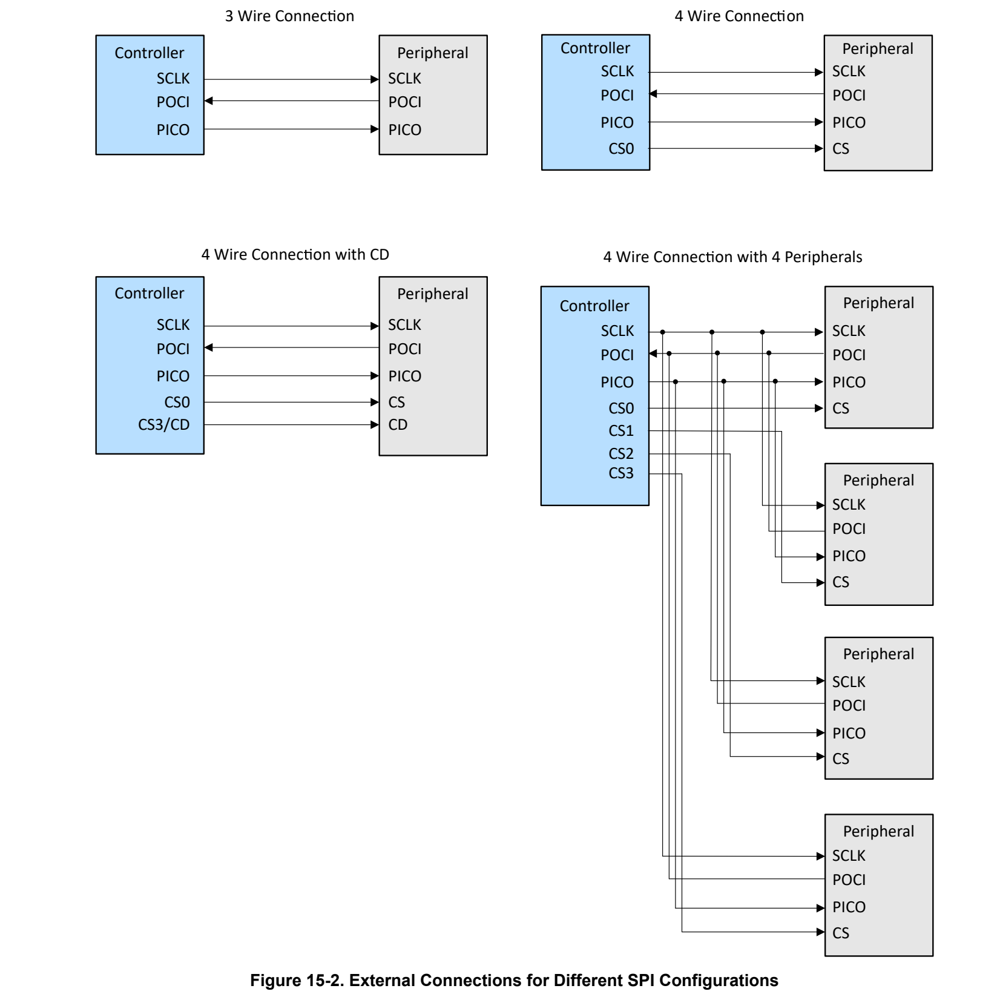
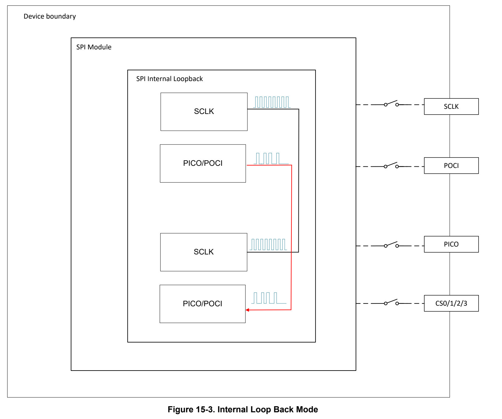
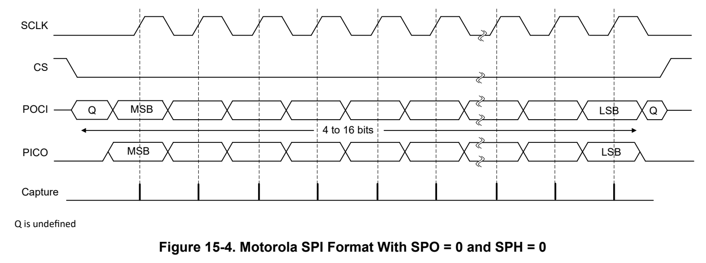
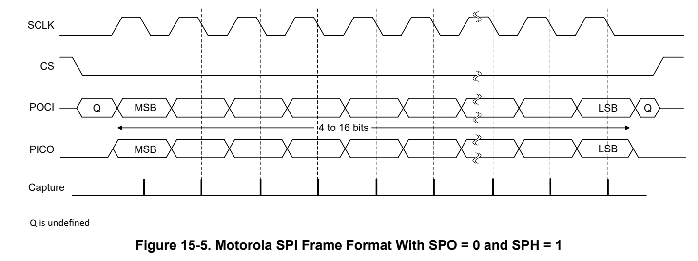
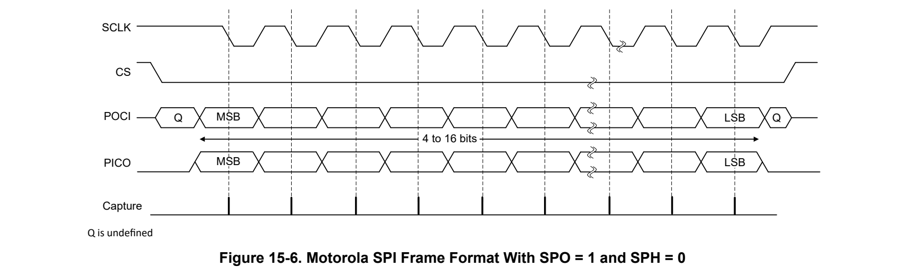
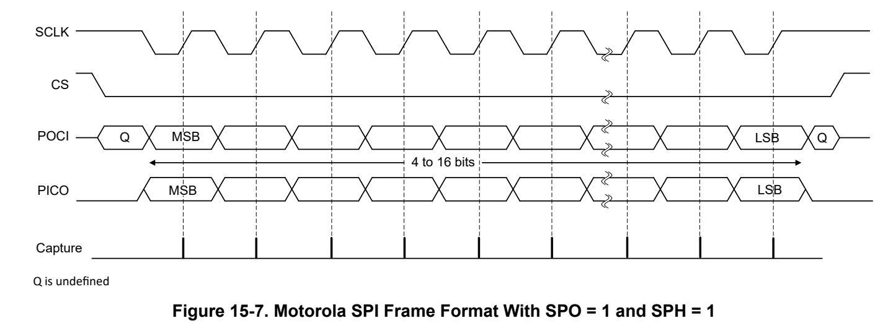
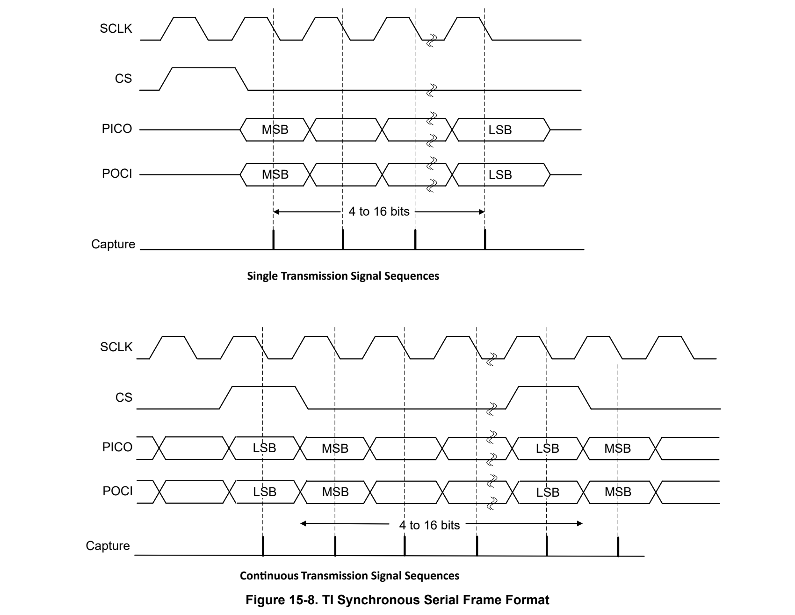

# 15 SPI (pp. 862-922)

### 15.1 SPI Overview 863 (p. 862)

### 15.2 SPI Operation 866 (p. 862)

### 15.3 SPI Registers 879 (p. 862)

### 15.1 SPI Overview (p. 863)

The SPI module provides a standardized serial interface to transfer data between MSPM0 devices and other external devices (such as a Sensors, Memory, ADCs, or DACs) using SPI protocols

#### 15.1.1 Purpose of the Peripheral (p. 863)

The SPI module acts as a controller or peripheral interface for synchronous serial communication with peripheral devices and other controllers. The transmit and receive paths are buffered with internal, independent FIFO memories allowing up to 4 entries with 16-bit width. A DMA interface is also provided to allow the data exchange with the transmit and receive FIFOs.

#### 15.1.2 Features (p. 863)

The SPI modules have the following features:

- Configurable as a controller or a peripheral

- Programmable clock bit rate and prescaler

- Separate transmit (TX) and receive (RX) first-in first-out buffers (FIFOs)

- Programmable data frame size from 4-bits to 16-bits (Controller Mode)

- Programmable data frame size from 7-bits to 16-bits (Peripheral Mode)

- Supports PACKEN feature that allows the packing of two 16 bit FIFO entries into a 32-bit value to improve CPU performance. However, not all devices support packing. Please check device specific data sheet.

- Interrupts for transmit and receive FIFOs, overrun and timeout interrupts, and DMA done

- Programmable SPI mode support Motorola SPI, MICROWIRE, or Texas Instruments format

- Single bit parity will be supported in both transmit and receive paths using the CTL1.PTEN and CTL1.PREN bits

- Direct memory access controller interface (DMA): – Separate channels for transmit and receive – Transfer complete interrupt

#### 15.1.3 Functional Block Diagram (p. 864)

*Figure 15-1. SPI Functional Block Diagram (p. 864)*

#### 15.1.4 External Connections and Signal Descriptions (p. 864)

Figure 15-2 and Table 15-1 show an overview of the pin functions for different operation modes of the SPI module.

*Figure 15-2. External Connections for Different SPI Configurations (p. 865)*

**Table 15-1. Pin Function Overview (p. 866)**

| Standard SPI | Col 2 | Feature |
| --- | --- | --- |
|  | SCLK | SPI clock Controller mode: SCLK is an output Peripheral mode: SCLK is an input |
|  | PICO | Controller out, peripheral in Controller mode: PICO is the data output line Peripheral mode: PICO is the data input line |
|  | POCI | Controller in, peripheral out Controller mode: POCI is the data input line Peripheral mode: POCI is the data output line |
|  | CS0 | Chip select signal 0, used in 4-pin mode |
|  | CS1 | Chip select signal 1, used in 4-pin mode |
|  | CS2 | Chip select signal 2, used in 4-pin mode |
|  | CS3/CD | Chip select signal 3 or Command, used in 4-pin mode |

### 15.2 SPI Operation (p. 866)

#### 15.2.1 Clock Control (p. 866)

The SPI internal functional clock is selected and divided from the clock sourced to this module.

- Use SPIx.CLKSEL register to select the source of the SPI functional clock. – BUSSCLK: the current bus clock is selected as the source for SPI. The current bus clock depends on power domain. If the SPI instance is in power domain 1 (PD1) please refer to MCLK, if the SPI instance is in power domain 0 (PD0) refer to ULPCLK. – MFCLK: MFCLK is selected as the source for SPI, refer to MFCLK. – LFCLK: LFCLK is selected as the source for SPI, refer to LFCLK

- Use SPIx.CLKDIV register to select the divide ratio of the SPI function clock. Options are from divide by 1 to 8.

The SPI module must be enabled before being configured for use by using the ENABLE bit in SPIx.PWREN register (see peripheral power enable). When the SPI will be setup or the configuration should be changed the ENABLE bit should be cleared to avoid unpredictable behavior during the updates or for the first data receive or transmitted afterward.

The maximum SPI frequency supported with controller and peripheral mode depends on the device clock option and IO option. Please refer to specific device data sheet spec for more information.

#### 15.2.2 General Architecture (p. 866)

##### 15.2.2.1 Chip Select and Command Handling (p. 866)

###### 15.2.2.1.1 Chip Select Control (p. 866)

One can configure the SPI to be controller mode by setting the CTL1.MS bit to 1, and in peripheral mode by clearing the CTL1.MS bit.

The CTL0.CSSEL bit selects which connected peripheral is addressed by the up to 4 CS signals. The bits are controlled by the SPI module in controller or target/peripheral mode. The selected signal is controlled during the transfers.

The chip select signal needs to be provided by the controller in four-wire mode and the chip select polarity can be inverted by configuring the PINCM.CSx.INV register.

In peripheral mode, the clock is provided by the controller and used by the peripheral to capture the data. The peripheral has the option to operate in 3-wire or 4-wire mode. 4-wire mode only accepts data transfers if the CS is activated.

When the CTL0.CSCLR bit is set, the transmit/receive shift register counter is cleared automatically when the CS goes to the inactive state. When using the Motorola 4-wire or National Microwire mode, follow these constraints:

- The CS disable period must be longer than 2 functional clock cycles before the CS pin is re-asserted

- The CS lead time (CS active to the first bit clock edge) must be at least 2 SPI functional clock cycles

Following these constraints helps the peripheral to synchronize again on the controller in case of a disturbance or glitch on the clock line or during initialization. This bit is relevant only in the peripheral mode.

- CTL0.CSCLR = 0: The transmit/receive bit counter state is retained when the CS signal disables the peripheral.

- CTL0.CSCLR = 1: The transmit/receive bit counter is cleared when the CS signal disables the peripheral.

Note The CSCLR function requires the CS disable pulse to be longer than 2 SPI function clock cycles to proper detect and clear the bit counter in the SPI. The CS lead time (CS active to the first bit clock edge) also needs to be at least 2 SPI function clock cycles.

###### 15.2.2.1.2 Command Data Control (p. 867)

When using the Motorola frame format, the CDMODE bit can be set to use the CS3/CD line as signal to distinguish between Command and Data information. This is often used for LCD or data storage devices.

- CD level low: command function

- CD level high: data function

The CTL1.CDMODE can be written with a value of 1-14 to specify the number of bytes and the CD line will go low for the given numbers of bytes which are sent by the SPI, starting with the next value to be transmitted. After the number of bytes are transmitted the CD will go high automatically. If a value of 0xF is set the C/D stays low permanently, a value of 0 set the CD line to high immediately after the current character has been transmitted.

This option is only available in controller mode. CTL1.CDENABLE can only be updated when the SPI module is disabled, CTL1.CDMODE can be updated between the different data packages. The counter will be reset with CDENABLE or SPI ENABLE set to disabled. Before setting a new value in CTL1.CDMODE the status of the FIFO should be checked to be empty and the SPI should be in Idle mode.

When writing a new value into CTL1.CDMODE, the internal counter will be reset and the new value will be used for counting. If the counter did count down to 0 and another command package should be sent the CDMODE needs to be set first again, otherwise the next data is send as data with the CD pin signaling data mode.

##### 15.2.2.2 Data Format (p. 867)

The control bit CTL1.MSB defines the direction of the data input and output with most-significant-bit (MSB) or least-significant-bit (LSB) first. If the parity is enabled the parity bits is always received as last bit.

With the control register bits CTL0.DSS the bit length per transfer will be defined between 4-16 bits for Controller mode and 7-16 bits for Peripheral mode.

A transfer will be triggered with writing to the TX buffer register. The data write needs to have at least the number of bits of the transfer. For example, if only a byte is written to the TX buffer but the length of the transfer is > 8 the missing bits will be filled with 0s. On the receive path the received data will be moved to the RXFIFO or RX buffer after the number of bit defined in CTL0.DSS register have been received.

The RX and TX buffer shall be accessed with at least the bits covering one transfer.

- 4-8 bits : byte access (Peripheral mode: 7-8 Bits)

Clock polarity (CTL0.SPO) is used to control the clock polarity when data is not being transferred and it is only used in the Motorola SPI frame mode.

- 0h = peripheral produces a steady state LOW value on the CLKOUT pin when data is not being transferred.

- 1h = peripheral produces a steady state HIGH value on the CLKOUT pin when data is not being transferred.

Clock phase (CTL0.SPH) bit selects the clock edge that captures data and enables it to change state. It has the most impact on the first bit transmitted by either permitting or not permitting a clock transition before the first data capture edge. Please refer to Motorola SPI frame mode section to check the diagrams.

- 0h = Data is captured on the first clock edge transition.

- 1h = Data is captured on the second clock edge transition.

The SPI can be configured to work in Peripheral mode with CTL1.MS bit = 0. In Peripheral mode the clock is provided by the controller and available for the peripheral on the CLK pins which needs to be configured for input. The Clock Select and divider control bits are not used. The CS input signal is used to select/enable the data receive path of the peripheral in 4 wire mode.

The SPI can be configured to work as Controller with CTL1.MS bit = 1. In Controller mode the clock needs to be generated by selecting the available clock sources with the clock select bits. It also needs to control the CS signal depending on the selected protocol.

When setting the CTL1.PEN bit the last bit will be used as parity to evaluate the integrity of the previous bits. The CTL1.PES bit selects the parity mode as even or odd. When detecting a fault, the interrupt flag RIS.PER is set to mark the data as invalid. Parity checking is a feature to improve the robustness of the communication.

##### 15.2.2.3 Delayed data sampling (p. 868)

In circumstances when the input data arrives at the POCI pin with some delay due to runtime conditions and the following input data sampling stage, the previous data would be sampled at the sampling clock edge. To compensate for such condition, a delayed sampling can be set with the CLKCTL.DSAMPLE bits. The delayed sampling is only available in controller mode. The delay can be adjusted in steps of SPI input clock steps with setting the control register bits CLKCTL.DSAMPLE. The maximum allowed delay should not exceed the length of one data frame.

##### 15.2.2.4 Clock Generation (p. 868)

The SPI includes a programmable bit rate clock divider and prescaler to generate the serial output clock (SCLK).

Bit rates supported are up to, the input clocks divided by 2. The input clock selection depends on the specific device, refer to the device data sheet and Clock Control section.

The SPI functionality can work with any of these selected inputs : SYSCLK, MFCLK and LFCLK

"SPI Clock" is the output after clock division performed according to ratio selected by the CLKDIV register. SPI clock = Selected input clock / (1 + CLKDIV)

SPI Sampling Clock (SCLK) is the output after dividing the SPI Clock by the Prescalar value. SCLK = SPI Clock / ((1 + SCR )*2)

If the factor of two (*2) is set by CLKDIV the input clock must be at least 2 times faster than SPI clock.

##### 15.2.2.5 FIFO Operation (p. 868)

Transmit FIFO

The TX FIFO is a 16-bit-wide, 4-location-deep, first-in first-out memory buffer. The CPU writes data to the FIFO by writing the SPI Data Register TXDATA.DATA, and data is stored in the FIFO until it is read out by the transmission logic.

When configured as a controller or a peripheral, parallel data is written into the TX FIFO before serial conversion and transmission to the attached peripheral or controller, respectively, through the PICO or POCI pin.

In peripheral mode, the SPI transmits data each time the controller initiates a transaction. If the TX FIFO is empty and the controller initiates a transfer, the peripheral transmits the most-recent value written to the transmit

FIFO. User or software is responsible to make valid data available to the FIFO as needed. The SPI can be configured to generate an interrupt or a DMA request when the FIFO is empty. The transmit FIFO has a TXFIFO_UNF interrupt to indicate a FIFO underflow condition.

Receive FIFO

The RX FIFO is a 16-bit-wide, 4-location-deep, first-in-first-out memory buffer. Received data from the serial interface is stored in the buffer until read out by the CPU or DMA, which accesses the read FIFO by reading the SPIx.RXDATA register.

When configured as a controller or peripheral, serial data is received through the POCI or PICO pin. As the access pointer for the FIFO will be updated with each access, the data needs to be accessed by single transfers.

With the FIFO fill level trigger signals located in the STAT register (TFE, TNF, RFE, RNF) the FIFO buffer allows an application to continuously stream serial data in one buffer while the application moves or process the data from the other buffer. If the FIFO is full and new data is written into the FIFO without reading data the RXFIFO overflow event is set. The receive FIFO has a RXFULL interrupt to indicate a FIFO full condition.

##### 15.2.2.6 Loopback mode (p. 869)

The SPI module can be placed into an internal loopback mode for diagnostic or debug work by setting the LBM bit in the CTL1 register. In loopback mode, the data from the TX FIFO can serially transmitted into the RX FIFO. The data from the RX FIFO can be read to check whether correct transmission has occurred or not. The external toggling of the IOs has no effect when the module is set in the internal loopback mode.

*Figure 15-3. Internal Loop Back Mode (p. 870)*

##### 15.2.2.7 DMA Operation (p. 870)

| Col 1 | operation of the SPI is enabled through the SPI Event and DMA register. When DMA operation is enabled, the SPI asserts a DMA request on the receive or transmit channel when the associated FIFO can transfer data. |
| --- | --- |
| triggered, in this case the amount of data received so far will be transmitted. | SPI asserts a DMA request on the receive or transmit channel when the associated FIFO can transfer data. For the receive channel a transfer request is asserted whenever the amount of data in the receive FIFO is at or above the FIFO trigger level configured using the RXIFLSEL bit in IFLS register or the receive timeout has For the transmit channel a transfer request is asserted whenever the transmit FIFO contains fewer characters |
|  | For the transmit channel a transfer request is asserted whenever the transmit FIFO contains fewer characters than the FIFO trigger level configured using the TXIFLSEL bit in IFLS register. The DMA transfer requests are handled automatically by the DMA controller depending on how the DMA channel is configured. |

The DMA transfers can be configured and aligned between the data width of the SPI transfers and the bus accesses width of 8/16 bits to make an efficient usage of the bus. The trigger and transfers are independent for receive and transmit.

See more information about the interrupt and event in Section 15.2.6.2 section.

##### 15.2.2.8 Repeat Transfer mode (p. 871)

With the CTL1.REPEATTX bits the last character transmit will be repeated as defined by the register bits. A value of 0 in CTL1.REPEATTX bits will disable this mode and this function is only available in Controller mode. The transfer will be started with writing a data into the TX Buffer. Then the data will be repeatedly sent with the given value. The behavior is identical as if the data would be written into the TX Buffer that many times as defined by the value here. It can be used to clean a transfer or to pull a certain amount of data from a peripheral.

When REPEATTX is used it needs to be aligned with the data in the FIFO. So the below shown sequence should be used:

- Wait and check till FIFO is empty

- Setup REPEATTX

- Write to TXDATA / FIFO

- Wait till requested data has been received

##### 15.2.2.9 Low Power Mode (p. 871)

The SPI module is located in power domain 1 (PD1) and as such is only active in RUN and SLEEP modes. If the SPI module is enabled by application software, an entry into STOP or STANDBY low-power mode forces the SPI module to be temporarily disabled while the device is in STOP or STANDBY mode.

#### 15.2.3 Protocol Descriptions (p. 871)

The protocol format mode can be selected by using CTL0.FRF register. The supported options include Motorola 3 wire, Motorola 4 wire, Texas Instruments Synchronous and MICROWIRE.

##### 15.2.3.1 Motorola SPI Frame Format (p. 871)

The Motorola SPI interface is a 4-wire interface where the CS signal behaves as a peripheral select. In the 3-wire mode the CS signals is not required and the module behaves as if always selected. The main feature of the Motorola SPI format is that the inactive state and phase of the SCLK signal can be programmed through the SPO and SPH bits in the SPIx.CTL0 control register.

SPO Clock Polarity Bit

If the CTL0.SPO clock polarity control bit is clear, the bit produces a steady-state low value on the SCLK pin when data is not being transferred. If the CTL0.SPO bit is set, the bit places a steady-state high value on the SCLK pin when data is not being transferred.

SPH Phase-Control Bit

The CTL0.SPH phase-control bit selects the clock edge that captures data, and allows it to change state. The state of this bit has the most impact on the first bit transmitted, by either allowing or not allowing a clock transition before the first data capture edge. If the CTL0.SPH phase-control bit is clear, data is captured on the first clock edge transition. If the SPH bit is set, data is captured on the second clock edge transition.

Motorola SPI Frame Format with SPO = 0 and SPH = 0

Figure 15-4 shows signal sequences for Motorola SPI format with SPO = 0 and SPH = 0.

*Figure 15-4. Motorola SPI Format With SPO = 0 and SPH = 0 (p. 872)*

In this configuration, the following occurs during idle periods:

- SCLK is forced low

- CS is forced high

- The transmit data line PICO is forced low

- When the SPI is configured as a controller, it enables the SCLK pin

- When the SPI is configured as a peripheral, it disables the SCLK pin

If the SPI is enabled and valid data is in the TX FIFO, the CS controller signal is driven low at the start of transmission which causes enabling of peripheral data onto the POCI input line of the controller. The controller PICO output pin is enabled.

One-half SCLK period later, valid controller data is transferred to the PICO pin. Once both the controller and peripheral data are set, the SCLK controller clock pin goes high after an additional one-half SCLK period. The data is now captured on the rising edges and propagated on the falling edges of the SCLK signal.

For a single-word transmission after all bits of the data word are transferred, the CS line is returned to its IDLE high state one SCLK period after the last bit is captured. For continuous back-to-back transmissions, the CS signal must pulse high between each data word transfer because the peripheral-select pin freezes the data in its serial peripheral register and does not allow altering of the data if the SPH bit is clear. The controller device must raise the CS pin of the peripheral device between each data transfer to enable the serial peripheral data write. When the continuous transfer completes, the CS pin is returned to its IDLE state one SCLK period after the last bit is captured.

Motorola SPI Frame Format with SPO = 0 and SPH = 1

Figure 15-5 shows the signal sequence for Motorola SPI format with SPO = 0 and SPH = 1.

*Figure 15-5. Motorola SPI Frame Format With SPO = 0 and SPH = 1 (p. 873)*

In this configuration, the following occurs during idle periods:

- SCLK is forced low

- CS is forced high

- The transmit data line PICO is forced low

- When the SPI is configured as a controller, it enables the SCLK pin

- When the SPI is configured as a peripheral, it disables the SCLK pin

If the SPI is enabled and valid data is in the TX FIFO, the CS controller signal goes low at the start of transmission. The controller PICO output is enabled. After an additional one-half SCLK period, both controller and peripheral valid data are enabled onto their respective transmission lines. At the same time, SCLK is enabled with a rising-edge transition. Data is then captured on the falling edges and propagated on the rising edges of the SCLK signal.

For a single-word transfer, after all bits are transferred, the CS line is returned to its IDLE high state one SCLK period after the last bit is captured. For continuous back-to-back transfers, the CS pin is held low between successive data words and terminates like a single-word transfer.

Motorola SPI Frame Format with SPO = 1 and SPH = 0

Figure 15-6 shows signal sequences for Motorola SPI format with SPO = 1 and SPH = 0.

*Figure 15-6. Motorola SPI Frame Format With SPO = 1 and SPH = 0 (p. 873)*

In this configuration, the following occurs during idle periods:

- SCLK is forced high

- The transmit data line PICO is arbitrarily forced low

- When the SPI is configured as a controller, it enables the SCLK pin

- When the SPI is configured as a peripheral, it disables the SCLK pin

If the SPI is enabled and valid data is in the TX FIFO, the SPI CS controller signal goes low at the start of transmission and transfers peripheral data onto the POCI line of the controller immediately. The controller PICO output pin is enabled.

One-half SCLK period later, valid controller data is transferred to the PICO line. When both the controller and peripheral data have been set, the SCLK controller clock pin becomes low after one additional half SCLK period. Data is captured on the falling edges and propagated on the rising edges of the SCLK signal.

For a single-word transmission after all bits of the data word are transferred, the CS line is returned to its IDLE high state one SCLK period after the last bit is captured. For continuous back-to-back transmissions, the CS signal must pulse high between each data word transfer as the peripheral-select pin freezes the data in its serial peripheral register and keeps it from being altered if the SPH bit is clear. The controller device must raise the CS pin of the peripheral device between each data transfer to enable the serial peripheral data write. When the continuous transfer completes, the CS pin returns to its IDLE state one SCLK period after the last bit is captured.

Motorola SPI Frame Format with SPO = 1 and SPH = 1

Figure 15-7 shows the signal sequence for Motorola SPI format with SPO = 1 and SPH = 1.

*Figure 15-7. Motorola SPI Frame Format With SPO = 1 and SPH = 1 (p. 874)*

In this configuration, the following occurs during idle periods:

- SCLK is forced high

- CS is forced high

- The transmit data line PICO is arbitrarily forced low

- When the SPI is configured as a controller, it enables the SCLK pin

- When the SPI is configured as a peripheral, it disables the SCLK pin

If the SPI is enabled and valid data is in the TX FIFO, the start of transmission is signified by the CS controller signal going low. The controller PICO output pin is enabled. After an additional one-half SCLK period, both controller and peripheral data are enabled onto their respective transmission lines. At the same time, SCLK is enabled with a falling-edge transition. Data is then captured on the rising edges and propagated on the falling edges of the SCLK signal.

For a single word transmission, after all bits are transferred, the CS line returns to its IDLE high state one SCLK period after the last bit is captured. For continuous back-to-back transmissions, the CS pin remains in its active low state until the final bit of the last word is captured and then returns to its IDLE state. For continuous back-to-back transfers, the CS pin is held low between successive data words and terminates like a single-word transfer.

The serial clock (SCLK) is held inactive while the SPI is idle and SCLK transitions at the programmed frequency only during active transmission or reception of data. The IDLE state of SCLK provides a receive timeout indication that occurs when the RX FIFO still contains data after a timeout period.

##### 15.2.3.2 Texas Instruments Synchronous Serial Frame Format (p. 875)

The SPI peripheral is compatible with Texas Instruments Synchronous Serial frame format.

Figure 15-8 shows the TI synchronous serial frame format for a single and continuous transmitted frame.

*Figure 15-8. TI Synchronous Serial Frame Format (p. 875)*

SCLK and CS are forced low and the transmit data line PICO is put in tristate whenever the SPI is idle. When the bottom entry of the TX FIFO contains data, CS is pulsed high for one SCLK period. The transmitted value is also transferred from the TX FIFO to the serial shift register of the transmit logic. On the next rising edge of SCLK, the MSB of the 4- to 16-bit data frame is shifted out on the PICO pin. Likewise, the MSB of the received data is shifted onto the POCI pin by the off-chip serial peripheral device. Both the SPI and the off-chip serial peripheral device then clock each data bit into their serial shifter on each falling edge of SCLK. The received

data is transferred from the serial shifter to the RX FIFO on the first rising edge of SCLK after the least significant bit (LSB) is latched.

The serial clock (SCLK) is held inactive while the SPI is idle and SCLK transitions at the programmed frequency only during active transmission or reception of data. The IDLE state of SCLK provides a receive time-out indication that occurs when the RX FIFO still contains data after a time-out period.

#### 15.2.4 Reset Considerations (p. 876)

Software Reset Considerations

A Software reset can be executed with setting the RESETASSERT together with the KEY in the RSTCTL register. An ongoing transfer will be terminated immediately and can leave the software in an undefined state. Therefore, before requesting a Reset an ongoing Transfer should be terminated.

Hardware Reset Considerations

A hardware reset also initializes the IO configuration. This sets the IOs to a high impedance state and the data lines can float. If this is critical for the application or connected devices on the SPI interface external pull up or down resistors might be required.

#### 15.2.5 Initialization (p. 876)

To enable and initialize the SPI, the following steps are necessary: 1. Configure the IOMUX with the appropriate GPIO pins for which the SPI signals are multiplexed to

Note Pull-ups can be used to avoid unnecessary toggles on the SPI pins, which can take the peripheral to a wrong state. In addition, if the SCLK signal is programmed to steady state High through the SPO bit in the CTL0 register, then software must also configure the GPIO port pin corresponding to the SCLK signal as a pull-up.

For each of the frame formats, the SPI is configured using the following steps: 1. Ensure that the ENABLE bit in the CTL1 register is clear before making any configuration changes. 2. Select and configure the clock prescale divisor by writing the CLKSEL and CLKDIV register. 3. Select whether the SPI is a controller or peripheral:

- For controller operations, set the MS bit in the CTL1 register.

- For peripheral mode, clear the MS bit in the CTL1 register. 4. Configure the clock divisor by writing the CLKCTL register. 5. Please note that a SPI Software reset ( See section 15.3.4) is required when switching SPI protocol format. 6. Configure the CTL0 and CTL1 register with based on the desired protocol, data width and other special configurations. 7. Optionally configure DMA 8. Enable the SPI by setting the ENABLE bit in the CTL1 register.

#### 15.2.6 Interrupt and Events Support (p. 876)

The SPI module contains three event publishers and no event subscribers. One event publisher (CPU_INT) manages SPI interrupt requests (IRQs) to the CPU subsystem through a static event route. The second and third event publishers (DMA_TRIG_RX, DMA_TRIG_TX) are used to setup the trigger signaling for the DMA through DMA event route.

The SPI events are summarized in Table 15-2.

**Table 15-2. SPI Events (p. 877)**

| Event | Type | Source | Destination | Route | Configuration | Functionality |
| --- | --- | --- | --- | --- | --- | --- |
| CPU interrupt | Publisher | SPI | CPU Subsystem | Static route | CPU_INT registers | Fixed interrupt route from SPI to CPU |
| DMA trigger | Publisher | SPI | DMA | DMA event route | DMA_TRIG_RX registers | Fixed interrupt route from SPI RX to DMA |
| DMA trigger | Publisher | SPI | DMA | DMA event route | DMA_TRIG_TX registers | Fixed interrupt route from SPI TX to DMA |

##### 15.2.6.1 CPU Interrupt Event Publisher (CPU_INT) (p. 877)

The SPI module provides 9 interrupt sources that can source a CPU interrupt event. Table 15-3 lists the CPU interrupt events from the SPI in order of decreasing priority.

**Table 15-3. SPI CPU_INT Trigger Condition (p. 877)**

| IIDX STAT | Name | Description |
| --- | --- | --- |
| 0x01 | RXFIFO_OVF | RXFIFO overflow event. This interrupt is set if an RX FIFO overflow has been detected. |
| 0x02 | PER | Parity error event. This bit if a Parity error has been detected. |
| 0x03 | RTOUT | Peripheral receive timeout event. When in peripheral mode and not receiving data for the CTL1.RXTIMEOUT selected number of functional clock cycles. |
| 0x04 | RX | Receive FIFO event. This interrupt is set if the selected receive FIFO level has been reached. |
| 0x05 | TX | Transmit FIFO event. This interrupt is set if the selected transmit FIFO level has been reached. |
| 0x06 | TXEMPTY | Transmit FIFO empty interrupt. This is set if all data in the transmit FIFO have been shifted out. |
| 0x07 | IDLE | SPI Idle. SPI has done finished transfers and changed into IDLE mode. This bit is set when STAT.BUSY bit goes low. |
| 0x08 | DMA_DONE1_RX | This interrupt is set if the RX DMA channel sends the DONE signal. |
| 0x09 | DMA_DONE1_TX | This interrupt is set if the TX DMA channel sends the DONE signal. |

The CPU interrupt event configuration is managed with the CPU_INT event management registers. See Section 7.2.5 for guidance on configuring the Event registers.

##### 15.2.6.2 DMA Trigger Publisher (DMA_TRIG_RX, DMA_TRIG_TX) (p. 877)

DMA_TRIG_RX and DMA_TRIG_TX registers are used to setup the trigger signaling for the DMA. This can be setup in a flexible way to trigger the DMA for receive or transmit events with the trigger conditions in Table 15-4 and Table 15-5.

DMA_TRIG_RX is used for triggering the DMA to do a receive data transfer and DMA_TRIG_TX is used for triggering the DMA to do a transmit data transfer.

**Table 15-4. SPI DMA_TRIG_RX DMA Trigger Condition (p. 877)**

| IIDX STAT | Name | Description |
| --- | --- | --- |
| 0x03 | RTOUT | Peripheral receive timeout event. When in peripheral mode and not receiving data for the CTL1.RXTIMEOUT selected number of functional clock cycles. |
| 0x04 | RX | Receive FIFO event. This interrupt is set if the selected receive FIFO level has been reached. |

**Table 15-5. SPI DMA_TRIG_TX DMA Trigger Condition (p. 878)**

| IIDX STAT | Name | Description |
| --- | --- | --- |
| 0x05 | TX | Transmit FIFO event. This interrupt is set if the selected transmit FIFO level has been reached. |

The DMA trigger event configuration is managed with the DMA_TRIG_RX and DMA_TRIG_TX event management registers. See Section 7.2.5 for guidance on configuring the Event registers and Section 7.1.3.2 for on how DMA trigger event works.

#### 15.2.7 Emulation Modes (p. 878)

The module behavior while the device is in debug mode is controlled by the FREE and SOFT bits in PDBGCTL register.

When the device is in debug mode and set into halt mode below behavior can be configured.

**Table 15-6. Debug Mode Peripheral Behavior (p. 878)**

| PDBGCTL.FREE | PDBGCTL.SOFT | Function |
| --- | --- | --- |
| 1 | x | Modules continues operation |
| 0 | 0 | Module stops immediately |
| 0 | 1 | Module stops after the next transfer has been finished |

### 15.3 SPI Registers (p. 879)

Table 15-7 lists the memory-mapped registers for the SPI registers. All register offset addresses not listed in Table 15-7 should be considered as reserved locations and the register contents should not be modified.

**Table 15-7. SPI Registers (pp. 879-880)**

| Offset | Acronym | Register Name | Group |
| --- | --- | --- | --- |
| 800h | PWREN | Power enable |  |
| 804h | RSTCTL | Reset Control |  |
| 808h | CLKCFG | Peripheral Clock Configuration Register |  |
| 814h | STAT | Status Register |  |
| 1000h | CLKDIV | Clock Divider |  |
| 1004h | CLKSEL | Clock Select for Ultra Low Power peripherals |  |
| 1018h | PDBGCTL | Peripheral Debug Control |  |
| 1020h | IIDX | Interrupt Index Register | CPU_INT |
| 1028h | IMASK | Interrupt mask | CPU_INT |
| 1030h | RIS | Raw interrupt status | CPU_INT |
| 1038h | MIS | Masked interrupt status | CPU_INT |
| 1040h | ISET | Interrupt set | CPU_INT |
| 1048h | ICLR | Interrupt clear | CPU_INT |
| 1050h | IIDX | Interrupt Index Register | DMA_TRIG_RX |
| 1058h | IMASK | Interrupt mask | DMA_TRIG_RX |
| 1060h | RIS | Raw interrupt status | DMA_TRIG_RX |
| 1068h | MIS | Masked interrupt status | DMA_TRIG_RX |
| 1070h | ISET | Interrupt set | DMA_TRIG_RX |
| 1078h | ICLR | Interrupt clear | DMA_TRIG_RX |
| 1080h | IIDX | Interrupt Index Register | DMA_TRIG_TX |
| 1088h | IMASK | Interrupt mask | DMA_TRIG_TX |
| 1090h | RIS | Raw interrupt status | DMA_TRIG_TX |
| 1098h | MIS | Masked interrupt status | DMA_TRIG_TX |
| 10A0h | ISET | Interrupt set | DMA_TRIG_TX |
| 10A8h | ICLR | Interrupt clear | DMA_TRIG_TX |
| 10E0h | EVT_MODE | Event Mode |  |
| 10E4h | INTCTL | Interrupt control register |  |
| 1100h | CTL0 | SPI control register 0 |  |
| 1104h | CTL1 | SPI control register 1 |  |
| 1108h | CLKCTL | Clock prescaler and divider register. |  |
| 110Ch | IFLS | Interrupt FIFO Level Select Register |  |
| 1130h | RXDATA | RXDATA Register |  |
| 1140h | TXDATA | TXDATA Register |  |

Complex bit access types are encoded to fit into small table cells. Table 15-8 shows the codes that are used for access types in this section.

**Table 15-8. SPI Access Type Codes (p. 880)**

| Access Type | Code | Description |
| --- | --- | --- |
| Read Type |  |  |
| R | R | Read |
| Write Type |  |  |
| W | W | Write |
| WK | W K | Write Write protected by a key |
| Reset or Default Value |  |  |
| - n |  | Value after reset or the default value |

### 15.3.1 [SPI.PWREN] Offset: 800h | Reset: 00000000h (p. 881)

PWREN is shown in Figure 15-9 and described in Table 15-9.

Register to control the power state

> **Bit Map**: `[31-24] KEY (W, 0h)` | `[23-1] RESERVED (R, 0h)` | `[0] ENABLE (R/WK, 0h)`

**Table 15-9. PWREN Field Descriptions (p. 881)**

| Bit | Field | Type | Reset | Description |
| --- | --- | --- | --- | --- |
| 31-24 | KEY | W | 0h | KEY to allow Power State Change; 26h = KEY to allow write access to this register |
| 23-1 | RESERVED | R | 0h |  |
| 0 | ENABLE | R/WK | 0h | Enable the power KEY must be set to 26h to write to this bit.; 0h = Disable Power; 1h = Enable Power |

### 15.3.2 [SPI.RSTCTL] Offset: 804h | Reset: 00000000h (p. 882)

RSTCTL is shown in Figure 15-10 and described in Table 15-10.

Register to control reset assertion and de-assertion

> **Bit Map**: `[31-24] KEY (W, 0h)` | `[23-2] RESERVED (R, 0h)` | `[1] RESETSTKYCLR (WK, 0h)` | `[0] RESETASSERT (WK, 0h)`

**Table 15-10. RSTCTL Field Descriptions (p. 882)**

| Bit | Field | Type | Reset | Description |
| --- | --- | --- | --- | --- |
| 31-24 | KEY | W | 0h | Unlock key; B1h = KEY to allow write access to this register |
| 23-2 | RESERVED | R | 0h |  |
| 1 | RESETSTKYCLR | WK | 0h | Clear the RESETSTKY bit in the STAT register KEY must be set to B1h to write to this bit.; 0h = Writing 0 has no effect; 1h = Clear reset sticky bit |
| 0 | RESETASSERT | WK | 0h | Assert reset to the peripheral KEY must be set to B1h to write to this bit.; 0h = Writing 0 has no effect; 1h = Assert reset |

### 15.3.3 [SPI.CLKCFG] Offset: 808h | Reset: 00000000h (p. 883)

CLKCFG is shown in Figure 15-11 and described in Table 15-11.

Peripheral Clock Configuration Register

> **Bit Map**: `[31-24] KEY (W, 0h)` | `[23-9] RESERVED (R, 0h)` | `[8] BLOCKASYNC (R/W, 0h)` | `[7-0] RESERVED (R, 0h)`

**Table 15-11. CLKCFG Field Descriptions (p. 883)**

| Bit | Field | Type | Reset | Description |
| --- | --- | --- | --- | --- |
| 31-24 | KEY | W | 0h | KEY to Allow State Change -- 0xA9; A9h = key value to allow change field of GPRCM |
| 23-9 | RESERVED | R | 0h |  |
| 8 | BLOCKASYNC | R/W | 0h | Async Clock Request is blocked from starting SYSOSC or forcing bus clock to 32MHz; 0h = Not block async clock request; 1h = Block async clock request |
| 7-0 | RESERVED | R | 0h |  |

### 15.3.4 [SPI.STAT] Offset: 814h | Reset: 00000000h (p. 884)

STAT is shown in Figure 15-12 and described in Table 15-12.

peripheral enable and reset status

> **Bit Map**: `[31-17] RESERVED (R, 0h)` | `[16] RESETSTKY (R, 0h)` | `[15-0] RESERVED (R, 0h)`

**Table 15-12. STAT Field Descriptions (p. 884)**

| Bit | Field | Type | Reset | Description |
| --- | --- | --- | --- | --- |
| 31-17 | RESERVED | R | 0h |  |
| 16 | RESETSTKY | R | 0h | This bit indicates, if the peripheral was reset, since this bit was cleared by RESETSTKYCLR in the RSTCTL register; 0h = The peripheral has not been reset since this bit was last cleared by RESETSTKYCLR in the RSTCTL register; 1h = The peripheral was reset since the last bit clear |
| 15-0 | RESERVED | R | 0h |  |

### 15.3.5 [SPI.CLKDIV] Offset: 1000h | Reset: 00000000h (p. 885)

CLKDIV is shown in Figure 15-13 and described in Table 15-13.

This register is used to specify module-specific divide ratio of the functional clock

> **Bit Map**: `[31-3] RESERVED (R, 0h)` | `[2-0] RATIO (R/W, 0h)`

**Table 15-13. CLKDIV Field Descriptions (p. 885)**

| Bit | Field | Type | Reset | Description |
| --- | --- | --- | --- | --- |
| 31-3 | RESERVED | R | 0h |  |
| 2-0 | RATIO | R/W | 0h | Selects divide ratio of module clock; 0h = Do not divide clock source; 1h = Divide clock source by 2; 2h = Divide clock source by 3; 3h = Divide clock source by 4; 4h = Divide clock source by 5; 5h = Divide clock source by 6; 6h = Divide clock source by 7; 7h = Divide clock source by 8 |

### 15.3.6 [SPI.CLKSEL] Offset: 1004h | Reset: 00000000h (p. 886)

CLKSEL is shown in Figure 15-14 and described in Table 15-14.

Clock source selection for peripherals

> **Bit Map**: `[31-4] RESERVED (R, 0h)` | `[3] SYSCLK_SEL (R/W, 0h)` | `[2] MFCLK_SEL (R/W, 0h)` | `[1] LFCLK_SEL (R/W, 0h)` | `[0] RESERVED (R, 0h)`

**Table 15-14. CLKSEL Field Descriptions (p. 886)**

| Bit | Field | Type | Reset | Description |
| --- | --- | --- | --- | --- |
| 31-4 | RESERVED | R | 0h |  |
| 3 | SYSCLK_SEL | R/W | 0h | Selects SYSCLK as clock source if enabled; 0h = Does not select this clock as a source; 1h = Select this clock as a source |
| 2 | MFCLK_SEL | R/W | 0h | Selects MFCLK as clock source if enabled; 0h = Does not select this clock as a source; 1h = Select this clock as a source |
| 1 | LFCLK_SEL | R/W | 0h | Selects LFCLK as clock source if enabled; 0h = Does not select this clock as a source; 1h = Select this clock as a source |
| 0 | RESERVED | R | 0h |  |

### 15.3.7 [SPI.PDBGCTL] Offset: 1018h | Reset: 00000000h (p. 887)

PDBGCTL is shown in Figure 15-15 and described in Table 15-15.

This register can be used by the software developer to control the behavior of the peripheral relative to the 'Core Halted' input

> **Bit Map**: `[31-2] RESERVED (R, 0h)` | `[1] SOFT (R/W, 1h)` | `[0] FREE (R/W, 1h)`

**Table 15-15. PDBGCTL Field Descriptions (p. 887)**

| Bit | Field | Type | Reset | Description |
| --- | --- | --- | --- | --- |
| 31-2 | RESERVED | R | 0h |  |
| 1 | SOFT | R/W | 1h | Soft halt boundary control. This function is only available, if FREE is set to 'STOP'; 0h = The peripheral will halt immediately, even if the resultant state will result in corruption if the system is restarted; 1h = The peripheral blocks the debug freeze until it has reached a boundary where it can resume without corruption |
| 0 | FREE | R/W | 1h | Free run control; 0h = The peripheral freezes functionality while the Core Halted input is asserted and resumes when it is deasserted.; 1h = The peripheral ignores the state of the Core Halted input |

### 15.3.8 [SPI.IIDX] Offset: 1020h | Reset: 00000000h (p. 888)

IIDX is shown in Figure 15-16 and described in Table 15-16.

This register provides the highest priority enabled interrupt index. Value 0x00 means no event pending. Interrupt 1 is the highest priority, IIDX next highest, 4, 8, … IIDX^31 is the least priority. That is, the least bit position that is set to 1 denotes the highest priority pending interrupt. The priority order is fixed. However, users can implement their own prioritization schemes using other registers that expose the full set of interrupts that have occurred. On each read, only one interrupt is indicated. On a read, the current interrupt (highest priority) is automatically cleared by the hardware and the corresponding interrupt flag in [RIS] and [MIS] are cleared as well. After a read from the CPU (not from the debug interface), the register is updated with the next highest priority interrupt, if none are pending, then it should display 0x0.

> **Bit Map**: `[31-8] RESERVED (R, 0h)` | `[7-0] STAT (R, 0h)`

**Table 15-16. IIDX Field Descriptions (p. 888)**

| Bit | Field | Type | Reset | Description |
| --- | --- | --- | --- | --- |
| 31-8 | RESERVED | R | 0h |  |
| 7-0 | STAT | R | 0h | Interrupt index status; 00h = No interrupt pending; 1h = RX FIFO Overflow Event/interrupt pending; 2h = Transmit Parity Event/interrupt pending; 3h = SPI receive time-out interrupt; 4h = Receive Event/interrupt pending; 5h = Transmit Event/interrupt pending; 6h = Transmit Buffer Empty Event/interrupt pending; 7h = End of Transmit Event/interrupt pending; 8h = DMA Done for Receive Event/interrupt pending; 9h = DMA Done for Transmit Event/interrupt pending; Ah = TX FIFO underflow interrupt; Bh = RX FIFO Full Interrupt |

### 15.3.9 [SPI.IMASK] Offset: 1028h | Reset: 00000000h (p. 889)

IMASK is shown in Figure 15-17 and described in Table 15-17.

Interrupt Mask. If a bit is set, then corresponding interrupt is un-masked. Un-masking the interrupt causes the raw interrupt to be visible in IIDX, as well as MIS.

> **Bit Map**: `[31-11] RESERVED (R, 0h)` | `[10] RXFULL (R/W, 0h)` | `[9] TXFIFO_UNF (R/W, 0h)` | `[8] DMA_DONE_TX (R/W, 0h)` | `[7] DMA_DONE_RX (R/W, 0h)` | `[6] IDLE (R/W, 0h)` | `[5] TXEMPTY (R/W, 0h)` | `[4] TX (R/W, 0h)` | `[3] RX (R/W, 0h)` | `[2] RTOUT (R/W, 0h)` | `[1] PER (R/W, 0h)` | `[0] RXFIFO_OVF (R/W, 0h)`

**Table 15-17. IMASK Field Descriptions (pp. 889-890)**

| Bit | Field | Type | Reset | Description |
| --- | --- | --- | --- | --- |
| 31-11 | RESERVED | R | 0h |  |
| 10 | RXFULL | R/W | 0h | RX FIFO Full Interrupt Mask; 0h = Clear Interrupt Mask; 1h = Set Interrupt Mask |
| 9 | TXFIFO_UNF | R/W | 0h | TX FIFO underflow interrupt mask; 0h = Clear Interrupt Mask; 1h = Set Interrupt Mask |
| 8 | DMA_DONE_TX | R/W | 0h | DMA Done 1 event for TX event mask.; 0h = Clear Interrupt Mask; 1h = Set Interrupt Mask |
| 7 | DMA_DONE_RX | R/W | 0h | DMA Done 1 event for RX event mask.; 0h = Clear Interrupt Mask; 1h = Set Interrupt Mask |
| 6 | IDLE | R/W | 0h | SPI Idle event mask.; 0h = Clear Interrupt Mask; 1h = Set Interrupt Mask |
| 5 | TXEMPTY | R/W | 0h | Transmit FIFO Empty event mask.; 0h = Clear Interrupt Mask; 1h = Set Interrupt Mask |
| 4 | TX | R/W | 0h | Transmit FIFO event mask.; 0h = Clear Interrupt Mask; 1h = Set Interrupt Mask |
| 3 | RX | R/W | 0h | Receive FIFO event.This interrupt is set if the selected Receive FIFO level has been reached; 0h = Clear Interrupt Mask; 1h = Set Interrupt Mask |
| 2 | RTOUT | R/W | 0h | Enable SPI Receive Time-Out event mask. |
| 1 | PER | R/W | 0h | Parity error event mask.; 0h = Clear Interrupt Mask; 1h = Set Interrupt Mask |
| 0 | RXFIFO_OVF | R/W | 0h | RXFIFO overflow event mask.; 0h = Clear Interrupt Mask; 1h = Set Interrupt Mask |

### 15.3.10 [SPI.RIS] Offset: 1030h | Reset: 00000000h (p. 891)

RIS is shown in Figure 15-18 and described in Table 15-18.

Raw interrupt status. Reflects all pending interrupts, regardless of masking. The RIS register allows the user to implement a poll scheme. A flag set in this register can be cleared by writing 1 to the ICLR register bit even if the corresponding IMASK bit is not enabled.

> **Bit Map**: `[31-11] RESERVED (R, 0h)` | `[10] RXFULL (R, 0h)` | `[9] TXFIFO_UNF (R, 0h)` | `[8] DMA_DONE_TX (R, 0h)` | `[7] DMA_DONE_RX (R, 0h)` | `[6] IDLE (R, 0h)` | `[5] TXEMPTY (R, 0h)` | `[4] TX (R, 0h)` | `[3] RX (R, 0h)` | `[2] RTOUT (R, 0h)` | `[1] PER (R, 0h)` | `[0] RXFIFO_OVF (R, 0h)`

**Table 15-18. RIS Field Descriptions (pp. 891-892)**

| Bit | Field | Type | Reset | Description |
| --- | --- | --- | --- | --- |
| 31-11 | RESERVED | R | 0h |  |
| 10 | RXFULL | R | 0h | RX FIFO Full Interrupt; 0h = Interrupt did not occur; 1h = Interrupt occurred |
| 9 | TXFIFO_UNF | R | 0h | TX FIFO Underflow Interrupt; 0h = Interrupt did not occur; 1h = Interrupt occurred |
| 8 | DMA_DONE_TX | R | 0h | DMA Done 1 event for TX. This interrupt is set if the TX DMA channel sends the DONE signal. This allows the handling of the DMA event inside the mapped peripheral.; 0h = Interrupt did not occur; 1h = Interrupt occurred |
| 7 | DMA_DONE_RX | R | 0h | DMA Done 1 event for RX. This interrupt is set if the RX DMA channel sends the DONE signal. This allows the handling of the DMA event inside the mapped peripheral.; 0h = Interrupt did not occur; 1h = Interrupt occurred |
| 6 | IDLE | R | 0h | SPI has done finished transfers and changed into IDLE mode. This bit is set when BUSY goes low.; 0h = Interrupt did not occur; 1h = Interrupt occurred |
| 5 | TXEMPTY | R | 0h | Transmit FIFO Empty interrupt mask. This interrupt is set if all data in the Transmit FIFO have been move to the shift register.; 0h = Interrupt did not occur; 1h = Interrupt occurred |
| 4 | TX | R | 0h | Transmit FIFO event..This interrupt is set if the selected Transmit FIFO level has been reached. |
| 3 | RX | R | 0h | Receive FIFO event.This interrupt is set if the selected Receive FIFO level has been reached; 0h = Interrupt did not occur; 1h = Interrupt occurred |
| 2 | RTOUT | R | 0h | SPI Receive Time-Out event.; 0h = Interrupt did not occur; 1h = Interrupt occurred |
| 1 | PER | R | 0h | Parity error event: this bit is set if a Parity error has been detected; 0h = Interrupt did not occur; 1h = Interrupt occurred |
| 0 | RXFIFO_OVF | R | 0h | RXFIFO overflow event. This interrupt is set if an RX FIFO overflow has been detected.; 0h = Interrupt did not occur; 1h = Interrupt occurred |

### 15.3.11 [SPI.MIS] Offset: 1038h | Reset: 00000000h (p. 893)

MIS is shown in Figure 15-19 and described in Table 15-19.

Masked interrupt status. This is an AND of the IMASK and RIS registers.

> **Bit Map**: `[31-11] RESERVED (R, 0h)` | `[10] RXFULL (R, 0h)` | `[9] TXFIFO_UNF (R, 0h)` | `[8] DMA_DONE_TX (R, 0h)` | `[7] DMA_DONE_RX (R, 0h)` | `[6] IDLE (R, 0h)` | `[5] TXEMPTY (R, 0h)` | `[4] TX (R, 0h)` | `[3] RX (R, 0h)` | `[2] RTOUT (R, 0h)` | `[1] PER (R, 0h)` | `[0] RXFIFO_OVF (R, 0h)`

**Table 15-19. MIS Field Descriptions (pp. 893-894)**

| Bit | Field | Type | Reset | Description |
| --- | --- | --- | --- | --- |
| 31-11 | RESERVED | R | 0h |  |
| 10 | RXFULL | R | 0h | RX FIFO Full Interrupt; 0h = Interrupt did not occur; 1h = Interrupt occurred |
| 9 | TXFIFO_UNF | R | 0h | TX FIFO underflow interrupt; 0h = Interrupt did not occur; 1h = Interrupt occurred |
| 8 | DMA_DONE_TX | R | 0h | Masked DMA Done 1 event for TX.; 0h = Interrupt did not occur; 1h = Interrupt occurred |
| 7 | DMA_DONE_RX | R | 0h | Masked DMA Done 1 event for RX.; 0h = Interrupt did not occur; 1h = Interrupt occurred |
| 6 | IDLE | R | 0h | Masked SPI IDLE mode event.; 0h = Interrupt did not occur; 1h = Interrupt occurred |
| 5 | TXEMPTY | R | 0h | Masked Transmit FIFO Empty event.; 0h = Interrupt did not occur; 1h = Interrupt occurred |
| 4 | TX | R | 0h | Masked Transmit FIFO event. This interrupt is set if the selected Transmit FIFO level has been reached.; 0h = Interrupt did not occur; 1h = Interrupt occurred |
| 3 | RX | R | 0h | Masked receive FIFO event.This interrupt is set if the selected Receive FIFO level has been reached; 0h = Interrupt did not occur; 1h = Interrupt occurred |
| 2 | RTOUT | R | 0h | Masked SPI Receive Time-Out Interrupt.; 0h = Clear Interrupt Mask |
| 1 | PER | R | 0h | Masked Parity error event: this bit if a Parity error has been detected; 0h = Interrupt did not occur; 1h = Interrupt occurred |
| 0 | RXFIFO_OVF | R | 0h | Masked RXFIFO overflow event. This interrupt is set if an RX FIFO overflow has been detected.; 0h = Interrupt did not occur; 1h = Interrupt occurred |

### 15.3.12 [SPI.ISET] Offset: 1040h | Reset: 00000000h (p. 895)

ISET is shown in Figure 15-20 and described in Table 15-20.

Interrupt set. Allows interrupts to be set by software (useful in diagnostics and safety checks). Writing a 1 to a bit in ISET will set the event and therefore the related RIS bit also gets set. If the interrupt is enabled through the mask, then the corresponding MIS bit is also set.

> **Bit Map**: `[31-11] RESERVED (R, 0h)` | `[10] RXFULL (W, 0h)` | `[9] TXFIFO_UNF (W, 0h)` | `[8] DMA_DONE_TX (W, 0h)` | `[7] DMA_DONE_RX (W, 0h)` | `[6] IDLE (W, 0h)` | `[5] TXEMPTY (W, 0h)` | `[4] TX (W, 0h)` | `[3] RX (W, 0h)` | `[2] RTOUT (W, 0h)` | `[1] PER (W, 0h)` | `[0] RXFIFO_OVF (W, 0h)`

**Table 15-20. ISET Field Descriptions (pp. 895-896)**

| Bit | Field | Type | Reset | Description |
| --- | --- | --- | --- | --- |
| 31-11 | RESERVED | R | 0h |  |
| 10 | RXFULL | W | 0h | Set RX FIFO Full Event; 0h = Writing has no effect; 1h = Set Interrupt |
| 9 | TXFIFO_UNF | W | 0h | Set TX FIFO Underflow Event; 0h = Writing has no effect; 1h = Set interrupt |
| 8 | DMA_DONE_TX | W | 0h | Set DMA Done 1 event for TX.; 0h = Writing 0 has no effect; 1h = Set Interrupt |
| 7 | DMA_DONE_RX | W | 0h | Set DMA Done 1 event for RX.; 0h = Writing 0 has no effect; 1h = Set Interrupt |
| 6 | IDLE | W | 0h | Set SPI IDLE mode event.; 0h = Writing 0 has no effect; 1h = Set Interrupt |
| 5 | TXEMPTY | W | 0h | Set Transmit FIFO Empty event.; 0h = Writing 0 has no effect; 1h = Set Interrupt |
| 4 | TX | W | 0h | Set Transmit FIFO event.; 0h = Writing 0 has no effect; 1h = Set Interrupt |
| 3 | RX | W | 0h | Set Receive FIFO event.; 0h = Writing 0 has no effect; 1h = Set Interrupt |
| 2 | RTOUT | W | 0h | Set SPI Receive Time-Out Event. |
| 1 | PER | W | 0h | Set Parity error event.; 0h = Writing 0 has no effect; 1h = Set Interrupt |
| 0 | RXFIFO_OVF | W | 0h | Set RXFIFO overflow event.; 0h = Writing 0 has no effect; 1h = Set Interrupt |

### 15.3.13 [SPI.ICLR] Offset: 1048h | Reset: 00000000h (p. 897)

ICLR is shown in Figure 15-21 and described in Table 15-21.

Interrupt clear. Write a 1 to clear corresponding Interrupt.

> **Bit Map**: `[31-11] RESERVED (R, 0h)` | `[10] RXFULL (W, 0h)` | `[9] TXFIFO_UNF (W, 0h)` | `[8] DMA_DONE_TX (W, 0h)` | `[7] DMA_DONE_RX (W, 0h)` | `[6] IDLE (W, 0h)` | `[5] TXEMPTY (W, 0h)` | `[4] TX (W, 0h)` | `[3] RX (W, 0h)` | `[2] RTOUT (W, 0h)` | `[1] PER (W, 0h)` | `[0] RXFIFO_OVF (W, 0h)`

**Table 15-21. ICLR Field Descriptions (pp. 897-898)**

| Bit | Field | Type | Reset | Description |
| --- | --- | --- | --- | --- |
| 31-11 | RESERVED | R | 0h |  |
| 10 | RXFULL | W | 0h | Clear RX FIFO underflow event; 0h = Writing has no effect; 1h = Clear interrupt |
| 9 | TXFIFO_UNF | W | 0h | Clear TXFIFO underflow event; 0h = Writing has no effect; 1h = Clear interrupt |
| 8 | DMA_DONE_TX | W | 0h | Clear DMA Done 1 event for TX.; 0h = Writing 0 has no effect; 1h = Clear Interrupt |
| 7 | DMA_DONE_RX | W | 0h | Clear DMA Done 1 event for RX.; 0h = Writing 0 has no effect; 1h = Clear Interrupt |
| 6 | IDLE | W | 0h | Clear SPI IDLE mode event.; 0h = Writing 0 has no effect; 1h = Clear Interrupt |
| 5 | TXEMPTY | W | 0h | Clear Transmit FIFO Empty event.; 0h = Writing 0 has no effect; 1h = Clear Interrupt |
| 4 | TX | W | 0h | Clear Transmit FIFO event.; 0h = Writing 0 has no effect; 1h = Clear Interrupt |
| 3 | RX | W | 0h | Clear Receive FIFO event.; 0h = Writing 0 has no effect; 1h = Clear Interrupt |
| 2 | RTOUT | W | 0h | Clear SPI Receive Time-Out Event.; 0h = Writing 0 has no effect; 1h = Set Interrupt Mask |
| 1 | PER | W | 0h | Clear Parity error event.; 0h = Writing 0 has no effect; 1h = Clear Interrupt |
| 0 | RXFIFO_OVF | W | 0h | Clear RXFIFO overflow event.; 0h = Writing 0 has no effect; 1h = Clear Interrupt |

### 15.3.14 [SPI.IIDX] Offset: 1050h | Reset: 00000000h (p. 899)

IIDX is shown in Figure 15-22 and described in Table 15-22.

This register provides the highest priority enabled interrupt index. Value 0x00 means no event pending. Interrupt 1 is the highest priority, IIDX next highest, 4, 8, … IIDX^31 is the least priority. That is, the least bit position that is set to 1 denotes the highest priority pending interrupt. The priority order is fixed. However, users can implement their own prioritization schemes using other registers that expose the full set of interrupts that have occurred. On each read, only one interrupt is indicated. On a read, the current interrupt (highest priority) is automatically cleared by the hardware and the corresponding interrupt flag in [RIS] and [MIS] are cleared as well. After a read from the CPU (not from the debug interface), the register is updated with the next highest priority interrupt, if none are pending, then it should display 0x0.

> **Bit Map**: `[31-8] RESERVED (R, 0h)` | `[7-0] STAT (R, 0h)`

**Table 15-22. IIDX Field Descriptions (p. 899)**

| Bit | Field | Type | Reset | Description |
| --- | --- | --- | --- | --- |
| 31-8 | RESERVED | R | 0h |  |
| 7-0 | STAT | R | 0h | Interrupt index status; 00h = No interrupt pending; 3h = SPI receive time-out interrupt; 4h = Receive Event/interrupt pending |

### 15.3.15 [SPI.IMASK] Offset: 1058h | Reset: 00000000h (p. 900)

IMASK is shown in Figure 15-23 and described in Table 15-23.

Interrupt Mask. If a bit is set, then corresponding interrupt is un-masked. Un-masking the interrupt causes the raw interrupt to be visible in IIDX, as well as MIS.

> **Bit Map**: `[31-4] RESERVED (R, 0h)` | `[3] RX (R/W, 0h)` | `[2] RTOUT (R/W, 0h)` | `[1-0] RESERVED (R, 0h)`

**Table 15-23. IMASK Field Descriptions (p. 900)**

| Bit | Field | Type | Reset | Description |
| --- | --- | --- | --- | --- |
| 31-4 | RESERVED | R | 0h |  |
| 3 | RX | R/W | 0h | Receive FIFO event mask.; 0h = Clear Interrupt Mask; 1h = Set Interrupt Mask |
| 2 | RTOUT | R/W | 0h | SPI Receive Time-Out event mask.; 0h = Clear Interrupt Mask; 1h = Set Interrupt Mask |
| 1-0 | RESERVED | R | 0h |  |

### 15.3.16 [SPI.RIS] Offset: 1060h | Reset: 00000000h (p. 901)

RIS is shown in Figure 15-24 and described in Table 15-24.

Raw interrupt status. Reflects all pending interrupts, regardless of masking. The RIS register allows the user to implement a poll scheme. A flag set in this register can be cleared by writing 1 to the ICLR register bit even if the corresponding IMASK bit is not enabled.

> **Bit Map**: `[31-4] RESERVED (R, 0h)` | `[3] RX (R, 0h)` | `[2] RTOUT (R, 0h)` | `[1-0] RESERVED (R, 0h)`

**Table 15-24. RIS Field Descriptions (p. 901)**

| Bit | Field | Type | Reset | Description |
| --- | --- | --- | --- | --- |
| 31-4 | RESERVED | R | 0h |  |
| 3 | RX | R | 0h | Receive FIFO event.This interrupt is set if the selected Receive FIFO level has been reached; 0h = Interrupt did not occur; 1h = Interrupt occurred |
| 2 | RTOUT | R | 0h | SPI Receive Time-Out Event.; 0h = Clear Interrupt Mask; 1h = Set Interrupt Mask |
| 1-0 | RESERVED | R | 0h |  |

### 15.3.17 [SPI.MIS] Offset: 1068h | Reset: 00000000h (p. 902)

MIS is shown in Figure 15-25 and described in Table 15-25.

Masked interrupt status. This is an AND of the IMASK and RIS registers.

> **Bit Map**: `[31-4] RESERVED (R, 0h)` | `[3] RX (R, 0h)` | `[2] RTOUT (R, 0h)` | `[1-0] RESERVED (R, 0h)`

**Table 15-25. MIS Field Descriptions (p. 902)**

| Bit | Field | Type | Reset | Description |
| --- | --- | --- | --- | --- |
| 31-4 | RESERVED | R | 0h |  |
| 3 | RX | R | 0h | Receive FIFO event mask.; 0h = Interrupt did not occur; 1h = Interrupt occurred |
| 2 | RTOUT | R | 0h | SPI Receive Time-Out event mask.; 0h = Clear Interrupt Mask; 1h = Set Interrupt Mask |
| 1-0 | RESERVED | R | 0h |  |

### 15.3.18 [SPI.ISET] Offset: 1070h | Reset: 00000000h (p. 903)

ISET is shown in Figure 15-26 and described in Table 15-26.

Interrupt set. Allows interrupts to be set by software (useful in diagnostics and safety checks). Writing a 1 to a bit in ISET will set the event and therefore the related RIS bit also gets set. If the interrupt is enabled through the mask, then the corresponding MIS bit is also set.

> **Bit Map**: `[31-4] RESERVED (R, 0h)` | `[3] RX (W, 0h)` | `[2] RTOUT (W, 0h)` | `[1-0] RESERVED (R, 0h)`

**Table 15-26. ISET Field Descriptions (p. 903)**

| Bit | Field | Type | Reset | Description |
| --- | --- | --- | --- | --- |
| 31-4 | RESERVED | R | 0h |  |
| 3 | RX | W | 0h | Set Receive FIFO event.; 0h = Writing 0 has no effect; 1h = Set Interrupt |
| 2 | RTOUT | W | 0h | Set SPI Receive Time-Out event.; 0h = Writing 0 has no effect; 1h = Set Interrupt Mask |
| 1-0 | RESERVED | R | 0h |  |

### 15.3.19 [SPI.ICLR] Offset: 1078h | Reset: 00000000h (p. 904)

ICLR is shown in Figure 15-27 and described in Table 15-27.

Interrupt clear. Write a 1 to clear corresponding Interrupt.

> **Bit Map**: `[31-4] RESERVED (R, 0h)` | `[3] RX (W, 0h)` | `[2] RTOUT (W, 0h)` | `[1-0] RESERVED (R, 0h)`

**Table 15-27. ICLR Field Descriptions (p. 904)**

| Bit | Field | Type | Reset | Description |
| --- | --- | --- | --- | --- |
| 31-4 | RESERVED | R | 0h |  |
| 3 | RX | W | 0h | Clear Receive FIFO event.; 0h = Writing 0 has no effect; 1h = Clear Interrupt |
| 2 | RTOUT | W | 0h | Clear SPI Receive Time-Out event.; 0h = Writing 0 has no effect; 1h = Set Interrupt Mask |
| 1-0 | RESERVED | R | 0h |  |

### 15.3.20 [SPI.IIDX] Offset: 1080h | Reset: 00000000h (p. 905)

IIDX is shown in Figure 15-28 and described in Table 15-28.

This register provides the highest priority enabled interrupt index. Value 0x00 means no event pending. Interrupt 1 is the highest priority, IIDX next highest, 4, 8, … IIDX^31 is the least priority. That is, the least bit position that is set to 1 denotes the highest priority pending interrupt. The priority order is fixed. However, users can implement their own prioritization schemes using other registers that expose the full set of interrupts that have occurred. On each read, only one interrupt is indicated. On a read, the current interrupt (highest priority) is automatically cleared by the hardware and the corresponding interrupt flag in [RIS] and [MIS] are cleared as well. After a read from the CPU (not from the debug interface), the register is updated with the next highest priority interrupt, if none are pending, then it should display 0x0.

> **Bit Map**: `[31-8] RESERVED (R, 0h)` | `[7-0] STAT (R, 0h)`

**Table 15-28. IIDX Field Descriptions (p. 905)**

| Bit | Field | Type | Reset | Description |
| --- | --- | --- | --- | --- |
| 31-8 | RESERVED | R | 0h |  |
| 7-0 | STAT | R | 0h | Interrupt index status; 00h = No interrupt pending; 5h = Transmit Event/interrupt pending |

### 15.3.21 [SPI.IMASK] Offset: 1088h | Reset: 00000000h (p. 906)

IMASK is shown in Figure 15-29 and described in Table 15-29.

Interrupt Mask. If a bit is set, then corresponding interrupt is un-masked. Un-masking the interrupt causes the raw interrupt to be visible in IIDX, as well as MIS.

> **Bit Map**: `[31-5] RESERVED (R, 0h)` | `[4] TX (R/W, 0h)` | `[3-0] RESERVED (R, 0h)`

**Table 15-29. IMASK Field Descriptions (p. 906)**

| Bit | Field | Type | Reset | Description |
| --- | --- | --- | --- | --- |
| 31-5 | RESERVED | R | 0h |  |
| 4 | TX | R/W | 0h | Transmit FIFO event mask.; 0h = Clear Interrupt Mask; 1h = Set Interrupt Mask |
| 3-0 | RESERVED | R | 0h |  |

### 15.3.22 [SPI.RIS] Offset: 1090h | Reset: 00000000h (p. 907)

RIS is shown in Figure 15-30 and described in Table 15-30.

Raw interrupt status. Reflects all pending interrupts, regardless of masking. The RIS register allows the user to implement a poll scheme. A flag set in this register can be cleared by writing 1 to the ICLR register bit even if the corresponding IMASK bit is not enabled.

> **Bit Map**: `[31-5] RESERVED (R, 0h)` | `[4] TX (R, 0h)` | `[3-0] RESERVED (R, 0h)`

**Table 15-30. RIS Field Descriptions (p. 907)**

| Bit | Field | Type | Reset | Description |
| --- | --- | --- | --- | --- |
| 31-5 | RESERVED | R | 0h |  |
| 4 | TX | R | 0h | Transmit FIFO event: A read returns the current mask for transmit FIFO interrupt. On a write of 1, the mask for transmit FIFO interrupt is set which means the interrupt state will be reflected in MIS.TXMIS. A write of 0 clears the mask which means MIS.TXMIS will not reflect the interrupt.; 0h = Interrupt did not occur; 1h = Interrupt occurred |
| 3-0 | RESERVED | R | 0h |  |

### 15.3.23 [SPI.MIS] Offset: 1098h | Reset: 00000000h (p. 908)

MIS is shown in Figure 15-31 and described in Table 15-31.

Masked interrupt status. This is an AND of the IMASK and RIS registers.

> **Bit Map**: `[31-5] RESERVED (R, 0h)` | `[4] TX (R, 0h)` | `[3-0] RESERVED (R, 0h)`

**Table 15-31. MIS Field Descriptions (p. 908)**

| Bit | Field | Type | Reset | Description |
| --- | --- | --- | --- | --- |
| 31-5 | RESERVED | R | 0h |  |
| 4 | TX | R | 0h | Masked Transmit FIFO event; 0h = Interrupt did not occur; 1h = Interrupt occurred |
| 3-0 | RESERVED | R | 0h |  |

### 15.3.24 [SPI.ISET] Offset: 10A0h | Reset: 00000000h (p. 909)

ISET is shown in Figure 15-32 and described in Table 15-32.

Interrupt set. Allows interrupts to be set by software (useful in diagnostics and safety checks). Writing a 1 to a bit in ISET will set the event and therefore the related RIS bit also gets set. If the interrupt is enabled through the mask, then the corresponding MIS bit is also set.

> **Bit Map**: `[31-5] RESERVED (R, 0h)` | `[4] TX (W, 0h)` | `[3-0] RESERVED (R, 0h)`

**Table 15-32. ISET Field Descriptions (p. 909)**

| Bit | Field | Type | Reset | Description |
| --- | --- | --- | --- | --- |
| 31-5 | RESERVED | R | 0h |  |
| 4 | TX | W | 0h | Set Transmit FIFO event.; 0h = Writing 0 has no effect; 1h = Set Interrupt |
| 3-0 | RESERVED | R | 0h |  |

### 15.3.25 [SPI.ICLR] Offset: 10A8h | Reset: 00000000h (p. 910)

ICLR is shown in Figure 15-33 and described in Table 15-33.

Interrupt clear. Write a 1 to clear corresponding Interrupt.

> **Bit Map**: `[31-5] RESERVED (R, 0h)` | `[4] TX (W, 0h)` | `[3-0] RESERVED (R, 0h)`

**Table 15-33. ICLR Field Descriptions (p. 910)**

| Bit | Field | Type | Reset | Description |
| --- | --- | --- | --- | --- |
| 31-5 | RESERVED | R | 0h |  |
| 4 | TX | W | 0h | Clear Transmit FIFO event.; 0h = Writing 0 has no effect; 1h = Clear Interrupt |
| 3-0 | RESERVED | R | 0h |  |

### 15.3.26 [SPI.EVT_MODE] Offset: 10E0h | Reset: 00000000h (p. 911)

EVT_MODE is shown in Figure 15-34 and described in Table 15-34.

Event mode register. It is used to select whether each line is disabled, in software mode (software clears the RIS) or in hardware mode (hardware clears the RIS)

> **Bit Map**: `[31-6] RESERVED (R, 0h)` | `[5-4] INT2_CFG (R, 2h)` | `[3-2] INT1_CFG (R, 2h)` | `[1-0] INT0_CFG (R, 1h)`

**Table 15-34. EVT_MODE Field Descriptions (p. 911)**

| Bit | Field | Type | Reset | Description |
| --- | --- | --- | --- | --- |
| 31-6 | RESERVED | R | 0h |  |
| 5-4 | INT2_CFG | R | 2h | Event line mode select for event corresponding to none.DMA_TRIG_TX; 0h = The interrupt or event line is disabled.; 1h = The interrupt or event line is in software mode. Software must clear the RIS.; 2h = The interrupt or event line is in hardware mode. The hardware (another module) clears automatically the associated RIS flag. |
| 3-2 | INT1_CFG | R | 2h | Event line mode select for event corresponding to none.DMA_TRIG_RX; 0h = The interrupt or event line is disabled.; 1h = The interrupt or event line is in software mode. Software must clear the RIS.; 2h = The interrupt or event line is in hardware mode. The hardware (another module) clears automatically the associated RIS flag. |
| 1-0 | INT0_CFG | R | 1h | Event line mode select for event corresponding to none.CPU_INT; 0h = The interrupt or event line is disabled.; 1h = The interrupt or event line is in software mode. Software must clear the RIS.; 2h = The interrupt or event line is in hardware mode. The hardware (another module) clears automatically the associated RIS flag. |

### 15.3.27 [SPI.INTCTL] Offset: 10E4h | Reset: 00000000h (p. 912)

INTCTL is shown in Figure 15-35 and described in Table 15-35.

Interrupt control register

> **Bit Map**: `[31-1] RESERVED (R, 0h)` | `[0] INTEVAL (W, 0h)`

**Table 15-35. INTCTL Field Descriptions (p. 912)**

| Bit | Field | Type | Reset | Description |
| --- | --- | --- | --- | --- |
| 31-1 | RESERVED | R | 0h |  |
| 0 | INTEVAL | W | 0h | Writing a 1 to this field re-evaluates the interrupt sources.; 0h = The interrupt or event line is disabled.; 1h = The interrupt or event line is in software mode. Software must clear the RIS. |

### 15.3.28 [SPI.CTL0] Offset: 1100h | Reset: 00000000h (p. 913)

CTL0 is shown in Figure 15-36 and described in Table 15-36.

SPI control register 0

> **Bit Map**: `[31-15] RESERVED (R, 0h)` | `[14] CSCLR (R/W, 0h)` | `[13-12] CSSEL (R/W, 0h)` | `[11-10] RESERVED (R, 0h)` | `[9] SPH (R/W, 0h)` | `[8] SPO (R/W, 0h)` | `[7] PACKEN (R/W, 0h)` | `[6-5] FRF (R/W, 0h)` | `[4-0] DSS (R/W, 0h)`

**Table 15-36. CTL0 Field Descriptions (pp. 913-914)**

| Bit | Field | Type | Reset | Description |
| --- | --- | --- | --- | --- |
| 31-15 | RESERVED | R | 0h |  |
| 14 | CSCLR | R/W | 0h | Clear shift register counter on CS inactive This bit is relevant only in the peripheral, CTL1.CP=0.; 0h = Disable automatic clear of shift register when CS goes to disable.; 1h = Enable automatic clear of shift register when CS goes to disable. |
| 13-12 | CSSEL | R/W | 0h | Select the CS line to control on data transfer This bit is applicable for both controller/target mode 0h (R/W) = CS line select: 0 1h (R/W) = CS line select: 1 2h (R/W) = CS line select: 2 3h (R/W) = CS line select: 3 |
| 11-10 | RESERVED | R | 0h |  |
| 9 | SPH | R/W | 0h | CLKOUT phase (Motorola SPI frame format only) This bit selects the clock edge that captures data and enables it to change state. It has the most impact on the first bit transmitted by either permitting or not permitting a clock transition before the first data capture edge.; 0h = Data is captured on the first clock edge transition.; 1h = Data is captured on the second clock edge transition. |
| 8 | SPO | R/W | 0h | CLKOUT polarity (Motorola SPI frame format only); 0h = SPI produces a steady state LOW value on the CLKOUT; 1h = SPI produces a steady state HIGH value on the CLKOUT |
| 7 | PACKEN | R/W | 0h | Packing Enable. When 1, packing feature is enabled inside the IP When 0, packing feature is disabled inside the IP; 0h = Packing feature disabled; 1h = Packing feature enabled |
| 6-5 | FRF | R/W | 0h | Frame format Select; 0h = Motorola SPI frame format (3 wire mode); 1h = Motorola SPI frame format (4 wire mode); 2h = TI synchronous serial frame format; 3h = National Microwire frame format |
| 4-0 | DSS | R/W | 0h | Data Size Select. Values 0 - 2 are reserved and shall not be used.; 3h = 4_BIT : 4-bit data SPI allows only values up to 16 Bit 3h (R/W) = Data Size Select bits: 4 4h (R/W) = Data Size Select bits: 5 5h (R/W) = Data Size Select bits: 6 6h (R/W) = Data Size Select bits: 7 7h (R/W) = Data Size Select bits: 8 8h (R/W) = Data Size Select bits: 9 9h (R/W) = Data Size Select bits: 10 Ah (R/W) = Data Size Select bits: 11 Bh (R/W) = Data Size Select bits: 12 Ch (R/W) = Data Size Select bits: 13 Dh (R/W) = Data Size Select bits: 14 Eh (R/W) = Data Size Select bits: 15 Fh (R/W) = Data Size Select bits: 16 |

### 15.3.29 [SPI.CTL1] Offset: 1104h | Reset: 00000004h (p. 915)

CTL1 is shown in Figure 15-37 and described in Table 15-37.

SPI control register 1

> **Bit Map**: `[31-30] RESERVED (R, 0h)` | `[29-24] RXTIMEOUT (R/W, 0h)` | `[23-16] REPEATTX (R/W, 0h)` | `[15-12] CDMODE (R/W, 0h)` | `[11] CDENABLE (R/W, 0h)` | `[10-9] RESERVED (R, 0h)` | `[8] PTEN (R/W, 0h)` | `[7] RESERVED (R, 0h)` | `[6] PES (R/W, 0h)` | `[5] PREN (R/W, 0h)` | `[4] MSB (R/W, 0h)` | `[3] POD (R/W, 0h)` | `[2] CP (R/W, 1h)` | `[1] LBM (R/W, 0h)` | `[0] ENABLE (R/W, 0h)`

**Table 15-37. CTL1 Field Descriptions (pp. 915-916)**

| Bit | Field | Type | Reset | Description |
| --- | --- | --- | --- | --- |
| 31-30 | RESERVED | R | 0h |  |
| 29-24 | RXTIMEOUT | R/W | 0h | Receive Timeout (only for Peripheral mode) Defines the number of Clock Cycles before after which the Receive Timeout flag RTOUT is set. The time is calculated using the control register for the clock selection and divider in the Controller mode configuration. A value of 0 disables this function.; 0h = Smallest value; 3Fh = Highest possible value |
| 23-16 | REPEATTX | R/W | 0h | Counter to repeat last transfer 0: repeat last transfer is disabled. x: repeat the last transfer with the given number. The transfer will be started with writing a data into the TX Buffer. Sending the data will be repeated with the given value, so the data will be transferred X+1 times in total. The behavior is identical as if the data would be written into the TX Buffer that many times as defined by the value here. It can be used to clean a transfer or to pull a certain amount of data by a peripheral.; 0h = Smallest value; FFh = Highest possible value |
| 15-12 | CDMODE | R/W | 0h | Command/Data Mode Value When CTL1.CDENABLE is 1, CS3 line is used as C/D signal to distinguish between Command (C/D low) and Data (C/D high) information. When a value is written into the CTL1.CDMODE bits, the C/D (CS3) line will go low for the given numbers of byte which are sent by the SPI, starting with the next value to be transmitted after which, C/D line will go high automatically 0: Manual mode with C/D signal as High 1-14: C/D is low while this number of bytes are being sent after which, this field sets to 0 and C/D goes high. Reading this field at any time returns the remaining number of command bytes. 15: Manual mode with C/D signal as Low.; 0h = Manual mode: Data; 0h = Smallest value; Fh = Manual mode: Command |
| 11 | CDENABLE | R/W | 0h | Command/Data Mode enable; 0h = CS3 is used for Chip Select; 1h = CS3 is used as CD signal |
| 10-9 | RESERVED | R | 0h |  |
| 8 | PTEN | R/W | 0h | Parity transmit enable If enabled, parity transmission will be done for both controller and peripheral modes.; 0h = Parity transmission is disabled; 1h = Parity transmission is enabled |
| 7 | RESERVED | R | 0h |  |
| 6 | PES | R/W | 0h | Even Parity Select; 0h = Odd Parity mode; 1h = Even Parity mode |
| 5 | PREN | R/W | 0h | Parity receive enable If enabled, parity reception check will be done for both controller and peripheral modes In case of a parity miss-match the parity error flag RIS.PER will be set.; 0h = Disable Parity receive function; 1h = Enable Parity receive function |
| 4 | MSB | R/W | 0h | MSB first select. Controls the direction of the receive and transmit shift register.; 0h = LSB first; 1h = MSB first |
| 3 | POD | R/W | 0h | Peripheral-mode: Data output disabled This bit is relevant only in Peripheral mode. In multiple-peripheral system topologies, SPI controller can broadcast a message to all peripherals, while only one peripheral drives the line. POD can be used by the SPI peripheral to disable driving data on the line.; 0h = SPI can drive the MISO output in peripheral mode.; 1h = SPI cannot drive the MISO output in peripheral mode. |
| 2 | CP | R/W | 1h | Controller or peripheral mode select. This bit can be modified only when SPI is disabled, CTL1.ENABLE=0.; 0h = Select Peripheral mode; 1h = Select Controller Mode |
| 1 | LBM | R/W | 0h | Loop back mode; 0h = Disable loopback mode; 1h = Enable loopback mode |
| 0 | ENABLE | R/W | 0h | SPI enable; 0h = Disable module function; 1h = Enable module function |

### 15.3.30 [SPI.CLKCTL] Offset: 1108h | Reset: 00000000h (p. 917)

CLKCTL is shown in Figure 15-38 and described in Table 15-38.

Clock prescaler and divider register. This register contains the settings for the Clock prescaler and divider settings.

> **Bit Map**: `[31-28] DSAMPLE (R/W, 0h)` | `[27-10] RESERVED (R, 0h)` | `[9-0] SCR (R/W, 0h)`

**Table 15-38. CLKCTL Field Descriptions (p. 917)**

| Bit | Field | Type | Reset | Description |
| --- | --- | --- | --- | --- |
| 31-28 | DSAMPLE | R/W | 0h | Delayed sampling value. In controller mode the data on the input pin will be delayed sampled by the defined clock cycles of internal functional clock hence relaxing the setup time of input data. This setting is useful in systems where the board delays and external peripheral delays are more than the input setup time of the controller. Please refer to the datasheet for values of controller input setup time and assess what DSAMPLE value meets the requirement of the system. Note: High values of DSAMPLE can cause HOLD time violations and must be factored in the calculations.; 0h = Smallest value; Fh = Highest possible value |
| 27-10 | RESERVED | R | 0h |  |
| 9-0 | SCR | R/W | 0h | Serial clock divider: This is used to generate the transmit and receive bit rate of the SPI. The SPI bit rate is (SPI's functional clock frequency)/((SCR+1)*2). SCR is a value from 0-1023.; 0h = Smallest value; 3FFh = Highest possible value |

### 15.3.31 [SPI.IFLS] Offset: 110Ch | Reset: 00000012h (p. 918)

IFLS is shown in Figure 15-39 and described in Table 15-39.

The IFLS register is the interrupt FIFO level select register. You can use this register to define the levels at which the TX, RX and timeout interrupt flags are triggered. The interrupts are generated based on a transition through a level rather than being based on the level. That is, the interrupts are generated when the fill level progresses through the trigger level. For example, if the receive trigger level is set to the half-way mark, the interrupt is triggered when the receive FIFO is filled with two or more characters. Out of reset, the TXIFLSEL and RXIFLSEL bits are configured so that the FIFOs trigger an interrupt at the half-way mark.

> **Bit Map**: `[31-6] RESERVED (R, 0h)` | `[5-3] RXIFLSEL (R/W, 2h)` | `[2-0] TXIFLSEL (R/W, 2h)`

**Table 15-39. IFLS Field Descriptions (p. 918)**

| Bit | Field | Type | Reset | Description |
| --- | --- | --- | --- | --- |
| 31-6 | RESERVED | R | 0h |  |
| 5-3 | RXIFLSEL | R/W | 2h | SPI Receive Interrupt FIFO Level Select The trigger points for the receive interrupt are as follows:; 0h = Reserved; 1h = RX FIFO >= 1/4 full; 2h = RX FIFO >= 1/2 full (default); 3h = RX FIFO >= 3/4 full; 4h = Reserved; 5h = RX FIFO is full; 6h = Reserved; 7h = Trigger when RX FIFO contains >= 1 frame |
| 2-0 | TXIFLSEL | R/W | 2h | SPI Transmit Interrupt FIFO Level Select The trigger points for the transmit interrupt are as follows:; 0h = Reserved; 1h = TX FIFO <= 3/4 empty; 2h = TX FIFO <= 1/2 empty (default); 3h = TX FIFO <= 1/4 empty; 4h = Reserved; 5h = TX FIFO is empty; 6h = Reserved; 7h = Trigger when TX FIFO has >= 1 frame free. |

### 15.3.32 [SPI.STAT] Offset: 1110h | Reset: 00000000h (p. 919)

STAT is shown in Figure 15-40 and described in Table 15-40.

Status Register

> **Bit Map**: `[31-5] RESERVED (R, 0h)` | `[4] BUSY (R, 0h)` | `[3] RNF (R, 1h)` | `[2] RFE (R, 1h)` | `[1] TNF (R, 1h)` | `[0] TFE (R, 1h)`

**Table 15-40. STAT Field Descriptions (p. 919)**

| Bit | Field | Type | Reset | Description |
| --- | --- | --- | --- | --- |
| 31-5 | RESERVED | R | 0h |  |
| 4 | BUSY | R | 0h | Busy; 0h = SPI is in idle mode.; 1h = SPI is currently transmitting and/or receiving data, or transmit FIFO is not empty. |
| 3 | RNF | R | 1h | Receive FIFO not full; 0h = Receive FIFO is full.; 1h = Receive FIFO is not full. |
| 2 | RFE | R | 1h | Receive FIFO empty.; 0h = Receive FIFO is not empty.; 1h = Receive FIFO is empty. |
| 1 | TNF | R | 1h | Transmit FIFO not full; 0h = Transmit FIFO is full.; 1h = Transmit FIFO is not full. |
| 0 | TFE | R | 1h | Transmit FIFO empty.; 0h = Transmit FIFO is not empty.; 1h = Transmit FIFO is empty. |

### 15.3.33 [SPI.RXDATA] Offset: 1130h | Reset: 00000000h (p. 920)

RXDATA is shown in Figure 15-41 and described in Table 15-41.

RXDATA Register Reading this register returns value(s) of FIFO. If the FIFO is empty the last read value is returned. Writing has not effect and is ignored. When PACKEN=1,two entries of the FIFO are returned as a 32-bit value. When PACKEN=0, 1 entry of FIFO is returned as 16-bit value.

> **Bit Map**: `[31-0] DATA (R, 0h)`

**Table 15-41. RXDATA Field Descriptions (p. 920)**

| Bit | Field | Type | Reset | Description |
| --- | --- | --- | --- | --- |
| 31-0 | DATA | R | 0h | Received Data |
|  |  |  |  | When PACKEN=1,two entries of the FIFO are returned as a 32-bit |
|  |  |  |  | value. When PACKEN=0, 1 entry of FIFO is returned as 16-bit value. |
|  |  |  |  | As data values are removed by the receive logic from the incoming |
|  |  |  |  | data frame, they are placed into the entry in the receive FIFO, |
|  |  |  |  | pointed to by the current FIFO write pointer. |
|  |  |  |  | Received data less than 16 bits is automatically right justified in the |
|  |  |  |  | receive buffer. |
|  |  |  |  | 0h = Smallest value |
|  |  |  |  | FFFFFFFFh = Highest possible value |

### 15.3.34 [SPI.TXDATA] Offset: 1140h | Reset: 00000000h (p. 921)

TXDATA is shown in Figure 15-42 and described in Table 15-42.

TXDATA Register Writing puts the data into the TX FIFO. Reading this register returns the last written value. When PACKEN=0, only the lower 16-bits of data written into the register is transferred to one 16-bits wide TX FIFO entry When PACKEN=1, upper and lower 16-bits of 32-bit write data are transferred to two16-bits wide TX FIFO entry

> **Bit Map**: `[31-0] DATA (R/W, 0h)`

**Table 15-42. TXDATA Field Descriptions (p. 921)**

| Bit | Field | Type | Reset | Description |
| --- | --- | --- | --- | --- |
| 31-0 | DATA | R/W | 0h | Transmit Data |
|  |  |  |  | When read, last written value will be returned. If the last write to this |
|  |  |  |  | field was a 32-bit write (with PACKEN=1), 32-bits will be returned |
|  |  |  |  | and if the last write was a 16-bit write (PACKEN=0), those 16-bits will |
|  |  |  |  | be returned. |
|  |  |  |  | When written, one or two FIFO entries will be written depending on |
|  |  |  |  | PACKEN value. Data values are removed from the transmit FIFO |
|  |  |  |  | one value at a time by the transmit logic. It is loaded into the transmit |
|  |  |  |  | serial shifter, then serially shifted out onto the TXD output pin at the |
|  |  |  |  | programmed bit rate. |
|  |  |  |  | When a data size of less than 16 bits is selected, the user must right- |
|  |  |  |  | justify data written to the transmit FIFO. The transmit logic ignores |
|  |  |  |  | the unused bits. |
|  |  |  |  | 0h = Smallest value |
|  |  |  |  | FFFFFFFFh = Highest possible value |

| Chapter 16 | Col 3 |
| --- | --- |
| I2C | C |
| The I2C module provides a standardized serial interface to transfer data between MSP devices and other2 |  |
| external I2C devices (such as a sensors, memory, or DACs). |  |
