# 16 I2C (pp. 922-1013)

### 16.1 I2C Overview 923 (p. 922)

### 16.2 I2C Operation 925 (p. 922)

### 16.3 I2C Registers 949 (p. 922)

### 16.1 I2C Overview (p. 923)

The I2C module provides a standardized serial interface to transfer data between MSP devices and other2 external I C devices (such as a sensors, memory, or DACs).

#### 16.1.1 Purpose of the Peripheral (p. 923)

The I2C peripheral provides bidirectional data transfer through a two-wire serial bus consisting of a data (SDA)2 and clock (SCL) line. The I C bus is widely used to interface with devices such as battery management ICs,2 sensors, other MCUs and so on. This I2 C peripheral provides the ability to both transmit to and receive from other I C devices on the bus.

#### 16.1.2 Features (p. 923)

The controller includes I2C modules with the following features:

- Devices on the I2 2 C bus can be designated as either a controller or a target with 7-bit addressing.

- Support four I C modes – Controller transmit – Controller receive – Target transmit – Target receive

- Supported transmission speeds: – Standard-mode (Sm) with a bit rate up to 100 kbps – Fast-mode (Fm) with a bit rate up to 400 kbps – Fast-mode Plus (Fm+) with a bit rate up to 1 Mbps

- Independent 8-byte FIFOs for reception and transmission

- Dual target address capability

- Glitch suppression

- Independent controller and target interrupt generation

- Controller operation with arbitration, clock synchronization, multiple controller support

- Hardware support for SMBus and PMBus – Clock low timeout detection and interrupt – Quick command capability

- Hardware support for DMA with separate channels for transmit and receive

#### 16.1.3 Functional Block Diagram (p. 924)

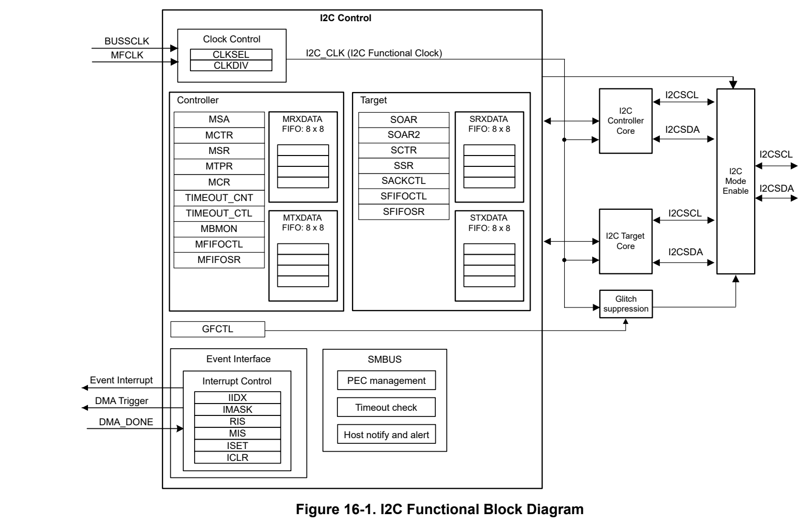
*Figure 16-1. I2C Functional Block Diagram (p. 924)*

#### 16.1.4 Environment and External Connections (p. 924)

The I2C mode supports any target or controller I2 2 C-compatible device. Figure 16-2 shows an example of an I2C bus. Each I C peripheral instance is comprised of both controller and target functions where the target can be2 addressed with 2 independent user defined addresses. A device connected to the I C bus can be considered as the controller or the target when performing data transfers. A controller initiates a data transfer and generates the clock signal SCL. Any device addressed by a controller is considered a target. I2C data is communicated using the serial data (SDA) pin and the serial clock (SCL) pin. Both SDA and SCL are open-drain bidirectional and must be connected to a positive supply voltage using a pullup resistor.

### 16.2 I2C Operation (p. 925)

This section describes the operation of the I2C peripheral.

#### 16.2.1 Clock Control (p. 925)

##### 16.2.1.1 Clock Select and I2C Speed (p. 925)

Standard, Fast, and Fast Plus modes are selected using a value in the I2C Controller Timer Period (I2CMTPR) register that results in a maximum SCL frequency of:

- 100kbps for Standard mode

- 400kbps for Fast mode

- 1Mbps for Fast mode Plus The I2C frequency I2C_FREQ is determined by the I2C_CLK frequency and bit fields TPR , SCL_LP , and SCL_HP where:

- I2C_CLK is the functional clock frequency to the I2C module. Note that the I2C internal functional clock is first divided from the source clock: – Use I2Cx.CLKSEL register to select the source of the I2C functional clock

- BUSSCLK: the current bus clock is selected as the source for I2 2 C. The current bus clock depends on2 power domain. If the I C instance is in power domain 1 ( PD1) refer to MCLK, if the I C instance is in power domain 0 ( PD0) refer to ULPCLK. 2

- MFCLK: MFCLK is selected as the source for I C, refer to MFCLK. – Use I2Cx.CLKDIV register to select divide ratio of I2C function clock, options are from divide by 1 to 8.

- SCL_LP is the low phase of SCL (which must be fixed at 6)

- SCL_HP is the high phase of SCL (which must be fixed at 4)

- TPR is the programmed value of the TPR bits in the I2Cx.MTPR register. This value is determined by replacing the known variables in the equation below and solving for TPR The I2C frequency is calculated as follows:

I2C_FREQ = I2C_CLK / ((1+TPR) × (SCL_LP + SCL_HP )) (7)

For example, if the I2C functional clock frequency is 32MHz and target SCL frequency is 400kHz:

I2C_CLK = 32MHz

I2C_FREQ = 400kHz

SCL_LP = 6 , SCL_HP = 4

TPR = (I2C_CLK / (I2C_FREQ * (4 + 6))) - 1

TPR = 7 (0x07)

**Table 16-1. Examples of Controller Clock Setting for Typical Clock Configurations (p. 925)**

| Functional Clock | TPR Bits Standard Mode 100kHz SCL | TPR Bits Fast Mode 400kHz SCL | TPR Bits Fast Mode Plus 1000kHz SCL |
| --- | --- | --- | --- |
| 4MHz | 0x03 | - | - |
| 8MHz | 0x07 | 0x01 | - |
| 20MHz | 0x13 | 0x04 | 0x01 |
| 32MHz | 0x1F | 0x07 | 0x02 (1) |
| 40MHz | 0x27 | 0x09 | 0x03 |

(1) With 32MHz functional clock, TPR = 0x01 generates 1.6MHz SCL frequency, and TPR = 0x02 generates 1.067MHz SCL frequency.

2

The following minimum functional clock frequencies are required when running certain I2C clock speeds:

- I2C_CLK ≥ 2MHz when working with I22 C speed 0 to 100kHz

- I2C_CLK ≥ 8MHz when working with I C speed 100 to 400kHz2

- I2C_CLK ≥ 20MHz when working with I C speed 400 kHz to 1MHz

##### 16.2.1.2 Clock Startup (p. 926)

The selected clock source is always available and the frequency depends on the power mode, for more2 information refer to the PMU/Clock section. After enabling the I C module by setting the I2C.PWREN.ENABLE bit, the module is ready to start receiving and transmitting data.

#### 16.2.2 Signal Descriptions (p. 926)

The I2C bus consists of a clock signal and a data signal. The clock signal can be generated either internally (during controller operation) or externally (during target operation).

**Table 16-2. I2C signal descriptions (p. 926)**

| Device Pin | Function |
| --- | --- |
| I2Cx_SCL | I2C clock signal |
| I2Cx_SDA | I2C data signal |

#### 16.2.3 General Architecture (p. 926)

##### 16.2.3.1 I2C Bus Functional Overview (p. 926)

The I2C bus uses only two signals: SDA and SCL. SDA is the bidirectional serial data line and SCL is the bidirectional serial clock line. The bus is considered idle when both lines are in high state and no transfer is ongoing. Every transaction on the I2C bus is 9-bits long, consisting of 8 data bits and 1 acknowledge bit. A transfer is defined as the time between a valid START and STOP condition—as described in Figure 16-3. The number of bytes per transfer is unrestricted; however, each data byte must be followed by an acknowledge bit and data must be transferred MSB first. When a receiver cannot receive another complete byte, it can hold the clock line SCL Low and force the transmitter into a wait state, this process is commonly known as clock stretching. The data transfer continues when the receiver releases the clock SCL.

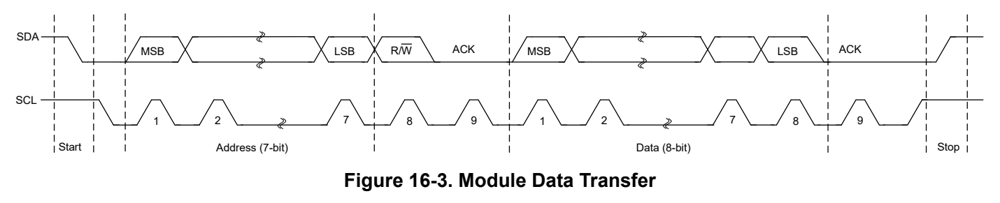
*Figure 16-3. Module Data Transfer (p. 926)*

The data on the SDA line must be stable during the high period of the clock, and the data line can only change when SCL is low (see Figure 16-4), otherwise START or STOP conditions are generated.

*Figure 16-4. Data Change Period (p. 926)*

##### 16.2.3.2 START and STOP Conditions (p. 927)

The protocol of the I2C bus defines two states to begin and end a transaction: START and STOP. A high-to-low transition on the SDA line while the SCL is high is defined as a START condition, and a low-to-high transition on the SDA line while SCL is high is defined as a STOP condition. START and STOP conditions are always generated by the controller. The bus is considered busy after a START condition and free after a STOP condition.

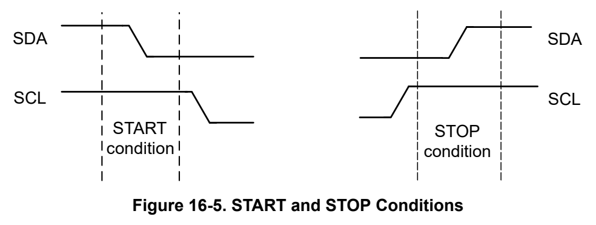
*Figure 16-5. START and STOP Conditions (p. 927)*

The STOP bit determines if the transaction stops at the end of the data cycle or continues on to a repeated START condition.

To generate a single transaction, the I2C controller target address I2Cx.MSA.SADDR register is written with the desired address, the I2Cx.MSA.DIR bit should be set to 1 to start a receive operation and 0 to start a transmit operation , and the control register (I2Cx.MCTR) is written with ACK = X (0 or 1), STOP = 1, START = 1, and RUN = 1 to perform the operation and generate a STOP at the end. When the operation is completed (or2 aborted due an error) the interrupt flags are set. When the I C module operates in Controller receiver mode,2 the ACK bit is normally (in case of no error) set causing the I C bus controller to transmit an acknowledge2 automatically after each byte. This bit must be cleared when the I2 C bus controller requires no further data to be transmitted from the target transmitter. For more information on I C controller mode configuration please refer to Section 16.2.4.1

When operating in target mode, the START and STOP bits in the CPU_INT.RIS register indicate detection of start and stop conditions on the bus and the CPU_INT.IMASK can be configured to allow START and STOP2 to be promoted to controller interrupts (when interrupts are enabled). For more information on I C target mode configuration please refer to Section 16.2.4.2

Bus Status Flags:

- BUSBSY is set when a START is detected on the bus and sequentially cleared when a STOP condition is detected on the bus. It is also cleared after a clock timeout I2Cx.MSR.CLKTO is set once both SCL and SDA are pulled to high.

- BUSY is also set after a START/RESTART, and cleared after I2Cx.MCTR.MBLEN bytes of data is transferred. It is also cleared after data is NACK ‘d or a STOP.

- IDLE is set when the Controller I2C State machine is in the IDLE state indicating no ongoing transfer.

##### 16.2.3.3 Data Format with 7-Bit Address (p. 927)

Data transfers follow the format shown in Figure 16-6. After the START condition, a target address is transmitted. This address is 7-bits long followed by an eighth bit, which is a data direction bit (this bit is only as Controller mode, DIR bit in the I2Cx.MSA register). If the I2Cx.MSA.DIR bit is 0, it indicates a transmit operation (send), and if it is set to 1, it indicates a request to receive data (receive). A data transfer is always terminated by a STOP condition generated by the controller; however, a controller can initiate communications with another device on the bus by generating a repeated START condition and addressing another target without first generating a STOP condition, see section Repeated Start. Various combinations of receive/transmit formats are then possible within a single transfer. The ninth bit is the Acknowledge bit, which is described in Section 16.2.3.4.

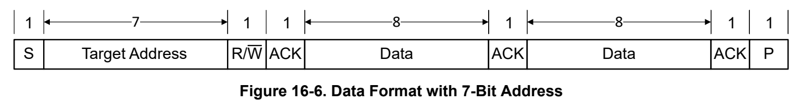
*Figure 16-6. Data Format with 7-Bit Address (p. 928)*

With the I2Cx.SCTR.GENCALL bit the I2C module can be enabled to respond on a General Call on the I2C bus. The General Call is identified by address of 0x00 and the R/W bit set to 0. The General Call interrupt can be enabled with the CPU_INT.IMASK.GENCALL bit.

##### 16.2.3.4 Acknowledge (p. 928)

All bus transactions have a required acknowledge clock cycle that is generated by the controller. During the acknowledge cycle, the transmitter (which can be the controller or target) releases the SDA line. To acknowledge the transaction, the receiver must pull down SDA during the acknowledge clock cycle. The acknowledge cycle must comply with the data validity requirements.

When a target receiver does not acknowledge the target address, SDA must be left high by the target so that the controller can generate a STOP condition and abort the current transfer or generate a repeated START condition to start a new transfer. If the controller device is acting as a receiver during a transfer, it is responsible for acknowledging each transfer made by the target. Because the controller controls the number of bytes in the transfer, it signals the end of data to the target transmitter by not generating an acknowledge on the last data byte. The target transmitter must then release SDA to allow the controller to generate the STOP or a repeated START condition.

A target can generate ACK/NACK manually or automatically. When I2Cx.SACKCTL.ACKOEN=0, the target will send automatic ACK. Note that due to the FIFO, the device will receive and ACK all bytes automatically until the RX FIFO is full. Setting SACKCTL.ACKOEN =1 enables manual ACK. Manual ACK override can be used to evaluate each received byte or to slow down the communication when automatic FIFO reception is not desired.2 When manual ACK override operation is enabled, the I C target module’s clock is pulled low after the last data bit until this SACKCTL.ACKOVAL is written with the indicated response. The reception of new data is indicated by the SRXDONE interrupt flag.

If the controller receives a NACK while transmitting data the NACK and MTXDONE bit will be set in the RIS registers. If there is still data in the FIFO the TXEMPTY bit will not be set to inform software that a TX FIFO flush may be required.

##### 16.2.3.5 Repeated Start (p. 928)

The direction of data flow on SDA can be changed by the controller, without first stopping a transfer, by issuing a repeated START condition. This is called a RESTART, see data format in Figure 16-7. After a RESTART is issued, the target address is again sent out with the new data direction specified by the R/W bit.

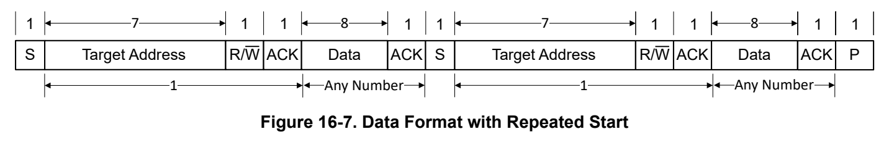
*Figure 16-7. Data Format with Repeated Start (p. 928)*

A repeated start sequence for a Controller transmit is as follows:

1. When the device is in the idle state, the Controller writes the target address to the I2Cx.MSA register and configures the DIR bit for the desired transfer type. 2. Data is written to the I2Cx.MTXDATA register. 3. When the BUSY bit in the MSR register is 0, the BURSTRUN and START bit in the I2Cx.MCTR register need to be set to initiate a transfer. 4. Wait till the BUSY bit in the I2Cx.MSR register gets 0.

5. The Controller does not generate a STOP condition but instead writes another target address to the I2Cx.MSA register and then sets the BURSTRUN and START bit again with a write operation to initiate the repeated START.

A repeated start sequence for a Controller receive is similar:

1. When the device is in idle, the Controller writes the target address to the I2Cx.MSA register and configures the DIR bit for the desired transfer type. 2. When the BUSY bit in the I2Cx.MSR register is 0, the BURSTRUN and START bit in the I2Cx.MCTR register need to be set to initiate a transfer. 3. The controller reads data from the I2Cx.MRXDATA register. 4. Wait till the BUSY bit in the I2Cx.MSR register gets 0. 5. The Controller does not generate a STOP condition but instead writes another target address to the I2Cx.MSA register and then sets the BURSTRUN and START bit again with a write operation to initiate the repeated START.

##### 16.2.3.6 SCL Clock Low Timeout (p. 929)

The I2C target can extend the transaction by pulling the clock low to slow down communication. The I2C module has a 12-bit programmable counter that is used to track how long the clock has been held low. The upper 8 bits of the count value are software programmable through the I2CTIMEOUT_CTL register. The CNTL value programmed in the I2CTIMEOUT_CTL.TCNTLA register has to be greater than 0x01 to enable the timeout feature . Please note that the low timeout configuration needs to be set only during initialization and not during active state.

The application can program the eight most significant bits of the counter to reflect the acceptable cumulative low period in a transaction. Each count is equal to a timeout period of (1 + TPR) × 12 of functional clocks FCLK where the TPR is the programmable timer period. The Timeout counter A counts for the entire time SCL is held Low continuously. When SCL is high, the Timeout counter A is reloaded with the value in the I2CTIMEOUT_CTL.TCNTLA register bit, and begins counting down from this value at the falling edge of SCL. The BUSSCLK clock generated for the timeout counter keeps running irrespective of the programmed I2C speed even if SCL is held low on the bus.

The I2C clock low timeout period is calculated as follows:

- Cumulative clock low period = Timeout counter * One timeout period

- One timeout period = BUSSCLK period * (1 + TPR) * 12

- Timeout counter = I2CTIMEOUT_CTL.TCNTLA register (this register contains the upper 8-bits of a 12-bit counter value, the lower 4-bits are set to 0) As an example, if the BUSSCLK: clock is 20MHz and the I2C module was operating at 100kHz speed, the TPR would be equal to 19. See Section 16.2.1.1 on how TPR is calculated. One timeout period is equal to (1 / 20MHz) × ( 1 + 19) × 12 or 12µs. Programming the I2CTIMEOUT_CTL.TCNTLA register to 0xDA would translate to the value 0xDA0, because the lower 4-bits are set to 0x0. This would translate to a decimal value of 3488 clocks or a cumulative clock low period of 3488 × 12µs, or 41.856ms at 100kHz. The TIMEOUTA bit in the I2C Controller Raw Interrupt Status (RIS) register is set when the clock timeout period is reached, allowing the controller to start corrective action to resolve the remote target state. In addition, the2 2 BUSBSY bit in the I2 C Controller Status MSR register is set. This bit is cleared after I C goes to idle or during the I C controller reset. The status of the raw SDA and SCL signals are readable by software through the SDA and2 SCL bits in the I C Controller Bus Monitor MBMON register to help determine the state of the remote target.

In the event of a timeout condition, application software must choose how it intends to attempt bus recovery. If a timeout is detected before the end of a transfer (receive or transmit), software should flush the FIFO before initializing the next transfer. The clock low timeout is needed for SMBus and PMBus implementation.

Note The Controller clock low timeout counter register I2CTIMEOUT_CNT.TCNTA counts for the entire time SCL is held low continuously. When SCL is high, the counter is reloaded with the value in the I2CTIMEOUT_CTL.TCNTLA register, and begins counting down from this value at the falling edge of SCL.

##### 16.2.3.7 Clock Stretching (p. 930)

In controller mode, the clock stretching can be disabled if no targets on the bus support it, allowing the controller to reach the maximum speed on the bus. Otherwise the clock can be slowed by a target keeping the clock low or2 due to the clock status detection delay within the I C module. To ensure compliance to the I2C specification, clock stretching needs to be enabled. Clock stretching is activated when either the RX FIFO full or TX FIFO empty is set. Clock stretching support can be enabled or disabled by configuring the CLKSTRETCH bit in I2Cx.MCR register.

In the target mode, clock stretching is enabled by default and it is signaled by the TREQ and RREQ bits of the2 I C target status register I2Cx.SSR.

- When TREQ bit is set, it indicates the I2C controller has been addressed as a target transmitter and is using clock stretching to delay the controller until data has been written to the STXDATA FIFO (Target TX FIFO is empty). 2

- When RREQ bit is set, it indicates the I C controller has outstanding receive data from the I2C controller and is using clock stretching to delay the controller until the data has been read from the SRXDATA FIFO (Target RX FIFO is full).

Note Clock stretching in target mode may be used together with an asynchronous fast clock request to support bringing the device into a suspended low power mode state upon detection of an I2C start bit, enabling the I2C module to support 100kHz (standard mode) or 400kHz (fast mode) operation out of low power modes where the bus clock speed is below the minimum oversampling speed required by2 the respective mode. Refer to the clock selection and I C speed section for the minimum frequency requirements. When clock stretching is used together with an asynchronous fast clock request, it is2 2 possible for the device to wait in STOP or STANDBY mode when the I C is idle, and when an I C bus edge is seen, the fast clock request will requests SYSOSC at base frequency and the bus clock2 will switch to SYSOSC at base frequency, allowing the I C module to process the bus transaction and wake the processor if an interrupt is generated.

##### 16.2.3.8 Dual Address (p. 930)

The I2C target interface supports dual address capability for the target. An additional programmable I2C Target Own Address Register I2CX. SOAR is provided and can be matched if enabled. When dual address disabled2 (I2Cx.SOAR2.OAR2EN=0) , the I C target provides an ACK on the bus if the address matches the OAR field2 in the I2Cx.SOAR register. In dual address mode (I2Cx.SOAR2.OAR2EN=1), the I C target provides an ACK on the bus if either the OAR field in the I2Cx.SOAR register or the OAR2 field in the I2Cx.SOAR2 register is matched.

The OAR2SEL bit in the I2Cx.SSR register indicates if the address that was ACKed is the alternate address or not. When this bit is clear, it indicates either the primary address match or no OAR2 address match.

##### 16.2.3.9 Arbitration (p. 930)

A controller can start a transfer only if the bus is idle. It's possible for two or more controllers to generate a START condition within minimum hold time of the START condition. In these situations, an arbitration scheme takes place on the SDA line, while SCL is high (see Figure 16-8) . The first controller transmitter that generates a logic high is overruled by the opposing controller generating a logic low and the losing controller releases the bus until the bus is idle again.

Arbitration can take place over several bits. Its first stage is a comparison of address bits, and if both controllers are trying to address the same device, arbitration continues on to the comparison of data bits.

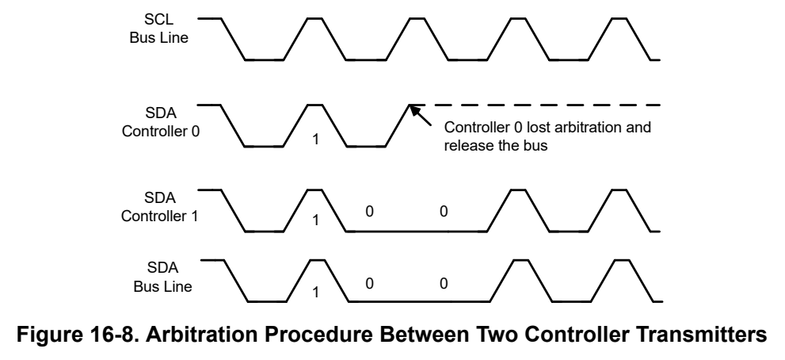
*Figure 16-8. Arbitration Procedure Between Two Controller Transmitters (p. 931)*

When an arbitration lost is detected the I2Cx.MSR.ARBLST flag is set. It will be reset by the hardware with the next STOP condition detected on the bus. Additionally the ARBLOST flags in CPU_INT.RIS registers are set. If arbitration is lost when the I2C controller has initiated a transfer, the application should execute the following steps to correctly handle the arbitration loss:

- Flush TX FIFO

- Clear and mask the TX Empty interrupt by the TXEMPTY bit through the IMASK and ICLR register.

- Once the bus is IDLE, the TXFIFO can be filled and enabled, the TXEMPTY bit can be unmasked and a new transaction can be initiated.

##### 16.2.3.10 Multiple Controller Mode (p. 931)

When operating in a multiple controller system, the I2Cx.MCR.MMST bit must be set.

During the arbitration procedure, the clocks from the different controllers must be synchronized. A device that first generates a low period on SCL overrules the other devices, forcing them to start their own low periods. SCL is then held low by the device with the longest low period. The other devices must wait for SCL to be released before starting their high periods

In multiple-controller configuration, the clock synchronization ( Figure 16-9) during the arbitration is enabled, the SCL high time counts once the SCL line has been detected high. If not enabled the high time counts as soon as2 2 the SCL line has been set high by the I C controller which allows the I C to reach the maximum speed by the I2Cx.MTPR register specified speed.

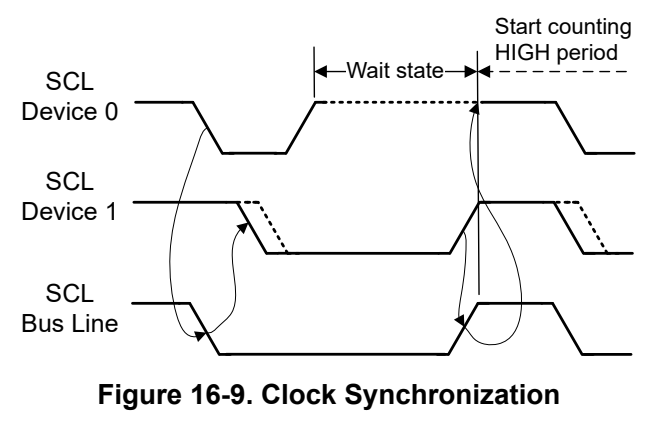
*Figure 16-9. Clock Synchronization (p. 931)*

##### 16.2.3.11 Glitch Suppression (p. 931)

The I2C module supports glitch suppression on the SCL and SDA lines to meet the 50ns glitch suppression as2 specified in the I C specification.

Analog glitch Filter

By default, an analog glitch filter is enabled and configured to suppress spikes with a pulse width up to 50ns.2 I C spec advises to suppress noise spikes of less than 50ns. The user can disable this filter by clear the I2Cx.GFCTL.AGFEN bit and the suppression pulse width can also be configured by using I2Cx.GFCTL.AGFEN.2 The analog glitch filter can only be used to wake up the I C in low-power mode.

Digital glitch Filter

The DGFSEL bits in the I2Cx.GFCTL register can be programmed to provide glitch suppression on the SCL and2 SDA lines and assure proper signal values. The glitch suppression value is in terms of the I C functional clocks. All signals are delayed internally when glitch suppression is nonzero. For example, if DGFSEL bit is set to 0x7, 31 clocks should be added onto the calculation for the expected transaction time, for more information please see register description. Digital glitch filter can't be used to wake up the I2C from low-power mode.

**Table 16-3. Glitch Suppression Filter (p. 932)**

| Col 1 | Analog Glitch Filter | Digital Glitch Filter |
| --- | --- | --- |
| Default | Default enabled with 50ns | Default bypassed |
| Pulse width of suppressed spikes | Configurable 5ns, 10ns, 25ns, 50ns | Programmable I2C clock cycle 1, 2, 3, 4, 8, 16, 31 |
| Benefits | Available without needing clock | • Programmable length to provide extra filtering • Stable filtering length |
| Limitation | Variation with temperature, voltage, process | Does not work in low-power mode wakeup when there is no sufficient clock . Enabled only after 3 clock cycles after start of I2C packet |

Note The glitch filter configuration within the register I2Cx.GFCTL should only be modified while the I2C module for controller and target is not enabled.

##### 16.2.3.12 FIFO operation (p. 932)

The receive data register I2Cx.MRXDATA (for controller mode) and I2Cx.SRXDATA (for target mode) are user accessible and contains the current character to be read from the RX FIFO stack. The last received character from the receive shift register will be push to the end of the FIFO Stack.

The transmit data register I2Cx.MTXDATA (for controller mode) and I2Cx.STXDATA (for target mode) are user accessible and holds the data last written data to the TX FIFO. The TX FIFO contains the data waiting to be moved into the transmit shift register and transmitted on SDA.

FIFOs are available for the controller and target receive and transmit. Each FIFO entry has a width of 8 bits and should be accessed in byte mode. Each FIFO has a programmable threshold point (configured by RXTRIG and TXTRIG bits in the I2Cx.MFIFOCTL register for controller mode and I2Cx.SFIFOCTL register for target mode) which indicates when the FIFO service interrupt should be generated. Additionally, a FIFO receive full and transmit empty interrupt can be enabled in the interrupt mask (IMASK) registers for the controller and target.

The content of the FIFO can be flushed with setting TXFLUSH or RXFLUSH bit to 1 in the I2Cx.FIFOCTL2 registers. When the I2 C gets reset the content of the FIFO needs also to be cleared. FIFO clear should only be executed while the I C is in IDLE mode. Before triggering the flush the FIFO interrupts should be disabled and after flush has completed the interrupt flags needs to be checked.

###### 16.2.3.12.1 Flushing Stale Tx Data in Target Mode (p. 932)

In most use cases, the user does not want to transmit leftover data of the I2C peripheral Tx FIFO from previous frame in the next frame. The device provides a mechanism for the software to choose whether to flush stale data or not.

A status bit SSR.STALE_TXFIFO represents whether the data present inside I2C peripheral TX FIFO is stale or not. A control bit SCTR.TXWAIT_STALE_TXFIFO is used to enable modified empty indication to target logic - indicate empty to I2C peripheral FSM when Tx FIFO is empty OR stale data present in Tx FIFO. The SCTR.TXEMPTY_ON_TREQ control bit allows the RIS.STXEMPTY interrupt to be used to indicate the TREQ condition, the condition when SCL is being stretched waiting for transmit data from the I2C peripheral.

Recommended Sequence 1. When SCTR.TXWAIT_STALE_TXFIFO is set, on STOP, restart, or timeout, I2C peripheral FSM gets an empty indication even though stale data is present inside I2C peripheral Tx FIFO. 2. I2C module doesn’t immediately generate an TX FIFO empty interrupt/DMA request. Instead, waits till the controller on the I2C bus attempts to read data from the I2C peripheral, at which point the I2C peripheral clock stretches. 3. The I2C peripheral issues the clock stretch (TREQ) interrupt to the CPU when SCTR.TXEMPTY_ON_TREQ is set. 4. Application software in the ISR checks for a SSR.STALE_TXFIFO flag and flushes the TX FIFO using SFIFOCTL.TXFLUSH, which also clears the status of SSR.STALE_TXFIFO.

##### 16.2.3.13 Loopback mode (p. 933)

The I2C modules can be placed into an internal loopback mode for diagnostic or debug work by setting the LPBK2 bit in the I C controller configuration I2Cx.MCR register. In loopback mode, the SDA and SCL signals from the2 2 controller part of the I C are tied to the SDA and SCL signals of the target part of the I C module to allow internal testing of the device without having to connect the I/Os. The SWUEN bit should be set to 0 for internal loopback to work correctly.

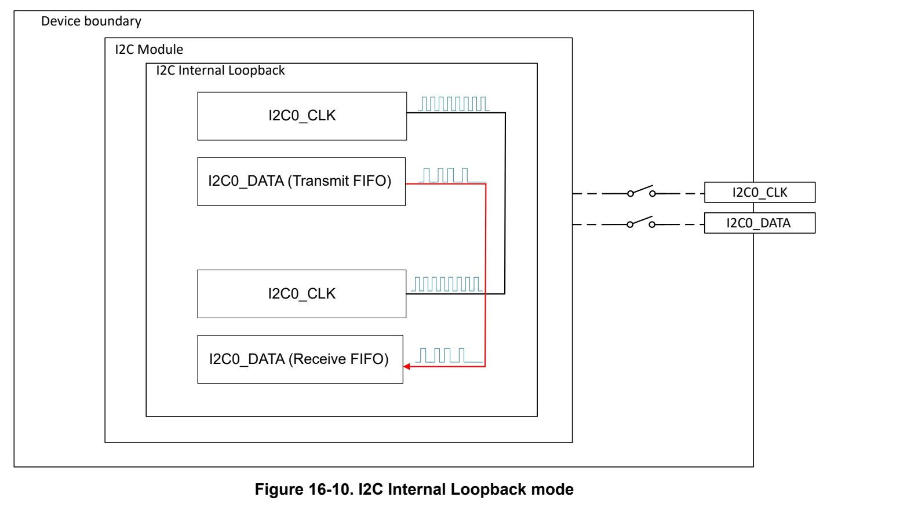
*Figure 16-10. I2C Internal Loopback mode (p. 933)*

##### 16.2.3.14 Burst Mode (p. 933)

A burst mode is provided for the controller module which allows a sequence of data transfers using the DMA or software to handle the data in the FIFO. The burst mode is enabled by setting the MBLEN bits in the controller

control register I2Cx.MCTR to a value greater then '1'. This sets the number of bytes transferred by a burst. A2 copy of this value is automatically written to the MBCNT bits in the I C controller status register I2Cx.MSR to be used as a down-counter during the burst transfer. The bytes written to the I2C FIFO are transferred to the RX FIFO or TX FIFO depending on whether a transmit or receive is being executed. If data is not acknowledged (NACK) during a BURST and the STOP bit is set in the I2Cx.MCTR register, the transfer terminates. If the STOP bit is not set, software must issue a STOP or repeated START when a NACK interrupt is asserted. In the case of a NACK, the MBCNT bits in the I2Cx.MSR register can be used to determine the amount of data that was transferred prior to the burst termination. If the address is not acknowledged (NACK) during a transfer, then a STOP is issued.

##### 16.2.3.15 DMA Operation (p. 934)

The I2C provides an interface to the DMA controller with two channels. The DMA operation of the I2 2 C is enabled2 through the I C event register and DMA peripheral registers. When the DMA functionality is enabled, the I C asserts a DMA request on the selected channel when the associated FIFO can transfer or receive data. For more information about I2C event and DMA, please refer to Interrupt and Events Support and DMA Trigger Publisher sections.

Note Per DMA Channel only one event source should be enabled by the IMASK register at the same time. The DMA transaction descriptor needs to match for the selected trigger with a correct setup for either Controller or Target and RX or TX configuration. The DMA trigger should only be changed when no2 I C transfer is ongoing and a previous triggered DMA transfer has been finished. If this cannot be2 ensured the I C and DMA channel should be disabled first.

##### 16.2.3.16 Low-Power Operation (p. 934)

I2C supports operation in low-power modes.

Supported power mode for controller mode:

- Controller mode with 100kHz speed can operate in RUN, SLEEP, STOP power mode

- Controller mode with 400kHz speed can operate in RUN, SLEEP power mode

- Controller mode with 1MHz speed can operate in RUN, SLEEP power mode In low-power mode, the I2C interface automatically request the clock selected in the CLKSEL control register after detecting a start condition. The clock request is released after detection of the STOP condition.

Supported power mode and wakeup mode for target mode:

- Target mode with 100kHz speed can operate in RUN, SLEEP, STOP power mode

- Target mode with 100kHz speed can't operate in STANDBY mode because the maximum bus clock in STANDBY mode is 32kHz and support for 100kHz speed requires a minimum 400kHz clock. However, in STANDBY mode the I2C target can still wakeup from the start bit and perform the Asynchronous Fast Clock Requests to temporarily get a 24MHz/32MHz clock to receive the data until the FIFO or address match interrupt wakes up the CPU.

- Target mode with 400kHz speed in RUN, SLEEP power mode

- Target mode with 1MHz speed in RUN, SLEEP power mode

#### 16.2.4 Protocol Descriptions (p. 934)

##### 16.2.4.1 I2C Controller Mode (p. 934)

As showing in the function block diagram section, I2C peripheral has a set of specific controller registers to2 configure the operation when the module is configured as an I C target mode.

###### 16.2.4.1.1 Controller Configuration (p. 935)

The I2C Controller Control register I2Cx.MCTR and I2C Controller Target Address register I2Cx.MSA are used for controlling controller transmit and receive modes. The following settings can be modified to control the different transactions.

- Length indicates the number of bytes for the transaction and is configured by I2Cx.MCTR.MBLEN bit

- Direction (transmit or receive) is configured by I2Cx.MSA.DIR bit

- ACK generation is configured by I2Cx.MCTR.MBLEN bit

- STOP condition generation is configured by I2Cx.MCTR.STOP bit

- START or repeated START condition generation is configured by I2Cx.MCTR.START bit

- RUN enable the controller transaction and is configured by I2Cx.MCTR.BURSTRUN bit

Controller send data transactions

**Table 16-4. Start Transmit From Idle Mode (p. 935)**

| Length | Direction | ACK | STOP | START | RUN | Format | Comments |
| --- | --- | --- | --- | --- | --- | --- | --- |
| n (n>0) | 0 | x | 0 or 1 | 1 | 1 | START+ADDR+R/W+ DATA*n+(STOP) | Sending of STOP depends on STOP bit |

**Table 16-5. Continue Transmit When Last Transmission Finished Without stop (p. 935)**

| Length | Direction | ACK | STOP | START | RUN | Format | Comments |
| --- | --- | --- | --- | --- | --- | --- | --- |
| n (n>0) | 0 | x | 0 or 1 | 0 | 1 | DATA*n+ (ACK/NACK)+ (STOP) | Sending of STOP depends on STOP bit |

If there is a NACK response from the target, the controller will automatically send out a stop to finish the transmit. The Controller will be unable to send a RESTART after ADDR or DATA NACK.

Controller receive data transactions

**Table 16-6. Start Receive From Idle Mode (p. 935)**

| Length | Direction | ACK | STOP | START | RUN | Format | Comments |
| --- | --- | --- | --- | --- | --- | --- | --- |
|  |  |  |  |  |  |  | The last data ACK or |
|  |  |  |  |  |  | START+ADDR +R/ | NACK depend on ACK |
| n (n>0) | 1 | 0 or 1 | 0 or 1 | 1 | 1 | W+DATA *n +(ACK/NACK) | bit; additional sending of |
|  |  |  |  |  |  | +(STOP) | STOP depends on STOP |
|  |  |  |  |  |  |  | bit |

**Table 16-7. Continue Receive When Last Receive Finished Without STOP or NACK (p. 935)**

| Length | Direction | ACK | STOP | START | RUN | Format | Comments |
| --- | --- | --- | --- | --- | --- | --- | --- |
|  |  |  |  |  |  |  | The last data followed by |
|  |  |  |  |  |  |  | ACK or NACK depend |
|  |  |  |  |  |  | DATA*n+ (ACK/NACK) + |  |
| n (n>0) | 1 | 0 or 1 | 0 or 1 | 0 | 1 |  | on ACK bit; additional |
|  |  |  |  |  |  | (STOP) |  |
|  |  |  |  |  |  |  | sending of STOP depends |
|  |  |  |  |  |  |  | on STOP bit |

This configuration is not allowed if last transaction ended with NACK, as NACK can only be followed by STOP or RESTART. The ACK and STOP bits should not be set to 1 at the same time, as the target needs to be informed to release bus lines before sending out STOP.

Controller repeated start transactions

If last transmit or receive finished without stop, a repeat start can be generated to initiate a new transaction

**Table 16-8. Repeated Start Transmit (p. 936)**

| Length | Direction | ACK | STOP | START | RUN | Format | Comments |
| --- | --- | --- | --- | --- | --- | --- | --- |
| n (n>0) | 0 | 0 or 1 | 0 or 1 | 1 | 1 | Restart+ADDR +R/ W+DATA*n +(STOP) | Additional sending of STOP depends on STOP bit |

If there is a NACK response from the target, the controller will automatically send out a stop to finish the transmit. The Controller will be unable to send a RESTART after ADDR or DATA NACK.

**Table 16-9. Repeated Start Receive (p. 936)**

| Length | Direction | ACK | STOP | START | RUN | Format | Comments |
| --- | --- | --- | --- | --- | --- | --- | --- |
|  |  |  |  |  |  |  | The last data followed by |
|  |  |  |  |  |  | Restart+ADDR +R/ | ACK or NACK depend |
| n (n>0) | 1 | 0 or 1 | 0 or 1 | 1 | 1 | W+DATA*n +(ACK/NACK) | on ACK bit; additional |
|  |  |  |  |  |  | +(STOP) | sending of STOP depends |
|  |  |  |  |  |  |  | on STOP bit |

The ACK and STOP bits should not be set to 1 at the same time, as the target needs to be informed to release bus lines before sending out STOP.

Controller send STOP only transaction

**Table 16-10. Send STOP only (p. 936)**

| Length | Direction | ACK | STOP | START | RUN | Format | Comments |
| --- | --- | --- | --- | --- | --- | --- | --- |
| n (n>0) | X | X | 1 | 0 | 1 | STOP | STOP command |

It is only allowed to send after previous transaction success finished, and STOP can't be sent without a NACK to the target if controller is currently in receive mode

Controller Quick Command transaction

The Quick command could only be sent at the transaction beginning, not following other transactions (without stop) or repeat start.

**Table 16-11. Controller quick command (p. 936)**

| Length | Direction | ACK | STOP | START | RUN | Format | Comments |
| --- | --- | --- | --- | --- | --- | --- | --- |
| 0 | 0/1 | X | 1 | 1 | 1 | START+ADDR +R/ W+STOP | Quick command |

###### 16.2.4.1.2 Controller Mode Operation (p. 936)

I2C Controller Initialization

1. Configure SDA and SCL pin functions and select as input by using the IOMUX registers. 2. Reset the peripheral using I2Cx.RSTCTL register 3. Enable the power to peripheral using I2Cx.PWREN register2 4. Select and configure the I C clock using the CLKCTL and CLKDIV registers. 5. Set the desired SCL clock speed of by writing the TPR bit in I2Cx.MTPR register with the correct value. For more information about how to calculate TPR value refer to2 Clock Control section. For example, with 20MHz I C clock to achieve 100 kbps SCL clock, TPR value will be 19 (0x13) so we can write the I2Cx.MTPR register with the value of 0x13. 6. Specify the target address and mode (transmit or receive) for the next operation by writing the I2Cx.MSA register. For example, if the target address is 0x3B (MSA.SADDR[7:1] = 0x3B) and we want to transmit (MSA.DIR[0] = 0x0) data then we can write the I2Cx.MSA register with a value of 0x76. 7. If controller is transmitting data, user can place data (byte) to be transmitted in the data register by writing the I2Cx.MTXDATA register with the desired data.

8. Configure the controller transmit or receive mode by writing the I2Cx.MCTR register. For more information on how to configure I2Cx.MCTR register for different mode please see Controller Configuration section above. 9. Enable desired interrupts and/or DMA event by using CPU_INT.IMASK register.

I2C Controller Status

User can read the I2Cx.MSR register to check the current state of the I2C controller.

**Table 16-12. Controller Status Register (p. 937)**

| Bit Field | Description |
| --- | --- |
| BUSY | I2C controller busy. The BUSY bit is set during an ongoing transaction. |
| ERR | I2C error. The error can be from the target address not being acknowledged or the transmit data not being acknowledged. |
| ADRACK | Acknowledge address. This bit is set if the transmitted address was not acknowledged. |
| DATACK | Acknowledge data. This bit is set if the transmitted data was not acknowledged. |
| ARBLST | Arbitration lost. This bit is set if controller lost arbitration. |
| IDLE | I2C bus idle. |
| BUSBSY | I2C bus busy. The bit changes based on the START and STOP conditions, set it bus is busy. |
| CLKTO | Clock timeout error. This bit is set if the clock timeout error has occurred. |
| MBCNT | I2C controller transaction count. This field contains the current countdown value of the transaction. |

I2C Controller Receiver Mode

For controller to start receive data out of the idle mode, user needs to set the START bit in I2Cx.MCTR register to generate the start condition. Then the controller automatically sends the START condition followed by the target address as soon as it detects that the bus is free. All the process below should be followed.

I2Cx.MSA.DIR is set to 1 to enable receive mode, I2Cx.MCTR.START is set to generate start condition, I2Cx.MBLEN can be programmed to indicate the number of bytes (n) for the receive operation. I2Cx.MCTR.ACK and I2Cx.MCTR.STOP bit can be set or clear based on user configuration. I2Cx.MCTR.BURSTRUN is set to start the operation. The packet format is START+ADDR+R+DATA*n +(ACK/NACK) + (STOP). The last data ACK/NACK depend on ACK bit, additional sending of STOP depends on STOP bit.

After last byte is received, the MRXDONE (0x01) interrupt in CPU_INT.IIDX register is set to indicate that controller receive transaction is completed. User can use the MRXFIFOTRG (0x03) interrupt in CPU_INT.IIDX register to read the data from the receive FIFO. This interrupt will trigger when controller RX FIFO contains >= defined bytes, the trigger level can be defined by using RXTRIG bit in I2Cx.MFIFOCTL register. The flow chart of controller receiver mode is shown in Figure 16-11.

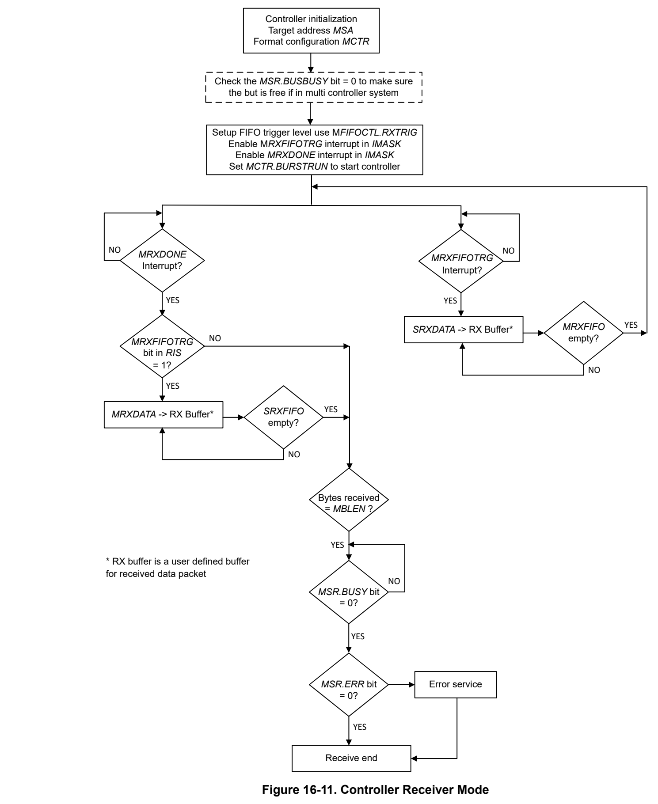
*Figure 16-11. Controller Receiver Mode (p. 938)*

I2C Controller transmitter Mode

For controller, to start transmit data out of the idle mode, user need to set the START bit in I2Cx.MCTR register to generate the start condition. Then the controller automatically sends the START condition followed by the target address as soon as it detects that the bus is free. The data written into the MTXFIFO is transmitted if arbitration is not lost during transmission of the target address. All the process below should be followed.

I2Cx.MSA.DIR is cleared to enable transmit mode, I2Cx.MCTR.START is set to generate start condition, I2Cx.MBLEN can be programmed to indicate the number of bytes (n) for the transmit operation. I2Cx.MCTR.STOP bit can be set or clear based on user configuration. I2Cx.MCTR.BURSTRUN is set to start the operation. The packet format is START+ADDR+W+DATA*n + (STOP), sending of STOP depends on STOP bit.

After last byte is transmitted, the MTXDONE (0x02) interrupt in CPU_INT.IIDX register is set to indicate that controller transmit transaction is completed. User can also set use the MTXEMPTY (0x06) interrupt in CPU_INT.IIDX register to see if the MTXFIFO is empty and ready to load more data. This interrupt will trigger if all data in the transmit FIFO have been shifted out. The flow chart of controller receiver mode is shown in Figure 16-12.

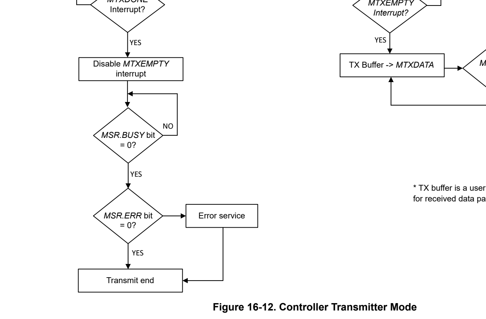
*Figure 16-12. Controller Transmitter Mode (p. 940)*

###### 16.2.4.1.3 Read On TX Empty (p. 940)

A typical I2C transaction must first write the target to set the register number and then do a repeated start + read to read the data value. However, the RD_ON_EMPTY flag enables two I2C transactions with a single setup of the I2C controller. Software can set up both the write and read together, with the limitation being that the "write" phase cannot send more data than fits in the TX FIFO. This is an optimization to minimize interrupt processing requirements. The high-level set up is:

1. Set MSA to target address with RECEIVE = 1 (RD_ON_TXEMPTY must have I2C_MSR_DIR_RECEIVE set)

- MBLEN= size for READ phase

- RD_ON_TXEMPTY

- ACK_DISABLE (NACK+STOP after read)

- STOP_ENABLE

- START_ENABLE

- BURST_ENABLE

The expected behavior with this set up is that the controller does a START, transmits all TXFIFO data, and when TXFIFO is empty automatically does a repeated START, reads the MBLEN bytes, then STOP.

##### 16.2.4.2 I2C Target Mode (p. 941)

###### 16.2.4.2.1 Target Mode Operation (p. 941)

I2C Target Initialization

1. Configure SDA and SCL pin functions and select as input by using the IOMUX registers. 2. Reset the peripheral using I2Cx.RSTCTL register 3. Enable the power to peripheral using I2Cx.PWREN register2 4. Select and configure the I C clock using the CLKCTL and CLKDIV registers. 5. Configure at least one target address by writing the 7-bit address to I2Cx.SOAR register. The additional target address can be enabled and configured by using I2Cx.SOAR2 register. 6. Enable desired interrupts and/or DMA event by using CPU_INT.IMASK register. 7. The general call response can be enabled by setting the GENCALL bit in I2Cx.SCTR register.2 8. Enable the I C target mode by setting the ACTIVE bit in I2Cx.SCTR register.

I2C Target Status User can read the I2Cx.SSR register to check the current state of the I2C target.

**Table 16-13. Target Status Register (p. 941)**

| Bit Field | Description |
| --- | --- |
| RREQ | This bit is set if the I2C controller has outstanding receive data from the I2C controller and is using clock stretching to delay the controller until the data has been read from the SRXDATA FIFO (Target RX FIFO is full) |
| TREQ | This bit is set if the I2C controller has been addressed as a target transmitter and is using clock stretching to delay the controller until data has been written to the STXDATA FIFO (Target TX FIFO is empty). |
| OAR2SEL | This bit is set if SOAR2.OAR2 address matched and ACKed by the target. |
| QCMDST | Quick command status value. This bit is 0 if the last transaction was a normal transaction or a transaction has not occurred. This bit is set if the last transaction was a quick command transaction |
| QCMDRW | Quick command read / write status. This bit only has meaning when the QCMDST bit is set. This bit is 0 if quick command was a write. This bit is set if quick command was a read. |

I2C Target Receiver Mode

Target receiver mode is entered when the target address transmitted by the controller matches its own address and a cleared R/W bit is received. In target receiver mode, serial data bits received on SDA are shifted in with the clock pulses that are generated by the controller device. The target device does not generate the clock, but it can hold SCL low if intervention of the CPU is required after a byte has been received.

After the a data byte is received, the SRXDONE (0x11) interrupt in CPU_INT.IIDX register is set to indicate that2 a byte has been received. The I C module automatically acknowledges the received data or user can choice to manually send acknowledge after each byte received by configuring the I2Cx.SACKCTL register.

When the controller generates a START condition, the SSTART (0x17) interrupt in CPU_INT.IIDX register is set. When the controller generates a STOP condition, the SSTOP (0x18) interrupt in CPU_INT.IIDX register is set.

User can also set use the SRXFIFOTRG (0x13) interrupt in CPU_INT.IIDX register to read the data from the receive FIFO. This interrupt will trigger when receive FIFO contains >= defined bytes, the trigger level can be defined by using RXTRIG bit in I2Cx.SFIFOCTL register.

The SRXDONE approach could be used if target wants to slow down communication to evaluate reception of every byte, while the SRXFIFOTRG approach could be used to maximize throughput and avoid clock stretching.

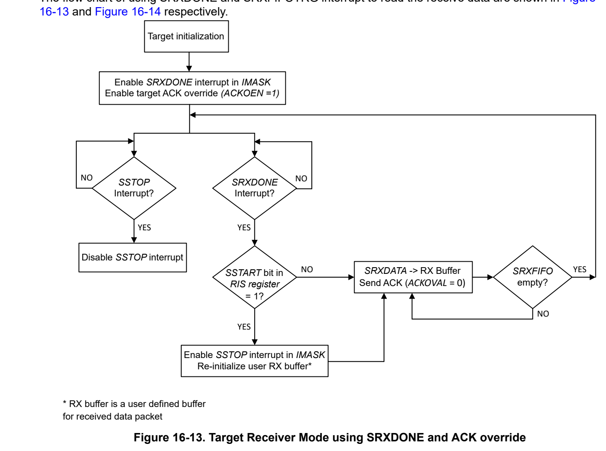
*Figure 16-13. Target Receiver Mode using SRXDONE and ACK override (p. 942)*

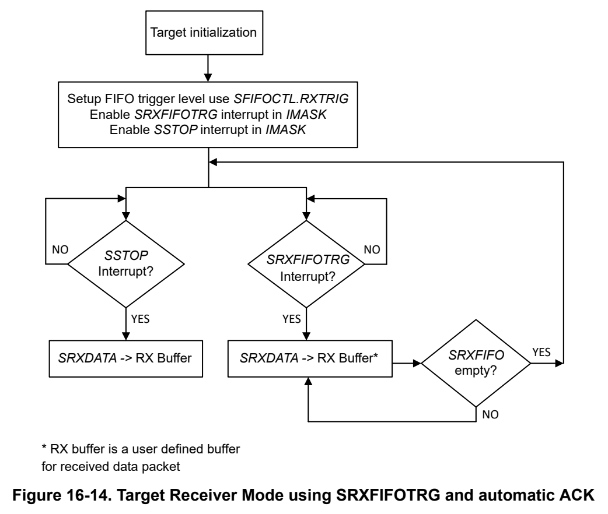
*Figure 16-14. Target Receiver Mode using SRXFIFOTRG and automatic ACK (p. 943)*

I2C Target Transmitter Mode

Target transmitter mode is entered when the target address transmitted by the controller is identical to its own address with a set R/W bit. The target transmitter shifts the serial data out on SDA with the clock pulses that are generated by the controller device. The target device does not generate the clock, but it can hold SCL low if intervention of the CPU is required after a byte has been transmitted.

After a data byte is transmitted, the STXDONE (0x12) interrupt in CPU_INT.IIDX register is set to indicate that a byte has been transmitted.

When the controller generates a START condition, the SSTART (0x17) interrupt in CPU_INT.IIDX register is set. When the controller generates a STOP condition, the SSTOP (0x18) interrupt in CPU_INT.IIDX register is set.

User can also set use the STXFIFOTRG (0x14) interrupt in CPU_INT.IIDX register to load the data to the transmit FIFO. This interrupt will trigger when transmit FIFO contains <= defined bytes, the trigger level can be defined by using TXTRIG bit in I2Cx.SFIFOCTL register.

The STXDONE approach could be used if target wants to slow down communication to evaluate reception of every byte, while the STXFIFOTRG approach could be used to maximize throughput and avoid clock stretching.

The flow chat of using STXDONE and STXFIFOTRG interrupt to transmit data are shown in Figure 16-15 and Figure 16-16.

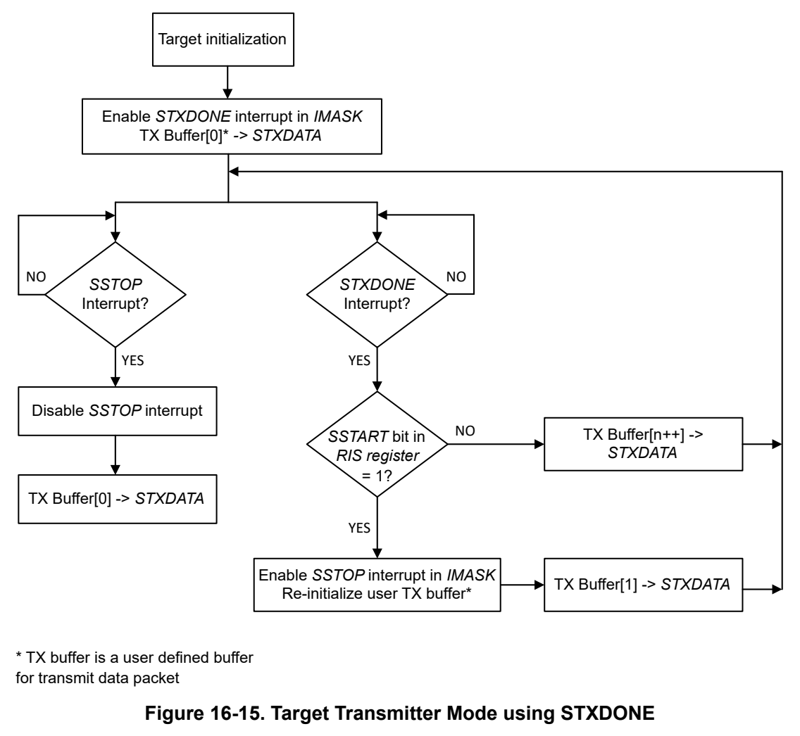
*Figure 16-15. Target Transmitter Mode using STXDONE (p. 944)*

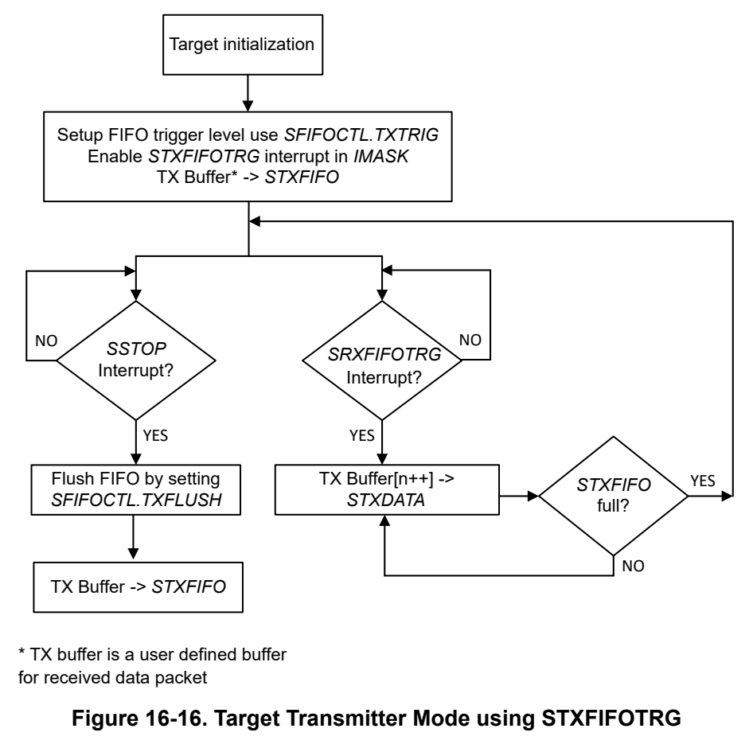
*Figure 16-16. Target Transmitter Mode using STXFIFOTRG (p. 945)*

#### 16.2.5 Reset Considerations (p. 945)

Software Reset Considerations

A Software reset can be executed by setting the RESETASSERT bit together with the KEY bit in the I2Cx.RSTCTL register. We recommend issues a reset only after terminating a transaction.

Hardware Reset Considerations

A hardware reset also initializes the IO configuration. This sets the IOs to a high-impedance state and with the2 external pullup resistors for I C the lines pulled high.

Table 16-14 shows the behavior of status bits when Controller or Target gets disabled.

**Table 16-14. Status Bits When Controller is Disabled (pp. 945-946)**

| Register | Col 5 | Bit | Behavior When Controller Disabled | Col 10 | Behavior When Target Disabled | Behavior After Controller/Target Enabled |
| --- | --- | --- | --- | --- | --- | --- |
|  |  |  | Disabled |  |  |  |
| I2Cx.MSR | Busy |  | Reset State | Don’t care |  | updates Start condition sending |
|  | ERR |  | Reset State | Don’t care |  | updates on next event detected |
|  | ADRACK |  | Reset State | Don’t care |  | updates on next event detected |
|  | DATACK |  | Reset State | Don’t care |  | updates on next event detected |
|  | ARBLST |  | Reset State | Don’t care |  | updates on next event detected |
|  | IDLE |  | Reset State | Don’t care |  | updates on next event detected |
|  | BUSBSY |  | Reset State | Don’t care |  | updates on next Start detected on bus (or SDA or SCL is low) |
|  | CLKTO |  | Reset State | Don’t care |  | updates on next event detected |
|  | MBCNT |  | Reset State | Don’t care |  | updates on next event detected |
| I2Cx.MCLKOCNT | CLKCNT |  | Reset State | Don’t care |  | updates with Controller enable when SCL is high |
| I2Cx.MBMON | SCL | Reset State | Don’t care | updates with Controller enable |  |  |
|  | SDA | Reset State | Don’t care | updates with Controller enable |  |  |

**Table 16-15. Status Bits When Target is Disabled (p. 946)**

| Register | Bit | Behavior When Controller Disabled | Behavior When Target Disabled | Behavior After Controller/Target Enabled |
| --- | --- | --- | --- | --- |
| I2Cx.SSR | RREQ | Don’t care | Reset State | updates on next event detected |
|  | TREQ | Don’t care | Reset State | updates on next event detected |
|  | OAR2SEL | Don’t care | Reset State | updates on next event detected |
|  | QCMDST | Don’t care | Reset State | updates on next event detected |
|  | QCMDRW | Don’t care | Reset State | updates on next event detected |
| I2Cx.SFIFOSR | RXFIFOCNT | Don’t care | Unchanged | updates on FIFO access |
|  | TXFIFOCNT | Don’t care | Unchanged | updates on FIFO access |

#### 16.2.6 Initialization (p. 946)

Please see Section 16.2.4.1.2 for controller initialization and Section 16.2.4.2.1 for target initialization.

Note The configuration registers of the I2C module (including the clock configuration, mode configuration, and timeout count) must not be modified by application software when an I2C data transfer is in progress.

#### 16.2.7 Interrupt and Events Support (p. 946)

The I2C module contains three2 event publishers and no event subscribers. One event publisher (CPU_INT) manages I C interrupt requests (IRQs) to the CPU subsystem through a static event route. The second and third event publishers (DMA_TRIG1, DMA_TRIG0) are used to setup the trigger signaling for the DMA through DMA event route.

The I2C events are summarized in Table 16-16 .

**Table 16-16. I2C Events (p. 946)**

| Event | Type | Source | Destination | Route | Configuration | Functionality |
| --- | --- | --- | --- | --- | --- | --- |
| CPU interrupt | Publisher | I2C | CPU Subsystem | Static route | CPU_INT registers | Fixed interrupt route from I2C to CPU |
| DMA trigger | Publisher | I2C | DMA | DMA event route | DMA_TRIG1 registers | Fixed interrupt route from I2C to DMA |
| DMA trigger | Publisher | I2C | DMA | DMA event route | DMA_TRIG0 registers | Fixed interrupt route from I2C to DMA |

##### 16.2.7.1 CPU Interrupt Event Publisher (CPU_INT) (p. 946)

The I2C module provides 24 interrupt sources which can be configured to source a2 CPU interrupt event. In order of decreasing interrupt priority, the CPU interrupt events from the I C are:

**Table 16-17. I2C CPU Interrupt Event Conditions for Controller (CPU_INT) (p. 947)**

| IIDX STAT | Name | Description |
| --- | --- | --- |
| 0x01 | MRXDONE | Controller receive transaction completed interrupt |
| 0x02 | MTXDONE | Controller transmit transaction completed interrupt |
| 0x03 | MRXFIFOTRG | Controller receive FIFO trigger. Trigger when RX FIFO contains >= defined bytes |
| 0x04 | MTXFIFOTRG | Controller transmit FIFO trigger. Trigger when Transmit FIFO contains <= defined bytes |
| 0x05 | MRXFIFOFULL | Controller RXFIFO full event. This interrupt is set if an RX FIFO is full. |
| 0x06 | MTXEMPTY | Controller transmit FIFO empty interrupt. This interrupt is set if all data in the Transmit FIFO have been shifted out and the transmit goes into idle mode. |
| 0x07 | MCLKTO | Controller clock timeout interrupt |
| 0x08 | MNACK | Address/Data NACK interrupt |
| 0x09 | MSTART | Controller START detection interrupt |
| 0x0A | MSTOP | Controller STOP detection interrupt |
| 0x0B | MARBLOST | Controller arbitration lost interrupt |
| 0x0C | MDMA_DONE_TX | Controller DMA TX done signal (see next section for more detail) |
| 0x0D | MDMA_DONE_RX | Controller DMA RX done signal (see next section for more detail) |

**Table 16-18. I2C CPU Interrupt Event Conditions for Target (CPU_INT) (p. 947)**

| IIDX STAT | Name | Description |
| --- | --- | --- |
| 0x11 | SRXDONE | Target receive transaction completed interrupt |
| 0x12 | STXDONE | Target transmit transaction completed interrupt |
| 0x13 | SRXFIFOTRG | Target receive FIFO trigger. It will trigger when receive FIFO contains >= defined bytes |
| 0x14 | STXFIFOTRG | Target transmit FIFO trigger. It will trigger when transmit FIFO contains <= defined bytes |
| 0x15 | SXFIFOFULL | Target RXFIFO full event. This interrupt is set if an RX FIFO is full. |
| 0x16 | STXEMPTY | Target transmit FIFO empty interrupt. This interrupt is set if all data in the Target Transmit FIFO have been shifted out and the transmit goes into idle mode. |
| 0x17 | SSTART | Target START detection interrupt |
| 0x18 | SSTOP | Target STOP detection interrupt |
| 0x19 | SGENCALL | General call interrupt |
| 0x1A | SDMA_DONE_TX | Target DMA TX done signal (see next section for more detail) |
| 0x1B | SDMA_DONE_RX | Target DMA RX done signal (see next section for more detail) |

The CPU interrupt event configuration is managed with the CPU_INT event management registers. See Section 7.2.5 for guidance on configuring the Event registers for CPU interrupts.

##### 16.2.7.2 DMA Trigger Publisher (DMA_TRIG1, DMA_TRIG0) (p. 947)

DMA_TRIG1 and DMA_TRIG0 registers are used to setup the trigger signaling for the DMA. This can be setup in a flexible way to trigger the DMA for Controller or Target and receive or transmit events with the following four trigger conditions:

**Table 16-19. I2C DMA Trigger Condition (DMA_TRIG1 and DMA_TRIG0) (p. 947)**

| IIDX STAT | Name | Description |
| --- | --- | --- |
| 0x01 | MRXFIFOTRG | Controller receive FIFO trigger. Trigger when RX FIFO contains >= defined bytes |
| 0x02 | MTXFIFOTRG | Controller transmit FIFO trigger. Trigger when Transmit FIFO contains <= defined bytes |
| 0x03 | SRXFIFOTRG | Target receive FIFO trigger. Trigger when RX FIFO contains >= defined bytes |
| 0x04 | STXFIFOTRG | Target transmit FIFO trigger. Trigger when Transmit FIFO contains <= defined bytes |

The DMA trigger event configuration is managed with the DMA_TRIG1 and DMA_TRIG0 event management registers. See Section 7.2.5 for guidance on configuring the Event registers and Section 7.1.3.2 for on how DMA trigger event works. DMA_TRIG1 and DMA_TRIG0 are two event management registers that correspond to two DMA channels.

As shown in Figure 16-17, each DMA channel can be triggered by any of the conditions listed in Table 16-19 and it can generate either the controller DMA done signal or target DMA done signal.

For example, the user can configure the DMA_TRIG1 trigger using MTXFIFOTRG and the DMA_TRIG0 trigger using SRXFIFOTRG. When the Channel 1 DMA status changes to done, the MDMA_DONE_TX and MDMA_DONE_RX interrupts will set, and when the Channel 2 DMA status change to done, the SDMA_DONE_TX and SDMA_DONE_RX interrupts will set.

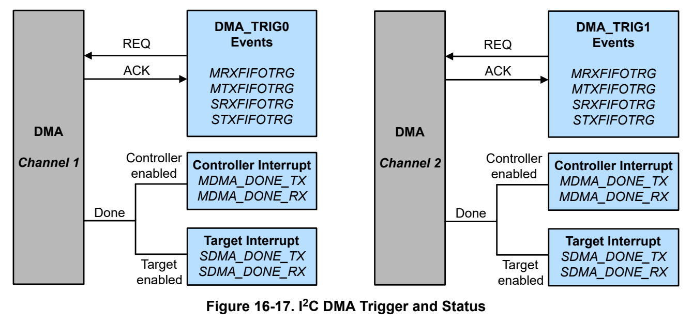
*Figure 16-17. I2C DMA Trigger and Status (p. 948)*

#### 16.2.8 Emulation Modes (p. 948)

The module behavior while the device is in debug mode is controlled by the FREE and SOFT bits in PDBGCTL register.

When the device is in debug mode and set into halt mode below behavior can be configured.

**Table 16-20. Debug Mode Peripheral Behavior (p. 948)**

| PDBGCTL.FREE | PDBGCTL.SOFT | Function |
| --- | --- | --- |
| 1 | x | Modules continues operation |
| 0 | 0 | Module stops immediately |
| 0 | 1 | Module stops after the next transfer has been finished |

### 16.3 I2C Registers (p. 949)

Table 16-21 lists the memory-mapped registers for the I2C registers. All register offset addresses not listed in Table 16-21 should be considered as reserved locations and the register contents should not be modified.

**Table 16-21. I2C Registers (pp. 949-950)**

| Offset | Acronym | Register Name | Section |
| --- | --- | --- | --- |
| 800h | PWREN | Power enable | Section 16.3.1 |
| 804h | RSTCTL | Reset Control | Section 16.3.2 |
| 808h | CLKCFG | Peripheral Clock Configuration Register | Section 16.3.3 |
| 814h | STAT | Status Register | Section 16.3.4 |
| 1000h | CLKDIV | Clock Divider | Section 16.3.5 |
| 1004h | CLKSEL | Clock Select for Ultra Low Power peripherals | Section 16.3.6 |
| 1018h | PDBGCTL | Peripheral Debug Control | Section 16.3.7 |
| 1020h | IIDX | Interrupt index | Section 16.3.8 |
| 1028h | IMASK | Interrupt mask | Section 16.3.9 |
| 1030h | RIS | Raw interrupt status | Section 16.3.10 |
| 1038h | MIS | Masked interrupt status | Section 16.3.11 |
| 1040h | ISET | Interrupt set | Section 16.3.12 |
| 1048h | ICLR | Interrupt clear | Section 16.3.13 |
| 1050h | IIDX | Interrupt index | Section 16.3.14 |
| 1058h | IMASK | Interrupt mask | Section 16.3.15 |
| 1060h | RIS | Raw interrupt status | Section 16.3.16 |
| 1068h | MIS | Masked interrupt status | Section 16.3.17 |
| 1070h | ISET | Interrupt set | Section 16.3.18 |
| 1078h | ICLR | Interrupt clear | Section 16.3.19 |
| 1080h | IIDX | Interrupt index | Section 16.3.20 |
| 1088h | IMASK | Interrupt mask | Section 16.3.21 |
| 1090h | RIS | Raw interrupt status | Section 16.3.22 |
| 1098h | MIS | Masked interrupt status | Section 16.3.23 |
| 10A0h | ISET | Interrupt set | Section 16.3.24 |
| 10A8h | ICLR | Interrupt clear | Section 16.3.25 |
| 10E0h | EVT_MODE | Event Mode | Section 16.3.26 |
| 10E4h | INTCTL | Interrupt control register | Section 16.3.27 |
| 10FCh | DESC | Module Description | Section 16.3.28 |
| 1200h | GFCTL | I2C Glitch Filter Control | Section 16.3.29 |
| 1204h | TIMEOUT_CTL | I2C Timeout Count Control Register | Section 16.3.30 |
| 1208h | TIMEOUT_CNT | I2C Timeout Count Register | Section 16.3.31 |
| 1210h | CSA | I2C Controller Target Address Register | Section 16.3.32 |
| 1214h | CCTR | I2C Controller Control Register | Section 16.3.33 |
| 1218h | CSR | I2C Controller Status Register | Section 16.3.34 |
| 121Ch | CRXDATA | I2C Controller RXData | Section 16.3.35 |
| 1220h | CTXDATA | I2C Controller TXData | Section 16.3.36 |
| 1224h | CTPR | I2C Controller Timer Period | Section 16.3.37 |
| 1228h | CCR | I2C Controller Configuration | Section 16.3.38 |
| 1234h | CBMON | I2C Controller Bus Monitor | Section 16.3.39 |
| 1238h | CFIFOCTL | I2C Controller FIFO Control | Section 16.3.40 |
| 1240h | _I2CPECCTL | I2C Controller PEC control register | Section 16.3.42 |
| 1244h | _PECSR | I2C Controller PEC status register | Section 16.3.43 |
| 1250h | TOAR | I2C Target Own Address | Section 16.3.44 |
| 1254h | TOAR2 | I2C Target Own Address 2 | Section 16.3.45 |
| 1258h | TCTR | I2C Target Control Register | Section 16.3.46 |
| 125Ch | TSR | I2C Target Status Register | Section 16.3.47 |
| 1260h | TRXDATA | I2C Target RXData | Section 16.3.48 |
| 1264h | TTXDATA | I2C Target TXData | Section 16.3.49 |
| 1268h | TACKCTL | I2C Target ACK Control | Section 16.3.50 |
| 126Ch | TFIFOCTL | I2C Target FIFO Control | Section 16.3.51 |
| 1270h | TFIFOSR | I2C Target FIFO Status Register | Section 16.3.52 |
| 1274h | _PECCTL | I2C Target PEC control register | Section 16.3.53 |
| 1278h | _PECSR | I2C Target PEC status register | Section 16.3.54 |

Complex bit access types are encoded to fit into small table cells. Table 16-22 shows the codes that are used for access types in this section.

**Table 16-22. I2C Access Type Codes (p. 950)**

| Access Type | Code | Description |
| --- | --- | --- |
| Read Type |  |  |
| R | R | Read |
| Write Type |  |  |
| W | W | Write |
| WK | W K | Write Write protected by a key |
| Reset or Default Value |  |  |
| - n |  | Value after reset or the default value |

### 16.3.1 [I2C.PWREN] Offset: 800h | Reset: 00000000h (p. 951)

PWREN is shown in Table 16-23.

Register to control the power state

> **Bit Map**: `[31-24] KEY (W, 0h)` | `[23-1] RESERVED (R, 0h)` | `[0] ENABLE (R/WK, 0h)`

**Table 16-23. PWREN Register Field Descriptions (p. 951)**

| Bit | Field | Type | Reset | Description |
| --- | --- | --- | --- | --- |
| 31-24 | KEY | W | 0h | KEY to allow Power State Change; 26h = KEY to allow write access to this register |
| 23-1 | RESERVED | R | 0h |  |
| 0 | ENABLE | R/WK | 0h | Enable the power KEY must be set to 26h to write to this bit.; 0h = Disable Power; 1h = Enable Power |

### 16.3.2 [I2C.RSTCTL] Offset: 804h | Reset: 00000000h (p. 952)

RSTCTL is shown in Table 16-24.

Register to control reset assertion and de-assertion

> **Bit Map**: `[31-24] KEY (W, 0h)` | `[23-2] RESERVED (R, 0h)` | `[1] RESETSTKYCLR (WK, 0h)` | `[0] RESETASSERT (WK, 0h)`

**Table 16-24. RSTCTL Register Field Descriptions (p. 952)**

| Bit | Field | Type | Reset | Description |
| --- | --- | --- | --- | --- |
| 31-24 | KEY | W | 0h | Unlock key; B1h = KEY to allow write access to this register |
| 23-2 | RESERVED | R | 0h |  |
| 1 | RESETSTKYCLR | WK | 0h | Clear the RESETSTKY bit in the STAT register KEY must be set to B1h to write to this bit.; 0h = Writing 0 has no effect; 1h = Clear reset sticky bit |
| 0 | RESETASSERT | WK | 0h | Assert reset to the peripheral KEY must be set to B1h to write to this bit.; 0h = Writing 0 has no effect; 1h = Assert reset |

### 16.3.3 [I2C.CLKCFG] Offset: 808h | Reset: 00000000h (p. 953)

CLKCFG is shown in Table 16-25.

Peripheral Clock Configuration Register

> **Bit Map**: `[31-24] KEY (W, 0h)` | `[23-9] RESERVED (R, 0h)` | `[8] BLOCKASYNC (R/W, 0h)` | `[7-0] RESERVED (R, 0h)`

**Table 16-25. CLKCFG Register Field Descriptions (p. 953)**

| Bit | Field | Type | Reset | Description |
| --- | --- | --- | --- | --- |
| 31-24 | KEY | W | 0h | KEY to Allow State Change -- 0xA9; A9h = key value to allow change field of GPRCM |
| 23-9 | RESERVED | R | 0h |  |
| 8 | BLOCKASYNC | R/W | 0h | Async Clock Request is blocked from starting SYSOSC or forcing bus clock to 32MHz; 0h = Not block async clock request; 1h = Block async clock request |
| 7-0 | RESERVED | R | 0h |  |

### 16.3.4 [I2C.STAT] Offset: 814h | Reset: 00000000h (p. 954)

STAT is shown in Table 16-26.

peripheral enable and reset status

> **Bit Map**: `[31-17] RESERVED (R, 0h)` | `[16] RESETSTKY (R, 0h)` | `[15-0] RESERVED (R, 0h)`

**Table 16-26. STAT Register Field Descriptions (p. 954)**

| Bit | Field | Type | Reset | Description |
| --- | --- | --- | --- | --- |
| 31-17 | RESERVED | R | 0h |  |
| 16 | RESETSTKY | R | 0h | This bit indicates, if the peripheral was reset, since this bit was cleared by RESETSTKYCLR in the RSTCTL register; 0h = The peripheral has not been reset since this bit was last cleared by RESETSTKYCLR in the RSTCTL register; 1h = The peripheral was reset since the last bit clear |
| 15-0 | RESERVED | R | 0h |  |

### 16.3.5 [I2C.CLKDIV] Offset: 1000h | Reset: 00000000h (p. 955)

CLKDIV is shown in Table 16-27.

This register is used to specify module-specific divide ratio of the functional clock

> **Bit Map**: `[31-3] RESERVED (R, 0h)` | `[2-0] RATIO (R/W, 0h)`

**Table 16-27. CLKDIV Register Field Descriptions (p. 955)**

| Bit | Field | Type | Reset | Description |
| --- | --- | --- | --- | --- |
| 31-3 | RESERVED | R | 0h |  |
| 2-0 | RATIO | R/W | 0h | Selects divide ratio of module clock; 0h = Do not divide clock source; 1h = Divide clock source by 2; 2h = Divide clock source by 3; 3h = Divide clock source by 4; 4h = Divide clock source by 5; 5h = Divide clock source by 6; 6h = Divide clock source by 7; 7h = Divide clock source by 8 |

### 16.3.6 [I2C.CLKSEL] Offset: 1004h | Reset: 00000000h (p. 956)

CLKSEL is shown in Table 16-28.

Clock source selection.

> **Bit Map**: `[31-4] RESERVED (R, 0h)` | `[3] BUSCLK_SEL (R/W, 0h)` | `[2] MFCLK_SEL (R/W, 0h)` | `[1-0] RESERVED (R, 0h)`

**Table 16-28. CLKSEL Register Field Descriptions (p. 956)**

| Bit | Field | Type | Reset | Description |
| --- | --- | --- | --- | --- |
| 31-4 | RESERVED | R | 0h |  |
| 3 | BUSCLK_SEL | R/W | 0h | Selects BUSCLK as clock source if enabled; 0h = Does not select this clock as a source; 1h = Select this clock as a source |
| 2 | MFCLK_SEL | R/W | 0h | Selects MFCLK as clock source if enabled; 0h = Does not select this clock as a source; 1h = Select this clock as a source |
| 1-0 | RESERVED | R | 0h |  |

### 16.3.7 [I2C.PDBGCTL] Offset: 1018h | Reset: 00000000h (p. 957)

PDBGCTL is shown in Table 16-29.

This register can be used by the software developer to control the behavior of the peripheral relative to the 'Core Halted' input

> **Bit Map**: `[31-2] RESERVED (R, 0h)` | `[1] SOFT (R/W, 1h)` | `[0] FREE (R/W, 1h)`

**Table 16-29. PDBGCTL Register Field Descriptions (p. 957)**

| Bit | Field | Type | Reset | Description |
| --- | --- | --- | --- | --- |
| 31-2 | RESERVED | R | 0h |  |
| 1 | SOFT | R/W | 1h | Soft halt boundary control. This function is only available, if FREE is set to 'STOP'; 0h = The peripheral will halt immediately, even if the resultant state will result in corruption if the system is restarted; 1h = The peripheral blocks the debug freeze until it has reached a boundary where it can resume without corruption |
| 0 | FREE | R/W | 1h | Free run control; 0h = The peripheral freezes functionality while the Core Halted input is asserted and resumes when it is deasserted.; 1h = The peripheral ignores the state of the Core Halted input |

### 16.3.8 [I2C.IIDX] Offset: 1020h | Reset: 00000000h (p. 958)

IIDX is shown in Table 16-30.

This register provides the highest priority enabled interrupt index.

> **Bit Map**: `[31-8] RESERVED (R, 0h)` | `[7-0] STAT (R, 0h)`

**Table 16-30. IIDX Register Field Descriptions (p. 958)**

| Bit | Field | Type | Reset | Description |
| --- | --- | --- | --- | --- |
| 31-8 | RESERVED | R | 0h |  |
| 7-0 | STAT | R | 0h | I2C Module Interrupt Vector Value. This register provides the highes priority interrupt index. A read clears the corresponding interrupt flag in RIS and MISC. 15h-1Fh = Reserved; 00h = No interrupt pending; 01h = Controller data received; 02h = Controller data transmitted; 03h = Controller receive FIFO Trigger Level; 04h = Controller transmit FIFO Trigger level; 5h = RX FIFO FULL Event/interrupt pending; 6h = Transmit FIFO/Buffer Empty Event/interrupt pending; 08h = Address/Data NACK; 09h = Start Event; 0Ah = Stop Event; 0Bh = Arbitration Lost; Ch = DMA DONE on Channel TX; Dh = DMA DONE on Channel RX; Eh = Controller PEC Receive Error Event; Fh = Timeout A Event; 10h = Timeout B Event; 11h = Target Data Event; 12h = Target Data Event; 13h = Target receive FIFO Trigger Level; 14h = Target transmit FIFO Trigger level; 15h = RX FIFO FULL Event/interrupt pending; 16h = Transmit FIFO/Buffer Empty Event/interrupt pending; 17h = Start Event; 18h = Stop Event; 19h = General Call Event; 1Ah = DMA DONE on Channel TX; 1Bh = DMA DONE on Channel RX; 1Ch = Target PEC receive error event; 1Dh = Target TX FIFO underflow; 1Eh = Target RX FIFO overflow event; 1Fh = Target arbitration lost event; 20h = Interrupt overflow event |

### 16.3.9 [I2C.IMASK] Offset: 1028h | Reset: 00000000h (p. 959)

IMASK is shown in Table 16-31.

Interrupt Mask. If a bit is set, then corresponding interrupt is un-masked. Un-masking the interrupt causes the raw interrupt to be visible in IIDX, as well as MIS.

> **Bit Map**: `[31] INTR_OVFL (R/W, 0h)` | `[30] TARBLOST (R/W, 0h)` | `[29] TRX_OVFL (R/W, 0h)` | `[28] TTX_UNFL (R/W, 0h)` | `[27] TPEC_RX_ERR (R/W, 0h)` | `[26] TDMA_DONE_RX (R/W, 0h)` | `[25] TDMA_DONE_TX (R/W, 0h)` | `[24] TGENCALL (R/W, 0h)` | `[23] TSTOP (R/W, 0h)` | `[22] TSTART (R/W, 0h)` | `[21] TTXEMPTY (R/W, 0h)` | `[20] TRXFIFOFULL (R/W, 0h)` | `[19] TTXFIFOTRG (R/W, 0h)` | `[18] TRXFIFOTRG (R/W, 0h)` | `[17] TTXDONE (R/W, 0h)` | `[16] TRXDONE (R/W, 0h)` | `[15] TIMEOUTB (R/W, 0h)` | `[14] TIMEOUTA (R/W, 0h)` | `[13] CPEC_RX_ERR (R/W, 0h)` | `[12] CDMA_DONE_RX (R/W, 0h)` | `[11] CDMA_DONE_TX (R/W, 0h)` | `[10] CARBLOST (R/W, 0h)` | `[9] CSTOP (R/W, 0h)` | `[8] CSTART (R/W, 0h)` | `[7] CNACK (R/W, 0h)` | `[6] RESERVED (R, 0h)` | `[5] CTXEMPTY (R/W, 0h)` | `[4] CRXFIFOFULL (R/W, 0h)` | `[3] CTXFIFOTRG (R/W, 0h)` | `[2] CRXFIFOTRG (R/W, 0h)` | `[1] CTXDONE (R/W, 0h)` | `[0] CRXDONE (R/W, 0h)`

**Table 16-31. IMASK Register Field Descriptions (pp. 959-960)**

| Bit | Field | Type | Reset | Description |
| --- | --- | --- | --- | --- |
| 31 | INTR_OVFL | R/W | 0h | Interrupt Overflow Interrupt Mask; 0h = Clear Interrupt Mask; 1h = Set Interrupt Mask |
| 30 | TARBLOST | R/W | 0h | Target Arbitration Lost; 0h = Clear Set Interrupt Mask; 1h = Set Interrupt Mask |
| 29 | TRX_OVFL | R/W | 0h | Target RX FIFO overflow; 0h = Clear Interrupt Mask; 1h = Set Interrupt Mask |
| 28 | TTX_UNFL | R/W | 0h | Target TX FIFO underflow; 0h = Clear Interrupt Mask; 1h = Set Interrupt Mask |
| 27 | TPEC_RX_ERR | R/W | 0h | Target RX Pec Error Interrupt; 0h = Clear Interrupt Mask; 1h = Set Interrupt Mask |
| 26 | TDMA_DONE_RX | R/W | 0h | Target DMA Done on Event Channel RX; 0h = Clear Interrupt Mask; 1h = Set Interrupt Mask |
| 25 | TDMA_DONE_TX | R/W | 0h | Target DMA Done on Event Channel TX; 0h = Clear Interrupt Mask; 1h = Set Interrupt Mask |
| 24 | TGENCALL | R/W | 0h | General Call Interrupt; 0h = Clear Interrupt Mask; 1h = Set Interrupt Mask |
| 23 | TSTOP | R/W | 0h | Stop Condition Interrupt; 0h = Clear Interrupt Mask; 1h = Set Interrupt Mask |
| 22 | TSTART | R/W | 0h | Start Condition Interrupt; 0h = Clear Interrupt Mask; 1h = Set Interrupt Mask |
| 21 | TTXEMPTY | R/W | 0h | Target Transmit FIFO Empty interrupt mask. This interrupt is set if all data in the Transmit FIFO have been shifted out and the transmit goes into idle mode.; 0h = Clear Interrupt Mask; 1h = Set Interrupt Mask |
| 20 | TRXFIFOFULL | R/W | 0h | RXFIFO full event. This interrupt is set if an Target RX FIFO is full.; 0h = Clear Interrupt Mask; 1h = Set Interrupt Mask |
| 19 | TTXFIFOTRG | R/W | 0h | Target Transmit FIFO Trigger; 0h = Clear Interrupt Mask; 1h = Set Interrupt Mask |
| 18 | TRXFIFOTRG | R/W | 0h | Target Receive FIFO Trigger; 0h = Clear Interrupt Mask; 1h = Set Interrupt Mask |
| 17 | TTXDONE | R/W | 0h | Target Transmit Transaction completed Interrupt; 0h = Clear Interrupt Mask; 1h = Set Interrupt Mask |
| 16 | TRXDONE | R/W | 0h | Target Receive Data Interrupt Signals that a byte has been received; 0h = Clear Interrupt Mask; 1h = Set Interrupt Mask |
| 15 | TIMEOUTB | R/W | 0h | Timeout B Interrupt; 0h = Clear Interrupt Mask; 1h = Set Interrupt Mask |
| 14 | TIMEOUTA | R/W | 0h | Timeout A Interrupt; 0h = Clear Interrupt Mask; 1h = Set Interrupt Mask |
| 13 | CPEC_RX_ERR | R/W | 0h | Controller RX Pec Error Interrupt; 0h = Clear Interrupt Mask; 1h = Set Interrupt Mask |
| 12 | CDMA_DONE_RX | R/W | 0h | DMA Done on Event Channel RX; 0h = Interrupt disabled; 1h = Set Interrupt Mask |
| 11 | CDMA_DONE_TX | R/W | 0h | DMA Done on Event Channel TX; 0h = Interrupt disabled; 1h = Set Interrupt Mask |
| 10 | CARBLOST | R/W | 0h | Arbitration Lost Interrupt; 0h = Clear Interrupt Mask; 1h = Set Interrupt Mask |
| 9 | CSTOP | R/W | 0h | STOP Detection Interrupt; 0h = Clear Interrupt Mask; 1h = Set Interrupt Mask |
| 8 | CSTART | R/W | 0h | START Detection Interrupt; 0h = Clear Interrupt Mask; 1h = Set Interrupt Mask |
| 7 | CNACK | R/W | 0h | Address/Data NACK Interrupt; 0h = Clear Interrupt Mask; 1h = Set Interrupt Mask |
| 6 | RESERVED | R | 0h |  |
| 5 | CTXEMPTY | R/W | 0h | Transmit FIFO Empty interrupt mask. This interrupt is set if all data in the Transmit FIFO have been shifted out and the transmit goes into idle mode.; 0h = Clear Interrupt Mask; 1h = Set Interrupt Mask |
| 4 | CRXFIFOFULL | R/W | 0h | RXFIFO full event. This interrupt is set if an RX FIFO is full.; 0h = Clear Interrupt Mask; 1h = Set Interrupt Mask |
| 3 | CTXFIFOTRG | R/W | 0h | Controller Transmit FIFO Trigger Trigger when Transmit FIFO contains <= defined bytes; 0h = Clear Interrupt Mask; 1h = Set Interrupt Mask |
| 2 | CRXFIFOTRG | R/W | 0h | Controller Receive FIFO Trigger Trigger when RX FIFO contains >= defined bytes; 0h = Clear Interrupt Mask; 1h = Set Interrupt Mask |
| 1 | CTXDONE | R/W | 0h | Controller Transmit Transaction completed Interrupt; 0h = Clear Interrupt Mask; 1h = Set Interrupt Mask |
| 0 | CRXDONE | R/W | 0h | Controller Receive Transaction completed Interrupt; 0h = Clear Interrupt Mask; 1h = Set Interrupt Mask |

### 16.3.10 [I2C.RIS] Offset: 1030h | Reset: 00000000h (p. 961)

RIS is shown in Table 16-32.

Raw interrupt status. Reflects all pending interrupts, regardless of masking. The RIS register allows the user to implement a poll scheme. A flag set in this register can be cleared by writing 1 to the ICLR register bit even if the corresponding IMASK bit is not enabled.

> **Bit Map**: `[31] INTR_OVFL (R, 0h)` | `[30] TARBLOST (R, 0 h)` | `[29] TRX_OVFL (R, 0h)` | `[28] TTX_UNFL (R, 0h)` | `[27] TPEC_RX_ERR (R, 0h)` | `[26] TDMA_DONE_RX (R, 0h)` | `[25] TDMA_DONE_TX (R, 0h)` | `[24] TGENCALL (R, 0h)` | `[23] TSTOP (R, 0h)` | `[22] TSTART (R, 0h)` | `[21] TTXEMPTY (R, 0h)` | `[20] TRXFIFOFULL (R, 0h)` | `[19] TTXFIFOTRG (R, 0h)` | `[18] TRXFIFOTRG (R, 0h)` | `[17] TTXDONE (R, 0h)` | `[16] TRXDONE (R, 0h)` | `[15] TIMEOUTB (R, 0h)` | `[14] TIMEOUTA (R, 0h)` | `[13] CPEC_RX_ERR (R, 0h)` | `[12] CDMA_DONE_RX (R, 0h)` | `[11] CDMA_DONE_TX (R, 0h)` | `[10] CARBLOST (R, 0h)` | `[9] CSTOP (R, 0h)` | `[8] CSTART (R, 0h)` | `[7] CNACK (R, 0h)` | `[6] RESERVED (R, 0h)` | `[5] CTXEMPTY (R, 0h)` | `[4] CRXFIFOFULL (R, 0h)` | `[3] CTXFIFOTRG (R, 0h)` | `[2] CRXFIFOTRG (R, 0h)` | `[1] CTXDONE (R, 0h)` | `[0] CRXDONE (R, 0h)`

**Table 16-32. RIS Register Field Descriptions (pp. 961-962)**

| Bit | Field | Type | Reset | Description |
| --- | --- | --- | --- | --- |
| 31 | INTR_OVFL | R | 0h | Interrupt overflow interrupt It is set when CSTART or CSTOP interrupts overflow i.e. occur twice without being serviced; 0h = Interrupt did not occur; 1h = Interrupt occurred |
| 30 | TARBLOST | R | 0 h | Target Arbitration Lost; 0h = Interrupt did not occur; 1h = Interrupt occurred |
| 29 | TRX_OVFL | R | 0h | Target RX FIFO overflow; 0h = Interrupt did not occur; 1h = Interrupt Occured |
| 28 | TTX_UNFL | R | 0h | Target TX FIFO underflow; 0h = Interrupt did not occur; 1h = Interrupt occurred |
| 27 | TPEC_RX_ERR | R | 0h | Target RX Pec Error Interrupt; 0h = Interrupt did not occur; 1h = Interrupt ocuured |
| 26 | TDMA_DONE_RX | R | 0h | DMA Done on Event Channel RX; 0h = Clear interrupt; 1h = Set interrupt |
| 25 | TDMA_DONE_TX | R | 0h | DMA Done on Event Channel TX; 0h = Clear interrupt; 1h = Set interrupt |
| 24 | TGENCALL | R | 0h | General Call Interrupt; 0h = Clear Interrupt Mask; 1h = Interrupt occurred |
| 23 | TSTOP | R | 0h | Stop Condition Interrupt; 0h = Clear Interrupt; 1h = Set interrupt |
| 22 | TSTART | R | 0h | Start Condition Interrupt; 0h = Clear interrupt; 1h = Set Interrupt |
| 21 | TTXEMPTY | R | 0h | Transmit FIFO Empty interrupt mask. This interrupt is set if all data in the Transmit FIFO have been shifted out and the transmit goes into idle mode.; 0h = Interrupt did not occur; 1h = Interrupt occurred |
| 20 | TRXFIFOFULL | R | 0h | RXFIFO full event. This interrupt is set if an RX FIFO is full.; 0h = Clear Interrupt Mask; 1h = Interrupt occurred |
| 19 | TTXFIFOTRG | R | 0h | Target Transmit FIFO Trigger; 0h = Clear Interrupt Mask; 1h = Interrupt occurred |
| 18 | TRXFIFOTRG | R | 0h | Target Receive FIFO Trigger; 0h = Clear Interrupt Mask; 1h = Interrupt occurred |
| 17 | TTXDONE | R | 0h | Target Transmit Transaction completed Interrupt |
| 16 | TRXDONE | R | 0h | Target Receive Data Interrupt Signals that a byte has been received; 0h = Interrupt did not occur; 1h = Interrupt occurred |
| 15 | TIMEOUTB | R | 0h | Timeout B Interrupt; 0h = Interrupt did not occur; 1h = Interrupt occurred |
| 14 | TIMEOUTA | R | 0h | Timeout A Interrupt; 0h = Interrupt did not occur; 1h = Interrupt occurred |
| 13 | CPEC_RX_ERR | R | 0h | Controller RX Pec Error Interrupt; 0h = Interrupt did not occur; 1h = Interrupt Occured |
| 12 | CDMA_DONE_RX | R | 0h | DMA Done on Event Channel RX; 0h = Interrupt disabled; 1h = Interrupt occurred |
| 11 | CDMA_DONE_TX | R | 0h | DMA Done on Event Channel TX; 0h = Interrupt disabled; 1h = Interrupt occurred |
| 10 | CARBLOST | R | 0h | Arbitration Lost Interrupt; 0h = Interrupt did not occur; 1h = Interrupt occurred |
| 9 | CSTOP | R | 0h | STOP Detection Interrupt; 0h = Interrupt did not occur; 1h = Interrupt occurred |
| 8 | CSTART | R | 0h | START Detection Interrupt; 0h = Interrupt did not occur; 1h = Interrupt occurred |
| 7 | CNACK | R | 0h | Address/Data NACK Interrupt; 0h = Interrupt did not occur; 1h = Interrupt occurred |
| 6 | RESERVED | R | 0h |  |
| 5 | CTXEMPTY | R | 0h | Transmit FIFO Empty interrupt mask. This interrupt is set if all data in the Transmit FIFO have been shifted out and the transmit goes into idle mode.; 0h = Interrupt did not occur; 1h = Interrupt occurred |
| 4 | CRXFIFOFULL | R | 0h | RXFIFO full event. This interrupt is set if an RX FIFO is full.; 0h = Interrupt did not occur; 1h = Interrupt occurred |
| 3 | CTXFIFOTRG | R | 0h | Controller Transmit FIFO Trigger Trigger when Transmit FIFO contains <= defined bytes; 0h = Clear Interrupt Mask; 1h = Interrupt occurred |
| 2 | CRXFIFOTRG | R | 0h | Controller Receive FIFO Trigger Trigger when RX FIFO contains >= defined bytes; 0h = Clear Interrupt Mask; 1h = Interrupt occurred |
| 1 | CTXDONE | R | 0h | Controller Transmit Transaction completed Interrupt; 0h = Interrupt did not occur; 1h = Interrupt occurred |
| 0 | CRXDONE | R | 0h | Controller Receive Transaction completed Interrupt; 0h = Interrupt did not occur; 1h = Interrupt occurred |

### 16.3.11 [I2C.MIS] Offset: 1038h | Reset: 00000000h (p. 963)

MIS is shown in Table 16-33.

Masked interrupt status. This is an AND of the IMASK and RIS registers.

> **Bit Map**: `[31] INTR_OVFL (R, 0h)` | `[30] TARBLOST (R, 0h)` | `[29] TRX_OVFL (R, 0h)` | `[28] TTX_UNFL (R, 0h)` | `[27] TPEC_RX_ERR (R, 0h)` | `[26] TDMA_DONE_RX (R, 0h)` | `[25] TDMA_DONE_TX (R, 0h)` | `[24] TGENCALL (R, 0h)` | `[23] TSTOP (R, 0h)` | `[22] TSTART (R, 0h)` | `[21] TTXEMPTY (R, 0h)` | `[20] TRXFIFOFULL (R, 0h)` | `[19] TTXFIFOTRG (R, 0h)` | `[18] TRXFIFOTRG (R, 0h)` | `[17] TTXDONE (R, 0h)` | `[16] TRXDONE (R, 0h)` | `[15] TIMEOUTB (R, 0h)` | `[14] TIMEOUTA (R, 0h)` | `[13] CPEC_RX_ERR (R, 0h)` | `[12] CDMA_DONE_RX (R, 0h)` | `[11] CDMA_DONE_TX (R, 0h)` | `[10] CARBLOST (R, 0h)` | `[9] CSTOP (R, 0h)` | `[8] CSTART (R, 0h)` | `[7] CNACK (R, 0h)` | `[6] RESERVED (R, 0h)` | `[5] CTXEMPTY (R, 0h)` | `[4] CRXFIFOFULL (R, 0h)` | `[3] CTXFIFOTRG (R, 0h)` | `[2] CRXFIFOTRG (R, 0h)` | `[1] CTXDONE (R, 0h)` | `[0] CRXDONE (R, 0h)`

**Table 16-33. MIS Register Field Descriptions (pp. 963-964)**

| Bit | Field | Type | Reset | Description |
| --- | --- | --- | --- | --- |
| 31 | INTR_OVFL | R | 0h | Interrupt overflow; 0h = Interrupt did not occur; 1h = Interrupt occurred |
| 30 | TARBLOST | R | 0h | Target Arbitration Lost; 0h = Clear interrupt mask; 1h = Set interrupt mask |
| 29 | TRX_OVFL | R | 0h | Target RX FIFO overflow; 0h = Clear interrupt mask; 1h = Set interrupt mask |
| 28 | TTX_UNFL | R | 0h | Target TX FIFO underflow; 0h = Clear interrupt mask; 1h = Set interrupt mask |
| 27 | TPEC_RX_ERR | R | 0h | Target RX Pec Error Interrupt; 0h = Clear interrupt mask; 1h = Set interrupt mask |
| 26 | TDMA_DONE_RX | R | 0h | DMA Done on Event Channel RX; 0h = Clear MIS; 1h = Set MIS |
| 25 | TDMA_DONE_TX | R | 0h | DMA Done on Event Channel TX; 0h = Clear MIS; 1h = Set MIS |
| 24 | TGENCALL | R | 0h | General Call Interrupt; 0h = Interrupt did not occur; 1h = Interrupt occurred |
| 23 | TSTOP | R | 0h | Target STOP Detection Interrupt; 0h = Clear MIS; 1h = Set MIS |
| 22 | TSTART | R | 0h | Target START Detection Interrupt; 0h = Clear MIS; 1h = Set MIS |
| 21 | TTXEMPTY | R | 0h | Transmit FIFO Empty interrupt mask. This interrupt is set if all data in the Transmit FIFO have been shifted out and the transmit goes into idle mode.; 0h = Interrupt did not occur; 1h = Interrupt occurred |
| 20 | TRXFIFOFULL | R | 0h | RXFIFO full event. This interrupt is set if an RX FIFO is full.; 0h = Clear Interrupt Mask; 1h = Interrupt occurred |
| 19 | TTXFIFOTRG | R | 0h | Target Transmit FIFO Trigger; 0h = Clear Interrupt Mask; 1h = Interrupt occurred |
| 18 | TRXFIFOTRG | R | 0h | Target Receive FIFO Trigger; 0h = Clear Interrupt Mask; 1h = Interrupt occurred |
| 17 | TTXDONE | R | 0h | Target Transmit Transaction completed Interrupt; 0h = Interrupt did not occur; 1h = Interrupt occurred |
| 16 | TRXDONE | R | 0h | Target Receive Data Interrupt Signals that a byte has been received |
| 15 | TIMEOUTB | R | 0h | Timeout B Interrupt; 0h = Clear interrupt mask; 1h = Set interrupt mask |
| 14 | TIMEOUTA | R | 0h | Timeout A Interrupt; 0h = Interrupt did not occur; 1h = Interrupt occurred |
| 13 | CPEC_RX_ERR | R | 0h | Controller RX Pec Error Interrupt; 0h = Clear interrupt mask; 1h = Set interrupt mask |
| 12 | CDMA_DONE_RX | R | 0h | DMA Done on Event Channel RX; 0h = Interrupt disabled; 1h = Interrupt occurred |
| 11 | CDMA_DONE_TX | R | 0h | DMA Done on Event Channel TX; 0h = Interrupt disabled; 1h = Interrupt occurred |
| 10 | CARBLOST | R | 0h | Arbitration Lost Interrupt; 0h = Interrupt did not occur; 1h = Interrupt occurred |
| 9 | CSTOP | R | 0h | STOP Detection Interrupt; 0h = Interrupt did not occur; 1h = Interrupt occurred |
| 8 | CSTART | R | 0h | START Detection Interrupt; 0h = Interrupt did not occur; 1h = Interrupt occurred |
| 7 | CNACK | R | 0h | Address/Data NACK Interrupt; 0h = Interrupt did not occur; 1h = Interrupt occurred |
| 6 | RESERVED | R | 0h |  |
| 5 | CTXEMPTY | R | 0h | Transmit FIFO Empty interrupt mask. This interrupt is set if all data in the Transmit FIFO have been shifted out and the transmit goes into idle mode.; 0h = Interrupt did not occur; 1h = Interrupt occurred |
| 4 | CRXFIFOFULL | R | 0h | RXFIFO full event. This interrupt is set if the RX FIFO is full.; 0h = Interrupt did not occur; 1h = Interrupt occurred |
| 3 | CTXFIFOTRG | R | 0h | Controller Transmit FIFO Trigger Trigger when Transmit FIFO contains <= defined bytes; 0h = Clear Interrupt Mask; 1h = Interrupt occurred |
| 2 | CRXFIFOTRG | R | 0h | Controller Receive FIFO Trigger Trigger when RX FIFO contains >= defined bytes; 0h = Clear Interrupt Mask; 1h = Interrupt occurred |
| 1 | CTXDONE | R | 0h | Controller Transmit Transaction completed Interrupt; 0h = Interrupt did not occur; 1h = Interrupt occurred |
| 0 | CRXDONE | R | 0h | Controller Receive Data Interrupt; 0h = Interrupt did not occur; 1h = Interrupt occurred |

### 16.3.12 [I2C.ISET] Offset: 1040h | Reset: 00000000h (p. 965)

ISET is shown in Table 16-34.

Interrupt set. Allows interrupts to be set by software (useful in diagnostics and safety checks). Writing a 1 to a bit in ISET will set the event and therefore the related RIS bit also gets set. If the interrupt is enabled through the mask, then the corresponding MIS bit is also set.

> **Bit Map**: `[31] INTR_OVFL (W, 0h)` | `[30] TARBLOST (W, 0h)` | `[29] TRX_OVFL (W, 0h)` | `[28] TTX_UNFL (W, 0h)` | `[27] TPEC_RX_ERR (W, 0h)` | `[26] TDMA_DONE_RX (W, 0h)` | `[25] TDMA_DONE_TX (W, 0h)` | `[24] TGENCALL (W, 0h)` | `[23] TSTOP (W, 0h)` | `[22] TSTART (W, 0h)` | `[21] TTXEMPTY (W, 0h)` | `[20] TRXFIFOFULL (W, 0h)` | `[19] TTXFIFOTRG (W, 0h)` | `[18] TRXFIFOTRG (W, 0h)` | `[17] TTXDONE (W, 0h)` | `[16] TRXDONE (W, 0h)` | `[15] TIMEOUTB (W, 0h)` | `[14] TIMEOUTA (W, 0h)` | `[13] CPEC_RX_ERR (W, 0h)` | `[12] CDMA_DONE_RX (W, 0h)` | `[11] CDMA_DONE_TX (W, 0h)` | `[10] CARBLOST (W, 0h)` | `[9] CSTOP (W, 0h)` | `[8] CSTART (W, 0h)` | `[7] CNACK (W, 0h)` | `[6] RESERVED (R, 0h)` | `[5] CTXEMPTY (W, 0h)` | `[4] CRXFIFOFULL (W, 0h)` | `[3] CTXFIFOTRG (W, 0h)` | `[2] CRXFIFOTRG (W, 0h)` | `[1] CTXDONE (W, 0h)` | `[0] CRXDONE (W, 0h)`

**Table 16-34. ISET Register Field Descriptions (pp. 965-966)**

| Bit | Field | Type | Reset | Description |
| --- | --- | --- | --- | --- |
| 31 | INTR_OVFL | W | 0h | Interrupt overflow; 0h = No effect; 1h = Set interrupt |
| 30 | TARBLOST | W | 0h | Target Arbitration Lost; 0h = Writing 0 has no effect; 1h = Set interrupt |
| 29 | TRX_OVFL | W | 0h | Target RX FIFO overflow; 0h = Writing 0 has no effect; 1h = Set interrupt |
| 28 | TTX_UNFL | W | 0h | Target TX FIFO underflow; 0h = Writing 0 has no effect; 1h = Set interrupt |
| 27 | TPEC_RX_ERR | W | 0h | Target RX Pec Error Interrupt; 0h = Writing 0 has no effect; 1h = Set interrupt |
| 26 | TDMA_DONE_RX | W | 0h | DMA Done on Event Channel RX; 0h = Writing 0 has no effect; 1h = Set interrupt |
| 25 | TDMA_DONE_TX | W | 0h | DMA Done on Event Channel TX; 0h = Writing 0 has no effect; 1h = Set interrupt |
| 24 | TGENCALL | W | 0h | General Call Interrupt; 0h = Writing 0 has no effect; 1h = Set Interrupt |
| 23 | TSTOP | W | 0h | Stop Condition Interrupt; 0h = Writing 0 has no effect; 1h = Set interrupt |
| 22 | TSTART | W | 0h | Start Condition Interrupt; 0h = Writing 0 has no effect; 1h = Set interrupt |
| 21 | TTXEMPTY | W | 0h | Transmit FIFO Empty interrupt mask. This interrupt is set if all data in the Transmit FIFO have been shifted out and the transmit goes into idle mode.; 0h = Writing 0 has no effect; 1h = Set Interrupt |
| 20 | TRXFIFOFULL | W | 0h | RXFIFO full event. This interrupt is set if an RX FIFO is full.; 0h = Clear Interrupt Mask; 1h = Set Interrupt |
| 19 | TTXFIFOTRG | W | 0h | Target Transmit FIFO Trigger; 0h = Clear Interrupt Mask; 1h = Set Interrupt |
| 18 | TRXFIFOTRG | W | 0h | Target Receive FIFO Trigger; 0h = Clear Interrupt Mask; 1h = Set Interrupt |
| 17 | TTXDONE | W | 0h | Target Transmit Transaction completed Interrupt; 0h = Writing 0 has no effect; 1h = Set Interrupt |
| 16 | TRXDONE | W | 0h | Target Receive Data Interrupt Signals that a byte has been received; 0h = Writing 0 has no effect; 1h = Set Interrupt |
| 15 | TIMEOUTB | W | 0h | Timeout B Interrupt; 0h = Writing 0 has no effect; 1h = Set interrupt |
| 14 | TIMEOUTA | W | 0h | Timeout A interrupt; 0h = Writing 0 has no effect; 1h = Set Interrupt |
| 13 | CPEC_RX_ERR | W | 0h | Controller RX Pec Error Interrupt; 0h = Writing 0 has no effect; 1h = Set interrupt |
| 12 | CDMA_DONE_RX | W | 0h | DMA Done on Event Channel RX; 0h = Interrupt disabled; 1h = Set Interrupt |
| 11 | CDMA_DONE_TX | W | 0h | DMA Done on Event Channel TX; 0h = Interrupt disabled; 1h = Set Interrupt |
| 10 | CARBLOST | W | 0h | Arbitration Lost Interrupt; 0h = Writing 0 has no effect; 1h = Set Interrupt |
| 9 | CSTOP | W | 0h | STOP Detection Interrupt; 0h = Writing 0 has no effect; 1h = Set Interrupt |
| 8 | CSTART | W | 0h | START Detection Interrupt; 0h = Writing 0 has no effect; 1h = Set Interrupt |
| 7 | CNACK | W | 0h | Address/Data NACK Interrupt; 0h = Writing 0 has no effect; 1h = Set Interrupt |
| 6 | RESERVED | R | 0h |  |
| 5 | CTXEMPTY | W | 0h | Transmit FIFO Empty interrupt mask. This interrupt is set if all data in the Transmit FIFO have been shifted out and the transmit goes into idle mode.; 0h = Writing 0 has no effect; 1h = Set Interrupt |
| 4 | CRXFIFOFULL | W | 0h | RXFIFO full event.; 0h = Writing 0 has no effect; 1h = Set Interrupt |
| 3 | CTXFIFOTRG | W | 0h | Controller Transmit FIFO Trigger Trigger when Transmit FIFO contains <= defined bytes; 0h = Clear Interrupt Mask; 1h = Set Interrupt |
| 2 | CRXFIFOTRG | W | 0h | Controller Receive FIFO Trigger Trigger when RX FIFO contains >= defined bytes; 0h = Clear Interrupt Mask; 1h = Set Interrupt |
| 1 | CTXDONE | W | 0h | Controller Transmit Transaction completed Interrupt; 0h = Writing 0 has no effect; 1h = Set Interrupt |
| 0 | CRXDONE | W | 0h | Controller Receive Data Interrupt Signals that a byte has been received; 0h = Writing 0 has no effect; 1h = Set Interrupt |

### 16.3.13 [I2C.ICLR] Offset: 1048h | Reset: 00000000h (p. 967)

ICLR is shown in Table 16-35.

Interrupt clear. Write a 1 to clear corresponding Interrupt.

> **Bit Map**: `[31] INTR_OVFL (W, 0h)` | `[30] TARBLOST (W, 0h)` | `[29] TRX_OVFL (W, 0h)` | `[28] TTX_UNFL (W, 0h)` | `[27] TPEC_RX_ERR (W, 0h)` | `[26] TDMA_DONE_RX (W, 0h)` | `[25] TDMA_DONE_TX (W, 0h)` | `[24] TGENCALL (W, 0h)` | `[23] TSTOP (W, 0h)` | `[22] TSTART (W, 0h)` | `[21] TTXEMPTY (W, 0h)` | `[20] TRXFIFOFULL (W, 0h)` | `[19] TTXFIFOTRG (W, 0h)` | `[18] TRXFIFOTRG (W, 0h)` | `[17] TTXDONE (W, 0h)` | `[16] TRXDONE (W, 0h)` | `[15] TIMEOUTB (W, 0h)` | `[14] TIMEOUTA (W, 0h)` | `[13] CPEC_RX_ERR (W, 0h)` | `[12] CDMA_DONE_RX (W, 0h)` | `[11] CDMA_DONE_TX (W, 0h)` | `[10] CARBLOST (W, 0h)` | `[9] CSTOP (W, 0h)` | `[8] CSTART (W, 0h)` | `[7] CNACK (W, 0h)` | `[6] RESERVED (R, 0h)` | `[5] CTXEMPTY (W, 0h)` | `[4] CRXFIFOFULL (W, 0h)` | `[3] CTXFIFOTRG (W, 0h)` | `[2] CRXFIFOTRG (W, 0h)` | `[1] CTXDONE (W, 0h)` | `[0] CRXDONE (W, 0h)`

**Table 16-35. ICLR Register Field Descriptions (pp. 967-968)**

| Bit | Field | Type | Reset | Description |
| --- | --- | --- | --- | --- |
| 31 | INTR_OVFL | W | 0h | Interrupt overflow; 0h = No effect; 1h = Clear interrupt |
| 30 | TARBLOST | W | 0h | Target Arbitration Lost; 0h = Writing 0 has no effect; 1h = Clear Interrupt |
| 29 | TRX_OVFL | W | 0h | Target RX FIFO overflow; 0h = Writing 0 has no effect; 1h = Clear Interrupt |
| 28 | TTX_UNFL | W | 0h | Target TX FIFO underflow; 0h = Writing 0 has no effect; 1h = Clear Interrupt |
| 27 | TPEC_RX_ERR | W | 0h | Target RX Pec Error Interrupt; 0h = Writing 0 has no effect; 1h = Clear Interrupt |
| 26 | TDMA_DONE_RX | W | 0h | DMA Done on Event Channel RX; 0h = Writing 0 has no effect; 1h = Clear interrupt |
| 25 | TDMA_DONE_TX | W | 0h | DMA Done on Event Channel TX; 0h = Writing 0 has no effect; 1h = Clear interrupt |
| 24 | TGENCALL | W | 0h | General Call Interrupt; 0h = Writing 0 has no effect; 1h = Clear Interrupt |
| 23 | TSTOP | W | 0h | Target STOP Detection Interrupt; 0h = Writing 0 has no effect; 1h = Clear interrupt |
| 22 | TSTART | W | 0h | Target START Detection Interrupt; 0h = Writing 0 has no effect; 1h = Clear interrupt |
| 21 | TTXEMPTY | W | 0h | Transmit FIFO Empty interrupt mask. This interrupt is set if all data in the Transmit FIFO have been shifted out and the transmit goes into idle mode.; 0h = Writing 0 has no effect; 1h = Clear Interrupt |
| 20 | TRXFIFOFULL | W | 0h | RXFIFO full event. This interrupt is set if an RX FIFO is full.; 0h = Clear Interrupt Mask; 1h = Clear Interrupt |
| 19 | TTXFIFOTRG | W | 0h | Target Transmit FIFO Trigger; 0h = Clear Interrupt Mask; 1h = Clear Interrupt |
| 18 | TRXFIFOTRG | W | 0h | Target Receive FIFO Trigger; 0h = Clear Interrupt Mask; 1h = Clear Interrupt |
| 17 | TTXDONE | W | 0h | Target Transmit Transaction completed Interrupt; 0h = Writing 0 has no effect; 1h = Clear Interrupt |
| 16 | TRXDONE | W | 0h | Target Receive Data Interrupt Signals that a byte has been received |
| 15 | TIMEOUTB | W | 0h | Timeout B Interrupt; 0h = Writing 0 has no effect; 1h = Clear Interrupt |
| 14 | TIMEOUTA | W | 0h | Timeout A interrupt; 0h = Writing 0 has no effect; 1h = Clear Interrupt |
| 13 | CPEC_RX_ERR | W | 0h | Controller RX Pec Error Interrupt; 0h = Writing 0 has no effect; 1h = Clear Interrupt |
| 12 | CDMA_DONE_RX | W | 0h | DMA Done on Event Channel RX; 0h = Interrupt disabled; 1h = Clear Interrupt |
| 11 | CDMA_DONE_TX | W | 0h | DMA Done on Event Channel TX; 0h = Interrupt disabled; 1h = Clear Interrupt |
| 10 | CARBLOST | W | 0h | Arbitration Lost Interrupt; 0h = Writing 0 has no effect; 1h = Clear Interrupt |
| 9 | CSTOP | W | 0h | STOP Detection Interrupt; 0h = Writing 0 has no effect; 1h = Clear Interrupt |
| 8 | CSTART | W | 0h | START Detection Interrupt; 0h = Writing 0 has no effect; 1h = Clear Interrupt |
| 7 | CNACK | W | 0h | Address/Data NACK Interrupt; 0h = Writing 0 has no effect; 1h = Clear Interrupt |
| 6 | RESERVED | R | 0h |  |
| 5 | CTXEMPTY | W | 0h | Transmit FIFO Empty interrupt mask. This interrupt is set if all data in the Transmit FIFO have been shifted out and the transmit goes into idle mode.; 0h = Writing 0 has no effect; 1h = Clear Interrupt |
| 4 | CRXFIFOFULL | W | 0h | RXFIFO full event.; 0h = Writing 0 has no effect; 1h = Clear Interrupt |
| 3 | CTXFIFOTRG | W | 0h | Controller Transmit FIFO Trigger Trigger when Transmit FIFO contains <= defined bytes; 0h = Clear Interrupt Mask; 1h = Clear Interrupt |
| 2 | CRXFIFOTRG | W | 0h | Controller Receive FIFO Trigger Trigger when RX FIFO contains >= defined bytes; 0h = Clear Interrupt Mask; 1h = Clear Interrupt |
| 1 | CTXDONE | W | 0h | Controller Transmit Transaction completed Interrupt; 0h = Writing 0 has no effect; 1h = Clear Interrupt |
| 0 | CRXDONE | W | 0h | Controller Receive Data Interrupt Signals that a byte has been received; 0h = Writing 0 has no effect; 1h = Clear Interrupt |

### 16.3.14 [I2C.IIDX] Offset: 1050h | Reset: 00000000h (p. 969)

IIDX is shown in Table 16-36.

This register provides the highest priority enabled interrupt index.

> **Bit Map**: `[31-8] RESERVED (R, 0h)` | `[7-0] STAT (R, 0h)`

**Table 16-36. IIDX Register Field Descriptions (p. 969)**

| Bit | Field | Type | Reset | Description |
| --- | --- | --- | --- | --- |
| 31-8 | RESERVED | R | 0h |  |
| 7-0 | STAT | R | 0h | I2C Module Interrupt Vector Value. This register provides the highes priority interrupt index. A read clears the corresponding interrupt flag in RIS and MISC. 15h-1Fh = Reserved; 00h = No interrupt pending; 01h = Controller receive FIFO Trigger Level; 02h = Controller transmit FIFO Trigger level; 03h = Target receive FIFO Trigger Level; 04h = Target transmit FIFO Trigger level |

### 16.3.15 [I2C.IMASK] Offset: 1058h | Reset: 00000000h (p. 970)

IMASK is shown in Table 16-37.

Interrupt Mask. If a bit is set, then corresponding interrupt is un-masked. Un-masking the interrupt causes the raw interrupt to be visible in IIDX, as well as MIS.

> **Bit Map**: `[31-4] RESERVED (R, 0h)` | `[3] TTXFIFOTRG (R/W, 0h)` | `[2] TRXFIFOTRG (R/W, 0h)` | `[1] CTXFIFOTRG (R/W, 0h)` | `[0] CRXFIFOTRG (R/W, 0h)`

**Table 16-37. IMASK Register Field Descriptions (p. 970)**

| Bit | Field | Type | Reset | Description |
| --- | --- | --- | --- | --- |
| 31-4 | RESERVED | R | 0h |  |
| 3 | TTXFIFOTRG | R/W | 0h | Target Transmit FIFO Trigger; 0h = Clear Interrupt Mask; 1h = Set Interrupt Mask |
| 2 | TRXFIFOTRG | R/W | 0h | Target Receive FIFO Trigger; 0h = Clear Interrupt Mask; 1h = Set Interrupt Mask |
| 1 | CTXFIFOTRG | R/W | 0h | Controller Transmit FIFO Trigger Trigger when Transmit FIFO contains <= defined bytes; 0h = Clear Interrupt Mask; 1h = Set Interrupt Mask |
| 0 | CRXFIFOTRG | R/W | 0h | Controller Receive FIFO Trigger Trigger when RX FIFO contains >= defined bytes; 0h = Clear Interrupt Mask; 1h = Set Interrupt Mask |

### 16.3.16 [I2C.RIS] Offset: 1060h | Reset: 00000000h (p. 971)

RIS is shown in Table 16-38.

Raw interrupt status. Reflects all pending interrupts, regardless of masking. The RIS register allows the user to implement a poll scheme. A flag set in this register can be cleared by writing 1 to the ICLR register bit even if the corresponding IMASK bit is not enabled.

> **Bit Map**: `[31-4] RESERVED (R, 0h)` | `[3] TTXFIFOTRG (R, 0h)` | `[2] TRXFIFOTRG (R, 0h)` | `[1] CTXFIFOTRG (R, 0h)` | `[0] CRXFIFOTRG (R, 0h)`

**Table 16-38. RIS Register Field Descriptions (p. 971)**

| Bit | Field | Type | Reset | Description |
| --- | --- | --- | --- | --- |
| 31-4 | RESERVED | R | 0h |  |
| 3 | TTXFIFOTRG | R | 0h | Target Transmit FIFO Trigger; 0h = Clear Interrupt Mask; 1h = Set Interrupt Mask |
| 2 | TRXFIFOTRG | R | 0h | Target Receive FIFO Trigger; 0h = Clear Interrupt Mask; 1h = Set Interrupt Mask |
| 1 | CTXFIFOTRG | R | 0h | Controller Transmit FIFO Trigger Trigger when Transmit FIFO contains <= defined bytes; 0h = Clear Interrupt Mask; 1h = Set Interrupt Mask |
| 0 | CRXFIFOTRG | R | 0h | Controller Receive FIFO Trigger Trigger when RX FIFO contains >= defined bytes; 0h = Clear Interrupt Mask; 1h = Set Interrupt Mask |

### 16.3.17 [I2C.MIS] Offset: 1068h | Reset: 00000000h (p. 972)

MIS is shown in Table 16-39.

Masked interrupt status. This is an AND of the IMASK and RIS registers.

> **Bit Map**: `[31-4] RESERVED (R, 0h)` | `[3] TTXFIFOTRG (R, 0h)` | `[2] TRXFIFOTRG (R, 0h)` | `[1] CTXFIFOTRG (R, 0h)` | `[0] CRXFIFOTRG (R, 0h)`

**Table 16-39. MIS Register Field Descriptions (p. 972)**

| Bit | Field | Type | Reset | Description |
| --- | --- | --- | --- | --- |
| 31-4 | RESERVED | R | 0h |  |
| 3 | TTXFIFOTRG | R | 0h | Target Transmit FIFO Trigger; 0h = Clear Interrupt Mask; 1h = Set Interrupt Mask |
| 2 | TRXFIFOTRG | R | 0h | Target Receive FIFO Trigger; 0h = Clear Interrupt Mask; 1h = Set Interrupt Mask |
| 1 | CTXFIFOTRG | R | 0h | Controller Transmit FIFO Trigger Trigger when Transmit FIFO contains <= defined bytes; 0h = Clear Interrupt Mask; 1h = Set Interrupt Mask |
| 0 | CRXFIFOTRG | R | 0h | Controller Receive FIFO Trigger Trigger when RX FIFO contains >= defined bytes; 0h = Clear Interrupt Mask; 1h = Set Interrupt Mask |

### 16.3.18 [I2C.ISET] Offset: 1070h | Reset: 00000000h (p. 973)

ISET is shown in Table 16-40.

Interrupt set. Allows interrupts to be set by software (useful in diagnostics and safety checks). Writing a 1 to a bit in ISET will set the event and therefore the related RIS bit also gets set. If the interrupt is enabled through the mask, then the corresponding MIS bit is also set.

> **Bit Map**: `[31-4] RESERVED (R, 0h)` | `[3] TTXFIFOTRG (W, 0h)` | `[2] TRXFIFOTRG (W, 0h)` | `[1] CTXFIFOTRG (W, 0h)` | `[0] CRXFIFOTRG (W, 0h)`

**Table 16-40. ISET Register Field Descriptions (p. 973)**

| Bit | Field | Type | Reset | Description |
| --- | --- | --- | --- | --- |
| 31-4 | RESERVED | R | 0h |  |
| 3 | TTXFIFOTRG | W | 0h | Target Transmit FIFO Trigger; 0h = Clear Interrupt Mask; 1h = Set Interrupt Mask |
| 2 | TRXFIFOTRG | W | 0h | Target Receive FIFO Trigger; 0h = Clear Interrupt Mask; 1h = Set Interrupt Mask |
| 1 | CTXFIFOTRG | W | 0h | Controller Transmit FIFO Trigger Trigger when Transmit FIFO contains <= defined bytes; 0h = Clear Interrupt Mask; 1h = Set Interrupt Mask |
| 0 | CRXFIFOTRG | W | 0h | Controller Receive FIFO Trigger Trigger when RX FIFO contains >= defined bytes; 0h = Clear Interrupt Mask; 1h = Set Interrupt Mask |

### 16.3.19 [I2C.ICLR] Offset: 1078h | Reset: 00000000h (p. 974)

ICLR is shown in Table 16-41.

Interrupt clear. Write a 1 to clear corresponding Interrupt.

> **Bit Map**: `[31-4] RESERVED (R, 0h)` | `[3] TTXFIFOTRG (W, 0h)` | `[2] TRXFIFOTRG (W, 0h)` | `[1] CTXFIFOTRG (W, 0h)` | `[0] CRXFIFOTRG (W, 0h)`

**Table 16-41. ICLR Register Field Descriptions (p. 974)**

| Bit | Field | Type | Reset | Description |
| --- | --- | --- | --- | --- |
| 31-4 | RESERVED | R | 0h |  |
| 3 | TTXFIFOTRG | W | 0h | Target Transmit FIFO Trigger; 0h = Clear Interrupt Mask; 1h = Set Interrupt Mask |
| 2 | TRXFIFOTRG | W | 0h | Target Receive FIFO Trigger; 0h = Clear Interrupt Mask; 1h = Set Interrupt Mask |
| 1 | CTXFIFOTRG | W | 0h | Controller Transmit FIFO Trigger Trigger when Transmit FIFO contains <= defined bytes; 0h = Clear Interrupt Mask; 1h = Set Interrupt Mask |
| 0 | CRXFIFOTRG | W | 0h | Controller Receive FIFO Trigger Trigger when RX FIFO contains >= defined bytes; 0h = Clear Interrupt Mask; 1h = Set Interrupt Mask |

### 16.3.20 [I2C.IIDX] Offset: 1080h | Reset: 00000000h (p. 975)

IIDX is shown in Table 16-42.

This register provides the highest priority enabled interrupt index.

> **Bit Map**: `[31-8] RESERVED (R, 0h)` | `[7-0] STAT (R, 0h)`

**Table 16-42. IIDX Register Field Descriptions (p. 975)**

| Bit | Field | Type | Reset | Description |
| --- | --- | --- | --- | --- |
| 31-8 | RESERVED | R | 0h |  |
| 7-0 | STAT | R | 0h | I2C Module Interrupt Vector Value. This register provides the highes priority interrupt index. A read clears the corresponding interrupt flag in RIS and MISC. 15h-1Fh = Reserved; 00h = No interrupt pending; 01h = Controller receive FIFO Trigger Level; 02h = Controller transmit FIFO Trigger level; 03h = Target receive FIFO Trigger Level; 04h = Target transmit FIFO Trigger level |

### 16.3.21 [I2C.IMASK] Offset: 1088h | Reset: 00000000h (p. 976)

IMASK is shown in Table 16-43.

Interrupt Mask. If a bit is set, then corresponding interrupt is un-masked. Un-masking the interrupt causes the raw interrupt to be visible in IIDX, as well as MIS.

> **Bit Map**: `[31-4] RESERVED (R, 0h)` | `[3] TTXFIFOTRG (R/W, 0h)` | `[2] TRXFIFOTRG (R/W, 0h)` | `[1] CTXFIFOTRG (R/W, 0h)` | `[0] CRXFIFOTRG (R/W, 0h)`

**Table 16-43. IMASK Register Field Descriptions (p. 976)**

| Bit | Field | Type | Reset | Description |
| --- | --- | --- | --- | --- |
| 31-4 | RESERVED | R | 0h |  |
| 3 | TTXFIFOTRG | R/W | 0h | Target Transmit FIFO Trigger; 0h = Clear Interrupt Mask; 1h = Set Interrupt Mask |
| 2 | TRXFIFOTRG | R/W | 0h | Target Receive FIFO Trigger; 0h = Clear Interrupt Mask; 1h = Set Interrupt Mask |
| 1 | CTXFIFOTRG | R/W | 0h | Controller Transmit FIFO Trigger Trigger when Transmit FIFO contains <= defined bytes; 0h = Clear Interrupt Mask; 1h = Set Interrupt Mask |
| 0 | CRXFIFOTRG | R/W | 0h | Controller Receive FIFO Trigger Trigger when RX FIFO contains >= defined bytes; 0h = Clear Interrupt Mask; 1h = Set Interrupt Mask |

### 16.3.22 [I2C.RIS] Offset: 1090h | Reset: 00000000h (p. 977)

RIS is shown in Table 16-44.

Raw interrupt status. Reflects all pending interrupts, regardless of masking. The RIS register allows the user to implement a poll scheme. A flag set in this register can be cleared by writing 1 to the ICLR register bit even if the corresponding IMASK bit is not enabled.

> **Bit Map**: `[31-4] RESERVED (R, 0h)` | `[3] TTXFIFOTRG (R, 0h)` | `[2] TRXFIFOTRG (R, 0h)` | `[1] CTXFIFOTRG (R, 0h)` | `[0] CRXFIFOTRG (R, 0h)`

**Table 16-44. RIS Register Field Descriptions (p. 977)**

| Bit | Field | Type | Reset | Description |
| --- | --- | --- | --- | --- |
| 31-4 | RESERVED | R | 0h |  |
| 3 | TTXFIFOTRG | R | 0h | Target Transmit FIFO Trigger; 0h = Clear Interrupt Mask; 1h = Set Interrupt Mask |
| 2 | TRXFIFOTRG | R | 0h | Target Receive FIFO Trigger; 0h = Clear Interrupt Mask; 1h = Set Interrupt Mask |
| 1 | CTXFIFOTRG | R | 0h | Controller Transmit FIFO Trigger Trigger when Transmit FIFO contains <= defined bytes; 0h = Clear Interrupt Mask; 1h = Set Interrupt Mask |
| 0 | CRXFIFOTRG | R | 0h | Controller Receive FIFO Trigger Trigger when RX FIFO contains >= defined bytes; 0h = Clear Interrupt Mask; 1h = Set Interrupt Mask |

### 16.3.23 [I2C.MIS] Offset: 1098h | Reset: 00000000h (p. 978)

MIS is shown in Table 16-45.

Masked interrupt status. This is an AND of the IMASK and RIS registers.

> **Bit Map**: `[31-4] RESERVED (R, 0h)` | `[3] TTXFIFOTRG (R, 0h)` | `[2] TRXFIFOTRG (R, 0h)` | `[1] CTXFIFOTRG (R, 0h)` | `[0] CRXFIFOTRG (R, 0h)`

**Table 16-45. MIS Register Field Descriptions (p. 978)**

| Bit | Field | Type | Reset | Description |
| --- | --- | --- | --- | --- |
| 31-4 | RESERVED | R | 0h |  |
| 3 | TTXFIFOTRG | R | 0h | Target Transmit FIFO Trigger; 0h = Clear Interrupt Mask; 1h = Set Interrupt Mask |
| 2 | TRXFIFOTRG | R | 0h | Target Receive FIFO Trigger; 0h = Clear Interrupt Mask; 1h = Set Interrupt Mask |
| 1 | CTXFIFOTRG | R | 0h | Controller Transmit FIFO Trigger Trigger when Transmit FIFO contains <= defined bytes; 0h = Clear Interrupt Mask; 1h = Set Interrupt Mask |
| 0 | CRXFIFOTRG | R | 0h | Controller Receive FIFO Trigger Trigger when RX FIFO contains >= defined bytes; 0h = Clear Interrupt Mask; 1h = Set Interrupt Mask |

### 16.3.24 [I2C.ISET] Offset: 10A0h | Reset: 00000000h (p. 979)

ISET is shown in Table 16-46.

Interrupt set. Allows interrupts to be set by software (useful in diagnostics and safety checks). Writing a 1 to a bit in ISET will set the event and therefore the related RIS bit also gets set. If the interrupt is enabled through the mask, then the corresponding MIS bit is also set.

> **Bit Map**: `[31-4] RESERVED (R, 0h)` | `[3] TTXFIFOTRG (W, 0h)` | `[2] TRXFIFOTRG (W, 0h)` | `[1] CTXFIFOTRG (W, 0h)` | `[0] CRXFIFOTRG (W, 0h)`

**Table 16-46. ISET Register Field Descriptions (p. 979)**

| Bit | Field | Type | Reset | Description |
| --- | --- | --- | --- | --- |
| 31-4 | RESERVED | R | 0h |  |
| 3 | TTXFIFOTRG | W | 0h | Target Transmit FIFO Trigger; 0h = Clear Interrupt Mask; 1h = Set Interrupt Mask |
| 2 | TRXFIFOTRG | W | 0h | Target Receive FIFO Trigger; 0h = Clear Interrupt Mask; 1h = Set Interrupt Mask |
| 1 | CTXFIFOTRG | W | 0h | Controller Transmit FIFO Trigger Trigger when Transmit FIFO contains <= defined bytes; 0h = Clear Interrupt Mask; 1h = Set Interrupt Mask |
| 0 | CRXFIFOTRG | W | 0h | Controller Receive FIFO Trigger Trigger when RX FIFO contains >= defined bytes; 0h = Clear Interrupt Mask; 1h = Set Interrupt Mask |

### 16.3.25 [I2C.ICLR] Offset: 10A8h | Reset: 00000000h (p. 980)

ICLR is shown in Table 16-47.

Interrupt clear. Write a 1 to clear corresponding Interrupt.

> **Bit Map**: `[31-4] RESERVED (R, 0h)` | `[3] TTXFIFOTRG (W, 0h)` | `[2] TRXFIFOTRG (W, 0h)` | `[1] CTXFIFOTRG (W, 0h)` | `[0] CRXFIFOTRG (W, 0h)`

**Table 16-47. ICLR Register Field Descriptions (p. 980)**

| Bit | Field | Type | Reset | Description |
| --- | --- | --- | --- | --- |
| 31-4 | RESERVED | R | 0h |  |
| 3 | TTXFIFOTRG | W | 0h | Target Transmit FIFO Trigger; 0h = Clear Interrupt Mask; 1h = Set Interrupt Mask |
| 2 | TRXFIFOTRG | W | 0h | Target Receive FIFO Trigger; 0h = Clear Interrupt Mask; 1h = Set Interrupt Mask |
| 1 | CTXFIFOTRG | W | 0h | Controller Transmit FIFO Trigger Trigger when Transmit FIFO contains <= defined bytes; 0h = Clear Interrupt Mask; 1h = Set Interrupt Mask |
| 0 | CRXFIFOTRG | W | 0h | Controller Receive FIFO Trigger Trigger when RX FIFO contains >= defined bytes; 0h = Clear Interrupt Mask; 1h = Set Interrupt Mask |

### 16.3.26 [I2C.EVT_MODE] Offset: 10E0h | Reset: 00000000h (p. 981)

EVT_MODE is shown in Table 16-48.

Event mode register. It is used to select whether each line is disabled, in software mode (software clears the RIS) or in hardware mode (hardware clears the RIS)

> **Bit Map**: `[31-6] RESERVED (R, 0h)` | `[5-4] EVT2_CFG (R, 2h)` | `[3-2] INT1_CFG (R, 2h)` | `[1-0] INT0_CFG (R, 1h)`

**Table 16-48. EVT_MODE Register Field Descriptions (p. 981)**

| Bit | Field | Type | Reset | Description |
| --- | --- | --- | --- | --- |
| 31-6 | RESERVED | R | 0h |  |
| 5-4 | EVT2_CFG | R | 2h | Event line mode select for event corresponding to none.DMA_TRIG0; 0h = The interrupt or event line is disabled.; 1h = The interrupt or event line is in software mode. Software must clear the RIS.; 2h = The interrupt or event line is in hardware mode. The hardware (another module) clears automatically the associated RIS flag. |
| 3-2 | INT1_CFG | R | 2h | Event line mode select for event corresponding to none.DMA_TRIG1; 0h = The interrupt or event line is disabled.; 1h = The interrupt or event line is in software mode. Software must clear the RIS.; 2h = The interrupt or event line is in hardware mode. The hardware (another module) clears automatically the associated RIS flag. |
| 1-0 | INT0_CFG | R | 1h | Event line mode select for event corresponding to none.CPU_INT; 0h = The interrupt or event line is disabled.; 1h = The interrupt or event line is in software mode. Software must clear the RIS.; 2h = The interrupt or event line is in hardware mode. The hardware (another module) clears automatically the associated RIS flag. |

### 16.3.27 [I2C.INTCTL] Offset: 10E4h | Reset: 00000000h (p. 982)

INTCTL is shown in Table 16-49.

Interrupt control register

> **Bit Map**: `[31-1] RESERVED (R, 0h)` | `[0] INTEVAL (W, 0h)`

**Table 16-49. INTCTL Register Field Descriptions (p. 982)**

| Bit | Field | Type | Reset | Description |
| --- | --- | --- | --- | --- |
| 31-1 | RESERVED | R | 0h |  |
| 0 | INTEVAL | W | 0h | Writing a 1 to this field re-evaluates the interrupt sources.; 0h = The interrupt or event line is disabled.; 1h = The interrupt or event line is in software mode. Software must clear the RIS. |

### 16.3.28 [I2C.DESC] Offset: 10FCh | Reset: 00000000h (p. 983)

DESC is shown in Table 16-50.

This register identifies the peripheral and its exact version.

> **Bit Map**: `[31-16] MODULEID (R, 1511h)` | `[15-12] FEATUREVER (R, 0h)` | `[11-8] INSTNUM (R, 0h)` | `[7-4] MAJREV (R, 1h)` | `[3-0] MINREV (R, 0h)`

**Table 16-50. DESC Register Field Descriptions (p. 983)**

| Bit | Field | Type | Reset | Description |
| --- | --- | --- | --- | --- |
| 31-16 | MODULEID | R | 1511h | Module identification contains a unique peripheral identification number. The assignments are maintained in a central database for all of the platform modules to ensure uniqueness.; 0h = Smallest value; FFFFh = Highest possible value |
| 15-12 | FEATUREVER | R | 0h | Feature Set for the module *instance*; 0h = Smallest value; Fh = Highest possible value |
| 11-8 | INSTNUM | R | 0h | Instance Number within the device. This will be a parameter to the RTL for modules that can have multiple instances; 0h = Smallest value; Fh = Highest possible value |
| 7-4 | MAJREV | R | 1h | Major rev of the IP; 0h = Smallest value; Fh = Highest possible value |
| 3-0 | MINREV | R | 0h | Minor rev of the IP; 0h = Smallest value; Fh = Highest possible value |

### 16.3.29 [I2C.GFCTL] Offset: 1200h | Reset: 00000000h (p. 984)

GFCTL is shown in Table 16-51.

This register controls the glitch filter on the SCL and SDA lines

> **Bit Map**: `[31-12] RESERVED (R, 0h)` | `[11] CHAIN (R/W, 1h)` | `[10-9] AGFSEL (R/W, 3h)` | `[8] AGFEN (R/W, 1h)` | `[7-3] RESERVED (R, 0h)` | `[2-0] DGFSEL (R/W, 0h)`

**Table 16-51. GFCTL Register Field Descriptions (p. 984)**

| Bit | Field | Type | Reset | Description |
| --- | --- | --- | --- | --- |
| 31-12 | RESERVED | R | 0h |  |
| 11 | CHAIN | R/W | 1h | Analog and digital noise filters chaining enable.; 0h = When 0, chaining is disabled and only digital filter output is available to IP logic for oversampling; 1h = When 1, analog and digital glitch filters are chained and the output of the combination is made available to IP logic for oversampling |
| 10-9 | AGFSEL | R/W | 3h | Analog Glitch Suppression Pulse Width This field controls the pulse width select for the analog glitch suppression on SCL and SDA lines. See device datasheet for exact values. (ULP I2C only); 0h = Pulses shorter then 5ns length are filtered.; 1h = Pulses shorter then 10ns length are filtered.; 2h = Pulses shorter then 25ns length are filtered.; 3h = Pulses shorter then 50ns length are filtered. |
| 8 | AGFEN | R/W | 1h | Analog Glitch Suppression Enable; 0h = Analog Glitch Filter disable; 1h = Analog Glitch Filter enable |
| 7-3 | RESERVED | R | 0h |  |
| 2-0 | DGFSEL | R/W | 0h | Glitch Suppression Pulse Width This field controls the pulse width select for glitch suppression on the SCL and SDA lines. The following values are the glitch suppression values in terms of functional clocks. (Core Domain only); 0h = Bypass; 1h = 1 clock; 2h = 2 clocks; 3h = 3 clocks; 4h = 4 clocks; 5h = 8 clocks; 6h = 16 clocks; 7h = 31 clocks |

### 16.3.30 [I2C.TIMEOUT_CTL] Offset: 1204h | Reset: 00020002h (p. 985)

TIMEOUT_CTL is shown in Table 16-52.

This register contains controls for Timeout Counters A and B

> **Bit Map**: `[31] TCNTBEN (R/W, 0h)` | `[30-24] RESERVED (R, 0h)` | `[23-16] TCNTLB (R/W, 2h)` | `[15] TCNTAEN (R/W, 0h)` | `[14-8] RESERVED (R, 0h)` | `[7-0] TCNTLA (R/W, 2h)`

**Table 16-52. TIMEOUT_CTL Register Field Descriptions (p. 985)**

| Bit | Field | Type | Reset | Description |
| --- | --- | --- | --- | --- |
| 31 | TCNTBEN | R/W | 0h | Timeout Counter B Enable; 0h = Disable Timeout Counter B; 1h = Enable Timeout Counter B |
| 30-24 | RESERVED | R | 0h |  |
| 23-16 | TCNTLB | R/W | 2h | Timeout Count B Load: Counter B is used for SCL High Detection. This field contains the upper 8 bits of a 12-bit pre-load value for the Timeout B count. NOTE: The value of CNTLB must be greater than 1h. Each count is equal to 1* clock period. For example, with 10MHz functional clock one timeout period will be equal to1*100ns.; 0h = Smallest possible value; FFh = Highest possible value |
| 15 | TCNTAEN | R/W | 0h | Timeout Counter A Enable; 0h = Disable Timeout Counter B; 1h = Enable Timeout Counter B |
| 14-8 | RESERVED | R | 0h |  |
| 7-0 | TCNTLA | R/W | 2h | Timeout counter A load value Counter A is used for SCL low detection. This field contains the upper 8 bits of a 12-bit pre-load value for the Timeout A count. NOTE: The value of CNTLA must be greater than 1h. Each count is equal to 520 times the timeout period of functional clock. For example, with 8MHz functional clock and a 100KHz operating I2C clock, one timeout period will be equal to (1 / 8MHz) * 520 or 65 us.; 0h = Smallest Value; FFh = Highest possible value |

### 16.3.31 [I2C.TIMEOUT_CNT] Offset: 1208h | Reset: 00020002h (p. 986)

TIMEOUT_CNT is shown in Table 16-53.

This register contains the upper 8 bits of a 12-bit current counter values for counter A and B. The lower four bits of the counter are not user visible and are always 0h.

> **Bit Map**: `[31-24] RESERVED (R, 0h)` | `[23-16] TCNTB (R, 2h)` | `[15-8] RESERVED (R, 0h)` | `[7-0] TCNTA (R, 2h)`

**Table 16-53. TIMEOUT_CNT Register Field Descriptions (p. 986)**

| Bit | Field | Type | Reset | Description |
| --- | --- | --- | --- | --- |
| 31-24 | RESERVED | R | 0h |  |
| 23-16 | TCNTB | R | 2h | Timeout Count B Current Count: This field contains the upper 8 bits of a 12-bit current counter for timeout counter B; 0h = Smallest Value; FFh = Highest possible value |
| 15-8 | RESERVED | R | 0h |  |
| 7-0 | TCNTA | R | 2h | Timeout Count A Current Count: This field contains the upper 8 bits of a 12-bit current counter for timeout counter A; 0h = Smallest Value; FFh = Highest possible value |

### 16.3.32 [I2C.CSA] Offset: 1210h | Reset: 00000000h (p. 987)

CSA is shown in Table 16-54.

I2C Controller Target Address Register

> **Bit Map**: `[31-16] RESERVED (R, 0h)` | `[15] CMODE (R/W, 0h)` | `[14-11] RESERVED (R, 0h)` | `[10-1] TADDR (R/W, 0h)` | `[0] DIR (R/W, 0h)`

**Table 16-54. CSA Register Field Descriptions (p. 987)**

| Bit | Field | Type | Reset | Description |
| --- | --- | --- | --- | --- |
| 31-16 | RESERVED | R | 0h |  |
| 15 | CMODE | R/W | 0h | This bit selects the adressing mode to be used in Controller mode When 0, 7-bit addressing is used. When 1, 10-bit addressing is used.; 0h = 7-bit addressing mode; 1h = 10-bit addressing mode |
| 14-11 | RESERVED | R | 0h |  |
| 10-1 | TADDR | R/W | 0h | I2C Target Address This field specifies bits A9 through A0 of the Target address. In 7-bit addressing mode as selected by MSA.MODE bit, the top 3 bits are don't care; 0h = Smallest value; 3FFh = Highest possible value |
| 0 | DIR | R/W | 0h | Receive/Send The DIR bit specifies if the next Controller operation is a Receive (High) or Transmit (Low).; 0h = Transmit; 1h = Receive; 0h = The Controller is in transmit mode.; 1h = The Controller is in receive mode. |

### 16.3.33 [I2C.CCTR] Offset: 1214h | Reset: 00000000h (p. 988)

CCTR is shown in Table 16-55.

This control register configures the I2C controller operation. The START bit generates the START or REPEATED START condition. The STOP bit determines if the cycle stops at the end of the data cycle or continues to the next transfer cycle, which could be a repeated START. To generate a single transmit cycle, the I2C Controller Target Address (MSA) register is written with the desired address, the RS bit is cleared, and this register is written with ACK = X (0 or 1), STOP = 1, START = 1, and RUN = 1 to perform the operation and stop. When the operation is completed (or aborted due an error), an byte transaction completed interrupt becomes active and the data may be read from the MRXDATA register. When the I2C module operates in Controller receiver mode, a set ACK bit causes the I2C bus controller to transmit an acknowledge automatically after each byte. This bit must be cleared when the I2C bus controller requires no further data to be transmitted from the Target transmitter.

> **Bit Map**: `[31-28] RESERVED (R, 0h)` | `[27-16] CBLEN (R/W, 0h)` | `[15-6] RESERVED (R, 0h)` | `[5] RD_ON_TXEMPTY (R/W, 0h)` | `[4] CACKOEN (R/W, 0h)` | `[3] ACK (R/W, 0h)` | `[2] STOP (R/W, 0h)` | `[1] START (R/W, 0h)` | `[0] BURSTRUN (R/W, 0h)`

**Table 16-55. CCTR Register Field Descriptions (pp. 988-989)**

| Bit | Field | Type | Reset | Description |
| --- | --- | --- | --- | --- |
| 31-28 | RESERVED | R | 0h |  |
| 27-16 | CBLEN | R/W | 0h | I2C transaction length This field contains the programmed length of bytes of the Transaction.; 0h = Smallest value; FFFh = Highest possible value |
| 15-6 | RESERVED | R | 0h |  |
| 5 | RD_ON_TXEMPTY | R/W | 0h | Read on TX Empty; 0h = No special behavior; 1h = When 1 the Controller will transmit all bytes from the TX FIFO before continuing with the programmed Burst Run Read. If the DIR is not set to Read in the MSA then this bit is ignored. The Start must be set in the MCTR for proper I2C protocol. The Controller will first send the Start Condition, I2C Address with R/W bit set to write, before sending the bytes in the TX FIFO. When the TX FIFO is empty, the I2C transaction will continue as programmed in MTCR and MSA without sending a Stop Condition. This is intended to be used to perform simple I2C command based reads transition that will complete after initiating them without having to get an interrupt to turn the bus around. |
| 4 | CACKOEN | R/W | 0h | Controller ACK overrride Enable; 0h = No special behavior; 1h = When 1 and the Controller is receiving data and the number of bytes indicated in MBLEN have been received, the state machine will generate an rxdone interrupt and wait at the start of the ACK for FW to indicate if an ACK or NACK should be sent. The ACK or NACK is selected by writing the MCTR register and setting ACK accordingly. The other fields in this register can also be written at this time to continue on with the transaction. If a NACK is sent the state machine will automatically send a Stop. |
| 3 | ACK | R/W | 0h | Data Acknowledge Enable. Software needs to configure this bit to send the ACK or NACK.; 0h = The last received data byte of a transaction is not acknowledged automatically by the Controller.; 1h = The last received data byte of a transaction is acknowledged automatically by the Controller. |
| 2 | STOP | R/W | 0h | Generate STOP; 0h = The controller does not generate the STOP condition.; 1h = The controller generates the STOP condition. |
| 1 | START | R/W | 0h | Generate START; 0h = The controller does not generate the START condition.; 1h = The controller generates the START or repeated START condition. |
| 0 | BURSTRUN | R/W | 0h | I2C Controller Enable |
|  |  |  |  | and start transaction |
|  |  |  |  | 0h = In standard mode, this encoding means the Controller is unable |
|  |  |  |  | to transmit or receive data. |
|  |  |  |  | 1h = The Controller is able to transmit or receive data. |

### 16.3.34 [I2C.CSR] Offset: 1218h | Reset: 00000000h (p. 990)

CSR is shown in Table 16-56.

The status register indicates the state of the I2C bus controller.

> **Bit Map**: `[31-28] RESERVED (R, 0h)` | `[27-16] CBCNT (R, 0h)` | `[15-7] RESERVED (R, 0h)` | `[6] BUSBSY (R, 0h)` | `[5] IDLE (R, 1h)` | `[4] ARBLST (R, 0h)` | `[3] DATACK (R, 0h)` | `[2] ADRACK (R, 0h)` | `[1] ERR (R, 0h)` | `[0] BUSY (R, 0h)`

**Table 16-56. CSR Register Field Descriptions (p. 990)**

| Bit | Field | Type | Reset | Description |
| --- | --- | --- | --- | --- |
| 31-28 | RESERVED | R | 0h |  |
| 27-16 | CBCNT | R | 0h | I2C Controller Transaction Count This field contains the current count-down value of the transaction.; 0h = Smallest value; FFFh = Highest possible value |
| 15-7 | RESERVED | R | 0h |  |
| 6 | BUSBSY | R | 0h | I2C Bus is Busy Controller State Machine will wait until this bit is cleared before starting a transaction. When first enabling the Controller in multi Controller environments, FW should wait for one I2C clock period after setting ACTIVE high before writing to the MTCR register to start the transaction so that if SCL goes low it will trigger the BUSBSY.; 0h = The I2C bus is idle.; 1h = 'This Status bit is set on a START or when SCL goes low. It is cleared on a STOP, or when a SCL high bus busy timeout occurs and SCL and SDA are both high. This status is cleared when the ACTIVE bit is low. Note that the Controller State Machine will wait until this bit is cleared before starting an I2C transaction. When first enabling the Controller in multi Controller environments, FW should wait for one I2C clock period after setting ACTIVE high before writing to the MTCR register to start the transaction so that if SCL goes low it will trigger the BUSBSY. |
| 5 | IDLE | R | 1h | I2C Idle; 0h = The I2C controller is not idle.; 1h = The I2C controller is idle. |
| 4 | ARBLST | R | 0h | Arbitration Lost; 0h = The I2C controller won arbitration.; 1h = The I2C controller lost arbitration. |
| 3 | DATACK | R | 0h | Acknowledge Data; 0h = The transmitted data was acknowledged; 1h = The transmitted data was not acknowledged. |
| 2 | ADRACK | R | 0h | Acknowledge Address; 0h = The transmitted address was acknowledged; 1h = The transmitted address was not acknowledged. |
| 1 | ERR | R | 0h | Error The error can be from the Target address not being acknowledged or the transmit data not being acknowledged.; 0h = No error was detected on the last operation.; 1h = An error occurred on the last operation. |
| 0 | BUSY | R | 0h | I2C Controller FSM Busy The BUSY bit is set during an ongoing transaction, so is set during the transmit/receive of the amount of data set in MBLEN including START, RESTART, Address and STOP signal generation when required for the current transaction.; 0h = The controller is idle.; 1h = The controller is busy. |

### 16.3.35 [I2C.CRXDATA] Offset: 121Ch | Reset: 00000000h (p. 991)

CRXDATA is shown in Table 16-57.

I2C Controller RX FIFO Read Data Byte This field contains the current byte being read in the RX FIFO stack. If the FIFO is disabled, the data byte and status are stored in the receiving holding register (the bottom word of the receive FIFO). The received data can be retrieved by reading this register.

> **Bit Map**: `[31-8] RESERVED (R, 0h)` | `[7-0] VALUE (R, 0h)`

**Table 16-57. CRXDATA Register Field Descriptions (p. 991)**

| Bit | Field | Type | Reset | Description |
| --- | --- | --- | --- | --- |
| 31-8 | RESERVED | R | 0h |  |
| 7-0 | VALUE | R | 0h | Received Data. This field contains the last received data.; 0h = Smallest value; FFh = Highest possible value |

### 16.3.36 [I2C.CTXDATA] Offset: 1220h | Reset: 00000000h (p. 992)

CTXDATA is shown in Table 16-58.

I2C Controller Transmit Data Register. This register is the transmit data register (the interface to the FIFOs). For transmitted data, if the FIFO is enabled, data written to this location is pushed onto the transmit FIFO. If the FIFO is disabled, data is stored in the transmitter holding register (the bottom word of the transmit FIFO).

> **Bit Map**: `[31-8] RESERVED (R, 0h)` | `[7-0] VALUE (R/W, 0h)`

**Table 16-58. CTXDATA Register Field Descriptions (p. 992)**

| Bit | Field | Type | Reset | Description |
| --- | --- | --- | --- | --- |
| 31-8 | RESERVED | R | 0h |  |
| 7-0 | VALUE | R/W | 0h | Transmit Data This byte contains the data to be transferred during the next transaction.; 0h = Smallest value; FFh = Highest possible value |

### 16.3.37 [I2C.CTPR] Offset: 1224h | Reset: 00000001h (p. 993)

CTPR is shown in Table 16-59.

This register is programmed to set the timer period for the SCL clock and assign the SCL clock to standard mode.

> **Bit Map**: `[31-7] RESERVED (R, 0h)` | `[6-0] TPR (R/W, 1h)`

**Table 16-59. CTPR Register Field Descriptions (p. 993)**

| Bit | Field | Type | Reset | Description |
| --- | --- | --- | --- | --- |
| 31-7 | RESERVED | R | 0h |  |
| 6-0 | TPR | R/W | 1h | Timer Period This field is used in the equation to configure SCL_PERIOD : SCL_PERIOD = (1 + TPR ) × (SCL_LP + SCL_HP ) × INT_CLK_PRD where: SCL_PRD is the SCL line period (I2C clock). TPR is the Timer Period register value (range of 1 to 127). SCL_LP is the SCL Low period (fixed at 6). SCL_HP is the SCL High period (fixed at 4). CLK_PRD is the functional clock period in ns.; 0h = Smallest value; 7Fh = Highest possible value |

### 16.3.38 [I2C.CCR] Offset: 1228h | Reset: 00000000h (p. 994)

CCR is shown in Table 16-60.

Controller configuration register

> **Bit Map**: `[31-9] RESERVED (R, 0h)` | `[8] LPBK (R/W, 0h)` | `[7-3] RESERVED (R, 0h)` | `[2] CLKSTRETCH (R/W, 0h)` | `[1] MCTL (R/W, 0h)` | `[0] ACTIVE (R/W, 0h)`

**Table 16-60. CCR Register Field Descriptions (p. 994)**

| Bit | Field | Type | Reset | Description |
| --- | --- | --- | --- | --- |
| 31-9 | RESERVED | R | 0h |  |
| 8 | LPBK | R/W | 0h | I2C Loopback; 0h = Normal operation.; 1h = The controller in a test mode loopback configuration. |
| 7-3 | RESERVED | R | 0h |  |
| 2 | CLKSTRETCH | R/W | 0h | Clock Stretching. This bit controls the support for clock stretching of the I2C bus.; 0h = Disables the clock stretching detection. This can be disabled if no Target on the bus does support clock stretching, so that the maximum speed on the bus can be reached.; 1h = Enables the clock stretching detection. Enabling the clock stretching ensures compliance to the I2C standard but could limit the speed due the clock stretching. |
| 1 | MCTL | R/W | 0h | MultiController mode. In MultiController mode the SCL high time counts once the SCL line has been detected high. If this is not enabled the high time counts as soon as the SCL line has been set high by the I2C controller.; 0h = Disable MultiController mode.; 1h = Enable MultiController mode. |
| 0 | ACTIVE | R/W | 0h | Device Active After this bit has been set, it should not be set again unless it has been cleared by writing a 0 or by a reset, otherwise transfer failures may occur.; 0h = Disables the I2C Controller operation.; 1h = Enables the I2C Controller operation. |

### 16.3.39 [I2C.CBMON] Offset: 1234h | Reset: 00000003h (p. 995)

CBMON is shown in Table 16-61.

This register is used to determine the SCL and SDA signal status.

> **Bit Map**: `[31-2] RESERVED (R, 0h)` | `[1] SDA (R, 1h)` | `[0] SCL (R, 1h)`

**Table 16-61. CBMON Register Field Descriptions (p. 995)**

| Bit | Field | Type | Reset | Description |
| --- | --- | --- | --- | --- |
| 31-2 | RESERVED | R | 0h |  |
| 1 | SDA | R | 1h | I2C SDA Status; 0h = The I2CSDA signal is low.; 1h = The I2CSDA signal is high. Note: During and right after reset, the SDA pin is in GPIO input mode without the internal pull enabled. For proper I2C operation, the user should have the external pull-up resistor in place before starting any I2C operations. |
| 0 | SCL | R | 1h | I2C SCL Status; 0h = The I2CSCL signal is low.; 1h = The I2CSCL signal is high. Note: During and right after reset, the SCL pin is in GPIO input mode without the internal pull enabled. For proper I2C operation, the user should have the external pull-up resistor in place before starting any I2C operations. |

### 16.3.40 [I2C.CFIFOCTL] Offset: 1238h | Reset: 00000000h (p. 996)

CFIFOCTL is shown in Table 16-62.

I2C Controller FIFO Control

> **Bit Map**: `[31-16] RESERVED (R, 0h)` | `[15] RXFLUSH (R/W, 0h)` | `[14-11] RESERVED (R, 0h)` | `[10-8] RXTRIG (R/W, 0h)` | `[7] TXFLUSH (R/W, 0h)` | `[6-3] RESERVED (R, 0h)` | `[2-0] TXTRIG (R/W, 0h)`

**Table 16-62. CFIFOCTL Register Field Descriptions (p. 996)**

| Bit | Field | Type | Reset | Description |
| --- | --- | --- | --- | --- |
| 31-16 | RESERVED | R | 0h |  |
| 15 | RXFLUSH | R/W | 0h | RX FIFO Flush Setting this bit will Flush the RX FIFO. Before clearing this bit to stop Flush the RXFIFOCNT should be checked to be 0 and indicating that the Flush has completed.; 0h = Do not Flush FIFO; 1h = Flush FIFO |
| 14-11 | RESERVED | R | 0h |  |
| 10-8 | RXTRIG | R/W | 0h | RX FIFO Trigger Indicates at what fill level in the RX FIFO a trigger will be generated. Note: Programming RXTRIG to 0x0 has no effect since no data is present to transfer out of RX FIFO.; 0h = Trigger when RX FIFO contains >= 1 byte; 1h = Trigger when RX FIFO contains >= 2 byte; 2h = Trigger when RX FIFO contains >= 3 byte; 3h = Trigger when RX FIFO contains >= 4 byte; 4h = Trigger when RX FIFO contains >= 5 byte; 5h = Trigger when RX FIFO contains >= 6 byte; 6h = Trigger when RX FIFO contains >= 7 byte; 7h = Trigger when RX FIFO contains >= 8 byte |
| 7 | TXFLUSH | R/W | 0h | TX FIFO Flush Setting this bit will Flush the TX FIFO. Before clearing this bit to stop Flush the TXFIFOCNT should be checked to be 8 and indicating that the Flush has completed.; 0h = Do not Flush FIFO; 1h = Flush FIFO |
| 6-3 | RESERVED | R | 0h |  |
| 2-0 | TXTRIG | R/W | 0h | TX FIFO Trigger Indicates at what fill level in the TX FIFO a trigger will be generated.; 0h = Trigger when the TX FIFO is empty.; 1h = Trigger when TX FIFO contains ≤ 1 byte; 2h = Trigger when TX FIFO contains ≤ 2 byte; 3h = Trigger when TX FIFO contains ≤ 3 byte; 4h = Trigger when TX FIFO contains ≤ 4 byte; 5h = Trigger when TX FIFO contains ≤ 5 byte; 6h = Trigger when TX FIFO contains ≤ 6 byte; 7h = Trigger when TX FIFO contains ≤ 7 byte |

### 16.3.41 [I2C.CFIFOSR] Offset: 123Ch | Reset: 00000800h (p. 997)

CFIFOSR is shown in Table 16-63.

I2C Controller FIFO Status Register Note: this Register should only be read when BUSY is 0

> **Bit Map**: `[31-16] RESERVED (R, 0h)` | `[15] TXFLUSH (R, 0h)` | `[14-12] RESERVED (R, 0h)` | `[11-8] TXFIFOCNT (R, 8h)` | `[7] RXFLUSH (R, 0h)` | `[6-4] RESERVED (R, 0h)` | `[3-0] RXFIFOCNT (R, 0h)`

**Table 16-63. CFIFOSR Register Field Descriptions (p. 997)**

| Bit | Field | Type | Reset | Description |
| --- | --- | --- | --- | --- |
| 31-16 | RESERVED | R | 0h |  |
| 15 | TXFLUSH | R | 0h | TX FIFO Flush When this bit is set a Flush operation for the TX FIFO is active. Clear the TXFLUSH bit in the control register to stop.; 0h = FIFO Flush not active; 1h = FIFO Flush active |
| 14-12 | RESERVED | R | 0h |  |
| 11-8 | TXFIFOCNT | R | 8h | Number of Bytes which could be put into the TX FIFO; 0h = Smallest value; 8h = Highest possible value |
| 7 | RXFLUSH | R | 0h | RX FIFO Flush When this bit is set a Flush operation for the RX FIFO is active. Clear the RXFLUSH bit in the control register to stop.; 0h = FIFO Flush not active; 1h = FIFO Flush active |
| 6-4 | RESERVED | R | 0h |  |
| 3-0 | RXFIFOCNT | R | 0h | Number of Bytes which could be read from the RX FIFO; 0h = Smallest value; 8h = Highest possible value |

### 16.3.42 [I2C._I2CPECCTL] Offset: 1240h | Reset: 00000000h (p. 998)

_I2CPECCTL is shown in Table 16-64.

I2C Controller PEC Control Register

> **Bit Map**: `[31-13] RESERVED (R, 0h)` | `[12] PECEN (R/W, 0h)` | `[11-9] RESERVED (R, 0h)` | `[8-0] PECCNT (R/W, 0h)`

**Table 16-64. _I2CPECCTL Register Field Descriptions (p. 998)**

| Bit | Field | Type | Reset | Description |
| --- | --- | --- | --- | --- |
| 31-13 | RESERVED | R | 0h |  |
| 12 | PECEN | R/W | 0h | PEC Enable This bit enables the SMB Packet Error Checking (PEC). When enabled the PEC is calculated on all bits except the Start, Stop, Ack and Nack. The PEC LSFR and the Byte Counter is set to 0 when the State Machine is in the IDLE state, which occur following a Stop or when a timeout occurs. The Counter is also set to 0 after the PEC byte is sent or received. Note that the NACK is automatically send following a PEC byte that results in a PEC error. The PEC Polynomial is x^8 + x^2 + x^1 + 1.; 0h = PEC is disabled in Controller mode; 1h = PEC is enabled in Controller mode |
| 11-9 | RESERVED | R | 0h |  |
| 8-0 | PECCNT | R/W | 0h | PEC Count When this field is non zero, the number of I2C bytes are counted (Note that although the PEC is calculated on the I2C address it is not counted at a byte). When the byte count = PECCNT and the state machine is transmitting, the contents of the LSFR is loaded into the shift register instead of the byte received from the Tx FIFO. When the state machine is receiving, after the last bit of this byte is received the LSFR is checked and if it is non-zero, a PEC RX Error interrupt is generated. The I2C packet must be padded to include the PEC byte for both transmit and receive. In transmit mode the FIFO must be loaded with a dummy PEC byte. In receive mode the PEC byte will be passed to the Rx FIFO. In the normal Controller use case, FW would set PECEN=1 and PECCNT=SMB packet length (Not including Target Address byte, but including the PEC byte). FW would then configure DMA to allow the packet to complete unassisted and write MCTR to initiate the transaction. Note that when the byte count = PEC CNT, the byte count is reset to 0 and multiple PEC calculation can automatically occur within a single I2C transaction. Note that any write to the Controller_I2CPECCTL Register will clear the current PEC Byte Count in the Controller State Machine.; 0h = Minimum Value; 1FFh = Maximum Value |

### 16.3.43 [I2C._PECSR] Offset: 1244h | Reset: 00000000h (p. 999)

_PECSR is shown in Table 16-65.

Controller PEC Status Register

> **Bit Map**: `[31-18] RESERVED (R, 0h)` | `[17] PECSTS_ERROR (R, 0h)` | `[16] PECSTS_CHECK (R, 0h)` | `[15-9] RESERVED (R, 0h)` | `[8-0] PECBYTECNT (R, 0h)`

**Table 16-65. _PECSR Register Field Descriptions (p. 999)**

| Bit | Field | Type | Reset | Description |
| --- | --- | --- | --- | --- |
| 31-18 | RESERVED | R | 0h |  |
| 17 | PECSTS_ERROR | R | 0h | This status bit indicates if a PEC check error occurred in the transaction that occurred before the last Stop. Latched on Stop.; 0h = Indicates PEC check error did not occurr in the transaction that occurred before the last Stop; 1h = Indicates if a PEC check error occurred in the transaction that occurred before the last Stop |
| 16 | PECSTS_CHECK | R | 0h | This status bit indicates if the PEC was checked in the transaction that occurred before the last Stop. Latched on Stop.; 0h = Indicates PEC was not checked in the transaction that occurred before the last Stop; 1h = Indicates if the PEC was checked in the transaction that occurred before the last Stop |
| 15-9 | RESERVED | R | 0h |  |
| 8-0 | PECBYTECNT | R | 0h | PEC Byte Count This is the current PEC Byte Count of the Controller State Machine.; 0h = Minimum Value; 1FFh = Maximum Value |

### 16.3.44 [I2C.TOAR] Offset: 1250h | Reset: 00004000h (p. 1000)

TOAR is shown in Table 16-66.

This register consists of seven address bits that identify the I2C device on the I2C bus.

> **Bit Map**: `[31-16] RESERVED (R, 0h)` | `[15] TMODE (R/W, 0h)` | `[14] OAREN (R/W, 1h)` | `[13-10] RESERVED (R, 0h)` | `[9-0] OAR (R/W, 0h)`

**Table 16-66. TOAR Register Field Descriptions (p. 1000)**

| Bit | Field | Type | Reset | Description |
| --- | --- | --- | --- | --- |
| 31-16 | RESERVED | R | 0h |  |
| 15 | TMODE | R/W | 0h | This bit selects the adressing mode to be used in Target mode. When 0, 7-bit addressing is used. When 1, 10-bit addressing is used.; 0h = Enable 7-bit addressing; 1h = Enable 10-bit addressing |
| 14 | OAREN | R/W | 1h | I2C Target Own Address Enable; 0h = Disable OAR address; 1h = Enable OAR address |
| 13-10 | RESERVED | R | 0h |  |
| 9-0 | OAR | R/W | 0h | I2C Target Own Address: This field specifies bits A9 through A0 of the Target address. In 7-bit addressing mode as selected by I2CSOAR.MODE bit, the top 3 bits are don't care; 0h = Smallest value; 3FFh = Highest possible value |

### 16.3.45 [I2C.TOAR2] Offset: 1254h | Reset: 00000000h (p. 1001)

TOAR2 is shown in Table 16-67.

This register consists of seven address bits that identify the alternate address for the I2C device on the I2C bus.

> **Bit Map**: `[31-23] RESERVED (R, 0h)` | `[22-16] OAR2_MASK (R/W, 0h)` | `[15-8] RESERVED (R, 0h)` | `[7] OAR2EN (R/W, 0h)` | `[6-0] OAR2 (R/W, 0h)`

**Table 16-67. TOAR2 Register Field Descriptions (p. 1001)**

| Bit | Field | Type | Reset | Description |
| --- | --- | --- | --- | --- |
| 31-23 | RESERVED | R | 0h |  |
| 22-16 | OAR2_MASK | R/W | 0h | I2C Target Own Address 2 Mask: This field specifies bits A6 through A0 of the Target address. The bits with value ‘1’ in SOAR2.OAR2_MASK field will make the corresponding incoming address bits to match by default regardless of the value inside SOAR2.OAR2 i.e. corresponding SOAR2.OAR2 bit is a don’t care.; 0h = Minimum Value; 7Fh = Maximum Value |
| 15-8 | RESERVED | R | 0h |  |
| 7 | OAR2EN | R/W | 0h | I2C Target Own Address 2 Enable; 0h = The alternate address is disabled.; 1h = Enables the use of the alternate address in the OAR2 field. |
| 6-0 | OAR2 | R/W | 0h | I2C Target Own Address 2 This field specifies the alternate OAR2 address.; 0h = Smallest value; 7Fh = Highest possible value |

### 16.3.46 [I2C.TCTR] Offset: 1258h | Reset: 00000404h (p. 1002)

TCTR is shown in Table 16-68.

I2C Target Control Register

> **Bit Map**: `[31-11] RESERVED (R, 0h)` | `[10] TWUEN (R/W, 1h)` | `[9] EN_DEFDEVADR (R/W, 0h)` | `[8] EN_ALRESPADR (R/W, 0h)` | `[7] EN_DEFHOSTADR (R/W, 0h)` | `[6] RXFULL_ON_RREQ (R/W, 0h)` | `[5] TXWAIT_STALE_TXFIFO (R/W, 0h)` | `[4] TXTRIG_TXMODE (R/W, 0h)` | `[3] TXEMPTY_ON_TREQ (R/W, 0h)` | `[2] TCLKSTRETCH (R/W, 1h)` | `[1] GENCALL (R/W, 0h)` | `[0] ACTIVE (R/W, 0h)`

**Table 16-68. TCTR Register Field Descriptions (pp. 1002-1003)**

| Bit | Field | Type | Reset | Description |
| --- | --- | --- | --- | --- |
| 31-11 | RESERVED | R | 0h |  |
| 10 | TWUEN | R/W | 1h | Target Wakeup Enable; 0h = When 0, the Target is not allowed to clock stretch on START detection; 1h = When 1, the Target is allowed to clock stretch on START detection and wait for faster clock to be abvailable. This allows clean wake up support for I2C in low power mode use cases |
| 9 | EN_DEFDEVADR | R/W | 0h | Enable Deault device address; 0h = When this bit is 0, the default device address is not matched. NOTE: it may still be matched if programmed inside SOAR/SOAR2.; 1h = When this bit is 1, default device address of 7’h110_0001 is always matched by the Target address match logic. |
| 8 | EN_ALRESPADR | R/W | 0h | Enable Alert Response Address; 0h = When this bit is 0, the alert response address is not matched. NOTE: it may still be matched if programmed inside SOAR/SOAR2; 1h = When this bit is 1, alert response address of 7’h000_1100 is always matched by the Target address match logic. |
| 7 | EN_DEFHOSTADR | R/W | 0h | Enable Default Host Address; 0h = When this bit is 0, the default host address is not matched NOTE: it may still be matched if programmed inside SOAR/SOAR2; 1h = When this bit is 1, default host address of 7’h000_1000 is always matched by the Target address match logic. |
| 6 | RXFULL_ON_RREQ | R/W | 0h | Rx full interrupt generated on RREQ condition as indicated in SSR; 0h = When 0, RIS:TRXFULL will be set when only the Target RX FIFO is full. This allows the TRXFULL interrupt to be used to indicate that the I2C bus is being clock stretched and that the FW must either read the RX FIFO or ACK/NACK the current Rx byte.; 1h = When 1, RIS:TRXFULL will be set when the Target State Machine is in the RX_WAIT or RX_ACK_WAIT states which occurs when the I2C transaction is clock stretched because the RX FIFO is full or the ACKOEN has been set and the state machine is waiting for FW to ACK/NACK the current byte. |
| 5 | TXWAIT_STALE_TXFIFO | R/W | 0h | Tx transfer waits when stale data in Tx FIFO. This prevents stale bytes left in the TX FIFO from automatically being sent on the next I2C packet. Note: this should be used with TXEMPTY_ON_TREQ set to prevent the Target State Machine from waiting for TX FIFO data without an interrupt notification when the FIFO data is stale.; 0h = When 0, the TX FIFO empty signal to the Target State Machine indicates that the TX FIFO is empty.; 1h = When 1, the TX FIFO empty signal to the Target State Machine will indicate that the TX FIFO is empty or that the TX FIFO data is stale. The TX FIFO data is determined to be stale when there is data in the TX FIFO when the Target State Machine leaves the TXMODE as defined in the SSR register. This can occur is a Stop or timeout occur when there are bytes left in the TX FIFO. |
| 4 | TXTRIG_TXMODE | R/W | 0h | Tx Trigger when Target FSM is in Tx Mode; 0h = No special behavior; 1h = When 1, RIS:TXFIFOTRG will be set when the Target TX FIFO has reached the trigger level AND the Target State Machine is in the TXMODE as defined in the SSR register. When cleared RIS:TXFIFOTRG will be set when the Target TX FIFO is at or above the trigger level. This setting can be used to hold off the TX DMA until a transaction starts. This allows the DMA to be configured when the I2C is idle but have it wait till the transaction starts to load the Target TX FIFO, so it can load from a memory buffer that might be changing over time. |
| 3 | TXEMPTY_ON_TREQ | R/W | 0h | Tx Empty Interrupt on TREQ; 0h = When 0, RIS:TTXEMPTY will be set when only the Target TX FIFO is empty. This allows the TTXEMPTY interrupt to be used to indicate that the I2C bus is being clock stretched and that Target TX data is required.; 1h = When 1, RIS:TTXEMPTY will be set when the Target State Machine is in the TX_WAIT state which occurs when the TX FIFO is empty AND the I2C transaction is clock stretched waiting for the FIFO to receive data. |
| 2 | TCLKSTRETCH | R/W | 1h | Target Clock Stretch Enable; 0h = Target clock stretching is disabled; 1h = Target clock stretching is enabled |
| 1 | GENCALL | R/W | 0h | General call response enable Modify only when UCSWRST = 1.; 0b = Do not respond to a general call; 1b = Respond to a general call; 0h = Do not respond to a general call; 1h = Respond to a general call |
| 0 | ACTIVE | R/W | 0h | Device Active. Setting this bit enables the Target functionality.; 0h = Disables the I2C Target operation.; 1h = Enables the I2C Target operation. |

### 16.3.47 [I2C.TSR] Offset: 125Ch | Reset: 00000000h (p. 1004)

TSR is shown in Table 16-69.

This register functions as a control register when written, and a status register when read.

> **Bit Map**: `[31-19] RESERVED (R, 0h)` | `[18-9] ADDRMATCH (R, 0h)` | `[8] STALE_TXFIFO (R, 0h)` | `[7] TXMODE (R, 0h)` | `[6] BUSBSY (R, 0h)` | `[5] QCMDRW (R, 0h)` | `[4] QCMDST (R, 0h)` | `[3] OAR2SEL (R, 0h)` | `[2] RXMODE (R, 0h)` | `[1] TREQ (R, 0h)` | `[0] RREQ (R, 0h)`

**Table 16-69. TSR Register Field Descriptions (pp. 1004-1005)**

| Bit | Field | Type | Reset | Description |
| --- | --- | --- | --- | --- |
| 31-19 | RESERVED | R | 0h |  |
| 18-9 | ADDRMATCH | R | 0h | Indicates the address for which Target address match happened; 0h = Minimum Value; 3FFh = Maximum Value |
| 8 | STALE_TXFIFO | R | 0h | Stale Tx FIFO; 0h = Tx FIFO is not stale; 1h = The TX FIFO is stale. This occurs when the TX FIFO was not emptied during the previous I2C transaction. |
| 7 | TXMODE | R | 0h | Target FSM is in TX MODE; 0h = The Target State Machine is not in TX_DATA, TX_WAIT, TX_ACK or ADDR_ACK state with the bus direction set to read.; 1h = The Target State Machine is in TX_DATA, TX_WAIT, TX_ACK or ADDR_ACK state with the bus direction set to read. |
| 6 | BUSBSY | R | 0h | I2C bus is busy; 0h = The I2C Bus is not busy; 1h = The I2C Bus is busy. This is cleared on a timeout. |
| 5 | QCMDRW | R | 0h | Quick Command Read / Write This bit only has meaning when the QCMDST bit is set. Value Description: 0: Quick command was a write 1: Quick command was a read; 0h = Quick command was a write; 1h = Quick command was a read |
| 4 | QCMDST | R | 0h | Quick Command Status Value Description: 0: The last transaction was a normal transaction or a transaction has not occurred. 1: The last transaction was a Quick Command transaction; 0h = The last transaction was a normal transaction or a transaction has not occurred.; 1h = The last transaction was a Quick Command transaction. |
| 3 | OAR2SEL | R | 0h | OAR2 Address Matched This bit gets reevaluated after every address comparison.; 0h = Either the OAR2 address is not matched or the match is in legacy mode.; 1h = OAR2 address matched and ACKed by the Target. |
| 2 | RXMODE | R | 0h | Target FSM is in Rx MODE; 0h = The Target State Machine is not in the RX_DATA, RX_ACK, RX_WAIT, RX_ACK_WAIT or ADDR_ACK state with the bus direction set to write.; 1h = The Target State Machine is in the RX_DATA, RX_ACK, RX_WAIT, RX_ACK_WAIT or ADDR_ACK state with the bus direction set to write. |
| 1 | TREQ | R | 0h | Transmit Request; 0h = No outstanding transmit request.; 1h = The I2C controller has been addressed as a Target transmitter and is using clock stretching to delay the Controller until data has been written to the TTXDATA FIFO (Target TX FIFO is empty). |
| 0 | RREQ | R | 0h | Receive Request |
|  |  |  |  | 0h = No outstanding receive data. |
|  |  |  |  | 1h = The I2C controller has outstanding receive data from the I2C |
|  |  |  |  | Controller and is using clock stretching to delay the Controller until |
|  |  |  |  | the data has been read from the TRXDATA FIFO (Target RX FIFO is |
|  |  |  |  | full). |

### 16.3.48 [I2C.TRXDATA] Offset: 1260h | Reset: 00000000h (p. 1006)

TRXDATA is shown in Table 16-70.

I2C Target RX FIFO Read Data Byte This field contains the current byte being read in the RX FIFO stack. If the FIFO is disabled, the data byte and status are stored in the receiving holding register (the bottom word of the receive FIFO). The received data can be retrieved by reading this register.

> **Bit Map**: `[31-8] RESERVED (R, 0h)` | `[7-0] VALUE (R, 0h)`

**Table 16-70. TRXDATA Register Field Descriptions (p. 1006)**

| Bit | Field | Type | Reset | Description |
| --- | --- | --- | --- | --- |
| 31-8 | RESERVED | R | 0h |  |
| 7-0 | VALUE | R | 0h | Received Data. This field contains the last received data.; 0h = Smallest value; FFh = Highest possible value |

### 16.3.49 [I2C.TTXDATA] Offset: 1264h | Reset: 00000000h (p. 1007)

TTXDATA is shown in Table 16-71.

I2C Target Transmit Data Register. This register is the transmit data register (the interface to the FIFOs). For transmitted data, if the FIFO is enabled, data written to this location is pushed onto the transmit FIFO. If the FIFO is disabled, data is stored in the transmitter holding register (the bottom word of the transmit FIFO).

> **Bit Map**: `[31-8] RESERVED (R, 0h)` | `[7-0] VALUE (R/W, 0h)`

**Table 16-71. TTXDATA Register Field Descriptions (p. 1007)**

| Bit | Field | Type | Reset | Description |
| --- | --- | --- | --- | --- |
| 31-8 | RESERVED | R | 0h |  |
| 7-0 | VALUE | R/W | 0h | Transmit Data This byte contains the data to be transferred during the next transaction.; 0h = Smallest value; FFh = Highest possible value |

### 16.3.50 [I2C.TACKCTL] Offset: 1268h | Reset: 00000000h (p. 1008)

TACKCTL is shown in Table 16-72.

This register enables the I2C Target to Not Acknowledge (NACK) for invalid data or command or Acknowledge (ACK) for valid data or command. The I2C clock is pulled low after the last data bit until this register is written.

> **Bit Map**: `[31-5] RESERVED (R, 0h)` | `[4] ACKOEN_ON_PECDONE (R/W, 0h)` | `[3] ACKOEN_ON_PECNEXT (R/W, 0h)` | `[2] ACKOEN_ON_START (R/W, 0h)` | `[1] ACKOVAL (R/W, 0h)` | `[0] ACKOEN (R/W, 0h)`

**Table 16-72. TACKCTL Register Field Descriptions (p. 1008)**

| Bit | Field | Type | Reset | Description |
| --- | --- | --- | --- | --- |
| 31-5 | RESERVED | R | 0h |  |
| 4 | ACKOEN_ON_PECDONE | R/W | 0h | When set this bit will automatically turn on the Target ACKOEN field following the ACK/NACK of the received PEC byte.; 0h = No special behavior; 1h = When set this bit will automatically turn on the Target ACKOEN field following the ACK/NACK of the received PEC byte. |
| 3 | ACKOEN_ON_PECNEXT | R/W | 0h | When set this bit will automatically turn on the Target ACKOEN field following the ACK/NACK of the byte received just prior to the PEC byte. Note that when ACKOEN is set the PEC byte will not automatically be ACKed/NACKed by the State Machine and FW must perform this function by writing Target_SACKCTL.; 0h = No special behavior; 1h = When set this bit will automatically turn on the Target ACKOEN field following the ACK/NACK of the byte received just prior to the PEC byte. Note that when ACKOEN is set the PEC byte will not automatically be ACKed/NACKed by the State Machine and FW must perform this function by writing Target_SACKCTL. |
| 2 | ACKOEN_ON_START | R/W | 0h | When set this bit will automatically turn on the Target ACKOEN field following a Start Condition.; 0h = No special behavior; 1h = When set this bit will automatically turn on the Target ACKOEN field following a Start Condition. |
| 1 | ACKOVAL | R/W | 0h | I2C Target ACK Override Value Note: for General Call this bit will be ignored if set to NACK and Target continues to receive data.; 0h = An ACK is sent indicating valid data or command.; 1h = A NACK is sent indicating invalid data or command. |
| 0 | ACKOEN | R/W | 0h | I2C Target ACK Override Enable; 0h = A response in not provided.; 1h = An ACK or NACK is sent according to the value written to the ACKOVAL bit. |

### 16.3.51 [I2C.TFIFOCTL] Offset: 126Ch | Reset: 00000000h (p. 1009)

TFIFOCTL is shown in Table 16-73.

I2C Target FIFO Control

> **Bit Map**: `[31-16] RESERVED (R, 0h)` | `[15] RXFLUSH (R/W, 0h)` | `[14-11] RESERVED (R, 0h)` | `[10-8] RXTRIG (R/W, 0h)` | `[7] TXFLUSH (R/W, 0h)` | `[6-3] RESERVED (R, 0h)` | `[2-0] TXTRIG (R/W, 0h)`

**Table 16-73. TFIFOCTL Register Field Descriptions (p. 1009)**

| Bit | Field | Type | Reset | Description |
| --- | --- | --- | --- | --- |
| 31-16 | RESERVED | R | 0h |  |
| 15 | RXFLUSH | R/W | 0h | RX FIFO Flush Setting this bit will Flush the RX FIFO. Before clearing this bit to stop Flush the RXFIFOCNT should be checked to be 0 and indicating that the Flush has completed.; 0h = Do not Flush FIFO; 1h = Flush FIFO |
| 14-11 | RESERVED | R | 0h |  |
| 10-8 | RXTRIG | R/W | 0h | RX FIFO Trigger Indicates at what fill level in the RX FIFO a trigger will be generated. Note: Programming RXTRIG to 0x0 has no effect since no data is present to transfer out of RX FIFO.; 4h = Trigger when RX FIFO contains >= 5 byte; 5h = Trigger when RX FIFO contains >= 6 byte; 6h = Trigger when RX FIFO contains >= 7 byte; 7h = Trigger when RX FIFO contains >= 8 byte |
| 7 | TXFLUSH | R/W | 0h | TX FIFO Flush Setting this bit will Flush the TX FIFO. Before clearing this bit to stop Flush the TXFIFOCNT should be checked to be 8 and indicating that the Flush has completed.; 0h = Do not Flush FIFO; 1h = Flush FIFO |
| 6-3 | RESERVED | R | 0h |  |
| 2-0 | TXTRIG | R/W | 0h | TX FIFO Trigger Indicates at what fill level in the TX FIFO a trigger will be generated.; 4h = Trigger when TX FIFO contains ≤ 4 byte; 5h = Trigger when TX FIFO contains ≤ 5 byte; 6h = Trigger when TX FIFO contains ≤ 6 byte; 7h = Trigger when TX FIFO contains ≤ 7 byte |

### 16.3.52 [I2C.TFIFOSR] Offset: 1270h | Reset: 00000800h (p. 1010)

TFIFOSR is shown in Table 16-74.

I2C Target FIFO Status Register Note: this Register should only be read when BUSY is 0

> **Bit Map**: `[31-16] RESERVED (R, 0h)` | `[15] TXFLUSH (R, 0h)` | `[14-12] RESERVED (R, 0h)` | `[11-8] TXFIFOCNT (R, 8h)` | `[7] RXFLUSH (R, 0h)` | `[6-4] RESERVED (R, 0h)` | `[3-0] RXFIFOCNT (R, 0h)`

**Table 16-74. TFIFOSR Register Field Descriptions (p. 1010)**

| Bit | Field | Type | Reset | Description |
| --- | --- | --- | --- | --- |
| 31-16 | RESERVED | R | 0h |  |
| 15 | TXFLUSH | R | 0h | TX FIFO Flush When this bit is set a Flush operation for the TX FIFO is active. Clear the TXFLUSH bit in the control register to stop.; 0h = FIFO Flush not active; 1h = FIFO Flush active |
| 14-12 | RESERVED | R | 0h |  |
| 11-8 | TXFIFOCNT | R | 8h | Number of Bytes which could be put into the TX FIFO; 0h = Smallest value; 8h = Highest possible value |
| 7 | RXFLUSH | R | 0h | RX FIFO Flush When this bit is set a Flush operation for the RX FIFO is active. Clear the RXFLUSH bit in the control register to stop.; 0h = FIFOFlush not active; 1h = FIFO Flush active |
| 6-4 | RESERVED | R | 0h |  |
| 3-0 | RXFIFOCNT | R | 0h | Number of Bytes which could be read from the RX FIFO; 0h = Smallest value; 8h = Highest possible value |

### 16.3.53 [I2C._PECCTL] Offset: 1274h | Reset: 00000000h (p. 1011)

_PECCTL is shown in Table 16-75.

I2C Target PEC Control Register

> **Bit Map**: `[31-13] RESERVED (R, 0h)` | `[12] PECEN (R/W, 0h)` | `[11-9] RESERVED (R, 0h)` | `[8-0] PECCNT (R/W, 0h)`

**Table 16-75. _PECCTL Register Field Descriptions (p. 1011)**

| Bit | Field | Type | Reset | Description |
| --- | --- | --- | --- | --- |
| 31-13 | RESERVED | R | 0h |  |
| 12 | PECEN | R/W | 0h | PEC Enable This bit enables the SMB Packet Error Checking (PEC). When enabled the PEC is calculated on all bits except the Start, Stop, Ack and Nack. The PEC LSFR and the Byte Counter is set to 0 when the State Machine is in the IDLE state, which occur following a Stop or when a timeout occurs. The Counter is also set to 0 after the PEC byte is sent or received. Note that the NACK is automatically send following a PEC byte that results in a PEC error. The PEC Polynomial is x^8 + x^2 + x^1 + 1.; 0h = PEC transmission and check is disabled; 1h = PEC transmission and check is enabled |
| 11-9 | RESERVED | R | 0h |  |
| 8-0 | PECCNT | R/W | 0h | When this field is non zero, the number of I2C data bytes are counted. When the byte count = PECCNT and the state machine is transmitting, the contents of the LSFR is loaded into the shift register instead of the byte received from the Tx FIFO. When the state machine is receiving, after the last bit of this byte is received the LSFR is checked and if it is non-zero, a PEC RX Error interrupt is generated. The I2C packet must be padded to include the PEC byte for both transmit and receive. In transmit mode the FIFO must be loaded with a dummy PEC byte. In receive mode the PEC byte will be passed to the Rx FIFO. In the normal Target use case, FW would set PECEN=1 and PECCNT=0 and use the ACKOEN until the remaining SMB packet length is known. FW would then set the PECCNT to the remaining packet length (Including PEC bye). FW would then configure DMA to allow the packet to complete unassisted and exit NoAck mode. Note that when the byte count = PEC CNT, the byte count is reset to 0 and multiple PEC calculation can automatically occur within a single I2C transaction; 0h = Minimum Value; 1FFh = Maximum Value |

### 16.3.54 [I2C._PECSR] Offset: 1278h | Reset: 00000000h (p. 1012)

_PECSR is shown in Table 16-76.

Target PEC Status Register

> **Bit Map**: `[31-18] RESERVED (R, 0h)` | `[17] PECSTS_ERROR (R, 0h)` | `[16] PECSTS_CHECK (R, 0h)` | `[15-9] RESERVED (R, 0h)` | `[8-0] PECBYTECNT (R, 0h)`

**Table 16-76. _PECSR Register Field Descriptions (p. 1012)**

| Bit | Field | Type | Reset | Description |
| --- | --- | --- | --- | --- |
| 31-18 | RESERVED | R | 0h |  |
| 17 | PECSTS_ERROR | R | 0h | This status bit indicates if a PEC check error occurred in the transaction that occurred before the last Stop. Latched on Stop.; 0h = Indicates PEC check error did not occurr in the transaction that occurred before the last Stop; 1h = Indicates PEC check error occurred in the transaction that occurred before the last Stop |
| 16 | PECSTS_CHECK | R | 0h | This status bit indicates if the PEC was checked in the transaction that occurred before the last Stop. Latched on Stop.; 0h = Indicates PEC was not checked in the transaction that occurred before the last Stop; 1h = Indicates PEC was checked in the transaction that occurred before the last Stop |
| 15-9 | RESERVED | R | 0h |  |
| 8-0 | PECBYTECNT | R | 0h | This is the current PEC Byte Count of the Target State Machine.; 0h = Minimum Value; 1FFh = Maximum Value |

Chapter 17

## CRC (p. 1013)

The cyclic redundancy check (CRC) accelerator generates signatures for a given data sequence based on the CRC16-CCITT polynomial.
