# 18 Timers (TIMx) (pp. 1030-1176)

## Timers (TIMx) (p. 1030)

The timer module (TIMx) is a timer counting module with multiple compare/capture blocks. Based on the device, two types of timers are available: general-purpose timers (TIMG) and advanced control timers (TIMA). Both timers include many common features that can be used for a variety of functions such as measuring the input signal edge and period (capture mode) or generating output waveforms like PWMs (compare mode output). See the device-specific data sheet to determine which timers and timer instances are available.

### 18.1 TIMx Overview 1031 (p. 1030)

### 18.2 TIMx Operation 1034 (p. 1030)

### 18.3 TIMx Registers 1082 (p. 1030)

### 18.1 TIMx Overview (p. 1031)

The timer module (TIMx) is a timer counting module with multiple compare/capture blocks. Based on the device, two types of timers are available: general-purpose timers (TIMG) and advanced control timers (TIMA). Both timers use a common timer architecture, which allows for easy migration between timer instances with common functions. This minimizes the need to write extra software for timer-based applications and allows for easy porting and maintenance between TIMx instances.

Note See Section 18.1.3 to determine the common features available between TIMG and TIMA instances.

In this section:

- “TIMx” indicates a common feature available on TIMG and TIMA.

- "TIMA" indicates a feature available only on TIMA.

- "TIMG" indicates a feature available only on TIMG.

#### 18.1.1 TIMG Overview (p. 1031)

The TIMG module consists of 16-bit auto reload counters driven by a programmable prescaler with up to 4 capture/compare (CC) blocks for multiple capture/compares, PWM outputs, and interval timing. TIMG also has extensive event generation capabilities, including counter overflow, reload, and capture/compare actions for a variety of use cases.

##### 18.1.1.1 TIMG Features (p. 1031)

Specific features for TIMG include:

- 16-bit up, down, or up-down counter, with repeat-reload mode

- 8-bit programmable prescaler to divide the counter clock frequency

- Up to four independent channels for – Output compare – Input capture – PWM output (Edge-Aligned and Center-Aligned) – One-shot mode

- Selectable and configurable clock source

- Shadow register mode for load and compare values (see Section 18.2.4)

- Support for quadrature encoder interface (QEI) (see Section 18.2.3.1.3)

- 3-input Hall sensor mode for position sensing and speed computation (see Section 18.2.3.1.4)

- Support synchronization and cross trigger among different TIMx instances in the same power domain (see Section 18.2.7)

- Support CPU interrupt generation and cross peripherals (such as ADC, DAC, etc.) using the Event (see Section 18.2.9)

##### 18.1.1.2 Functional Block Diagram (p. 1031)

Figure 18-1 shows the TIMG block diagram.

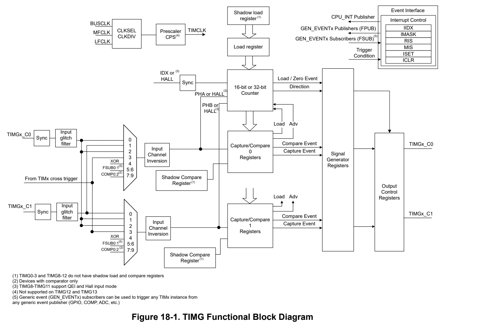
*Figure 18-1. TIMG Functional Block Diagram (p. 1032)*

#### 18.1.2 TIMA Overview (p. 1032)

The TIMA module consists of a 16-bit auto reload counter driven by a programmable prescaler with up to four capture/compare (CC) blocks for multiple capture/compares, PWM outputs with deadband insertion, and interval timing. TIMA has extensive event generation capabilities from different counter events such as overflow, reload, and each of the capture/compare events. It also has the hardware design to handle the fault signal generated by internal or external circuitry to indicate a fault in the system.

##### 18.1.2.1 TIMA Features (p. 1032)

- 16-bit up, down, or up-down counter, with repeat-reload mode

- Selectable and configurable clock source

- 8-bit programmable prescaler to divide the counter clock frequency

- Repeat counter to generate an interrupt or event only after a given number of cycles of the counter (see Section 18.2.1.2)

- Up to four independent channels for: – Output compare – Input capture – PWM output (Edge-Aligned and Center-Aligned) – One-shot mode

- Two additional capture/compare channels for internal events (CC4/CC5)

- Shadow register for load and compare values (see Section 18.2.4)

- Complementary PWM output with programmable deadband insertion (see Section 18.2.5.2.4)

- Fault handling mechanisms to ensure the output signals are in a safe user-defined state when a fault condition is encountered (see Section 18.2.6)

- Support synchronization and cross trigger among different TIMx instances in the same power domain (see Section 18.2.7)

- Support CPU interrupt generation and cross peripherals (such as ADC, DAC, etc.) using the Event (see Section 18.2.9)

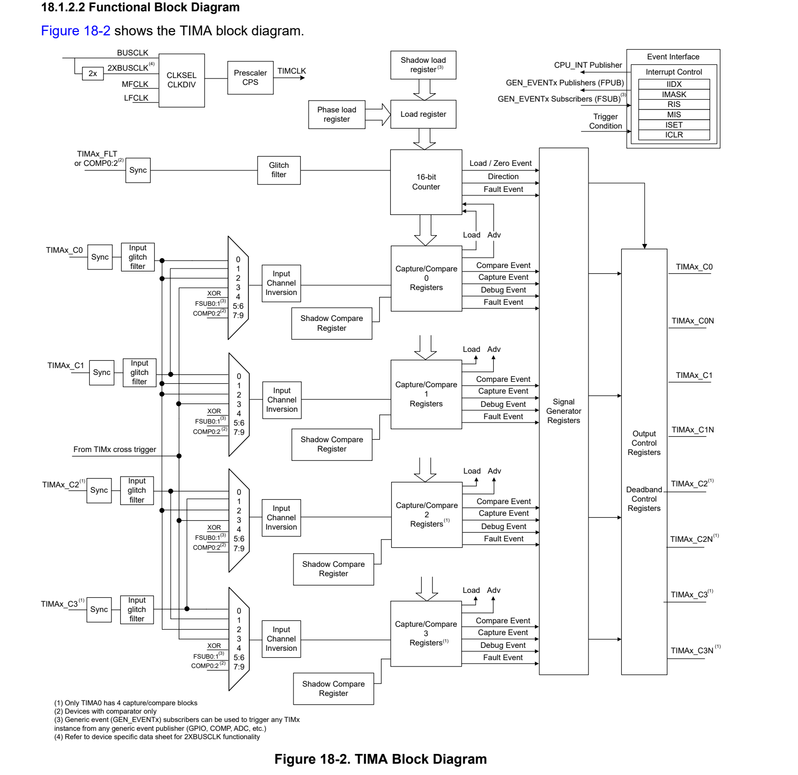
*Figure 18-2. TIMA Block Diagram (p. 1033)*

#### 18.1.3 TIMx Instance Configuration (p. 1034)

Table 18-1 shows the TIMx instance configuration for TIMA and TIMG instances.

**Table 18-1. TIMx Instance Configuration (p. 1034)**

| Instance | Counter Resolution | Prescaler | Repeat Counter | CCP Channels (External/ Internal) | External PWM Channels | Phase Load | Shadow Load | Shadow CCs | Deadband | Fault Handler | QEI / Hall Input Mode |
| --- | --- | --- | --- | --- | --- | --- | --- | --- | --- | --- | --- |
| TIMG0 | 16-bit | 8-bit | - | 2 | 2 | - | - | - | - | - | - |
| TIMG1 | 16-bit | 8-bit | - | 2 | 2 | - | - | - | - | - | - |
| TIMG2 | 16-bit | 8-bit | - | 2 | 2 | - | - | - | - | - | - |
| TIMG3 | 16-bit | 8-bit | - | 2 | 2 | - | - | - | - | - | - |
| TIMG4 | 16-bit | 8-bit | - | 2 | 2 | - | Yes | Yes | - | - | - |
| TIMG5 | 16-bit | 8-bit | - | 2 | 2 | - | Yes | Yes | - | - | - |
| TIMG6 | 16-bit | 8-bit | - | 2 | 2 | - | Yes | Yes | - | - | - |
| TIMG7 | 16-bit | 8-bit | - | 2 | 2 | - | Yes | Yes | - | - | - |
| TIMG8 | 16-bit | 8-bit | - | 2 | 2 | - | - | - | - | - | Yes |
| TIMG9 | 16-bit | 8-bit | - | 2 | 2 | - | - | - | - | - | Yes |
| TIMG10 | 16-bit | 8-bit | - | 2 | 2 | - | - | - | - | - | Yes |
| TIMG11 | 16-bit | 8-bit | - | 2 | 2 | - | - | - | - | - | Yes |
| TIMG12 | 32-bit | - | - | 2 | 2 | - | - | Yes | - | - | - |
| TIMG13 | 32-bit | - | - | 2 | 2 | - | - | Yes | - | - | - |
| TIMG14 | 16-bit | 8-bit | - | 4 | 4 | - | - | - | - | - | - |
| TIMA0 | 16-bit | 8-bit | Yes | 4/2 | 8 | Yes | Yes | Yes | Yes | Yes | - |
| TIMA1 | 16-bit | 8-bit | Yes | 2/2 | 4 | Yes | Yes | Yes | Yes | Yes | - |

Note On TIMA instances, external PWM channels are pairs of complementary PWM output signals with deadband generation with respect to the CC block instance, such as TIMA0_C0 and TIMA0_C0N. For independent PWM output generation, separate noninverting channels must be used, such as TIMA0_C0 and TIMA0_C1.

Note Internal CC channels 4 and 5 (CC_45) can be used for internal compare events and are available in TIMA only.

Note Look at the device-specific data sheet to check which TIMx instances are available on the device and their respective power domains

### 18.2 TIMx Operation (p. 1034)

The TIMx module is configured with user software. The setup and operation of TIMx is discussed in the following sections.

Note There are register arrays in the timer module to group registers with same bit fields for different capture/compare ports. For example, TIMx.CC_01[0/1] is a register array that contains the capture/ compare registers for both CCP0 and CCP1. Access TIMx.CC_01[0] to read the CC0 capture/ compare value, and access TIMx.CC_01[1] to read the CC1 capture/compare value.

> **Note:**

TIMx supports event subscribers and event publishers through event register arrays. For more information, please see the Events chapter.

#### 18.2.1 Timer Counter (p. 1035)

All TIMx instances have 16-bit counter blocks except for TIMG12 and TIMG13, which have 32-bit counter blocks. The timer counter register (TIMx.CTR) can count down, up-and-down, or up depending on the operation mode. It can also be read or written with software. Each count occurs with each rising edge of the TIMCLK signal or with both edges of external signals.

Enabling the TIMx Counter

The counter is clocked by the prescaler output TIMCLK. The counter enable bit TIMx.CTRCTL.EN can be enabled in two ways:

- Set in software manually

- After a load condition (LCOND) or zero condition (ZCOND) is met, and the counter value after enable (CVAE) is changed to the load value or zero value, respectively.

Note The ability to write the counter register while TIMx is running is possible but should be avoided because the user write can collide with a load, zero, or advance event. Depending on the prescaler ratio, the application cannot predict the timing of the write, which can affect the correct timer period.

##### 18.2.1.1 Clock Source Select and Prescaler (p. 1035)

The TIMx clock (TIMCLK) can be sourced from an internal clock or an external signal trigger to advance the clock.

###### 18.2.1.1.1 Internal Clock and Prescaler (p. 1035)

The TIMx clock (TIMCLK) can be sourced from BUSCLK, MFCLK and LFCLK by setting the TIMx.CLKSEL register. It can also be divided by a ratio by setting the TIMx.CLKDIV register and a prescaler (if present). The selected source clock is always available and the frequency depends on the power mode. For more information, see the Clock Module (CKM) section.

The TIMCLK can come from the following sources:

- BUSCLK: the current bus clock is selected as the source for TIMx. The current bus clock depends on power domain.

– If the TIMx instance is in Power Domain 1 ( PD1), refer to MCLK. – If the TIMx instance is in Power Domain 0 ( PD0), refer to ULPCLK.

- MFCLK: MFCLK is selected as the source for TIMx, refer to MFCLK.

- LFCLK: LFCLK is selected as the source for TIMx, refer to LFCLK.

The selected clock source can be passed directly to TIMx or divided by the 8-bit prescaler. The prescaler setting can be configured with register TIMx.CPS.PCNT bit. The selected TIMCLK source is divided by a value of (PCNT+1). A PCNT value of 0 divides TIMCLK by 1, effectively bypassing the divider. A PCNT value of greater than 0 divides the TIMCLK source to generate a slower clock.

TIMx also has a software mechanism for disabling the timer clock. Set TIMx.CCLKCTL.CLKEN to 0 to put the timer in an IDLE state.

TIMCLK Configuration

To configure the clock source, divider, and prescaler:

1. Select the TIMCLK clock source (BUSCLK, MFCLK, or LFCLK) using the CLKSEL register.

| 3. | Col 2 | In TIMx instances with prescalers, optionally set a prescaler using CPS.PCNT. | Col 4 |
| --- | --- | --- | --- |
| 4. | Enable the TIMCLK by setting CCLKCTL.CLKEN = 1. |  |  |
|  | The frequency of TIMCLK is determined using |  | Equation 9. |
| f = | f CLK _ | SOURCE | (9) |

CLKDIV. RATIO + 1 CPS. PCNT + 1

###### 18.2.1.1.2 External Signal Trigger (p. 1036)

The counter can also advance (increment or decrement) by using an external signal on the timer input pin or by triggering from an event from other peripherals in the system. This can be configured by using the advance condition setting (TIMx.CCCTL_xy[0/1].ACOND) to specify what creates the advance event. To specify what event advances the counter, use the TIMx.CTRCTL.CAC setting.

The counter can advance using the internal clock TIMCLK, a different edge of an timer external input, or an internal trigger event from other peripherals.

##### 18.2.1.2 Repeat Counter (TIMA only) (p. 1036)

In TIMA only, the repeat counter (RC) is an 8-bit counter that provides the mechanism to suppress unnecessary events and generate real events for interrupt generation. Specifically, the repeat counter can suppress Load, Compare, and Zero events in the case where the timer is generating events that repeat for a known number of cycles, such a periodic PWM output waveform. This prevents generating excessive and unnecessary interrupts every timer period.

When the timer counter (TIMA.CTR) is advancing, the repeat counter (TIMA.RC) advances when the counter reloads (TIMA.CTR = 0). Software can set the how many timer counter reloads occur until generating the interrupts and events by setting the TIMA.RCLD register. When TIMA.RC = TIMA.RCLD, the repeat counter is reset back to zero and a Repeat Counter Zero event occurs (REPC) in the Interrupt and Event Status registers.

Note If software configures the counter to stop counting in a debug or fault condition, also stop the repeat counter. See Section 18.2.6 and Section 18.2.10 for more details.

Additionally, the repeat counter provides the ability to suppress generation of Zero, Load, and Compare events when TIMA.RC does not equal zero.

- Zero and Load events are suppressed by setting TIMA.CTRCTL.SLZERCNEZ register bit

- Compare events (see Table 18-15) are suppressed by setting the TIMA.CCCTL_xy[0/1].SCERCNEZ bit

Table 18-2 shows the repeat counter behavior with respect to the timer counter and repeat counter load value.

**Table 18-2. Repeat Counter Behavior (p. 1036)**

| TIMA.CTR is Advancing (+1) | Counter value | TIMA.RC = TIMA.RCLD | Repeat Counter Behavior | Suppress Load and Zero Events (SLZERCNEZ = 1) | Suppress Compare Events (SCERCNEZ = 1) |
| --- | --- | --- | --- | --- | --- |
| No | - | - | Does not advance | Yes | Yes |
| Yes | TIMA.CTR ≠ 0 | - | Does not advance | Yes | Yes |
| Yes | TIMA.CTR = 0 | No | Advance (+1) | Yes | Yes |
| Yes | TIMA.CTR = 0 | Yes | TIMA.RC = 0 | No | No |

Repeat counter example

As shown in Figure 18-3, the TIMA.CTR is configured for down-counting mode and zero events are generated once TIMA.CTR = 0. To suppress interrupt generation until 4 timer reloads occur, set TIMA.RCLD = 4 and TIMA.CTRCTL.SLZERCNEZ = 1 to suppress zero and load events until RC = 0 (which occurs once TIMA.RC = TIMA.RCLD).

Note The use of the repeat counter does not affect the output signal generation. All events are generated regardless of the repeat counter value sent to the signal generator unit.

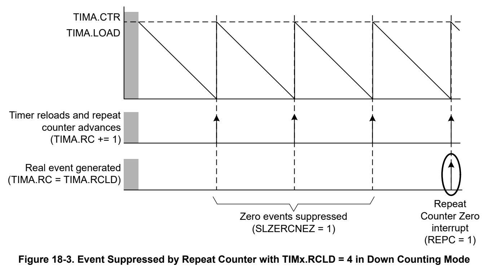
*Figure 18-3. Event Suppressed by Repeat Counter with TIMx.RCLD = 4 in Down Counting Mode (p. 1037)*

#### 18.2.2 Counting Mode Control (p. 1037)

When the device is out of reset, TIMx is disabled. Writing 1 to the TIMx.CTRCTL.EN bit enables the counter. This bit is automatically cleared if TIMx.CTRCTL.REPEAT=0 (do not automatically reload), and the counter value equals zero.

TIMx has three counting modes when enabled: down, up/down, and up. The operating mode is selected by TIMx.CTRCTL.CM bit (shown in Table 18-3). After the counter is enabled, the timer will start counting from the TIMx.CTRCTL.CVAE setting.

**Table 18-3. TIMx Counting Modes (CM) (p. 1037)**

| TIMx.CTRCTL.CM | Counting Mode | Counting Mode |
| --- | --- | --- |
| 0 | Down | Down |
| 1 | Up/Down | Up/Down |
| 2 | Up | Up |

**Table 18-4. TIMx Counter Value after Enable (CVAE) (p. 1037)**

| Count Value After Enable (CVAE) | Description | Supported Counting Modes |
| --- | --- | --- |
| 0 | LOAD value | Up, up/down, down |
| 1 | Unchanged from current value | Up/down |
| 1 | Unchanged from current value | Up/down |
| 2 | Zero value | Up, up/down, down |

##### 18.2.2.1 One-shot and Periodic Modes (p. 1037)

Figure 18-4 shows TIMx working in both one-shot mode and periodic mode.

One-shot Mode

When TIMx.CTRCTL.REPEAT bit is set to 0, TIMx does not advance when:

- TIMx.CTR value reaches 0 in either down- or up/down-counting mode

- TIMx.CTR value reaches TIMx.LOAD in up-counting mode

Periodic Mode (Counter Reload)

When TIMx.CTRCTL.REPEAT is set to 1h, TIMx automatically repeats once a zero event occurs. This happens when:

- TIMx.CTR reaches 0 in either down- or up/down-counting mode – In down-counting mode, a zero event is followed by a load event at the next advance condition – In up/down-counting mode, a zero event is followed by an advance event (+1)

- TIMx.CTR reaches TIMx.LOAD in up-counting mode – A load event is followed by a zero at the next advance condition

TIMx.CTRCTL.REPEAT can also be set to 3h for TIMx to repeat only when not in a debug condition. If there is a debug condition, TIMx will count to the zero event and repeat only once the debug condition is removed.

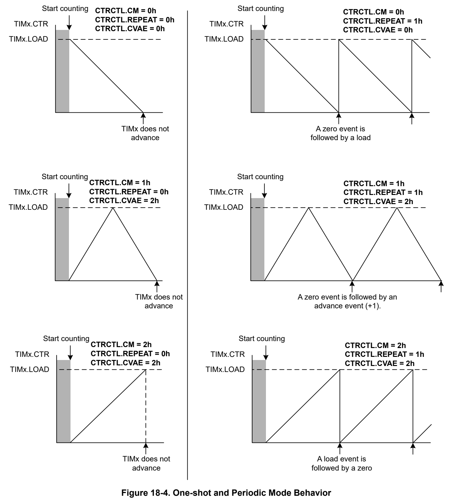
*Figure 18-4. One-shot and Periodic Mode Behavior (p. 1039)*

##### 18.2.2.2 Down Counting Mode (p. 1039)

In down counting mode (CM = 0), TIMx counts from the value defined in TIMx.LOAD (CVAE = 0) down to zero. When the TIMx.CTR value equals zero and TIMx.CTRCTL.REPEAT is set to 1, the TIMx.LOAD value is loaded into TIMx.CTR and the timer repeats the down counting pattern as shown in Figure 18-5.

A Zero event is generated when TIMx counts to zero. A Load event is generated when TIMx counts from zero to the TIMx.LOAD value. Figure 18-6 shows the event generating cycle.

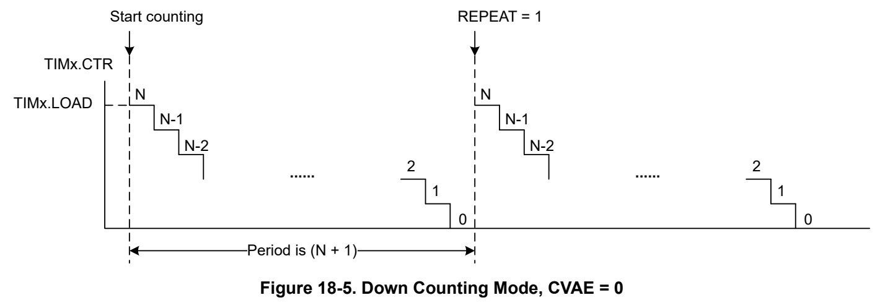
*Figure 18-5. Down Counting Mode, CVAE = 0 (p. 1040)*

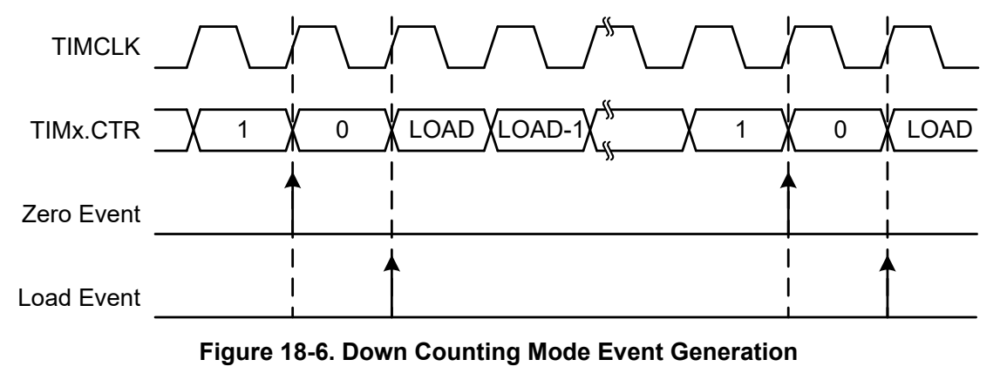
*Figure 18-6. Down Counting Mode Event Generation (p. 1040)*

##### 18.2.2.3 Up/Down Counting Mode (p. 1040)

The Up/Down counting mode can count in an down-up direction or an up-down direction depending on TIMx.CTRCTL.CVAE value. The TIMx.CTRCTL.CVAE bits specify the initialization condition of the counter.

Conditions

**Table 18-5. Counter Value after Enable Initialization (p. 1040)**

| TIMx.CTRCTL.CVAE Value | Counter Value After Enable |
| --- | --- |
| 0x0 | Load Value |
| 0x1 | No Change |
| 0x2 | Zero |

Counting in down-up direction

When TIMx.CTRCTL.CVAE = 0, TIMx.CTR is set to TIMx.LOAD register value and TIMx counts in the down direction. When it reaches zero, a Zero event is generated and TIMx counts back up to TIMx.LOAD value. A Load event is generated when it reaches TIMx.LOAD value.

Figure 18-7 shows TIMx counting in the down-up direction when TIMx.CTRCTL.CVAE = 0.

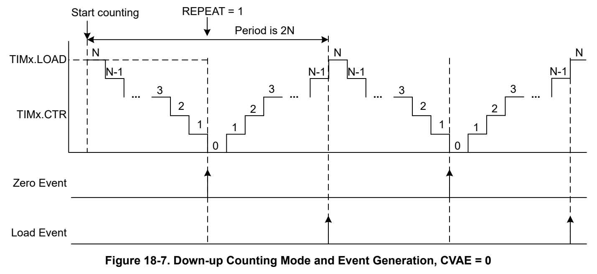
*Figure 18-7. Down-up Counting Mode and Event Generation, CVAE = 0 (p. 1041)*

Counting in up-down direction

When TIMx.CTRCTL.CVAE = 2, TIMx.CTR is set to zero and TIMx counts in the up direction. When it reaches TIMx.LOAD, a Load event is generated and TIMx counts back down to zero. A Zero event is generated when it reaches zero.

Figure 18-8 shows TIMx counting in up-down direction when TIMxCTRCTL.CVAE = 2.

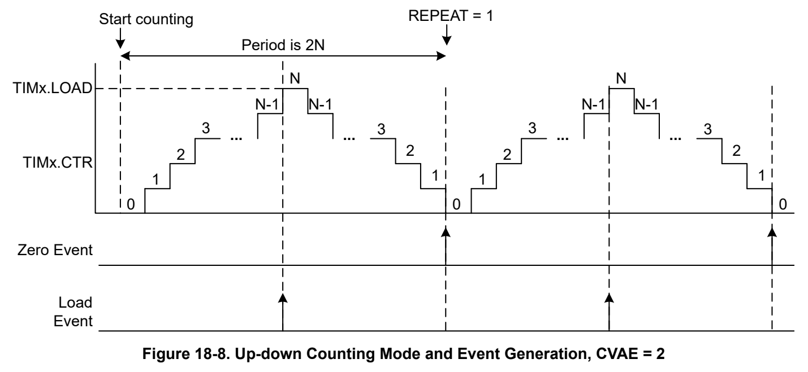
*Figure 18-8. Up-down Counting Mode and Event Generation, CVAE = 2 (p. 1041)*

##### 18.2.2.4 Up Counting Mode (p. 1041)

In up counting mode, TIMx counts from zero up to the value defined in TIMx.LOAD. When the TIMx.CTR value equals TIMx.LOAD and TIMx.CTRCTL.REPEAT is not equal to 0, the zero is loaded into TIMx.CTR and the timer repeats the up counting pattern as shown in Figure 18-5.

A Load event is generated when TIMx counts to TIMx.LOAD. A Zero event is generated when TIMx counts from TIMx.LOAD to the zero value. Figure 18-6 shows the event generating cycle.

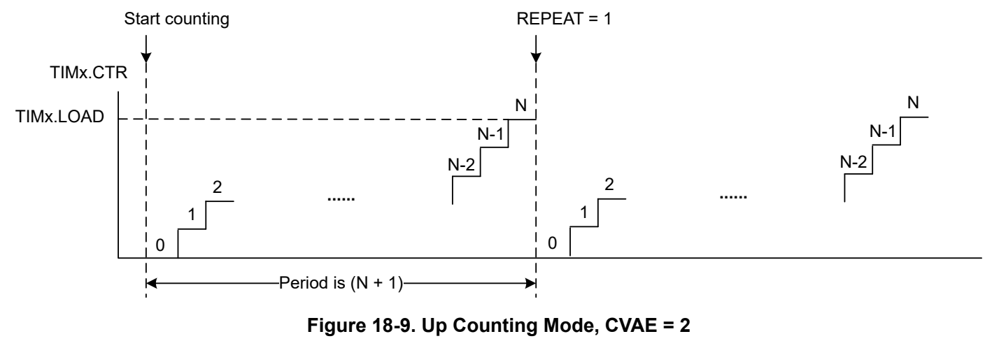
*Figure 18-9. Up Counting Mode, CVAE = 2 (p. 1042)*

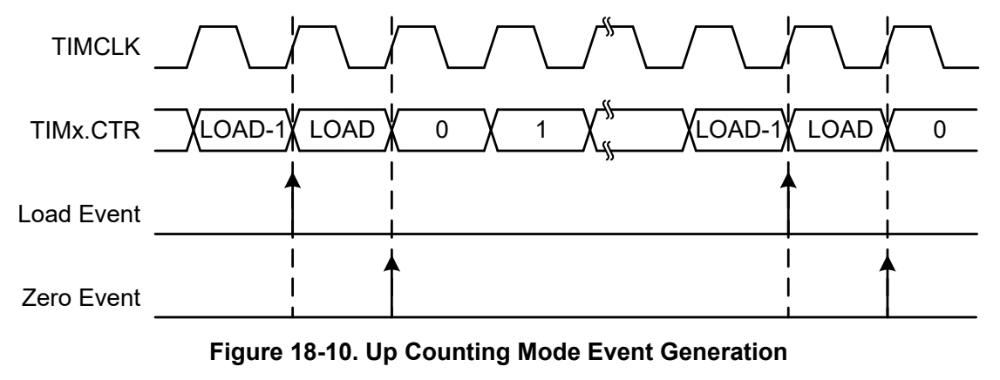
*Figure 18-10. Up Counting Mode Event Generation (p. 1042)*

##### 18.2.2.5 Phase Load (TIMA only) (p. 1042)

In TIMA only, the phase load register TIMA.PL provides the capability for TIMA.CTR to count from a value other than zero or TIMA.LOAD in Up/Down counting mode. Phase load is used to generate asymmetric center-aligned PWM output signals with a controlled phase shift between different timer instances.

When TIMA.PL is nonzero, phase load is enabled by setting TIMA.CTRCTL.PLEN = 1 and triggered when TIMA.CTTRIG.TRIG = 1. When phase load is triggered while TIMA.CTRCTL.CVAE = 0, the timer counts from the TIMA.PL value in the down direction. When phase load is triggered while TIMA.CTRCTL.CVAE = 0, the TIMx counts from the TIMA.PL value in the up direction.

TIMA.PL is latched when the timer starts, and TIMA.PL is synchronized every time when the counter reaches the previously latched TIMA.PL value. Figure 18-11 shows how the phase load register works when the timer is counting in the up-down direction and the phase load value changes to a new value.

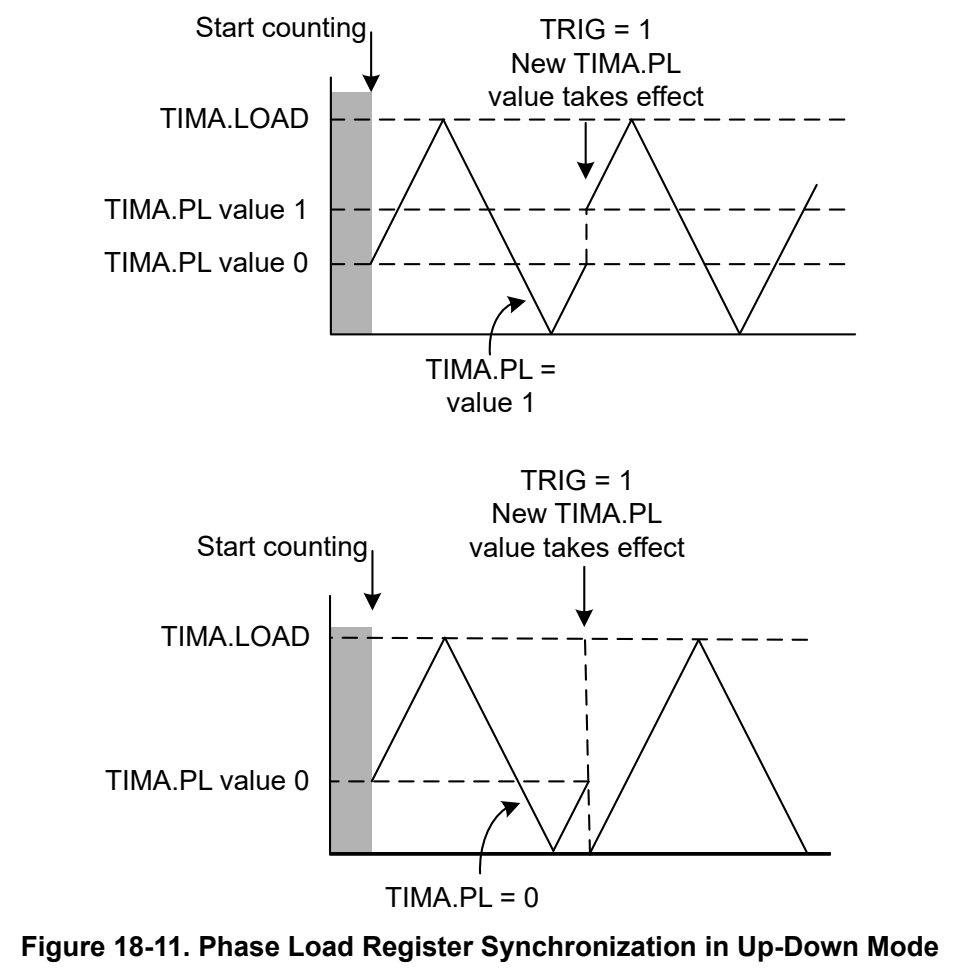
*Figure 18-11. Phase Load Register Synchronization in Up-Down Mode (p. 1043)*

#### 18.2.3 Capture/Compare Module (p. 1043)

The capture/compare (CC) block is used for capture events or compare events. TIMG has up to 2 identical capture/compare blocks and TIMA has up to 4 identical capture/compare blocks present to support external or internal signals. Additionally, TIMA provides 2 additional CC blocks (CC4 and CC5) for compare events only from internal signals. Any of the TIMx capture/compare blocks may be used to capture timings of an input signal or to generate time intervals.

##### 18.2.3.1 Capture Mode (p. 1043)

Capture mode is selected when the TIMx.CCCTL_xy[0/1].COC bit is set to 1. Capture mode is used to generate capture events and record time intervals, which is useful for speed computation or time measurements.

| Col 1 | Key registers for configuring capture mode: |
| --- | --- |
| TIMx.LOAD | TIMx.LOAD |

•: the contents of this register are copied to counter (TIMx.CTR) on any operation designated to do a "load". This value is also used to compare with the counter value for generating a "Load Event" which can be used for interrupt, trigger, or signal generation actions.

- TIMx.CC_xy[0/1]: this is a register that can be used as either a capture register to acquire or record the next counter value on an event, or a compare register to the current counter to create an event.

- TIMx.CCCTL_xy[0/1]: this register controls the operations of the respective CC (capture/compare) blocks. In capture mode, it can configure whether a rising edge or falling edge generates a load, zero, advance, or capture condition. In compare mode, it controls which sources generate different types of compare events.

- TIMx.CTRCTL: this register provides control over the counter operation in different conditions.

- TIMx.IFCTL_xy[0/1]: this register controls the input filtering (FE, FP, CPV), selection (ISEL), and inversion (INV) for the associated CC block.

###### 18.2.3.1.1 Input Selection, Counter Conditions, and Inversion (p. 1044)

The TIMx.IFCTL register is used for selecting input source, filtering, and final inversion options for the capture/ compare block.

Figure 18-12 shows the block diagram for the TIMx capture block with two CC channels.

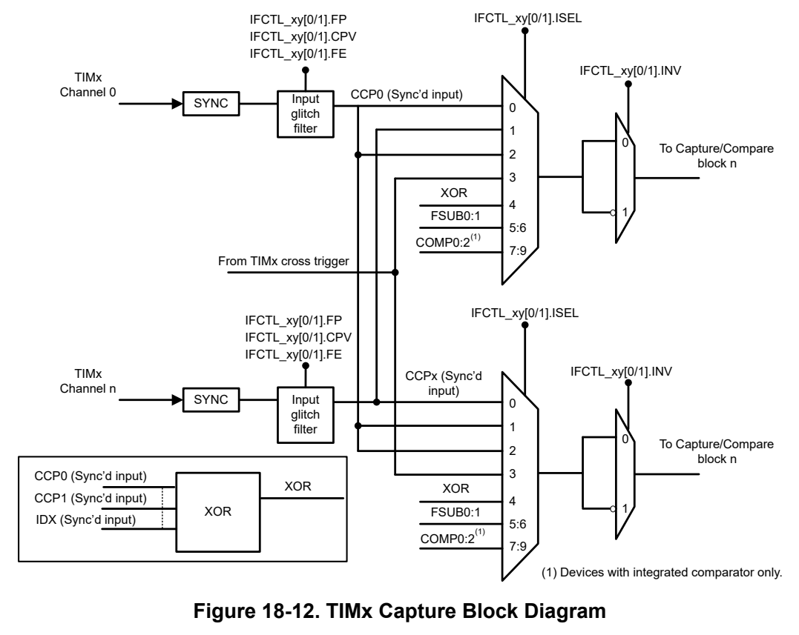
*Figure 18-12. TIMx Capture Block Diagram (p. 1044)*

###### 18.2.3.1.1.1 CCP Input Edge Synchronization (p. 1044)

When using a capture/compare pin (CCP) as an input, configure the pin control management register (PINCMx) for the TIMx CCP input. Refer to the device data sheet for TIMx CCP pinmux input options, such as TIMG0_C0.

The CCP input signal is always passed through a synchronizer, and the input state (high or low) must be greater than one TIMCLK clock period for the synchronizer to detect the edge. CCP input edge detection requires at least one TIMCLK cycle to synchronize the edge input. Timing in the first TIMCLK cycle is uncertain because the edge detection cannot be predicted in the first TIMCLK period.

When the capture condition occurs, an additional TIMCLK cycle is required to generate the capture event.

###### 18.2.3.1.1.2 CCP Input Pulse Conditions (p. 1044)

The TIMx.CCCTL_xy[0/1] register can control whether each timer instance generates a zero, load, capture, or advance pulse based on the edge or polarity of the CCP input signal or trigger edge. The conditions that can be generated are:

- Advance condition (ACOND)

- Load condition (LCOND)

- Zero condition (ZCOND)

- Capture condition (CCOND)

Advance conditions

By default, the timer advances based on each TIMCLK. (ACOND = 0h). However, the timer can also advance based off the specified TIMx.CCCTL_xy[0/1].ACOND settings below.

**Table 18-6. Advance pulse condition settings (ACOND) (p. 1045)**

| ACOND | Col 2 | Condition |
| --- | --- | --- |
| 0h | Each TIMCLK |  |
| 1h | Rising edge of CCP or trigger assertion edge |  |
| 2h | Falling edge of CCP or trigger de-assertion edge |  |
| 3h | Either edge of CCP or trigger |  |
| 5h | CCP high or trigger assertion |  |

Load, zero, and capture conditions

Load, zero, and capture pulses can be generated the LCOND, ZCOND, and CCOND condition settings below in the TIMx.CCCTL_xy[0/1] register.

**Table 18-7. Load, zero, and capture condition settings (LCOND, ZCOND, CCOND) (p. 1045)**

| LCOND | ZCOND | CCOND | Condition |
| --- | --- | --- | --- |
| N/A | N/A | 0h | None |
| 1h | 1h | 1h | Rising edge of CCP or trigger assertion edge |
| 2h | 2h | 2h | Falling edge of CCP or trigger de-assertion edge |
| 3h | 3h | 3h | Either edge of CCP or trigger |

###### 18.2.3.1.1.3 Counter Control Operation (p. 1045)

To specify what CC instance controls the load, zero, or advance event, the CZC, CAC, and CLC fields are used for configuration in the TIMx.CTRCTL register.

See Table 18-8 for counter zero control settings. For example, if a timer triggers a ZCOND event in Channel 1, then CZC should be set to 1h to register that a ZCOND event in channel 1 triggers the zero event.

**Table 18-8. Counter Zero Control (CZC) settings (p. 1045)**

| TIMx.CTRCTL.CZC | Setting |
| --- | --- |
| 0h | Channel 0 ZCOND event zeroes the TIMx instance |
| 1h | Channel 1 ZCOND event zeroes the TIMx instance |
| 2h | Channel 2 ZCOND event zeroes the TIMx instance (4 CC timer only) |
| 3h | Channel 3 ZCOND event zeroes the TIMx instance (4 CC timer only) |
| 4h | 2-input QEI mode. See Section 18.2.3.1.3 |
| 5h | 3-input QEI mode. See Section 18.2.3.1.3 |

See Table 18-9 for counter load control settings. For example, if a timer triggers a LCOND event in Channel 2, then CLC should be set to 2h to register that a LCOND event in channel 2 triggers the load event.

**Table 18-9. Counter Load Control (CLC) settings (p. 1045)**

| TIMx.CTRCTL.CLC | Setting |
| --- | --- |
| 0h | Channel 0 LCOND event loads the TIMx instance |
| 1h | Channel 1 LCOND event loads the TIMx instance |
| 2h | Channel 2 LCOND event loads the TIMx instance (4 CC timer only) |
| 3h | Channel 3 LCOND event loads the TIMx instance (4 CC timer only) |
| 4h | 2-input QEI mode. See Section 18.2.3.1.3 |
| 5h | 3-input QEI mode. See Section 18.2.3.1.3 |

See Table 18-10 for counter advance control settings. For example, if a timer triggers a ACOND event in Channel 3, then CAC should be set to 3h to register that a ACOND event in channel 3 triggers the advance event.

**Table 18-10. Counter Advance Control (CAC) settings (p. 1046)**

| TIMx.CTRCTL.CAC | Setting |
| --- | --- |
| 0h | Channel 0 ACOND event advances the TIMx instance |
| 1h | Channel 1 ACOND event advances the TIMx instance |
| 2h | Channel 2 ACOND event advances the TIMx instance (4 CC timer only) |
| 3h | Channel 3 ACOND event advances the TIMx instance (4 CC timer only) |
| 4h | 2-input QEI mode. See Section 18.2.3.1.3 |
| 5h | 3-input QEI mode. See Section 18.2.3.1.3 |

###### 18.2.3.1.1.4 CCP Input Filtering (p. 1046)

The input glitch filter can be enabled by setting the TIMx. IFCTL_01[0/1].FE bit. The filter period is configured by setting the TIMx. IFCTL_01[0/1].FP bit.

A consecutive period or majority voting format selected by the TIMx.IFCTL_xy[0/1].CPV bit is used to select the criteria for a CCP input signal.

- Consecutive period - The CCP input signal must be at the specified level for the defined number of FP timer clocks for the CCP input to be processed.

- Majority voting - The filter ignores one clock of opposite logic over the filter period. For example, over the number of FP samples of the input, up to 1 sample can be of an opposite logic value (glitch) without affecting the output.

The example shown in Figure 18-13 shows the difference between consecutive period and majority voting formats with a digital filter implemented to capture a CCP input signal of 3 TIMCLK periods.

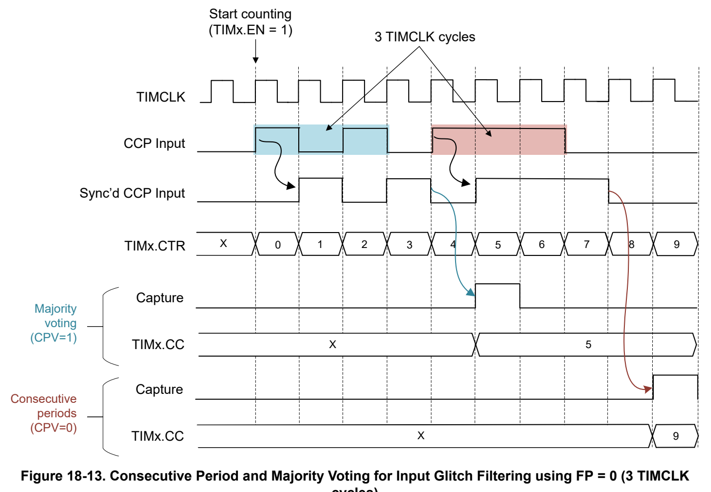
*Figure 18-13. Consecutive Period and Majority Voting for Input Glitch Filtering using FP = 0 (3 TIMCLK (p. 1046)*

###### 18.2.3.1.1.5 Input Selection (p. 1047)

The input select bits TIMx.IFCTL_xy[0/1].ISEL select the input source to the filter input as the corresponding CCP input, CCP0 for cross-triggering across CC blocks, an external trigger, XOR (used in Hall input mode), event subscribers, or comparator inputs.

**Table 18-11. Input Selection Options for TIMx CC Instances (p. 1047)**

| Input selection (TIMx.IFCTL_xy[0/1].ISEL) | Source |
| --- | --- |
| 0h | TIMx CCP of the corresponding capture compare unit |
| 1h | Input pair CCPx of the capture compare unit. [CCP0/CCP1, CCP2/CCP3] |
| 2h | TIMx CCP0 |
| 3h | Cross trigger signal |
| 4h | XOR of CCP inputs. Used in Hall input mode. See Section 18.2.3.1.4 |
| 5h | Subscriber event 0 (FSUB0). See Section 18.2.9.2 |
| 6h | Subscriber event 1 (FSUB1). See Section 18.2.9.2 |
| 7h | COMP0_OUT (devices with comparator only) |
| 8h | COMP1_OUT (devices with comparator only) |
| 9h | COMP2_OUT (devices with comparator only) |

###### 18.2.3.1.2 Use Cases (p. 1047)

Several different use cases can be achieved in capture mode and are discussed in the following sections.

###### 18.2.3.1.2.1 Edge Time Capture (p. 1047)

Edge time capture measures the time (in TIMCLK cycles) from the start of the capture operation to the signal edge. The counter is loaded when TIMx is enabled and counts with each TIMCLK period until the CCP edge is detected, which triggers the capture of the timer value and generates a capture event. The capture edge time is equivalent to the difference between the starting value of the counter and the capture value in TIMx.CC_xy[0/1] register.

Edge Time Capture Configuration

1. Set the TIMx.LOAD value. 2. In the CTRCTL register, set the desired counter control settings for: a. Counting mode (CM) and counter value after enable (CVAE) (see as described in Section 18.2.2) b. Zero (CZC), advance (CAC), and load control (CLC) to specify what condition controls zeroing, advancing, or loading the counter c. Repeat or one-shot mode (REPEAT)

3. Set TIMx.CCCTL_xy[0/1].COC = 1 for capture mode. 4. Configure CCP as an input for the CC block by setting respective bit in the CCPD registers. For instance, if TIMx Channel 0 is an input, set CCPD.C0CCP0 = 0. 5. For the corresponding CC block control register (CCCTL_01[0/1]), set CCOND to the corresponding setting to capture events based off the input signal condition (rising and/or falling edge). Additionally, set ZCOND or LCOND depending on the counting mode used. 6. Configure input capture settings in the TIMx.IFCTL_xy[0/1] register as described in Section 18.2.3.1.1. 7. Enable the counter by setting EN = 1 or waiting for a capture event to occur from the input edge.

Example using up-counting mode for rising edge capture

In up-counting mode starting from zero (CM = 2, CVAE = 2), TIMx can be configured to generate a zero pulse and start the counter from the configured capture event (CCOND) by setting ZCOND to 1.

The expected internal timing for a rising or positive edge time capture in up-counting mode is shown in Figure 18-14

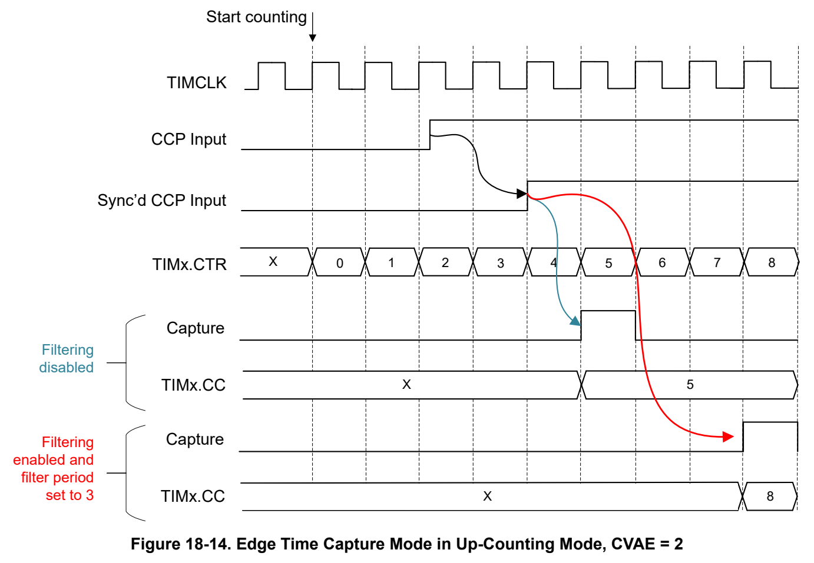
*Figure 18-14. Edge Time Capture Mode in Up-Counting Mode, CVAE = 2 (p. 1048)*

###### 18.2.3.1.2.2 Period Capture (p. 1048)

Period capture measures the period of a signal on an input CCP in TIMCLK cycles. On each positive (or negative) edge of the CCP input, the TIMx.CTR value is both captured into the TIMx.CC register to generate a capture event. The period capture time is equivalent to the difference between the starting value of the counter generated to the capture event, or time between reoccurring capture events for a periodic input signal.

Period Capture Configuration

1. Set the TIMx.LOAD value. 2. In the CTRCTL register, set the desired counter control settings for: a. Counting mode (CM) and counter value after enable (CVAE) (see as described in Section 18.2.2) b. Advance (CAC) to specify what condition controls advancing the counter c. Repeat or one-shot mode (REPEAT)

3. Set TIMx.CCCTL_xy[0/1].COC = 1 for capture mode. 4. Configure CCP as an input for the CC block by setting respective bit in the CCPD registers. For instance, if

| TIMx Channel 0 is an input, set CCPD.C0CCP0 = 0. | Col 3 | Col 4 | Col 5 | Col 6 |
| --- | --- | --- | --- | --- |
|  | For the corresponding CC block control register (CCCTL_01[0/1]), |  |  |  |
|  |  |  | Set CCOND to the corresponding setting to capture events based off the input signal condition (rising | Set CCOND to the corresponding setting to capture events based off the input signal condition (rising |
|  | Set ZCOND or LCOND depending on the counting mode used |  |  |  |
|  |  | Configure input capture settings in the TIMx.IFCTL_xy[0/1] register as described in |  |  |

5.

a. and/or falling edge) b.

6. Section 18.2.3.1.1. 7.

Example using up-counting mode for rising-edge period capture

In up-counting mode starting from zero (CM = 2, CVAE = 2), TIMx channel 0 can be configured to generate a capture event from a rising edge input by setting CCOND = 1h. After enabling the counter, when a rising edge input is detected, the counter will capture the counter value in TIMx.CC. After the capture event, set the TIMx.LOAD value back to 0 to reset the timer counter for the periodic CCP input signal.

The expected internal timing for a period capture in up-counting mode using two rising edges is shown in Figure 18-14.

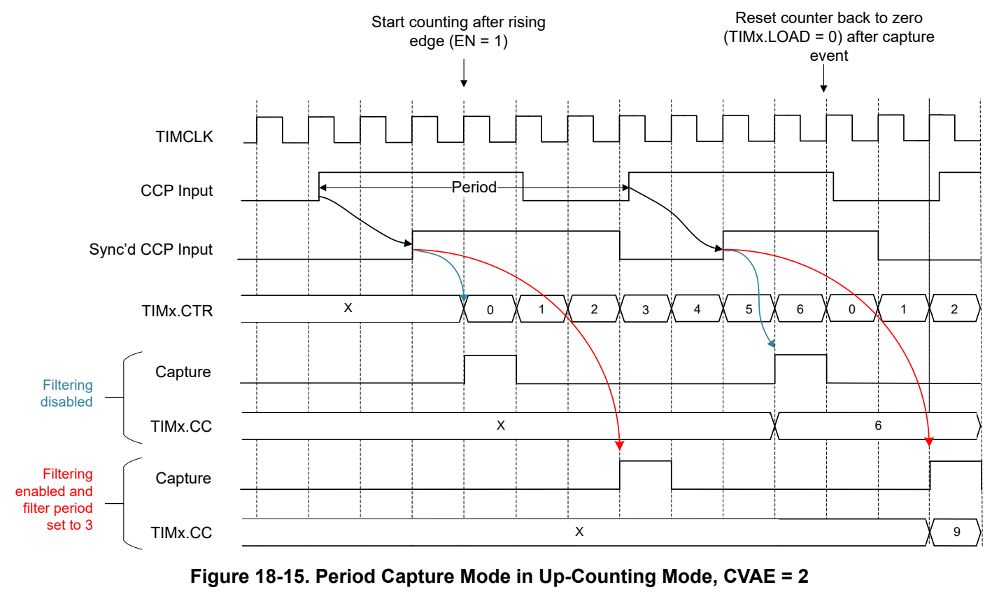
*Figure 18-15. Period Capture Mode in Up-Counting Mode, CVAE = 2 (p. 1049)*

###### 18.2.3.1.2.3 Pulse Width Capture (p. 1049)

Pulse width capture measures the high-time of a signal on CCP. The high time is the number of TIMCLK periods from rising edge to falling edge of the CCP input, and is useful for applications such as measuring the duty cycle of an PWM input signal. The counter is loaded at the positive edge and captured at the negative edge (capture event is generated).

Pulse-Width Capture Configuration

1. Set the TIMx.LOAD value. 2. a. Section 18.2.2) b.

| Col 2 | In the CTRCTL register, set the desired counter control settings for: | Col 5 | Col 6 | Col 7 |
| --- | --- | --- | --- | --- |
|  |  | Counting mode (CM) and counter value after enable (CVAE) (see as described in | Zero (CZC), advance (CAC), and load control (CLC) to specify what condition controls zeroing, |  |
| advancing, or loading the counter Repeat or one-shot mode (REPEAT) |  |  |  |  |
|  |  |  | Configure CCP as an input for the CC block by setting respective bit in the CCPD registers. For instance, if | Configure CCP as an input for the CC block by setting respective bit in the CCPD registers. For instance, if For the corresponding CC block control register (CCCTL_01[0/1]), set CCOND to the corresponding setting |

c.

3. 4.

5. to capture events based off the input signal condition (rising and/or falling edge). Additionally, set ZCOND or LCOND depending on the counting mode used.

7. Enable the counter by setting EN = 1 or waiting for a capture event to occur from the input edge.

Example using up-counting mode for pulse width capture

In up-counting mode starting from zero (CM = 2, CVAE = 2), TIMx channel 0 can be configured to generate a zero pulse and start the counter from the configured capture event (CCOND) by setting ZCOND to 1. To start the counter, a load condition can be triggered from the CCP rising edge input by setting LCOND = 1.

The expected internal timing for a pulse width capture in up-counting mode using a rising and falling edge is shown in Figure 18-14.

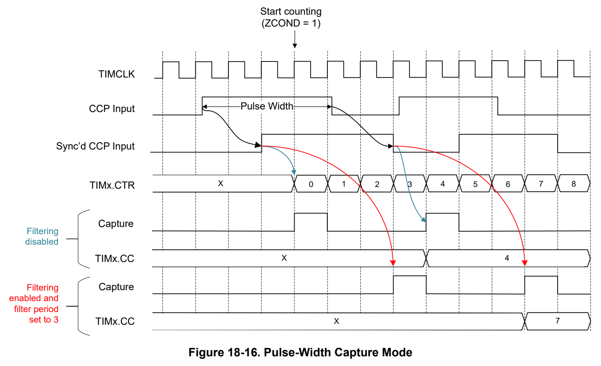
*Figure 18-16. Pulse-Width Capture Mode (p. 1050)*

###### 18.2.3.1.2.4 Combined Pulse Width and Period Time (p. 1050)

Using two capture registers can combine pulse-width and period capture of a single input waveform. The input signal can be externally connected to CCP channel 0, and the IFCTL_01[1] register can be configured to have the input connected to CCP channel 1 internally so capture register 0 (TIMx.CC0) captures pulse width and

| Pulse-Width and Period Capture Configuration | Figure 18-17 | . | . | Col 6 | Col 7 |
| --- | --- | --- | --- | --- | --- |
|  |  | In the CTRCTL register, set the desired counter control settings for: |  | Counting mode (CM) and counter value after enable (CVAE) (see as described in | Zero (CZC), advance (CAC), and load control (CLC) to specify what condition controls zeroing, |
| advancing, or loading the counter Repeat or one-shot mode (REPEAT) |  |  | Set TIMx.CCCTL_xy[0/1].COC = 1 for capture mode for each CC channel. |  |  |

period capture is shown in

1. Set the TIMx.LOAD value. 2. a. Section 18.2.2) b.

c.

3. 4. Configure CCP as an input for each CC block by setting respective bits in the CCPD register. For instance, if TIMx Channel 0 is an input, set CCPD.C0CCP0 = 0.

a. Set CCOND to the corresponding setting to capture events based off the input signal condition (rising and/or falling edge) b. Set ZCOND or LCOND depending on the counting mode used.

6. Configure input capture settings in the TIMx.IFCTL_xy[0/1] register as described in Section 18.2.3.1.1. 7. Enable the counter by setting EN = 1 or waiting for a capture event to occur from the input edge.

Example using pulse-width and period time capture

In up counting mode, TIMx can be configured to generate a zero pulse and start the counter from the configured capture event (CCOND) by setting ZCOND to 1.

The expected internal timing for a pulse-width and period capture in up-counting mode using two CC blocks is shown in Figure 18-14.

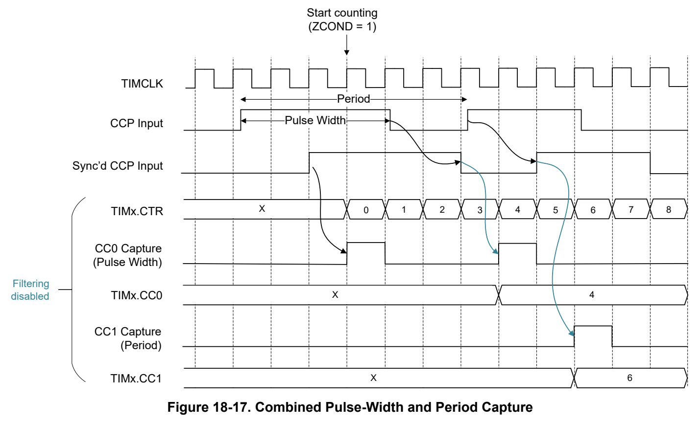
*Figure 18-17. Combined Pulse-Width and Period Capture (p. 1051)*

###### 18.2.3.1.3 QEI Mode (TIMG with QEI support only) (p. 1051)

In TIMGx instances with QEI support, Quadrature Encoder Interface (QEI) mode provides an interface to the output of a quadrature encoder. It decodes the quadrature encoded data to provide the information on the relative positioning and movement of a linear or rotary motion.

The QEI consists of two Gray coded quadrature input signals PHA and PHB, and an index input signal IDX. All input signals go to CCP inputs of a single counter, such that PHA and PHB are mapped to CCP0 and CCP1, and IDX is brought in as a separate input. An error detection mechanism can report erroneous transitions to avoid improper signal decodings.

> **Note:**

See Section 18.1.3 and the device-specific data sheet for TIMG instances that support QEI / Hall Input Mode.

###### 18.2.3.1.3.1 QEI With 2-Signal (p. 1052)

QEI is used to decode signals from optical position encoders. Optical position encoders typically output 2 signals (PHA/PHB) which are often used to measure rotary or linear movement of physical items with rotating shafts, such as 3-phase motors. The measurement provided by the interface is incremental, which means as movement occurs, the interface provides the ability to capture the relative change from the previous position.

When operating in QEI mode, a counter accumulates the incremental updates, deriving current position from initial position and the accumulated change. The initial position can be determined by the signal of the IDX input (3-signal QEI mode) or by other software means (software directly setting the initial position). The capture and compare register can be used to store the position value by defining a capture condition.

When a direction change (DC) occurs, a DC interrupt is generated in the RIS register.

Figure 18-18 shows the state machine in the QEI interface to detect the directional rotation from the two CCP input signals, PHA and PHB.

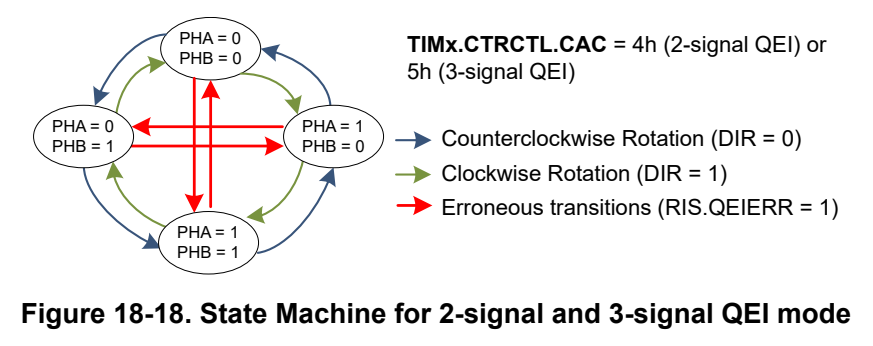
*Figure 18-18. State Machine for 2-signal and 3-signal QEI mode (p. 1052)*

QEI 2-Signal Mode Configuration

1. Configure PINCMx for TIMGx_C0 (PHA) and TIMGx_C1 (PHB). 2. Set TIMG.CCCTL_01[0].COC = 1 and TIMG.CCCTL_01[1].COC = 1 for capture mode for both CCP channels 0 and 1 (PHA and PHB). 3. Configure CCP as an input for each CC block by setting respective bits in the CCPD register. For instance, if TIMx Channel 0 is an input, set CCPD.C0CCP0 = 0. 4. Set the TIMx.LOAD to the encoder resolution, such as 4000. 5. In the CTRCTL register, set the CAC, CZC, and CLC bits to 4h. 6. Configure input capture settings as described in Section 18.2.3.1.1, if desired. 7. Enable the counter to start counting by setting EN = 1.

Example using QEI mode with 2 input signals

The behavior of PHA/PHB follows Table 18-12 and Figure 18-19.

**Table 18-12. PHA/PHB State Table and Counter Actions (p. 1052)**

| Current State (PHA, PHB) | Next State (PHA, PHB) | Direction (DIR) | Counter Action |
| --- | --- | --- | --- |
| 00 | 10 |  |  |
| 10 | 11 | 1 (Up) | +1 (If TIMx.CTR = LOAD, then |
| 11 | 01 | 1 (Up) | CTR = 0) |
| 01 | 00 |  |  |
| 00 | 01 |  |  |
| 01 | 11 | 0 (Down) | -1 (If TIMx.CTR = 0, then CTR = |
| 11 | 10 | 0 (Down) | TIMx.LOAD) |
| 10 | 00 |  |  |

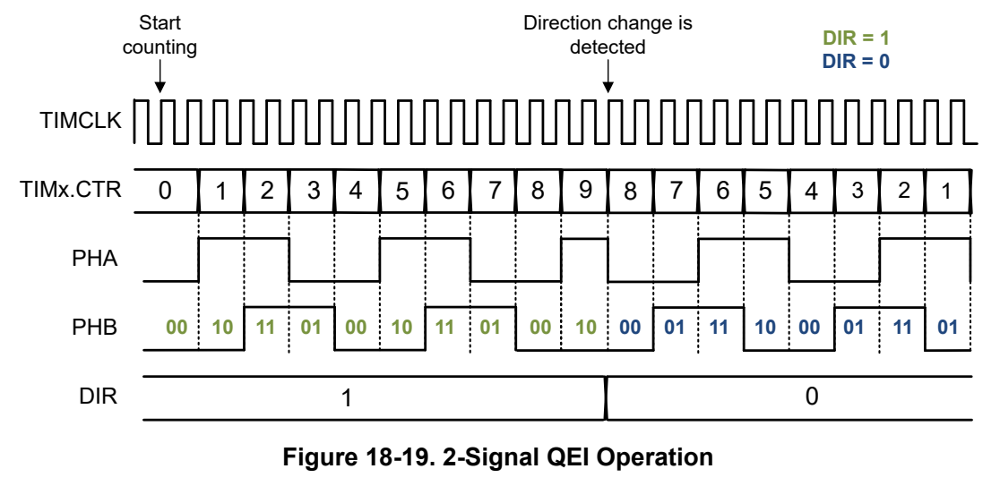
*Figure 18-19. 2-Signal QEI Operation (p. 1053)*

###### 18.2.3.1.3.2 QEI With Index Input (p. 1053)

3-signal QEI mode is similar to the 2-signal mode with additional index input signal IDX. Generally, IDX input pulses once per rotation which can be used to reset the counter. It is used in one of two applications:

- One IDX pulse is generated each movement cycle. In this case, the accumulated position represents the fraction of the movement cycle.

- An IDX pulse is generated at a specific position in a noncyclic movement.

QEI 3-Signal Mode Configuration

1. Configure PINCMx for TIMGx_C0 (PHA), TIMGx_C1 (PHB), and TIMGx_IDX (IDX). 2. Set TIMG.CCCTL_01[0].COC = 1 and TIMG.CCCTL_01[1].COC = 1 for capture mode for both CCP channels 0 and 1 (PHA and PHB). 3. Configure CCP as an input for each CC block by setting respective bits in the CCPD register. For instance, if TIMx Channel 0 is an input, set CCPD.C0CCP0 = 0. 4. Set the TIMx.LOAD value to the encoder resolution, such as 4000. 5. In the CTRCTL register,set the CAC, CZC, and CLC bits to 5h. 6. Configure input capture settings as described in Section 18.2.3.1.1, if desired. 7. Enable the counter to start counting by setting EN = 1.

The IDX input is sampled when a rising edge is detected. The IDX signal affects the counter value depending on the direction as shown in Table 18-13 and

**Table 18-13. Relation of IDX Input and Counter Value (p. 1053)**

| Direction (DIR) | IDX | Col 7 | Counter Action |
| --- | --- | --- | --- |
| 1 | Rising | Zero (TIMx.CTR is set to zero) |  |
| 0 | Rising |  |  |

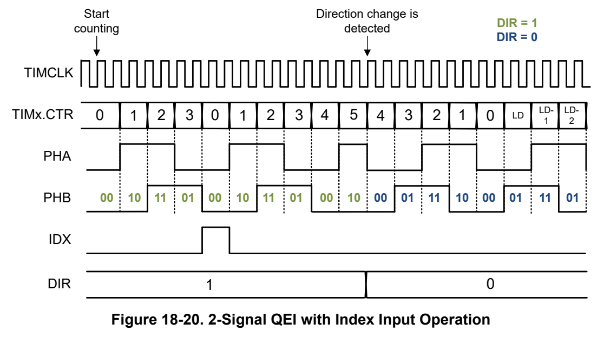
*Figure 18-20. 2-Signal QEI with Index Input Operation (p. 1054)*

###### 18.2.3.1.3.3 QEI Error Detection (p. 1054)

The QEI module can detect erroneous transactions or state errors as shown in Figure 18-18. A QEIERR interrupt is generated and the counter or direction signal does not change in the error state.

> **Note:**

QEIERR can occur if the TIMCLK period is slower than the period of the PHA or PHB signals.

###### 18.2.3.1.4 Hall Input Mode (TIMG with QEI support only) (p. 1054)

In TIMGx instances with QEI support, three digital Hall signals can be input into CCP channel 0 (CCP0), CCP channel input 1 (CCP1), and IDX for position control of 3-phase Hall-sensored motor applications. Hall signals are used to detect real-time motor position in motor control applications and can be used for speed computation measurements, position control, or motor stall status.

Note See Section 18.1.3 and the device-specific data sheet for TIMG instances that support QEI / Hall Input Mode.

Table 18-14 shows the signal mapping for Hall signals A (U), B (V), and C (W) to TIMG capture/compare input signals.

**Table 18-14. Hall Input and TIMx Input Signal Mapping (p. 1054)**

| Hall input signal | Hall input signal | TIMx input |
| --- | --- | --- |
| HALL A / HALL U | HALL A / HALL U | CCP0 |
| HALL B / HALL V | HALL B / HALL V | CCP1 |
| HALL C / HALL W | HALL C / HALL W | IDX |

Note Hall input signals should be digital inputs from Hall sensor ICs with a pullup to VCC.

As shown in Figure 18-21, the input capture module provides a 3-input XOR of synced CCP0, CCP1, and IDX signals to create a frequency generator (FG) signal. The XOR output signal is selected when IFCTL_xy[0/1].ISEL is set to 4h. See Figure 18-21 for XOR option in the input capture block diagram.

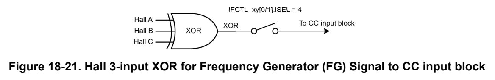
*Figure 18-21. Hall 3-input XOR for Frequency Generator (FG) Signal to CC input block (p. 1055)*

The XOR'ed output signal is propagated to the CC block and a period or pulse-width capture can be used to compute the linear motor speed in relation to the calculated period or pulse width in the TIMx.CC register. See Section 18.2.3.1.2.2 and Section 18.2.3.1.2.3 on how to calculate period and pulse-width captures based on the XOR'ed input signal.

Figure 18-22 shows the input signal to the CC block which can be used for speed calculations.

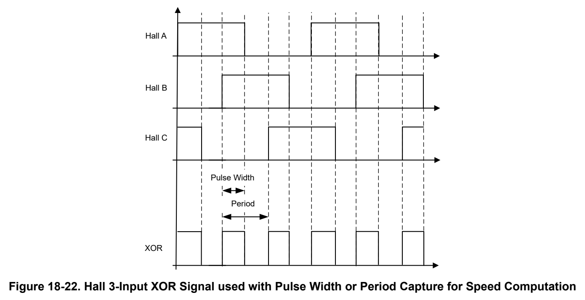
*Figure 18-22. Hall 3-Input XOR Signal used with Pulse Width or Period Capture for Speed Computation (p. 1055)*

Hall Input Mode Configuration

1. Configure PINCMx for TIMGx_C0 (HALLA), TIMGx_C1 (HALLB), and TIMGx_IDX (HALLC). 2. Set TIMG.CCCTL_01[0].COC = 1 and TIMG.CCCTL_01[1].COC = 1 for capture mode for both CCP channels 0 and 1 (HALLA and HALLB). 3. Configure CCP as an input for each CC block by setting respective bits in the CCPD register. For instance, if TIMx Channel 0 is an input, set CCPD.C0CCP0 = 0. 4. Set the TIMx.LOAD value. 5. Set TIMG.IFCTL_xy[0/1].ISEL = 4h to select the XOR option for Hall signals. 6. Enable the counter to start counting by setting EN = 1.

##### 18.2.3.2 Compare Mode (p. 1055)

Compare mode is selected when TIMx.CCCTL_xy[0/1].COC = 0. Compare mode is used to generate a compare event to output PWM output signals at specific time intervals. Compare events can be used to generate a timing base internally or generate a PWM output with specific profiles using active, inactive, or toggle action behaviors, and optional deadband insertion.

Many types of compare mode events can be generated based on the configuration of the CC action register CCACT_xy[0/1]:

- Compare events: occurs for a CC channel when TIMx.CTR counts up (CCU) or down (CCD) to the value in TIMx.CC_xy[0/1]

- Secondary compare events: occurs when a secondary CCx block compare up (CC2U) or down (CC2U) is configured for another CCx block's CCU event or CCD event, respectively. This enables more flexible output generation from other external events such as comparator outputs or fault signals. It can be useful for real-time control applications, like digital power or motor control.

In TIMA only, an additional internal 5th and 6th CC block (TIMA.CC_45[0/1]) can be used for internal secondary compare events while continuing to use CC channels with dedicated output pins for external PWM signal generation.

Table 18-15 shows the types of compare mode events that can be generated and conditions to generate the events.

**Table 18-15. Compare Mode Events (p. 1056)**

| Event | Name | Event Condition |
| --- | --- | --- |
| CCDn (n = CC channel) | Capture/compare down event | When timer is counting down, TIMx.CTR = TIMx.CC_xy[0/1] |
| CCUn (n = CC channel) | Capture/compare up event | When timer is counting up, TIMx.CTR = TIMx.CC_xy[0/1] |
| CC2Dn (n = CC channel) | Secondary capture/compare down event | Occurs when CC2SELD is configured for the source of the CCDn event |
| CC2Un (n = CC channel) | Secondary capture/compare up event | Occurs when CC2SELU is configured for the source of the CCUn event |

Note Look at the device specific data sheet to check how many CC channels are available in each TIMx instance on the device.

###### 18.2.3.2.1 Edge Count (p. 1056)

In addition to event or PWM output generation, compare mode can also be used for input signal edge counting to determine when a number of edges has been detected. In edge count operation, a CCP input edge can advance the counter based on the ACOND condition. The counter register is initialized with the starting value, and the number of detected CCP input edges at any time can increment or decrement depending on the counting mode configuration. The user can count rising edges, falling edges, or both edges by configuring the CCOND value.

Edge Count Configuration

1. Set TIMx.CCCTL_xy[0/1].COC = 0 for compare mode. 2. Optionally set the corresponding TIMx.CC_xy[0/1] to a compare value to generate a compare interrupt when the counter reaches this value. 3. In the CTRCTL register, set the desired counter control settings for: a. Counting mode (CM) and counter value after enable (CVAE) (see as described in Section 18.2.2) b. Zero (CZC), advance (CAC), and load control (CLC) to specify what condition controls zeroing, advancing, or loading the counter c. Repeat or one-shot mode (REPEAT)

4. Set ACOND to a setting to advance the counter based on the input edge polarity. 5. Configure input capture settings as described in Section 18.2.3.1.1, if desired. 6. Enable the counter by setting EN = 1.

Example using edge count operation using up-counting mode

In up-counting mode starting from zero (CM = 2, CVAE = 2), the expected internal timing for rising edge count operation to increment the counter is shown in Figure 18-23.

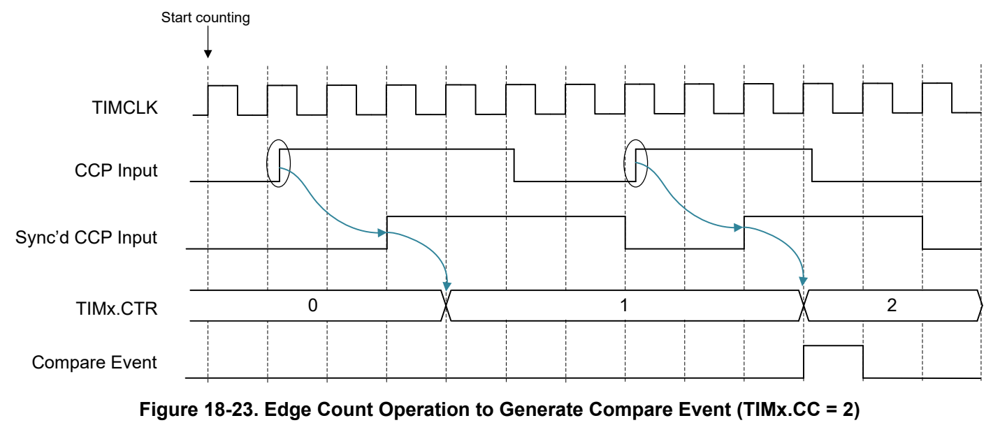
*Figure 18-23. Edge Count Operation to Generate Compare Event (TIMx.CC = 2) (p. 1057)*

#### 18.2.4 Shadow Load and Shadow Compare (p. 1057)

Some timer modules have a shadow load and shadow compare register feature which gives the user the flexibility of holding the update of load and CC values until a certain event occurs. This is useful in timing-critical applications where PWM control signals need to be updated with correct timings, such as duty cycle updates. Refer to the timer features for specific configurations of the TIMx modules.

Note See Section 18.1.3 and the device-specific data sheet for TIMx instances that support Shadow Load and Shadow Compare.

##### 18.2.4.1 Shadow Load (TIMG4-7, TIMA only) (p. 1057)

On shadow-load capable timers, the shadow load feature allows holding the update of load values until a zero event occurs. To enable shadow loading, set the TIMx.GCTL.SHDWLDEN bit while the timer is enabled (EN = 1).

If the TIMx module has a shadow load feature, there is an internal shadow register for the load value (TIMx.LOAD). The shadow register will update the load value at a zero event as shown in Figure 18-24.

Note On shadow-load capable timers, SHDWLDEN must be set or else the load value will not update.

If the timer instance does not have shadow load capability (standard timer), the load value will update immediately when TIMx.LOAD is written to.

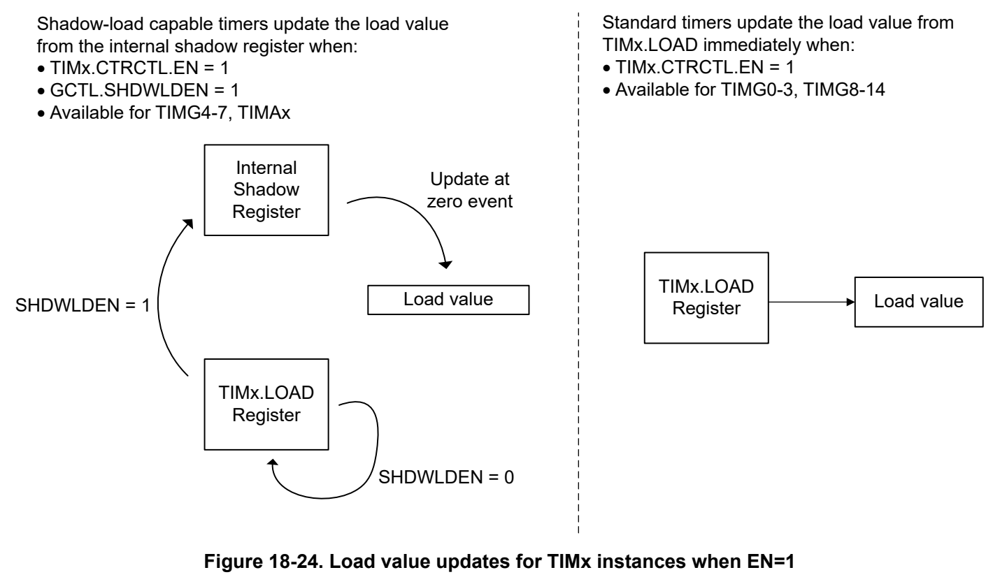
*Figure 18-24. Load value updates for TIMx instances when EN=1 (p. 1058)*

Note To update the load value for shadow load capable timers, the timer must be disabled before changing the TIMx.LOAD value.

When TIMx.GCTL.SHDWLDEN = 1, load values update at zero events for all counting modes. Consult the counting mode operations below to determine if a shadow load is needed:

- In down-counting modes, since TIMx.LOAD value is updated when a zero event occurs, a shadow load is not needed in these modes.

- In up/down counting mode, TIMx.LOAD is compared with the counter value to determine if the peak is reached and when to start to counting down. A shadow load is necessary to ensure that TIMx counts up to the load value before the zero event, or else the load value can update immediately and cause incorrect timings.

- In up-counting mode, the timer counts to TIMx.LOAD. A shadow load is necessary to ensure that TIMx counts up to the load value before the zero event, or else the load value can update immediately and cause incorrect timings.

Figure 18-25 shows an example of how shadow load and shadow compare takes effect at the zero event for both the TIMx.LOAD and TIMx.CC value in up/down counting mode.

##### 18.2.4.2 Shadow Compare (TIMG4-7, TIMG12-13, TIMA only) (p. 1058)

When shadow compare is enabled for updating the capture/compare register (TIMx.CC), the value written to the respective compare register is first stored into a shadow compare register and then transferred to the compare register at different events configured by setting the TIMx.CCCTL_xy[0/1].CCUPD bits.

Additionally, the capture/compare action register (TIMx.CCACT) has the ability to update the action at different events configured by setting the TIMx.CCCTL_xy[0/1].CCACTUPD bits.

Table 18-16 shows the settings for configuring when shadow compare and actions occur at different events.

**Table 18-16. Shadow Compare and Action Update Behavior (p. 1059)**

| Bit Field | Value | Description/Comment |
| --- | --- | --- |
|  | 0 | The value written to TIMx.CC register take effect immediately. |
|  | 1 | The value written to the TIMx.CC register is stored in a shadow compare register and gets transferred to the TIMx.CC register in the TIMCLK cycle following a zero event (TIMx.CTR value equals 0). |
|  | 2 | The value written to the TIMx.CC register is stored in a shadow compare register and gets transferred to the TIMx.CC register in the TIMCLK cycle following a compare (down) event (TIMx.CTR value equals TIMx.CC) |
|  | 3 | The value written to the TIMx.CC register is stored in a shadow compare register and gets transferred to the TIMx.CC register in the TIMCLK cycle following a compare (up) event (TIMx.CTR value equals TIMx.CC) |
| CCUPD / CCACTUPD | 4 | The value written to the TIMx.CC register is stored in a shadow compare register and gets transferred to the TIMx.CC register in the TIMCLK cycle following a zero or load event (TIMx.CTR value equals 0 or TIMx.CTR equals TIMx.LOAD). Note: this update mechanism is defined for use only in up/down counting mode. |
|  | 5 | The value written to the TIMx.CC register is stored in a shadow compare register and gets transferred to the TIMx.CC register in the TIMCLK cycle following a zero event and the repeat count equaling zero (TIMx.CTR value equals 0 and TIMx.RC equals 0) |
|  | 6 | The value written to the TIMx.CC register is stored in a shadow compare register, and gets transferred to the TIMx.CC register in the TIMCLK cycle following a trigger pulse. See Section 18.2.7. |

Figure 18-25 shows an example of how shadow load and shadow compare takes effect at the zero event for both the TIMx.LOAD and TIMx.CC value in up/down counting mode.

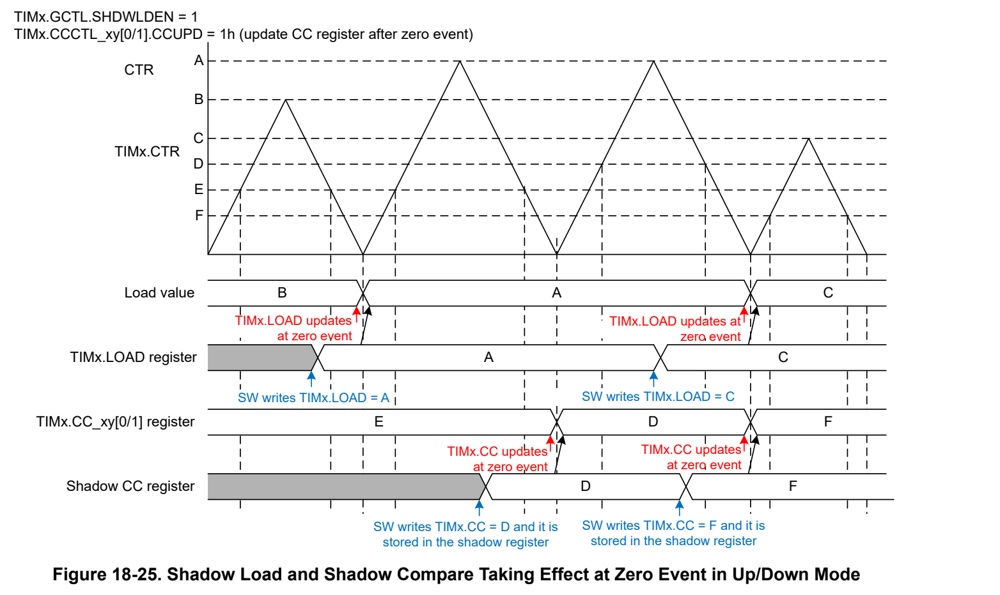
*Figure 18-25. Shadow Load and Shadow Compare Taking Effect at Zero Event in Up/Down Mode (p. 1059)*

#### 18.2.5 Output Generator (p. 1059)

The output signal generation unit can be used with the counter and capture/compare modules to generate desired pulse-width modulation (PWM) output waveforms, event signals, synchronized capture inputs, or the

counter direction. Many output waveforms are generated from counter events (load, zero, counter direction) and the capture/compare block (compare match).

TIMA and TIMG have many common features in the output generation signal unit. Additionally, TIMA has advanced output generation features such as complimentary output signals, deadband insertion, and fault generation.

Figure 18-27 shows the TIMG output block diagram.

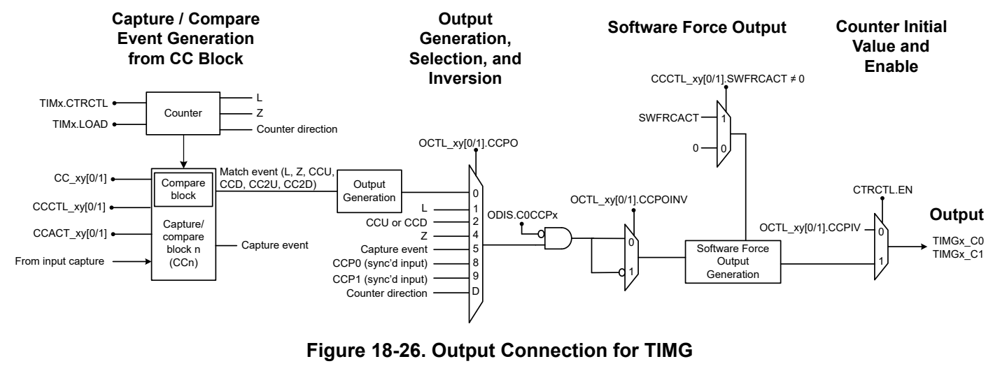
*Figure 18-26. Output Connection for TIMG (p. 1060)*

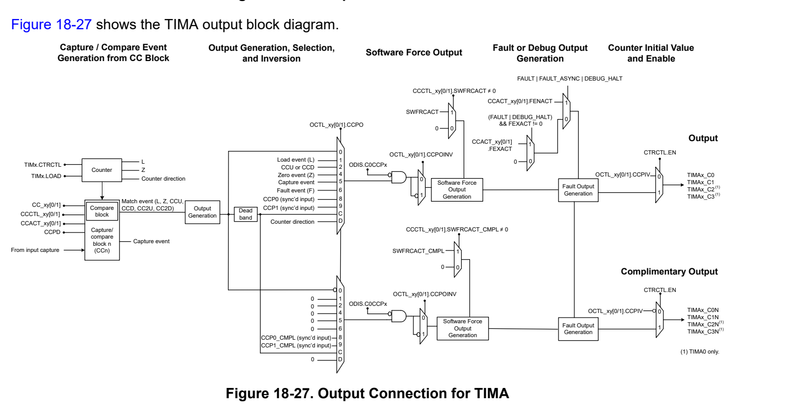
*Figure 18-27. Output Connection for TIMA (p. 1060)*

Signal Generator Actions

Table 18-17 shows the types of signal generator actions capable by the output generator. Signal generator actions are configured in the CCACT_xy[0/1] register for zero, load, and compare events. For types of compare events, see Table 18-15.

**Table 18-17. Signal Generator Actions from Compare Event (p. 1061)**

| Value | Action |
| --- | --- |
| 0h | Event is disabled and a lower priority event is selected if asserting |
| 1h | CCP output value is set high |
| 2h | CCP output value is set low |
| 3h | CCP output value is toggled |

The key registers for generation of output signals are:

- LOAD: the contents of this register are copied to the counter (TIMx.CTR) on any operation designated to do a "load". This value is also used to compare with the counter value for generating a "Load Event" that can be used for interrupt, trigger, or signal generator actions.

- CCPD: this register configures the direction of the CCP pins as inputs or outputs.

- CC_xy[0/1]: this is a register used as a compare value to the current counter to create an match event.

- CTRCTL: this register provides control over the counter operation in different conditions.

- CCCTL_xy[0/1]: this register controls the operations of the respective CC registers and the counter

- OCTL_xy[0/1]: this register controls the output of the capture-compare portion of the counter. This includes the ability to select the source of what is driven out along with initial condition values and final inversion options.

- CCACT_xy[0/1]: this register controls the actions of the signal generator of the capture-compare portion based on the events created in the counter block, the capture and compare block, and debug events.

- ODIS: this register disables the output signal selected by OCTL.CCPO (before conditional inversion) to allow software the ability to hold the CCP output low during configuration or shutdown.

These are key registers for configuring the compare mode to generate PWM signals:

##### 18.2.5.1 Configuration (p. 1061)

There are five stages to configuring output signal generation in TIMx devices:

- Counter and CC Block Event Generation

- Output Generation, Selection and Inversion

- Software Force Output

- Fault Output Generation (TIMA only)

- Counter Initial Value and Enable

Counter and CC Block Event Generation

The counter block contains the counter and produces a load event (L), zero event (Z), and direction of counting based on the counting mode used.

The CC blocks contain the CC register and can generate two types of output signals: compare match events and capture events. Please see Table 18-15 for the compare events that can be generated.

Output Generation, Selection and Inversion

The TIMx.CCACT register specifies the waveform generation of a CCP output depending on the counting mode and counter compare actions.

TIMx.OCTL_xy[0/1].CCPO controls the CCP output selection from the output generation unit, output generation unit with deadband (TIMA only), counter events, compare events, capture events, fault events, or signal inputs. The output disable register (ODIS) can optionally disable the CCP output to optionally hold the CCP output low during configuration or shutdown. TIMx.OCTL_xy[0/1].INV controls final inversion options.

Note Mux selections for synchronized inputs are tied to 0 for TIMAx CC2 and CC3 instances. Do not use TIMAx.OCTL_23[0/1].CCPO = 8 or 9.

On TIMA devices only, CCP complimentary output channels can be generated from the output generation unit (denoted by "N" in the signal name). For instance, TIMA0 channel 2 (TIMA0_C2) can also produce a complimentary output (TIMA0_C2N). The CCPO and INV bits also controls the selection and inversion options for the complementary output.

Complimentary outputs with deadband insertion are a common use case for inverter-based applications with half-bridge topologies. For more information, please see Section 18.2.5.2.4.

Software Force Output

The output of the signal generator can be overwritten in software by setting CCCTL_xy[0/1].SWFRCACT to a nonzero setting. For TIMA devices only, the complementary output of the signal generator can be overwritten by setting CCCTL_xy[0/1].SWFRCACT_CMPL to a nonzero setting.

For more information, see Section 18.2.5.3.

Fault / Debug Output Generation (TIMA only)

On TIMA devices, the CCP output can be overwritten after the software force output block if there is a system fault (FAULT), fault condition upon exit (FEXACT), fault condition upon entry (FENACT), an asynchronous fault (FAULT_ASYNC), or the debugger is halted (DEBUG_HALT).

For more information, see Section 18.2.6 and Section 18.2.10.

Counter Compare Initial Value and Enable

To specify an initial value for the CCP output while the counter is disabled, set OCTL_xy[0/1].CCPIV to 0 for a low value or 1 for a high value. This is useful for applications where CCP outputs need to be in a default state before enabling the counter.

To enable the counter, set TIMx.CTRCTL.EN to 1.

##### 18.2.5.2 Use Cases (p. 1062)

Several different use cases can be achieved with the output generator and are discussed in the following sections.

###### 18.2.5.2.1 Edge-Aligned PWM (p. 1062)

To generate edge-aligned PWMs, TIMx can be configured for up- or down-counting mode and the PWM period in TIMCLK cycles is TIMx.LOAD + 1. The waveform uses load, zero, and compare events to drive the CCPx output high or low depending on the configuration settings of the compare/capture block and counter.

Edge-Aligned PWM Configuration

To generate edge-aligned PWMs using compare match events from the counter: 1. In the TIMx.CTRCTL register, set the desired counter control settings for: a. Up-counting (CM = 2) or down-counting mode (CM = 0) and counter value after enable (CVAE) (see as described in Section 18.2.2) b. Zero (CZC), advance (CAC), and load control (CLC) to specify what condition controls zeroing, advancing, or loading the counter c. Repeat or one-shot mode (REPEAT)

2. Set the TIMx.LOAD value to configure the PWM period. 3. Set the TIMx.CC_xy[0/1] value to configure the duty cycle. 4. Set TIMx.CCCTL_xy[0/1].COC = 1 for compare mode. 5. Configure CCP as an output for the CC block by setting respective bit in the CCPD registers. For instance, if TIMx Channel 0 is an output, set CCPD.C0CCP0 = 1. 6. In TIMx.CCACT_xy[0/1], set the CCP output action settings for compare events, zero events, load events, software force action, or fault events (TIMA only). 7. In TIMx.OCTL_xy[0/1], set CCPO = 0 to select the signal generator output.

8. Enable the corresponding CCP output by setting ODIS.C0CCPn to 1 for the corresponding counter n. 9. Configure polarity of the signal using the CCPOINV bit, and configure CCPIV to specify the CCP output state while disabled. 10. Enable the counter by setting TIMx.CTRCTL.EN = 1.

Example using edge-aligned PWM in down-counting mode

A typical 2-channel edge-aligned PWM generation for down-counting mode is shown in Figure 18-28 with the following edge-aligned PWM output waveforms:

- CCP0 output generates:

– High pulse-width from TIMx.LOAD to TIMx.CC0 value (LACT = 1h) – Low pulse-width from TIMx.CC0 value to zero (CDACT = 2h)

- CCP1 output generates:

– High pulse-width from TIMx.LOAD to TIMx.CC1 value (LACT = 1h) – Low pulse-width from TIMx.CC1 value to zero (CDACT = 2h)

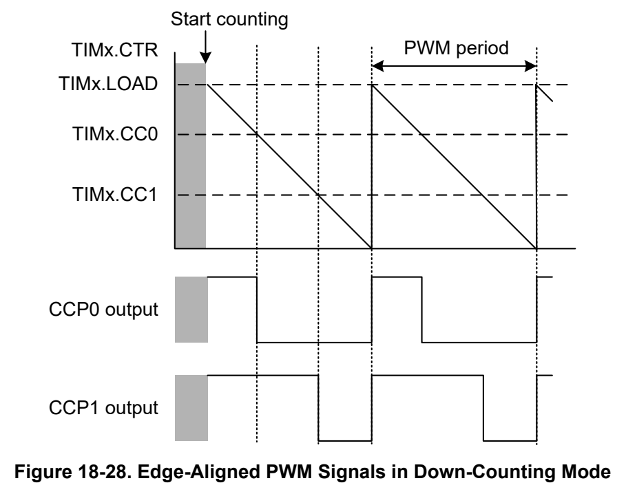
*Figure 18-28. Edge-Aligned PWM Signals in Down-Counting Mode (p. 1063)*

Example using edge-aligned PWM in up-counting mode

A typical 2-channel edge-aligned PWM generation for up-counting mode is shown in Figure 18-28 with the following edge-aligned PWM output waveforms:

- CCP0 output generates:

| – – | CCP1 output generates: | High pulse-width from zero to TIMx.CC0 value (ZACT = 1h) Low pulse-width from TIMx.CC0 value to TIMx.LOAD (CUACT = 2h) |
| --- | --- | --- |
| – – |  | High pulse-width from zero to TIMx.CC1 value (ZACT = 1h) Low pulse-width from TIMx.CC1 value to TIMx.LOAD (CUACT = 2h) |

•

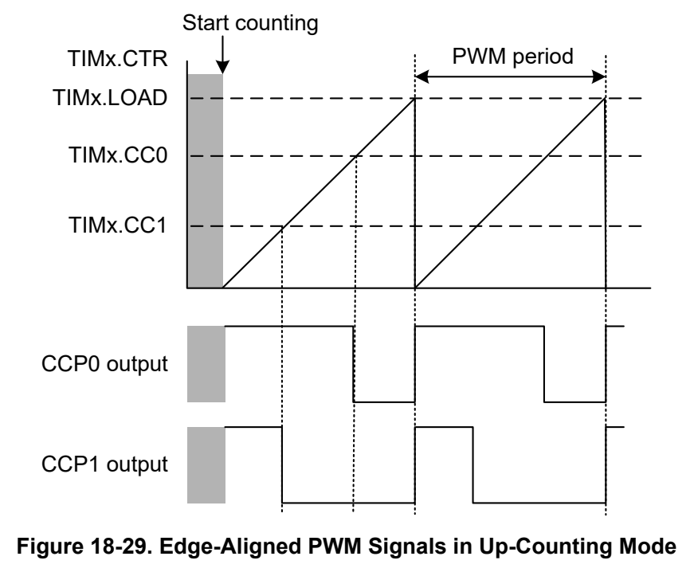
*Figure 18-29. Edge-Aligned PWM Signals in Up-Counting Mode (p. 1064)*

###### 18.2.5.2.2 Center-Aligned PWM (p. 1064)

To generate center-aligned PWMs, TIMx is configured for up/down counting mode and the TIMx.LOAD value contains the half-period. The waveform uses up compare events and down compare events to drive the CCPx output high or low depending on the configuration settings of the compare/capture block and counter.

In TIMCLK cycles, the PWM period is (2 * TIMx.LOAD) and the duty cycle is 1 - (TIMx.CC_xy[0/1] / TIMx.LOAD).

Center-Aligned PWM Configuration

To generate center-aligned PWMs using compare match events from the counter: 1. In the TIMx.CTRCTL register, set the desired counter control settings for: a. Up/down counting mode (CM = 1) and counter value after enable (CVAE) (see as described in Section 18.2.2) b. Zero (CZC), advance (CAC), and load control (CLC) to specify what condition controls zeroing, advancing, or loading the counter c. Repeat or one-shot mode (REPEAT)

2. Set the TIMx.LOAD value to configure the PWM period. 3. Set the TIMx.CC_xy[0/1] value to configure the duty cycle. 4. Set TIMx.CCCTL_xy[0/1].COC = 1 for compare mode. 5. Configure CCP as an output for the CC block by setting respective bit in the CCPD registers. For instance, if TIMx Channel 0 is an output, set CCPD.C0CCP0 = 1. 6. In TIMx.CCACT_xy[0/1], set the CCP output action settings for compare events, zero events, load events, software force action, or fault events (TIMA only). 7. 8. Enable the corresponding CCP output by setting ODIS.C0CCPn to 1 for the corresponding counter n. 9. Configure polarity of the signal using the CCPOINV bit, and configure CCPIV to specify the CCP output state

| Col 2 | In TIMx.OCTL_xy[0/1], set CCPO = 0 to select the signal generator output. |
| --- | --- |
| while disabled. | Enable the counter by setting TIMx.CTRCTL.EN = 1. |
|  | Example using center-aligned PWM in up/down counting mode |

A typical 2-channel center-aligned PWM generation using up/down counting mode is shown in Figure 18-30 with the following center-aligned PWM output waveforms:

- CCP0 output generates: – High pulse-width from TIMx.CC0 compare up event to TIMx.CC0 compare down event (CUACT = 1h) – Low pulse-width from TIMx.CC0 compare down event to TIMx.CC0 compare up event (CDACT = 2h)

- CCP1 output generates: – High pulse-width from TIMx.CC0 compare up event to TIMx.CC0 compare down event (CUACT = 1h) – Low pulse-width from TIMx.CC0 compare down event to TIMx.CC0 compare up event (CDACT = 2h)

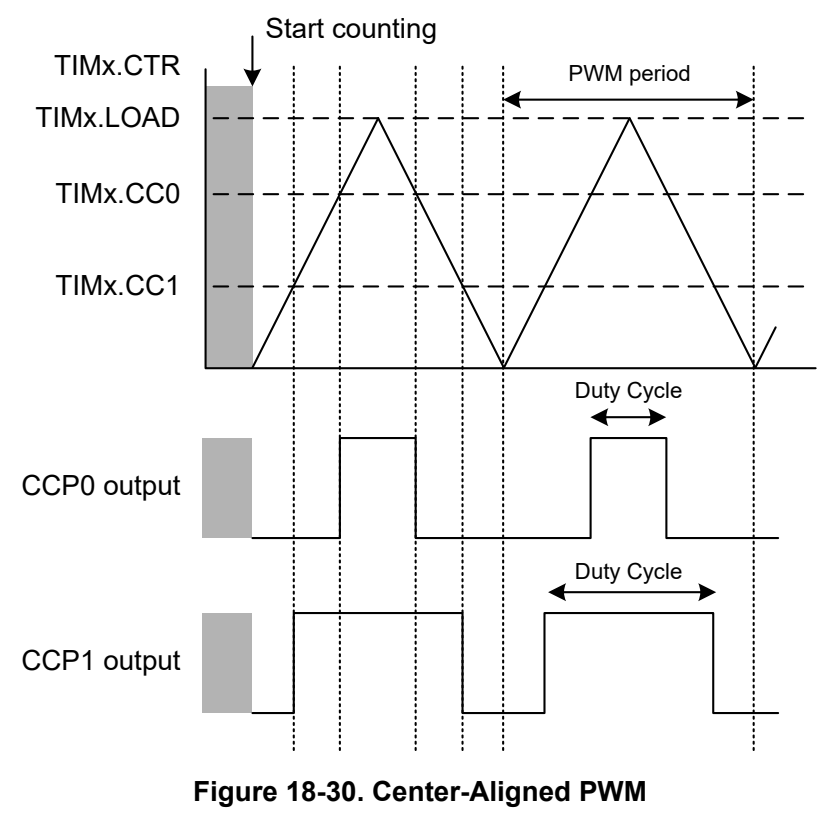
*Figure 18-30. Center-Aligned PWM (p. 1065)*

###### 18.2.5.2.3 Asymmetric PWM (TIMA only) (p. 1065)

In TIMA only, asymmetric PWMs can be generated by generating two synchronized center-aligned PWM signals with a controlled phase shift. To generate the asymmetric PWM signals, the phase load feature is used as described in Section 18.2.2.5.

Asymmetric PWM Configuration

To generate asymmetric PWMs using compare match events from the counter:

1. Synchronize TIMA0 and TIMA1 using a cross trigger as described in Section 18.2.7. 2. Configure two center-aligned PWMs as described in Section 18.2.5.2.2 using TIMA0 and TIMA1. TIMA0 and TIMA1 should have the same load value (TIMA.LOAD) and compare value (TIMA.CC_xy[0/1]) to generate the same PWM frequency and duty cycle. 3. Add a phase shift value for TIMA0 or TIMA1 by configuring the phase load value TIMA.PL as described in Section 18.2.2.5. 4. Enable the counter by setting TIMA.CTRCTL.EN = 1.

Figure 18-31 shows an example of asymmetric PWM configuration using CCP channel 0 of TIMA0 and TIMA1.

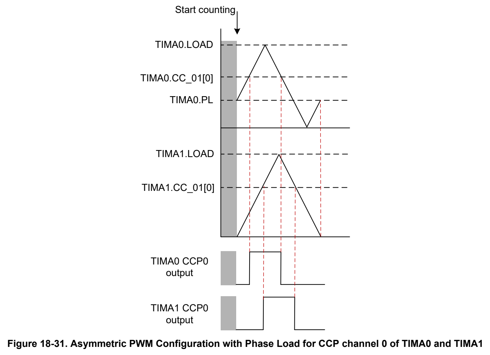
*Figure 18-31. Asymmetric PWM Configuration with Phase Load for CCP channel 0 of TIMA0 and TIMA1 (p. 1066)*

###### 18.2.5.2.4 Complementary PWM With Deadband Insertion (TIMA only) (p. 1066)

TIMA provides the option of generating complimentary PWM outputs with deadband insertion (nonoverlapping transitions in complimentary PWM signals) from a signal PWM reference signal. Deadband is useful for applications with half-bridge control to avoid shoot-through conditions, such as motor driver or inverter-based applications.

The reference signal is generated on the TIMAx_Cy signal, and the complimentary signal is generated on TIMAx_CyN, where x is the timer instance and y is the CCP output channel. For instances, a reference PWM signal generated on TIMA0 CCP output channel 2 will produce complimentary output signals on TIMA0_C2 and TIMA0_C2N.

The deadband control register (TIMAx.DBCTL) is programmed with the deadband mode and timing information. The deadband mode is selected using the M1_ENABLE bit, and the timing information to control the deadband width in TIMCLK cycles is selected by the RISEDELAY and FALLDELAY bit fields. RISEDELAY and FALLDELAY are a function of the rising or falling edge delay to or from the reference PWM.

See Table 18-18 for the configuration and relationship between deadband mode and deadband width settings.

**Table 18-18. Deadband Modes and Delay Timing Configuration in DBCTL register (pp. 1066-1067)**

| Col 1 | Deadband Mode | Bitfield | Col 8 | Description | Counting Mode |
| --- | --- | --- | --- | --- | --- |
| Mode 0 |  |  | M1_ENABLE = 0 | RISEDELAY is applied from rising edge of reference PWM to rising edge of TIMAx_Cy signal. FALLDELAY is applied from falling edge of reference PWM | Any |
|  |  |  |  | PWM to rising edge of CxN signal. |  |
| Mode 1 | M1_ENABLE = 1 | RISEDELAY is applied from falling edge of | Up/down counting mode |  |  |
|  |  | TIMAx_CyN signal to rising edge of reference PWM. | only |  |  |
|  |  | FALLDELAY is applied to falling edge of reference |  |  |  |
|  |  | PWM to rising edge of TIMAx_CyN signal. |  |  |  |

Deadband timing equation and example

The equations for configuring RISEDELAY and FALLDELAY from TIMCLK frequency and deadband timing is shown in Equation 10 and Equation 11.

RISEDELAY = f TIMCLK × t dead _ rise (10)

FALLDELAY = f TIMCLK × t dead _fall (11)

For example, if 400ns of deadband is required when using a TIMCLK frequency of 80MHz, and Mode 1 is used with center-aligned PWMs to generate equal deadband every PWM period, then RISEDELAY = FALLDELAY = (80MHz) * (400ns) = 32.

Complimentary PWM with Deadband Configuration

1. Configure a PWM output for an edge-aligned PWM ( Section 18.2.5.2.1) or center-aligned PWM ( Section 18.2.5.2.2) for any CCP output channel in TIMA. 2. Configure TIMA.DBCTL with the specified deadband mode (M1_ENABLE) and deadband width RISEDELAY and FALLDELAY, depending on the deadband mode. 3. In TIMx.OCTL_xy[0/1], set CCPO = 0xC to select the signal generator with deadband output. 4. Enable the counter by setting TIMx.CTRCTL.EN = 1.

Example 1 - Complimentary PWM outputs with deadband using edge-aligned PWM in down-counting mode

For edge-aligned PWM, Mode 0 can only be used for deadband insertion mode. See Figure 18-32 for inserting configurable deadband using down counting mode, TIMA output channel 0, and edge-aligned PWM.

Example 2- Complimentary PWM outputs with deadband using center-aligned PWM

For center-aligned PWM, Mode 0 or Mode 1 can be used for deadband insertion mode. See Figure 18-33 for inserting configurable deadband using up/down counting mode, TIMA output channel 0, and center-aligned PWMs with deadband.

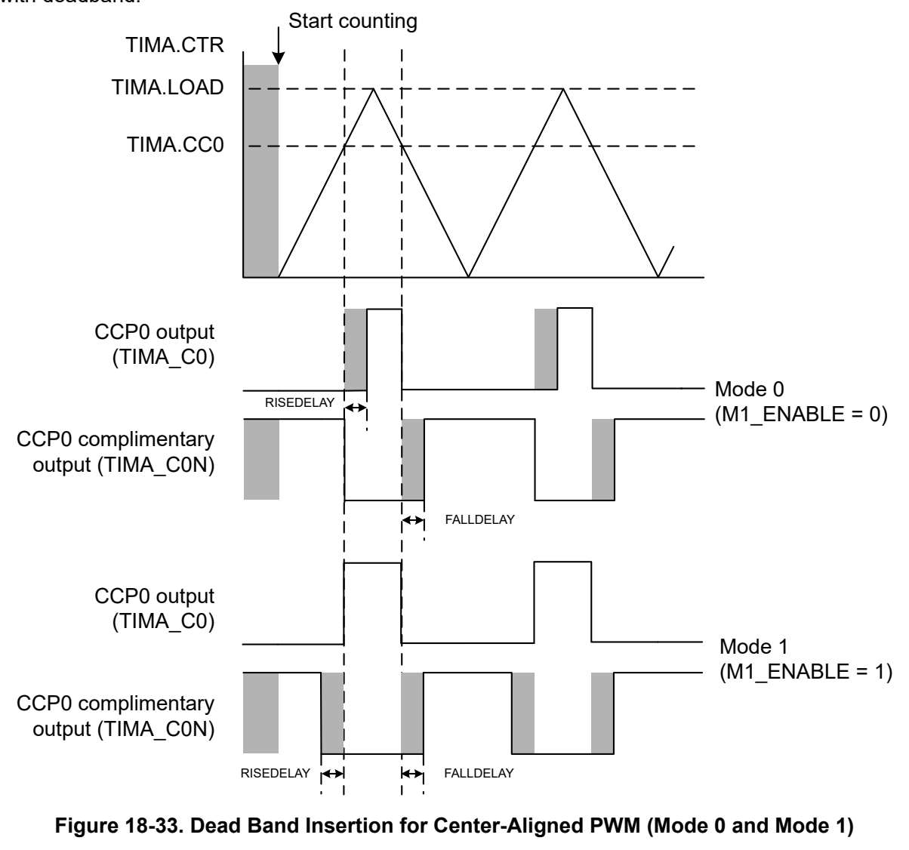
*Figure 18-33. Dead Band Insertion for Center-Aligned PWM (Mode 0 and Mode 1) (p. 1068)*

##### 18.2.5.3 Forced Output (p. 1068)

Each output channel signal can be forced to a high or low level directly by software, independently of any comparison between the compare register and the counter. A shadow register exists to ensure the forced output action occurs at the end of the timer period.

The output of the CCP channel can be forced to high or low by setting the SWFRCACT bit in the TIMx.CCACT_xy[0/1] register.

In TIMA only, the complimentary output channel can also be forced to high or low by setting the SWFRCACT_CMPL bit in the TIMx.CCACT_xy[0/1] register.

Table 18-19 shows the software force output action configuration options.

**Table 18-19. Force Output Action Configuration (p. 1069)**

| Bit Field | Value | Description/Comment |
| --- | --- | --- |
|  | 0 | No forced output. Output is directly from the signal generation block. |
| SWFRCACT / SWFRCACT_CMPL | 1 | Force output high |
|  | 2 | Force output low |

#### 18.2.6 Fault Handler (TIMA only) (p. 1069)

In TIMA only, there are internal and external fault inputs which can be used to control the generation of PWM signals. The intended use of these inputs is as a mechanism for internal or external circuitry to indicate a fault in the system. This allows the hardware to react quickly to the external fault while optionally signaling an interrupt for software correction and leaving the output signals in a safe state.

It is important to consider the following basic properties of faults in a system, such as:

- Fault input selection (fault signal from external IC, internal signal, etc.)

- How long a fault condition lasts, or the fault condition duration

- How the counter reacts to the entry and exit of a fault condition

- How the output signal reacts to the entry and exit of a fault condition

Fault conditions are synchronously detected using TIMCLK or asynchronously detected. Synchronous faults have a configurable glitch filter and can generate a latched fault event. Asynchronous faults cannot be latched and do not generate a fault event, with a latency of 1-2 TIMCLK cycles to detect the fault and perform a configured action. The CCP output can be configured for either type of fault upon entry and exit conditions.

The fault handler logic diagrams are split into three parts: asynchronous faults, synchronous faults, and fault output generation.

Figure 18-34 shows the asynchronous fault handler logic connections.

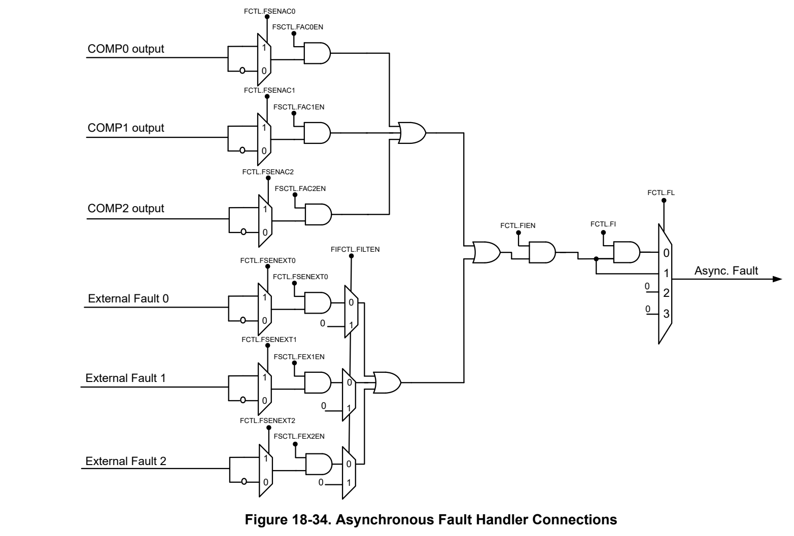
*Figure 18-34. Asynchronous Fault Handler Connections (p. 1070)*

Figure 18-35 shows the synchronous fault handler logic connections.

*Figure 18-35. Synchronous Fault Handler Connections (p. 1071)*

*Figure 18-36. Fault Output Generation Connections (p. 1071)*

Key registers for configuring the fault handler are:

- TIMA.FCTL: this register controls the fault inputs, fault detection, and error handling behavior.

- TIMA.FSCTL: this register controls the fault source selection and enable.

- TIMA.FIFCTL: this register controls the input filtering (FILTEN, FP, CPV) for the fault input.

- TIMA.CCACT_xy[0/1]: this register controls the actions of the signal generator of the capture-compare portion based on fault events.

##### 18.2.6.1 Fault Input Conditioning (p. 1071)

The comparator and external fault pin fault source input passes through a two TIMCLK synchronization stage and the fault input can be filtered through the glitch filter using the fault input filter (TIMA.FIFCTL) register.

The fault input glitch filter can be enabled by setting the TIMA.FIFCTL.FILTEN bit. The filter period is configured by setting the TIMA.FIFCTL.FP bit.

A consecutive period or majority voting format selected by the TIMA.FIFCTL.CPV bit is used to select the criteria for a CCP input signal.

- Consecutive period - The fault input signal must be at the specified level for the defined number of FP timer clocks for the fault input to be processed.

- Majority voting - The filter ignores one clock of opposite logic over the filter period. For example, over the number of FP samples of the fault input, up to 1 sample may be of an opposite logic value (glitch) without affecting the output.

The example shown in Figure 18-13 shows the difference between consecutive period and majority voting formats with a digital filter implemented to capture a fault input of 3 TIMCLK periods.

##### 18.2.6.2 Fault Input Sources (p. 1072)

The fault control (FCTL) and fault source control (FSCTL) registers are used to select the polarity and enable various fault input sources as shown in Table 18-20.

To enable the final input for fault detection, set TIMA.FTCL.FIEN = 1.

There are four types of fault input sources that are available for synchronous or asynchronous fault detection:

Comparator (COMP) output

The comparator output is useful for fault detection when COMPs are used for detecting overcurrent or overvoltage events. To enable the comparator output for fault detection, set the TIMA.FSCTL.FACxEN bit, and configure the polarity to detect the fault using TIMA.FCTL.FSENACx bit (x = 0, 1, or 2 for COMP instance).

External Fault Pin

Many IC devices include a fault detection pin (i.e. nFAULT) that an MCU can detect when there is a fault condition in the system. There are 3 fault external signal pins (TIMA_FLTx) connected to every TIMA module, where x = 0, 1, or 2. Each signal pin can be enabled by setting the TIMA.FSCTL.FEXxEN bit, and the polarity of this signal to trigger a fault condition can be configured by using TIMA.FCTL.FSENEXTx bit (where x = 0, 1, or 2 for each TIMA_FLTx pin).

System Clock Fault

Any system clock fault can be used to trigger the PWM output(s) to a Hi-Z state. This can be enabled by setting the TIMA.FSCTL.FCEN bit.

> **Note:**

When a SYSCLK fault occurs, a device reset is generated. Various TIMA fault entry and exit options are invalid while the device is in reset.

Trigger

A trigger can be configured to generate a fault condition is detected. This is useful for performing diagnostics or creating fault dependencies from other peripherals in the event fabric. For trigger configuration, please see Section 18.2.7. The fault input mask can be enabled by setting the TIMA.FSCTL.TFIM bit.

**Table 18-20. Fault Input Sources and Configuration (p. 1073)**

| Signal name | Input source | Fault type | Polarity Bit | Enable Bit |
| --- | --- | --- | --- | --- |
| COMP0_OUT | COMP0 output |  | FSENAC0 | FAC0EN |
| COMP1_OUT | COMP1 output |  | FSENAC1 | FAC1EN |
| COMP2_OUT | COMP2 output |  | FSENAC2 | FAC2EN |
| TIMA_FLT0 | External Fault 0 | Synchronous or | FSENEXT0 | FSENEXT0 |
| TIMA_FLT1 | External Fault 1 | Asynchronous | FSENEXT1 | FSENEXT1 |
| TIMA_FLT2 | External Fault 2 |  | FSENEXT2 | FSENEXT2 |
| SYSCLK | System Clock | Synchronous | - | FCEN |
| TRIG | Trigger Output | Synchronous | - | TFIM |

##### 18.2.6.3 Counter Behavior With Fault Conditions (p. 1073)

There are two settings for specifying the counter behavior in fault conditions: TIMA.CTRCTL.FB (during fault behavior) and TIMA.CTRCTL.FRB (fault resume behavior). The counter should continue to be enabled (TIMA.CTRCTL.EN = 1) during the fault handler behavior.

The counter behavior of the fault condition is described in Table 18-21 and Figure 18-37.

**Table 18-21. Counter Behavior in Fault Condition With TIMA.CTRCTL Register (p. 1073)**

| Col 1 | Col 2 | Bit Fields | Col 4 | Counter Behavior |
| --- | --- | --- | --- | --- |
| FB | FRB | CVAE | REPEAT | Counter Behavior |
| 0 | X | X | 0 | Ignores fault mode. Counter continues to count during fault and stops when reaches zero. |
|  |  |  | 1/3 | Ignores fault mode. Counter continues to count during fault and repeat. |
|  | 0 | X | 0/1/3 | Reacts immediately to fault mode. The counter stops counting immediately and throughout the fault mode. Upon exit of fault mode, the counter continues counting from where it left off. |
| 1 |  | 0 |  | Reacts immediately to fault mode. The counter stops counting immediately and throughout the debug mode. Upon exit of fault mode, the counter restarts from LOAD value (restarts a down count). |
| 1 | 1 | 1 | X | Reacts immediately to fault mode. The counter stops counting immediately and throughout the debug mode. Upon exit of debug mode, the counter restarts from where it paused at fault entry. |
|  |  | 2 |  | Reacts immediately to fault mode. The counter stops counting immediately and throughout the fault mode. Upon exit of fault mode, it restarts from 0 value (restarts an up/down count). |

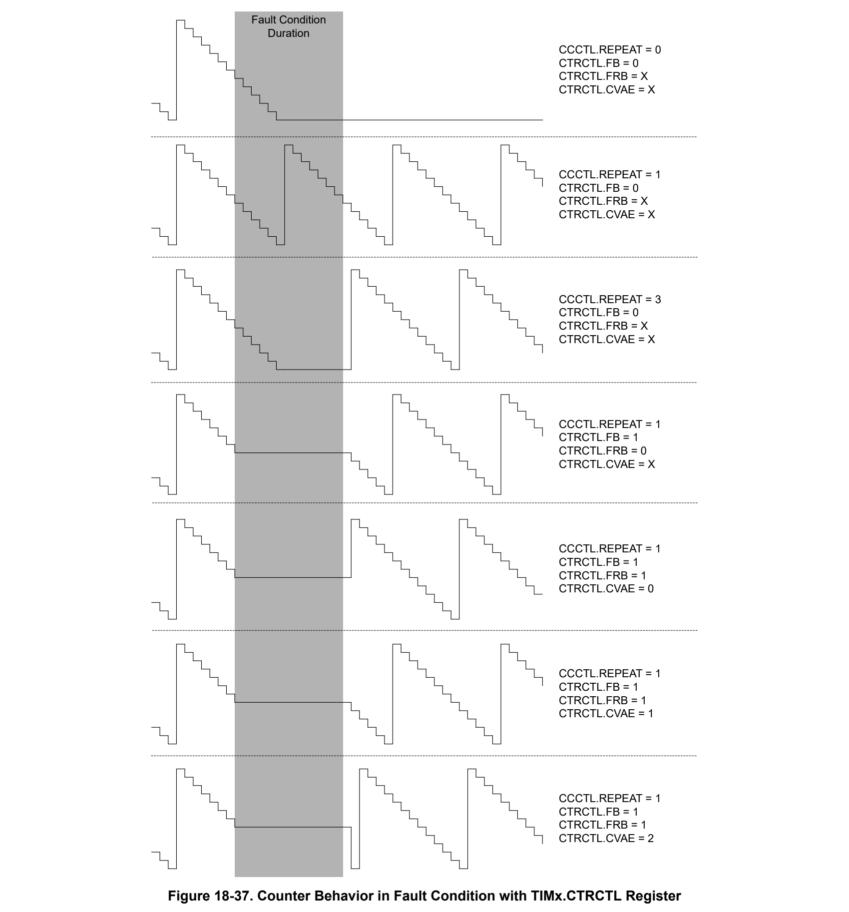
*Figure 18-37. Counter Behavior in Fault Condition with TIMx.CTRCTL Register (p. 1074)*

##### 18.2.6.4 Output Behavior With Fault Conditions (p. 1075)

There are two settings for the CCP output channel behavior in a fault condition, TIMA.CCACT_01[0/1].FEXACT (fault exit behavior) and TIMA.CCACT_01[0/1].FENACT (fault entry behavior). The output behavior of fault condition is described in Table 18-22.

**Table 18-22. CCP Output Behavior in Fault Condition With TIMA.CCACT Register (p. 1075)**

| Bit Fields | Bit Fields | Output Behavior |
| --- | --- | --- |
| FEXACT | FENACT | Output Behavior |
| 0 | 0 | The CCP output value is unaffected by the fault event |
| 1 | 1 | CCP output value is set high |
| 2 | 2 | CCP output value is set low |
| 3 | 3 | CCP output value toggles |
| 4 | 4 | CCP output is tristated (Hi-Z) |

Note Fault entry and exit behavior is not dependent on the counter being enabled. They will always update the output when in fault mode. Enabling the counter through a software write when in fault mode will generate a load event that will be captured in RIS but the counter will not proceed. Load events will not affect the output when in fault mode. Fault events takes the absolute priority and no events can update the output until you are out of fault mode.

> **Note:**

If using the TIMA_FALx pin with the CCP capture channel inputs (such as adding deadband to complimentary PWMs) for low latency actions, an external connection should be in hardware between the TIMA_FALx pin and TIMAx_Cy pin (x = timer instance, y = CC channel).

#### 18.2.7 Synchronization With Cross Trigger (p. 1075)

When using a main-secondary timer configuration by connecting multiple timers together, the cross-trigger feature can instruct multiple timer modules in the same power domain or across different power domains using the event fabric to start counting simultaneously.

Cross-triggers can be enabled using software, compare events from other timer instances, zero or load events, or generic subscriber events. Some applications may require more than one counter block that can be simultaneously started across the same power domain (such as TIMA0 and TIMA1) or different power domains (such as TIMA0 and TIMG0).

This configuration uses cross triggers from a main timer module as the input trigger condition for the secondary timers. The timer cross trigger is essentially the combined logic of the hardware and software conditions that control the EN bit in the TIMx.CTRCTL register.

The cross triggers that are outputted from the main timer are connected to the external trigger input of other secondary timer modules. As shown in Figure 18-38, TIMGx is the main timer and TIMAx is the secondary timer that will be cross triggered in the configuration example.

Note For power domains and cross trigger selection sources enabled for timer instances, refer to the device-specific data sheet.

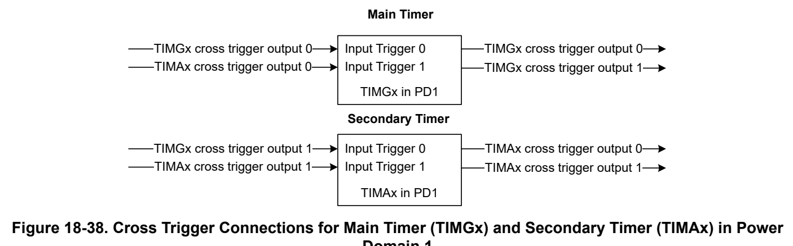
*Figure 18-38. Cross Trigger Connections for Main Timer (TIMGx) and Secondary Timer (TIMAx) in Power (p. 1076)*

##### 18.2.7.1 Main Timer Cross Trigger Configuration (p. 1076)

The following steps are used to configure the main timer cross trigger (which is TIMGx in this example):

1. Configure the main timer (which triggers other secondary timers) for the desired function, such as PWM output generation or using compare mode, to trigger other peripherals. See Section 18.2.5 for how to configure for PWM generation. 2. Select which cross trigger output needs to be generated. For example, in Figure 18-38, TIMGx cross trigger 1 can be used to trigger TIMAx and TIMGx cross trigger 0 can be used to trigger itself. 3. Enable the cross trigger output function by setting TIMx.CTTRIGCTL.CTEN bit to 1. 4. Choose how to trigger the start of these connected timers, which can be a software trigger or hardware trigger from a subscriber port, zero, load, or compare event. a. For a software event trigger, set the TIMx.CTTRIG.TRIG bit. b. For a hardware trigger event, select the source for the trigger using TIMx.CTTRIGCTL.EVTCTTRIGSEL and enable the hardware trigger by setting TIMx.CTTRIGCTL.EVTCTEN.

Figure 18-39 shows the connection logic and registers.

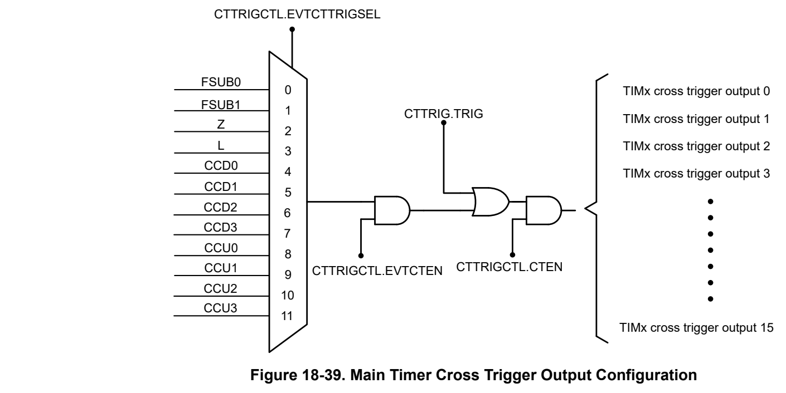
*Figure 18-39. Main Timer Cross Trigger Output Configuration (p. 1076)*

##### 18.2.7.2 Secondary Timer Cross Trigger Configuration (p. 1077)

The following steps are used to configure the secondary timer cross trigger (which is TIMAx in this example):

1. Configure the secondary timer (triggered by the main timer) for the desired function for this timer, such as PWM output generation or using compare mode, to trigger other peripherals. See Section 18.2.5 for how to configure for PWM generation. 2. Select which input trigger to use according to the device-specific data sheet. Using the example connection in Figure 18-38, TIMAx must be triggered by TIMGx and the cross trigger output 1 of TIMGx is connected to input trigger 0 of TIMAx. Therefore, select input trigger 0 of TIMAx by setting TIMA.TSEL.ETSEL bit to 0. 3. Enable the input trigger function by setting the TIMA.TSEL.TE bit to 1. 4. Set TIMAx.IFCTL_01[0].ISEL = 3 and TIMAx.IFCTL_01[1].ISEL = 3 to select the trigger as the input source. a. For a center-aligned PWM, set the TIMA.CCCTL_01[0].ZCOND and TIMA.CCCTL_01[1].ZCOND bits to 1 to use a trigger assertion edge for a zero event. b. For an edge-aligned PWM, set the TIMA.CCCTL_01[0].LCOND and TIMA.CCCTL_01[1].LCOND bits to 1 to use the trigger assertion edge for a load event.

5. The TIMx.CTRCTL.EN bit is set as the result of an LCOND or ZCOND condition being met, and the counter value changes to the load value or zero value, respectively.

As the main timer TIMGx must also trigger itself, complete the previous configuration steps for TIMAx to trigger TIMGx itself.

Figure 18-40 shows the logic connection.

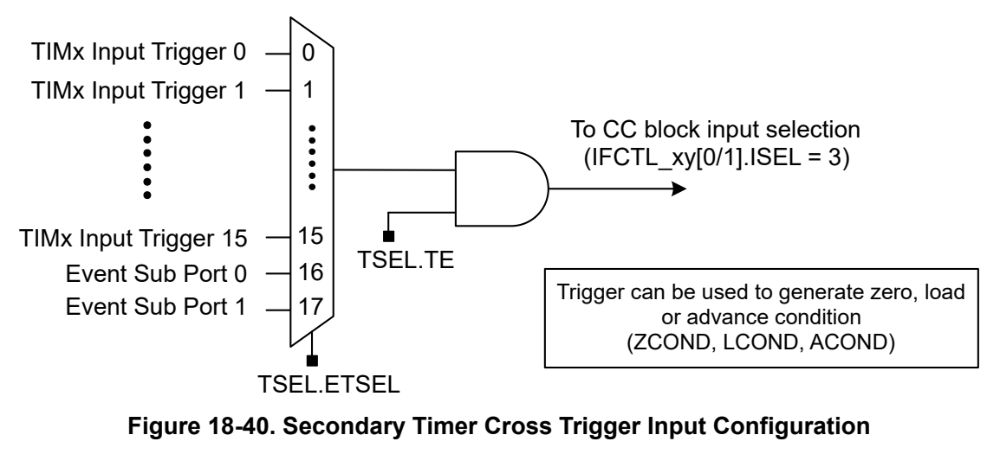
*Figure 18-40. Secondary Timer Cross Trigger Input Configuration (p. 1077)*

Note Refer to "TIMx Cross Trigger Map" in the device-specific data sheet for enabled cross trigger mapping using the ETSEL bit. For instance, if the timer instances of a device all use trigger input 0 (TRIG0) to cross trigger other timers, then only TRIG0 can be used to cross trigger other instances.

#### 18.2.8 Low Power Operation (p. 1077)

For detailed information on the low power modes in terms of available clock source and behaviors, refer to Section 2.1.1.

Timer modules in power domain PD0 can be active and configured to continue counting in all power modes except SHUTDOWN mode. See Section 2.1.1 for the available clock sources in each low-power mode. The user needs to configure the proper clock to source the timer in low-power mode.

Timer modules in power domain PD1 can only be active in RUN and SLEEP modes. When the system goes to STOP or STANDBY mode, the timer modules will be forced to a disabled state and resume when the systems moves back to RUN or SLEEP modes.

#### 18.2.9 Interrupt and Event Support (p. 1078)

TIMx interrupts and events can be configured to any peripheral of the device using the Event Manager. The timer can generate interrupts or events as an event publisher, and be triggered from other peripheral events (such as GPIO, comparator, ADC, etc.) as an event subscriber. See Section 7.2.5 for guidance on configuring the event registers for CPU interrupts or generic events.

The TIMx module contains three event publishers and two event subscribers.

- One event publisher (CPU_INT) manages TIMx interrupt requests (IRQs) to the CPU subsystem through a static event route.

- The second and third event (GEN_EVENT0 and GEN_EVENT1) are used to setup the generic event publishers and subscribers through Generic route.

TIMx events are summarized in Table 18-23.

**Table 18-23. TIMx Events (p. 1078)**

| Event | Type | Source | Destination | Route | Configuration | Functionality |
| --- | --- | --- | --- | --- | --- | --- |
| CPU interrupt | Publisher | TIMx | CPU Subsystem | Static route | CPU_INT registers | Fixed interrupt route from TIMx to CPU |
| Generic publisher event | Publisher | TIMx | Other peripherals | Generic route | GEN_EVENT0 and FPUB_0 registers | Configurable interrupt route from TIMx to other peripherals |
| Generic publisher event | Publisher | TIMx | Other peripherals | Generic route | GEN_EVENT 1 and FPUB_1 registers | Configurable interrupt route from TIMx to other peripherals |
| Generic subscriber event | Subscriber | Other peripherals | TIMx | Generic route | FSUB_0 | Configurable interrupt route from other peripherals to TIMx |
| Generic subscriber event | Subscriber | Other peripherals | TIMx | Generic route | FSUB_1 | Configurable interrupt route from other peripherals to TIMx |

##### 18.2.9.1 CPU Interrupt Event Publisher (CPU_INT) (p. 1078)

The TIMx module provides 18 interrupt sources (depending on the specific TIMx module features) which can be configured to source a CPU interrupt event. The CPU interrupt event configuration is managed with the CPU_INT event management registers. Table 18-24 lists the CPU interrupt events from the TIMx in order of decreasing interrupt priority.

**Table 18-24. TIMx CPU Interrupt Event Conditions (CPU_INT) (pp. 1078-1079)**

| IIDX STAT | Name | Description | Timer Module |
| --- | --- | --- | --- |
| 0x01 | Z | Zero event interrupt. This interrupt is set when there is a zero event. | TIMx |
| 0x02 | L | Load event interrupt. This interrupt is set when there is a load event. | TIMx |
| 0x05 | CCD0 | Capture or compare 0 down event. This interrupt is set when there is a down compare match event at CC0. | TIMx |
| 0x06 | CCD1 | Capture or compare 1 down event. This interrupt is set when there is a down compare match event at CC1. | TIMx |
| 0x07 | CCD2 | Capture or compare 2 down event. This interrupt is set when there is a down compare match event at CC2. This interrupt is only available for TIMA0. | TIMx |
| 0x08 | CCD3 | Capture or compare 3 down event. This interrupt is set when there is a down compare match event at CC3. This interrupt is only available for TIMA0. | TIMx |
| 0x09 | CCU0 | Capture or compare 0 up event. This interrupt is set when there is a up compare match event at CC0. | TIMx |
| 0x0A | CCU1 | Capture or compare 1 up event. This interrupt is set when there is a up compare match event at CC1. | TIMx |
| 0x0B | CCU2 | Capture or compare 2 up event. This interrupt is set when there is a up compare match event at CC2. | TIMx |
| 0x0C | CCU3 | Capture or compare 3 up event. This interrupt is set when there is a up compare match event at CC3. | TIMx |
| 0x0D | CCD4 | Capture or compare 4 down event. This interrupt is set when there is a down compare match event at CC4. This interrupt is only available for TIMA modules. | TIMA |
| 0x0E | CCD5 | Capture or compare 5 down event. This interrupt is set when there is a down compare match event at CC5. This interrupt is only available for TIMA modules. | TIMA |
| 0x0F | CCU4 | Capture or compare 4 up event. This interrupt is set when there is a up compare match event at CC4. This interrupt is only available for TIMA modules. | TIMA |
| 0x10 | CCU5 | Capture or compare 5 up event. This interrupt is set when there is a up compare match event at CC5. This interrupt is only available for TIMA modules. | TIMA |
| 0x19 | F | Fault event interrupt. This interrupt is set when there is a fault condition event. See Section 18.2.6. This interrupt is only available for TIMA modules with fault handler features. | TIMA |
| 0x1A | TOV | Trigger overflow interrupt. This interrupt is set if a trigger event is generated while the associated trigger channel is active. | TIMx |
| 0x1B | REPC | Repeat counter zero interrupt. This bit controls the generation of an interrupt if the repeat counter value transitions from a nonzero value to zero. This interrupt is only available for TIMA modules with a repeat counter feature. | TIMA |
| 0x1C | DC | Direction change interrupt, used in QEI mode. This interrupt is only available for TIMG modules with QEI features. | TIMG |
| 0X1D | QEIERR | Direction change interrupt, used in QEI mode. This interrupt is only available for TIMG modules with QEI features. | TIMG |

See Section 7.2.5 for guidance on configuring the event registers for CPU interrupts.

##### 18.2.9.2 Generic Event Publisher and Subscriber (GEN_EVENT0 and GEN_EVENT1) (p. 1079)

A generic route is a route in which the comparator peripheral publishing the event is configured to use one of several available generic route channels to publish its event to another entity (or entities, in the case of a splitter route), where an entity can be another peripheral, a generic DMA trigger event, or a generic CPU event.

The GEN_EVENT0 and GEN_EVENT1 registers are used to select a peripheral condition ( Table 18-25) to use for publishing or subscribing an event. FPUB_0 and FPUB_1 are the publisher port registers and are used to configure which generic route channel to use to broadcast the event. FSUB_0 and FSUB_1 are the subscriber port registers and are used to configure which generic route channel to use to subscribe the event. Other peripherals, the DMA, or the CPU can subscribe to this event by configuring its subscriber port to listen on the same generic route channel which the publishing peripheral is connected to.

For example, through the use of a generic event channel, it is possible to directly start an ADC conversion from a TIMx event by connecting a TIMx FPUB_x and ADC FSUB_0 to the same generic event channel. Refer to Section 7.1.3.3 and Section 7.2.3 for how generic event route works.

**Table 18-25. TIMx Generic Event Conditions (GEN_EVENT0 and GEN_EVENT1) (pp. 1079-1080)**

| IIDX STAT | Name | Description | Timer Module |
| --- | --- | --- | --- |
| 0x01 | Z | Zero event interrupt. This interrupt is set when there is a zero event. | TIMx |
| 0x02 | L | Load event interrupt. This interrupt is set when there is a load event. | TIMx |
| 0x05 | CCD0 | Capture or compare 0 down event. This interrupt is set when there is a down compare match event at CC0. | TIMx |
| 0x06 | CCD1 | Capture or compare 1 down event. This interrupt is set when there is a down compare match event at CC1. | TIMx |
| 0x07 | CCD2 | Capture or compare 2 down event. This interrupt is set when there is a down compare match event at CC2. This interrupt is only available for TIMA0. | TIMx |
| 0x08 | CCD3 | Capture or compare 3 down event. This interrupt is set when there is a down compare match event at CC3. This interrupt is only available for TIMA0. | TIMx |
| 0x09 | CCU0 | Capture or compare 0 up event. This interrupt is set when there is a up compare match event at CC0. | TIMx |
| 0x0A | CCU1 | Capture or compare 1 up event. This interrupt is set when there is a up compare match event at CC1. | TIMx |
| 0x0B | CCU2 | Capture or compare 2 up event. This interrupt is set when there is a up compare match event at CC2. | TIMx |
| 0x0C | CCU3 | Capture or compare 3 up event. This interrupt is set when there is a up compare match event at CC3. | TIMx |
| 0x0D | CCD4 | Capture or compare 4 down event. This interrupt is set when there is a down compare match event at CC4. This interrupt is only available for TIMA modules. | TIMA |
| 0x0E | CCD5 | Capture or compare 5 down event. This interrupt is set when there is a down compare match event at CC5. This interrupt is only available for TIMA modules. | TIMA |
| 0x0F | CCU4 | Capture or compare 4 up event. This interrupt is set when there is a up compare match event at CC4. This interrupt is only available for TIMA modules. | TIMA |
| 0x10 | CCU5 | Capture or compare 5 up event. This interrupt is set when there is a up compare match event at CC5. This interrupt is only available for TIMA modules. | TIMA |
| 0x19 | F | Fault event interrupt. This interrupt is set when there is a fault condition event. See Section 18.2.6. This interrupt is only available for TIMA modules with fault handler features. | TIMA |
| 0x1A | TOV | Trigger overflow interrupt. This interrupt is set if a trigger event is generated while the associated trigger channel is active. | TIMx |
| 0x1B | REPC | Repeat counter zero interrupt. This bit controls the generation of an interrupt if the repeat counter value transitions from a nonzero value to zero. This interrupt is only available for TIMA modules with a repeat counter feature. | TIMA |
| 0x1C | DC | Direction change interrupt, used in QEI mode. This interrupt is only available for TIMG modules with QEI features. | TIMG |
| 0x1D | QEIERR | Direction change interrupt, used in QEI mode. This interrupt is only available for TIMG modules with QEI features. | TIMG |

See Section 7.2.5 for guidance on configuring the event registers.

##### 18.2.9.3 Generic Subscriber Event Example (COMP to TIMx) (p. 1080)

A common use case is to directly trigger a timer action (reset, PWM output, etc.) from the comparator output. The Event Manager can be used to set up the comparator as a generic event publisher (FPUB_1) and the timer as a generic event subscriber (FSUB_0 or FSUB_1) listening for an event from the publisher.

Comparator configuration (Publisher):

1. Set COMPIFG bit in GEN_EVENT0 IMASK register to mask the comparator output interrupt. For more info, see the COMP chapter. 2. Configure FPUB_1 register in comparator module to connect to event channel y. 3. Configure and enable the comparator.

TIMx configuration (Subscriber):

1. Configure FSUB_0 or FSUB_1 register in the TIMx module to connect to event channel y. Channel y must not be in use by another peripheral. 2. Set TIMx.IFCTL_xy[0/1].ISEL = 5 or 6 to select the CC input source as FSUB0 or FSUB1 for the TIMx module. See Figure 18-12

and Section 18.2.3.1.1.5. 3. Configure and enable the timer.

Note The comparator output (COMP0:2) has two more options for cross-peripherals:

- Input to the TIMx CC block directly using TIMx.IFCTL_xy[0/1].ISEL = 7h, 8h, or 9h. – This is a lower latency path and is useful for applications such as cycle-by-cycle overcurrent limiting. See Figure 18-12.

- Using the timer's cross trigger path to configure the event subscriber port as a trigger source by configuring the TIMx.TSEL.ETSEL = 0x10 for FSUB0 or to 0x11 for FSUB1.

– Enable the input trigger function by setting the TIMx.TSEL.TE bit to 1. – Set TIMx.IFCTL_xy[0/1].ISEL bit to 3 to select the cross trigger as input source for the TIMx module. – This is useful for using an event subscriber to trigger multiple timer instances in the same power domain, such as COMP to multiple TIMG instances.

#### 18.2.10 Debug Handler (TIMA Only) (p. 1081)

In TIMA only, the counter behavior in CPU halt debug mode and debug resume can also be configured by software using the PDBGCTL and CTRCTL registers.

TIMA can be configured to stop counting or continue counting when the CPU is halted for debug by the debug subsystem. By default, TIMA stops counting when the CPU is halted for debug and the device is in a debug state. To allow TIMA to continue to free run when the CPU is stopped for debug, set the FREE bit in the PDBGCTL register. See Section 22.2.1.2 for more information.

The CTRCTL register lets the device to resume counting or perform the action specified by the CVAE field following the exit of debug mode using the DRB bit.

### 18.3 TIMx Registers (p. 1082)

Table 18-26 lists the memory-mapped registers for the TIMx registers. All register offset addresses not listed in Table 18-26 should be considered as reserved locations and the register contents should not be modified.

**Table 18-26. TIMX Registers (pp. 1082-1083)**

| Offset | Acronym | Register Name | Group |
| --- | --- | --- | --- |
| 400h | FSUB_0 | Subsciber Port 0 |  |
| 404h | FSUB_1 | Subscriber Port 1 |  |
| 444h | FPUB_0 | Publisher Port 0 |  |
| 448h | FPUB_1 | Publisher Port 1 |  |
| 800h | PWREN | Power enable |  |
| 804h | RSTCTL | Reset Control |  |
| 814h | STAT | Status Register |  |
| 1000h | CLKDIV | Clock Divider |  |
| 1008h | CLKSEL | Clock Select for Ultra Low Power peripherals |  |
| 1018h | PDBGCTL | Peripheral Debug Control |  |
| 1020h | IIDX | Interrupt index | CPU_INT |
| 1028h | IMASK | Interrupt mask | CPU_INT |
| 1030h | RIS | Raw interrupt status | CPU_INT |
| 1038h | MIS | Masked interrupt status | CPU_INT |
| 1040h | ISET | Interrupt set | CPU_INT |
| 1048h | ICLR | Interrupt clear | CPU_INT |
| 1050h | IIDX | Interrupt index | GEN_EVENT0 |
| 1058h | IMASK | Interrupt mask | GEN_EVENT0 |
| 1060h | RIS | Raw interrupt status | GEN_EVENT0 |
| 1068h | MIS | Masked interrupt status | GEN_EVENT0 |
| 1070h | ISET | Interrupt set | GEN_EVENT0 |
| 1078h | ICLR | Interrupt clear | GEN_EVENT0 |
| 1080h | IIDX | Interrupt index | GEN_EVENT1 |
| 1088h | IMASK | Interrupt mask | GEN_EVENT1 |
| 1090h | RIS | Raw interrupt status | GEN_EVENT1 |
| 1098h | MIS | Masked interrupt status | GEN_EVENT1 |
| 10A0h | ISET | Interrupt set | GEN_EVENT1 |
| 10A8h | ICLR | Interrupt clear | GEN_EVENT1 |
| 10E0h | EVT_MODE | Event Mode |  |
| 10FCh | DESC | Module Description |  |
| 1100h | CCPD | CCP Direction |  |
| 1104h | ODIS | Output Disable |  |
| 1108h | CCLKCTL | Counter Clock Control Register |  |
| 110Ch | CPS | Clock Prescale Register |  |
| 1110h | CPSV | Clock prescale count status register |  |
| 1114h | CTTRIGCTL | Timer Cross Trigger Control Register |  |
| 111Ch | CTTRIG | Timer Cross Trigger Register |  |
| 1120h | FSCTL | Fault Source Control |  |
| 1124h | GCTL | Global control register |  |
| 1808h | LOAD | Load Register |  |
| 1810h + formula | CC_01[y] | Capture or Compare Register 0/1 |  |
| 1818h + formula | CC_23[y] | Capture or Compare Register 2/3 |  |
| 1820h + formula | CC_45[y] | The CC_45 register are a registers which can be used as compare to the current CTR to create an events CC4U, CC4D, CC5U and CC5D. |  |
| 1830h + formula | CCCTL_01[y] | Capture or Compare Control Registers 0/1 |  |
| 1838h + formula | CCCTL_23[y] | Capture or Compare Control Registers 2/3 |  |
| 1840h + formula | CCCTL_45[y] | Capture or Compare Control Registers 4/5 |  |
| 1850h + formula | OCTL_01[y] | CCP Output Control Registers 0/1 |  |
| 1858h + formula | OCTL_23[y] | CCP Output Control Registers 2/3 |  |
| 1870h + formula | CCACT_01[y] | Capture or Compare Action Registers 0/1 |  |
| 1878h + formula | CCACT_23[y] | Capture or Compare Action Registers 2/3 |  |
| 1880h + formula | IFCTL_01[y] | Input Filter Control Register 0/1 |  |
| 1888h + formula | IFCTL_23[y] | Input Filter Control Register 2/3 |  |
| 18A0h | PL | Phase Load Register |  |
| 18A4h | DBCTL | Dead Band insertion control register |  |
| 18B0h | TSEL | Trigger Select Register |  |
| 18B4h | RC | Repeat counter Register |  |
| 18B8h | RCLD | Repeat counter load Register |  |
| 18BCh | QDIR | QEI Count Direction Register |  |
| 18D0h | FCTL | Fault Control Register |  |
| 18D4h | FIFCTL | Fault input Filter control register |  |

Complex bit access types are encoded to fit into small table cells. Table 18-27 shows the codes that are used for access types in this section.

**Table 18-27. TIMx Access Type Codes (pp. 1083-1084)**

| Access Type | Code | Description |
| --- | --- | --- |
| Read Type |  |  |
| R | R | Read |
| Write Type |  |  |
| W | W | Write |
| WK | W K | Write Write protected by a key |
| Reset or Default Value |  |  |
| - n |  | Value after reset or the default value |
| Register Array Variables |  |  |
| i,j,k,l,m,n |  | When these variables are used in a register name, an offset, or an address, they refer to the value of a register array where the register is part of a group of repeating registers. The register groups form a hierarchical structure and the array is represented with a formula. |
| y |  | When this variable is used in a register name, an offset, or an address it refers to the value of a register array. |

### 18.3.1 [TIMX.FSUB_0] Offset: 400h | Reset: 00000000h (p. 1085)

FSUB_0 is shown in Figure 18-41 and described in Table 18-28.

Subscriber port

> **Bit Map**: `[31-4] RESERVED (R, 0h)` | `[3-0] CHANID (R/W, 0h)`

**Table 18-28. FSUB_0 Field Descriptions (p. 1085)**

| Bit | Field | Type | Reset | Description |
| --- | --- | --- | --- | --- |
| 31-4 | RESERVED | R | 0h |  |
| 3-0 | CHANID | R/W | 0h | 0 = disconnected.; 1-15 = connected to channelID = CHANID.; 0h = A value of 0 specifies that the event is not connected; Fh = Consult your device data sheet as the actual allowed maximum may be less than 15. |

### 18.3.2 [TIMX.FSUB_1] Offset: 404h | Reset: 00000000h (p. 1086)

FSUB_1 is shown in Figure 18-42 and described in Table 18-29.

Subscriber port

> **Bit Map**: `[31-4] RESERVED (R, 0h)` | `[3-0] CHANID (R/W, 0h)`

**Table 18-29. FSUB_1 Field Descriptions (p. 1086)**

| Bit | Field | Type | Reset | Description |
| --- | --- | --- | --- | --- |
| 31-4 | RESERVED | R | 0h |  |
| 3-0 | CHANID | R/W | 0h | 0 = disconnected.; 1-15 = connected to channelID = CHANID.; 0h = A value of 0 specifies that the event is not connected; Fh = Consult your device data sheet as the actual allowed maximum may be less than 15. |

### 18.3.3 [TIMX.FPUB_0] Offset: 444h | Reset: 00000000h (p. 1087)

FPUB_0 is shown in Figure 18-43 and described in Table 18-30.

Publisher port

> **Bit Map**: `[31-4] RESERVED (R, 0h)` | `[3-0] CHANID (R/W, 0h)`

**Table 18-30. FPUB_0 Field Descriptions (p. 1087)**

| Bit | Field | Type | Reset | Description |
| --- | --- | --- | --- | --- |
| 31-4 | RESERVED | R | 0h |  |
| 3-0 | CHANID | R/W | 0h | 0 = disconnected.; 1-15 = connected to channelID = CHANID.; 0h = A value of 0 specifies that the event is not connected; Fh = Consult your device data sheet as the actual allowed maximum may be less than 15. |

### 18.3.4 [TIMX.FPUB_1] Offset: 448h | Reset: 00000000h (p. 1088)

FPUB_1 is shown in Figure 18-44 and described in Table 18-31.

Publisher port

> **Bit Map**: `[31-4] RESERVED (R, 0h)` | `[3-0] CHANID (R/W, 0h)`

**Table 18-31. FPUB_1 Field Descriptions (p. 1088)**

| Bit | Field | Type | Reset | Description |
| --- | --- | --- | --- | --- |
| 31-4 | RESERVED | R | 0h |  |
| 3-0 | CHANID | R/W | 0h | 0 = disconnected.; 1-15 = connected to channelID = CHANID.; 0h = A value of 0 specifies that the event is not connected; Fh = Consult your device data sheet as the actual allowed maximum may be less than 15. |

### 18.3.5 [TIMX.PWREN] Offset: 800h | Reset: 00000000h (p. 1089)

PWREN is shown in Figure 18-45 and described in Table 18-32.

Register to control the power state

> **Bit Map**: `[31-24] KEY (W, 0h)` | `[23-1] RESERVED (R, 0h)` | `[0] ENABLE (R/WK, 0h)`

**Table 18-32. PWREN Field Descriptions (p. 1089)**

| Bit | Field | Type | Reset | Description |
| --- | --- | --- | --- | --- |
| 31-24 | KEY | W | 0h | KEY to allow Power State Change; 26h = KEY to allow write access to this register |
| 23-1 | RESERVED | R | 0h |  |
| 0 | ENABLE | R/WK | 0h | Enable the power KEY must be set to 26h to write to this bit.; 0h = Disable Power; 1h = Enable Power |

### 18.3.6 [TIMX.RSTCTL] Offset: 804h | Reset: 00000000h (p. 1090)

RSTCTL is shown in Figure 18-46 and described in Table 18-33.

Register to control reset assertion and de-assertion

> **Bit Map**: `[31-24] KEY (W, 0h)` | `[23-2] RESERVED (R, 0h)` | `[1] RESETSTKYCLR (WK, 0h)` | `[0] RESETASSERT (WK, 0h)`

**Table 18-33. RSTCTL Field Descriptions (p. 1090)**

| Bit | Field | Type | Reset | Description |
| --- | --- | --- | --- | --- |
| 31-24 | KEY | W | 0h | Unlock key; B1h = KEY to allow write access to this register |
| 23-2 | RESERVED | R | 0h |  |
| 1 | RESETSTKYCLR | WK | 0h | Clear the RESETSTKY bit in the STAT register KEY must be set to B1h to write to this bit.; 0h = Writing 0 has no effect; 1h = Clear reset sticky bit |
| 0 | RESETASSERT | WK | 0h | Assert reset to the peripheral KEY must be set to B1h to write to this bit.; 0h = Writing 0 has no effect; 1h = Assert reset |

### 18.3.7 [TIMX.STAT] Offset: 814h | Reset: 00000000h (p. 1091)

STAT is shown in Figure 18-47 and described in Table 18-34.

peripheral enable and reset status

> **Bit Map**: `[31-17] RESERVED (R, 0h)` | `[16] RESETSTKY (R, 0h)` | `[15-0] RESERVED (R, 0h)`

**Table 18-34. STAT Field Descriptions (p. 1091)**

| Bit | Field | Type | Reset | Description |
| --- | --- | --- | --- | --- |
| 31-17 | RESERVED | R | 0h |  |
| 16 | RESETSTKY | R | 0h | This bit indicates, if the peripheral was reset, since this bit was cleared by RESETSTKYCLR in the RSTCTL register; 0h = The peripheral has not been reset since this bit was last cleared by RESETSTKYCLR in the RSTCTL register; 1h = The peripheral was reset since the last bit clear |
| 15-0 | RESERVED | R | 0h |  |

### 18.3.8 [TIMX.CLKDIV] Offset: 1000h | Reset: 00000000h (p. 1092)

CLKDIV is shown in Figure 18-48 and described in Table 18-35.

This register is used to specify module-specific divide ratio of the functional clock

> **Bit Map**: `[31-3] RESERVED (R, 0h)` | `[2-0] RATIO (R/W, 0h)`

**Table 18-35. CLKDIV Field Descriptions (p. 1092)**

| Bit | Field | Type | Reset | Description |
| --- | --- | --- | --- | --- |
| 31-3 | RESERVED | R | 0h |  |
| 2-0 | RATIO | R/W | 0h | Selects divide ratio of module clock; 0h = Do not divide clock source; 1h = Divide clock source by 2; 2h = Divide clock source by 3; 3h = Divide clock source by 4; 4h = Divide clock source by 5; 5h = Divide clock source by 6; 6h = Divide clock source by 7; 7h = Divide clock source by 8 |

### 18.3.9 [TIMX.CLKSEL] Offset: 1008h | Reset: 00000000h (p. 1093)

CLKSEL is shown in Figure 18-49 and described in Table 18-36.

Clock Source Select Register

> **Bit Map**: `[31-5] RESERVED (R, 0h)` | `[4] RESERVED (R, 0h)` | `[3] BUSCLK_SEL (R/W, 0h)` | `[2] MFCLK_SEL (R/W, 0h)` | `[1] LFCLK_SEL (R/W, 0h)` | `[0] RESERVED (R, 0h)`

**Table 18-36. CLKSEL Field Descriptions (p. 1093)**

| Bit | Field | Type | Reset | Description |
| --- | --- | --- | --- | --- |
| 31-5 | RESERVED | R | 0h |  |
| 4 | RESERVED | R | 0h | Reserved |
| 3 | BUSCLK_SEL | R/W | 0h | Selects BUSCLK as clock source if enabled; 0h = Does not select this clock as a source; 1h = Select this clock as a source |
| 2 | MFCLK_SEL | R/W | 0h | Selects MFCLK as clock source if enabled; 0h = Does not select this clock as a source; 1h = Select this clock as a source |
| 1 | LFCLK_SEL | R/W | 0h | Selects LFCLK as clock source if enabled; 0h = Does not select this clock as a source; 1h = Select this clock as a source |
| 0 | RESERVED | R | 0h |  |

### 18.3.10 [TIMX.PDBGCTL] Offset: 1018h | Reset: 00000000h (p. 1094)

PDBGCTL is shown in Figure 18-50 and described in Table 18-37.

This register can be used by the software developer to control the behavior of the peripheral relative to the 'Core Halted' input

> **Bit Map**: `[31-2] RESERVED (R, 0h)` | `[1] SOFT (R/W, 0h)` | `[0] FREE (R/W, 0h)`

**Table 18-37. PDBGCTL Field Descriptions (p. 1094)**

| Bit | Field | Type | Reset | Description |
| --- | --- | --- | --- | --- |
| 31-2 | RESERVED | R | 0h |  |
| 1 | SOFT | R/W | 0h | Soft halt boundary control. This function is only available, if FREE is set to 'STOP'; 0h = The peripheral will halt immediately, even if the resultant state will result in corruption if the system is restarted; 1h = The peripheral blocks the debug freeze until it has reached a boundary where it can resume without corruption |
| 0 | FREE | R/W | 0h | Free run control; 0h = The peripheral freezes functionality while the Core Halted input is asserted and resumes when it is deasserted.; 1h = The peripheral ignores the state of the Core Halted input |

### 18.3.11 [TIMX.IIDX] Offset: 1020h | Reset: 00000000h (p. 1095)

IIDX is shown in Figure 18-51 and described in Table 18-38.

This register provides the highest priority enabled interrupt index. Value 0x00 means no event pending. Interrupt 1 is the highest priority, IIDX next highest, 4, 8, … IIDX^31 is the least priority. That is, the least bit position that is set to 1 denotes the highest priority pending interrupt. The priority order is fixed. However, users can implement their own prioritization schemes using other registers that expose the full set of interrupts that have occurred. On each read, only one interrupt is indicated. On a read, the current interrupt (highest priority) is automatically cleared by the hardware and the corresponding interrupt flag in [RIS] and [MIS] are cleared as well. After a read from the CPU (not from the debug interface), the register is updated with the next highest priority interrupt, if none are pending, then it should display 0x0.

> **Bit Map**: `[31-8] RESERVED (R, 0h)` | `[7-0] STAT (R, 0h)`

**Table 18-38. IIDX Field Descriptions (p. 1095)**

| Bit | Field | Type | Reset | Description |
| --- | --- | --- | --- | --- |
| 31-8 | RESERVED | R | 0h |  |
| 7-0 | STAT | R | 0h | Interrupt index status; 00h = No interrupt pending; 01h = Interrupt Source: Zero event (Z); 02h = Interrupt Source: Load event (L); 05h = Interrupt Source: Capture or compare down event (CCD0); 06h = Interrupt Source: Capture or compare down event (CCD1); 07h = Interrupt Source: Capture or compare down event (CCD2); 08h = Interrupt Source: Capture or compare down event (CCD3); 09h = Interrupt Source: Capture or compare up event (CCU0); 0Ah = Interrupt Source: Capture or compare up event (CCU1); 0Bh = Interrupt Source: Capture or compare up event (CCU2); 0Ch = Interrupt Source: Capture or compare up event (CCU3); 0Dh = Interrupt Source: Compare down event (CCD4); 0Eh = Interrupt Source: Compare down event (CCD5); 0Fh = Interrupt Source: Compare down event (CCU4); 10h = Interrupt Source: Compare down event (CCU5); 19h = Interrupt Source: Fault Event generated an interrupt. (F); 1Ah = Interrupt Source: Trigger overflow (TOV); 1Bh = Interrupt Source: Repeat Counter Zero (REPC); 1Ch = Interrupt Source: Direction Change (DC); 1Dh = Interrupt Source:QEI Incorrect state transition error (QEIERR) |

### 18.3.12 [TIMX.IMASK] Offset: 1028h | Reset: 00000000h (p. 1096)

IMASK is shown in Figure 18-52 and described in Table 18-39.

Interrupt Mask. If a bit is set, then corresponding interrupt is unmasked. Unmasking the interrupt causes the raw interrupt to be visible in IIDX, as well as MIS.”

> **Bit Map**: `[31-29] RESERVED (R, 0h)` | `[28] QEIERR (R/W, 0h)` | `[27] DC (R/W, 0h)` | `[26] REPC (R/W, 0h)` | `[25] TOV (R/W, 0h)` | `[24] F (R/W, 0h)` | `[23-16] RESERVED (R, 0h)` | `[15] CCU5 (R/W, 0h)` | `[14] CCU4 (R/W, 0h)` | `[13] CCD5 (R/W, 0h)` | `[12] CCD4 (R/W, 0h)` | `[11] CCU3 (R/W, 0h)` | `[10] CCU2 (R/W, 0h)` | `[9] CCU1 (R/W, 0h)` | `[8] CCU0 (R/W, 0h)` | `[7] CCD3 (R/W, 0h)` | `[6] CCD2 (R/W, 0h)` | `[5] CCD1 (R/W, 0h)` | `[4] CCD0 (R/W, 0h)` | `[3-2] RESERVED (R, 0h)` | `[1] L (R/W, 0h)` | `[0] Z (R/W, 0h)`

**Table 18-39. IMASK Field Descriptions (pp. 1096-1097)**

| Bit | Field | Type | Reset | Description |
| --- | --- | --- | --- | --- |
| 31-29 | RESERVED | R | 0h |  |
| 28 | QEIERR | R/W | 0h | QEIERR Event mask; 0h = Disable Event; 1h = Enable Event |
| 27 | DC | R/W | 0h | Direction Change Event mask; 0h = Disable Event; 1h = Enable Event |
| 26 | REPC | R/W | 0h | Repeat Counter Zero Event mask; 0h = Disable Event; 1h = Enable Event |
| 25 | TOV | R/W | 0h | Trigger Overflow Event mask; 0h = Disable Event; 1h = Enable Event |
| 24 | F | R/W | 0h | Fault Event mask; 0h = Disable Event; 1h = Enable Event |
| 23-16 | RESERVED | R | 0h |  |
| 15 | CCU5 | R/W | 0h | Compare UP event mask CCP5; 0h = Clear Interrupt Mask; 1h = Set Interrupt Mask |
| 14 | CCU4 | R/W | 0h | Compare UP event mask CCP4; 0h = Clear Interrupt Mask; 1h = Set Interrupt Mask |
| 13 | CCD5 | R/W | 0h | Compare DN event mask CCP5; 0h = Clear Interrupt Mask; 1h = Set Interrupt Mask |
| 12 | CCD4 | R/W | 0h | Compare DN event mask CCP4; 0h = Clear Interrupt Mask; 1h = Set Interrupt Mask |
| 11 | CCU3 | R/W | 0h | Capture or Compare UP event mask CCP3; 0h = Clear Interrupt Mask; 1h = Set Interrupt Mask |
| 10 | CCU2 | R/W | 0h | Capture or Compare UP event mask CCP2; 0h = Clear Interrupt Mask; 1h = Set Interrupt Mask |
| 9 | CCU1 | R/W | 0h | Capture or Compare UP event mask CCP1; 0h = Clear Interrupt Mask; 1h = Set Interrupt Mask |
| 8 | CCU0 | R/W | 0h | Capture or Compare UP event mask CCP0; 0h = Clear Interrupt Mask; 1h = Set Interrupt Mask |
| 7 | CCD3 | R/W | 0h | Capture or Compare DN event mask CCP3; 0h = Clear Interrupt Mask; 1h = Set Interrupt Mask |
| 6 | CCD2 | R/W | 0h | Capture or Compare DN event mask CCP2; 0h = Clear Interrupt Mask; 1h = Set Interrupt Mask |
| 5 | CCD1 | R/W | 0h | Capture or Compare DN event mask CCP1; 0h = Clear Interrupt Mask; 1h = Set Interrupt Mask |
| 4 | CCD0 | R/W | 0h | Capture or Compare DN event mask CCP0; 0h = Clear Interrupt Mask; 1h = Set Interrupt Mask |
| 3-2 | RESERVED | R | 0h |  |
| 1 | L | R/W | 0h | Load Event mask; 0h = Clear Interrupt Mask; 1h = Set Interrupt Mask |
| 0 | Z | R/W | 0h | Zero Event mask; 0h = Disable Event; 1h = Enable Event |

### 18.3.13 [TIMX.RIS] Offset: 1030h | Reset: 00000000h (p. 1098)

RIS is shown in Figure 18-53 and described in Table 18-40.

Raw interrupt status. Reflects all pending interrupts, regardless of masking. The RIS register allows the user to implement a poll scheme. A flag set in this register can be cleared by writing 1 to the ICLR register bit even if the corresponding IMASK bit is not enabled.

> **Bit Map**: `[31-29] RESERVED (R, 0h)` | `[28] QEIERR (R, 0h)` | `[27] DC (R, 0h)` | `[26] REPC (R, 0h)` | `[25] TOV (R, 0h)` | `[24] F (R, 0h)` | `[23-16] RESERVED (R, 0h)` | `[15] CCU5 (R, 0h)` | `[14] CCU4 (R, 0h)` | `[13] CCD5 (R, 0h)` | `[12] CCD4 (R, 0h)` | `[11] CCU3 (R, 0h)` | `[10] CCU2 (R, 0h)` | `[9] CCU1 (R, 0h)` | `[8] CCU0 (R, 0h)` | `[7] CCD3 (R, 0h)` | `[6] CCD2 (R, 0h)` | `[5] CCD1 (R, 0h)` | `[4] CCD0 (R, 0h)` | `[3-2] RESERVED (R, 0h)` | `[1] L (R, 0h)` | `[0] Z (R, 0h)`

**Table 18-40. RIS Field Descriptions (pp. 1098-1099)**

| Bit | Field | Type | Reset | Description |
| --- | --- | --- | --- | --- |
| 31-29 | RESERVED | R | 0h |  |
| 28 | QEIERR | R | 0h | QEIERR, set on an incorrect state transition on the encoder interface.; 0h = Event Cleared; 1h = Event Set |
| 27 | DC | R | 0h | Direction Change; 0h = Event Cleared; 1h = Event Set |
| 26 | REPC | R | 0h | Repeat Counter Zero; 0h = Event Cleared; 1h = Event Set |
| 25 | TOV | R | 0h | Trigger overflow; 0h = Event Cleared; 1h = Event Set |
| 24 | F | R | 0h | Fault; 0h = Event Cleared; 1h = Event Set |
| 23-16 | RESERVED | R | 0h |  |
| 15 | CCU5 | R | 0h | Compare up event generated an interrupt CCP5; 0h = Event Cleared; 1h = Event Set |
| 14 | CCU4 | R | 0h | Compare up event generated an interrupt CCU4; 0h = Event Cleared; 1h = Event Set |
| 13 | CCD5 | R | 0h | Compare down event generated an interrupt CCD5; 0h = Event Cleared; 1h = Event Set |
| 12 | CCD4 | R | 0h | Compare down event generated an interrupt CCD4; 0h = Event Cleared; 1h = Event Set |
| 11 | CCU3 | R | 0h | Capture or compare up event generated an interrupt CCP3; 0h = Event Cleared; 1h = Event Set |
| 10 | CCU2 | R | 0h | Capture or compare up event generated an interrupt CCP2; 0h = Event Cleared; 1h = Event Set |
| 9 | CCU1 | R | 0h | Capture or compare up event generated an interrupt CCP1; 0h = Event Cleared; 1h = Event Set |
| 8 | CCU0 | R | 0h | Capture or compare up event generated an interrupt CCP0; 0h = Event Cleared; 1h = Event Set |
| 7 | CCD3 | R | 0h | Capture or compare down event generated an interrupt CCP3; 0h = Event Cleared; 1h = Event Set |
| 6 | CCD2 | R | 0h | Capture or compare down event generated an interrupt CCP2; 0h = Event Cleared; 1h = Event Set |
| 5 | CCD1 | R | 0h | Capture or compare down event generated an interrupt CCP1; 0h = Event Cleared; 1h = Event Set |
| 4 | CCD0 | R | 0h | Capture or compare down event generated an interrupt CCP0; 0h = Event Cleared; 1h = Event Set |
| 3-2 | RESERVED | R | 0h |  |
| 1 | L | R | 0h | Load event generated an interrupt.; 0h = Event Cleared; 1h = Event Set |
| 0 | Z | R | 0h | Zero event generated an interrupt.; 0h = Event Cleared; 1h = Event Set |

### 18.3.14 [TIMX.MIS] Offset: 1038h | Reset: 00000000h (p. 1100)

MIS is shown in Figure 18-54 and described in Table 18-41.

Masked interrupt status. This is an AND of the IMASK and RIS registers.

> **Bit Map**: `[31-29] RESERVED (R, 0h)` | `[28] QEIERR (R, 0h)` | `[27] DC (R, 0h)` | `[26] REPC (R, 0h)` | `[25] TOV (R, 0h)` | `[24] F (R, 0h)` | `[23-16] RESERVED (R, 0h)` | `[15] CCU5 (R, 0h)` | `[14] CCU4 (R, 0h)` | `[13] CCD5 (R, 0h)` | `[12] CCD4 (R, 0h)` | `[11] CCU3 (R, 0h)` | `[10] CCU2 (R, 0h)` | `[9] CCU1 (R, 0h)` | `[8] CCU0 (R, 0h)` | `[7] CCD3 (R, 0h)` | `[6] CCD2 (R, 0h)` | `[5] CCD1 (R, 0h)` | `[4] CCD0 (R, 0h)` | `[3-2] RESERVED (R, 0h)` | `[1] L (R, 0h)` | `[0] Z (R, 0h)`

**Table 18-41. MIS Field Descriptions (pp. 1100-1101)**

| Bit | Field | Type | Reset | Description |
| --- | --- | --- | --- | --- |
| 31-29 | RESERVED | R | 0h |  |
| 28 | QEIERR | R | 0h | QEIERR; 0h = Event Cleared; 1h = Event Set |
| 27 | DC | R | 0h | Direction Change; 0h = Event Cleared; 1h = Event Set |
| 26 | REPC | R | 0h | Repeat Counter Zero; 0h = Event Cleared; 1h = Event Set |
| 25 | TOV | R | 0h | Trigger overflow; 0h = Event Cleared; 1h = Event Set |
| 24 | F | R | 0h | Fault; 0h = Event Cleared; 1h = Event Set |
| 23-16 | RESERVED | R | 0h |  |
| 15 | CCU5 | R | 0h | Compare up event generated an interrupt CCP5; 0h = Event Cleared; 1h = Event Set |
| 14 | CCU4 | R | 0h | Compare up event generated an interrupt CCP4; 0h = Event Cleared; 1h = Event Set |
| 13 | CCD5 | R | 0h | Compare down event generated an interrupt CCP5; 0h = Event Cleared; 1h = Event Set |
| 12 | CCD4 | R | 0h | Compare down event generated an interrupt CCP4; 0h = Event Cleared; 1h = Event Set |
| 11 | CCU3 | R | 0h | Capture or compare up event generated an interrupt CCP3; 0h = Event Cleared; 1h = Event Set |
| 10 | CCU2 | R | 0h | Capture or compare up event generated an interrupt CCP2; 0h = Event Cleared; 1h = Event Set |
| 9 | CCU1 | R | 0h | Capture or compare up event generated an interrupt CCP1; 0h = Event Cleared; 1h = Event Set |
| 8 | CCU0 | R | 0h | Capture or compare up event generated an interrupt CCP0; 0h = Event Cleared; 1h = Event Set |
| 7 | CCD3 | R | 0h | Capture or compare down event generated an interrupt CCP3; 0h = Event Cleared; 1h = Event Set |
| 6 | CCD2 | R | 0h | Capture or compare down event generated an interrupt CCP2; 0h = Event Cleared; 1h = Event Set |
| 5 | CCD1 | R | 0h | Capture or compare down event generated an interrupt CCP1; 0h = Event Cleared; 1h = Event Set |
| 4 | CCD0 | R | 0h | Capture or compare down event generated an interrupt CCP0; 0h = Event Cleared; 1h = Event Set |
| 3-2 | RESERVED | R | 0h |  |
| 1 | L | R | 0h | Load event generated an interrupt.; 0h = Event Cleared; 1h = Event Set |
| 0 | Z | R | 0h | Zero event generated an interrupt.; 0h = Event Cleared; 1h = Event Set |

### 18.3.15 [TIMX.ISET] Offset: 1040h | Reset: 00000000h (p. 1102)

ISET is shown in Figure 18-55 and described in Table 18-42.

Interrupt set. Allows interrupts to be set by software (useful in diagnostics and safety checks). Writing a 1 to a bit in ISET will set the event and therefore the related RIS bit also gets set. If the interrupt is enabled through the mask, then the corresponding MIS bit is also set.

> **Bit Map**: `[31-29] RESERVED (R, 0h)` | `[28] QEIERR (W, 0h)` | `[27] DC (W, 0h)` | `[26] REPC (W, 0h)` | `[25] TOV (W, 0h)` | `[24] F (W, 0h)` | `[23-16] RESERVED (R, 0h)` | `[15] CCU5 (W, 0h)` | `[14] CCU4 (W, 0h)` | `[13] CCD5 (W, 0h)` | `[12] CCD4 (W, 0h)` | `[11] CCU3 (W, 0h)` | `[10] CCU2 (W, 0h)` | `[9] CCU1 (W, 0h)` | `[8] CCU0 (W, 0h)` | `[7] CCD3 (W, 0h)` | `[6] CCD2 (W, 0h)` | `[5] CCD1 (W, 0h)` | `[4] CCD0 (W, 0h)` | `[3-2] RESERVED (R, 0h)` | `[1] L (W, 0h)` | `[0] Z (W, 0h)`

**Table 18-42. ISET Field Descriptions (pp. 1102-1103)**

| Bit | Field | Type | Reset | Description |
| --- | --- | --- | --- | --- |
| 31-29 | RESERVED | R | 0h |  |
| 28 | QEIERR | W | 0h | QEIERR event SET; 0h = Writing 0 has no effect.; 1h = Event Set |
| 27 | DC | W | 0h | Direction Change event SET; 0h = Writing 0 has no effect.; 1h = Event Set |
| 26 | REPC | W | 0h | Repeat Counter Zero event SET; 0h = Writing 0 has no effect.; 1h = Event Set |
| 25 | TOV | W | 0h | Trigger Overflow event SET; 0h = Writing 0 has no effect.; 1h = Event Set |
| 24 | F | W | 0h | Fault event SET; 0h = Writing 0 has no effect.; 1h = Event Set |
| 23-16 | RESERVED | R | 0h |  |
| 15 | CCU5 | W | 0h | Compare up event 5 SET; 0h = Writing 0 has no effect.; 1h = Event Set |
| 14 | CCU4 | W | 0h | Compare up event 4 SET; 0h = Writing 0 has no effect.; 1h = Event Set |
| 13 | CCD5 | W | 0h | Compare down event 5 SET; 0h = Writing 0 has no effect.; 1h = Event Set |
| 12 | CCD4 | W | 0h | Compare down event 4 SET; 0h = Writing 0 has no effect. |
| 11 | CCU3 | W | 0h | Capture or compare up event SET; 0h = Writing 0 has no effect.; 1h = Event Set |
| 10 | CCU2 | W | 0h | Capture or compare up event SET; 0h = Writing 0 has no effect.; 1h = Event Set |
| 9 | CCU1 | W | 0h | Capture or compare up event SET; 0h = Writing 0 has no effect.; 1h = Event Set |
| 8 | CCU0 | W | 0h | Capture or compare up event SET; 0h = Writing 0 has no effect.; 1h = Event Set |
| 7 | CCD3 | W | 0h | Capture or compare down event SET; 0h = Writing 0 has no effect.; 1h = Event Set |
| 6 | CCD2 | W | 0h | Capture or compare down event SET; 0h = Writing 0 has no effect.; 1h = Event Set |
| 5 | CCD1 | W | 0h | Capture or compare down event SET; 0h = Writing 0 has no effect.; 1h = Event Set |
| 4 | CCD0 | W | 0h | Capture or compare down event SET; 0h = Writing 0 has no effect.; 1h = Event Set |
| 3-2 | RESERVED | R | 0h |  |
| 1 | L | W | 0h | Load event SET; 0h = Writing 0 has no effect.; 1h = Event Set |
| 0 | Z | W | 0h | Zero event SET; 0h = Writing 0 has no effect.; 1h = Event Set |

### 18.3.16 [TIMX.ICLR] Offset: 1048h | Reset: 00000000h (p. 1104)

ICLR is shown in Figure 18-56 and described in Table 18-43.

Interrupt clear. Write a 1 to clear corresponding Interrupt.

> **Bit Map**: `[31-29] RESERVED (R, 0h)` | `[28] QEIERR (W, 0h)` | `[27] DC (W, 0h)` | `[26] REPC (W, 0h)` | `[25] TOV (W, 0h)` | `[24] F (W, 0h)` | `[23-16] RESERVED (R, 0h)` | `[15] CCU5 (W, 0h)` | `[14] CCU4 (W, 0h)` | `[13] CCD5 (W, 0h)` | `[12] CCD4 (W, 0h)` | `[11] CCU3 (W, 0h)` | `[10] CCU2 (W, 0h)` | `[9] CCU1 (W, 0h)` | `[8] CCU0 (W, 0h)` | `[7] CCD3 (W, 0h)` | `[6] CCD2 (W, 0h)` | `[5] CCD1 (W, 0h)` | `[4] CCD0 (W, 0h)` | `[3-2] RESERVED (R, 0h)` | `[1] L (W, 0h)` | `[0] Z (W, 0h)`

**Table 18-43. ICLR Field Descriptions (pp. 1104-1105)**

| Bit | Field | Type | Reset | Description |
| --- | --- | --- | --- | --- |
| 31-29 | RESERVED | R | 0h |  |
| 28 | QEIERR | W | 0h | QEIERR event CLEAR; 0h = Writing 0 has no effect.; 1h = Event Clear |
| 27 | DC | W | 0h | Direction Change event CLEAR; 0h = Writing 0 has no effect.; 1h = Event Clear |
| 26 | REPC | W | 0h | Repeat Counter Zero event CLEAR; 0h = Writing 0 has no effect.; 1h = Event Clear |
| 25 | TOV | W | 0h | Trigger Overflow event CLEAR; 0h = Writing 0 has no effect.; 1h = Event Clear |
| 24 | F | W | 0h | Fault event CLEAR; 0h = Writing 0 has no effect.; 1h = Event Clear |
| 23-16 | RESERVED | R | 0h |  |
| 15 | CCU5 | W | 0h | Compare up event 5 CLEAR; 0h = Writing 0 has no effect.; 1h = Event Clear |
| 14 | CCU4 | W | 0h | Compare up event 4 CLEAR; 0h = Writing 0 has no effect.; 1h = Event Clear |
| 13 | CCD5 | W | 0h | Compare down event 5 CLEAR; 0h = Writing 0 has no effect.; 1h = Event Clear |
| 12 | CCD4 | W | 0h | Compare down event 4 CLEAR; 0h = Writing 0 has no effect.; 1h = Event Clear |
| 11 | CCU3 | W | 0h | Capture or compare up event CLEAR; 0h = Writing 0 has no effect.; 1h = Event Clear |
| 10 | CCU2 | W | 0h | Capture or compare up event CLEAR; 0h = Writing 0 has no effect.; 1h = Event Clear |
| 9 | CCU1 | W | 0h | Capture or compare up event CLEAR; 0h = Writing 0 has no effect.; 1h = Event Clear |
| 8 | CCU0 | W | 0h | Capture or compare up event CLEAR; 0h = Writing 0 has no effect.; 1h = Event Clear |
| 7 | CCD3 | W | 0h | Capture or compare down event CLEAR; 0h = Writing 0 has no effect.; 1h = Event Clear |
| 6 | CCD2 | W | 0h | Capture or compare down event CLEAR; 0h = Writing 0 has no effect.; 1h = Event Clear |
| 5 | CCD1 | W | 0h | Capture or compare down event CLEAR; 0h = Writing 0 has no effect.; 1h = Event Clear |
| 4 | CCD0 | W | 0h | Capture or compare down event CLEAR; 0h = Writing 0 has no effect.; 1h = Event Clear |
| 3-2 | RESERVED | R | 0h |  |
| 1 | L | W | 0h | Load event CLEAR; 0h = Writing 0 has no effect.; 1h = Event Clear |
| 0 | Z | W | 0h | Zero event CLEAR; 0h = Writing 0 has no effect.; 1h = Event Clear |

### 18.3.17 [TIMX.IIDX] Offset: 1050h | Reset: 00000000h (p. 1106)

IIDX is shown in Figure 18-57 and described in Table 18-44.

This register provides the highest priority enabled interrupt index. Value 0x00 means no event pending. Interrupt 1 is the highest priority, IIDX next highest, 4, 8, … IIDX^31 is the least priority. That is, the least bit position that is set to 1 denotes the highest priority pending interrupt. The priority order is fixed. However, users can implement their own prioritization schemes using other registers that expose the full set of interrupts that have occurred. On each read, only one interrupt is indicated. On a read, the current interrupt (highest priority) is automatically cleared by the hardware and the corresponding interrupt flag in [RIS] and [MIS] are cleared as well. After a read from the CPU (not from the debug interface), the register is updated with the next highest priority interrupt, if none are pending, then it should display 0x0.

> **Bit Map**: `[31-8] RESERVED (R, 0h)` | `[7-0] STAT (R, 0h)`

**Table 18-44. IIDX Field Descriptions (p. 1106)**

| Bit | Field | Type | Reset | Description |
| --- | --- | --- | --- | --- |
| 31-8 | RESERVED | R | 0h |  |
| 7-0 | STAT | R | 0h | Interrupt index status; 00h = No interrupt pending; 01h = Interrupt Source: Zero event (Z); 02h = Interrupt Source: Load event (L); 05h = Interrupt Source: Capture or compare down event (CCD0); 06h = Interrupt Source: Capture or compare down event (CCD1); 07h = Interrupt Source: Capture or compare down event (CCD2); 08h = Interrupt Source: Capture or compare down event (CCD3); 09h = Interrupt Source: Capture or compare up event (CCU0); 0Ah = Interrupt Source: Capture or compare up event (CCU1); 0Bh = Interrupt Source: Capture or compare up event (CCU2); 0Ch = Interrupt Source: Capture or compare up event (CCU3); 0Dh = Interrupt Source: Compare down event (CCD4); 0Eh = Interrupt Source: Compare down event (CCD5); 0Fh = Interrupt Source: Compare down event (CCU4); 10h = Interrupt Source: Compare down event (CCU5); 19h = Interrupt Source: Fault Event generated an interrupt. (F); 1Ah = Interrupt Source: Trigger overflow (TOV); 1Bh = Interrupt Source: Repeat Counter Zero (REPC); 1Ch = Interrupt Source: Direction Change (DC); 1Dh = Interrupt Source:QEI Incorrect state transition error (QEIERR) |

### 18.3.18 [TIMX.IMASK] Offset: 1058h | Reset: 00000000h (p. 1107)

IMASK is shown in Figure 18-58 and described in Table 18-45.

Interrupt Mask. If a bit is set, then corresponding interrupt is unmasked. Unmasking the interrupt causes the raw interrupt to be visible in IIDX, as well as MIS.”

> **Bit Map**: `[31-29] RESERVED (R, 0h)` | `[28] QEIERR (R/W, 0h)` | `[27] DC (R/W, 0h)` | `[26] REPC (R/W, 0h)` | `[25] TOV (R/W, 0h)` | `[24] F (R/W, 0h)` | `[23-16] RESERVED (R, 0h)` | `[15] CCU5 (R/W, 0h)` | `[14] CCU4 (R/W, 0h)` | `[13] CCD5 (R/W, 0h)` | `[12] CCD4 (R/W, 0h)` | `[11] CCU3 (R/W, 0h)` | `[10] CCU2 (R/W, 0h)` | `[9] CCU1 (R/W, 0h)` | `[8] CCU0 (R/W, 0h)` | `[7] CCD3 (R/W, 0h)` | `[6] CCD2 (R/W, 0h)` | `[5] CCD1 (R/W, 0h)` | `[4] CCD0 (R/W, 0h)` | `[3-2] RESERVED (R, 0h)` | `[1] L (R/W, 0h)` | `[0] Z (R/W, 0h)`

**Table 18-45. IMASK Field Descriptions (pp. 1107-1108)**

| Bit | Field | Type | Reset | Description |
| --- | --- | --- | --- | --- |
| 31-29 | RESERVED | R | 0h |  |
| 28 | QEIERR | R/W | 0h | QEIERR Event mask; 0h = Disable Event; 1h = Enable Event |
| 27 | DC | R/W | 0h | Direction Change Event mask; 0h = Disable Event; 1h = Enable Event |
| 26 | REPC | R/W | 0h | Repeat Counter Zero Event mask; 0h = Disable Event; 1h = Enable Event |
| 25 | TOV | R/W | 0h | Trigger Overflow Event mask; 0h = Disable Event; 1h = Enable Event |
| 24 | F | R/W | 0h | Fault Event mask; 0h = Disable Event; 1h = Enable Event |
| 23-16 | RESERVED | R | 0h |  |
| 15 | CCU5 | R/W | 0h | Compare UP event mask CCP5; 0h = Clear Interrupt Mask; 1h = Set Interrupt Mask |
| 14 | CCU4 | R/W | 0h | Compare UP event mask CCP4; 0h = Clear Interrupt Mask; 1h = Set Interrupt Mask |
| 13 | CCD5 | R/W | 0h | Compare DN event mask CCP5; 0h = Clear Interrupt Mask; 1h = Set Interrupt Mask |
| 12 | CCD4 | R/W | 0h | Compare DN event mask CCP4; 0h = Clear Interrupt Mask; 1h = Set Interrupt Mask |
| 11 | CCU3 | R/W | 0h | Capture or Compare UP event mask CCP3; 0h = Clear Interrupt Mask; 1h = Set Interrupt Mask |
| 10 | CCU2 | R/W | 0h | Capture or Compare UP event mask CCP2; 0h = Clear Interrupt Mask; 1h = Set Interrupt Mask |
| 9 | CCU1 | R/W | 0h | Capture or Compare UP event mask CCP1; 0h = Clear Interrupt Mask; 1h = Set Interrupt Mask |
| 8 | CCU0 | R/W | 0h | Capture or Compare UP event mask CCP0; 0h = Clear Interrupt Mask; 1h = Set Interrupt Mask |
| 7 | CCD3 | R/W | 0h | Capture or Compare DN event mask CCP3; 0h = Clear Interrupt Mask; 1h = Set Interrupt Mask |
| 6 | CCD2 | R/W | 0h | Capture or Compare DN event mask CCP2; 0h = Clear Interrupt Mask; 1h = Set Interrupt Mask |
| 5 | CCD1 | R/W | 0h | Capture or Compare DN event mask CCP1; 0h = Clear Interrupt Mask; 1h = Set Interrupt Mask |
| 4 | CCD0 | R/W | 0h | Capture or Compare DN event mask CCP0; 0h = Clear Interrupt Mask; 1h = Set Interrupt Mask |
| 3-2 | RESERVED | R | 0h |  |
| 1 | L | R/W | 0h | Load Event mask; 0h = Clear Interrupt Mask; 1h = Set Interrupt Mask |
| 0 | Z | R/W | 0h | Zero Event mask; 0h = Disable Event; 1h = Enable Event |

### 18.3.19 [TIMX.RIS] Offset: 1060h | Reset: 00000000h (p. 1109)

RIS is shown in Figure 18-59 and described in Table 18-46.

Raw interrupt status. Reflects all pending interrupts, regardless of masking. The RIS register allows the user to implement a poll scheme. A flag set in this register can be cleared by writing 1 to the ICLR register bit even if the corresponding IMASK bit is not enabled.

> **Bit Map**: `[31-29] RESERVED (R, 0h)` | `[28] QEIERR (R, 0h)` | `[27] DC (R, 0h)` | `[26] REPC (R, 0h)` | `[25] TOV (R, 0h)` | `[24] F (R, 0h)` | `[23-16] RESERVED (R, 0h)` | `[15] CCU5 (R, 0h)` | `[14] CCU4 (R, 0h)` | `[13] CCD5 (R, 0h)` | `[12] CCD4 (R, 0h)` | `[11] CCU3 (R, 0h)` | `[10] CCU2 (R, 0h)` | `[9] CCU1 (R, 0h)` | `[8] CCU0 (R, 0h)` | `[7] CCD3 (R, 0h)` | `[6] CCD2 (R, 0h)` | `[5] CCD1 (R, 0h)` | `[4] CCD0 (R, 0h)` | `[3-2] RESERVED (R, 0h)` | `[1] L (R, 0h)` | `[0] Z (R, 0h)`

**Table 18-46. RIS Field Descriptions (pp. 1109-1110)**

| Bit | Field | Type | Reset | Description |
| --- | --- | --- | --- | --- |
| 31-29 | RESERVED | R | 0h |  |
| 28 | QEIERR | R | 0h | QEIERR, set on an incorrect state transition on the encoder interface.; 0h = Event Cleared; 1h = Event Set |
| 27 | DC | R | 0h | Direction Change; 0h = Event Cleared; 1h = Event Set |
| 26 | REPC | R | 0h | Repeat Counter Zero; 0h = Event Cleared; 1h = Event Set |
| 25 | TOV | R | 0h | Trigger overflow; 0h = Event Cleared; 1h = Event Set |
| 24 | F | R | 0h | Fault; 0h = Event Cleared; 1h = Event Set |
| 23-16 | RESERVED | R | 0h |  |
| 15 | CCU5 | R | 0h | Compare up event generated an interrupt CCP5; 0h = Event Cleared; 1h = Event Set |
| 14 | CCU4 | R | 0h | Compare up event generated an interrupt CCU4; 0h = Event Cleared; 1h = Event Set |
| 13 | CCD5 | R | 0h | Compare down event generated an interrupt CCD5; 0h = Event Cleared; 1h = Event Set |
| 12 | CCD4 | R | 0h | Compare down event generated an interrupt CCD4; 0h = Event Cleared; 1h = Event Set |
| 11 | CCU3 | R | 0h | Capture or compare up event generated an interrupt CCP3; 0h = Event Cleared; 1h = Event Set |
| 10 | CCU2 | R | 0h | Capture or compare up event generated an interrupt CCP2; 0h = Event Cleared; 1h = Event Set |
| 9 | CCU1 | R | 0h | Capture or compare up event generated an interrupt CCP1; 0h = Event Cleared; 1h = Event Set |
| 8 | CCU0 | R | 0h | Capture or compare up event generated an interrupt CCP0; 0h = Event Cleared; 1h = Event Set |
| 7 | CCD3 | R | 0h | Capture or compare down event generated an interrupt CCP3; 0h = Event Cleared; 1h = Event Set |
| 6 | CCD2 | R | 0h | Capture or compare down event generated an interrupt CCP2; 0h = Event Cleared; 1h = Event Set |
| 5 | CCD1 | R | 0h | Capture or compare down event generated an interrupt CCP1; 0h = Event Cleared; 1h = Event Set |
| 4 | CCD0 | R | 0h | Capture or compare down event generated an interrupt CCP0; 0h = Event Cleared; 1h = Event Set |
| 3-2 | RESERVED | R | 0h |  |
| 1 | L | R | 0h | Load event generated an interrupt.; 0h = Event Cleared; 1h = Event Set |
| 0 | Z | R | 0h | Zero event generated an interrupt.; 0h = Event Cleared; 1h = Event Set |

### 18.3.20 [TIMX.MIS] Offset: 1068h | Reset: 00000000h (p. 1111)

MIS is shown in Figure 18-60 and described in Table 18-47.

Masked interrupt status. This is an AND of the IMASK and RIS registers.

> **Bit Map**: `[31-29] RESERVED (R, 0h)` | `[28] QEIERR (R, 0h)` | `[27] DC (R, 0h)` | `[26] REPC (R, 0h)` | `[25] TOV (R, 0h)` | `[24] F (R, 0h)` | `[23-16] RESERVED (R, 0h)` | `[15] CCU5 (R, 0h)` | `[14] CCU4 (R, 0h)` | `[13] CCD5 (R, 0h)` | `[12] CCD4 (R, 0h)` | `[11] CCU3 (R, 0h)` | `[10] CCU2 (R, 0h)` | `[9] CCU1 (R, 0h)` | `[8] CCU0 (R, 0h)` | `[7] CCD3 (R, 0h)` | `[6] CCD2 (R, 0h)` | `[5] CCD1 (R, 0h)` | `[4] CCD0 (R, 0h)` | `[3-2] RESERVED (R, 0h)` | `[1] L (R, 0h)` | `[0] Z (R, 0h)`

**Table 18-47. MIS Field Descriptions (pp. 1111-1112)**

| Bit | Field | Type | Reset | Description |
| --- | --- | --- | --- | --- |
| 31-29 | RESERVED | R | 0h |  |
| 28 | QEIERR | R | 0h | QEIERR; 0h = Event Cleared; 1h = Event Set |
| 27 | DC | R | 0h | Direction Change; 0h = Event Cleared; 1h = Event Set |
| 26 | REPC | R | 0h | Repeat Counter Zero; 0h = Event Cleared; 1h = Event Set |
| 25 | TOV | R | 0h | Trigger overflow; 0h = Event Cleared; 1h = Event Set |
| 24 | F | R | 0h | Fault; 0h = Event Cleared; 1h = Event Set |
| 23-16 | RESERVED | R | 0h |  |
| 15 | CCU5 | R | 0h | Compare up event generated an interrupt CCP5; 0h = Event Cleared; 1h = Event Set |
| 14 | CCU4 | R | 0h | Compare up event generated an interrupt CCP4; 0h = Event Cleared; 1h = Event Set |
| 13 | CCD5 | R | 0h | Compare down event generated an interrupt CCP5; 0h = Event Cleared; 1h = Event Set |
| 12 | CCD4 | R | 0h | Compare down event generated an interrupt CCP4; 0h = Event Cleared; 1h = Event Set |
| 11 | CCU3 | R | 0h | Capture or compare up event generated an interrupt CCP3; 0h = Event Cleared; 1h = Event Set |
| 10 | CCU2 | R | 0h | Capture or compare up event generated an interrupt CCP2; 0h = Event Cleared; 1h = Event Set |
| 9 | CCU1 | R | 0h | Capture or compare up event generated an interrupt CCP1; 0h = Event Cleared; 1h = Event Set |
| 8 | CCU0 | R | 0h | Capture or compare up event generated an interrupt CCP0; 0h = Event Cleared; 1h = Event Set |
| 7 | CCD3 | R | 0h | Capture or compare down event generated an interrupt CCP3; 0h = Event Cleared; 1h = Event Set |
| 6 | CCD2 | R | 0h | Capture or compare down event generated an interrupt CCP2; 0h = Event Cleared; 1h = Event Set |
| 5 | CCD1 | R | 0h | Capture or compare down event generated an interrupt CCP1; 0h = Event Cleared; 1h = Event Set |
| 4 | CCD0 | R | 0h | Capture or compare down event generated an interrupt CCP0; 0h = Event Cleared; 1h = Event Set |
| 3-2 | RESERVED | R | 0h |  |
| 1 | L | R | 0h | Load event generated an interrupt.; 0h = Event Cleared; 1h = Event Set |
| 0 | Z | R | 0h | Zero event generated an interrupt.; 0h = Event Cleared; 1h = Event Set |

### 18.3.21 [TIMX.ISET] Offset: 1070h | Reset: 00000000h (p. 1113)

ISET is shown in Figure 18-61 and described in Table 18-48.

Interrupt set. Allows interrupts to be set by software (useful in diagnostics and safety checks). Writing a 1 to a bit in ISET will set the event and therefore the related RIS bit also gets set. If the interrupt is enabled through the mask, then the corresponding MIS bit is also set.

> **Bit Map**: `[31-29] RESERVED (R, 0h)` | `[28] QEIERR (W, 0h)` | `[27] DC (W, 0h)` | `[26] REPC (W, 0h)` | `[25] TOV (W, 0h)` | `[24] F (W, 0h)` | `[23-16] RESERVED (R, 0h)` | `[15] CCU5 (W, 0h)` | `[14] CCU4 (W, 0h)` | `[13] CCD5 (W, 0h)` | `[12] CCD4 (W, 0h)` | `[11] CCU3 (W, 0h)` | `[10] CCU2 (W, 0h)` | `[9] CCU1 (W, 0h)` | `[8] CCU0 (W, 0h)` | `[7] CCD3 (W, 0h)` | `[6] CCD2 (W, 0h)` | `[5] CCD1 (W, 0h)` | `[4] CCD0 (W, 0h)` | `[3-2] RESERVED (R, 0h)` | `[1] L (W, 0h)` | `[0] Z (W, 0h)`

**Table 18-48. ISET Field Descriptions (pp. 1113-1114)**

| Bit | Field | Type | Reset | Description |
| --- | --- | --- | --- | --- |
| 31-29 | RESERVED | R | 0h |  |
| 28 | QEIERR | W | 0h | QEIERR event SET; 0h = Writing 0 has no effect.; 1h = Event Set |
| 27 | DC | W | 0h | Direction Change event SET; 0h = Writing 0 has no effect.; 1h = Event Set |
| 26 | REPC | W | 0h | Repeat Counter Zero event SET; 0h = Writing 0 has no effect.; 1h = Event Set |
| 25 | TOV | W | 0h | Trigger Overflow event SET; 0h = Writing 0 has no effect.; 1h = Event Set |
| 24 | F | W | 0h | Fault event SET; 0h = Writing 0 has no effect.; 1h = Event Set |
| 23-16 | RESERVED | R | 0h |  |
| 15 | CCU5 | W | 0h | Compare up event 5 SET; 0h = Writing 0 has no effect.; 1h = Event Set |
| 14 | CCU4 | W | 0h | Compare up event 4 SET; 0h = Writing 0 has no effect.; 1h = Event Set |
| 13 | CCD5 | W | 0h | Compare down event 5 SET; 0h = Writing 0 has no effect.; 1h = Event Set |
| 12 | CCD4 | W | 0h | Compare down event 4 SET; 0h = Writing 0 has no effect. |
| 11 | CCU3 | W | 0h | Capture or compare up event SET; 0h = Writing 0 has no effect.; 1h = Event Set |
| 10 | CCU2 | W | 0h | Capture or compare up event SET; 0h = Writing 0 has no effect.; 1h = Event Set |
| 9 | CCU1 | W | 0h | Capture or compare up event SET; 0h = Writing 0 has no effect.; 1h = Event Set |
| 8 | CCU0 | W | 0h | Capture or compare up event SET; 0h = Writing 0 has no effect.; 1h = Event Set |
| 7 | CCD3 | W | 0h | Capture or compare down event SET; 0h = Writing 0 has no effect.; 1h = Event Set |
| 6 | CCD2 | W | 0h | Capture or compare down event SET; 0h = Writing 0 has no effect.; 1h = Event Set |
| 5 | CCD1 | W | 0h | Capture or compare down event SET; 0h = Writing 0 has no effect.; 1h = Event Set |
| 4 | CCD0 | W | 0h | Capture or compare down event SET; 0h = Writing 0 has no effect.; 1h = Event Set |
| 3-2 | RESERVED | R | 0h |  |
| 1 | L | W | 0h | Load event SET; 0h = Writing 0 has no effect.; 1h = Event Set |
| 0 | Z | W | 0h | Zero event SET; 0h = Writing 0 has no effect.; 1h = Event Set |

### 18.3.22 [TIMX.ICLR] Offset: 1078h | Reset: 00000000h (p. 1115)

ICLR is shown in Figure 18-62 and described in Table 18-49.

Interrupt clear. Write a 1 to clear corresponding Interrupt.

> **Bit Map**: `[31-29] RESERVED (R, 0h)` | `[28] QEIERR (W, 0h)` | `[27] DC (W, 0h)` | `[26] REPC (W, 0h)` | `[25] TOV (W, 0h)` | `[24] F (W, 0h)` | `[23-16] RESERVED (R, 0h)` | `[15] CCU5 (W, 0h)` | `[14] CCU4 (W, 0h)` | `[13] CCD5 (W, 0h)` | `[12] CCD4 (W, 0h)` | `[11] CCU3 (W, 0h)` | `[10] CCU2 (W, 0h)` | `[9] CCU1 (W, 0h)` | `[8] CCU0 (W, 0h)` | `[7] CCD3 (W, 0h)` | `[6] CCD2 (W, 0h)` | `[5] CCD1 (W, 0h)` | `[4] CCD0 (W, 0h)` | `[3-2] RESERVED (R, 0h)` | `[1] L (W, 0h)` | `[0] Z (W, 0h)`

**Table 18-49. ICLR Field Descriptions (pp. 1115-1116)**

| Bit | Field | Type | Reset | Description |
| --- | --- | --- | --- | --- |
| 31-29 | RESERVED | R | 0h |  |
| 28 | QEIERR | W | 0h | QEIERR event CLEAR; 0h = Writing 0 has no effect.; 1h = Event Clear |
| 27 | DC | W | 0h | Direction Change event CLEAR; 0h = Writing 0 has no effect.; 1h = Event Clear |
| 26 | REPC | W | 0h | Repeat Counter Zero event CLEAR; 0h = Writing 0 has no effect.; 1h = Event Clear |
| 25 | TOV | W | 0h | Trigger Overflow event CLEAR; 0h = Writing 0 has no effect.; 1h = Event Clear |
| 24 | F | W | 0h | Fault event CLEAR; 0h = Writing 0 has no effect.; 1h = Event Clear |
| 23-16 | RESERVED | R | 0h |  |
| 15 | CCU5 | W | 0h | Compare up event 5 CLEAR; 0h = Writing 0 has no effect.; 1h = Event Clear |
| 14 | CCU4 | W | 0h | Compare up event 4 CLEAR; 0h = Writing 0 has no effect.; 1h = Event Clear |
| 13 | CCD5 | W | 0h | Compare down event 5 CLEAR; 0h = Writing 0 has no effect.; 1h = Event Clear |
| 12 | CCD4 | W | 0h | Compare down event 4 CLEAR; 0h = Writing 0 has no effect.; 1h = Event Clear |
| 11 | CCU3 | W | 0h | Capture or compare up event CLEAR; 0h = Writing 0 has no effect.; 1h = Event Clear |
| 10 | CCU2 | W | 0h | Capture or compare up event CLEAR; 0h = Writing 0 has no effect.; 1h = Event Clear |
| 9 | CCU1 | W | 0h | Capture or compare up event CLEAR; 0h = Writing 0 has no effect.; 1h = Event Clear |
| 8 | CCU0 | W | 0h | Capture or compare up event CLEAR; 0h = Writing 0 has no effect.; 1h = Event Clear |
| 7 | CCD3 | W | 0h | Capture or compare down event CLEAR; 0h = Writing 0 has no effect.; 1h = Event Clear |
| 6 | CCD2 | W | 0h | Capture or compare down event CLEAR; 0h = Writing 0 has no effect.; 1h = Event Clear |
| 5 | CCD1 | W | 0h | Capture or compare down event CLEAR; 0h = Writing 0 has no effect.; 1h = Event Clear |
| 4 | CCD0 | W | 0h | Capture or compare down event CLEAR; 0h = Writing 0 has no effect.; 1h = Event Clear |
| 3-2 | RESERVED | R | 0h |  |
| 1 | L | W | 0h | Load event CLEAR; 0h = Writing 0 has no effect.; 1h = Event Clear |
| 0 | Z | W | 0h | Zero event CLEAR; 0h = Writing 0 has no effect.; 1h = Event Clear |

### 18.3.23 [TIMX.IIDX] Offset: 1080h | Reset: 00000000h (p. 1117)

IIDX is shown in Figure 18-63 and described in Table 18-50.

This register provides the highest priority enabled interrupt index. Value 0x00 means no event pending. Interrupt 1 is the highest priority, IIDX next highest, 4, 8, … IIDX^31 is the least priority. That is, the least bit position that is set to 1 denotes the highest priority pending interrupt. The priority order is fixed. However, users can implement their own prioritization schemes using other registers that expose the full set of interrupts that have occurred. On each read, only one interrupt is indicated. On a read, the current interrupt (highest priority) is automatically cleared by the hardware and the corresponding interrupt flag in [RIS] and [MIS] are cleared as well. After a read from the CPU (not from the debug interface), the register is updated with the next highest priority interrupt, if none are pending, then it should display 0x0.

> **Bit Map**: `[31-8] RESERVED (R, 0h)` | `[7-0] STAT (R, 0h)`

**Table 18-50. IIDX Field Descriptions (p. 1117)**

| Bit | Field | Type | Reset | Description |
| --- | --- | --- | --- | --- |
| 31-8 | RESERVED | R | 0h |  |
| 7-0 | STAT | R | 0h | Interrupt index status; 00h = No interrupt pending; 01h = Interrupt Source: Zero event (Z); 02h = Interrupt Source: Load event (L); 05h = Interrupt Source: Capture or compare down event (CCD0); 06h = Interrupt Source: Capture or compare down event (CCD1); 07h = Interrupt Source: Capture or compare down event (CCD2); 08h = Interrupt Source: Capture or compare down event (CCD3); 09h = Interrupt Source: Capture or compare up event (CCU0); 0Ah = Interrupt Source: Capture or compare up event (CCU1); 0Bh = Interrupt Source: Capture or compare up event (CCU2); 0Ch = Interrupt Source: Capture or compare up event (CCU3); 0Dh = Interrupt Source: Compare down event (CCD4); 0Eh = Interrupt Source: Compare down event (CCD5); 0Fh = Interrupt Source: Compare down event (CCU4); 10h = Interrupt Source: Compare down event (CCU5); 19h = Interrupt Source: Fault Event generated an interrupt. (F); 1Ah = Interrupt Source: Trigger overflow (TOV); 1Bh = Interrupt Source: Repeat Counter Zero (REPC); 1Ch = Interrupt Source: Direction Change (DC); 1Dh = Interrupt Source:QEI Incorrect state transition error (QEIERR) |

### 18.3.24 [TIMX.IMASK] Offset: 1088h | Reset: 00000000h (p. 1118)

IMASK is shown in Figure 18-64 and described in Table 18-51.

Interrupt Mask. If a bit is set, then corresponding interrupt is unmasked. Unmasking the interrupt causes the raw interrupt to be visible in IIDX, as well as MIS.”

> **Bit Map**: `[31-29] RESERVED (R, 0h)` | `[28] QEIERR (R/W, 0h)` | `[27] DC (R/W, 0h)` | `[26] REPC (R/W, 0h)` | `[25] TOV (R/W, 0h)` | `[24] F (R/W, 0h)` | `[23-16] RESERVED (R, 0h)` | `[15] CCU5 (R/W, 0h)` | `[14] CCU4 (R/W, 0h)` | `[13] CCD5 (R/W, 0h)` | `[12] CCD4 (R/W, 0h)` | `[11] CCU3 (R/W, 0h)` | `[10] CCU2 (R/W, 0h)` | `[9] CCU1 (R/W, 0h)` | `[8] CCU0 (R/W, 0h)` | `[7] CCD3 (R/W, 0h)` | `[6] CCD2 (R/W, 0h)` | `[5] CCD1 (R/W, 0h)` | `[4] CCD0 (R/W, 0h)` | `[3-2] RESERVED (R, 0h)` | `[1] L (R/W, 0h)` | `[0] Z (R/W, 0h)`

**Table 18-51. IMASK Field Descriptions (pp. 1118-1119)**

| Bit | Field | Type | Reset | Description |
| --- | --- | --- | --- | --- |
| 31-29 | RESERVED | R | 0h |  |
| 28 | QEIERR | R/W | 0h | QEIERR Event mask; 0h = Disable Event; 1h = Enable Event |
| 27 | DC | R/W | 0h | Direction Change Event mask; 0h = Disable Event; 1h = Enable Event |
| 26 | REPC | R/W | 0h | Repeat Counter Zero Event mask; 0h = Disable Event; 1h = Enable Event |
| 25 | TOV | R/W | 0h | Trigger Overflow Event mask; 0h = Disable Event; 1h = Enable Event |
| 24 | F | R/W | 0h | Fault Event mask; 0h = Disable Event; 1h = Enable Event |
| 23-16 | RESERVED | R | 0h |  |
| 15 | CCU5 | R/W | 0h | Compare UP event mask CCP5; 0h = Clear Interrupt Mask; 1h = Set Interrupt Mask |
| 14 | CCU4 | R/W | 0h | Compare UP event mask CCP4; 0h = Clear Interrupt Mask; 1h = Set Interrupt Mask |
| 13 | CCD5 | R/W | 0h | Compare DN event mask CCP5; 0h = Clear Interrupt Mask; 1h = Set Interrupt Mask |
| 12 | CCD4 | R/W | 0h | Compare DN event mask CCP4; 0h = Clear Interrupt Mask; 1h = Set Interrupt Mask |
| 11 | CCU3 | R/W | 0h | Capture or Compare UP event mask CCP3; 0h = Clear Interrupt Mask; 1h = Set Interrupt Mask |
| 10 | CCU2 | R/W | 0h | Capture or Compare UP event mask CCP2; 0h = Clear Interrupt Mask; 1h = Set Interrupt Mask |
| 9 | CCU1 | R/W | 0h | Capture or Compare UP event mask CCP1; 0h = Clear Interrupt Mask; 1h = Set Interrupt Mask |
| 8 | CCU0 | R/W | 0h | Capture or Compare UP event mask CCP0; 0h = Clear Interrupt Mask; 1h = Set Interrupt Mask |
| 7 | CCD3 | R/W | 0h | Capture or Compare DN event mask CCP3; 0h = Clear Interrupt Mask; 1h = Set Interrupt Mask |
| 6 | CCD2 | R/W | 0h | Capture or Compare DN event mask CCP2; 0h = Clear Interrupt Mask; 1h = Set Interrupt Mask |
| 5 | CCD1 | R/W | 0h | Capture or Compare DN event mask CCP1; 0h = Clear Interrupt Mask; 1h = Set Interrupt Mask |
| 4 | CCD0 | R/W | 0h | Capture or Compare DN event mask CCP0; 0h = Clear Interrupt Mask; 1h = Set Interrupt Mask |
| 3-2 | RESERVED | R | 0h |  |
| 1 | L | R/W | 0h | Load Event mask; 0h = Clear Interrupt Mask; 1h = Set Interrupt Mask |
| 0 | Z | R/W | 0h | Zero Event mask; 0h = Disable Event; 1h = Enable Event |

### 18.3.25 [TIMX.RIS] Offset: 1090h | Reset: 00000000h (p. 1120)

RIS is shown in Figure 18-65 and described in Table 18-52.

Raw interrupt status. Reflects all pending interrupts, regardless of masking. The RIS register allows the user to implement a poll scheme. A flag set in this register can be cleared by writing 1 to the ICLR register bit even if the corresponding IMASK bit is not enabled.

> **Bit Map**: `[31-29] RESERVED (R, 0h)` | `[28] QEIERR (R, 0h)` | `[27] DC (R, 0h)` | `[26] REPC (R, 0h)` | `[25] TOV (R, 0h)` | `[24] F (R, 0h)` | `[23-16] RESERVED (R, 0h)` | `[15] CCU5 (R, 0h)` | `[14] CCU4 (R, 0h)` | `[13] CCD5 (R, 0h)` | `[12] CCD4 (R, 0h)` | `[11] CCU3 (R, 0h)` | `[10] CCU2 (R, 0h)` | `[9] CCU1 (R, 0h)` | `[8] CCU0 (R, 0h)` | `[7] CCD3 (R, 0h)` | `[6] CCD2 (R, 0h)` | `[5] CCD1 (R, 0h)` | `[4] CCD0 (R, 0h)` | `[3-2] RESERVED (R, 0h)` | `[1] L (R, 0h)` | `[0] Z (R, 0h)`

**Table 18-52. RIS Field Descriptions (pp. 1120-1121)**

| Bit | Field | Type | Reset | Description |
| --- | --- | --- | --- | --- |
| 31-29 | RESERVED | R | 0h |  |
| 28 | QEIERR | R | 0h | QEIERR, set on an incorrect state transition on the encoder interface.; 0h = Event Cleared; 1h = Event Set |
| 27 | DC | R | 0h | Direction Change; 0h = Event Cleared; 1h = Event Set |
| 26 | REPC | R | 0h | Repeat Counter Zero; 0h = Event Cleared; 1h = Event Set |
| 25 | TOV | R | 0h | Trigger overflow; 0h = Event Cleared; 1h = Event Set |
| 24 | F | R | 0h | Fault; 0h = Event Cleared; 1h = Event Set |
| 23-16 | RESERVED | R | 0h |  |
| 15 | CCU5 | R | 0h | Compare up event generated an interrupt CCP5; 0h = Event Cleared; 1h = Event Set |
| 14 | CCU4 | R | 0h | Compare up event generated an interrupt CCU4; 0h = Event Cleared; 1h = Event Set |
| 13 | CCD5 | R | 0h | Compare down event generated an interrupt CCD5; 0h = Event Cleared; 1h = Event Set |
| 12 | CCD4 | R | 0h | Compare down event generated an interrupt CCD4; 0h = Event Cleared; 1h = Event Set |
| 11 | CCU3 | R | 0h | Capture or compare up event generated an interrupt CCP3; 0h = Event Cleared; 1h = Event Set |
| 10 | CCU2 | R | 0h | Capture or compare up event generated an interrupt CCP2; 0h = Event Cleared; 1h = Event Set |
| 9 | CCU1 | R | 0h | Capture or compare up event generated an interrupt CCP1; 0h = Event Cleared; 1h = Event Set |
| 8 | CCU0 | R | 0h | Capture or compare up event generated an interrupt CCP0; 0h = Event Cleared; 1h = Event Set |
| 7 | CCD3 | R | 0h | Capture or compare down event generated an interrupt CCP3; 0h = Event Cleared; 1h = Event Set |
| 6 | CCD2 | R | 0h | Capture or compare down event generated an interrupt CCP2; 0h = Event Cleared; 1h = Event Set |
| 5 | CCD1 | R | 0h | Capture or compare down event generated an interrupt CCP1; 0h = Event Cleared; 1h = Event Set |
| 4 | CCD0 | R | 0h | Capture or compare down event generated an interrupt CCP0; 0h = Event Cleared; 1h = Event Set |
| 3-2 | RESERVED | R | 0h |  |
| 1 | L | R | 0h | Load event generated an interrupt.; 0h = Event Cleared; 1h = Event Set |
| 0 | Z | R | 0h | Zero event generated an interrupt.; 0h = Event Cleared; 1h = Event Set |

### 18.3.26 [TIMX.MIS] Offset: 1098h | Reset: 00000000h (p. 1122)

MIS is shown in Figure 18-66 and described in Table 18-53.

Masked interrupt status. This is an AND of the IMASK and RIS registers.

> **Bit Map**: `[31-29] RESERVED (R, 0h)` | `[28] QEIERR (R, 0h)` | `[27] DC (R, 0h)` | `[26] REPC (R, 0h)` | `[25] TOV (R, 0h)` | `[24] F (R, 0h)` | `[23-16] RESERVED (R, 0h)` | `[15] CCU5 (R, 0h)` | `[14] CCU4 (R, 0h)` | `[13] CCD5 (R, 0h)` | `[12] CCD4 (R, 0h)` | `[11] CCU3 (R, 0h)` | `[10] CCU2 (R, 0h)` | `[9] CCU1 (R, 0h)` | `[8] CCU0 (R, 0h)` | `[7] CCD3 (R, 0h)` | `[6] CCD2 (R, 0h)` | `[5] CCD1 (R, 0h)` | `[4] CCD0 (R, 0h)` | `[3-2] RESERVED (R, 0h)` | `[1] L (R, 0h)` | `[0] Z (R, 0h)`

**Table 18-53. MIS Field Descriptions (pp. 1122-1123)**

| Bit | Field | Type | Reset | Description |
| --- | --- | --- | --- | --- |
| 31-29 | RESERVED | R | 0h |  |
| 28 | QEIERR | R | 0h | QEIERR; 0h = Event Cleared; 1h = Event Set |
| 27 | DC | R | 0h | Direction Change; 0h = Event Cleared; 1h = Event Set |
| 26 | REPC | R | 0h | Repeat Counter Zero; 0h = Event Cleared; 1h = Event Set |
| 25 | TOV | R | 0h | Trigger overflow; 0h = Event Cleared; 1h = Event Set |
| 24 | F | R | 0h | Fault; 0h = Event Cleared; 1h = Event Set |
| 23-16 | RESERVED | R | 0h |  |
| 15 | CCU5 | R | 0h | Compare up event generated an interrupt CCP5; 0h = Event Cleared; 1h = Event Set |
| 14 | CCU4 | R | 0h | Compare up event generated an interrupt CCP4; 0h = Event Cleared; 1h = Event Set |
| 13 | CCD5 | R | 0h | Compare down event generated an interrupt CCP5; 0h = Event Cleared; 1h = Event Set |
| 12 | CCD4 | R | 0h | Compare down event generated an interrupt CCP4; 0h = Event Cleared; 1h = Event Set |
| 11 | CCU3 | R | 0h | Capture or compare up event generated an interrupt CCP3; 0h = Event Cleared; 1h = Event Set |
| 10 | CCU2 | R | 0h | Capture or compare up event generated an interrupt CCP2; 0h = Event Cleared; 1h = Event Set |
| 9 | CCU1 | R | 0h | Capture or compare up event generated an interrupt CCP1; 0h = Event Cleared; 1h = Event Set |
| 8 | CCU0 | R | 0h | Capture or compare up event generated an interrupt CCP0; 0h = Event Cleared; 1h = Event Set |
| 7 | CCD3 | R | 0h | Capture or compare down event generated an interrupt CCP3; 0h = Event Cleared; 1h = Event Set |
| 6 | CCD2 | R | 0h | Capture or compare down event generated an interrupt CCP2; 0h = Event Cleared; 1h = Event Set |
| 5 | CCD1 | R | 0h | Capture or compare down event generated an interrupt CCP1; 0h = Event Cleared; 1h = Event Set |
| 4 | CCD0 | R | 0h | Capture or compare down event generated an interrupt CCP0; 0h = Event Cleared; 1h = Event Set |
| 3-2 | RESERVED | R | 0h |  |
| 1 | L | R | 0h | Load event generated an interrupt.; 0h = Event Cleared; 1h = Event Set |
| 0 | Z | R | 0h | Zero event generated an interrupt.; 0h = Event Cleared; 1h = Event Set |

### 18.3.27 [TIMX.ISET] Offset: 10A0h | Reset: 00000000h (p. 1124)

ISET is shown in Figure 18-67 and described in Table 18-54.

Interrupt set. Allows interrupts to be set by software (useful in diagnostics and safety checks). Writing a 1 to a bit in ISET will set the event and therefore the related RIS bit also gets set. If the interrupt is enabled through the mask, then the corresponding MIS bit is also set.

> **Bit Map**: `[31-29] RESERVED (R, 0h)` | `[28] QEIERR (W, 0h)` | `[27] DC (W, 0h)` | `[26] REPC (W, 0h)` | `[25] TOV (W, 0h)` | `[24] F (W, 0h)` | `[23-16] RESERVED (R, 0h)` | `[15] CCU5 (W, 0h)` | `[14] CCU4 (W, 0h)` | `[13] CCD5 (W, 0h)` | `[12] CCD4 (W, 0h)` | `[11] CCU3 (W, 0h)` | `[10] CCU2 (W, 0h)` | `[9] CCU1 (W, 0h)` | `[8] CCU0 (W, 0h)` | `[7] CCD3 (W, 0h)` | `[6] CCD2 (W, 0h)` | `[5] CCD1 (W, 0h)` | `[4] CCD0 (W, 0h)` | `[3-2] RESERVED (R, 0h)` | `[1] L (W, 0h)` | `[0] Z (W, 0h)`

**Table 18-54. ISET Field Descriptions (pp. 1124-1125)**

| Bit | Field | Type | Reset | Description |
| --- | --- | --- | --- | --- |
| 31-29 | RESERVED | R | 0h |  |
| 28 | QEIERR | W | 0h | QEIERR event SET; 0h = Writing 0 has no effect.; 1h = Event Set |
| 27 | DC | W | 0h | Direction Change event SET; 0h = Writing 0 has no effect.; 1h = Event Set |
| 26 | REPC | W | 0h | Repeat Counter Zero event SET; 0h = Writing 0 has no effect.; 1h = Event Set |
| 25 | TOV | W | 0h | Trigger Overflow event SET; 0h = Writing 0 has no effect.; 1h = Event Set |
| 24 | F | W | 0h | Fault event SET; 0h = Writing 0 has no effect.; 1h = Event Set |
| 23-16 | RESERVED | R | 0h |  |
| 15 | CCU5 | W | 0h | Compare up event 5 SET; 0h = Writing 0 has no effect.; 1h = Event Set |
| 14 | CCU4 | W | 0h | Compare up event 4 SET; 0h = Writing 0 has no effect.; 1h = Event Set |
| 13 | CCD5 | W | 0h | Compare down event 5 SET; 0h = Writing 0 has no effect.; 1h = Event Set |
| 12 | CCD4 | W | 0h | Compare down event 4 SET; 0h = Writing 0 has no effect. |
| 11 | CCU3 | W | 0h | Capture or compare up event SET; 0h = Writing 0 has no effect.; 1h = Event Set |
| 10 | CCU2 | W | 0h | Capture or compare up event SET; 0h = Writing 0 has no effect.; 1h = Event Set |
| 9 | CCU1 | W | 0h | Capture or compare up event SET; 0h = Writing 0 has no effect.; 1h = Event Set |
| 8 | CCU0 | W | 0h | Capture or compare up event SET; 0h = Writing 0 has no effect.; 1h = Event Set |
| 7 | CCD3 | W | 0h | Capture or compare down event SET; 0h = Writing 0 has no effect.; 1h = Event Set |
| 6 | CCD2 | W | 0h | Capture or compare down event SET; 0h = Writing 0 has no effect.; 1h = Event Set |
| 5 | CCD1 | W | 0h | Capture or compare down event SET; 0h = Writing 0 has no effect.; 1h = Event Set |
| 4 | CCD0 | W | 0h | Capture or compare down event SET; 0h = Writing 0 has no effect.; 1h = Event Set |
| 3-2 | RESERVED | R | 0h |  |
| 1 | L | W | 0h | Load event SET; 0h = Writing 0 has no effect.; 1h = Event Set |
| 0 | Z | W | 0h | Zero event SET; 0h = Writing 0 has no effect.; 1h = Event Set |

### 18.3.28 [TIMX.ICLR] Offset: 10A8h | Reset: 00000000h (p. 1126)

ICLR is shown in Figure 18-68 and described in Table 18-55.

Interrupt clear. Write a 1 to clear corresponding Interrupt.

> **Bit Map**: `[31-29] RESERVED (R, 0h)` | `[28] QEIERR (W, 0h)` | `[27] DC (W, 0h)` | `[26] REPC (W, 0h)` | `[25] TOV (W, 0h)` | `[24] F (W, 0h)` | `[23-16] RESERVED (R, 0h)` | `[15] CCU5 (W, 0h)` | `[14] CCU4 (W, 0h)` | `[13] CCD5 (W, 0h)` | `[12] CCD4 (W, 0h)` | `[11] CCU3 (W, 0h)` | `[10] CCU2 (W, 0h)` | `[9] CCU1 (W, 0h)` | `[8] CCU0 (W, 0h)` | `[7] CCD3 (W, 0h)` | `[6] CCD2 (W, 0h)` | `[5] CCD1 (W, 0h)` | `[4] CCD0 (W, 0h)` | `[3-2] RESERVED (R, 0h)` | `[1] L (W, 0h)` | `[0] Z (W, 0h)`

**Table 18-55. ICLR Field Descriptions (pp. 1126-1127)**

| Bit | Field | Type | Reset | Description |
| --- | --- | --- | --- | --- |
| 31-29 | RESERVED | R | 0h |  |
| 28 | QEIERR | W | 0h | QEIERR event CLEAR; 0h = Writing 0 has no effect.; 1h = Event Clear |
| 27 | DC | W | 0h | Direction Change event CLEAR; 0h = Writing 0 has no effect.; 1h = Event Clear |
| 26 | REPC | W | 0h | Repeat Counter Zero event CLEAR; 0h = Writing 0 has no effect.; 1h = Event Clear |
| 25 | TOV | W | 0h | Trigger Overflow event CLEAR; 0h = Writing 0 has no effect.; 1h = Event Clear |
| 24 | F | W | 0h | Fault event CLEAR; 0h = Writing 0 has no effect.; 1h = Event Clear |
| 23-16 | RESERVED | R | 0h |  |
| 15 | CCU5 | W | 0h | Compare up event 5 CLEAR; 0h = Writing 0 has no effect.; 1h = Event Clear |
| 14 | CCU4 | W | 0h | Compare up event 4 CLEAR; 0h = Writing 0 has no effect.; 1h = Event Clear |
| 13 | CCD5 | W | 0h | Compare down event 5 CLEAR; 0h = Writing 0 has no effect.; 1h = Event Clear |
| 12 | CCD4 | W | 0h | Compare down event 4 CLEAR; 0h = Writing 0 has no effect.; 1h = Event Clear |
| 11 | CCU3 | W | 0h | Capture or compare up event CLEAR; 0h = Writing 0 has no effect.; 1h = Event Clear |
| 10 | CCU2 | W | 0h | Capture or compare up event CLEAR; 0h = Writing 0 has no effect.; 1h = Event Clear |
| 9 | CCU1 | W | 0h | Capture or compare up event CLEAR; 0h = Writing 0 has no effect.; 1h = Event Clear |
| 8 | CCU0 | W | 0h | Capture or compare up event CLEAR; 0h = Writing 0 has no effect.; 1h = Event Clear |
| 7 | CCD3 | W | 0h | Capture or compare down event CLEAR; 0h = Writing 0 has no effect.; 1h = Event Clear |
| 6 | CCD2 | W | 0h | Capture or compare down event CLEAR; 0h = Writing 0 has no effect.; 1h = Event Clear |
| 5 | CCD1 | W | 0h | Capture or compare down event CLEAR; 0h = Writing 0 has no effect.; 1h = Event Clear |
| 4 | CCD0 | W | 0h | Capture or compare down event CLEAR; 0h = Writing 0 has no effect.; 1h = Event Clear |
| 3-2 | RESERVED | R | 0h |  |
| 1 | L | W | 0h | Load event CLEAR; 0h = Writing 0 has no effect.; 1h = Event Clear |
| 0 | Z | W | 0h | Zero event CLEAR; 0h = Writing 0 has no effect.; 1h = Event Clear |

### 18.3.29 [TIMX.EVT_MODE] Offset: 10E0h | Reset: 00000029h (p. 1128)

EVT_MODE is shown in Figure 18-69 and described in Table 18-56.

Event mode register. It is used to select whether each line is disabled, in software mode (software clears the RIS) or in hardware mode (hardware clears the RIS)

> **Bit Map**: `[31-6] RESERVED (R, 0h)` | `[5-4] EVT2_CFG (R, 2h)` | `[3-2] EVT1_CFG (R, 2h)` | `[1-0] EVT0_CFG (R, 1h)`

**Table 18-56. EVT_MODE Field Descriptions (p. 1128)**

| Bit | Field | Type | Reset | Description |
| --- | --- | --- | --- | --- |
| 31-6 | RESERVED | R | 0h |  |
| 5-4 | EVT2_CFG | R | 2h | Event line mode select for event corresponding to GEN_EVENT1; 0h = The interrupt or event line is disabled.; 1h = The interrupt or event line is in software mode. Software must clear the RIS.; 2h = The interrupt or event line is in hardware mode. The hardware (another module) clears automatically the associated RIS flag. |
| 3-2 | EVT1_CFG | R | 2h | Event line mode select for event corresponding to GEN_EVENT0; 0h = The interrupt or event line is disabled.; 1h = The interrupt or event line is in software mode. Software must clear the RIS.; 2h = The interrupt or event line is in hardware mode. The hardware (another module) clears automatically the associated RIS flag. |
| 1-0 | EVT0_CFG | R | 1h | Event line mode select for event corresponding to CPU_INT; 0h = The interrupt or event line is disabled.; 1h = The interrupt or event line is in software mode. Software must clear the RIS.; 2h = The interrupt or event line is in hardware mode. The hardware (another module) clears automatically the associated RIS flag. |

### 18.3.30 [TIMX.DESC] Offset: 10FCh | Reset: 00000000h (p. 1129)

DESC is shown in Figure 18-70 and described in Table 18-57.

This register identifies the peripheral and its exact version.

> **Bit Map**: `[31-16] MODULEID (R, 0h)` | `[15-12] FEATUREVER (R, 0h)` | `[11-8] INSTNUM (R, 0h)` | `[7-4] MAJREV (R, 0h)` | `[3-0] MINREV (R, 0h)`

**Table 18-57. DESC Field Descriptions (p. 1129)**

| Bit | Field | Type | Reset | Description |
| --- | --- | --- | --- | --- |
| 31-16 | MODULEID | R | 0h | Module identification contains a unique peripheral identification number. The assignments are maintained in a central database for all of the platform modules to ensure uniqueness.; 0h = Smallest value; FFFFh = Highest possible value |
| 15-12 | FEATUREVER | R | 0h | Feature Set for the module *instance*; 0h = Smallest value; Fh = Highest possible value |
| 11-8 | INSTNUM | R | 0h | Instance Number within the device. This will be a parameter to the RTL for modules that can have multiple instances; 0h = Smallest value; Fh = Highest possible value |
| 7-4 | MAJREV | R | 0h | Major rev of the IP; 0h = Smallest value; Fh = Highest possible value |
| 3-0 | MINREV | R | 0h | Minor rev of the IP; 0h = Smallest value; Fh = Highest possible value |

### 18.3.31 [TIMX.CCPD] Offset: 1100h | Reset: 00000000h (p. 1130)

CCPD is shown in Figure 18-71 and described in Table 18-58.

CCP Direction. Controls whether CCP is used as an input or an output.

> **Bit Map**: `[31-4] RESERVED (R, 0h)` | `[3] RESERVED (R, 0h)` | `[2] C0CCP2 (R/W, 0h)` | `[1] C0CCP1 (R/W, 0h)` | `[0] C0CCP0 (R/W, 0h)`

**Table 18-58. CCPD Field Descriptions (p. 1130)**

| Bit | Field | Type | Reset | Description |
| --- | --- | --- | --- | --- |
| 31-4 | RESERVED | R | 0h |  |
| 3 | RESERVED | R | 0h | Reserved |
| 2 | C0CCP2 | R/W | 0h | CCP2 direction; 0h = input; 1h = Output |
| 1 | C0CCP1 | R/W | 0h | CCP1 direction; 0h = Input; 1h = Output |
| 0 | C0CCP0 | R/W | 0h | CCP0 direction; 0h = Input; 1h = Output |

### 18.3.32 [TIMX.ODIS] Offset: 1104h | Reset: 00000000h (p. 1131)

ODIS is shown in Figure 18-72 and described in Table 18-59.

The ODIS register output is inverted and then ANDed with the output signal selected by the OCTL register CCPO field (before conditional inversion) to allow software the ability to hold the CCP output low during configuration or shutdown.

> **Bit Map**: `[31-4] RESERVED (R, 0h)` | `[3] C0CCP3 (R/W, 0h)` | `[2] C0CCP2 (R/W, 0h)` | `[1] C0CCP1 (R/W, 0h)` | `[0] C0CCP0 (R/W, 0h)`

**Table 18-59. ODIS Field Descriptions (p. 1131)**

| Bit | Field | Type | Reset | Description |
| --- | --- | --- | --- | --- |
| 31-4 | RESERVED | R | 0h |  |
| 3 | C0CCP3 | R/W | 0h | Counter CCP3 Disable Mask Defines whether CCP3 of Counter n is forced low or not; 0h = Output function as selected by the OCTL register CCPO field are provided to occpout[2].; 1h = CCP output occpout[3] is forced low. |
| 2 | C0CCP2 | R/W | 0h | Counter CCP2 Disable Mask Defines whether CCP2 of Counter n is forced low or not; 0h = Output function as selected by the OCTL register CCPO field are provided to output inversion block.; 1h = CCP output occpout[2] is forced low. |
| 1 | C0CCP1 | R/W | 0h | Counter CCP1 Disable Mask Defines whether CCP0 of Counter n is forced low or not; 0h = Output function as selected by the OCTL register CCPO field are provided to output inversion block.; 1h = CCP output occpout[1] is forced low. |
| 0 | C0CCP0 | R/W | 0h | Counter CCP0 Disable Mask Defines whether CCP0 of Counter n is forced low or not; 0h = Output function as selected by the OCTL register CCPO field are provided to output inversion block.; 1h = CCP output occpout[0] is forced low. |

### 18.3.33 [TIMX.CCLKCTL] Offset: 1108h | Reset: 00000000h (p. 1132)

CCLKCTL is shown in Figure 18-73 and described in Table 18-60.

The CCLKCTL register provides a SW mechanism for gating the TIMER clock if the module is expected not to be used but the power domain is alive. This effectively puts the IP in an IDLE state

> **Bit Map**: `[31-1] RESERVED (R, 0h)` | `[0] CLKEN (R/W, 0h)`

**Table 18-60. CCLKCTL Field Descriptions (p. 1132)**

| Bit | Field | Type | Reset | Description |
| --- | --- | --- | --- | --- |
| 31-1 | RESERVED | R | 0h |  |
| 0 | CLKEN | R/W | 0h | Clock Enable Disables the clock gating to the module. SW has to explicitly program the value to 0 to gate the clock.; 0h = Clock is disabled.; 1h = Clock is enabled |

### 18.3.34 [TIMX.CPS] Offset: 110Ch | Reset: 00000000h (p. 1133)

CPS is shown in Figure 18-74 and described in Table 18-61.

The CPS register provides the value for the clock pre-scaler.

> **Bit Map**: `[31-8] RESERVED (R, 0h)` | `[7-0] PCNT (R/W, 0h)`

**Table 18-61. CPS Field Descriptions (p. 1133)**

| Bit | Field | Type | Reset | Description |
| --- | --- | --- | --- | --- |
| 31-8 | RESERVED | R | 0h |  |
| 7-0 | PCNT | R/W | 0h | Pre-Scale Count This field specifies the pre-scale count value. The selected TIMCLK source is divided by a value of (PCNT+1). A PCNT value of 0 divides TIMCLK by 1, effectively bypassing the divider. A PCNT value of greater than 0 divides the TIMCLK source generating a slower clock; 0h = Minimum value; FFh = Maximum Value |

### 18.3.35 [TIMX.CPSV] Offset: 1110h | Reset: 00000000h (p. 1134)

CPSV is shown in Figure 18-75 and described in Table 18-62.

The CPSV register provides the ability to read the current clock prescale count value.

> **Bit Map**: `[31-8] RESERVED (R, 0h)` | `[7-0] CPSVAL (R, 0h)`

**Table 18-62. CPSV Field Descriptions (p. 1134)**

| Bit | Field | Type | Reset | Description |
| --- | --- | --- | --- | --- |
| 31-8 | RESERVED | R | 0h |  |
| 7-0 | CPSVAL | R | 0h | Current Prescale Count Value; 0h = Minimum value; FFh = Maximum Value |

### 18.3.36 [TIMX.CTTRIGCTL] Offset: 1114h | Reset: 00000000h (p. 1135)

CTTRIGCTL is shown in Figure 18-76 and described in Table 18-63.

Cross Timer Trigger Control Register This register is used to control the cross trigger connections for enables and faults of different timer instances in the same power domain. Please refer to sections Timer Module Cross Trigger (In/Out) and Fault Cross Triggering for details.

> **Bit Map**: `[31-20] RESERVED (R, 0h)` | `[19-16] EVTCTTRIGSEL (R/W, 0h)` | `[15-2] RESERVED (R, 0h)` | `[1] EVTCTEN (R/W, 0h)` | `[0] CTEN (R/W, 0h)`

**Table 18-63. CTTRIGCTL Field Descriptions (p. 1135)**

| Bit | Field | Type | Reset | Description |
| --- | --- | --- | --- | --- |
| 31-20 | RESERVED | R | 0h |  |
| 19-16 | EVTCTTRIGSEL | R/W | 0h | Used to Select the subscriber port that should be used for input cross trigger.; 0h = Use FSUB0 as cross trigger source.; 1h = Use FSUB1 as cross trigger source.; 2h = Use Zero event as cross trigger source.; 3h = Use Load event as cross trigger source.; 4h = Use CCD0 event as cross trigger source.; 5h = Use CCD1 event as cross trigger source.; 6h = Use CCD2 event as cross trigger source.; 7h = Use CCD3 event as cross trigger source.; 8h = Use CCU0 event as cross trigger source.; 9h = Use CCU1 event as cross trigger source.; Ah = Use CCU2 event as cross trigger source.; Bh = Use CCU3 event as cross trigger source. |
| 15-2 | RESERVED | R | 0h |  |
| 1 | EVTCTEN | R/W | 0h | Enable the Input Trigger Conditions to the Timer module as a condition for Cross Triggers.; 0h = Cross trigger generation disabled.; 1h = Cross trigger generation enabled |
| 0 | CTEN | R/W | 0h | Timer Cross trigger enable. This field is used to enable whether the SW or HW logic can generate a timer cross trigger event in the system. These cross triggers are connected to the respective timer trigger in of the other timer IPs in the SOC power domain. The timer cross trigger is essentially the combined logic of the HW and SW conditions controlling EN bit in the CTRCTL register.; 0h = Cross trigger generation disabled.; 1h = Cross trigger generation enabled |

### 18.3.37 [TIMX.CTTRIG] Offset: 111Ch | Reset: 00000000h (p. 1136)

CTTRIG is shown in Figure 18-77 and described in Table 18-64.

Cross Timer Trigger Register This register is used to trigger the timer instances connected and enabled using CTTRIGCTL and CTTRIGMSK registers.

> **Bit Map**: `[31-1] RESERVED (R, 0h)` | `[0] TRIG (W, 0h)`

**Table 18-64. CTTRIG Field Descriptions (p. 1136)**

| Bit | Field | Type | Reset | Description |
| --- | --- | --- | --- | --- |
| 31-1 | RESERVED | R | 0h |  |
| 0 | TRIG | W | 0h | Generate Cross Trigger This bit when programmed will generate a synchronized trigger condition all the cross trigger enabled Timer instances including current timer instance.; 0h = Cross trigger generation disabled; 1h = Generate Cross trigger pulse |

### 18.3.38 [TIMX.FSCTL] Offset: 1120h | Reset: 00000000h (p. 1137)

FSCTL is shown in Figure 18-78 and described in Table 18-65.

The FSCTL register controls the fault source selection and enable. There are 5 input fault sources either through synchronous path processing or asynchronous path.

> **Bit Map**: `[31-7] RESERVED (R, 0h)` | `[6] FEX2EN (R/W, 0h)` | `[5] FEX1EN (R/W, 0h)` | `[4] FEX0EN (R/W, 0h)` | `[3] FAC2EN (R/W, 0h)` | `[2] FAC1EN (R/W, 0h)` | `[1] FAC0EN (R/W, 0h)` | `[0] FCEN (R/W, 0h)`

**Table 18-65. FSCTL Field Descriptions (p. 1137)**

| Bit | Field | Type | Reset | Description |
| --- | --- | --- | --- | --- |
| 31-7 | RESERVED | R | 0h |  |
| 6 | FEX2EN | R/W | 0h | This field controls whether the fault is caused by external fault pin 2.; 0h = Disable; 1h = Enable |
| 5 | FEX1EN | R/W | 0h | This field controls whether the fault is caused by external fault pin 1.; 0h = Disable; 1h = Enable |
| 4 | FEX0EN | R/W | 0h | This field controls whether the fault is caused by external fault pin 0.; 0h = Disable; 1h = Enable |
| 3 | FAC2EN | R/W | 0h | This field controls whether the fault is caused by COMP2 output.; 0h = Disable; 1h = Enable |
| 2 | FAC1EN | R/W | 0h | This field controls whether the fault is caused by COMP1 output.; 0h = Disable; 1h = Enable |
| 1 | FAC0EN | R/W | 0h | This field controls whether the fault signal is caused by COMP0 output.; 0h = Disable; 1h = Enable |
| 0 | FCEN | R/W | 0h | This field controls whether the fault is caused by the system clock fault.; 0h = Disable; 1h = Enable |

### 18.3.39 [TIMX.GCTL] Offset: 1124h | Reset: 00000000h (p. 1138)

GCTL is shown in Figure 18-79 and described in Table 18-66.

Global control register

> **Bit Map**: `[31-1] RESERVED (R, 0h)` | `[0] SHDWLDEN (R/W, 0h)`

**Table 18-66. GCTL Field Descriptions (p. 1138)**

| Bit | Field | Type | Reset | Description |
| --- | --- | --- | --- | --- |
| 31-1 | RESERVED | R | 0h |  |
| 0 | SHDWLDEN | R/W | 0h | Enables shadow to active load of buffered registers and register fields.; 0h = Disable; 1h = Enable |

### 18.3.40 [TIMX.CTR] Offset: 1800h | Reset: 00000000h (p. 1139)

CTR is shown in Figure 18-80 and described in Table 18-67.

This is the TIMER counter register. This can be set by SW. However, the writes will be unpredictable if the software tries to set a value while the counter is running.

> **Bit Map**: `[31-16] RESERVED (R, 0h)` | `[15-0] CCTR (R/W, 0h)`

**Table 18-67. CTR Field Descriptions (p. 1139)**

| Bit | Field | Type | Reset | Description |
| --- | --- | --- | --- | --- |
| 31-16 | RESERVED | R | 0h |  |
| 15-0 | CCTR | R/W | 0h | Current Counter value; 0h = Minimum value; 00FFFFFFh = Maximum Value |

### 18.3.41 [TIMX.CTRCTL] Offset: 1804h | Reset: 0000FF80h (p. 1140)

CTRCTL is shown in Figure 18-81 and described in Table 18-68.

This register provides control over the counter operation. The configuration can change as well as setting the EN bit in a single write. There is no requirement to change the configuration first and then do an additional write to set the EN bit.

> **Bit Map**: `[31-30] RESERVED (R, 0h)` | `[29-28] CVAE (R/W, 0h)` | `[27-25] RESERVED (R, 0h)` | `[24] PLEN (R/W, 0h)` | `[23] SLZERCNEZ (R/W, 0h)` | `[22-20] RESERVED (R, 0h)` | `[19] FRB (R/W, 0h)` | `[18] FB (R/W, 0h)` | `[17] DRB (R/W, 0h)` | `[16] RESERVED (R, 0h)` | `[15-13] CZC (R/W, 7h)` | `[12-10] CAC (R/W, 7h)` | `[9-7] CLC (R/W, 7h)` | `[6] RESERVED (R, 0h)` | `[5-4] CM (R/W, 0h)` | `[3-1] REPEAT (R/W, 0h)` | `[0] EN (R/W, 0h)`

**Table 18-68. CTRCTL Field Descriptions (pp. 1140-1142)**

| Bit | Field | Type | Reset | Description |
| --- | --- | --- | --- | --- |
| 31-30 | RESERVED | R | 0h |  |
| 29-28 | CVAE | R/W | 0h | Counter Value After Enable. This field specifies the initialization condition of the counter when the EN bit is changed from 0 to 1 by a write to the CTRCTL register. Note that an external event can also cause the EN bit to go active.; 0h = The counter is set to the LOAD register value; 1h = The counter value is unchanged from its current value which could have been initialized by software; 2h = The counter is set to zero |
| 27-25 | RESERVED | R | 0h |  |
| 24 | PLEN | R/W | 0h | Phase Load Enable. This bit allows the timer to have phase load feature.; 0h = Disabled; 1h = Enabled |
| 23 | SLZERCNEZ | R/W | 0h | Suppress Load and Zero Events if Repeat Counter is Not Equal to Zero. This bit suppresses the generation of the Z (zero) and L (load) events from the counter when the repeat counter (RC) value is not 0.; 0h = Disabled. Z and L events are always generated from the counter when their conditions are generated.; 1h = Enabled. Z and L events are generated from the counter when their conditions are generated and the RC register value is 0. |
| 22-20 | RESERVED | R | 0h |  |
| 19 | FRB | R/W | 0h | Fault Resume Behavior This bit specifies what the device does following the release/exit of fault condition.; 0h = Resume counting; 1h = Perform the action as specified by the CVAE field. |
| 18 | FB | R/W | 0h | Fault Behavior This bit specifies whether the counter continues running or suspends during a fault mode. There is a separate control under REPEAT to indicate whether counting is to suspend at next Counter==0; 0h = Continues counting; 1h = Suspends counting |
| 17 | DRB | R/W | 0h | Debug Resume Behavior This bit specifies what the device does following the release/exit of debug mode.; 0h = Resume counting; 1h = Perform the action as specified by the CVAE field. |
| 16 | RESERVED | R | 0h |  |
| 15-13 | CZC | R/W | 7h | Counter Zero Control This field specifies what controls the counter operation with respect to zeroing the counter value. Encodings 1-3 are present based on the CCPC parameter value. Bits 4-5 are present based on the HQEI parameter value. Any encodings not provided are documented as reserved.; 0h = CCCTL_0 ZCOND; 1h = CCCTL_1 ZCOND; 2h = CCCTL_2 ZCOND This value exists when there are 4 channels.; 3h = CCCTL_3 ZCOND This value exists when there are 4 channels.; 4h = Controlled by 2-input QEI mode This value exists when TIMER support QEI feature.; 5h = Controlled by 3-input QEI mode This value exists when TIMER support QEI feature. |
| 12-10 | CAC | R/W | 7h | Counter Advance Control. This field specifies what controls the counter operation with respect to advancing (incrementing or decrementing) the counter value. Encodings 1-3 are present based on the CCPC parameter value. Bits 4-5 are present based on the HQEI parameter value. Any encodings not provided are documented as reserved.; 0h = CCCTL_0 ACOND; 1h = CCCTL_1 ACOND; 2h = CCCTL_2 ACOND This value exists when there are 4 channels.; 3h = CCCTL_3 ACOND This value exists when there are 4 channels.; 4h = Controlled by 2-input QEI mode This value exists when TIMER support QEI feature.; 5h = Controlled by 3-input QEI mode This value exists when TIMER support QEI feature. |
| 9-7 | CLC | R/W | 7h | Counter Load Control. This field specifies what controls the counter operation with respect to setting the counter to the LD register value. Encodings 1-3 are present based on the CCPC parameter value. Bits 4-5 are present based on the HQEI parameter value. Any encodings not provided are documented as reserved.; 0h = CCCTL_0 LCOND; 1h = CCCTL_1 LCOND; 2h = CCCTL_2 LCOND This value exists when there are 4 channels.; 3h = CCCTL_3 LCOND This value exists when there are 4 channels.; 4h = Controlled by 2 input QEI mode. This value exists when TIMER support QEI feature.; 5h = Controlled by 3 input QEI mode. This value exists when TIMER support QEI feature. |
| 6 | RESERVED | R | 0h |  |
| 5-4 | CM | R/W | 0h | Count Mode; 0h = Down; 1h = Up/Down; 2h = Counter counts up. |
| 3-1 | REPEAT | R/W | 0h | Repeat. The repeat bit controls whether the counter continues to advance following a zero event, or the exiting of a debug or fault condition. If counting down, a zero event is followed by a load at the next advance condition. If counting up-down, a zero event is followed by an advance event (+1). The intent of encoding 3 is that if the debug condition is in effect, the generation of the load pulse is deferred until the debug condition is over. This allows the counter to reach zero before counting is suspended.; 0h = Does not automatically advance following a zero event.; 1h = Continues to advance following a zero event.; 2h = Reserved; 3h = Continues to advance following a zero event if the debug mode is not in effect, or following the release of the debug mode.; 4h = Reserved |
| 0 | EN | R/W | 0h | Counter Enable. This bit allows the timer to advance This bit is automatically cleared if REPEAT=0 (do not automatically reload) and the counter value equals zero. CPU Write: A register write that sets the EN bit, the counter value is set per the CVAE value. Hardware: This bit may also be set as the result of an LCOND or ZCOND condition being met and the counter value changed to the load value or zero value, respectively.; 0h = Disabled; 1h = Enabled |

### 18.3.42 [TIMX.LOAD] Offset: 1808h | Reset: 00000000h (p. 1143)

LOAD is shown in Figure 18-82 and described in Table 18-69.

The contents of LOAD register are copied to CTR on any operation designated to do a "LOAD". The LOAD is used to compare with the CTR for generating a "Load Event" that can be used for interrupt, trigger, or signal generator actions.

> **Bit Map**: `[31-16] RESERVED (R, 0h)` | `[15-0] LD (R/W, 0h)`

**Table 18-69. LOAD Field Descriptions (p. 1143)**

| Bit | Field | Type | Reset | Description |
| --- | --- | --- | --- | --- |
| 31-16 | RESERVED | R | 0h |  |
| 15-0 | LD | R/W | 0h | Load Value; 0h = Minimum value; 00FFFFFFh = Maximum Value |

### 18.3.43 [TIMX.CC_01[y]] Offset: 1810h + formula | Reset: 00000000h (p. 1144)

CC_01[y] is shown in Figure 18-83 and described in Table 18-70.

The CC_01 register is a register that can be used as either a capture register, to capture the next CTR value on an event, or a compare to the current CTR to create an event. It cannot operate concurrently as both. There are two Capture-Compare slices of hardware for each counter, hence there are two CC_01 registers per timer. On a capture event, the next value of the CTR is loaded so that CTR and CC_01 (which captured) will be equal on the cycle that an interrupt or trigger is created from the capture action.

Offset = 1810h + (y * 4h); where y = 0h to 1h

> **Bit Map**: `[31-16] RESERVED (R, 0h)` | `[15-0] CCVAL (R/W, 0h)`

**Table 18-70. CC_01[y] Field Descriptions (p. 1144)**

| Bit | Field | Type | Reset | Description |
| --- | --- | --- | --- | --- |
| 31-16 | RESERVED | R | 0h |  |
| 15-0 | CCVAL | R/W | 0h | Capture or compare value; 0h = Minimum value; FFFFh = Maximum Value |

### 18.3.44 [TIMX.CC_23[y]] Offset: 1818h + formula | Reset: 00000000h (p. 1145)

CC_23[y] is shown in Figure 18-84 and described in Table 18-71.

The CC_23 register is a register that can be used as either a capture register, to capture the next CTR value on an event, or a compare to the current CTR to create an event. It cannot operate concurrently as both. There are two Capture-Compare slices of hardware for each counter, hence there are two CC_01 registers per timer. On a capture event, the next value of the CTR is loaded so that CTR and CC_01 (which captured) will be equal on the cycle that an interrupt or trigger is created from the capture action.

Offset = 1818h + (y * 4h); where y = 0h to 1h

> **Bit Map**: `[31-16] RESERVED (R, 0h)` | `[15-0] CCVAL (R/W, 0h)`

**Table 18-71. CC_23[y] Field Descriptions (p. 1145)**

| Bit | Field | Type | Reset | Description |
| --- | --- | --- | --- | --- |
| 31-16 | RESERVED | R | 0h |  |
| 15-0 | CCVAL | R/W | 0h | Capture or compare value; 0h = Minimum value; FFFFh = Maximum Value |

### 18.3.45 [TIMX.CC_45[y]] Offset: 1820h + formula | Reset: 00000000h (p. 1146)

CC_45[y] is shown in Figure 18-85 and described in Table 18-72.

The CC_45 register are a registers which can be used as compare to the current CTR to create an events CC4U, CC4D, CC5U and CC5D.

Offset = 1820h + (y * 4h); where y = 0h to 1h

> **Bit Map**: `[31-16] RESERVED (R, 0h)` | `[15-0] CCVAL (R/W, 0h)`

**Table 18-72. CC_45[y] Field Descriptions (p. 1146)**

| Bit | Field | Type | Reset | Description |
| --- | --- | --- | --- | --- |
| 31-16 | RESERVED | R | 0h |  |
| 15-0 | CCVAL | R/W | 0h | Capture or compare value; 0h = Minimum value; FFFFh = Maximum Value |

### 18.3.46 [TIMX.CCCTL_01[y]] Offset: 1830h + formula | Reset: 00000000h (p. 1147)

CCCTL_01[y] is shown in Figure 18-86 and described in Table 18-73.

The CCCTL_01 registers control the operations of the respective CC registers and the counter.

Offset = 1830h + (y * 4h); where y = 0h to 1h

> **Bit Map**: `[31-29] CC2SELD (R/W, 0h)` | `[28-26] CCACTUPD (R/W, 0h)` | `[25] SCERCNEZ (R/W, 0h)` | `[24-22] CC2SELU (R/W, 0h)` | `[21] RESERVED (R, 0h)` | `[20-18] CCUPD (R/W, 0h)` | `[17] COC (R/W, 0h)` | `[16-15] RESERVED (R, 0h)` | `[14-12] ZCOND (R/W, 0h)` | `[11] RESERVED (R, 0h)` | `[10-8] LCOND (R/W, 0h)` | `[7] RESERVED (R, 0h)` | `[6-4] ACOND (R/W, 0h)` | `[3] RESERVED (R, 0h)` | `[2-0] CCOND (R/W, 0h)`

**Table 18-73. CCCTL_01[y] Field Descriptions (pp. 1147-1150)**

| Bit | Field | Type | Reset | Description |
| --- | --- | --- | --- | --- |
| 31-29 | CC2SELD | R/W | 0h | Selects the source second CCD event. |
|  |  |  |  | 0h = Selects CCD from CC0. |
|  |  |  |  | 1h = Selects CCD from CC1. |
|  |  |  |  | 2h = Selects CCD from CC2. |
|  |  |  |  | 3h = Selects CCD from CC3. |
|  |  |  |  | 4h = Selects CCD from CC4. |
|  |  |  |  | 5h = Selects CCD from CC5. |
| 28-26 | CCACTUPD | R/W | 0h | CCACT shadow register Update Method This field controls how updates to the CCACT shadow register are performed; 0h = Value written to the CCACT register has immediate effect.; 1h = Following a zero event (CTR=0) Writes to the CCACTx_y register are stored in shadow register and transferred to CCACTx_y in the TIMCLK cycle following CTR equals 0.; 2h = Following a CCD event (CTR=CC_xy) Writes to the CCACTx_y register are stored in shadow register and transferred to CCACTx_y in the TIMCLK cycle following CTR equals the CCx_y register value.; 3h = Following a CCU event (CTR=CC_xy) Writes to the CCACTx_y register are stored in shadow register and transferred to CCACTx_y in the TIMCLK cycle following CTR equals the CCx_y register value.; 4h = Following a zero event (CTR=0) or load event (CTR = LOAD) Writes to the CCACTx_y register are stored in shadow register and transferred to CCACTx_y in the TIMCLK cycle following CTR equals 0 or CTR. Equals LDn. Note this update mechanism is defined for use only in configurations using up/down counting. This mode is not intended for use in down count configurations.; 5h = Following a zero event (CTR=0) with repeat count also zero (RC=0). Writes to the CCACTx_y register are stored in shadow register and transferred to CCACTx_y in the TIMCLK cycle following CTR equals 0 and if RC equal 0.; 6h = On a TRIG pulse, the value stored in CCACT_xy shadow register is loaded into CCACT_xy register. |
| 25 | SCERCNEZ | R/W | 0h | Suppress Compare Event if Repeat Counter is Not Equal to Zero This bit suppresses the generation of the compare (CCD, CCU and RC) events from the counter when the repeat counter (RC) value is not 0.; 0h = CCD, CCU and RC events are always generated from the counter when their conditions are generated.; 1h = CCD, CCU and RC events are generated from the counter when their conditions are generated and the RC register value is 0. |
| 24-22 | CC2SELU | R/W | 0h | Selects the source second CCU event.; 0h = Selects CCU from CC0.; 1h = Selects CCU from CC1.; 2h = Selects CCU from CC2.; 3h = Selects CCU from CC3.; 4h = Selects CCU from CC4.; 5h = Selects CCU from CC5. |
| 21 | RESERVED | R | 0h |  |
| 20-18 | CCUPD | R/W | 0h | Capture and Compare Update Method This field controls how updates to the shadow capture and compare register are performed (when operating in compare mode, COC=0).; 0h = Writes to the CCx_y register is written to the register directly and has immediate effect.; 1h = Following a zero event (CTR=0) Writes to the CCx_y register are stored in shadow register and transferred to CCx_y in the TIMCLK cycle following CTR equals 0.; 2h = Following a CCD event (CTR=CC_xy) Writes to the CCx_y register are stored in shadow register and transferred to CCx_y in the TIMCLK cycle following CTR equals the CCx_y register value.; 3h = Following a CCU event (CTR=CC_xy) Writes to the CCx_y register are stored in shadow register and transferred to CCx_y in the TIMCLK cycle following CTR equals the CCx_y register value.; 4h = Following a zero event(CTR=0) or load event (CTR=LOAD) Writes to the CCx_y register are stored in shadow register and transferred to ECCx_y in the TIMCLK cycle following CTR equals 0 or CTR. Equals LD. Note this update mechanism is defined for use only in configurations using up/down counting. This mode is not intended for use in down count configurations.; 5h = Following a zero event (CTR=0) with repeat count also zero (RC=0). Writes to the CCx_y register are stored in shadow register and transferred to CCx_y in the TIMCLK cycle following CTR equals 0 and if RC equal 0.; 6h = Following a TRIG pulse. Writes to the CCx_y register are stored in shadow register and transferred to CCx_y |
| 17 | COC | R/W | 0h | Capture or Compare. Specifies whether the corresponding CC register is used as a capture register or a compare register (never both).; 0h = Compare; 1h = Capture |
| 16-15 | RESERVED | R | 0h |  |
| 14-12 | ZCOND | R/W | 0h | Zero Condition. This field specifies the condition that generates a zero pulse.; 0h = CCP edges have no effect; 1h = Rising edge of CCP or trigger assertion edge; 2h = Falling edge of CCP or trigger de-assertion edge; 3h = Either edge of CCP or trigger change (assertion/de-assertion edge) |
| 11 | RESERVED | R | 0h |  |
| 10-8 | LCOND | R/W | 0h | Load Condition. Specifies the condition that generates a load pulse.; 0h = CCP edges have no effect; 1h = Rising edge of CCP or trigger assertion edge; 2h = Falling edge of CCP or trigger de-assertion edge; 3h = Either edge of CCP or trigger change (assertion/de-assertion edge) |
| 7 | RESERVED | R | 0h |  |
| 6-4 | ACOND | R/W | 0h | Advance Condition. Specifies the condition that generates an advance pulse.; 0h = Each TIMCLK; 1h = Rising edge of CCP or trigger assertion edge; 2h = Falling edge of CCP or trigger de-assertion edge; 3h = Either edge of CCP or trigger change (assertion/de-assertion edge); 5h = CCP High or Trigger assertion (level) |
| 3 | RESERVED | R | 0h |  |
| 2-0 | CCOND | R/W | 0h | Capture Condition. Specifies the condition that generates a capture pulse.; 0h = None (never captures); 1h = Rising edge of CCP or trigger assertion edge; 2h = Falling edge of CCP or trigger de-assertion edge; 3h = Either edge of CCP or trigger change (assertion/de-assertion edge) |

### 18.3.47 [TIMX.CCCTL_23[y]] Offset: 1838h + formula | Reset: 00000000h (p. 1151)

CCCTL_23[y] is shown in Figure 18-87 and described in Table 18-74.

The CCCTL registers control the operations of the respective CC registers and the counter.

Offset = 1838h + (y * 4h); where y = 0h to 1h

> **Bit Map**: `[31-29] CC2SELD (R/W, 0h)` | `[28-26] CCACTUPD (R/W, 0h)` | `[25] SCERCNEZ (R/W, 0h)` | `[24-22] CC2SELU (R/W, 0h)` | `[21] RESERVED (R, 0h)` | `[20-18] CCUPD (R/W, 0h)` | `[17] COC (R/W, 0h)` | `[16-15] RESERVED (R, 0h)` | `[14-12] ZCOND (R/W, 0h)` | `[11] RESERVED (R, 0h)` | `[10-8] LCOND (R/W, 0h)` | `[7] RESERVED (R, 0h)` | `[6-4] ACOND (R/W, 0h)` | `[3] RESERVED (R, 0h)` | `[2-0] CCOND (R/W, 0h)`

**Table 18-74. CCCTL_23[y] Field Descriptions (pp. 1151-1154)**

| Bit | Field | Type | Reset | Description |
| --- | --- | --- | --- | --- |
| 31-29 | CC2SELD | R/W | 0h | Selects the source second CCD event. |
|  |  |  |  | 0h = Selects CCD from CC0. |
|  |  |  |  | 1h = Selects CCD from CC1. |
|  |  |  |  | 2h = Selects CCD from CC2. |
|  |  |  |  | 3h = Selects CCD from CC3. |
|  |  |  |  | 4h = Selects CCD from CC4. |
|  |  |  |  | 5h = Selects CCD from CC5. |
| 28-26 | CCACTUPD | R/W | 0h | CCACT shadow register Update Method This field controls how updates to the CCCACT shadow register are performed; 0h = Value written to the CCACTx_y register has immediate effect.; 1h = Following a zero event (CTR=0) Writes to the CCACTx_y register are stored in shadow register and transferred to CCACTx_y in the TIMCLK cycle following CTR equals 0.; 2h = Following a CCD event (CTR=CC_xy) Writes to the CCACTx_y register are stored in shadow register and transferred to CCACTx_y in the TIMCLK cycle following CTR equals the CCx_y register value.; 3h = Following a CCU event (CTR=cc_xy) Writes to the CCACTx_y register are stored in shadow register and transferred to CCACTx_y in the TIMCLK cycle following CTR equals the CCx_y register value.; 4h = Following a zero event (CTR=0) or load event (CTR=LOAD) Writes to the CCACTx_y register are stored in shadow register and transferred to CCACTx_y in the TIMCLK cycle following CTR equals 0 or CTR. Equals LDn. Note this update mechanism is defined for use only in configurations using up/down counting. This mode is not intended for use in down count configurations.; 5h = Following a zero event (CTR=0) with repeat count also zero (RC=0). Writes to the CCACTx_y register are stored in shadow register and transferred to CCACTx_y in the TIMCLK cycle following CTR equals 0 and if RC equal 0.; 6h = On a TRIG pulse, the value stored in CCACTx_y shadow register is loaded into CCACTx_y active register. |
| 25 | SCERCNEZ | R/W | 0h | Suppress Compare Event if Repeat Counter is Not Equal to Zero This bit suppresses the generation of the compare (CCD, CCU and RC) events from the counter when the repeat counter (RCn) value is not 0.; 0h = CCD, CCU and RC events are always generated from the counter when their conditions are generated.; 1h = CCD, CCU and RC events are generated from the counter when their conditions are generated and the RC register value is 0. |
| 24-22 | CC2SELU | R/W | 0h | Selects the source second CCU event.; 0h = Selects CCU from CC0.; 1h = Selects CCU from CC1.; 2h = Selects CCU from CC2.; 3h = Selects CCU from CC3.; 4h = Selects CCU from CC4.; 5h = Selects CCU from CC5. |
| 21 | RESERVED | R | 0h |  |
| 20-18 | CCUPD | R/W | 0h | Capture and Compare Update Method This field controls how updates to the shadow capture and compare register are performed (when operating in compare mode, COC=0).; 0h = Writes to the CCx_y register is written to the register directly and has immediate effect.; 1h = Following a zero event (CTR=0) Writes to the CCx_y register are stored in shadow register and transferred to CCx_y in the TIMCLK cycle following CTR equals 0.; 2h = Following a CCD event (CTR=CC_xy) Writes to the CCx_y register are stored in shadow register and transferred to CCx_y in the TIMCLK cycle following CTR equals the CCx_y register value.; 3h = Following a CCU event (CTR=CC_xy) Writes to the CCx_y register are stored in shadow register and transferred to CCx_y in the TIMCLK cycle following CTR equals the CCx_y register value.; 4h = Following a zero or load event Writes to the CCx_y register are stored in shadow register and transferred to CCx_y in the TIMCLK cycle following CTR equals 0 or CTR. Equals LDn. Note this update mechanism is defined for use only in configurations using up/down counting. This mode is not intended for use in down count configurations.; 5h = Following a zero event (CTR=0) with repeat count also zero (RC=0). Writes to the CCx_y register are stored in shadow register and transferred to CCx_y in the TIMCLK cycle following CTR equals 0 and if RC equal 0.; 6h = Following a TRIG pulse. Writes to the CCx_y register are stored in shadow register and transferred to CCx_y #xD; 0. |
| 17 | COC | R/W | 0h | Capture or Compare. Specifies whether the corresponding CC register is used as a capture register or a compare register (never both).; 0h = Compare; 1h = Capture |
| 16-15 | RESERVED | R | 0h |  |
| 14-12 | ZCOND | R/W | 0h | Zero Condition. This field specifies the condition that generates a zero pulse. 4h-Fh = Reserved; 0h = CCP edges have no effect; 1h = Rising edge of CCP or trigger assertion edge; 2h = Falling edge of CCP or trigger de-assertion edge; 3h = Either edge of CCP or trigger change (assertion/de-assertion edge) |
| 11 | RESERVED | R | 0h |  |
| 10-8 | LCOND | R/W | 0h | Load Condition. Specifies the condition that generates a load pulse. 4h-Fh = Reserved; 0h = CCP edges have no effect; 1h = Rising edge of CCP or trigger assertion edge; 2h = Falling edge of CCP or trigger de-assertion edge; 3h = Either edge of CCP or trigger change (assertion/de-assertion edge) |
| 7 | RESERVED | R | 0h |  |
| 6-4 | ACOND | R/W | 0h | Advance Condition. Specifies the condition that generates an advance pulse. 6h-Fh = Reserved; 0h = Each TIMCLK; 1h = Rising edge of CCP or trigger assertion edge; 2h = Falling edge of CCP or trigger de-assertion edge; 3h = Either edge of CCP or trigger change (assertion/de-assertion edge); 5h = CCP High or Trigger assertion (level) |
| 3 | RESERVED | R | 0h |  |
| 2-0 | CCOND | R/W | 0h | Capture Condition. Specifies the condition that generates a capture pulse. 4h-Fh = Reserved; 0h = None (never captures); 1h = Rising edge of CCP or trigger assertion edge; 2h = Falling edge of CCP or trigger de-assertion edge; 3h = Either edge of CCP or trigger change (assertion/de-assertion edge) |

### 18.3.48 [TIMX.CCCTL_45[y]] Offset: 1840h + formula | Reset: 00000000h (p. 1155)

CCCTL_45[y] is shown in Figure 18-88 and described in Table 18-75.

The CCCTL registers control the operations of the respective CC registers and the counter.

Offset = 1840h + (y * 4h); where y = 0h to 1h

> **Bit Map**: `[31-26] RESERVED (R, 0h)` | `[25] SCERCNEZ (R/W, 0h)` | `[24-21] RESERVED (R, 0h)` | `[20-18] CCUPD (R/W, 0h)` | `[17-0] RESERVED (R, 0h)`

**Table 18-75. CCCTL_45[y] Field Descriptions (pp. 1155-1156)**

| Bit | Field | Type | Reset | Description |
| --- | --- | --- | --- | --- |
| 31-26 | RESERVED | R | 0h |  |
| 25 | SCERCNEZ | R/W | 0h | Suppress Compare Event if Repeat Counter is Not Equal to Zero This bit suppresses the generation of the compare (CCD, CCU and RC) events from the counter when the repeat counter (RC) value is not 0.; 0h = CCD, CCU and RC events are always generated from the counter when their conditions are generated.; 1h = CCD, CCU and RC events are generated from the counter when their conditions are generated and the RC register value is 0. |
| 24-21 | RESERVED | R | 0h |  |
| 20-18 | CCUPD | R/W | 0h | Capture and Compare Update Method This field controls how updates to the shadow capture and compare register are performed (when operating in compare mode, COC=0).; 0h = Writes to the CCx_y register is written to the register directly and has immediate effect.; 1h = Following a zero event (CTR=0) Writes to the CCx_y register are stored in shadow register and transferred to ECCx_y in the TIMCLK cycle following CTR equals 0.; 2h = Following a CCD event (CTR=CC_xy) Writes to the CCx_y register are stored in shadow register and transferred to CCx_y in the TIMCLK cycle following CTR equals the CCx_y register value.; 3h = Following a CCU event (CTR=CC_xy) Writes to the CCx_y register are stored in shadow register and transferred to CCx_y in the TIMCLK cycle following CTR equals the CCx_y register value.; 4h = Following a zero event (CTR=0) or load event (CTR=LOAD) Writes to the CCx_y register are stored in shadow register and transferred to CCx_y in the TIMCLK cycle following CTR equals 0 or CTR. Equals LD. Note this update mechanism is defined for use only in configurations using up/down counting. This mode is not intended for use in down count configurations.; 5h = Following a zero event (CTR=0) with repeat count also zero (RC=0). Writes to the CCx_y register are stored in shadow register and transferred to CCx_y in the TIMCLK cycle following CTR equals 0 and if RC equal 0.; 6h = Following a TRIG pulse. Writes to the CCx_y register are stored in shadow register and transferred to CCx_y #xD; 0. |
| 17-0 | RESERVED | R | 0h |  |

### 18.3.49 [TIMX.OCTL_01[y]] Offset: 1850h + formula | Reset: 00000000h (p. 1157)

OCTL_01[y] is shown in Figure 18-89 and described in Table 18-76.

The OCTL_01 register controls the CCP output of the Capture-Compare slice of the counter. This includes the ability to select the source of what is driven out along with initial condition values and final inversion options.

Offset = 1850h + (y * 4h); where y = 0h to 1h

> **Bit Map**: `[31-6] RESERVED (R, 0h)` | `[5] CCPIV (R/W, 0h)` | `[4] CCPOINV (R/W, 0h)` | `[3-0] CCPO (R/W, 0h)`

**Table 18-76. OCTL_01[y] Field Descriptions (p. 1157)**

| Bit | Field | Type | Reset | Description |
| --- | --- | --- | --- | --- |
| 31-6 | RESERVED | R | 0h |  |
| 5 | CCPIV | R/W | 0h | CCP Initial Value This bit specifies the logical value put on the signal generator state while the counter is disabled (CTRCTL.EN == 0).; 0h = Low; 1h = High |
| 4 | CCPOINV | R/W | 0h | CCP Output Invert The output as selected by CCPO is conditionally inverted.; 0h = No inversion; 1h = Invert |
| 3-0 | CCPO | R/W | 0h | CCP Output Source; 0h = Signal generator value (for example, PWM, triggered PWM); 1h = Load event; 2h = CCU event or CCD event; 4h = Zero event; 5h = Capture event; 6h = Fault condition; 8h = Mirror CCP of first capture and compare register to other capture compare blocks; 9h = Mirror CCP of second capture and compare register in other capture compare blocks; Ch = Signal generator output after deadband insertion; Dh = Counter direction |

### 18.3.50 [TIMX.OCTL_23[y]] Offset: 1858h + formula | Reset: 00000000h (p. 1158)

OCTL_23[y] is shown in Figure 18-90 and described in Table 18-77.

The OCTL register controls the CCP output of the Capture-Compare slice of the counter. This includes the ability to select the source of what is driven out along with initial condition values and final inversion options.

Offset = 1858h + (y * 4h); where y = 0h to 1h

> **Bit Map**: `[31-6] RESERVED (R, 0h)` | `[5] CCPIV (R/W, 0h)` | `[4] CCPOINV (R/W, 0h)` | `[3-0] CCPO (R/W, 0h)`

**Table 18-77. OCTL_23[y] Field Descriptions (p. 1158)**

| Bit | Field | Type | Reset | Description |
| --- | --- | --- | --- | --- |
| 31-6 | RESERVED | R | 0h |  |
| 5 | CCPIV | R/W | 0h | CCP Initial Value This bit specifies the logical value put on the signal generator state while the counter is disabled (CTRCTL.EN == 0).; 0h = Low; 1h = High |
| 4 | CCPOINV | R/W | 0h | CCP Output Invert The output as selected by CCPO is conditionally inverted.; 0h = No inversion; 1h = Invert |
| 3-0 | CCPO | R/W | 0h | CCP Output Source; 0h = Signal generator value (for example, PWM, triggered PWM); 1h = Load condition; 2h = CCU event or CCD event; 4h = Zero event; 5h = Capture event; 6h = Fault Condition; 8h = Mirror CCP of first capture and compare register in other capture compare blocks; 9h = Mirror CCP of second capture and compare register in other capture compare blocks.; Ch = Deadband Inserted Output; Dh = Counter direction |

### 18.3.51 [TIMX.CCACT_01[y]] Offset: 1870h + formula | Reset: 00000000h (p. 1159)

CCACT_01[y] is shown in Figure 18-91 and described in Table 18-78.

The CCACT_01 register controls the actions of the signal generator of the capture-compare slice based on the events created in the counter block, the capture and compare block and debug events.

Offset = 1870h + (y * 4h); where y = 0h to 1h

> **Bit Map**: `[31-30] SWFRCACT_CMPL (R/W, 0h)` | `[29-28] SWFRCACT (R/W, 0h)` | `[27-25] FEXACT (R/W, 0h)` | `[24-22] FENACT (R/W, 0h)` | `[21-17] RESERVED (R, 0h)` | `[16-15] CC2UACT (R/W, 0h)` | `[14] RESERVED (R, 0h)` | `[13-12] CC2DACT (R/W, 0h)` | `[11] RESERVED (R, 0h)` | `[10-9] CUACT (R/W, 0h)` | `[8] RESERVED (R, 0h)` | `[7-6] CDACT (R/W, 0h)` | `[5] RESERVED (R, 0h)` | `[4-3] LACT (R/W, 0h)` | `[2] RESERVED (R, 0h)` | `[1-0] ZACT (R/W, 0h)`

**Table 18-78. CCACT_01[y] Field Descriptions (pp. 1159-1160)**

| Bit | Field | Type | Reset | Description |
| --- | --- | --- | --- | --- |
| 31-30 | SWFRCACT_CMPL | R/W | 0h | CCP Complimentary output Action on Software Force Output This field describes the resulting action of software force. This action has a shadow register, which will be updated under specific condition. So that this register cannot take into effect immediately.; 0h = This event is disabled and a lower priority event is selected if asserting. The CCP output value is unaffected by the event.; 1h = CCP Complimentary output value is set high; 2h = CCP Complimentary output value is set low |
| 29-28 | SWFRCACT | R/W | 0h | CCP Output Action on Software Force Output This field describes the resulting action of software force. This action has a shadow register, which will be updated under specific condition. So that this register cannot take into effect immediately.; 0h = This event is disabled and a lower priority event is selected if asserting. The CCP output value is unaffected by the event.; 1h = CCP output value is set high; 2h = CCP output value is set low |
| 27-25 | FEXACT | R/W | 0h | CCP Output Action on Fault Exit This field describes the resulting action of the signal generator upon exiting the fault condition.; 0h = This event is disabled and a lower priority event is selected if asserting. The CCP output value is unaffected by the event.; 1h = CCP output value is set high; 2h = CCP output value is set low; 3h = CCP output value is toggled; 4h = CCP output value is tristated |
| 24-22 | FENACT | R/W | 0h | CCP Output Action on Fault Entry This field describes the resulting action of the signal generator upon detecting a fault.; 0h = This event is disabled and a lower priority event is selected if asserting. The CCP output value is unaffected by the event.; 1h = CCP output value is set high; 2h = CCP output value is set low; 3h = CCP output value is toggled; 4h = CCP output value is tristated |
| 21-17 | RESERVED | R | 0h |  |
| 16-15 | CC2UACT | R/W | 0h | CCP Output Action on CC2U event.; 0h = This event is disabled and a lower priority event is selected if asserting. The CCP output value is unaffected by the event.; 1h = CCP output value is set high; 2h = CCP output value is set low; 3h = CCP output value is toggled |
| 14 | RESERVED | R | 0h |  |
| 13-12 | CC2DACT | R/W | 0h | CCP Output Action on CC2D event.; 0h = This event is disabled and a lower priority event is selected if asserting. The CCP output value is unaffected by the event.; 1h = CCP output value is set high; 2h = CCP output value is set low; 3h = CCP output value is toggled |
| 11 | RESERVED | R | 0h |  |
| 10-9 | CUACT | R/W | 0h | CCP Output Action on Compare (Up) This field describes the resulting action of the signal generator upon detecting a compare event while counting up.; 0h = This event is disabled and a lower priority event is selected if asserting. The CCP output value is unaffected by the event.; 1h = CCP output value is set high; 2h = CCP output value is set low; 3h = CCP output value is toggled |
| 8 | RESERVED | R | 0h |  |
| 7-6 | CDACT | R/W | 0h | CCP Output Action on Compare (Down) This field describes the resulting action of the signal generator upon detecting a compare event while counting down.; 0h = This event is disabled and a lower priority event is selected if asserting. The CCP output value is unaffected by the event.; 1h = CCP output value is set high; 2h = CCP output value is set low; 3h = CCP output value is toggled |
| 5 | RESERVED | R | 0h |  |
| 4-3 | LACT | R/W | 0h | CCP Output Action on Load Specifies what changes occur to CCP output as the result of a load event.; 0h = This event is disabled and a lower priority event is selected if asserting. The CCP output value is unaffected by the event.; 1h = CCP output value is set high; 2h = CCP output value is set low; 3h = CCP output value is toggled |
| 2 | RESERVED | R | 0h |  |
| 1-0 | ZACT | R/W | 0h | CCP Output Action on Zero Specifies what changes occur to CCP output as the result of a zero event.; 0h = This event is disabled and a lower priority event is selected if asserting. The CCP output value is unaffected by the event.; 1h = CCP output value is set high; 2h = CCP output value is set low; 3h = CCP output value is toggled |

### 18.3.52 [TIMX.CCACT_23[y]] Offset: 1878h + formula | Reset: 00000000h (p. 1161)

CCACT_23[y] is shown in Figure 18-92 and described in Table 18-79.

The CCACT register controls the actions of the signal generator of the capture-compare slice based on the events created in the counter block, the capture and compare block and debug events.

Offset = 1878h + (y * 4h); where y = 0h to 1h

> **Bit Map**: `[31-30] SWFRCACT_CMPL (R/W, 0h)` | `[29-28] SWFRCACT (R/W, 0h)` | `[27-25] FEXACT (R/W, 0h)` | `[24-22] FENACT (R/W, 0h)` | `[21-17] RESERVED (R, 0h)` | `[16-15] CC2UACT (R/W, 0h)` | `[14] RESERVED (R, 0h)` | `[13-12] CC2DACT (R/W, 0h)` | `[11] RESERVED (R, 0h)` | `[10-9] CUACT (R/W, 0h)` | `[8] RESERVED (R, 0h)` | `[7-6] CDACT (R/W, 0h)` | `[5] RESERVED (R, 0h)` | `[4-3] LACT (R/W, 0h)` | `[2] RESERVED (R, 0h)` | `[1-0] ZACT (R/W, 0h)`

**Table 18-79. CCACT_23[y] Field Descriptions (pp. 1161-1162)**

| Bit | Field | Type | Reset | Description |
| --- | --- | --- | --- | --- |
| 31-30 | SWFRCACT_CMPL | R/W | 0h | CCP Complimentary Output Action on Software Force Output This field describes the resulting action of software force. This action has a shadow register, which will be updated under specific condition. So that this register cannot take into effect immediately.; 0h = This event is disabled and a lower priority event is selected if asserting. The CCP output value is unaffected by the event.; 1h = CCP Complimentary output value is set high; 2h = CCP Complimentary output value is set low |
| 29-28 | SWFRCACT | R/W | 0h | CCP Output Action on Software Force Output This field describes the resulting action of software force. This action has a shadow register, which will be updated under specific condition. So that this register cannot take into effect immediately.; 0h = This event is disabled and a lower priority event is selected if asserting. The CCP output value is unaffected by the event.; 1h = CCP output value is set high; 2h = CCP output value is set low |
| 27-25 | FEXACT | R/W | 0h | CCP Output Action on Fault Exit This field describes the resulting action of the signal generator upon exiting the fault condition.; 0h = This event is disabled and a lower priority event is selected if asserting. The CCP output value is unaffected by the event.; 1h = CCP output value is set high; 2h = CCP output value is set low; 3h = CCP output value is toggled; 4h = CCP output value is tristated |
| 24-22 | FENACT | R/W | 0h | CCP Output Action on Fault Entry This field describes the resulting action of the signal generator upon detecting a fault.; 0h = This event is disabled and a lower priority event is selected if asserting. The CCP output value is unaffected by the event.; 1h = CCP output value is set high; 2h = CCP output value is set low; 3h = CCP output value is toggled; 4h = CCP output value is tristated |
| 21-17 | RESERVED | R | 0h |  |
| 16-15 | CC2UACT | R/W | 0h | CCP Output Action on CC2U event.; 0h = This event is disabled and a lower priority event is selected if asserting. The CCP output value is unaffected by the event.; 1h = CCP output value is set high; 2h = CCP output value is set low; 3h = CCP output value is toggled |
| 14 | RESERVED | R | 0h |  |
| 13-12 | CC2DACT | R/W | 0h | CCP Output Action on CC2D event.; 0h = This event is disabled and a lower priority event is selected if asserting. The CCP output value is unaffected by the event.; 1h = CCP output value is set high; 2h = CCP output value is set low; 3h = CCP output value is toggled |
| 11 | RESERVED | R | 0h |  |
| 10-9 | CUACT | R/W | 0h | CCP Output Action on Compare (Up) This field describes the resulting action of the signal generator upon detecting a compare event while counting up.; 0h = This event is disabled and a lower priority event is selected if asserting. The CCP output value is unaffected by the event.; 1h = CCP output value is set high; 2h = CCP output value is set low; 3h = CCP output value is toggled |
| 8 | RESERVED | R | 0h |  |
| 7-6 | CDACT | R/W | 0h | CCP Output Action on Compare (Down) This field describes the resulting action of the signal generator upon detecting a compare event while counting down.; 0h = This event is disabled and a lower priority event is selected if asserting. The CCP output value is unaffected by the event.; 1h = CCP output value is set high; 2h = CCP output value is set low; 3h = CCP output value is toggled |
| 5 | RESERVED | R | 0h |  |
| 4-3 | LACT | R/W | 0h | CCP Output Action on Load Specifies what changes occur to CCP output as the result of a load event.; 0h = This event is disabled and a lower priority event is selected if asserting. The CCP output value is unaffected by the event.; 1h = CCP output value is set high; 2h = CCP output value is set low; 3h = CCP output value is toggled |
| 2 | RESERVED | R | 0h |  |
| 1-0 | ZACT | R/W | 0h | CCP Output Action on Zero Specifies what changes occur to CCP output as the result of a zero event.; 0h = This event is disabled and a lower priority event is selected if asserting. The CCP output value is unaffected by the event.; 1h = CCP output value is set high; 2h = CCP output value is set low; 3h = CCP output value is toggled |

### 18.3.53 [TIMX.IFCTL_01[y]] Offset: 1880h + formula | Reset: 00000000h (p. 1163)

IFCTL_01[y] is shown in Figure 18-93 and described in Table 18-80.

The IFCTL_01 register controls the input selection and inversion for the associated Capture-Compare slice.

Offset = 1880h + (y * 4h); where y = 0h to 1h

> **Bit Map**: `[31-13] RESERVED (R, 0h)` | `[12] FE (R/W, 0h)` | `[11] CPV (R/W, 0h)` | `[10] RESERVED (R, 0h)` | `[9-8] FP (R/W, 0h)` | `[7] INV (R/W, 0h)` | `[6-4] RESERVED (R, 0h)` | `[3-0] ISEL (R/W, 0h)`

**Table 18-80. IFCTL_01[y] Field Descriptions (pp. 1163-1164)**

| Bit | Field | Type | Reset | Description |
| --- | --- | --- | --- | --- |
| 31-13 | RESERVED | R | 0h |  |
| 12 | FE | R/W | 0h | Filter Enable This bit controls whether the input is filtered by the input filter or bypasses to the edge detect.; 0h = Bypass.; 1h = Filtered. |
| 11 | CPV | R/W | 0h | Consecutive Period/Voting Select This bit controls whether the input filter uses a stricter consecutive period count or majority voting.; 0h = Consecutive Periods The input must be at a specific logic level for the period defined by FP before it is passed to the filter output.; 1h = Voting The filter ignores one clock of opposite logic over the filter period. That is, over FP samples of the input, up to 1 sample may be of an opposite logic value (glitch) without affecting the output. |
| 10 | RESERVED | R | 0h |  |
| 9-8 | FP | R/W | 0h | Filter Period. This field specifies the sample period for the input filter. That is, the input is sampled for FP timer clocks during filtering.; 0h = The division factor is 3; 1h = The division factor is 5; 2h = The division factor is 8 |
| 7 | INV | R/W | 0h | Input Inversion This bit controls whether the selected input is inverted.; 0h = Noninverted; 1h = Inverted |
| 6-4 | RESERVED | R | 0h |  |
| 3-0 | ISEL | R/W | 0h | Input Select (CCP0) This field selects the input source to the filter input. 4h-7h = Reserved; 0h = CCP of the corresponding capture compare unit; 1h = Input pair CCPX of the capture compare unit. For CCP0 input pair is CCP1 and for CCP1 input pair is CCP0.; 2h = CCP0 of the counter; 3h = Trigger; 4h = XOR of CCP inputs as input source (Used in Hall input mode).; 5h = subscriber 0 event as input source.; 6h = subscriber 1 event as input source.; 7h = Comparator 0 output.; 8h = Comparator 1 output.; 9h = Comparator 2 output. |

### 18.3.54 [TIMX.IFCTL_23[y]] Offset: 1888h + formula | Reset: 00000000h (p. 1165)

IFCTL_23[y] is shown in Figure 18-94 and described in Table 18-81.

The IFCTL register controls the input selection and inversion for the associated Capture-Compare slice.

Offset = 1888h + (y * 4h); where y = 0h to 1h

> **Bit Map**: `[31-13] RESERVED (R, 0h)` | `[12] FE (R/W, 0h)` | `[11] CPV (R/W, 0h)` | `[10] RESERVED (R, 0h)` | `[9-8] FP (R/W, 0h)` | `[7] INV (R/W, 0h)` | `[6-4] RESERVED (R, 0h)` | `[3-0] ISEL (R/W, 0h)`

**Table 18-81. IFCTL_23[y] Field Descriptions (pp. 1165-1166)**

| Bit | Field | Type | Reset | Description |
| --- | --- | --- | --- | --- |
| 31-13 | RESERVED | R | 0h |  |
| 12 | FE | R/W | 0h | Filter Enable This bit controls whether the input is filtered by the input filter or bypasses to the edge detect.; 0h = Bypass.; 1h = Filtered. |
| 11 | CPV | R/W | 0h | Consecutive Period/Voting Select This bit controls whether the input filter uses a stricter consecutive period count or majority voting.; 0h = Consecutive Periods The input must be at a specific logic level for the period defined by FP before it is passed to the filter output.; 1h = Voting The filter ignores one clock of opposite logic over the filter period. That is, over FP samples of the input, up to 1 sample may be of an opposite logic value (glitch) without affecting the output. |
| 10 | RESERVED | R | 0h |  |
| 9-8 | FP | R/W | 0h | Filter Period. This field specifies the sample period for the input filter. That is, the input is sampled for FP timer clocks during filtering.; 0h = The division factor is 3; 1h = The division factor is 5; 2h = The division factor is 8 |
| 7 | INV | R/W | 0h | Input Inversion This bit controls whether the selected input is inverted.; 0h = Noninverted; 1h = Inverted |
| 6-4 | RESERVED | R | 0h |  |
| 3-0 | ISEL | R/W | 0h | Input Select (CCP0) This field selects the input source to the filter |
|  |  |  |  | input. 4h-7h = Reserved |
|  |  |  |  | 0h = CCP of the corresponding capture compare unit |
|  |  |  |  | 1h = Input pair CCPX of the capture compare unit. For CCP0 input |
|  |  |  |  | pair is CCP1 and for CCP1 input pair is CCP0. |
|  |  |  |  | 2h = CCP0 of the counter |
|  |  |  |  | 3h = Trigger |
|  |  |  |  | 4h = XOR of CCP inputs as input source (Used in Hall input mode). |
|  |  |  |  | 5h = subscriber 0 event as input source. |
|  |  |  |  | 6h = subscriber 1 event as input source. |
|  |  |  |  | 7h = Comparator 0 output. |
|  |  |  |  | 8h = Comparator 1 output. |
|  |  |  |  | 9h = Comparator 2 output. |

### 18.3.55 [TIMX.PL] Offset: 18A0h | Reset: 00000000h (p. 1167)

PL is shown in Figure 18-95 and described in Table 18-82.

This is the phase load register.

> **Bit Map**: `[31-16] RESERVED (R, 0h)` | `[15-0] PHASE (R/W, 0h)`

**Table 18-82. PL Field Descriptions (p. 1167)**

| Bit | Field | Type | Reset | Description |
| --- | --- | --- | --- | --- |
| 31-16 | RESERVED | R | 0h |  |
| 15-0 | PHASE | R/W | 0h | Phase Load value; 0h = Minimum value; 00FFFFFFh = Maximum Value |

### 18.3.56 [TIMX.DBCTL] Offset: 18A4h | Reset: 00000000h (p. 1168)

DBCTL is shown in Figure 18-96 and described in Table 18-83.

The DBCTL register controls the dead band insertion of the pulse width modulated output.

> **Bit Map**: `[31-28] RESERVED (R, 0h)` | `[27-16] FALLDELAY (R/W, 0h)` | `[15-13] RESERVED (R, 0h)` | `[12] M1_ENABLE (R/W, 0h)` | `[11-0] RISEDELAY (R/W, 0h)`

**Table 18-83. DBCTL Field Descriptions (p. 1168)**

| Bit | Field | Type | Reset | Description |
| --- | --- | --- | --- | --- |
| 31-28 | RESERVED | R | 0h |  |
| 27-16 | FALLDELAY | R/W | 0h | Fall Delay The number of TIMCLK periods inserted between the fall edge of CCP signal and the rise edge of CCP complimentary signal.; 0h = Minimum value; FFFh = Maximum Value |
| 15-13 | RESERVED | R | 0h |  |
| 12 | M1_ENABLE | R/W | 0h | Dead Band Mode 1 Enable.; 0h = Disabled; 1h = Enabled |
| 11-0 | RISEDELAY | R/W | 0h | Rise Delay The number of TIMCLK periods inserted between the fall edge of CCP signal and the rise edge of CCP complimentary signal.; 0h = Minimum value; FFFh = Maximum Value |

### 18.3.57 [TIMX.TSEL] Offset: 18B0h | Reset: 00000000h (p. 1169)

TSEL is shown in Figure 18-97 and described in Table 18-84.

The TSEL register controls the input trigger enable and selection of the trigger source. Trigger sources are generated by other SoC elements through their respective publisher ports (subscribed in by the timer's subscriber port).

> **Bit Map**: `[31-10] RESERVED (R, 0h)` | `[9] TE (R/W, 0h)` | `[8-5] RESERVED (R, 0h)` | `[4-0] ETSEL (R/W, 0h)`

**Table 18-84. TSEL Field Descriptions (p. 1169)**

| Bit | Field | Type | Reset | Description |
| --- | --- | --- | --- | --- |
| 31-10 | RESERVED | R | 0h |  |
| 9 | TE | R/W | 0h | Trigger Enable. This selects whether a trigger is enabled or not for this counter 0x0 = Triggers are not used 0x1 = Triggers are used as selected by the ETSEL field; 0h = Triggers are not used.; 1h = Triggers are used as selected by the IE, ITSEL and ETSEL fields. |
| 8-5 | RESERVED | R | 0h |  |
| 4-0 | ETSEL | R/W | 0h | External Trigger Select. This selects which System Event is used if the input filter selects trigger. Triggers 0-15 are used to connect triggers generated by other timer modules. Refer to the SoC data sheet for details related to timer trigger sources. Triggers 16 and 17 are connected to event manager subscriber ports. Event lines 18-31 are reserved for future use.; 0h = TRIGx = External trigger input from TIM x.; 1h = TRIGx = External trigger input from TIM x.; 2h = TRIGx = External trigger input from TIM x.; 3h = TRIGx = External trigger input from TIM x.; 4h = TRIGx = External trigger input from TIM x.; 5h = TRIGx = External trigger input from TIM x.; 6h = TRIGx = External trigger input from TIM x.; 7h = TRIGx = External trigger input from TIM x.; 8h = TRIGx = External trigger input from TIM x.; 9h = TRIGx = External trigger input from TIM x.; Ah = TRIGx = External trigger input from TIM x.; Bh = TRIGx = External trigger input from TIM x.; Ch = TRIGx = External trigger input from TIM x.; Dh = TRIGx = External trigger input from TIM x.; Eh = TRIGx = External trigger input from TIM x.; Fh = TRIGx = External trigger input from TIM x.; 10h = TRIG_SUBx = External trigger input from subscriber port x.; 11h = TRIG_SUBx = External trigger input from subscriber port x. |

### 18.3.58 [TIMX.RC] Offset: 18B4h | Reset: 00000000h (p. 1170)

RC is shown in Figure 18-98 and described in Table 18-85.

Repeat counter is to reduce interrupt overhead. The repeat counter provides the mechanism to suppress unnecessary interrupts; reducing the number of interrupts generated by each event type to 1 for the program number of periods. Specifically, the repeat timer may suppress Load, Compare (up/down, normal/shadow), and Zero events.

> **Bit Map**: `[31-8] RESERVED (R, 0h)` | `[7-0] RC (R, 0h)`

**Table 18-85. RC Field Descriptions (p. 1170)**

| Bit | Field | Type | Reset | Description |
| --- | --- | --- | --- | --- |
| 31-8 | RESERVED | R | 0h |  |
| 7-0 | RC | R | 0h | Repeat Counter Value; 0h = Minimum value; FFh = Maximum Value |

### 18.3.59 [TIMX.RCLD] Offset: 18B8h | Reset: 00000000h (p. 1171)

RCLD is shown in Figure 18-99 and described in Table 18-86.

The load register value is transferred to the counter when the counter load input is asserted.

> **Bit Map**: `[31-8] RESERVED (R, 0h)` | `[7-0] RCLD (R/W, 0h)`

**Table 18-86. RCLD Field Descriptions (p. 1171)**

| Bit | Field | Type | Reset | Description |
| --- | --- | --- | --- | --- |
| 31-8 | RESERVED | R | 0h |  |
| 7-0 | RCLD | R/W | 0h | Repeat Counter Load Value This field provides the value loaded into the repeat counter at a load event following the repeat counter value equaling 0.; 0h = Minimum value; FFh = Maximum Value |

### 18.3.60 [TIMX.QDIR] Offset: 18BCh | Reset: 00000000h (p. 1172)

QDIR is shown in Figure 18-100 and described in Table 18-87.

The QDIR register provides the direction of count which is intended for use when operating the counter in QEI.

> **Bit Map**: `[31-1] RESERVED (R, 0h)` | `[0] DIR (R, 0h)`

**Table 18-87. QDIR Field Descriptions (p. 1172)**

| Bit | Field | Type | Reset | Description |
| --- | --- | --- | --- | --- |
| 31-1 | RESERVED | R | 0h |  |
| 0 | DIR | R | 0h | Direction of count; 0h = Down (Phase B leads Phase A); 1h = Up (Phase A leads Phase B) |

### 18.3.61 [TIMX.FCTL] Offset: 18D0h | Reset: 00000000h (p. 1173)

FCTL is shown in Figure 18-101 and described in Table 18-88.

The FCTL register controls the fault inputs, fault detection and error handling behavior.

> **Bit Map**: `[31-14] RESERVED (R, 0h)` | `[13] FSENEXT2 (R/W, 0h)` | `[12] FSENEXT1 (R/W, 0h)` | `[11] FSENEXT0 (R/W, 0h)` | `[10] FSENAC2 (R/W, 0h)` | `[9] FSENAC1 (R/W, 0h)` | `[8] FSENAC0 (R/W, 0h)` | `[7] TFIM (R/W, 0h)` | `[4-3] FL (R/W, 0h)` | `[2] FI (R/W, 0h)` | `[1] RESERVED (R, 0h)` | `[0] FIEN (R/W, 0h)`

**Table 18-88. FCTL Field Descriptions (pp. 1173-1174)**

| Bit | Field | Type | Reset | Description |
| --- | --- | --- | --- | --- |
| 31-14 | RESERVED | R | 0h |  |
| 13 | FSENEXT2 | R/W | 0h | Specifies whether the external fault pin2 high/low is treated as fault condition.; 0h = Fault Input is active low.; 1h = Fault Input is active high. |
| 12 | FSENEXT1 | R/W | 0h | Specifies whether the external fault pin1 high/low is treated as fault condition.; 0h = Fault Input is active low.; 1h = Fault Input is active high. |
| 11 | FSENEXT0 | R/W | 0h | Specifies whether the external fault pin0 high/low is treated as fault condition.; 0h = Fault Input is active low.; 1h = Fault Input is active high. |
| 10 | FSENAC2 | R/W | 0h | Specifies whether the COMP2 output high/low is treated as fault condition.; 0h = Fault Input is active low.; 1h = Fault Input is active high. |
| 9 | FSENAC1 | R/W | 0h | Specifies whether the COMP1 output high/low is treated as fault condition.; 0h = Fault Input is active low.; 1h = Fault Input is active high. |
| 8 | FSENAC0 | R/W | 0h | Specifies whether the COMP0 output high/low is treated as fault condition.; 0h = Fault Input is active low.; 1h = Fault Input is active high. |
| 7 | TFIM | R/W | 0h | Trigger Fault Input Mask Specifies whether the selected trigger participates as a fault input. If enabled and the trigger asserts, the trigger is treated as a fault.; 0h = Selected trigger does not participate in fault condition generation; 1h = Selected trigger participates in fault condition generation |
| 4-3 | FL | R/W | 0h | Fault Latch mode Specifies whether the fault condition is latched and configures the latch clear conditions.; 0h = Overall fault condition is not dependent on the F bit in RIS; 1h = Overall fault condition is dependent on the F bit in RIS; 2h = Fault condition is latched. Fault condition is cleared on a zero event if the fault input is 0.; 3h = Fault condition is latched. Fault condition is cleared on a load event if the fault input is 0. |
| 2 | FI | R/W | 0h | Fault Input Specifies whether the overall fault condition is dependent on the sensed fault pin.; 0h = Overall Fault condition is not dependent on sensed input.; 1h = Overall Fault condition is dependent on sensed input. |
| 1 | RESERVED | R | 0h |  |
| 0 | FIEN | R/W | 0h | Fault Input Enable This bit enables the input for fault detection.; 0h = Fault Input Disabled; 1h = Fault Input Enabled |

### 18.3.62 [TIMX.FIFCTL] Offset: 18D4h | Reset: 00000000h (p. 1175)

FIFCTL is shown in Figure 18-102 and described in Table 18-89.

The FIFCTL register controls the filtering for the fault input.

> **Bit Map**: `[31-5] RESERVED (R, 0h)` | `[4] FILTEN (R/W, 0h)` | `[3] CPV (R/W, 0h)` | `[2] RESERVED (R, 0h)` | `[1-0] FP (R/W, 0h)`

**Table 18-89. FIFCTL Field Descriptions (p. 1175)**

| Bit | Field | Type | Reset | Description |
| --- | --- | --- | --- | --- |
| 31-5 | RESERVED | R | 0h |  |
| 4 | FILTEN | R/W | 0h | Filter Enable This bit controls whether the input is filtered by the input filter or bypasses to go directly to the optional pre-scale filter and then to the edge detect.; 0h = Bypass; 1h = Filtered. |
| 3 | CPV | R/W | 0h | Consecutive Period/Voting Select This bit controls whether the input filter uses a stricter consecutive period count or majority voting.; 0h = Consecutive Periods. The input must be at a specific logic level for the period defined by FP before it is passed to the filter output.; 1h = Voting. The filter ignores one clock of opposite logic over the filter period, meaning that during FP samples of the input, up to 1 sample may be of an opposite logic value (glitch) without affecting the output |
| 2 | RESERVED | R | 0h |  |
| 1-0 | FP | R/W | 0h | Filter Period This field specifies the sample period for the input filter. The input is sampled for FP timer clocks during filtering.; 0h = Filter Period 3; 1h = Filter Period 5; 2h = Filter Period 8 |

Chapter 19

## RTC (p. 1176)

The real-time clock (RTC) module provides clock counters with calendar mode, a flexible programmable alarm, offset calibration, and a provision for temperature compensation.
