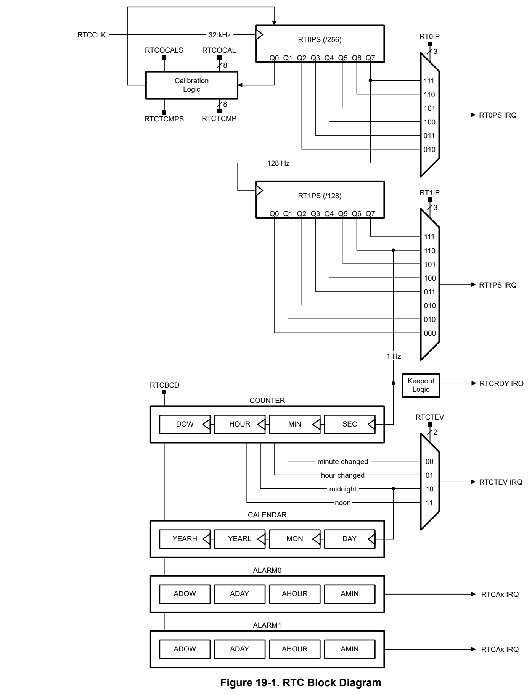
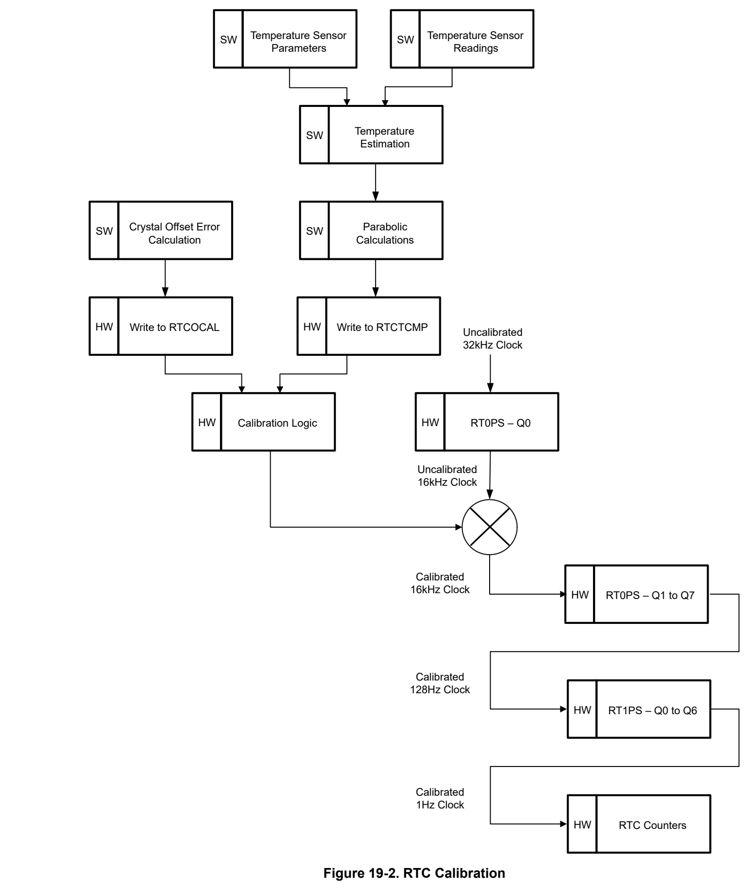
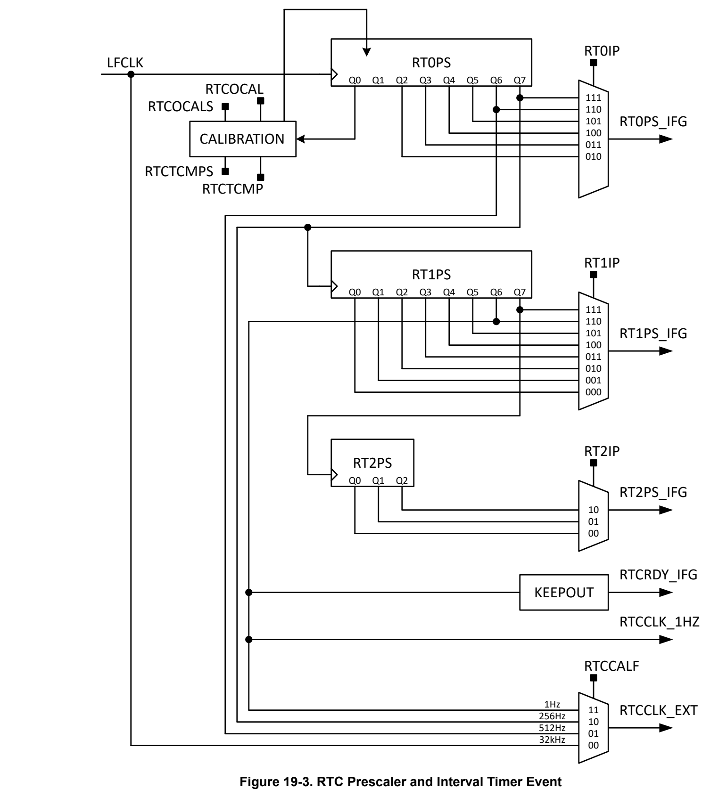
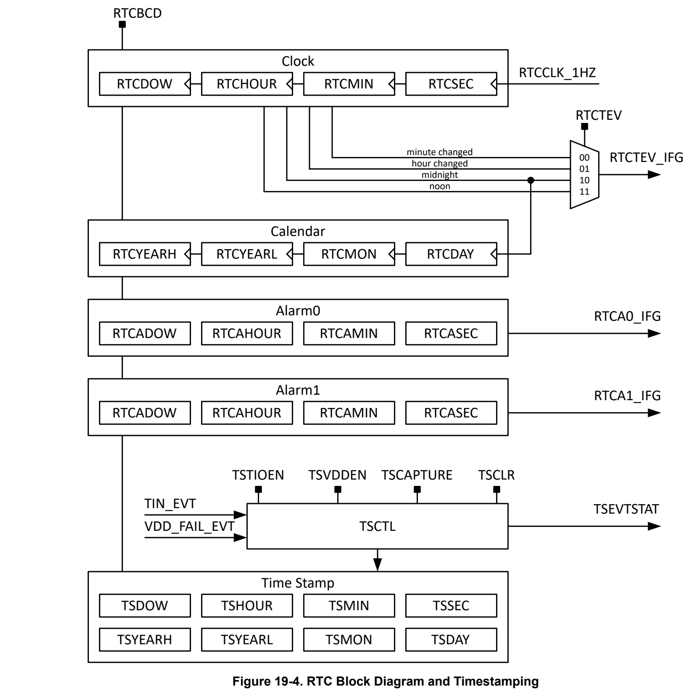

# 19 RTC (pp. 1176-1258)

### 19.1 Overview 1177 (p. 1176)

### 19.2 Basic Operation 1178 (p. 1176)

### 19.3 Configuration 1180 (p. 1176)

### 19.4 RTC Registers 1191 (p. 1176)

### 19.1 Overview (p. 1177)

The real-time clock module provides time-keeping for the application, with counters for seconds, minutes, hours, day of the week, day of the month, and year, in selectable binary or binary-coded decimal (BCD) format. A variety of programmable interrupt alarms are provided. There are RTC instances ( RTC, RTC_x) that provide common key features, and additional instances ( RTC_x) that provide specific key features.

Common key features of across all instances of the real-time clock ( RTC, RTC_x) include:

- Real-time clock and calendar mode providing seconds, minutes, hours, day of week, day of month, and year

- Selectable binary or binary-coded decimal (BCD) format

- Leap-year correction (valid for year 1901 through 2099)

- Two customizable calendar alarm interrupts based on minute, hour, day of the week, and day of the month

- Interval alarm interrupt to wake every minute, every hour, at midnight, or at noon

- Periodic interrupt to wake at 4096, 2048, 1024, 512, 256, or 128Hz

- Periodic interrupt to wake at 64, 32, 16, 8, 4, 2, 1, and 0.5Hz

- Interrupt capability down to STANDBY mode with STOPCLKSTBY

- Calibration for crystal offset error and crystal temperature drift (up to ±240 ppm total)

- RTC clock output to pin for calibration

RTC_x instances include features such as:

- Three bit prescaler for heartbeat function with interrupt generation

- RTC external clock selection of untrimmed 32kHz, trimmed 512Hz, 256Hz or 1Hz

- RTC time stamp capture upon detection of a timer stamp event, including tamper (TIO) event and VDD fail event

- RTC counter lock function

#### 19.1.1 RTC Instances (p. 1177)

Table 19-1 shows a comparison table of RTC instances and supported features.

**Table 19-1. RTC Instances and Key Features (pp. 1177-1178)**

| RTC Feature | RTC | RTC_A | RTC_B |
| --- | --- | --- | --- |
| Power enable register | Yes | – | – |
| Real-time clock and calendar mode providing seconds, minutes, hours, day of week, day of month, and year | Yes | Yes | Yes |
| Selectable binary or binary-coded decimal (BCD) format | Yes | Yes | Yes |
| Leap-year correction (valid for year 1901 through 2099) | Yes | Yes | Yes |
| Two customizable calendar alarm interrupts based on minute, hour, day of the week, and day of the month | Yes | Yes | Yes |
| Interval alarm interrupt to wake every minute, every hour, at midnight, or at noon | Yes | Yes | Yes |
| Periodic interrupt to wake at 4096, 2048, 1024, 512, 256, or 128Hz | Yes | Yes | Yes |
| Periodic interrupt to wake at 64, 32, 16, 8, 4, 2, 1, and 0.5Hz | Yes | Yes | Yes |
| Periodic interrupt to wake at 16, 8, 4 seconds | – | – | Yes |
| Interrupt capability down to STANDBY mode with STOPCLKSTBY | Yes | Yes | Yes |
| Calibration for crystal offset error and crystal temperature drift (up to ±240 ppm total) | Yes | Yes | Yes |
| RTC clock output to pin for calibration (GPIO) | Yes | Yes | Yes |
| RTC clock output to pin for calibration (TIO) | – | Yes | – |
| Three bit prescaler for heartbeat function with interrupt generation | – | Yes | – |
| RTC external clock selection of untrimmed 32kHz, trimmed 512Hz, 256Hz, or 1Hz | – | Yes | – |
| RTC time stamp capture upon detection of a timer stamp event, including: • TIO event • VDD fail event | – | Yes | – |
| RTC counter lock function | – | Yes | – |

Note To see which RTC instances and features are supported in a device, please see the device-specific data sheet.

### 19.2 Basic Operation (p. 1178)

The RTC utilizes two prescaler blocks (RT0PS, RT1PS) to generate a 128Hz and 1Hz clock, respectively, from the source 32.768kHz RTCCLK. The prescaler blocks each support generating a periodic interrupt alarm at a variety of rates from 4096Hz down to 0.5Hz. The 1Hz clock output from RT1PS ticks the counter block, which tracks seconds, minutes, hours, and day of the week. The counter block also sources an interval alarm interrupt once per minute, per hour, at midnight, or at noon. The counter midnight output sources the calendar block, which provides day of the month, month, and year, with leap year correction. Two independent calendar alarm interrupts are provided to wake the application at specific times.

*Figure 19-1. RTC Block Diagram (p. 1179)*

### 19.3 Configuration (p. 1180)

#### 19.3.1 Clocking (p. 1180)

The RTC is clocked directly from RTCCLK, which is sourced either from the internal LFOSC or the external low frequency crystal oscillator ( LFXT). The LFOSC and LFXT both require startup time. Ensure that the oscillator sourcing LFCLK in the application is configured and that LFCLK is operational before enabling power to the RTC module.

Two prescale dividers, RT0PS and RT1PS, are automatically configured to provide a 1-second clock interval for the RTC. The LFCLK must be running at 32kHz clock frequency for proper RTC operation. The RT0PS divider is sourced directly from LFCLK at 32kHz. The output of the RT0PS divider block is 32kHz/256, or 128Hz, and is used to source the input of the RT1PS divider block. The RT1PS output is 128Hz/128, or 1Hz, and is used to source the real-time clock counter registers with the required 1-second time interval.

Clearing the MODCLKEN bit in the CLKCTL register of the RTC halts the propagation of LFCLK to the real-time counters and the prescale counters (RT0PS and RT1PS) in the RTC. It does not have any effect on the LFCLK itself.

#### 19.3.2 Reading and Writing to RTC Peripheral Registers (p. 1180)

The peripheral bus clock (ULPCLK) is asynchronous to the RTC clock source (RTCCLK). As a result, special care must be taken when reading and writing certain RTC peripheral registers.

Counter/Calendar Registers

The RTC counter/calendar registers are updated once per second. To prevent reading any counter/calendar register at the time of an update (which could result in an invalid time being read), a keep-out window is provided. The keep-out window is approximately 128/32768 seconds before the counters update. The read-only RTCRDY bit in the STA register is reset during the keep-out window, and set outside the keep-out window period. Any read of the counter/calendar registers while RTCRDY bit in the STA register is reset can potentially be invalid, and the time read should be ignored.

The RTCRDY interrupt mechanism can also be used to safely read the RTC counter/calendar registers. When the RTCRDY interrupt is enabled, an interrupt is generated based on the rising edge of the RTCRDY bit, causing the RTCRDY interrupt flag to be set. At this point, the application has nearly a complete second to safely read any or all of the RTC registers. To ensure a safe read, the RTCRDY bit in the STA register can be read again in the interrupt service routine and other interrupts can be disabled. This synchronization process prevents reading the time value during a counter/calendar transition. The RTCRDY interrupt flag is reset automatically when the interrupt is serviced, or can be reset by software.

The RTC counter/calendar registers can be written to at any time. Writes to the calendar registers take 2 to 3 RTCCLK cycles to take effect. If a back-to-back write is done on counter/calendar registers, then it is possible that for 2-3 RTCCLK cycles, the register is set to an undefined value. Therefore, back-to-back writes to calendar registers need to be avoided. Note that due to the synchronization, if a read immediately follows a write to the calendar registers, the read back value is always the actual counter value, which can be different than the written value due to the 2-3 RTCCLK cycles required to synchronize the newly written value.

The following registers are subject to the restrictions above: SEC, MIN, HOUR, DAY, MON, YEAR.

Control Register

The RTC control register (CTL) can be read at any time. Writes to the CTL register should only be done when the TEV (interval timer) interrupt is disabled and after the RTCRDY interrupt is set.

The following register is subject to the restrictions above: CTL.

Alarm Registers

The RTC alarm configuration registers can be read at any time. Writes to the alarm registers must be done when the corresponding alarm interrupt is disabled, and after the RTCRDY interrupt is set.

The following registers are subject to the restrictions above: A1MIN, A1HOUR, A1DAY, A2MIN, A2HOUR, A2DAY.

Offset Correction and Temperature Compensation Registers

The offset correction register (CAL) and temperature compensation register (TCMP) must only be written when the RTCTCRDY bit in the STA register is set. RTCTCRDY is a read-only bit which is set when the hardware is ready to take in new correction or compensation values. Writes applied when RTCTCRDY is cleared have no effect. The RTCTCOK status bit is provided in the STA register. If a write to CAL or TCMP was successful, RTCTCOK will be set, else it will be reset. RTCTCOK will hold its status until the next write attempt. If a write is unsuccessful, software needs to re-attempt the write when RTCTCRDY is set.

The following registers are subject to the restrictions above: TCMP, CAL.

Prescaler Control Registers

The prescaler interval control registers can be read at any time. Writes to the prescaler control registers should only be done when the PS0 and PS1 interrupts are disabled.

The following registers are subject to the restrictions above: PSCTL.

19.3.3 Binary vs. BCD

The RTC provides seconds, minutes, hours, day of week, day of month, month, and year in selectable binary or binary-coded decimal (BCD) format. When the RTCBCD bit in the CTL register of the RTC is set, BCD format is selected. When BCD format is selected, only the BCD bits are valid in the calendar registers. The format must be selected before the time is set.

#### 19.3.4 Leap Year Handling (p. 1181)

The calendar includes a leap-year algorithm which considers all years evenly divisible by four as leap years. This algorithm is accurate from the year 1901 through 2099.

#### 19.3.5 Calendar Alarm Configuration (p. 1181)

The RTC provides a flexible alarm system. There are two user-programmable alarms (A0 and A1) which can be programmed based on the settings contained in the alarm registers for minutes, hours, day of week, and day of month.

Each alarm register contains an alarm enable (AE) bit that can be used to enable the respective alarm register. By setting the AE bits of the various alarm registers, a variety of alarm events can be generated.

- Example 1: A user wants to set an alarm every hour at 15 minutes past the hour (for example, at 00:15:00, 01:15:00, 02:15:00, and so on). This is possible by setting AxMIN to 15. By setting the AE bit of the AxMIN and clearing all other AE bits of the alarm registers, the alarm is enabled. When enabled, the RTCAx interrupt flag is set when the count transitions from 00:14:59 to 00:15:00, 01:14:59 to 01:15:00, 02:14:59 to 02:15:00, and so on.

- Example 2: A user wants to set an alarm every day at 04:00:00. This is possible by setting AxHOUR to 4. By setting the AE bit of the AxHOUR and clearing all other AE bits of the alarm registers, the alarm is enabled. When enabled, the RTCAx interrupt flag is set when the count transitions from 03:59:59 to 04:00:00.

- Example 3: A user wants to set an alarm for 06:30:00. AxHOUR would be set to 6 and AxMIN would be set to 30. By setting the AE bits of AxHOUR and AxMIN, the alarm is enabled. When enabled, the RTCAx interrupt flag is set when the time count transitions from 06:29:59 to 06:30:00. In this case, the alarm event occurs every day at 06:30:00.

- Example 4: A user wants to set an alarm every Tuesday at 06:30:00. AxDOW in the AxDAY register would be set to 2, AxHOUR would be set to 6 and AxMIN would be set to 30. By setting the AE bits of AxDOW,

AxHOUR and AxMIN, the alarm is enabled. When enabled, the RTCAx interrupt flag is set when the time count transitions from 06:29:59 to 06:30:00 and the DOW transitions from 1 to 2.

- Example 5: A user wants to set an alarm the fifth day of each month at 06:30:00. AxDAY would be set to 5, AxHOUR would be set to 6 and AxMIN would be set to 30. By setting the AE bits of AxDAY, AxHOUR and AxMIN, the alarm is enabled. When enabled, the RTCAx interrupt flag is set when the time count transitions from 06:29:59 to 06:30:00 and the RTCDAY equals 5.

> **Note:**

Invalid alarm settings

Invalid alarm settings are not checked through hardware. It is the user's responsibility that valid alarm settings are entered.

> **Note:**

Invalid time and date values

Writing of invalid date and/or time information or data values outside the legal ranges specified in the calendar and alarm registers can result in unpredictable behavior.

> **Note:**

Setting the alarm

Before setting an initial alarm, all alarm registers including the AE bits should be cleared.

To prevent potential erroneous alarm conditions from occurring, the alarms should be disabled by clearing the RTCAx interrupt enable, RTCAx interrupt flag, and AE bits before writing initial or new time values to the RTC time registers.

#### 19.3.6 Interval Alarm Configuration (p. 1182)

The interval alarm is provided in addition to the two calendar alarms, and can be configured to generate an interval alarm event when the following events occur:

- MIN changes

- HOUR changes

- Every day at midnight

- Every day at noon

The interval is selected by programming the RTCTEVTX field in the CTL register of the RTC. The interval alarm sources the RTCTEV interrupt.

#### 19.3.7 Periodic Alarm Configuration (p. 1182)

Two periodic alarms are provided, and can be configured to generate two periodic time bases for the application.

The RT0PS periodic alarm can be configured to generate a periodic interrupt at one of the following rates: 4096Hz, 2048Hz, 1024Hz, 512Hz, 256Hz, or 128Hz. The RT0PS period is set by the RT0IP bits in the PSCTL register. The RT0PS event sources the RT0PS interrupt.

The RT1PS periodic alarm can be configured to generate a periodic interrupt at one of the following rates: 64Hz, 32Hz, 16Hz, 8Hz, 4Hz, 2Hz, 1Hz, or 0.5Hz. The RT1PS period is set by the RT1IP bits in the PSCTL register. The RT1PS event sources the RT1PS interrupt.

Note Changing the settings of the periodic alarm configuration (RT0IP, RT1IP) while the corresponding prescalar is running can result in setting the corresponding interrupt flags. To avoid this, the RT0PS and RT1PS interrupts should be masked when changing RT0IP or RT1IP while the prescaler is running.

#### 19.3.8 Calibration (p. 1183)

The RTC module provides calibration mechanisms for reducing timekeeping error due to crystal offset error and crystal temperature drift. Crystal offset error can be corrected by measuring the crystal frequency through the RTC_OUT output and adjusting calibration registers in the RTC. Crystal temperature drift can be corrected by measuring the system temperature with software, computing a correction factor in ppm based on the measured temperature, and applying the correction factor to the RTC.

Up to ±240 ppm of offset correction or up to ±240 ppm of temperature compensation correction can be applied individually, but the total correction allowed when both offset correction and temperature compensation are used together is ±240 ppm. This means that the signed addition of offset error and temperature compensation should not exceed the maximum of ±240 ppm, else the values in excess of ±240 ppm will be ignored by hardware.

*Figure 19-2. RTC Calibration (p. 1184)*

##### 19.3.8.1 Crystal Offset Error (p. 1185)

The RTC module can be calibrated for crystal manufacturing tolerance or offset error for higher timekeeping accuracy. A crystal frequency error of up to ±240 ppm can be calibrated smoothly over a period of 60 seconds.

The CAL register is used to adjust the frequency. The calibration value is written into the RTCOCALX field in the CAL register, and each LSB in this field represents approximately ±1 ppm correction (the sign is based on the RTCOCALS bit in the CAL register). When RTCOCALS is set, up calibration is selected and each LSB in RTCOCALX represents +1 ppm adjustment. When RTOCALS is cleared, down calibration is selected and each LSB in RTCOCALX represents -1 ppm adjustment. The RTCOCALX field is 8 bits. Software can write a value of up to 256ppm into this register, but the maximum frequency error that can be corrected is only 240ppm. Software is responsible for writing legal values into RTCOCALX. Offset error calibration is inactive when the RTC is not enabled (MODCLKEN is cleared) or when RTCOCALX is zero. Writing to the RTOCAL register resets the temperature compensation to zero.

Note The CAL register must only be accessed via half-word (16-bit) or word (32-bit) wide operations to ensure that the sign bit is set together with the calibration value.

To calibrate the RTC frequency, the RTC_OUT output signal is available on a pin. The RTCCALFX field in the CAL register can be used to select the frequency rate of the output signal to the pin. When RTCCALFX = 0x0, no signal is output on the RTC_OUT pin. The other settings of the RTCCALFX select one of the three frequency options to output: 512Hz, 256Hz, or 1Hz. RTC_OUT output can be measured, and the result of this measurement can be applied to the RTCOCALS and RTCOCALX bits to effectively reduce the initial offset of the RTCCLK.

###### 19.3.8.1.1 Offset Error Correction Mechanism (p. 1185)

In the RTC, offset error calibration takes place over a period of 60 seconds. To achieve approximately ±1ppm correction, the 16kHz clock (Q0 output of RT0PS) is adjusted to add or subtract 1 clock pulse. This correction happens once every quarter second until the programmed ppm error is compensated.

All three possible output frequencies 512Hz, 256Hz, and 1Hz at the RTC_OUT pin are affected by calibration settings. RT0PS interrupt triggered by RT0PS – Q2 to Q7 is based on calibrated clock. RT1PS interrupt (RT1PS) and RTC clock time event interrupt (RTCTEV) are also based on the calibrated clock.

The following can be used as a guide for setting RTCOCALS and RTCOCALX, given f RTCCLK = f RTCCLK, meas x divider factor (set by RTCCALFX):

Slow Crystal (f RTCCLK < 32768Hz )

- Set RTCOCALS = 1

- Set RTCOCALX to Round (60 x 16384 x (1-f RTCCLK/32768))

As an example for up calibration, when the measured frequency is 511.9658Hz against the reference frequency of 512Hz, the frequency error is approximately 67ppm low. In order to increase the frequency by 67ppm, RTCOCALS should be set, and RTCOCALx should be set to Round (60 x 16384 x (1-511.9658x64/32768)) = 66.

Fast Crystal (f ACLK ≥ 32768Hz)

- Set RTCOCALS = 0

- Set RTCOCALX to Round (60 x 16384 x (1-f RTCCLK/32768))

As an example for down calibration, when the measured frequency is 512.0241Hz against the reference frequency of 512Hz, the frequency error is approximately 47ppm high. In order to decrease the frequency by 47ppm, RTCOCALS should be cleared, and RTCOCALx should be set to Round (60 x 16384 x (1-512.0241x64/32768)) = 46.

##### 19.3.8.2 Crystal Temperature Error (p. 1186)

The output frequency of a crystal can vary significantly due to drift in temperature. A hybrid software and hardware approach can be applied to achieve temperature compensation for the RTC. The RTC supports temperature compensation up to ±240 ppm.

Application software can make use of the on-chip temperature sensor to measure the device temperature at desired intervals (for example, every few seconds or minutes) to approximate the ambient temperature of the circuit. Then, software can be used to do parabolic calculations to determine the corresponding frequency error in ppm. This frequency error can then be written into the TCMP register for temperature compensation.

The RTCTCMPX field contains 8 bits which provide frequency correction up to ±240 ppm. The LSB represents ±1 ppm based on the RTCTCMPS bit in the TCMP register. When RTCTCMPS is set, each step in RTCTCMPX represents a +1ppm adjustment (up calibration). When the RTCTCMPS bit is cleared, each step in RTCTCMPX represents a -1ppm adjustment (down calibration).

###### 19.3.8.2.1 Temperature Drift Correction Mechanism (p. 1186)

When the temperature compensation value is written into RTCTCMPX, it is added together with the offset error calibration value an the resulting value is taken into account from the next calibration cycle onwards. The ongoing calibration cycle will not be affected by writes into the TCMP register.

Reading the TCMPX at any time returns the cumulative correction value (offset + temperature) which is the signed addition of RTCOCALX and RTCTCMPX, and the updated sign bit (RTCTCMPS) of the addition result. Note that writing to the RTCOCAL register will reset the temperature compensation value to zero.

For example, when RTCOCALX is +150 ppm, and RTCTCMP is written with +200 ppm, the effective value taken in for the next calibration cycle is +240 ppm (saturated). If the RTCOCALX is +150 ppm, and RTCTCMP is written with +50 ppm, the effective value taken for the next calibration cycle is +200 ppm (40 ppm of compensation headroom remains).

To achieve effective temperature compensation, software is responsible to:

1. Measure the temperature as often as required by the operating conditions, crystal performance, and targeted accuracy 2. Calculate the frequency error due to temperature 3. Write the temperature compensation value into RTCTCMPX while not exceeding the maximum combined correction limit of ±240 ppm

Writing to the TCMP register for temperature compensation requires 60 seconds (one minute) to take effect as a part of the next calibration cycle. Therefore, if temperature must be measured more frequently than once per minute (for example, once every 5 seconds) then it needs to average the error over one minute and update the TCMP register once per minute.

Note The TCMP register must only be accessed via half-word (16-bit) or word (32-bit) wide operations to ensure that the sign bit is set together with the calibration value.

#### 19.3.9 RTC Prescaler Extension (p. 1186)

In RTC_x instances only, a three-bit prescaler extension is included to support a longer interval time for a heartbeat function. The RT2PS prescaler allows interrupt generation with a 4s, 8s, or 16s interval.

The RTCCLK is used to provide RTC clock to the outside (512Hz, 256Hz, or 1Hz). The clock source is after the calibration circuit and allows to trim the LFXT offset and temperature compensation register.

For some applications, the raw uncalibrated 32kHz clock can be used as source for other components in the system. For LFSS, LFCLK is a mux option of RTCCLK.

See Figure 19-3 for configuration of the prescalers, internal timer events, and RTC output options.

*Figure 19-3. RTC Prescaler and Interval Timer Event (p. 1187)*

#### 19.3.10 RTC Timestamp Capture (p. 1187)

In RTC_x instances only, an RTC timestamp feature allows the capture of an RTC status on the detection of a timestamp event. When a timestamp event happens, the whole RTC register from seconds to years is copied

to the timestamp capture registers. In case of multiple timestamp events, the TSCAPTURE register defines whether only the first or every (last) RTC status should be captured. The timestamp event status is sticky and needs to be cleared by software with the TSCLR register bit.

See Figure 19-4 for the RTC block diagram and timestamping.

*Figure 19-4. RTC Block Diagram and Timestamping (p. 1188)*

The following timestamp events are supported:

– Depending on the configuration of the polarity (rising, falling or both edges), the tamper I/O input will trigger a timestamp event capture when the TIO changes its state. – This feature is used in a typical tamper detect application when the TIO input is connected to a switch which detects the opening of an enclosure.

- VDD fail event

– The VDD fail event allows the capture of a timestamp when the main supply (VDD) is lost. Once the device's main supply regains power, the timestamp status information indicates that a power low timestamp event happened. – This feature is used in applications where it is important to know how long the main power was lost.

#### 19.3.11 RTC Events (p. 1189)

The RTC module contains two event publishers and no event subscribers. One event publisher (CPU_INT) manages RTC interrupt requests (IRQs) to the CPU subsystem through a static event route. The second event publisher (GEN_EVENT) can be used to publish RTC events to a subscriber through a generic event route channel.

The RTC events are summarized in Table 19-2.

**Table 19-2. RTC Events (p. 1189)**

| Event | Type | Source | Destination | Route | Configuration | Functionality |
| --- | --- | --- | --- | --- | --- | --- |
| CPU interrupt event | Publisher | RTC | CPU Subsystem | Static route | CPU_INT registers | Fixed interrupt route from RTC to CPU |
| Generic event | Publisher | RTC | Generic event channel | Generic route (FPUB_0) | GEN_EVENT registers, FPUB_0 register | Trigger generic event channel from RTC |

##### 19.3.11.1 CPU Interrupt Event Publisher (CPU_INT) (p. 1189)

The RTC module provides six interrupt sources which can be configured to source a CPU interrupt event. In order of decreasing interrupt priority, the CPU interrupt events from the RTC are given in Table 19-3.

**Table 19-3. RTC CPU Interrupt Event Conditions (CPU_INT) (p. 1189)**

| Index (IIDX) | Name | Description |
| --- | --- | --- |
| 0 | RTCRDY | Indicates that the RTC counter/calendar registers are safe to be read for approximately one second |
| 1 | RTCTEV | Interval interrupt, configurable as once per minute, per hour, at midnight, or at noon |
| 2 | RTCA1 | Calendar alarm 1 interrupt |
| 3 | RTCA2 | Calendar alarm 2 interrupt |
| 4 | RTC0PS | Prescaler 0 periodic alarm interrupt |
| 5 | RTC1PS | Prescaler 1 periodic alarm interrupt |

The CPU interrupt event configuration is managed with the CPU_INT event management registers. See Section 7.2.5 for guidance on configuring the event registers for CPU interrupts.

##### 19.3.11.2 Generic Event Publisher (GEN_EVENT) (p. 1189)

The RTC module provides six interrupt sources, of which one can be configured to publish an event to a generic event route channel are given in Table 19-4.

**Table 19-4. RTC Generic Event Publisher Conditions (GEN_EVENT) (pp. 1189-1190)**

| Index | Name | Description |
| --- | --- | --- |
| 0 | RTCRDY | Indicates that the RTC counter/calendar registers are safe to be read for approximately one second |
| 1 | RTCTEV | Interval interrupt, configurable as once per minute, per hour, at midnight, or at noon |
| 2 | RTCA1 | Calendar alarm 1 interrupt |
| 3 | RTCA2 | Calendar alarm 2 interrupt |
| 4 | RTC0PS | Prescaler 0 periodic alarm interrupt |
| 5 | RTC1PS | Prescaler 1 periodic alarm interrupt |

The generic event publisher configuration is managed with the GEN_EVENT event management registers. See Section 7.2.5 for guidance on configuring the event registers for generic event publishers.

The generic event channel which generic event is to publish to must be selected by writing the target generic channel ID to the FPUB_0 register in the RTC. See Section 7.1.3.3 for guidance on configuring generic event routes.

If this publisher is not used in an application, the FPUB_0 register can be left in a disconnected state (set equal to zero) and no events should be unmasked through the MIS register in the RTC GEN_EVENT register set.

### 19.4 RTC Registers (p. 1191)

Table 19-5 lists the memory-mapped registers for the RTC registers. All register offset addresses not listed in Table 19-5 should be considered as reserved locations and the register contents should not be modified.

**Table 19-5. RTC Registers (pp. 1191-1192)**

| Offset | Acronym | Register Name | Group |
| --- | --- | --- | --- |
| 444h | FPUB_0 | Publisher Port 0 |  |
| 800h | PWREN | Power enable |  |
| 804h | RSTCTL | Reset Control |  |
| 808h | CLKCFG | Peripheral Clock Configuration Register |  |
| 814h | STAT | Status Register |  |
| 1004h | CLKSEL | Clock Select for Ultra Low Power peripherals |  |
| 1020h | IIDX | Interrupt Index Register | CPU_INT |
| 1028h | IMASK | Interrupt mask | CPU_INT |
| 1030h | RIS | Raw interrupt status | CPU_INT |
| 1038h | MIS | Masked interrupt status | CPU_INT |
| 1040h | ISET | Interrupt set | CPU_INT |
| 1048h | ICLR | Interrupt clear | CPU_INT |
| 1050h | IIDX | Interrupt Index Register | GEN_EVENT |
| 1054h | IMASK | Interrupt mask | GEN_EVENT |
| 1058h | RIS | Raw interrupt status | GEN_EVENT |
| 105Ch | MIS | Masked interrupt status | GEN_EVENT |
| 1060h | ISET | Interrupt set | GEN_EVENT |
| 1064h | ICLR | Interrupt clear | GEN_EVENT |
| 10E0h | EVT_MODE | Event Mode |  |
| 10FCh | DESC | RTC Descriptor Register |  |
| 1100h | CLKCTL | RTC Clock Control Register |  |
| 1104h | DBGCTL | RTC Module Debug Control Register |  |
| 1108h | CTL | RTC Control Register |  |
| 110Ch | STA | RTC Status Register |  |
| 1110h | CAL | RTC Clock Offset Calibration Register |  |
| 1114h | TCMP | RTC Temperature Compensation Register |  |
| 1118h | SEC | RTC Seconds Register - Calendar Mode With Binary / BCD Format |  |
| 111Ch | MIN | RTC Minutes Register - Calendar Mode With Binary / BCD Format |  |
| 1120h | HOUR | RTC Hours Register - Calendar Mode With Binary / BCD Format |  |
| 1124h | DAY | RTC Day Of Week / Month Register - Calendar Mode With Binary / BCD Format |  |
| 1128h | MON | RTC Month Register - Calendar Mode With Binary / BCD Format |  |
| 112Ch | YEAR | RTC Year Register - Calendar Mode With Binary / BCD Format |  |
| 1130h | A1MIN | RTC Minute Alarm Register - Calendar Mode With Binary / BCD Format |  |
|  |  | Mode With Binary / BCD Format |  |
| 1138h | A1DAY | RTC Alarm Day Of Week / Month Register - Calendar Mode With Binary / BCD Format |  |
| 113Ch | A2MIN | RTC Minute Alarm Register - Calendar Mode With Binary / BCD Format |  |
| 1140h | A2HOUR | RTC Hours Alarm Register - Calendar Mode With Binary / BCD Format |  |
| 1144h | A2DAY | RTC Alarm Day Of Week / Month Register - Calendar Mode With Binary / BCD Format |  |
| 1148h | PSCTL | RTC Prescale Timer 0/1 Control Register |  |
| 114Ch | EXTPSCTL | RTC Prescale Timer 2 Control Register |  |
| 1150h | TSSEC | Time Stamp Seconds Register -Calendar Mode With Binary / BCD Format |  |
| 1154h | TSMIN | Time Stamp Minutes Register -Calendar Mode With Binary / BCD Format |  |
| 1158h | TSHOUR | Time Stamp Hours Register - Calendar Mode With Binary / BCD Format |  |
| 115Ch | TSDAY | Time Stamp Day Of Week / Month Register - Calendar Mode With Binary / BCD Format |  |
| 1160h | TSMON | Time Stamp Month Register - Calendar Mode With Binary / BCD Format |  |
| 1164h | TSYEAR | Time Stamp Years Register - Calendar Mode With Binary / BCD Format |  |
| 1168h | TSSTAT | Time Stamp Status Register |  |
| 116Ch | TSCTL | Time Stamp Control Register |  |
| 1170h | TSCLR | Time Stamp Clear Register |  |
| 1174h | LFSSRST | Low frequency subsystem reset request |  |
| 1178h | RTCLOCK | Real time clock lock register |  |

Complex bit access types are encoded to fit into small table cells. Table 19-6 shows the codes that are used for access types in this section.

**Table 19-6. RTC Access Type Codes (p. 1192)**

| Access Type | Code | Description |
| --- | --- | --- |
| Read Type |  |  |
| R | R | Read |
| R-0 | R -0 | Read Returns 0s |
| Write Type |  |  |
| W | W | Write |
| WK | W K | Write Write protected by a key |
| Reset or Default Value |  |  |
| - n |  | Value after reset or the default value |

### 19.4.1 [RTC.FPUB_0] Offset: 444h | Reset: 00000000h (p. 1193)

FPUB_0 is shown in Figure 19-5 and described in Table 19-7.

Publisher port

> **Bit Map**: `[31-4] RESERVED (R, 0h)` | `[3-0] CHANID (R/W, 0h)`

**Table 19-7. FPUB_0 Field Descriptions (p. 1193)**

| Bit | Field | Type | Reset | Description |
| --- | --- | --- | --- | --- |
| 31-4 | RESERVED | R | 0h |  |
| 3-0 | CHANID | R/W | 0h | 0 = disconnected.; 1-15 = connected to channelID = CHANID.; 0h = A value of 0 specifies that the event is not connected; Fh = Consult your device data sheet as the actual allowed maximum may be less than 15. |

### 19.4.2 [RTC.PWREN] Offset: 800h | Reset: 00000000h (p. 1194)

PWREN is shown in Figure 19-6 and described in Table 19-8.

Register to control the power state

> **Bit Map**: `[31-24] KEY (R-0/W, 0h)` | `[23-1] RESERVED (R, 0h)` | `[0] ENABLE (R/WK, 0h)`

**Table 19-8. PWREN Field Descriptions (p. 1194)**

| Bit | Field | Type | Reset | Description |
| --- | --- | --- | --- | --- |
| 31-24 | KEY | R-0/W | 0h | KEY to allow Power State Change; 26h = KEY to allow write access to this register |
| 23-1 | RESERVED | R | 0h |  |
| 0 | ENABLE | R/WK | 0h | Enable the power KEY must be set to 26h to write to this bit.; 0h = Disable Power; 1h = Enable Power |

### 19.4.3 [RTC.RSTCTL] Offset: 804h | Reset: 00000000h (p. 1195)

RSTCTL is shown in Figure 19-7 and described in Table 19-9.

Register to control reset assertion and de-assertion

> **Bit Map**: `[31-24] KEY (W, 0h)` | `[23-2] RESERVED (R, 0h)` | `[1] RESETSTKYCLR (WK, 0h)` | `[0] RESETASSERT (WK, 0h)`

**Table 19-9. RSTCTL Field Descriptions (p. 1195)**

| Bit | Field | Type | Reset | Description |
| --- | --- | --- | --- | --- |
| 31-24 | KEY | W | 0h | Unlock key; B1h = KEY to allow write access to this register |
| 23-2 | RESERVED | R | 0h |  |
| 1 | RESETSTKYCLR | WK | 0h | Clear the RESETSTKY bit in the STAT register KEY must be set to B1h to write to this bit.; 0h = Writing 0 has no effect; 1h = Clear reset sticky bit |
| 0 | RESETASSERT | WK | 0h | Assert reset to the peripheral KEY must be set to B1h to write to this bit.; 0h = Writing 0 has no effect; 1h = Assert reset |

### 19.4.4 [RTC.CLKCFG] Offset: 808h | Reset: 00000000h (p. 1196)

CLKCFG is shown in Figure 19-8 and described in Table 19-10.

Peripheral Clock Configuration Register

> **Bit Map**: `[31-24] KEY (R-0/W, 0h)` | `[23-9] RESERVED (R, 0h)` | `[8] BLOCKASYNC (R/WK, 0h)` | `[7-0] RESERVED (R, 0h)`

**Table 19-10. CLKCFG Field Descriptions (p. 1196)**

| Bit | Field | Type | Reset | Description |
| --- | --- | --- | --- | --- |
| 31-24 | KEY | R-0/W | 0h | KEY to Allow State Change -- 0xA9 A9h (W) = key value to allow change field of GPRCM |
| 23-9 | RESERVED | R | 0h |  |
| 8 | BLOCKASYNC | R/WK | 0h | Async Clock Request is blocked from starting SYSOSC or forcing bus clock to 32MHz KEY must be set to A9h to write to this bit.; 0h = Not block async clock request; 1h = Block async clock request |
| 7-0 | RESERVED | R | 0h |  |

### 19.4.5 [RTC.STAT] Offset: 814h | Reset: 00000000h (p. 1197)

STAT is shown in Figure 19-9 and described in Table 19-11.

peripheral enable and reset status

> **Bit Map**: `[31-17] RESERVED (R, 0h)` | `[16] RESETSTKY (R, 0h)` | `[15-0] RESERVED (R, 0h)`

**Table 19-11. STAT Field Descriptions (p. 1197)**

| Bit | Field | Type | Reset | Description |
| --- | --- | --- | --- | --- |
| 31-17 | RESERVED | R | 0h |  |
| 16 | RESETSTKY | R | 0h | This bit indicates, if the peripheral was reset, since this bit was cleared by RESETSTKYCLR in the RSTCTL register; 0h = The peripheral has not been reset since this bit was last cleared by RESETSTKYCLR in the RSTCTL register; 1h = The peripheral was reset since the last bit clear |
| 15-0 | RESERVED | R | 0h |  |

### 19.4.6 [RTC.CLKSEL] Offset: 1004h | Reset: 00000000h (p. 1198)

CLKSEL is shown in Figure 19-10 and described in Table 19-12.

Clock source selection for ULP peripherals

> **Bit Map**: `[31-2] RESERVED (R, 0h)` | `[1] LFCLK_SEL (R, 0h)` | `[0] RESERVED (R, 0h)`

**Table 19-12. CLKSEL Field Descriptions (p. 1198)**

| Bit | Field | Type | Reset | Description |
| --- | --- | --- | --- | --- |
| 31-2 | RESERVED | R | 0h |  |
| 1 | LFCLK_SEL | R | 0h | Selects LFCLK as clock source if enabled; 0h = LFCLK is disabled as clock source; 1h = LFCLK is enabled as clock source |
| 0 | RESERVED | R | 0h |  |

### 19.4.7 [RTC.IIDX] Offset: 1020h | Reset: 00000000h (p. 1199)

IIDX is shown in Figure 19-11 and described in Table 19-13.

This register provides the highest priority enabled interrupt index. Value 0x00 means no event pending. Interrupt 1 is the highest priority, IIDX next highest, 4, 8, … IIDX^31 is the least priority. That is, the least bit position that is set to 1 denotes the highest priority pending interrupt. The priority order is fixed. However, users can implement their own prioritization schemes using other registers that expose the full set of interrupts that have occurred. On each read, only one interrupt is indicated. On a read, the current interrupt (highest priority) is automatically cleared by the hardware and the corresponding interrupt flag in [RIS] and [MIS] are cleared as well. After a read from the CPU (not from the debug interface), the register is updated with the next highest priority interrupt, if none are pending, then it should display 0x0.

> **Bit Map**: `[31-8] RESERVED (R, 0h)` | `[7-0] STAT (R, 0h)`

**Table 19-13. IIDX Field Descriptions (p. 1199)**

| Bit | Field | Type | Reset | Description |
| --- | --- | --- | --- | --- |
| 31-8 | RESERVED | R | 0h |  |
| 7-0 | STAT | R | 0h | Interrupt index status; 00h = No interrupt pending; 1h = RTC-Ready interrupt; Interrupt flag: RTCRDY; 2h = Time-Event interrupt; Interrupt flag: RTCTEV; 3h = Alarm-1 interrupt; Interrupt flag: RTCA1; 4h = Alarm-2 interrupt; Interrupt flag: RTCA2; 5h = Prescaler-0 interrupt; Interrupt flag: RT0PS; 6h = Prescaler-1 interrupt; Interrupt flag: RT1PS; 07h = RTC prescale timer 2; 08h = Time stamp event; 09h = Tamper I/O 0 event; 0Ah = Tamper I/O 1 event; 0Bh = Tamper I/O 2 event; 0Ch = Tamper I/O 3 event; 0Dh = Tamper I/O 4 event; 0Eh = Tamper I/O 5 event; 0Fh = Tamper I/O 6 event; 10h = Tamper I/O 7 event; 11h = Tamper I/O 8 event; 12h = Tamper I/O 9 event; 13h = Tamper I/O 10 event; 14h = Tamper I/O 11 event; 15h = Tamper I/O 12 event; 16h = Tamper I/O 13 event; 17h = Tamper I/O 14 event; 18h = Tamper I/O 15 event |

### 19.4.8 [RTC.IMASK] Offset: 1028h | Reset: 00000000h (p. 1200)

IMASK is shown in Figure 19-12 and described in Table 19-14.

Interrupt Mask. If a bit is set, then corresponding interrupt is unmasked. Unmasking the interrupt causes the raw interrupt to be visible in IIDX, as well as MIS.

> **Bit Map**: `[31-24] RESERVED (R, 0h)` | `[23] TIO15 (R/W, 0h)` | `[22] TIO14 (R/W, 0h)` | `[21] TIO13 (R/W, 0h)` | `[20] TIO12 (R/W, 0h)` | `[19] TIO11 (R/W, 0h)` | `[18] TIO10 (R/W, 0h)` | `[17] TIO9 (R/W, 0h)` | `[16] TIO8 (R/W, 0h)` | `[15] TIO7 (R/W, 0h)` | `[14] TIO6 (R/W, 0h)` | `[13] TIO5 (R/W, 0h)` | `[12] TIO4 (R/W, 0h)` | `[11] TIO3 (R/W, 0h)` | `[10] TIO2 (R/W, 0h)` | `[9] TIO1 (R/W, 0h)` | `[8] TIO0 (R/W, 0h)` | `[7] TSEVT (R/W, 0h)` | `[6] RT2PS (R/W, 0h)` | `[5] RT1PS (R/W, 0h)` | `[4] RT0PS (R/W, 0h)` | `[3] RTCA2 (R/W, 0h)` | `[2] RTCA1 (R/W, 0h)` | `[1] RTCTEV (R/W, 0h)` | `[0] RTCRDY (R/W, 0h)`

**Table 19-14. IMASK Field Descriptions (pp. 1200-1201)**

| Bit | Field | Type | Reset | Description |
| --- | --- | --- | --- | --- |
| 31-24 | RESERVED | R | 0h |  |
| 23 | TIO15 | R/W | 0h | Tamper I/O 15 event; 0h = Clear Interrupt Mask; 1h = Set Interrupt Mask |
| 22 | TIO14 | R/W | 0h | Tamper I/O 14 event; 0h = Clear Interrupt Mask; 1h = Set Interrupt Mask |
| 21 | TIO13 | R/W | 0h | Tamper I/O 13 event; 0h = Clear Interrupt Mask; 1h = Set Interrupt Mask |
| 20 | TIO12 | R/W | 0h | Tamper I/O 12 event; 0h = Clear Interrupt Mask; 1h = Set Interrupt Mask |
| 19 | TIO11 | R/W | 0h | Tamper I/O 11 event; 0h = Clear Interrupt Mask; 1h = Set Interrupt Mask |
| 18 | TIO10 | R/W | 0h | Tamper I/O 10 event; 0h = Clear Interrupt Mask; 1h = Set Interrupt Mask |
| 17 | TIO9 | R/W | 0h | Tamper I/O 9 event; 0h = Clear Interrupt Mask; 1h = Set Interrupt Mask |
| 16 | TIO8 | R/W | 0h | Tamper I/O 8 event; 0h = Clear Interrupt Mask; 1h = Set Interrupt Mask |
| 15 | TIO7 | R/W | 0h | Tamper I/O 7 event; 0h = Clear Interrupt Mask; 1h = Set Interrupt Mask |
| 14 | TIO6 | R/W | 0h | Tamper I/O 6 event |
| 13 | TIO5 | R/W | 0h | Tamper I/O 5 event; 0h = Clear Interrupt Mask; 1h = Set Interrupt Mask |
| 12 | TIO4 | R/W | 0h | Tamper I/O 4 event; 0h = Clear Interrupt Mask; 1h = Set Interrupt Mask |
| 11 | TIO3 | R/W | 0h | Tamper I/O 3 event; 0h = Clear Interrupt Mask; 1h = Set Interrupt Mask |
| 10 | TIO2 | R/W | 0h | Tamper I/O 2 event; 0h = Clear Interrupt Mask; 1h = Set Interrupt Mask |
| 9 | TIO1 | R/W | 0h | Tamper I/O 1 event; 0h = Clear Interrupt Mask; 1h = Set Interrupt Mask |
| 8 | TIO0 | R/W | 0h | Tamper I/O 0 event; 0h = Clear Interrupt Mask; 1h = Set Interrupt Mask |
| 7 | TSEVT | R/W | 0h | Time stamp event; 0h = Clear Interrupt Mask; 1h = Set Interrupt Mask |
| 6 | RT2PS | R/W | 0h | RTC prescale timer 2; 0h = Clear Interrupt Mask; 1h = Set Interrupt Mask |
| 5 | RT1PS | R/W | 0h | Enable Prescaler-1 interrupt; 0h = Clear Interrupt Mask; 1h = Set Interrupt Mask |
| 4 | RT0PS | R/W | 0h | Enable Prescaler-0 interrupt; 0h = Clear Interrupt Mask; 1h = Set Interrupt Mask |
| 3 | RTCA2 | R/W | 0h | Enable Alarm-2 interrupt; 0h = Clear Interrupt Mask; 1h = Set Interrupt Mask |
| 2 | RTCA1 | R/W | 0h | Enable Alarm-1 interrupt; 0h = Clear Interrupt Mask; 1h = Set Interrupt Mask |
| 1 | RTCTEV | R/W | 0h | Enable Time-Event interrupt; 0h = Clear Interrupt Mask; 1h = Set Interrupt Mask |
| 0 | RTCRDY | R/W | 0h | Enable RTC-Ready interrupt; 0h = Clear Interrupt Mask; 1h = Set Interrupt Mask |

### 19.4.9 [RTC.RIS] Offset: 1030h | Reset: 00000000h (p. 1202)

RIS is shown in Figure 19-13 and described in Table 19-15.

Raw interrupt status. Reflects all pending interrupts, regardless of masking. The RIS register allows the user to implement a poll scheme. A flag set in this register can be cleared by writing 1 to the ICLR register bit even if the corresponding IMASK bit is not enabled.

> **Bit Map**: `[31-24] RESERVED (R, 0h)` | `[23] TIO15 (R, 0h)` | `[22] TIO14 (R, 0h)` | `[21] TIO13 (R, 0h)` | `[20] TIO12 (R, 0h)` | `[19] TIO11 (R, 0h)` | `[18] TIO10 (R, 0h)` | `[17] TIO9 (R, 0h)` | `[16] TIO8 (R, 0h)` | `[15] TIO7 (R, 0h)` | `[14] TIO6 (R, 0h)` | `[13] TIO5 (R, 0h)` | `[12] TIO4 (R, 0h)` | `[11] TIO3 (R, 0h)` | `[10] TIO2 (R, 0h)` | `[9] TIO1 (R, 0h)` | `[8] TIO0 (R, 0h)` | `[7] TSEVT (R, 0h)` | `[6] RT2PS (R, 0h)` | `[5] RT1PS (R, 0h)` | `[4] RT0PS (R, 0h)` | `[3] RTCA2 (R, 0h)` | `[2] RTCA1 (R, 0h)` | `[1] RTCTEV (R, 0h)` | `[0] RTCRDY (R, 0h)`

**Table 19-15. RIS Field Descriptions (pp. 1202-1203)**

| Bit | Field | Type | Reset | Description |
| --- | --- | --- | --- | --- |
| 31-24 | RESERVED | R | 0h |  |
| 23 | TIO15 | R | 0h | Tamper I/O 15 event; 0h = Interrupt did not occur; 1h = Interrupt occurred |
| 22 | TIO14 | R | 0h | Tamper I/O 14 event; 0h = Interrupt did not occur; 1h = Interrupt occurred |
| 21 | TIO13 | R | 0h | Tamper I/O 13 event; 0h = Interrupt did not occur; 1h = Interrupt occurred |
| 20 | TIO12 | R | 0h | Tamper I/O 12 event; 0h = Interrupt did not occur; 1h = Interrupt occurred |
| 19 | TIO11 | R | 0h | Tamper I/O 11 event; 0h = Interrupt did not occur; 1h = Interrupt occurred |
| 18 | TIO10 | R | 0h | Tamper I/O 10 event; 0h = Interrupt did not occur; 1h = Interrupt occurred |
| 17 | TIO9 | R | 0h | Tamper I/O 9 event; 0h = Interrupt did not occur; 1h = Interrupt occurred |
| 16 | TIO8 | R | 0h | Tamper I/O 8 event; 0h = Interrupt did not occur; 1h = Interrupt occurred |
| 15 | TIO7 | R | 0h | Tamper I/O 7 event; 0h = Interrupt did not occur; 1h = Interrupt occurred |
| 14 | TIO6 | R | 0h | Tamper I/O 6 event; 0h = Interrupt did not occur; 1h = Interrupt occurred |
| 13 | TIO5 | R | 0h | Tamper I/O 5 event; 0h = Interrupt did not occur; 1h = Interrupt occurred |
| 12 | TIO4 | R | 0h | Tamper I/O 4 event; 0h = Interrupt did not occur; 1h = Interrupt occurred |
| 11 | TIO3 | R | 0h | Tamper I/O 3 event; 0h = Interrupt did not occur; 1h = Interrupt occurred |
| 10 | TIO2 | R | 0h | Tamper I/O 2 event; 0h = Interrupt did not occur; 1h = Interrupt occurred |
| 9 | TIO1 | R | 0h | Tamper I/O 1 event; 0h = Interrupt did not occur; 1h = Interrupt occurred |
| 8 | TIO0 | R | 0h | Tamper I/O 0 event; 0h = Interrupt did not occur; 1h = Interrupt occurred |
| 7 | TSEVT | R | 0h | Time stamp event; 0h = Interrupt did not occur; 1h = Interrupt occurred |
| 6 | RT2PS | R | 0h | RTC prescale timer 2; 0h = Interrupt did not occur; 1h = Interrupt occurred |
| 5 | RT1PS | R | 0h | Raw Prescaler-1 interrupt status; 0h = Interrupt did not occur; 1h = Interrupt occurred |
| 4 | RT0PS | R | 0h | Raw Prescaler-0 interrupt status; 0h = Interrupt did not occur; 1h = Interrupt occurred |
| 3 | RTCA2 | R | 0h | Raw Alarm-2 interrupts status; 0h = Interrupt did not occur; 1h = Interrupt occurred |
| 2 | RTCA1 | R | 0h | Raw Alarm-1 interrupt status; 0h = Interrupt did not occur; 1h = Interrupt occurred |
| 1 | RTCTEV | R | 0h | Raw Time-Event interrupt status; 0h = Interrupt did not occur; 1h = Interrupt occurred |
| 0 | RTCRDY | R | 0h | Raw RTC-Ready interrupts status; 0h = Interrupt did not occur; 1h = Interrupt occurred |

### 19.4.10 [RTC.MIS] Offset: 1038h | Reset: 00000000h (p. 1204)

MIS is shown in Figure 19-14 and described in Table 19-16.

Masked interrupt status. This is an AND of the IMASK and RIS registers.

> **Bit Map**: `[31-24] RESERVED (R, 0h)` | `[23] TIO15 (R, 0h)` | `[22] TIO14 (R, 0h)` | `[21] TIO13 (R, 0h)` | `[20] TIO12 (R, 0h)` | `[19] TIO11 (R, 0h)` | `[18] TIO10 (R, 0h)` | `[17] TIO9 (R, 0h)` | `[16] TIO8 (R, 0h)` | `[15] TIO7 (R, 0h)` | `[14] TIO6 (R, 0h)` | `[13] TIO5 (R, 0h)` | `[12] TIO4 (R, 0h)` | `[11] TIO3 (R, 0h)` | `[10] TIO2 (R, 0h)` | `[9] TIO1 (R, 0h)` | `[8] TIO0 (R, 0h)` | `[7] TSEVT (R, 0h)` | `[6] RT2PS (R, 0h)` | `[5] RT1PS (R, 0h)` | `[4] RT0PS (R, 0h)` | `[3] RTCA2 (R, 0h)` | `[2] RTCA1 (R, 0h)` | `[1] RTCTEV (R, 0h)` | `[0] RTCRDY (R, 0h)`

**Table 19-16. MIS Field Descriptions (pp. 1204-1205)**

| Bit | Field | Type | Reset | Description |
| --- | --- | --- | --- | --- |
| 31-24 | RESERVED | R | 0h |  |
| 23 | TIO15 | R | 0h | Tamper I/O 15 event; 0h = Interrupt did not occur or is masked out; 1h = Interrupt occurred |
| 22 | TIO14 | R | 0h | Tamper I/O 14 event; 0h = Interrupt did not occur or is masked out; 1h = Interrupt occurred |
| 21 | TIO13 | R | 0h | Tamper I/O 13 event; 0h = Interrupt did not occur or is masked out; 1h = Interrupt occurred |
| 20 | TIO12 | R | 0h | Tamper I/O 12 event; 0h = Interrupt did not occur or is masked out; 1h = Interrupt occurred |
| 19 | TIO11 | R | 0h | Tamper I/O 11 event; 0h = Interrupt did not occur or is masked out; 1h = Interrupt occurred |
| 18 | TIO10 | R | 0h | Tamper I/O 10 event; 0h = Interrupt did not occur or is masked out; 1h = Interrupt occurred |
| 17 | TIO9 | R | 0h | Tamper I/O 9 event; 0h = Interrupt did not occur or is masked out; 1h = Interrupt occurred |
| 16 | TIO8 | R | 0h | Tamper I/O 8 event; 0h = Interrupt did not occur or is masked out; 1h = Interrupt occurred |
| 15 | TIO7 | R | 0h | Tamper I/O 7 event; 0h = Interrupt did not occur or is masked out; 1h = Interrupt occurred |
| 14 | TIO6 | R | 0h | Tamper I/O 6 event; 0h = Interrupt did not occur or is masked out |
| 13 | TIO5 | R | 0h | Tamper I/O 5 event; 0h = Interrupt did not occur or is masked out; 1h = Interrupt occurred |
| 12 | TIO4 | R | 0h | Tamper I/O 4 event; 0h = Interrupt did not occur or is masked out; 1h = Interrupt occurred |
| 11 | TIO3 | R | 0h | Tamper I/O 3 event; 0h = Interrupt did not occur or is masked out; 1h = Interrupt occurred |
| 10 | TIO2 | R | 0h | Tamper I/O 2 event; 0h = Interrupt did not occur or is masked out; 1h = Interrupt occurred |
| 9 | TIO1 | R | 0h | Tamper I/O 1 event; 0h = Interrupt did not occur or is masked out; 1h = Interrupt occurred |
| 8 | TIO0 | R | 0h | Tamper I/O 0 event; 0h = Interrupt did not occur or is masked out; 1h = Interrupt occurred |
| 7 | TSEVT | R | 0h | Time stamp event; 0h = Interrupt did not occur or is masked out; 1h = Interrupt occurred |
| 6 | RT2PS | R | 0h | RTC prescale timer 2; 0h = Interrupt did not occur or is masked out; 1h = Interrupt occurred |
| 5 | RT1PS | R | 0h | Masked Prescaler-1 interrupt status; 0h = Interrupt did not occur; 1h = Interrupt occurred |
| 4 | RT0PS | R | 0h | Masked Prescaler-0 interrupt status; 0h = Interrupt did not occur; 1h = Interrupt occurred |
| 3 | RTCA2 | R | 0h | Masked Alarm-2 interrupt status; 0h = Interrupt did not occur; 1h = Interrupt occurred |
| 2 | RTCA1 | R | 0h | Masked Alarm-1 interrupt status; 0h = Interrupt did not occur; 1h = Interrupt occurred |
| 1 | RTCTEV | R | 0h | Masked Time-Event interrupt status; 0h = Interrupt did not occur; 1h = Interrupt occurred |
| 0 | RTCRDY | R | 0h | Masked RTC-Ready interrupt status; 0h = Interrupt did not occur; 1h = Interrupt occurred |

### 19.4.11 [RTC.ISET] Offset: 1040h | Reset: 00000000h (p. 1206)

ISET is shown in Figure 19-15 and described in Table 19-17.

Interrupt set. Allows interrupts to be set by software (useful in diagnostics and safety checks). Writing a 1 to a bit in ISET will set the event and therefore the related RIS bit also gets set. If the interrupt is enabled through the mask, then the corresponding MIS bit is also set.

> **Bit Map**: `[31-24] RESERVED (R, 0h)` | `[23] TIO15 (W, 0h)` | `[22] TIO14 (W, 0h)` | `[21] TIO13 (W, 0h)` | `[20] TIO12 (W, 0h)` | `[19] TIO11 (W, 0h)` | `[18] TIO10 (W, 0h)` | `[17] TIO9 (W, 0h)` | `[16] TIO8 (W, 0h)` | `[15] TIO7 (W, 0h)` | `[14] TIO6 (W, 0h)` | `[13] TIO5 (W, 0h)` | `[12] TIO4 (W, 0h)` | `[11] TIO3 (W, 0h)` | `[10] TIO2 (W, 0h)` | `[9] TIO1 (W, 0h)` | `[8] TIO0 (W, 0h)` | `[7] TSEVT (W, 0h)` | `[6] RT2PS (W, 0h)` | `[5] RT1PS (W, 0h)` | `[4] RT0PS (W, 0h)` | `[3] RTCA2 (W, 0h)` | `[2] RTCA1 (W, 0h)` | `[1] RTCTEV (W, 0h)` | `[0] RTCRDY (W, 0h)`

**Table 19-17. ISET Field Descriptions (pp. 1206-1207)**

| Bit | Field | Type | Reset | Description |
| --- | --- | --- | --- | --- |
| 31-24 | RESERVED | R | 0h |  |
| 23 | TIO15 | W | 0h | Tamper I/O 15 event; 0h = Writing 0 has no effect; 1h = Set interrupt |
| 22 | TIO14 | W | 0h | Tamper I/O 14 event; 0h = Writing 0 has no effect; 1h = Set interrupt |
| 21 | TIO13 | W | 0h | Tamper I/O 13 event; 0h = Writing 0 has no effect; 1h = Set interrupt |
| 20 | TIO12 | W | 0h | Tamper I/O 12 event; 0h = Writing 0 has no effect; 1h = Set interrupt |
| 19 | TIO11 | W | 0h | Tamper I/O 11 event; 0h = Writing 0 has no effect; 1h = Set interrupt |
| 18 | TIO10 | W | 0h | Tamper I/O 10 event; 0h = Writing 0 has no effect; 1h = Set interrupt |
| 17 | TIO9 | W | 0h | Tamper I/O 9 event; 0h = Writing 0 has no effect; 1h = Set interrupt |
| 16 | TIO8 | W | 0h | Tamper I/O 8 event; 0h = Writing 0 has no effect; 1h = Set interrupt |
| 15 | TIO7 | W | 0h | Tamper I/O 7 event; 0h = Writing 0 has no effect; 1h = Set interrupt |
| 14 | TIO6 | W | 0h | Tamper I/O 6 event; 0h = Writing 0 has no effect; 1h = Set interrupt |
| 13 | TIO5 | W | 0h | Tamper I/O 5 event; 0h = Writing 0 has no effect; 1h = Set interrupt |
| 12 | TIO4 | W | 0h | Tamper I/O 4 event; 0h = Writing 0 has no effect; 1h = Set interrupt |
| 11 | TIO3 | W | 0h | Tamper I/O 3 event; 0h = Writing 0 has no effect; 1h = Set interrupt |
| 10 | TIO2 | W | 0h | Tamper I/O 2 event; 0h = Writing 0 has no effect; 1h = Set interrupt |
| 9 | TIO1 | W | 0h | Tamper I/O 1 event; 0h = Writing 0 has no effect; 1h = Set interrupt |
| 8 | TIO0 | W | 0h | Tamper I/O 0 event; 0h = Writing 0 has no effect; 1h = Set interrupt |
| 7 | TSEVT | W | 0h | Time stamp event; 0h = Writing 0 has no effect; 1h = Set interrupt |
| 6 | RT2PS | W | 0h | RTC prescale timer 2; 0h = Writing 0 has no effect; 1h = Set interrupt |
| 5 | RT1PS | W | 0h | Set Prescaler-1 interrupt; 0h = Writing 0 has no effect; 1h = Set Interrupt |
| 4 | RT0PS | W | 0h | Set Prescaler-0 interrupt; 0h = Writing 0 has no effect; 1h = Set Interrupt |
| 3 | RTCA2 | W | 0h | Set Alarm-2 interrupt; 0h = Writing 0 has no effect; 1h = Set Interrupt |
| 2 | RTCA1 | W | 0h | Set Alarm-1 interrupt; 0h = Writing 0 has no effect; 1h = Set Interrupt |
| 1 | RTCTEV | W | 0h | Set Time-Event interrupt; 0h = Writing 0 has no effect; 1h = Set Interrupt |
| 0 | RTCRDY | W | 0h | Set RTC-Ready interrupt; 0h = Writing 0 has no effect; 1h = Set Interrupt |

### 19.4.12 [RTC.ICLR] Offset: 1048h | Reset: 00000000h (p. 1208)

ICLR is shown in Figure 19-16 and described in Table 19-18.

Interrupt clear. Write a 1 to clear corresponding Interrupt.

> **Bit Map**: `[31-24] RESERVED (R, 0h)` | `[23] TIO15 (W, 0h)` | `[22] TIO14 (W, 0h)` | `[21] TIO13 (W, 0h)` | `[20] TIO12 (W, 0h)` | `[19] TIO11 (W, 0h)` | `[18] TIO10 (W, 0h)` | `[17] TIO9 (W, 0h)` | `[16] TIO8 (W, 0h)` | `[15] TIO7 (W, 0h)` | `[14] TIO6 (W, 0h)` | `[13] TIO5 (W, 0h)` | `[12] TIO4 (W, 0h)` | `[11] TIO3 (W, 0h)` | `[10] TIO2 (W, 0h)` | `[9] TIO1 (W, 0h)` | `[8] TIO0 (W, 0h)` | `[7] TSEVT (W, 0h)` | `[6] RT2PS (W, 0h)` | `[5] RT1PS (W, 0h)` | `[4] RT0PS (W, 0h)` | `[3] RTCA2 (W, 0h)` | `[2] RTCA1 (W, 0h)` | `[1] RTCTEV (W, 0h)` | `[0] RTCRDY (W, 0h)`

**Table 19-18. ICLR Field Descriptions (pp. 1208-1209)**

| Bit | Field | Type | Reset | Description |
| --- | --- | --- | --- | --- |
| 31-24 | RESERVED | R | 0h |  |
| 23 | TIO15 | W | 0h | Tamper I/O 15 event; 0h = Writing 0 has no effect; 1h = Clear interrupt |
| 22 | TIO14 | W | 0h | Tamper I/O 14 event; 0h = Writing 0 has no effect; 1h = Clear interrupt |
| 21 | TIO13 | W | 0h | Tamper I/O 13 event; 0h = Writing 0 has no effect; 1h = Clear interrupt |
| 20 | TIO12 | W | 0h | Tamper I/O 12 event; 0h = Writing 0 has no effect; 1h = Clear interrupt |
| 19 | TIO11 | W | 0h | Tamper I/O 11 event; 0h = Writing 0 has no effect; 1h = Clear interrupt |
| 18 | TIO10 | W | 0h | Tamper I/O 10 event; 0h = Writing 0 has no effect; 1h = Clear interrupt |
| 17 | TIO9 | W | 0h | Tamper I/O 9 event; 0h = Writing 0 has no effect; 1h = Clear interrupt |
| 16 | TIO8 | W | 0h | Tamper I/O 8 event; 0h = Writing 0 has no effect; 1h = Clear interrupt |
| 15 | TIO7 | W | 0h | Tamper I/O 7 event; 0h = Writing 0 has no effect; 1h = Clear interrupt |
| 14 | TIO6 | W | 0h | Tamper I/O 6 event; 0h = Writing 0 has no effect |
| 13 | TIO5 | W | 0h | Tamper I/O 5 event; 0h = Writing 0 has no effect; 1h = Clear interrupt |
| 12 | TIO4 | W | 0h | Tamper I/O 4 event; 0h = Writing 0 has no effect; 1h = Clear interrupt |
| 11 | TIO3 | W | 0h | Tamper I/O 3 event; 0h = Writing 0 has no effect; 1h = Clear interrupt |
| 10 | TIO2 | W | 0h | Tamper I/O 2 event; 0h = Writing 0 has no effect; 1h = Clear interrupt |
| 9 | TIO1 | W | 0h | Tamper I/O 1 event; 0h = Writing 0 has no effect; 1h = Clear interrupt |
| 8 | TIO0 | W | 0h | Tamper I/O 0 event; 0h = Writing 0 has no effect; 1h = Clear interrupt |
| 7 | TSEVT | W | 0h | Time stamp event; 0h = Writing 0 has no effect; 1h = Clear interrupt |
| 6 | RT2PS | W | 0h | RTC prescale timer 2; 0h = Writing 0 has no effect; 1h = Clear interrupt |
| 5 | RT1PS | W | 0h | Clear Prescaler-1 interrupt; 0h = Writing 0 has no effect; 1h = Clear Interrupt |
| 4 | RT0PS | W | 0h | Clear Prescaler-0 interrupt; 0h = Writing 0 has no effect; 1h = Clear Interrupt |
| 3 | RTCA2 | W | 0h | Clear Alarm-2 interrupt; 0h = Writing 0 has no effect; 1h = Clear Interrupt |
| 2 | RTCA1 | W | 0h | Clear Alarm-1 interrupt; 0h = Writing 0 has no effect; 1h = Clear Interrupt |
| 1 | RTCTEV | W | 0h | Clear Time-Event interrupt; 0h = Writing 0 has no effect; 1h = Clear Interrupt |
| 0 | RTCRDY | W | 0h | Clear RTC-Ready interrupt; 0h = Writing 0 has no effect; 1h = Clear Interrupt |

### 19.4.13 [RTC.IIDX] Offset: 1050h | Reset: 00000000h (p. 1210)

IIDX is shown in Figure 19-17 and described in Table 19-19.

This register provides the highest priority enabled interrupt index. Value 0x00 means no event pending. Interrupt 1 is the highest priority, IIDX next highest, 4, 8, … IIDX^31 is the least priority. That is, the least bit position that is set to 1 denotes the highest priority pending interrupt. The priority order is fixed. However, users can implement their own prioritization schemes using other registers that expose the full set of interrupts that have occurred. On each read, only one interrupt is indicated. On a read, the current interrupt (highest priority) is automatically cleared by the hardware and the corresponding interrupt flag in [RIS] and [MIS] are cleared as well. After a read from the CPU (not from the debug interface), the register is updated with the next highest priority interrupt, if none are pending, then it should display 0x0.

> **Bit Map**: `[31-8] RESERVED (R, 0h)` | `[7-0] STAT (R, 0h)`

**Table 19-19. IIDX Field Descriptions (p. 1210)**

| Bit | Field | Type | Reset | Description |
| --- | --- | --- | --- | --- |
| 31-8 | RESERVED | R | 0h |  |
| 7-0 | STAT | R | 0h | Interrupt index status; 00h = No interrupt pending; 01h = RTC ready; 02h = RTC time event; 03h = RTC alarm 1; 04h = RTC alarm 2; 05h = RTC prescale timer 0; 06h = RTC prescale timer 1; 07h = RTC prescale timer 2; 08h = Time stamp event; 09h = Tamper I/O 0 event; 0Ah = Tamper I/O 1 event; 0Bh = Tamper I/O 2 event; 0Ch = Tamper I/O 3 event; 0Dh = Tamper I/O 4 event; 0Eh = Tamper I/O 5 event; 0Fh = Tamper I/O 6 event; 10h = Tamper I/O 7 event; 11h = Tamper I/O 8 event; 12h = Tamper I/O 9 event; 13h = Tamper I/O 10 event; 14h = Tamper I/O 11 event; 15h = Tamper I/O 12 event; 16h = Tamper I/O 13 event; 17h = Tamper I/O 14 event; 18h = Tamper I/O 15 event |

### 19.4.14 [RTC.IMASK] Offset: 1054h | Reset: 00000000h (p. 1211)

IMASK is shown in Figure 19-18 and described in Table 19-20.

Interrupt Mask. If a bit is set, then corresponding interrupt is unmasked. Unmasking the interrupt causes the raw interrupt to be visible in IIDX, as well as MIS.

> **Bit Map**: `[31-24] RESERVED (R, 0h)` | `[23] TIO15 (R/W, 0h)` | `[22] TIO14 (R/W, 0h)` | `[21] TIO13 (R/W, 0h)` | `[20] TIO12 (R/W, 0h)` | `[19] TIO11 (R/W, 0h)` | `[18] TIO10 (R/W, 0h)` | `[17] TIO9 (R/W, 0h)` | `[16] TIO8 (R/W, 0h)` | `[15] TIO7 (R/W, 0h)` | `[14] TIO6 (R/W, 0h)` | `[13] TIO5 (R/W, 0h)` | `[12] TIO4 (R/W, 0h)` | `[11] TIO3 (R/W, 0h)` | `[10] TIO2 (R/W, 0h)` | `[9] TIO1 (R/W, 0h)` | `[8] TIO0 (R/W, 0h)` | `[7] TSEVT (R/W, 0h)` | `[6] RT2PS (R/W, 0h)` | `[5] RT1PS (R/W, 0h)` | `[4] RT0PS (R/W, 0h)` | `[3] RTCA2 (R/W, 0h)` | `[2] RTCA1 (R/W, 0h)` | `[1] RTCTEV (R/W, 0h)` | `[0] RTCRDY (R/W, 0h)`

**Table 19-20. IMASK Field Descriptions (pp. 1211-1212)**

| Bit | Field | Type | Reset | Description |
| --- | --- | --- | --- | --- |
| 31-24 | RESERVED | R | 0h |  |
| 23 | TIO15 | R/W | 0h | Tamper I/O 15 event; 0h = Clear Interrupt Mask; 1h = Set Interrupt Mask |
| 22 | TIO14 | R/W | 0h | Tamper I/O 14 event; 0h = Clear Interrupt Mask; 1h = Set Interrupt Mask |
| 21 | TIO13 | R/W | 0h | Tamper I/O 13 event; 0h = Clear Interrupt Mask; 1h = Set Interrupt Mask |
| 20 | TIO12 | R/W | 0h | Tamper I/O 12 event; 0h = Clear Interrupt Mask; 1h = Set Interrupt Mask |
| 19 | TIO11 | R/W | 0h | Tamper I/O 11 event; 0h = Clear Interrupt Mask; 1h = Set Interrupt Mask |
| 18 | TIO10 | R/W | 0h | Tamper I/O 10 event; 0h = Clear Interrupt Mask; 1h = Set Interrupt Mask |
| 17 | TIO9 | R/W | 0h | Tamper I/O 9 event; 0h = Clear Interrupt Mask; 1h = Set Interrupt Mask |
| 16 | TIO8 | R/W | 0h | Tamper I/O 8 event; 0h = Clear Interrupt Mask; 1h = Set Interrupt Mask |
| 15 | TIO7 | R/W | 0h | Tamper I/O 7 event; 0h = Clear Interrupt Mask; 1h = Set Interrupt Mask |
| 14 | TIO6 | R/W | 0h | Tamper I/O 6 event |
| 13 | TIO5 | R/W | 0h | Tamper I/O 5 event; 0h = Clear Interrupt Mask; 1h = Set Interrupt Mask |
| 12 | TIO4 | R/W | 0h | Tamper I/O 4 event; 0h = Clear Interrupt Mask; 1h = Set Interrupt Mask |
| 11 | TIO3 | R/W | 0h | Tamper I/O 3 event; 0h = Clear Interrupt Mask; 1h = Set Interrupt Mask |
| 10 | TIO2 | R/W | 0h | Tamper I/O 2 event; 0h = Clear Interrupt Mask; 1h = Set Interrupt Mask |
| 9 | TIO1 | R/W | 0h | Tamper I/O 1 event; 0h = Clear Interrupt Mask; 1h = Set Interrupt Mask |
| 8 | TIO0 | R/W | 0h | Tamper I/O 0 event; 0h = Clear Interrupt Mask; 1h = Set Interrupt Mask |
| 7 | TSEVT | R/W | 0h | Time stamp event; 0h = Clear Interrupt Mask; 1h = Set Interrupt Mask |
| 6 | RT2PS | R/W | 0h | RTC prescale timer 2; 0h = Clear Interrupt Mask; 1h = Set Interrupt Mask |
| 5 | RT1PS | R/W | 0h | RTC prescale timer 1; 0h = Clear Interrupt Mask; 1h = Set Interrupt Mask |
| 4 | RT0PS | R/W | 0h | RTC prescale timer 0; 0h = Clear Interrupt Mask; 1h = Set Interrupt Mask |
| 3 | RTCA2 | R/W | 0h | RTC alarm 2; 0h = Clear Interrupt Mask; 1h = Set Interrupt Mask |
| 2 | RTCA1 | R/W | 0h | RTC alarm 1; 0h = Clear Interrupt Mask; 1h = Set Interrupt Mask |
| 1 | RTCTEV | R/W | 0h | RTC time event; 0h = Clear Interrupt Mask; 1h = Set Interrupt Mask |
| 0 | RTCRDY | R/W | 0h | RTC ready; 0h = Clear Interrupt Mask; 1h = Set Interrupt Mask |

### 19.4.15 [RTC.RIS] Offset: 1058h | Reset: 00000000h (p. 1213)

RIS is shown in Figure 19-19 and described in Table 19-21.

Raw interrupt status. Reflects all pending interrupts, regardless of masking. The RIS register allows the user to implement a poll scheme. A flag set in this register can be cleared by writing 1 to the ICLR register bit even if the corresponding IMASK bit is not enabled.

> **Bit Map**: `[31-24] RESERVED (R, 0h)` | `[23] TIO15 (R, 0h)` | `[22] TIO14 (R, 0h)` | `[21] TIO13 (R, 0h)` | `[20] TIO12 (R, 0h)` | `[19] TIO11 (R, 0h)` | `[18] TIO10 (R, 0h)` | `[17] TIO9 (R, 0h)` | `[16] TIO8 (R, 0h)` | `[15] TIO7 (R, 0h)` | `[14] TIO6 (R, 0h)` | `[13] TIO5 (R, 0h)` | `[12] TIO4 (R, 0h)` | `[11] TIO3 (R, 0h)` | `[10] TIO2 (R, 0h)` | `[9] TIO1 (R, 0h)` | `[8] TIO0 (R, 0h)` | `[7] TSEVT (R, 0h)` | `[6] RT2PS (R, 0h)` | `[5] RT1PS (R, 0h)` | `[4] RT0PS (R, 0h)` | `[3] RTCA2 (R, 0h)` | `[2] RTCA1 (R, 0h)` | `[1] RTCTEV (R, 0h)` | `[0] RTCRDY (R, 0h)`

**Table 19-21. RIS Field Descriptions (pp. 1213-1214)**

| Bit | Field | Type | Reset | Description |
| --- | --- | --- | --- | --- |
| 31-24 | RESERVED | R | 0h |  |
| 23 | TIO15 | R | 0h | Tamper I/O 15 event; 0h = Interrupt did not occur; 1h = Interrupt occurred |
| 22 | TIO14 | R | 0h | Tamper I/O 14 event; 0h = Interrupt did not occur; 1h = Interrupt occurred |
| 21 | TIO13 | R | 0h | Tamper I/O 13 event; 0h = Interrupt did not occur; 1h = Interrupt occurred |
| 20 | TIO12 | R | 0h | Tamper I/O 12 event; 0h = Interrupt did not occur; 1h = Interrupt occurred |
| 19 | TIO11 | R | 0h | Tamper I/O 11 event; 0h = Interrupt did not occur; 1h = Interrupt occurred |
| 18 | TIO10 | R | 0h | Tamper I/O 10 event; 0h = Interrupt did not occur; 1h = Interrupt occurred |
| 17 | TIO9 | R | 0h | Tamper I/O 9 event; 0h = Interrupt did not occur; 1h = Interrupt occurred |
| 16 | TIO8 | R | 0h | Tamper I/O 8 event; 0h = Interrupt did not occur; 1h = Interrupt occurred |
| 15 | TIO7 | R | 0h | Tamper I/O 7 event; 0h = Interrupt did not occur; 1h = Interrupt occurred |
| 14 | TIO6 | R | 0h | Tamper I/O 6 event; 0h = Interrupt did not occur; 1h = Interrupt occurred |
| 13 | TIO5 | R | 0h | Tamper I/O 5 event; 0h = Interrupt did not occur; 1h = Interrupt occurred |
| 12 | TIO4 | R | 0h | Tamper I/O 4 event; 0h = Interrupt did not occur; 1h = Interrupt occurred |
| 11 | TIO3 | R | 0h | Tamper I/O 3 event; 0h = Interrupt did not occur; 1h = Interrupt occurred |
| 10 | TIO2 | R | 0h | Tamper I/O 2 event; 0h = Interrupt did not occur; 1h = Interrupt occurred |
| 9 | TIO1 | R | 0h | Tamper I/O 1 event; 0h = Interrupt did not occur; 1h = Interrupt occurred |
| 8 | TIO0 | R | 0h | Tamper I/O 0 event; 0h = Interrupt did not occur; 1h = Interrupt occurred |
| 7 | TSEVT | R | 0h | Time stamp event; 0h = Interrupt did not occur; 1h = Interrupt occurred |
| 6 | RT2PS | R | 0h | RTC prescale timer 2; 0h = Interrupt did not occur; 1h = Interrupt occurred |
| 5 | RT1PS | R | 0h | RTC prescale timer 1; 0h = Interrupt did not occur; 1h = Interrupt occurred |
| 4 | RT0PS | R | 0h | RTC prescale timer 0; 0h = Interrupt did not occur; 1h = Interrupt occurred |
| 3 | RTCA2 | R | 0h | RTC alarm 2; 0h = Interrupt did not occur; 1h = Interrupt occurred |
| 2 | RTCA1 | R | 0h | RTC alarm 1; 0h = Interrupt did not occur; 1h = Interrupt occurred |
| 1 | RTCTEV | R | 0h | RTC time event; 0h = Interrupt did not occur; 1h = Interrupt occurred |
| 0 | RTCRDY | R | 0h | RTC ready; 0h = Interrupt did not occur; 1h = Interrupt occurred |

### 19.4.16 [RTC.MIS] Offset: 105Ch | Reset: 00000000h (p. 1215)

MIS is shown in Figure 19-20 and described in Table 19-22.

Masked interrupt status. This is an AND of the IMASK and RIS registers.

> **Bit Map**: `[31-24] RESERVED (R, 0h)` | `[23] TIO15 (R, 0h)` | `[22] TIO14 (R, 0h)` | `[21] TIO13 (R, 0h)` | `[20] TIO12 (R, 0h)` | `[19] TIO11 (R, 0h)` | `[18] TIO10 (R, 0h)` | `[17] TIO9 (R, 0h)` | `[16] TIO8 (R, 0h)` | `[15] TIO7 (R, 0h)` | `[14] TIO6 (R, 0h)` | `[13] TIO5 (R, 0h)` | `[12] TIO4 (R, 0h)` | `[11] TIO3 (R, 0h)` | `[10] TIO2 (R, 0h)` | `[9] TIO1 (R, 0h)` | `[8] TIO0 (R, 0h)` | `[7] TSEVT (R, 0h)` | `[6] RT2PS (R, 0h)` | `[5] RT1PS (R, 0h)` | `[4] RT0PS (R, 0h)` | `[3] RTCA2 (R, 0h)` | `[2] RTCA1 (R, 0h)` | `[1] RTCTEV (R, 0h)` | `[0] RTCRDY (R, 0h)`

**Table 19-22. MIS Field Descriptions (pp. 1215-1216)**

| Bit | Field | Type | Reset | Description |
| --- | --- | --- | --- | --- |
| 31-24 | RESERVED | R | 0h |  |
| 23 | TIO15 | R | 0h | Tamper I/O 15 event; 0h = Interrupt did not occur or is masked out; 1h = Interrupt occurred |
| 22 | TIO14 | R | 0h | Tamper I/O 14 event; 0h = Interrupt did not occur or is masked out; 1h = Interrupt occurred |
| 21 | TIO13 | R | 0h | Tamper I/O 13 event; 0h = Interrupt did not occur or is masked out; 1h = Interrupt occurred |
| 20 | TIO12 | R | 0h | Tamper I/O 12 event; 0h = Interrupt did not occur or is masked out; 1h = Interrupt occurred |
| 19 | TIO11 | R | 0h | Tamper I/O 11 event; 0h = Interrupt did not occur or is masked out; 1h = Interrupt occurred |
| 18 | TIO10 | R | 0h | Tamper I/O 10 event; 0h = Interrupt did not occur or is masked out; 1h = Interrupt occurred |
| 17 | TIO9 | R | 0h | Tamper I/O 9 event; 0h = Interrupt did not occur or is masked out; 1h = Interrupt occurred |
| 16 | TIO8 | R | 0h | Tamper I/O 8 event; 0h = Interrupt did not occur or is masked out; 1h = Interrupt occurred |
| 15 | TIO7 | R | 0h | Tamper I/O 7 event; 0h = Interrupt did not occur or is masked out; 1h = Interrupt occurred |
| 14 | TIO6 | R | 0h | Tamper I/O 6 event; 0h = Interrupt did not occur or is masked out |
| 13 | TIO5 | R | 0h | Tamper I/O 5 event; 0h = Interrupt did not occur or is masked out; 1h = Interrupt occurred |
| 12 | TIO4 | R | 0h | Tamper I/O 4 event; 0h = Interrupt did not occur or is masked out; 1h = Interrupt occurred |
| 11 | TIO3 | R | 0h | Tamper I/O 3 event; 0h = Interrupt did not occur or is masked out; 1h = Interrupt occurred |
| 10 | TIO2 | R | 0h | Tamper I/O 2 event; 0h = Interrupt did not occur or is masked out; 1h = Interrupt occurred |
| 9 | TIO1 | R | 0h | Tamper I/O 1 event; 0h = Interrupt did not occur or is masked out; 1h = Interrupt occurred |
| 8 | TIO0 | R | 0h | Tamper I/O 0 event; 0h = Interrupt did not occur or is masked out; 1h = Interrupt occurred |
| 7 | TSEVT | R | 0h | Time stamp event; 0h = Interrupt did not occur or is masked out; 1h = Interrupt occurred |
| 6 | RT2PS | R | 0h | RTC prescale timer 2; 0h = Interrupt did not occur or is masked out; 1h = Interrupt occurred |
| 5 | RT1PS | R | 0h | RTC prescale timer 1; 0h = Interrupt did not occur or is masked out; 1h = Interrupt occurred |
| 4 | RT0PS | R | 0h | RTC prescale timer 0; 0h = Interrupt did not occur or is masked out; 1h = Interrupt occurred |
| 3 | RTCA2 | R | 0h | RTC alarm 2; 0h = Interrupt did not occur or is masked out; 1h = Interrupt occurred |
| 2 | RTCA1 | R | 0h | RTC alarm 1; 0h = Interrupt did not occur or is masked out; 1h = Interrupt occurred |
| 1 | RTCTEV | R | 0h | RTC time event; 0h = Interrupt did not occur or is masked out; 1h = Interrupt occurred |
| 0 | RTCRDY | R | 0h | RTC ready; 0h = Interrupt did not occur or is masked out; 1h = Interrupt occurred |

### 19.4.17 [RTC.ISET] Offset: 1060h | Reset: 00000000h (p. 1217)

ISET is shown in Figure 19-21 and described in Table 19-23.

Interrupt set. Allows interrupts to be set by software (useful in diagnostics and safety checks). Writing a 1 to a bit in ISET will set the event and therefore the related RIS bit also gets set. If the interrupt is enabled through the mask, then the corresponding MIS bit is also set.

> **Bit Map**: `[31-24] RESERVED (R, 0h)` | `[23] TIO15 (W, 0h)` | `[22] TIO14 (W, 0h)` | `[21] TIO13 (W, 0h)` | `[20] TIO12 (W, 0h)` | `[19] TIO11 (W, 0h)` | `[18] TIO10 (W, 0h)` | `[17] TIO9 (W, 0h)` | `[16] TIO8 (W, 0h)` | `[15] TIO7 (W, 0h)` | `[14] TIO6 (W, 0h)` | `[13] TIO5 (W, 0h)` | `[12] TIO4 (W, 0h)` | `[11] TIO3 (W, 0h)` | `[10] TIO2 (W, 0h)` | `[9] TIO1 (W, 0h)` | `[8] TIO0 (W, 0h)` | `[7] TSEVT (W, 0h)` | `[6] RT2PS (W, 0h)` | `[5] RT1PS (W, 0h)` | `[4] RT0PS (W, 0h)` | `[3] RTCA2 (W, 0h)` | `[2] RTCA1 (W, 0h)` | `[1] RTCTEV (W, 0h)` | `[0] RTCRDY (W, 0h)`

**Table 19-23. ISET Field Descriptions (pp. 1217-1218)**

| Bit | Field | Type | Reset | Description |
| --- | --- | --- | --- | --- |
| 31-24 | RESERVED | R | 0h |  |
| 23 | TIO15 | W | 0h | Tamper I/O 15 event; 0h = Writing 0 has no effect; 1h = Set interrupt |
| 22 | TIO14 | W | 0h | Tamper I/O 14 event; 0h = Writing 0 has no effect; 1h = Set interrupt |
| 21 | TIO13 | W | 0h | Tamper I/O 13 event; 0h = Writing 0 has no effect; 1h = Set interrupt |
| 20 | TIO12 | W | 0h | Tamper I/O 12 event; 0h = Writing 0 has no effect; 1h = Set interrupt |
| 19 | TIO11 | W | 0h | Tamper I/O 11 event; 0h = Writing 0 has no effect; 1h = Set interrupt |
| 18 | TIO10 | W | 0h | Tamper I/O 10 event; 0h = Writing 0 has no effect; 1h = Set interrupt |
| 17 | TIO9 | W | 0h | Tamper I/O 9 event; 0h = Writing 0 has no effect; 1h = Set interrupt |
| 16 | TIO8 | W | 0h | Tamper I/O 8 event; 0h = Writing 0 has no effect; 1h = Set interrupt |
| 15 | TIO7 | W | 0h | Tamper I/O 7 event; 0h = Writing 0 has no effect; 1h = Set interrupt |
| 14 | TIO6 | W | 0h | Tamper I/O 6 event; 0h = Writing 0 has no effect; 1h = Set interrupt |
| 13 | TIO5 | W | 0h | Tamper I/O 5 event; 0h = Writing 0 has no effect; 1h = Set interrupt |
| 12 | TIO4 | W | 0h | Tamper I/O 4 event; 0h = Writing 0 has no effect; 1h = Set interrupt |
| 11 | TIO3 | W | 0h | Tamper I/O 3 event; 0h = Writing 0 has no effect; 1h = Set interrupt |
| 10 | TIO2 | W | 0h | Tamper I/O 2 event; 0h = Writing 0 has no effect; 1h = Set interrupt |
| 9 | TIO1 | W | 0h | Tamper I/O 1 event; 0h = Writing 0 has no effect; 1h = Set interrupt |
| 8 | TIO0 | W | 0h | Tamper I/O 0 event; 0h = Writing 0 has no effect; 1h = Set interrupt |
| 7 | TSEVT | W | 0h | Time stamp event; 0h = Writing 0 has no effect; 1h = Set interrupt |
| 6 | RT2PS | W | 0h | RTC prescale timer 2; 0h = Writing 0 has no effect; 1h = Set interrupt |
| 5 | RT1PS | W | 0h | RTC prescale timer 1; 0h = Writing 0 has no effect; 1h = Set interrupt |
| 4 | RT0PS | W | 0h | RTC prescale timer 0; 0h = Writing 0 has no effect; 1h = Set interrupt |
| 3 | RTCA2 | W | 0h | RTC alarm 2; 0h = Writing 0 has no effect; 1h = Set interrupt |
| 2 | RTCA1 | W | 0h | RTC alarm 1; 0h = Writing 0 has no effect; 1h = Set interrupt |
| 1 | RTCTEV | W | 0h | RTC time event; 0h = Writing 0 has no effect; 1h = Set interrupt |
| 0 | RTCRDY | W | 0h | RTC ready; 0h = Writing 0 has no effect; 1h = Set interrupt |

### 19.4.18 [RTC.ICLR] Offset: 1064h | Reset: 00000000h (p. 1219)

ICLR is shown in Figure 19-22 and described in Table 19-24.

Interrupt clear. Write a 1 to clear corresponding Interrupt.

> **Bit Map**: `[31-24] RESERVED (R, 0h)` | `[23] TIO15 (W, 0h)` | `[22] TIO14 (W, 0h)` | `[21] TIO13 (W, 0h)` | `[20] TIO12 (W, 0h)` | `[19] TIO11 (W, 0h)` | `[18] TIO10 (W, 0h)` | `[17] TIO9 (W, 0h)` | `[16] TIO8 (W, 0h)` | `[15] TIO7 (W, 0h)` | `[14] TIO6 (W, 0h)` | `[13] TIO5 (W, 0h)` | `[12] TIO4 (W, 0h)` | `[11] TIO3 (W, 0h)` | `[10] TIO2 (W, 0h)` | `[9] TIO1 (W, 0h)` | `[8] TIO0 (W, 0h)` | `[7] TSEVT (W, 0h)` | `[6] RT2PS (W, 0h)` | `[5] RT1PS (W, 0h)` | `[4] RT0PS (W, 0h)` | `[3] RTCA2 (W, 0h)` | `[2] RTCA1 (W, 0h)` | `[1] RTCTEV (W, 0h)` | `[0] RTCRDY (W, 0h)`

**Table 19-24. ICLR Field Descriptions (pp. 1219-1220)**

| Bit | Field | Type | Reset | Description |
| --- | --- | --- | --- | --- |
| 31-24 | RESERVED | R | 0h |  |
| 23 | TIO15 | W | 0h | Tamper I/O 15 event; 0h = Writing 0 has no effect; 1h = Clear interrupt |
| 22 | TIO14 | W | 0h | Tamper I/O 14 event; 0h = Writing 0 has no effect; 1h = Clear interrupt |
| 21 | TIO13 | W | 0h | Tamper I/O 13 event; 0h = Writing 0 has no effect; 1h = Clear interrupt |
| 20 | TIO12 | W | 0h | Tamper I/O 12 event; 0h = Writing 0 has no effect; 1h = Clear interrupt |
| 19 | TIO11 | W | 0h | Tamper I/O 11 event; 0h = Writing 0 has no effect; 1h = Clear interrupt |
| 18 | TIO10 | W | 0h | Tamper I/O 10 event; 0h = Writing 0 has no effect; 1h = Clear interrupt |
| 17 | TIO9 | W | 0h | Tamper I/O 9 event; 0h = Writing 0 has no effect; 1h = Clear interrupt |
| 16 | TIO8 | W | 0h | Tamper I/O 8 event; 0h = Writing 0 has no effect; 1h = Clear interrupt |
| 15 | TIO7 | W | 0h | Tamper I/O 7 event; 0h = Writing 0 has no effect; 1h = Clear interrupt |
| 14 | TIO6 | W | 0h | Tamper I/O 6 event; 0h = Writing 0 has no effect |
| 13 | TIO5 | W | 0h | Tamper I/O 5 event; 0h = Writing 0 has no effect; 1h = Clear interrupt |
| 12 | TIO4 | W | 0h | Tamper I/O 4 event; 0h = Writing 0 has no effect; 1h = Clear interrupt |
| 11 | TIO3 | W | 0h | Tamper I/O 3 event; 0h = Writing 0 has no effect; 1h = Clear interrupt |
| 10 | TIO2 | W | 0h | Tamper I/O 2 event; 0h = Writing 0 has no effect; 1h = Clear interrupt |
| 9 | TIO1 | W | 0h | Tamper I/O 1 event; 0h = Writing 0 has no effect; 1h = Clear interrupt |
| 8 | TIO0 | W | 0h | Tamper I/O 0 event; 0h = Writing 0 has no effect; 1h = Clear interrupt |
| 7 | TSEVT | W | 0h | Time stamp event; 0h = Writing 0 has no effect; 1h = Clear interrupt |
| 6 | RT2PS | W | 0h | RTC prescale timer 2; 0h = Writing 0 has no effect; 1h = Clear interrupt |
| 5 | RT1PS | W | 0h | RTC prescale timer 1; 0h = Writing 0 has no effect; 1h = Clear interrupt |
| 4 | RT0PS | W | 0h | RTC prescale timer 0; 0h = Writing 0 has no effect; 1h = Clear interrupt |
| 3 | RTCA2 | W | 0h | RTC alarm 2; 0h = Writing 0 has no effect; 1h = Clear interrupt |
| 2 | RTCA1 | W | 0h | RTC alarm 1; 0h = Writing 0 has no effect; 1h = Clear interrupt |
| 1 | RTCTEV | W | 0h | RTC time event; 0h = Writing 0 has no effect; 1h = Clear interrupt |
| 0 | RTCRDY | W | 0h | RTC ready; 0h = Writing 0 has no effect; 1h = Clear interrupt |

### 19.4.19 [RTC.EVT_MODE] Offset: 10E0h | Reset: 00000000h (p. 1221)

EVT_MODE is shown in Figure 19-23 and described in Table 19-25.

Event mode register. It is used to select whether each line is disabled, in software mode (software clears the RIS) or in hardware mode (hardware clears the RIS)

> **Bit Map**: `[31-4] RESERVED (R, 0h)` | `[3-2] EVT1_CFG (R, 0h)` | `[1-0] EVT0_CFG (R, 0h)`

**Table 19-25. EVT_MODE Field Descriptions (p. 1221)**

| Bit | Field | Type | Reset | Description |
| --- | --- | --- | --- | --- |
| 31-4 | RESERVED | R | 0h |  |
| 3-2 | EVT1_CFG | R | 0h | Event line mode 1 select; 0h = The interrupt or event line is disabled.; 1h = The interrupt or event line is in software mode. The software ISR clears the associated RIS flag.; 2h = The interrupt or event line is in hardware mode. The hardware (another module) clears automatically the associated RIS flag. |
| 1-0 | EVT0_CFG | R | 0h | Event line mode 0 select; 0h = The interrupt or event line is disabled.; 1h = The interrupt or event line is in software mode. The software ISR clears the associated RIS flag.; 2h = The interrupt or event line is in hardware mode. The hardware (another module) clears automatically the associated RIS flag. |

### 19.4.20 [RTC.DESC] Offset: 10FCh | Reset: 09118010h (p. 1222)

DESC is shown in Figure 19-24 and described in Table 19-26.

RTC Descriptor Register

> **Bit Map**: `[31-16] MODULEID (R, 911h)` | `[15-12] FEATUREVER (R, 8h)` | `[11-8] INSTNUM (R, 0h)` | `[7-4] MAJREV (R, 1h)` | `[3-0] MINREV (R, 0h)`

**Table 19-26. DESC Field Descriptions (p. 1222)**

| Bit | Field | Type | Reset | Description |
| --- | --- | --- | --- | --- |
| 31-16 | MODULEID | R | 911h | Module identifier. This ID is unique for each module. 0x0911 = Module ID of the RTC Module; 0000h = Minimum value; FFFFh = Maximum value |
| 15-12 | FEATUREVER | R | 8h | Feature set of this module. Differentiates the complexity of the actually instantiated module if there are differences.; 0h = Minimum value; Fh = Maximum value |
| 11-8 | INSTNUM | R | 0h | Instantiated version. Describes which instance of the module accessed.; 0h = This is the default, if there is only one instance - like for SSIM |
| 7-4 | MAJREV | R | 1h | Major revision. This number holds the module revision and is incremented by the module developers. n = Major version (see device-specific data sheet); 0h = Minimum value; Fh = Maximum value |
| 3-0 | MINREV | R | 0h | Minor revision. This number holds the module revision and is incremented by the module developers. n = Minor module revision (see device-specific data sheet); 0h = Minimum value; Fh = Maximum value |

### 19.4.21 [RTC.CLKCTL] Offset: 1100h | Reset: 00000000h (p. 1223)

CLKCTL is shown in Figure 19-25 and described in Table 19-27.

RTC Clock Control Register

> **Bit Map**: `[31] MODCLKEN (R/W, 0h)` | `[30-0] RESERVED (R, 0h)`

**Table 19-27. CLKCTL Field Descriptions (p. 1223)**

| Bit | Field | Type | Reset | Description |
| --- | --- | --- | --- | --- |
| 31 | MODCLKEN | R/W | 0h | This bit enables the supply of the 32kHz clock to the RTC. It will not power-up the 32kHz crystal oscillator this needs to be done in the Clock System Module.; 0h = 32kHz clock is not supplied to the RTC.; 1h = 32kHz clock is supplied to the RTC. |
| 30-0 | RESERVED | R | 0h |  |

### 19.4.22 [RTC.DBGCTL] Offset: 1104h | Reset: 00000000h (p. 1224)

DBGCTL is shown in Figure 19-26 and described in Table 19-28.

RTC Module Debug Control Register

> **Bit Map**: `[31-2] RESERVED (R, 0h)` | `[1] DBGINT (R/W, 0h)` | `[0] DBGRUN (R/W, 0h)`

**Table 19-28. DBGCTL Field Descriptions (p. 1224)**

| Bit | Field | Type | Reset | Description |
| --- | --- | --- | --- | --- |
| 31-2 | RESERVED | R | 0h |  |
| 1 | DBGINT | R/W | 0h | Debug Interrupt Enable.; 0h = Interrupts of the module will not be captured anymore if CPU is in debug state. Which means no update to the RTCRIS, RTCMISC and RTCIIDX register.; 1h = Interrupts are enabled in debug mode. Interrupt requests are signaled to the interrupt controller. If the flags are required by software (polling mode) the DGBINT bit need to be set to 1. |
| 0 | DBGRUN | R/W | 0h | Debug Run.; 0h = Counter is halted if CPU is in debug state.; 1h = Continue to operate normally ignoring the debug state of the CPU. |

### 19.4.23 [RTC.CTL] Offset: 1108h | Reset: 00000000h (p. 1225)

CTL is shown in Figure 19-27 and described in Table 19-29.

RTC Control Register

> **Bit Map**: `[31-8] RESERVED (R, 0h)` | `[7] RTCBCD (R/W, 0h)` | `[6-2] RESERVED (R, 0h)` | `[1-0] RTCTEVTX (R/W, 0h)`

**Table 19-29. CTL Field Descriptions (p. 1225)**

| Bit | Field | Type | Reset | Description |
| --- | --- | --- | --- | --- |
| 31-8 | RESERVED | R | 0h |  |
| 7 | RTCBCD | R/W | 0h | Real-time clock BCD select. Selects BCD counting for real-time clock.; 0h = Binary code selected; 1h = Binary coded decimal (BCD) code selected |
| 6-2 | RESERVED | R | 0h |  |
| 1-0 | RTCTEVTX | R/W | 0h | Real-time clock time event.; 0h = Minute changed.; 1h = Hour changed.; 2h = Every day at midnight (00:00).; 3h = Every day at noon (12:00). |

### 19.4.24 [RTC.STA] Offset: 110Ch | Reset: 00000000h (p. 1226)

STA is shown in Figure 19-28 and described in Table 19-30.

RTC Status Register

> **Bit Map**: `[31-3] RESERVED (R, 0h)` | `[2] RTCTCOK (R, 0h)` | `[1] RTCTCRDY (R, 0h)` | `[0] RTCRDY (R, 0h)`

**Table 19-30. STA Field Descriptions (p. 1226)**

| Bit | Field | Type | Reset | Description |
| --- | --- | --- | --- | --- |
| 31-3 | RESERVED | R | 0h |  |
| 2 | RTCTCOK | R | 0h | Real-time clock temperature compensation write OK. This is a read-only bit that indicates if the write to RTCTCMP is successful or not.; 0h = Write to RTCTCMPx is unsuccessful; 1h = Write to RTCTCMPx is successful |
| 1 | RTCTCRDY | R | 0h | Real-time clock temperature compensation ready. This is a read only bit that indicates when the RTCTCMPx can be written. Write to RTCTCMPx should be avoided when RTCTCRDY is reset.; 0h = Real-time clock temperature compensation not ready; 1h = Real-time clock temperature compensation ready |
| 0 | RTCRDY | R | 0h | Real-time clock ready. This bit indicates when the real-time clock time values are safe for reading.; 0h = RTC time values in transition; 1h = RTC time values safe for reading |

### 19.4.25 [RTC.CAL] Offset: 1110h | Reset: 00000000h (p. 1227)

CAL is shown in Figure 19-29 and described in Table 19-31.

RTC Clock Offset Calibration Register

> **Bit Map**: `[31-18] RESERVED (R, 0h)` | `[17-16] RTCCALFX (R/W, 0h)` | `[15] RTCOCALS (R/W, 0h)` | `[14-8] RESERVED (R, 0h)` | `[7-0] RTCOCALX (R/W, 0h)`

**Table 19-31. CAL Field Descriptions (p. 1227)**

| Bit | Field | Type | Reset | Description |
| --- | --- | --- | --- | --- |
| 31-18 | RESERVED | R | 0h |  |
| 17-16 | RTCCALFX | R/W | 0h | Real-time clock calibration frequency. Selects frequency output to RTC_OUT pin for calibration measurement. The corresponding port must be configured for the peripheral module function.; 0h = No frequency output to RTC_OUT pin; 1h = 512Hz; 2h = 256Hz; 3h = 1Hz |
| 15 | RTCOCALS | R/W | 0h | Real-time clock offset error calibration sign. This bit decides the sign of offset error calibration.; 0h = Down calibration. Frequency adjusted down.; 1h = Up calibration. Frequency adjusted up. |
| 14-8 | RESERVED | R | 0h |  |
| 7-0 | RTCOCALX | R/W | 0h | Real-time clock offset error calibration. Each LSB represents approximately +1ppm (RTCOCALXS = 1) or -1ppm (RTCOCALXS = 0) adjustment in frequency. Maximum effective calibration value is +/-240ppm. Excess values written above +/-240ppm will be ignored by hardware.; 0h = Minimum effective calibration value.; FFh = Maximum effective calibration value is +/-240ppm. Excess values written above +/-240ppm will be ignored by hardware. |

### 19.4.26 [RTC.TCMP] Offset: 1114h | Reset: 00000000h (p. 1228)

TCMP is shown in Figure 19-30 and described in Table 19-32.

RTC Temperature Compensation Register

> **Bit Map**: `[31-16] RESERVED (R, 0h)` | `[15] RTCTCMPS (R/W, 0h)` | `[14-8] RESERVED (R, 0h)` | `[7-0] RTCTCMPX (R/W, 0h)`

**Table 19-32. TCMP Field Descriptions (p. 1228)**

| Bit | Field | Type | Reset | Description |
| --- | --- | --- | --- | --- |
| 31-16 | RESERVED | R | 0h |  |
| 15 | RTCTCMPS | R/W | 0h | Real-time clock temperature compensation sign. This bit decides the sign of temperature compensation.; 0h = Down calibration. Frequency adjusted down.; 1h = Up calibration. Frequency adjusted up. |
| 14-8 | RESERVED | R | 0h |  |
| 7-0 | RTCTCMPX | R/W | 0h | Real-time clock temperature compensation. Value written into this register is used for temperature compensation of RTC. Each LSB represents approximately +1ppm (RTCTCMPS = 1) or -1ppm (RTCTCMPS = 0) adjustment in frequency. Maximum effective calibration value is +/-240ppm. Excess values written above +/-240ppm are ignored by hardware. Reading from RTCTCMP register at any time returns the cumulative value which is the signed addition of RTCOCALx and RTCTCMPX values, and the updated sign bit (RTCTCMPS) of the addition result.; 00h = Minimum value; FFh = Maximum value |

### 19.4.27 [RTC.SEC] Offset: 1118h | Reset: 0000XXXXh (p. 1229)

SEC is shown in Figure 19-31 and described in Table 19-33.

RTC Seconds Register - Calendar Mode With Binary / BCD Format

> **Bit Map**: `[31-15] RESERVED (R, 0h)` | `[14-12] SECHIGHBCD (R/W, X)` | `[11-8] SECLOWBCD (R/W, X)` | `[7-6] RESERVED (R, 0h)` | `[5-0] SECBIN (R/W, X)`

**Table 19-33. SEC Field Descriptions (p. 1229)**

| Bit | Field | Type | Reset | Description |
| --- | --- | --- | --- | --- |
| 31-15 | RESERVED | R | 0h |  |
| 14-12 | SECHIGHBCD | R/W | X | Seconds BCD – high digit (0 to 5). If RTCBCD=0 write to these bits will be ignored and read give the value 0.; 0h = Minimum value; 5h = Maximum value |
| 11-8 | SECLOWBCD | R/W | X | Seconds BCD – low digit (0 to 9). If RTCBCD=0 write to these bits will be ignored and read give the value 0.; 0h = Minimum value; 9h = Maximum value |
| 7-6 | RESERVED | R | 0h |  |
| 5-0 | SECBIN | R/W | X | Seconds Binary (0 to 59). If RTCBCD=1 write to these bits will be ignored and read give the value 0.; 00h = Minimum value; 3Bh = Maximum value |

### 19.4.28 [RTC.MIN] Offset: 111Ch | Reset: 0000XXXXh (p. 1230)

MIN is shown in Figure 19-32 and described in Table 19-34.

RTC Minutes Register - Calendar Mode With Binary / BCD Format

> **Bit Map**: `[31-15] RESERVED (R, 0h)` | `[14-12] MINHIGHBCD (R/W, X)` | `[11-8] MINLOWBCD (R/W, X)` | `[7-6] RESERVED (R, 0h)` | `[5-0] MINBIN (R/W, X)`

**Table 19-34. MIN Field Descriptions (p. 1230)**

| Bit | Field | Type | Reset | Description |
| --- | --- | --- | --- | --- |
| 31-15 | RESERVED | R | 0h |  |
| 14-12 | MINHIGHBCD | R/W | X | Minutes BCD – high digit (0 to 5). If RTCBCD=0 write to these bits will be ignored and read give the value 0.; 0h = Minimum value; 5h = Maximum value |
| 11-8 | MINLOWBCD | R/W | X | Minutes BCD – low digit (0 to 9). If RTCBCD=0 write to these bits will be ignored and read give the value 0.; 0h = Minimum value; 9h = Maximum value |
| 7-6 | RESERVED | R | 0h |  |
| 5-0 | MINBIN | R/W | X | Minutes Binary (0 to 59). If RTCBCD=1 write to these bits will be ignored and read give the value 0.; 00h = Minimum value; 3Bh = Maximum value |

### 19.4.29 [RTC.HOUR] Offset: 1120h | Reset: 0000XXXXh (p. 1231)

HOUR is shown in Figure 19-33 and described in Table 19-35.

RTC Hours Register - Calendar Mode With Binary / BCD Format

> **Bit Map**: `[31-14] RESERVED (R, 0h)` | `[13-12] HOURHIGHBCD (R/W, X)` | `[11-8] HOURLOWBCD (R/W, X)` | `[7-5] RESERVED (R, 0h)` | `[4-0] HOURBIN (R/W, X)`

**Table 19-35. HOUR Field Descriptions (p. 1231)**

| Bit | Field | Type | Reset | Description |
| --- | --- | --- | --- | --- |
| 31-14 | RESERVED | R | 0h |  |
| 13-12 | HOURHIGHBCD | R/W | X | Hours BCD – high digit (0 to 2). If RTCBCD=0 write to these bits will be ignored and read give the value 0.; 0h = Minimum value.; 2h = Maximum value. |
| 11-8 | HOURLOWBCD | R/W | X | Hours BCD – low digit (0 to 9). If RTCBCD=0 write to these bits will be ignored and read give the value 0.; 0h = Minimum value.; 9h = Maximum value. |
| 7-5 | RESERVED | R | 0h |  |
| 4-0 | HOURBIN | R/W | X | Hours Binary (0 to 23). If RTCBCD=1 write to these bits will be ignored and read give the value 0.; 00h = Minimum value.; 17h = Maximum value. |

### 19.4.30 [RTC.DAY] Offset: 1124h | Reset: 00XXXX0Xh (p. 1232)

DAY is shown in Figure 19-34 and described in Table 19-36.

RTC Day of Week/Month Register - Calendar Mode With Binary / BCD Format

> **Bit Map**: `[31-22] RESERVED (R, 0h)` | `[21-20] DOMHIGHBCD (R/W, X)` | `[19-16] DOMLOWBCD (R/W, X)` | `[15-13] RESERVED (R, 0h)` | `[12-8] DOMBIN (R/W, X)` | `[7-3] RESERVED (R, 0h)` | `[2-0] DOW (R/W, X)`

**Table 19-36. DAY Field Descriptions (p. 1232)**

| Bit | Field | Type | Reset | Description |
| --- | --- | --- | --- | --- |
| 31-22 | RESERVED | R | 0h |  |
| 21-20 | DOMHIGHBCD | R/W | X | Day of month BCD – high digit (0 to 3). If RTCBCD=0 write to these bits will be ignored and read give the value 0.; 0h = Minimum value; 3h = Maximum value |
| 19-16 | DOMLOWBCD | R/W | X | Day of month BCD – low digit (0 to 9). If RTCBCD=0 write to these bits will be ignored and read give the value 0.; 0h = Minimum value; 9h = Maximum value |
| 15-13 | RESERVED | R | 0h |  |
| 12-8 | DOMBIN | R/W | X | Day of month Binary (1 to 28, 29, 30, 31). If RTCBCD=1 write to these bits will be ignored and read give the value 0.; 00h = Minimum value; 1Fh = Maximum value |
| 7-3 | RESERVED | R | 0h |  |
| 2-0 | DOW | R/W | X | Day of week (0 to 6). These bits are valid if RTCBCD=1 or RTCBCD=0.; 0h = Minimum value; 6h = Maximum value |

### 19.4.31 [RTC.MON] Offset: 1128h | Reset: 0000XX0Xh (p. 1233)

MON is shown in Figure 19-35 and described in Table 19-37.

RTC Month Register - Calendar Mode With Binary / BCD Format

> **Bit Map**: `[31-13] RESERVED (R, 0h)` | `[12] MONHIGHBCD (R/W, X)` | `[11-8] MONLOWBCD (R/W, X)` | `[7-4] RESERVED (R, 0h)` | `[3-0] MONBIN (R/W, X)`

**Table 19-37. MON Field Descriptions (p. 1233)**

| Bit | Field | Type | Reset | Description |
| --- | --- | --- | --- | --- |
| 31-13 | RESERVED | R | 0h |  |
| 12 | MONHIGHBCD | R/W | X | Month BCD – high digit (0 or 1). If RTCBCD=0 write to these bits will be ignored and read give the value 0.; 0h = Minimum value; 1h = Maximum value |
| 11-8 | MONLOWBCD | R/W | X | Month BCD – low digit (0 to 9). If RTCBCD=0 write to these bits will be ignored and read give the value 0.; 0h = Minimum value; 9h = Maximum value |
| 7-4 | RESERVED | R | 0h |  |
| 3-0 | MONBIN | R/W | X | Month Binary (1 to 12). If RTCBCD=1 write to these bits will be ignored and read give the value 0.; 0h = Minimum value; Ch = Maximum value |

### 19.4.32 [RTC.YEAR] Offset: 112Ch | Reset: XXXX0XXXh (p. 1234)

YEAR is shown in Figure 19-36 and described in Table 19-38.

RTC Year Register - Calendar Mode With Binary / BCD Format

> **Bit Map**: `[31] RESERVED (R, 0h)` | `[30-28] CENTHIGHBCD (R/W, X)` | `[27-24] CENTLOWBCD (R/W, X)` | `[23-20] DECADEBCD (R/W, X)` | `[19-16] YEARLOWESTBCD (R/W, X)` | `[15-12] RESERVED (R, 0h)` | `[11-8] YEARHIGHBIN (R/W, X)` | `[7-0] YEARLOWBIN (R/W, X)`

**Table 19-38. YEAR Field Descriptions (p. 1234)**

| Bit | Field | Type | Reset | Description |
| --- | --- | --- | --- | --- |
| 31 | RESERVED | R | 0h |  |
| 30-28 | CENTHIGHBCD | R/W | X | Century BCD – high digit (0 to 4). If RTCBCD=0 write to these bits will be ignored and read give the value 0.; 0h = Minimum value; 4h = Maximum value |
| 27-24 | CENTLOWBCD | R/W | X | Century BCD – low digit (0 to 9). If RTCBCD=0 write to these bits will be ignored and read give the value 0.; 0h = Minimum value; 9h = Maximum value |
| 23-20 | DECADEBCD | R/W | X | Decade BCD (0 to 9). If RTCBCD=0 write to these bits will be ignored and read give the value 0.; 0h = Minimum value; 9h = Maximum value |
| 19-16 | YEARLOWESTBCD | R/W | X | Year BCD – lowest digit (0 to 9). If RTCBCD=0 write to these bits will be ignored and read give the value 0.; 0h = Minimum value; 9h = Maximum value |
| 15-12 | RESERVED | R | 0h |  |
| 11-8 | YEARHIGHBIN | R/W | X | Year Binary – high byte. Valid values for Year are 0 to 4095. If RTCBCD=1 write to these bits will be ignored and read give the value 0.; 0h = Minimum value; Fh = Maximum value |
| 7-0 | YEARLOWBIN | R/W | X | Year Binary – low byte. Valid values for Year are 0 to 4095. If RTCBCD=1 write to these bits will be ignored and read give the value 0.; 00h = Minimum value; FFh = Maximum value |

### 19.4.33 [RTC.A1MIN] Offset: 1130h | Reset: 00000000h (p. 1235)

A1MIN is shown in Figure 19-37 and described in Table 19-39.

RTC Minutes Alarm Register - Calendar Mode With Binary / BCD Format

> **Bit Map**: `[31-16] RESERVED (R, 0h)` | `[15] AMINAEBCD (R/W, 0h)` | `[14-12] AMINHIGHBCD (R/W, 0h)` | `[11-8] AMINLOWBCD (R/W, 0h)` | `[7] AMINAEBIN (R/W, 0h)` | `[6] RESERVED (R, 0h)` | `[5-0] AMINBIN (R/W, 0h)`

**Table 19-39. A1MIN Field Descriptions (p. 1235)**

| Bit | Field | Type | Reset | Description |
| --- | --- | --- | --- | --- |
| 31-16 | RESERVED | R | 0h |  |
| 15 | AMINAEBCD | R/W | 0h | Alarm Minutes BCD enable. If RTCBCD=0 this bit is always 0. Write to this bit will be ignored.; 0h = Alarm disabled; 1h = Alarm enabled |
| 14-12 | AMINHIGHBCD | R/W | 0h | Alarm Minutes BCD – high digit (0 to 5). If RTCBCD=0 write to these bits will be ignored and read give the value 0.; 0h = Minimum value; 5h = Maximum value |
| 11-8 | AMINLOWBCD | R/W | 0h | Alarm Minutes BCD – low digit (0 to 9). If RTCBCD=0 write to these bits will be ignored and read give the value 0.; 0h = Minimum value; 9h = Maximum value |
| 7 | AMINAEBIN | R/W | 0h | Alarm Minutes Binary enable. If RTCBCD=1 this bit is always 0. Write to this bit will be ignored.; 0h = Alarm disabled; 1h = Alarm enabled |
| 6 | RESERVED | R | 0h |  |
| 5-0 | AMINBIN | R/W | 0h | Alarm Minutes Binary (0 to 59). If RTCBCD=1 write to these bits will be ignored and read give the value 0.; 00h = Minimum value; 3Bh = Maximum value |

### 19.4.34 [RTC.A1HOUR] Offset: 1134h | Reset: 00000000h (p. 1236)

A1HOUR is shown in Figure 19-38 and described in Table 19-40.

RTC Hours Alarm Register - Calendar Mode With Binary / BCD Format

> **Bit Map**: `[31-16] RESERVED (R, 0h)` | `[15] AHOURAEBCD (R/W, 0h)` | `[14] RESERVED (R, 0h)` | `[13-12] AHOURHIGHBCD (R/W, 0h)` | `[11-8] AHOURLOWBCD (R/W, 0h)` | `[7] AHOURAEBIN (R/W, 0h)` | `[6-5] RESERVED (R, 0h)` | `[4-0] AHOURBIN (R/W, 0h)`

**Table 19-40. A1HOUR Field Descriptions (p. 1236)**

| Bit | Field | Type | Reset | Description |
| --- | --- | --- | --- | --- |
| 31-16 | RESERVED | R | 0h |  |
| 15 | AHOURAEBCD | R/W | 0h | Alarm Hours BCD enable. If RTCBCD=0 this bit is always 0. Write to this bit will be ignored.; 0h = Alarm disabled; 1h = Alarm enabled |
| 14 | RESERVED | R | 0h |  |
| 13-12 | AHOURHIGHBCD | R/W | 0h | Alarm Hours BCD – high digit (0 to 2). If RTCBCD=0 write to these bits will be ignored and read give the value 0..; 0h = Minimum value; 2h = Maximum value |
| 11-8 | AHOURLOWBCD | R/W | 0h | Alarm Hours BCD – low digit (0 to 9). If RTCBCD=0 write to these bits will be ignored and read give the value 0.; 0h = Minimum value; 9h = Maximum value |
| 7 | AHOURAEBIN | R/W | 0h | Alarm Hours Binary enable. If RTCBCD=1 this bit is always 0. Write to this bit will be ignored.; 0h = Alarm disabled; 1h = Alarm enabled |
| 6-5 | RESERVED | R | 0h |  |
| 4-0 | AHOURBIN | R/W | 0h | Alarm Hours Binary (0 to 23). If RTCBCD=1 write to these bits will be ignored and read give the value 0.; 00h = Minimum value; 17h = Maximum value |

### 19.4.35 [RTC.A1DAY] Offset: 1138h | Reset: 00000000h (p. 1237)

A1DAY is shown in Figure 19-39 and described in Table 19-41.

RTC Alarm Day Of Week / Month Register - Calendar Mode With Binary / BCD Format

> **Bit Map**: `[31-24] RESERVED (R, 0h)` | `[23] ADOMAEBCD (R/W, 0h)` | `[22] RESERVED (R, 0h)` | `[21-20] ADOMHIGHBCD (R/W, 0h)` | `[19-16] ADOMLOWBCD (R/W, 0h)` | `[15] ADOMAEBIN (R/W, 0h)` | `[14-13] RESERVED (R, 0h)` | `[12-8] ADOMBIN (R/W, 0h)` | `[7] ADOWAE (R/W, 0h)` | `[6-3] RESERVED (R, 0h)` | `[2-0] ADOW (R/W, 0h)`

**Table 19-41. A1DAY Field Descriptions (pp. 1237-1238)**

| Bit | Field | Type | Reset | Description |
| --- | --- | --- | --- | --- |
| 31-24 | RESERVED | R | 0h |  |
| 23 | ADOMAEBCD | R/W | 0h | Alarm Day of month BCD enable. If RTCBCD=0 this bit is always 0. Write to this bit will be ignored.; 0h = Alarm disabled; 1h = Alarm enabled |
| 22 | RESERVED | R | 0h |  |
| 21-20 | ADOMHIGHBCD | R/W | 0h | Alarm Day of month BCD – high digit (0 to 3). If RTCBCD=0 write to these bits will be ignored and read give the value 0.; 0h = Minimum value; 3h = Maximum value |
| 19-16 | ADOMLOWBCD | R/W | 0h | Alarm Day of month BCD – low digit (0 to 9). If RTCBCD=0 write to these bits will be ignored and read give the value 0.; 0h = Minimum value; 9h = Maximum value |
| 15 | ADOMAEBIN | R/W | 0h | Alarm Day of month Binary enable. If RTCBCD=1 this bit is always 0. Write to this bit will be ignored.; 0h = Alarm disabled; 1h = Alarm enabled |
| 14-13 | RESERVED | R | 0h |  |
| 12-8 | ADOMBIN | R/W | 0h | Alarm Day of month Binary (1 to 28, 29, 30, 31) If RTCBCD=1 write to these bits will be ignored and read give the value 0.; 00h = Minimum value; 1Fh = Maximum value |
| 7 | ADOWAE | R/W | 0h | Alarm Day of week enable. This bit are valid if RTCBCD=1 or RTCBCD=0.; 0h = Alarm disabled; 1h = Alarm enabled |
| 6-3 | RESERVED | R | 0h |  |
| 2-0 | ADOW | R/W | 0h | Alarm Day of week (0 to 6). These bits are valid if RTCBCD=1 or |
|  |  |  |  | RTCBCD=0. |
|  |  |  |  | 0h = Minimum value |
|  |  |  |  | 6h = Maximum value |

### 19.4.36 [RTC.A2MIN] Offset: 113Ch | Reset: 00000000h (p. 1239)

A2MIN is shown in Figure 19-40 and described in Table 19-42.

RTC Minutes Alarm Register - Calendar Mode With Binary / BCD Format

> **Bit Map**: `[31-16] RESERVED (R, 0h)` | `[15] AMINAEBCD (R/W, 0h)` | `[14-12] AMINHIGHBCD (R/W, 0h)` | `[11-8] AMINLOWBCD (R/W, 0h)` | `[7] AMINAEBIN (R/W, 0h)` | `[6] RESERVED (R, 0h)` | `[5-0] AMINBIN (R/W, 0h)`

**Table 19-42. A2MIN Field Descriptions (p. 1239)**

| Bit | Field | Type | Reset | Description |
| --- | --- | --- | --- | --- |
| 31-16 | RESERVED | R | 0h |  |
| 15 | AMINAEBCD | R/W | 0h | Alarm Minutes BCD enable. If RTCBCD=0 this bit is always 0. Write to this bit will be ignored.; 0h = Alarm disabled; 1h = Alarm enabled |
| 14-12 | AMINHIGHBCD | R/W | 0h | Alarm Minutes BCD – high digit (0 to 5). If RTCBCD=0 write to these bits will be ignored and read give the value 0.; 0h = Minimum value; 5h = Maximum value |
| 11-8 | AMINLOWBCD | R/W | 0h | Alarm Minutes BCD – low digit (0 to 9). If RTCBCD=0 write to these bits will be ignored and read give the value 0.; 0h = Minimum value; 9h = Maximum value |
| 7 | AMINAEBIN | R/W | 0h | Alarm Minutes Binary enable. If RTCBCD=1 this bit is always 0. Write to this bit will be ignored.; 0h = Alarm disabled; 1h = Alarm enabled |
| 6 | RESERVED | R | 0h |  |
| 5-0 | AMINBIN | R/W | 0h | Alarm Minutes Binary (0 to 59). If RTCBCD=1 write to these bits will be ignored and read give the value 0.; 00h = Minimum value; 3Bh = Maximum value |

### 19.4.37 [RTC.A2HOUR] Offset: 1140h | Reset: 00000000h (p. 1240)

A2HOUR is shown in Figure 19-41 and described in Table 19-43.

RTC Hours Alarm Register - Calendar Mode With Binary / BCD Format

> **Bit Map**: `[31-16] RESERVED (R, 0h)` | `[15] AHOURAEBCD (R/W, 0h)` | `[14] RESERVED (R, 0h)` | `[13-12] AHOURHIGHBCD (R/W, 0h)` | `[11-8] AHOURLOWBCD (R/W, 0h)` | `[7] AHOURAEBIN (R/W, 0h)` | `[6-5] RESERVED (R, 0h)` | `[4-0] AHOURBIN (R/W, 0h)`

**Table 19-43. A2HOUR Field Descriptions (p. 1240)**

| Bit | Field | Type | Reset | Description |
| --- | --- | --- | --- | --- |
| 31-16 | RESERVED | R | 0h |  |
| 15 | AHOURAEBCD | R/W | 0h | Alarm Hours BCD enable. If RTCBCD=0 this bit is always 0. Write to this bit will be ignored.; 0h = Alarm disabled; 1h = Alarm enabled |
| 14 | RESERVED | R | 0h |  |
| 13-12 | AHOURHIGHBCD | R/W | 0h | Alarm Hours BCD – high digit (0 to 2). If RTCBCD=0 write to these bits will be ignored and read give the value 0..; 0h = Minimum value; 2h = Maximum value |
| 11-8 | AHOURLOWBCD | R/W | 0h | Alarm Hours BCD – low digit (0 to 9). If RTCBCD=0 write to these bits will be ignored and read give the value 0.; 0h = Minimum value; 9h = Maximum value |
| 7 | AHOURAEBIN | R/W | 0h | Alarm Hours Binary enable. If RTCBCD=1 this bit is always 0. Write to this bit will be ignored.; 0h = Alarm disabled; 1h = Alarm enabled |
| 6-5 | RESERVED | R | 0h |  |
| 4-0 | AHOURBIN | R/W | 0h | Alarm Hours Binary (0 to 23). If RTCBCD=1 write to these bits will be ignored and read give the value 0.; 00h = Minimum value; 17h = Maximum value |

### 19.4.38 [RTC.A2DAY] Offset: 1144h | Reset: 00000000h (p. 1241)

A2DAY is shown in Figure 19-42 and described in Table 19-44.

RTC Alarm Day Of Week / Month Register - Calendar Mode With Binary / BCD Format

> **Bit Map**: `[31-24] RESERVED (R, 0h)` | `[23] ADOMAEBCD (R/W, 0h)` | `[22] RESERVED (R, 0h)` | `[21-20] ADOMHIGHBCD (R/W, 0h)` | `[19-16] ADOMLOWBCD (R/W, 0h)` | `[15] ADOMAEBIN (R/W, 0h)` | `[14-13] RESERVED (R, 0h)` | `[12-8] ADOMBIN (R/W, 0h)` | `[7] ADOWAE (R/W, 0h)` | `[6-3] RESERVED (R, 0h)` | `[2-0] ADOW (R/W, 0h)`

**Table 19-44. A2DAY Field Descriptions (pp. 1241-1242)**

| Bit | Field | Type | Reset | Description |
| --- | --- | --- | --- | --- |
| 31-24 | RESERVED | R | 0h |  |
| 23 | ADOMAEBCD | R/W | 0h | Alarm Day of month BCD enable. If RTCBCD=0 this bit is always 0. Write to this bit will be ignored.; 0h = Alarm disabled; 1h = Alarm enabled |
| 22 | RESERVED | R | 0h |  |
| 21-20 | ADOMHIGHBCD | R/W | 0h | Alarm Day of month BCD – high digit (0 to 3). If RTCBCD=0 write to these bits will be ignored and read give the value 0.; 0h = Minimum value; 3h = Maximum value |
| 19-16 | ADOMLOWBCD | R/W | 0h | Alarm Day of month BCD – low digit (0 to 9). If RTCBCD=0 write to these bits will be ignored and read give the value 0.; 0h = Minimum value; 9h = Maximum value |
| 15 | ADOMAEBIN | R/W | 0h | Alarm Day of month Binary enable. If RTCBCD=1 this bit is always 0. Write to this bit will be ignored.; 0h = Alarm disabled; 1h = Alarm enabled |
| 14-13 | RESERVED | R | 0h |  |
| 12-8 | ADOMBIN | R/W | 0h | Alarm Day of month Binary (1 to 28, 29, 30, 31) If RTCBCD=1 write to these bits will be ignored and read give the value 0.; 00h = Minimum value; 1Fh = Maximum value |
| 7 | ADOWAE | R/W | 0h | Alarm Day of week enable. This bit are valid if RTCBCD=1 or RTCBCD=0.; 0h = Alarm disabled; 1h = Alarm enabled |
| 6-3 | RESERVED | R | 0h |  |
| 2-0 | ADOW | R/W | 0h | Alarm Day of week (0 to 6). These bits are valid if RTCBCD=1 or |
|  |  |  |  | RTCBCD=0. |
|  |  |  |  | 0h = Minimum value |
|  |  |  |  | 6h = Maximum value |

### 19.4.39 [RTC.PSCTL] Offset: 1148h | Reset: 00000008h (p. 1243)

PSCTL is shown in Figure 19-43 and described in Table 19-45.

RTC Prescale Timer 0/1 Control Register

> **Bit Map**: `[31-21] RESERVED (R, 0h)` | `[20-18] RT1IP (R/W, 0h)` | `[17-5] RESERVED (R, 0h)` | `[4-2] RT0IP (R/W, 2h)` | `[1-0] RESERVED (R, 0h)`

**Table 19-45. PSCTL Field Descriptions (p. 1243)**

| Bit | Field | Type | Reset | Description |
| --- | --- | --- | --- | --- |
| 31-21 | RESERVED | R | 0h |  |
| 20-18 | RT1IP | R/W | 0h | Prescale timer 1 interrupt interval; 0h = Divide by 2 - 15.6 millisecond interval; 1h = Divide by 4 - 31.2 millisecond interval; 2h = Divide by 8 - 62.5 millisecond interval; 3h = Divide by 16 - 125 millisecond interval; 4h = Divide by 32 - 250 millisecond interval; 5h = Divide by 64 - 500 millisecond interval; 6h = Divide by 128 - 1 second interval; 7h = Divide by 256 - 2 second interval |
| 17-5 | RESERVED | R | 0h |  |
| 4-2 | RT0IP | R/W | 2h | Prescale timer 0 interrupt interval; 2h = Divide by 8 - 244 microsecond interval; 3h = Divide by 16 - 488 microsecond interval; 4h = Divide by 32 - 976 microsecond interval; 5h = Divide by 64 - 1.95 millisecond interval; 6h = Divide by 128 - 3.90 millisecond interval; 7h = Divide by 256 - 7.81 millisecond interval |
| 1-0 | RESERVED | R | 0h |  |

### 19.4.40 [RTC.EXTPSCTL] Offset: 114Ch | Reset: 00000000h (p. 1244)

EXTPSCTL is shown in Figure 19-44 and described in Table 19-46.

Extended Prescale Timer Control Register

> **Bit Map**: `[31-4] RESERVED (R, 0h)` | `[3-2] RT2PS (R/W, 0h)` | `[1-0] RESERVED (R, 0h)`

**Table 19-46. EXTPSCTL Field Descriptions (p. 1244)**

| Bit | Field | Type | Reset | Description |
| --- | --- | --- | --- | --- |
| 31-4 | RESERVED | R | 0h |  |
| 3-2 | RT2PS | R/W | 0h | Prescale timer 2 interrupt interval; 0h = Interval every 4 second; 1h = Interval every 8 second; 2h = Interval every 16 second |
| 1-0 | RESERVED | R | 0h |  |

### 19.4.41 [RTC.TSSEC] Offset: 1150h | Reset: 00000000h (p. 1245)

TSSEC is shown in Figure 19-45 and described in Table 19-47.

RTC Second Time Stamp Capture - Calendar Mode With Binary / BCD Format

> **Bit Map**: `[31-15] RESERVED (R, 0h)` | `[14-12] SECHIGHBCD (R, 0h)` | `[11-8] SECLOWBCD (R, 0h)` | `[7-6] RESERVED (R, 0h)` | `[5-0] SECBIN (R, 0h)`

**Table 19-47. TSSEC Field Descriptions (p. 1245)**

| Bit | Field | Type | Reset | Description |
| --- | --- | --- | --- | --- |
| 31-15 | RESERVED | R | 0h |  |
| 14-12 | SECHIGHBCD | R | 0h | Time Stamp Seconds BCD – high digit (0 to 5). If RTCBCD=0 write to these bits will be ignored and read give the value 0.; 0h = Smallest value; 5h = Highest possible value |
| 11-8 | SECLOWBCD | R | 0h | Time Stamp Seconds BCD – low digit (0 to 9). If RTCBCD=0 write to these bits will be ignored and read give the value 0.; 0h = Smallest value; 9h = Highest possible value |
| 7-6 | RESERVED | R | 0h |  |
| 5-0 | SECBIN | R | 0h | Time Stamp Second Binary (0 to 59). If RTCBCD=1 write to these bits will be ignored and read give the value 0.; 00h = Smallest value; 3Bh = Highest possible value |

### 19.4.42 [RTC.TSMIN] Offset: 1154h | Reset: 00000000h (p. 1246)

TSMIN is shown in Figure 19-46 and described in Table 19-48.

RTC Minutes Time Stamp Capture - Calendar Mode With Binary / BCD Format

> **Bit Map**: `[31-15] RESERVED (R, 0h)` | `[14-12] MINHIGHBCD (R, 0h)` | `[11-8] MINLOWBCD (R, 0h)` | `[7-6] RESERVED (R, 0h)` | `[5-0] MINBIN (R, 0h)`

**Table 19-48. TSMIN Field Descriptions (p. 1246)**

| Bit | Field | Type | Reset | Description |
| --- | --- | --- | --- | --- |
| 31-15 | RESERVED | R | 0h |  |
| 14-12 | MINHIGHBCD | R | 0h | Time Stamp Minutes BCD – high digit (0 to 5). If RTCBCD=0 write to these bits will be ignored and read give the value 0.; 0h = Smallest value; 5h = Highest possible value |
| 11-8 | MINLOWBCD | R | 0h | Time Stamp Minutes BCD – low digit (0 to 9). If RTCBCD=0 write to these bits will be ignored and read give the value 0.; 0h = Smallest value; 9h = Highest possible value |
| 7-6 | RESERVED | R | 0h |  |
| 5-0 | MINBIN | R | 0h | Time Stamp Minutes Binary (0 to 59). If RTCBCD=1 write to these bits will be ignored and read give the value 0.; 0h = Smallest value; 3Bh = Highest possible value |

### 19.4.43 [RTC.TSHOUR] Offset: 1158h | Reset: 00000000h (p. 1247)

TSHOUR is shown in Figure 19-47 and described in Table 19-49.

RTC Hours Time Stamp Capture - Calendar Mode With Binary / BCD Format

> **Bit Map**: `[31-14] RESERVED (R, 0h)` | `[13-12] HOURHIGHBCD (R, 0h)` | `[11-8] HOURLOWBCD (R, 0h)` | `[7-5] RESERVED (R, 0h)` | `[4-0] HOURBIN (R, 0h)`

**Table 19-49. TSHOUR Field Descriptions (p. 1247)**

| Bit | Field | Type | Reset | Description |
| --- | --- | --- | --- | --- |
| 31-14 | RESERVED | R | 0h |  |
| 13-12 | HOURHIGHBCD | R | 0h | Time Stamp Hours BCD – high digit (0 to 2). If RTCBCD=0 write to these bits will be ignored and read give the value 0.; 00h = Smallest value; 02h = Highest possible value |
| 11-8 | HOURLOWBCD | R | 0h | Time Stamp Hours BCD – low digit (0 to 9). If RTCBCD=0 write to these bits will be ignored and read give the value 0.; 00h = Smallest value; 09h = Highest possible value |
| 7-5 | RESERVED | R | 0h |  |
| 4-0 | HOURBIN | R | 0h | Time Stamp Hours Binary (0 to 23). If RTCBCD=1 write to these bits will be ignored and read give the value 0.; 00h = Smallest value; 17h = Highest possible value |

### 19.4.44 [RTC.TSDAY] Offset: 115Ch | Reset: 00000000h (p. 1248)

TSDAY is shown in Figure 19-48 and described in Table 19-50.

RTC Day Of Week / Month Time Stamp Capture - Calendar Mode With Binary / BCD Format

> **Bit Map**: `[31-22] RESERVED (R, 0h)` | `[21-20] DOMHIGHBCD (R, 0h)` | `[19-16] DOMLOWBCD (R, 0h)` | `[15-13] RESERVED (R, 0h)` | `[12-8] DOMBIN (R, 0h)` | `[7-3] RESERVED (R, 0h)` | `[2-0] DOW (R, 0h)`

**Table 19-50. TSDAY Field Descriptions (p. 1248)**

| Bit | Field | Type | Reset | Description |
| --- | --- | --- | --- | --- |
| 31-22 | RESERVED | R | 0h |  |
| 21-20 | DOMHIGHBCD | R | 0h | Time Stamp Day of month BCD – high digit (0 to 3). If RTCBCD=0 write to these bits will be ignored and read give the value 0.; 0h = Smallest value; 3h = Highest possible value |
| 19-16 | DOMLOWBCD | R | 0h | Time Stamp Day of month BCD – low digit (0 to 9). If RTCBCD=0 write to these bits will be ignored and read give the value 0.; 0h = Smallest value; 9h = Highest possible value |
| 15-13 | RESERVED | R | 0h |  |
| 12-8 | DOMBIN | R | 0h | Time Stamp Day of month Binary (1 to 28, 29, 30, 31) If RTCBCD=1 write to these bits will be ignored and read give the value 0.; 00h = Smallest value; 1Fh = Highest possible value |
| 7-3 | RESERVED | R | 0h |  |
| 2-0 | DOW | R | 0h | Time Stamp Day of week (0 to 6). These bits are valid if RTCBCD=1 or RTCBCD=0.; 0h = Smallest value; 6h = Highest possible value |

### 19.4.45 [RTC.TSMON] Offset: 1160h | Reset: 00000000h (p. 1249)

TSMON is shown in Figure 19-49 and described in Table 19-51.

RTC Month Time Stamp Capture - Calendar Mode With Binary / BCD Format

> **Bit Map**: `[31-13] RESERVED (R, 0h)` | `[12] MONHIGHBCD (R, 0h)` | `[11-8] MONLOWBCD (R, 0h)` | `[7-4] RESERVED (R, 0h)` | `[3-0] MONBIN (R, 0h)`

**Table 19-51. TSMON Field Descriptions (p. 1249)**

| Bit | Field | Type | Reset | Description |
| --- | --- | --- | --- | --- |
| 31-13 | RESERVED | R | 0h |  |
| 12 | MONHIGHBCD | R | 0h | Time Stamp Month BCD – high digit (0 or 1). If RTCBCD=0 write to these bits will be ignored and read give the value 0.; 0h = Smallest value; 1h = Highest possible value |
| 11-8 | MONLOWBCD | R | 0h | Time Stamp Month BCD – low digit (0 to 9). If RTCBCD=0 write to these bits will be ignored and read give the value 0.; 0h = Smallest value; 9h = Highest possible value |
| 7-4 | RESERVED | R | 0h |  |
| 3-0 | MONBIN | R | 0h | Time Stamp Month Binary (1 to 12). If RTCBCD=1 write to these bits will be ignored and read give the value 0.; 0h = Smallest value; Ch = Highest possible value |

### 19.4.46 [RTC.TSYEAR] Offset: 1164h | Reset: 00000000h (p. 1250)

TSYEAR is shown in Figure 19-50 and described in Table 19-52.

RTC Years Time Stamp Capture - Calendar Mode With Binary / BCD Format

> **Bit Map**: `[31] RESERVED (R, 0h)` | `[30-28] CENTHIGHBCD (R, 0h)` | `[27-24] CENTLOWBCD (R, 0h)` | `[23-20] DECADEBCD (R, 0h)` | `[19-16] YERARLOWESTBCD (R, 0h)` | `[15-12] RESERVED (R, 0h)` | `[11-8] YEARHIGHBIN (R, 0h)` | `[7-0] YEARLOWBIN (R, 0h)`

**Table 19-52. TSYEAR Field Descriptions (p. 1250)**

| Bit | Field | Type | Reset | Description |
| --- | --- | --- | --- | --- |
| 31 | RESERVED | R | 0h |  |
| 30-28 | CENTHIGHBCD | R | 0h | Time Stamp Century BCD – high digit (0 to 4). If RTCBCD=0 write to these bits will be ignored and read give the value 0.; 0h = Smallest value; 4h = Highest possible value |
| 27-24 | CENTLOWBCD | R | 0h | Time Stamp Century BCD – low digit (0 to 9). If RTCBCD=0 write to these bits will be ignored and read give the value 0.; 0h = Smallest value; 9h = Highest possible value |
| 23-20 | DECADEBCD | R | 0h | Time Stamp Decade BCD (0 to 9). If RTCBCD=0 write to these bits will be ignored and read give the value 0.; 0h = Smallest value; 9h = Highest possible value |
| 19-16 | YERARLOWESTBCD | R | 0h | Time Stamp Year BCD – lowest digit (0 to 9). If RTCBCD=0 write to these bits will be ignored and read give the value 0.; 0h = Smallest value; 9h = Highest possible value |
| 15-12 | RESERVED | R | 0h |  |
| 11-8 | YEARHIGHBIN | R | 0h | Time Stamp Year Binary – high byte. Valid values for Year are 0 to 4095. If RTCBCD=1 write to these bits will be ignored and read give the value 0.; 0h = Smallest value; Fh = Highest possible value |
| 7-0 | YEARLOWBIN | R | 0h | Time Stamp Year Binary – low byte. Valid values for Year are 0 to 4095. If RTCBCD=1 write to these bits will be ignored and read give the value 0.; 00h = Smallest value; FFh = Highest possible value |

### 19.4.47 [RTC.TSSTAT] Offset: 1168h | Reset: 00000000h (p. 1251)

TSSTAT is shown in Figure 19-51 and described in Table 19-53.

Time Stamp Status

> **Bit Map**: `[31-17] RESERVED (R, 0h)` | `[16] TSVDDEVT (R, 0h)` | `[15] TSTIOEVT15 (R, 0h)` | `[14] TSTIOEVT14 (R, 0h)` | `[13] TSTIOEVT13 (R, 0h)` | `[12] TSTIOEVT12 (R, 0h)` | `[11] TSTIOEVT11 (R, 0h)` | `[10] TSTIOEVT10 (R, 0h)` | `[9] TSTIOEVT9 (R, 0h)` | `[8] TSTIOEVT8 (R, 0h)` | `[7] TSTIOEVT7 (R, 0h)` | `[6] TSTIOEVT6 (R, 0h)` | `[5] TSTIOEVT5 (R, 0h)` | `[4] TSTIOEVT4 (R, 0h)` | `[3] TSTIOEVT3 (R, 0h)` | `[2] TSTIOEVT2 (R, 0h)` | `[1] TSTIOEVT1 (R, 0h)` | `[0] TSTIOEVT0 (R, 0h)`

**Table 19-53. TSSTAT Field Descriptions (pp. 1251-1252)**

| Bit | Field | Type | Reset | Description |
| --- | --- | --- | --- | --- |
| 31-17 | RESERVED | R | 0h |  |
| 16 | TSVDDEVT | R | 0h | Loss of VDD caused time stamp event; 0h = no event detected; 1h = event detected |
| 15 | TSTIOEVT15 | R | 0h | Tamper I/O 15 caused time stamp event; 0h = no event detected; 1h = event detected |
| 14 | TSTIOEVT14 | R | 0h | Tamper I/O 14 caused time stamp event; 0h = no event detected; 1h = event detected |
| 13 | TSTIOEVT13 | R | 0h | Tamper I/O 13 caused time stamp event; 0h = no event detected; 1h = event detected |
| 12 | TSTIOEVT12 | R | 0h | Tamper I/O 12 caused time stamp event; 0h = no event detected; 1h = event detected |
| 11 | TSTIOEVT11 | R | 0h | Tamper I/O 11 caused time stamp event; 0h = no event detected; 1h = event detected |
| 10 | TSTIOEVT10 | R | 0h | Tamper I/O 10 caused time stamp event; 0h = no event detected; 1h = event detected |
| 9 | TSTIOEVT9 | R | 0h | Tamper I/O 9 caused time stamp event; 0h = no event detected; 1h = event detected |
| 8 | TSTIOEVT8 | R | 0h | Tamper I/O 8 caused time stamp event; 0h = no event detected; 1h = event detected |
| 7 | TSTIOEVT7 | R | 0h | Tamper I/O 7 caused time stamp event; 0h = no event detected; 1h = event detected |
| 6 | TSTIOEVT6 | R | 0h | Tamper I/O 6 caused time stamp event; 0h = no event detected; 1h = event detected |
| 5 | TSTIOEVT5 | R | 0h | Tamper I/O 5 caused time stamp event; 0h = no event detected; 1h = event detected |
| 4 | TSTIOEVT4 | R | 0h | Tamper I/O 4 caused time stamp event; 0h = no event detected; 1h = event detected |
| 3 | TSTIOEVT3 | R | 0h | Tamper I/O 3 caused time stamp event; 0h = no event detected; 1h = event detected |
| 2 | TSTIOEVT2 | R | 0h | Tamper I/O 2 caused time stamp event; 0h = no event detected; 1h = event detected |
| 1 | TSTIOEVT1 | R | 0h | Tamper I/O 1 caused time stamp event; 0h = no event detected; 1h = event detected |
| 0 | TSTIOEVT0 | R | 0h | Tamper I/O 0 caused time stamp event; 0h = no event detected; 1h = event detected |

### 19.4.48 [RTC.TSCTL] Offset: 116Ch | Reset: 00000000h (p. 1253)

TSCTL is shown in Figure 19-52 and described in Table 19-54.

time stamp control register

> **Bit Map**: `[31-24] KEY (R-0/W, 0h)` | `[23-21] RESERVED (R, 0h)` | `[20] TSCAPTURE (R/WK, 0h)` | `[19-17] RESERVED (R, 0h)` | `[16] TSVDDEN (R/WK, 0h)` | `[15] TSTIOEN15 (R/WK, 0h)` | `[14] TSTIOEN14 (R/WK, 0h)` | `[13] TSTIOEN13 (R/WK, 0h)` | `[12] TSTIOEN12 (R/WK, 0h)` | `[11] TSTIOEN11 (R/WK, 0h)` | `[10] TSTIOEN10 (R/WK, 0h)` | `[9] TSTIOEN9 (R/WK, 0h)` | `[8] TSTIOEN8 (R/WK, 0h)` | `[7] TSTIOEN7 (R/WK, 0h)` | `[6] TSTIOEN6 (R/WK, 0h)` | `[5] TSTIOEN5 (R/WK, 0h)` | `[4] TSTIOEN4 (R/WK, 0h)` | `[3] TSTIOEN3 (R/WK, 0h)` | `[2] TSTIOEN2 (R/WK, 0h)` | `[1] TSTIOEN1 (R/WK, 0h)` | `[0] TSTIOEN0 (R/WK, 0h)`

**Table 19-54. TSCTL Field Descriptions (pp. 1253-1254)**

| Bit | Field | Type | Reset | Description |
| --- | --- | --- | --- | --- |
| 31-24 | KEY | R-0/W | 0h | need to write (KEY=0xC5) to update this register; C5h = This field must be written with 0xC5 to be able to clear any of the enable bits |
| 23-21 | RESERVED | R | 0h |  |
| 20 | TSCAPTURE | R/WK | 0h | Defines the capture method of the RTC timestamp when a time stamp event occurs. [IPSPECIFIC_RTC.TSCTL.KEY] must be written to access this bit.; 0h = Time stamp holds RTC capture at first occurrence of time stamp event.; 1h = Time stamp holds RTC capture at last occurrence of time stamp event. |
| 19-17 | RESERVED | R | 0h |  |
| 16 | TSVDDEN | R/WK | 0h | Time Stamp by VDD Loss detection enable [IPSPECIFIC_RTC.TSCTL.KEY] must be written to access this bit.; 0h = function disabled; 1h = function enabled |
| 15 | TSTIOEN15 | R/WK | 0h | Time Stamp by Tamper I/O 15 enable [IPSPECIFIC_RTC.TSCTL.KEY] must be written to access this bit.; 0h = function disabled; 1h = function enabled |
| 14 | TSTIOEN14 | R/WK | 0h | Time Stamp by Tamper I/O 14 enable [IPSPECIFIC_RTC.TSCTL.KEY] must be written to access this bit.; 0h = function disabled; 1h = function enabled |
| 13 | TSTIOEN13 | R/WK | 0h | Time Stamp by Tamper I/O 13 enable [IPSPECIFIC_RTC.TSCTL.KEY] must be written to access this bit.; 0h = function disabled; 1h = function enabled |
| 12 | TSTIOEN12 | R/WK | 0h | Time Stamp by Tamper I/O 12 enable [IPSPECIFIC_RTC.TSCTL.KEY] must be written to access this bit.; 0h = function disabled; 1h = function enabled |
| 11 | TSTIOEN11 | R/WK | 0h | Time Stamp by Tamper I/O 11 enable [IPSPECIFIC_RTC.TSCTL.KEY] must be written to access this bit.; 0h = function disabled; 1h = function enabled |
| 10 | TSTIOEN10 | R/WK | 0h | Time Stamp by Tamper I/O 10 enable [IPSPECIFIC_RTC.TSCTL.KEY] must be written to access this bit.; 0h = function disabled; 1h = function enabled |
| 9 | TSTIOEN9 | R/WK | 0h | Time Stamp by Tamper I/O 9 enable [IPSPECIFIC_RTC.TSCTL.KEY] must be written to access this bit.; 0h = function disabled; 1h = function enabled |
| 8 | TSTIOEN8 | R/WK | 0h | Time Stamp by Tamper I/O 8 enable [IPSPECIFIC_RTC.TSCTL.KEY] must be written to access this bit.; 0h = function disabled; 1h = function enabled |
| 7 | TSTIOEN7 | R/WK | 0h | Time Stamp by Tamper I/O 7 enable [IPSPECIFIC_RTC.TSCTL.KEY] must be written to access this bit.; 0h = function disabled; 1h = function enabled |
| 6 | TSTIOEN6 | R/WK | 0h | Time Stamp by Tamper I/O 6 enable [IPSPECIFIC_RTC.TSCTL.KEY] must be written to access this bit.; 0h = function disabled; 1h = function enabled |
| 5 | TSTIOEN5 | R/WK | 0h | Time Stamp by Tamper I/O 5 enable [IPSPECIFIC_RTC.TSCTL.KEY] must be written to access this bit.; 0h = function disabled; 1h = function enabled |
| 4 | TSTIOEN4 | R/WK | 0h | Time Stamp by Tamper I/O 4 enable [IPSPECIFIC_RTC.TSCTL.KEY] must be written to access this bit.; 0h = function disabled; 1h = function enabled |
| 3 | TSTIOEN3 | R/WK | 0h | Time Stamp by Tamper I/O 3 enable [IPSPECIFIC_RTC.TSCTL.KEY] must be written to access this bit.; 0h = function disabled; 1h = function enabled |
| 2 | TSTIOEN2 | R/WK | 0h | Time Stamp by Tamper I/O 2 enable [IPSPECIFIC_RTC.TSCTL.KEY] must be written to access this bit.; 0h = function disabled; 1h = function enabled |
| 1 | TSTIOEN1 | R/WK | 0h | Time Stamp by Tamper I/O 1 enable [IPSPECIFIC_RTC.TSCTL.KEY] must be written to access this bit.; 0h = function disabled; 1h = function enabled |
| 0 | TSTIOEN0 | R/WK | 0h | Time Stamp by Tamper I/O 0 enable [IPSPECIFIC_RTC.TSCTL.KEY] must be written to access this bit.; 0h = function disabled; 1h = function enabled |

### 19.4.49 [RTC.TSCLR] Offset: 1170h | Reset: 00000000h (p. 1255)

TSCLR is shown in Figure 19-53 and described in Table 19-55.

time stamp clear register

> **Bit Map**: `[31-24] KEY (R-0/W, 0h)` | `[23-1] RESERVED (R, 0h)` | `[0] CLR (WK, 0h)`

**Table 19-55. TSCLR Field Descriptions (p. 1255)**

| Bit | Field | Type | Reset | Description |
| --- | --- | --- | --- | --- |
| 31-24 | KEY | R-0/W | 0h | need to write (KEY=0xE2) to update this register; E2h = This field must be written with 0xE2 to be able to clear any of the enable bits |
| 23-1 | RESERVED | R | 0h |  |
| 0 | CLR | WK | 0h | Clear time stamp and status register. [IPSPECIFIC_RTC.TSCLR.KEY] must be written to access this bit.; 0h = Writing 0 has no effect; 1h = clear time stamp event |

### 19.4.50 [RTC.LFSSRST] Offset: 1174h | Reset: 00000000h (p. 1256)

LFSSRST is shown in Figure 19-54 and described in Table 19-56.

Low frequency subsystem reset request. Asserting the VBATPOR bit in this register will issue a power cycle on the battery backup domain. This reset has the same effect as removing and reconnecting the power supply to the VBAT power pin. This register can be write protected by the RTCLOCK register.

> **Bit Map**: `[31-24] KEY (R-0/W, 0h)` | `[23-1] RESERVED (R, 0h)` | `[0] VBATPOR (R/WK, 0h)`

**Table 19-56. LFSSRST Field Descriptions (p. 1256)**

| Bit | Field | Type | Reset | Description |
| --- | --- | --- | --- | --- |
| 31-24 | KEY | R-0/W | 0h | need to write (KEY=0x12) to update this register; 12h = This field must be written with 0x12 to be able to request the power on reset. |
| 23-1 | RESERVED | R | 0h |  |
| 0 | VBATPOR | R/WK | 0h | If set, the register bit will request a power on reset to the PMU of the LFSS. [IPSPECIFIC_RTC.LFSSRST.KEY] must be written to access this bit.; 0h = Writing this value has no effect.; 1h = Request power on reset to the LFSS. |

### 19.4.51 [RTC.RTCLOCK] Offset: 1178h | Reset: 00000000h (p. 1257)

RTCLOCK is shown in Figure 19-55 and described in Table 19-57.

The RTC lock bit protects the CLKCTL, SEC, MIN, HOUR, DAY, MON, YEAR and LFSSRST registers from accidental updates.

> **Bit Map**: `[31-24] KEY (R-0/W, 0h)` | `[23-1] RESERVED (R, 0h)` | `[0] PROTECT (R/WK, 0h)`

**Table 19-57. RTCLOCK Field Descriptions (p. 1257)**

| Bit | Field | Type | Reset | Description |
| --- | --- | --- | --- | --- |
| 31-24 | KEY | R-0/W | 0h | need to write (KEY=0x22) to update this register; 22h = This field must be written with 0x22 to be able to update any of the bits. |
| 23-1 | RESERVED | R | 0h |  |
| 0 | PROTECT | R/WK | 0h | If set, the register bit will protect the CLKCTL, SEC, MIN, HOUR, DAY, MON, YEAR and LFSSRST from accidental writes. [IPSPECIFIC_RTC.RTCLOCK.KEY] must be written to access this bit.; 0h = RTC counter is writable.; 1h = RTC counter is read only access. |

Chapter 20
