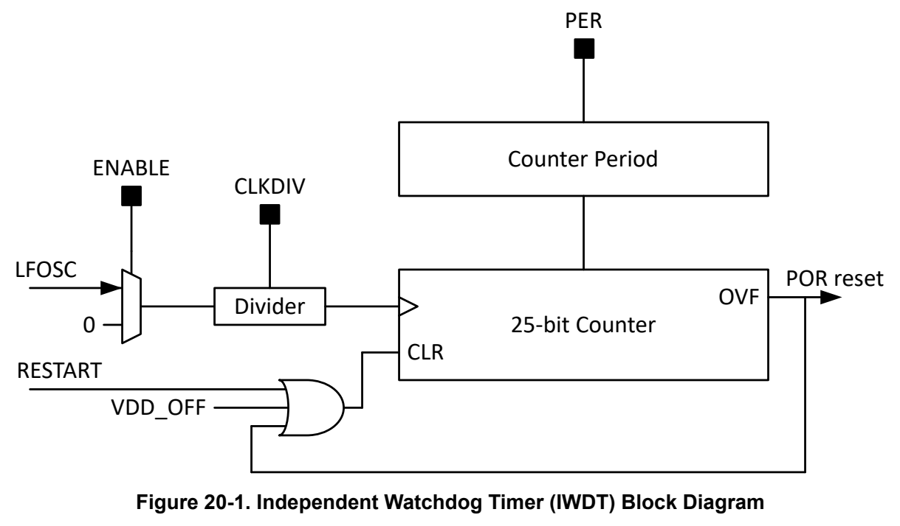

# 20 IWDT (pp. 1258-1260)

## IWDT (p. 1258)

Key features of the IWDT include:

- A 25-bit counter

- Counter driven from LFOSC (fixed 32kHz clock path) with a programmable clock divider

- Eight selectable watchdog timer periods

Figure 20-1 shows the block diagram of the IWDT.

*Figure 20-1. Independent Watchdog Timer (IWDT) Block Diagram (p. 1258)*

The primary function of the IWDT is to initiate a full power on reset (POR) of the device when correct operation of the device has failed due to an unexpected software or system delay. The IWDT can be programmed with a predefined time within the application software.

The application software must restart the timer, indicating that application execution is proceeding normally. If application software fails to restart the timer within the specified time, the IWDT will issue a POR reset request to PMU of the device to generate a POR, restarting the device in a cold boot process.

20.1 1259

### 20.2 IWDT Clock Configuration 1259 (p. 1258)

### 20.3 IWDT Period Selection 1259 (p. 1258)

### 20.4 Debug Behavior of the IWDT 1259 (p. 1258)

### 20.5 IWDT Registers 1259 (p. 1258)

20.1

### 20.2 IWDT Clock Configuration (p. 1259)

The IWDT runs from the 32kHz low-frequency oscillator (LFOSC). A clock divider supports dividing the input clock from /1 (no divide) to /8 (divide-by-8) using the CLKDIV field in the WDTCTL register. The default CLKDIV setting is 0x03 (32kHz divided by 4, or 8kHz).

### 20.3 IWDT Period Selection (p. 1259)

The IWDT has a 25-bit counter which is initially stopped after a power up of the VBAT power domain. The IWDT period (total time interval) is set by the PER field in the WDTCTL register. The total IWDT period is calculated as follows:

TWDT = (CLKDIV + 1) ∗ PERCOUNT / 32768Hz

The total timer count PERCOUNT is selected to be one of 8 possible period count values, with the encoding given in Table 20-1.

**Table 20-1. IWDT Period and Period Count Settings (p. 1259)**

| Period (PER) | 0x0 | 0x1 | 0x2 | 0x3 | 0x4 | 0x5 | 0x6 | 0x7 |
| --- | --- | --- | --- | --- | --- | --- | --- | --- |
| Period Count (PERCOUNT) | 225 | 221 | 218 | 215 | 212 | 210 | 28 | 26 |

The combination of the period selection (PER) and clock divider (CLKDIV) enable a wide range of IWDT periods, from as short as 1.95ms to as long as 136.53 minutes.

Table 20-2 gives all possible IWDT periods for a given combination of PER and CLKDIV.

**Table 20-2. IWDT Period Timing Options (p. 1259)**

| Col 1 | Col 2 | Col 3 | Col 4 | PER | PER | Col 7 | Col 8 | Col 9 |
| --- | --- | --- | --- | --- | --- | --- | --- | --- |
| CLKDIV | 0x0 | 0x1 | 0x2 | 0x3 | 0x4 | 0x5 | 0x6 | 0x7 |
|  | min | min | s | s | s | ms | ms | ms |
| 0x0 (/1) | 17.07 | 1.07 | 8.00 | 1.00 | 0.13 | 31.25 | 7.81 | 1.95 |
| 0x1 (/2) | 34.13 | 2.13 | 16.00 | 2.00 | 0.25 | 62.50 | 15.63 | 3.91 |
| 0x2 (/3) | 51.20 | 3.20 | 24.00 | 3.00 | 0.38 | 93.75 | 23.44 | 5.86 |
| 0x3 (/4) | 68.27 | 4.27 | 32.00 | 4.00 | 0.50 | 125.00 | 32.25 | 7.81 |
| 0x4 (/5) | 85.33 | 5.33 | 40.00 | 5.00 | 0.63 | 156.25 | 39.06 | 9.77 |
| 0x5 (/6) | 102.40 | 6.40 | 48.00 | 6.00 | 0.75 | 187.50 | 46.88 | 11.72 |
| 0x6 (/7) | 119.47 | 7.47 | 56.00 | 7.00 | 0.88 | 218.75 | 54.69 | 14.67 |
| 0x7 (/8) | 136.53 | 8.53 | 64.00 | 8.00 | 1.00 | 250.00 | 62.50 | 15.63 |

### 20.4 Debug Behavior of the IWDT (p. 1259)

The IWDT can be configured to stop counting or continue counting when the CPU is halted for debug by the debug subsystem. By default, the IWDT stops counting when the CPU is halted for debug and the device is in a debug state. To allow the IWDT to continue to free run when the CPU is stopped for debug, set the FREE bit in the WDTDBGCTL register.

### 20.5 IWDT Registers (p. 1259)

For IWDT registers, refer to the Section 8.7 related to the watchdog timer.

Chapter 21
