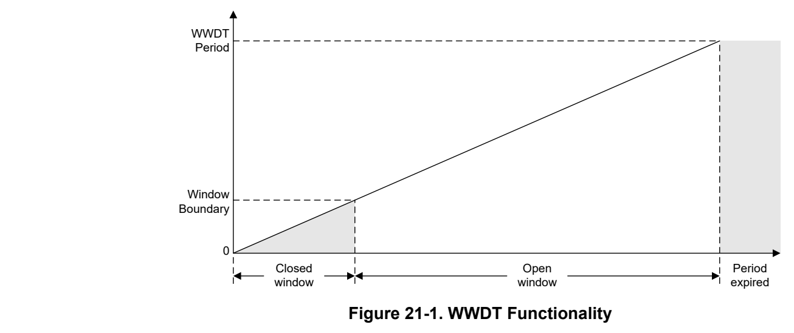
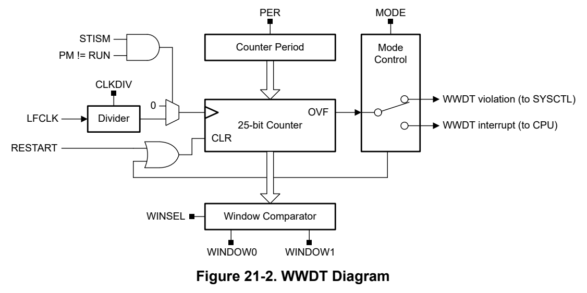
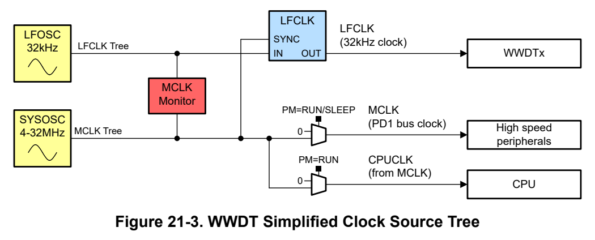

# 21 Window Watchdog Timer (WWDT) (pp. 1260-1284)

## Window Watchdog Timer (WWDT) (p. 1260)

The window watchdog timer (WWDT) supervises code execution. If the application software does not successfully reset the window watchdog within the programmed open time window, the window watchdog generates a reset.

### 21.1 WWDT Overview 1261 (p. 1260)

### 21.2 WWDT Operation 1262 (p. 1260)

### 21.3 WWDT Registers 1266 (p. 1260)

### 21.1 WWDT Overview (p. 1261)

The primary function of the window watchdog timer (WWDT) is to initiate a reset when correct operation of the device has failed due to an unexpected software or system delay. The WWDT can be programmed with a predefined time window within which the application software must restart the timer, indicating that application execution is proceeding normally. If application software fails to restart the timer within the specified window, the WWDT will issue a WWDT violation signal to SYSCTL to generate a reset.

If watchdog functionality is not required in an application, the WWDT can also be configured as a basic system interval timer which is capable of generating periodic maskable interrupts to the CPU.

Key features of the WWDT include:

- A 25-bit counter with closed and open window

- Counter driven from LFCLK (fixed 32kHz clock path) with a programmable clock divider

- Eight selectable watchdog timer periods

- Optional automatic suspension of counter when operating in low power modes

- Support for standard window watchdog mode or interval timer (nonwatchdog) mode

Devices may have 1 or 2 WWDT instances. A WWDT0 violation generates a BOOTRST, which resets the peripheral and CPU state and also causes the boot configuration routine (BCR) to run. A WWDT1 violation generates a SYSRST, which resets the peripheral and CPU state but does not trigger execution of the BCR. As such, WWDT1 is well suited for recovering from execution stalls that result from software execution, while WWDT0 is well suited for catching larger issues such as a corrupted trim value, at the expense of a longer reset time.

#### 21.1.1 Watchdog Mode (p. 1261)

In watchdog mode, the WWDT is configured to count up to the specified WWDT period. The WWDT counter must be restarted with the configured open window of the WWDT period, or the WWDT will assert a WWDT violation to SYSCTL and a reset will be generated.

The window watchdog timer supports detecting both a "too late" response as well as a "too early" response through the use of an optional closed window, as shown in Figure 21-1. The WWDT period consists of a closed window period and an open window period. The closed window period begins first, followed by the open window period. The WWDT can only be restarted during the open window period. An attempt to restart the WWDT during the closed window period results in a violation. Following the closed window, if the WWDT is not restarted before the end of the open window, the WWDT period expires and a violation is also generated.

*Figure 21-1. WWDT Functionality (p. 1261)*

If the closed window functionality is not desired, it can be disabled (set to 0%), giving traditional watchdog timer functionality where the WWDT can be reset any time before the WWDT period expires.

#### 21.1.2 Interval Timer Mode (p. 1262)

The WWDT can be used in interval timer mode to generate periodic interrupts to the CPU when not using the watchdog functionality. When used in interval timer mode, a WWDT interrupt is generated when the WWDT period expires, or when an incorrect password is applied to the WWDT control registers.

### 21.2 WWDT Operation (p. 1262)

The WWDT must be enabled before being configured for use through the PWREN register (see peripheral power enable).

The WWDT is configured through the WWDTCTL0 and WWDTCTL1 registers. The registers are password protected. Any register access (read or write) must be a 32-bit access. Write access must also include the corresponding password in the most significant byte (0xC9 for WWDTCTL0, and 0xBE for WWDTCTL1). Attempting a register write without the correct password, or attempting a write with an access other than a 32-bit access generates a WWDT violation to SYSCTL. The password byte always reads as 0x00.

The WWDT is disabled and cleared after a SYSRST. The WWDTCTL0 register sets the static configuration of the WWDT, including: the clock divider, the timer period, the two closed window percentages, the timer mode (WWDT or interval), and the stop-in-sleep status. The first write (with a key match) to the WWDTCTL0 register enables the WWDT. Once the WWDT is enabled, the WWDTCTL0 register becomes write protected. Any attempt to write to the WWDTCTL0 register after the WWDT is enabled generates a WWDT violation to SYSCTL. The RUN bit in the WWDTSTAT register indicates that the WWDT is running.

Figure 21-2 shows the WWDT functional block diagram.

*Figure 21-2. WWDT Diagram (p. 1262)*

#### 21.2.1 Mode Selection (p. 1262)

The WWDT operating mode (watchdog mode or interval timer mode) is selected by the MODE bit in the WWDTCTL0 register. Watchdog mode is the default mode (MODE cleared). Setting the MODE bit configures the WWDT for interval mode.

When the WWDT is in watchdog mode, the WWDT counter must be restarted within the open window period by writing the RESTART value (0x000000A7) to the WWDTCNTRST register. After a reset or restart, the WWDT counter will restart from zero. A failure to restart the WWDT within the open window or an attempt to restart the WWDT counter during the closed window will generate a WWDT violation to SYSCTL. Writing any value other than the RESTART value to the WWDTCNTRST register also generates a WWDT violation.

When the WWDT is in interval mode, the timer acts as an interval timer, generating WWDT interrupts to the CPU as specified by the WWDT period. As soon as the WWDT is enabled in interval mode, the WWDT interval timer interrupt will be asserted after the expiration of the timer. It is not necessary to restart the WWDT in interval timer mode.

#### 21.2.2 Clock Configuration (p. 1263)

The WWDT runs from the 32kHz low-frequency clock ( LFCLK). A clock divider supports dividing the input clock from /1 (no divide) to /8 (divide-by-8) using the CLKDIV field in the WWDTCTL0 register. The default CLKDIV setting is 0x03 (32kHz divided by 4, or 8kHz).

By running from the LFCLK, the WWDT time base is independent of the main clock (MCLK) and CPU clock (CPUCLK) time base, provided that these clocks are not also configured to be running from the LFCLK. While the time base may be considered as independent and derived from a separate oscillator source, LFCLK edges are synchronized to the MCLK before sourcing the WWDT to enable simple access to the memory-mapped registers from application software. A simplified view of the clock scheme is given in Figure 21-3. In Figure 21-3, the internal LFOSC is configured to set the LFCLK rate, and the internal SYSOSC sets the MCLK/CPUCLK rate. Clock selection muxes and dividers are excluded from the figure to simplify the view; the complete clock tree is provided in Section 2.3.3.

*Figure 21-3. WWDT Simplified Clock Source Tree (p. 1263)*

In the event that the MCLK fails and synchronization of the LFCLK to the MCLK is lost, this failure may be detected by enabling the continuous MCLK monitor. When the MCLK monitor is enabled, a loss of MCLK is always a catastrophic failure which generates a BOOTRST within 12 LFCLK cycles. As a result, a loss of the MCLK tree, and corresponding loss of synchronization, does not prevent a BOOTRST from being generated.

Period Selection

The WWDT has a 25-bit counter which is initially stopped after a SYSRST. The WWDT period (total time interval) is set by the PER field in the WWDTCTL0 register. The total WWDT period is calculated as follows:

T WWDT = (CLKDIV + 1) ∗ PER COUNT / 32768Hz (12)

The total timer count PER COUNT is selected to be one of 8 possible period count values, with the encoding given in Table 21-1.

**Table 21-1. WWDT Period Total Timer Count (p. 1263)**

| PER | 0x0 | 0x1 | 0x2 | 0x3 | 0x4 | 0x5 | 0x6 | 0x7 |
| --- | --- | --- | --- | --- | --- | --- | --- | --- |
| PER COUNT | 2 25 | 2 21 | 2 18 | 2 15 | 2 12 | 2 10 | 2 8 | 2 6 |

The combination of the period selection (PER) and clock divider (CLKDIV) enable a wide range of WWDT periods, from as short as 1.95ms to as long as 136.53 minutes. Table 21-2 gives all possible WWDT periods for a given combination of PER and CLKDIV.

**Table 21-2. WWDT Period Timing Options (pp. 1263-1264)**

| Col 4 | Col 7 | Col 8 | Col 9 | PER | Col 12 | Col 13 | Col 14 | Col 15 |
| --- | --- | --- | --- | --- | --- | --- | --- | --- |
| CLKDIV | 0x0 | 0x1 | 0x2 | 0x3 | 0x4 | 0x5 | 0x6 | 0x7 |
|  | min | min | s | s | s | ms | ms | ms |
| CLKDIV | 0x0 | 0x1 | 0x2 | 0x3 | 0x4 | 0x5 | 0x6 | 0x7 |
|  | min | min | s | s | s | ms | ms | ms |
| 0x1 (/2) | 34.13 | 2.13 | 16.00 | 2.00 | 0.25 | 62.50 | 15.63 | 3.91 |
| 0x2 (/3) | 51.20 | 3.20 | 24.00 | 3.00 | 0.38 | 93.75 | 23.44 | 5.86 |
| 0x3 (/4) | 68.27 | 4.27 | 32.00 | 4.00 | 0.50 | 125.00 | 32.25 | 7.81 |
| 0x4 (/5) | 85.33 | 5.33 | 40.00 | 5.00 | 0.63 | 156.25 | 39.06 | 9.77 |
| 0x5 (/6) | 102.40 | 6.40 | 48.00 | 6.00 | 0.75 | 187.50 | 46.88 | 11.72 |
| 0x6 (/7) | 119.47 | 7.47 | 56.00 | 7.00 | 0.88 | 218.75 | 54.69 | 13.67 |
| 0x7 (/8) | 136.53 | 8.53 | 64.00 | 8.00 | 1.00 | 250.00 | 62.50 | 15.63 |

Synchronization Delay

When starting or re-starting the WWDT counter, a maximum synchronization delay of one 32kHz clock cycle (30.5µs) can occur before the WWDT counter begins counting from zero. The periods given in Table 21-2 do not include this synchronization delay.

Closed Window Selection

Configuration of two closed window periods is supported by setting the WINDOW0 and WINDOW1 fields in the WWDTCTL0 register. The WINSEL bit in the WWDTCTL1 register determines the active window (either WINDOW0 or WINDOW1). Either window can be set to one of 8 possible window settings.

**Table 21-3. WWDT Window Options (p. 1264)**

| WINDOW | 0x0 | 0x1 | 0x2 | 0x3 | 0x4 | 0x5 | 0x6 | 0x7 |
| --- | --- | --- | --- | --- | --- | --- | --- | --- |
| Closed window | 0% | 12.5% | 18.75% | 25% | 50% | 75% | 81.25% | 87.5% |

Setting a WINDOWx value to 0x0 (0% closed, 100% open) is equivalent to disabling the window function of the WWDT. In this configuration, the WWDT can be restarted at any point during the WWDT period.

The active window selection can be changed after the WWDT has been enabled. When the WWDT is restarted by writing to the WWDTCNTRST register, the closed window selection (WINSEL) must not be changed for at least four 32kHz clock cycles (≈122µs).

#### 21.2.3 Low-Power Mode Behavior (p. 1264)

The WWDT counter can be configured to continue counting when the device is in a low-power mode (CPU is disabled) or to continue to run when the device is in a low-power mode.

The STISM bit in the WWDTCTL0 register controls if the WWDT counter stops counting in sleep mode. By default, the STISM bit is cleared, indicating that the WWDT continues to count in low-power modes. To stop the WWDT from counting in low-power modes, set the STISM bit when loading the WWDTCTL0 configuration to start the WWDT. In this case, when the low-power mode is exited and the CPU returns to operation, the WWDT counter resumes counting from the same value it held before entering the low-power mode.

#### 21.2.4 Debug Behavior (p. 1264)

The WWDT can be configured to stop counting or continue counting when the CPU is halted for debug by the debug subsystem. By default, the WWDT stops counting when the CPU is halted for debug and the device is in a debug state. To allow the WWDT to continue to free run when the CPU is stopped for debug, set the FREE bit in the PDBGCTL register.

#### 21.2.5 WWDT Events (p. 1265)

The WWDT module contains one event publisher and no event subscribers. One event publisher (CPU_INT) manages WWDT interrupt requests (IRQs) to the CPU subsystem through a static event route.

Table 21-4 lists the WWDT events.

**Table 21-4. WWDT Events (p. 1265)**

| Event | Type | Source | Destination | Route | Configuration | Functionality |
| --- | --- | --- | --- | --- | --- | --- |
| CPU Interrupt Event | Publisher | WWDT | CPU Subsystem | Static route | CPU_INT registers | Fixed interrupt route from WWDT to CPU |

##### 21.2.5.1 CPU Interrupt Event Publisher (CPU_INT) (p. 1265)

The WWDT module provides one interrupt source which can be configured to source a CPU interrupt event. The WWDT interrupt conditions are given in Table 21-5.

**Table 21-5. WWDT CPU Interrupt Conditions (CPU_INT) (p. 1265)**

| Index (IIDX) | Name | Description |
| --- | --- | --- |
| 0 | INTTIM | Indicates that the WWDT interval timer period has expired |

The CPU interrupt event configuration is managed with the CPU_INT event management registers. See Section 7.2.5 for guidance on configuring the Event registers for CPU interrupts.

### 21.3 WWDT Registers (p. 1266)

Table 21-6 lists the memory-mapped registers for the WWDT registers. All register offset addresses not listed in Table 21-6 should be considered as reserved locations and the register contents should not be modified.

**Table 21-6. WWDT Registers (p. 1266)**

| Offset | Acronym | Register Name | Section |
| --- | --- | --- | --- |
| 800h | PWREN | Power enable | Section 21.3.1 |
| 804h | RSTCTL | Reset Control | Section 21.3.2 |
| 814h | STAT | Status Register | Section 21.3.3 |
| 1018h | PDBGCTL | Peripheral Debug Control | Section 21.3.4 |
| 1020h | IIDX | Interrupt index | Section 21.3.5 |
| 1028h | IMASK | Interrupt mask | Section 21.3.6 |
| 1030h | RIS | Raw interrupt status | Section 21.3.7 |
| 1038h | MIS | Masked interrupt status | Section 21.3.8 |
| 1040h | ISET | Interrupt set | Section 21.3.9 |
| 1048h | ICLR | Interrupt clear | Section 21.3.10 |
| 10E0h | EVT_MODE | Event Mode | Section 21.3.11 |
| 10FCh | DESC | Module Description | Section 21.3.12 |
| 1100h | WWDTCTL0 | Window Watchdog Timer Control Register 0 | Section 21.3.13 |
| 1104h | WWDTCTL1 | Window Watchdog Timer Control Register 0 | Section 21.3.14 |
| 1108h | WWDTCNTRST | Window Watchdog Timer Counter Reset Register | Section 21.3.15 |
| 110Ch | WWDTSTAT | Window Watchdog Timer Status Register | Section 21.3.16 |

Complex bit access types are encoded to fit into small table cells. Table 21-7 shows the codes that are used for access types in this section.

**Table 21-7. WWDT Access Type Codes (p. 1266)**

| Access Type | Code | Description |
| --- | --- | --- |
| Read Type |  |  |
| R | R | Read |
| Write Type |  |  |
| K | K | Write protected by a key |
| W | W | Write |
| WK | W K | Write Write protected by a key |
| Reset or Default Value |  |  |
| - n |  | Value after reset or the default value |

### 21.3.1 [WWDT.PWREN] Offset: 800h | Reset: 00000000h (p. 1267)

PWREN is shown in Figure 21-4 and described in Table 21-8.

Register to control the power state

> **Bit Map**: `[31-24] KEY (W, 0h)` | `[23-1] RESERVED (R/W, 0h)` | `[0] ENABLE (K, 0h)`

**Table 21-8. PWREN Register Field Descriptions (p. 1267)**

| Bit | Field | Type | Reset | Description |
| --- | --- | --- | --- | --- |
| 31-24 | KEY | W | 0h | KEY to allow Power State Change; 26h = KEY to allow write access to this register |
| 23-1 | RESERVED | R/W | 0h |  |
| 0 | ENABLE | K | 0h | Enable the power Note: For safety devices the power cannot be disabled once enabled. KEY must be set to 26h to write to this bit.; 0h = Disable Power; 1h = Enable Power |

### 21.3.2 [WWDT.RSTCTL] Offset: 804h | Reset: 00000000h (p. 1268)

RSTCTL is shown in Figure 21-5 and described in Table 21-9.

Register to control reset assertion and de-assertion

> **Bit Map**: `[31-24] KEY (W, 0h)` | `[23-2] RESERVED (W, 0h)` | `[1] RESETSTKYCLR (WK, 0h)` | `[0] RESETASSERT (WK, 0h)`

**Table 21-9. RSTCTL Register Field Descriptions (p. 1268)**

| Bit | Field | Type | Reset | Description |
| --- | --- | --- | --- | --- |
| 31-24 | KEY | W | 0h | Unlock key; B1h = KEY to allow write access to this register |
| 23-2 | RESERVED | W | 0h |  |
| 1 | RESETSTKYCLR | WK | 0h | Clear RESETSTKY KEY must be set to B1h to write to this bit.; 0h = Writing 0 has no effect; 1h = Clear reset sticky bit |
| 0 | RESETASSERT | WK | 0h | Assert reset to the peripheral Note: For safety devices a watchdog reset by software is not possible. KEY must be set to B1h to write to this bit.; 0h = Writing 0 has no effect; 1h = Assert reset |

### 21.3.3 [WWDT.STAT] Offset: 814h | Reset: 00000000h (p. 1269)

STAT is shown in Figure 21-6 and described in Table 21-10.

peripheral enable and reset status

> **Bit Map**: `[31-17] RESERVED (R, 0h)` | `[16] RESETSTKY (R, 0h)` | `[15-0] RESERVED (R, 0h)`

**Table 21-10. STAT Register Field Descriptions (p. 1269)**

| Bit | Field | Type | Reset | Description |
| --- | --- | --- | --- | --- |
| 31-17 | RESERVED | R | 0h |  |
| 16 | RESETSTKY | R | 0h | This bit indicates, if the peripheral was reset, since this bit was cleared by RESETSTKYCLR in the RSTCTL register; 0h = The peripheral has not been reset since this bit was last cleared by RESETSTKYCLR in the RSTCTL register; 1h = The peripheral was reset since the last bit clear |
| 15-0 | RESERVED | R | 0h |  |

### 21.3.4 [WWDT.PDBGCTL] Offset: 1018h | Reset: 00000000h (p. 1270)

PDBGCTL is shown in Figure 21-7 and described in Table 21-11.

This register can be used by the software developer to control the behavior of the peripheral relative to the 'Core Halted' input

> **Bit Map**: `[31-1] RESERVED (R/W, 0h)` | `[0] FREE (R/W, 0h)`

**Table 21-11. PDBGCTL Register Field Descriptions (p. 1270)**

| Bit | Field | Type | Reset | Description |
| --- | --- | --- | --- | --- |
| 31-1 | RESERVED | R/W | 0h |  |
| 0 | FREE | R/W | 0h | Free run control; 0h = The peripheral freezes functionality while the Core Halted input is asserted and resumes when it is deasserted.; 1h = The peripheral ignores the state of the Core Halted input |

### 21.3.5 [WWDT.IIDX] Offset: 1020h | Reset: 00000000h (p. 1271)

IIDX is shown in Figure 21-8 and described in Table 21-12.

This register provides the highest priority enabled interrupt index.

> **Bit Map**: `[31-5] RESERVED (R, 0h)` | `[4-0] STAT (R, 0h)`

**Table 21-12. IIDX Register Field Descriptions (p. 1271)**

| Bit | Field | Type | Reset | Description |
| --- | --- | --- | --- | --- |
| 31-5 | RESERVED | R | 0h |  |
| 4-0 | STAT | R | 0h | Module Interrupt Vector Value. This register provides the highest priority interrupt index. A read clears the corresponding interrupt flag in RIS and MISC.; 0h = No interrupt pending; 1h = Interval Timer Interrupt; Interrupt Flag: INTTIM; Interrupt Priority: Highest |

### 21.3.6 [WWDT.IMASK] Offset: 1028h | Reset: 00000000h (p. 1272)

IMASK is shown in Figure 21-9 and described in Table 21-13.

Interrupt Mask. If a bit is set, then corresponding interrupt is unmasked. Unmasking the interrupt causes the raw interrupt to be visible in IIDX, as well as MIS.”

> **Bit Map**: `[31-1] RESERVED (R/W, 0h)` | `[0] INTTIM (R/W, 0h)`

**Table 21-13. IMASK Register Field Descriptions (p. 1272)**

| Bit | Field | Type | Reset | Description |
| --- | --- | --- | --- | --- |
| 31-1 | RESERVED | R/W | 0h |  |
| 0 | INTTIM | R/W | 0h | Interval Timer Interrupt.; 0h = Clear Interrupt Mask; 1h = Set Interrupt Mask |

### 21.3.7 [WWDT.RIS] Offset: 1030h | Reset: 00000000h (p. 1273)

RIS is shown in Figure 21-10 and described in Table 21-14.

Raw interrupt status. Reflects all pending interrupts, regardless of masking. The RIS register allows the user to implement a poll scheme. A flag set in this register can be cleared by writing 1 to the ICLR register bit even if the corresponding IMASK bit is not enabled.

> **Bit Map**: `[31-1] RESERVED (R, 0h)` | `[0] INTTIM (R, 0h)`

**Table 21-14. RIS Register Field Descriptions (p. 1273)**

| Bit | Field | Type | Reset | Description |
| --- | --- | --- | --- | --- |
| 31-1 | RESERVED | R | 0h |  |
| 0 | INTTIM | R | 0h | Interval Timer Interrupt.; 0h = Interrupt did not occur; 1h = Interrupt occurred |

### 21.3.8 [WWDT.MIS] Offset: 1038h | Reset: 00000000h (p. 1274)

MIS is shown in Figure 21-11 and described in Table 21-15.

Masked interrupt status. This is an AND of the IMASK and RIS registers.

> **Bit Map**: `[31-1] RESERVED (R, 0h)` | `[0] INTTIM (R, 0h)`

**Table 21-15. MIS Register Field Descriptions (p. 1274)**

| Bit | Field | Type | Reset | Description |
| --- | --- | --- | --- | --- |
| 31-1 | RESERVED | R | 0h |  |
| 0 | INTTIM | R | 0h | Interval Timer Interrupt.; 0h = Interrupt did not occur; 1h = Interrupt occurred |

### 21.3.9 [WWDT.ISET] Offset: 1040h | Reset: 00000000h (p. 1275)

ISET is shown in Figure 21-12 and described in Table 21-16.

Interrupt set. Allows interrupts to be set by software (useful in diagnostics and safety checks). Writing a 1 to a bit in ISET will set the event and therefore the related RIS bit also gets set. If the interrupt is enabled through the mask, then the corresponding MIS bit is also set.

> **Bit Map**: `[31-1] RESERVED (W, 0h)` | `[0] INTTIM (W, 0h)`

**Table 21-16. ISET Register Field Descriptions (p. 1275)**

| Bit | Field | Type | Reset | Description |
| --- | --- | --- | --- | --- |
| 31-1 | RESERVED | W | 0h |  |
| 0 | INTTIM | W | 0h | Interval Timer Interrupt.; 0h = Writing 0 has no effect; 1h = Set Interrupt |

### 21.3.10 [WWDT.ICLR] Offset: 1048h | Reset: 00000000h (p. 1276)

ICLR is shown in Figure 21-13 and described in Table 21-17.

Interrupt clear. Write a 1 to clear corresponding Interrupt.

> **Bit Map**: `[31-1] RESERVED (W, 0h)` | `[0] INTTIM (W, 0h)`

**Table 21-17. ICLR Register Field Descriptions (p. 1276)**

| Bit | Field | Type | Reset | Description |
| --- | --- | --- | --- | --- |
| 31-1 | RESERVED | W | 0h |  |
| 0 | INTTIM | W | 0h | Interval Timer Interrupt.; 0h = Writing 0 has no effect; 1h = Clear Interrupt |

### 21.3.11 [WWDT.EVT_MODE] Offset: 10E0h | Reset: 00000001h (p. 1277)

EVT_MODE is shown in Figure 21-14 and described in Table 21-18.

Event mode register. It is used to select whether each line is disabled, in software mode (software clears the RIS) or in hardware mode (hardware clears the RIS)

> **Bit Map**: `[31-2] RESERVED (R/W, 0h)` | `[1-0] INT0_CFG (R, 1h)`

**Table 21-18. EVT_MODE Register Field Descriptions (p. 1277)**

| Bit | Field | Type | Reset | Description |
| --- | --- | --- | --- | --- |
| 31-2 | RESERVED | R/W | 0h |  |
| 1-0 | INT0_CFG | R | 1h | Event line mode select for event corresponding to none.INT_EVENT[0]; 0h = The interrupt or event line is disabled.; 1h = The interrupt or event line is in software mode. Software must clear the RIS.; 2h = The interrupt or event line is in hardware mode. The hardware (another module) clears automatically the associated RIS flag. |

### 21.3.12 [WWDT.DESC] Offset: 10FCh | Reset: 1F117010h (p. 1278)

DESC is shown in Figure 21-15 and described in Table 21-19.

This register identifies the peripheral and its exact version.

> **Bit Map**: `[31-16] MODULEID (R, 1F11h)` | `[15-12] FEATUREVER (R, 7h)` | `[11-8] INSTNUM (R, 0h)` | `[7-4] MAJREV (R, 1h)` | `[3-0] MINREV (R, 0h)`

**Table 21-19. DESC Register Field Descriptions (p. 1278)**

| Bit | Field | Type | Reset | Description |
| --- | --- | --- | --- | --- |
| 31-16 | MODULEID | R | 1F11h | Module identification contains a unique peripheral identification number. The assignments are maintained in a central database for all of the platform modules to ensure uniqueness.; 0h = Smallest value; FFFFh = Highest possible value |
| 15-12 | FEATUREVER | R | 7h | Feature Set for the module *instance*; 0h = Smallest value; Fh = Highest possible value |
| 11-8 | INSTNUM | R | 0h | Instance Number within the device. This will be a parameter to the RTL for modules that can have multiple instances; 0h = Smallest value; Fh = Highest possible value |
| 7-4 | MAJREV | R | 1h | Major rev of the IP; 0h = Smallest value; Fh = Highest possible value |
| 3-0 | MINREV | R | 0h | Minor rev of the IP; 0h = Smallest value; Fh = Highest possible value |

### 21.3.13 [WWDT.WWDTCTL0] Offset: 1100h | Reset: 00000043h (p. 1279)

WWDTCTL0 is shown in Figure 21-16 and described in Table 21-20.

Window Watchdog Timer Control 0 Register NOTE: Write to this register is enabled after System Reset. The first successful write (key match) enables the Watchdog. When the watchdog is enabled all subsequent writes to this register activate the WWDT error signal to the ESM.

> **Bit Map**: `[31-24] KEY (W, 0h)` | `[23-18] RESERVED (R/W, 0h)` | `[17] STISM (R/W, 0h)` | `[16] MODE (R/W, 0h)` | `[15] RESERVED (R/W, 0h)` | `[14-12] WINDOW1 (R/W, 0h)` | `[11] RESERVED (R/W, 0h)` | `[10-8] WINDOW0 (R/W, 0h)` | `[7] RESERVED (R/W, 0h)` | `[6-4] PER (R/W, 4h)` | `[3] RESERVED (R/W, 0h)` | `[2-0] CLKDIV (R/W, 3h)`

**Table 21-20. WWDTCTL0 Register Field Descriptions (pp. 1279-1280)**

| Bit | Field | Type | Reset | Description |
| --- | --- | --- | --- | --- |
| 31-24 | KEY | W | 0h | KEY to allow write access to this register. Writing to this register with an incorrect key activates the WWDT error signal to the ESM. Read as 0. C9h (W) = KEY to allow write access to this register |
| 23-18 | RESERVED | R/W | 0h |  |
| 17 | STISM | R/W | 0h | Stop In Sleep Mode. The functionality of this bit requires that POLICY.HWCEN = 0. If POLICY.HWCEN = 1 the WWDT resets during sleep and needs re-configuration. Note: This bit has no effect for the global Window Watchdog as Sleep Mode is not supported.; 0h = The WWDT continues to function in Sleep mode.; 1h = The WWDT stops in Sleep mode and resumes where it was stopped after wakeup. |
| 16 | MODE | R/W | 0h | Window Watchdog Timer Mode; 0h = Window Watchdog Timer Mode. The WWDT will generate a error signal to the ESM when following conditions occur: - Timer Expiration (Timeout) - Reset WWDT during the active window closed period - Keyword violation; 1h = Interval Timer Mode. The WWDT acts as an interval timer. It generates an interrupt on timeout. |
| 15 | RESERVED | R/W | 0h |  |
| 14-12 | WINDOW1 | R/W | 0h | Closed window period in percentage of the timer interval. WWDTCTL1.WINSEL determines the active window setting (WWDTCTL0.WINDOW0 or WWDTCTL0.WINDOW1).; 0h = 0% (No closed Window); 1h = 12.50% of the total timer period is closed window; 2h = 18.75% of the total timer period is closed window; 3h = 25% of the total timer period is closed window; 4h = 50% of the total timer period is closed window; 5h = 75% of the total timer period is closed window; 6h = 81.25% of the total timer period is closed window; 7h = 87.50% of the total timer period is closed window |
| 11 | RESERVED | R/W | 0h |  |
| 10-8 | WINDOW0 | R/W | 0h | Closed window period in percentage of the timer interval. WWDTCTL1.WINSEL determines the active window setting (WWDTCTL0.WINDOW0 or WWDTCTL0.WINDOW1).; 0h = 0% (No closed Window); 1h = 12.50% of the total timer period is closed window; 2h = 18.75% of the total timer period is closed window; 3h = 25% of the total timer period is closed window; 4h = 50% of the total timer period is closed window; 5h = 75% of the total timer period is closed window; 6h = 81.25% of the total timer period is closed window; 7h = 87.50% of the total timer period is closed window |
| 7 | RESERVED | R/W | 0h |  |
| 6-4 | PER | R/W | 4h | Timer Period of the WWDT. These bits select the total watchdog timer count.; 0h = Total timer count is 2 25; 1h = Total timer count is 2 21; 2h = Total timer count is 2 18; 3h = Total timer count is 2 15; 4h = Total timer count is 2 1210 (default); 5h = Total timer count is 2; 6h = Total timer count is 2 8; 7h = Total timer count is 2 6 |
| 3 | RESERVED | R/W | 0h |  |
| 2-0 | CLKDIV | R/W | 3h | Module Clock Divider, Divide the clock source by CLKDIV+1. Divider values from /1 to /8 are possible. The clock divider is currently 4 bits. Bit 4 has no effect and should always be written with 0.; 0h = Minimum value; 7h = Maximum value |

### 21.3.14 [WWDT.WWDTCTL1] Offset: 1104h | Reset: 00000000h (p. 1281)

WWDTCTL1 is shown in Figure 21-17 and described in Table 21-21.

Window Watchdog Timer Control 1 Register

> **Bit Map**: `[31-24] KEY (W, 0h)` | `[23-1] RESERVED (R/W, 0h)` | `[0] WINSEL (R/W, 0h)`

**Table 21-21. WWDTCTL1 Register Field Descriptions (p. 1281)**

| Bit | Field | Type | Reset | Description |
| --- | --- | --- | --- | --- |
| 31-24 | KEY | W | 0h | KEY to allow write access to this register. Writing to this register with an incorrect key activates the WWDT error signal to the ESM. Read as 0. BEh (W) = KEY to allow write access to this register |
| 23-1 | RESERVED | R/W | 0h |  |
| 0 | WINSEL | R/W | 0h | Close Window Select; 0h = In window mode field WINDOW0 of WDDTCTL0 defines the closed window size.; 1h = In window mode field WINDOW1 of WDDTCTL0 defines the closed window size. |

### 21.3.15 [WWDT.WWDTCNTRST] Offset: 1108h | Reset: 00000000h (p. 1282)

WWDTCNTRST is shown in Figure 21-18 and described in Table 21-22.

Window Watchdog Timer Counter Restart Register

> **Bit Map**: `[31-0] RESTART (R/W, 0h)`

**Table 21-22. WWDTCNTRST Register Field Descriptions (p. 1282)**

| Bit | Field | Type | Reset | Description |
| --- | --- | --- | --- | --- |
| 31-0 | RESTART | R/W | 0h | Window Watchdog Timer Counter Restart Writing 00A7h to this |
|  |  |  |  | register restarts the WWDT Counter. |
|  |  |  |  | Writing any other value causes an error generation to the ESM. |
|  |  |  |  | Read as 0. |
|  |  |  |  | 0h = Minimum value |
|  |  |  |  | FFFFFFFFh = Maximum value |

### 21.3.16 [WWDT.WWDTSTAT] Offset: 110Ch | Reset: 00000000h (p. 1283)

WWDTSTAT is shown in Figure 21-19 and described in Table 21-23.

Window Watchdog Timer Status Register A write to this register has no effect.

> **Bit Map**: `[31-1] RESERVED (R, 0h)` | `[0] RUN (R, 0h)`

**Table 21-23. WWDTSTAT Register Field Descriptions (p. 1283)**

| Bit | Field | Type | Reset | Description |
| --- | --- | --- | --- | --- |
| 31-1 | RESERVED | R | 0h |  |
| 0 | RUN | R | 0h | Watchdog running status flag.; 0h = Watchdog counter stopped.; 1h = Watchdog running. |

Chapter 22
