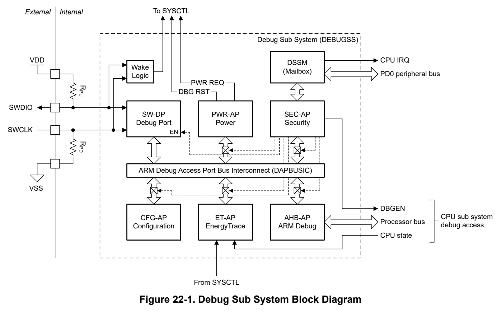

# 22 Debug (pp. 1284-1310)

## Debug (p. 1284)

The debug subsystem (DEBUGSS) is implemented in all MSPM0 devices. The DEBUGSS enables comprehensive debug of application software running on the processor during development by interfacing an external debug probe to the device systems through a serial wire debug (SWD) interface.

### 22.1 DEBUGSS Overview 1285 (p. 1284)

### 22.2 DEBUGSS Operation 1288 (p. 1284)

### 22.3 DEBUGSS Registers 1295 (p. 1284)

### 22.1 DEBUGSS Overview (p. 1285)

The debug subsystem (DEBUGSS) interfaces the ARM Serial Wire Debug (SWD) two-wire physical interface to multiple debug functions within the device. MSPM0 devices support debugging of processor execution, the device state, and the power state (through EnergyTrace technology). The DEBUGSS also provides a mailbox system for communicating with software through SWD.

Key features provided by the debug subsystem include:

- The ARM Serial Wire Debug (SWD) two-wire (SWDIO, SWCLK) debug interface, compatible with both TI andrd 3 party debug probes – On-chip pullup and pulldown resistors for SWDIO and SWCLK, respectively, enabled by default – Support for disabling SWD functions to use SWD pins as general-purpose input/output pins – Support for debug on all low power modes

- Debug of the processor – Run, halt, and step debug support – Up to 4 hardware breakpoints (BPU) – Up to 2 hardware watchpoints (DWT) – Instruction trace of up to 4 branches through the ARM micro trace buffer (MTB) – Supporting software breakpoints

- Software-configurable peripheral behavior during processor debug – Ability to free run select peripherals through debug halt – Ability to halt select peripherals on a debug halt – Ability to request reset and mode changes to the PMCU

- Monitoring of CPU state through EnergyTrace technology

- Mailbox (DSSM) for passing data and control signals between the SWD interface and boot ROM (as well as application software)

- Support for various security features, including SWD lockout and password authenticated debugging

- Note Refer to the datasheet for device-specific features

#### 22.1.1 Debug Interconnect (p. 1285)

The DEBUGSS architecture is given in Figure 22-1.

*Figure 22-1. Debug Sub System Block Diagram (p. 1286)*

The SWD physical interface interacts with the Arm serial wire debug port (SW-DP) to gain access to the debug access port bus interconnect (DAPBUSIC) when the SW-DP is enabled. From TI, devices ship with the SW-DP enabled to allow SWD access to the device for development and production programming, but the SW-DP can be configured to be permanently disabled through the boot configuration policy (see Section 22.2.3).

The DAPBUSIC enables a debug probe to access one or more debug access ports. For a debug probe to be able to communicate with an access port, the SW-DP debug port must not be disabled by the device boot configuration policy, and the target access port must also not be disabled by the boot configuration policy. The available access ports are given in Section 22.1.3.

The SWD and SW-DP also contain signaling to the PMCU module to support debug-generated resets and operating mode changes (see Section 22.2.2).

#### 22.1.2 Physical Interface (p. 1286)

| 10MHz is supported by the DEBUGSS. | A bidirectional data line (SWDIO) used to send data to, and receive data from, the device A unidirectional clock line (SWCLK) driven by the debug probe connecting to the device | Debug connections to the device are supported through an Arm serial wire debug (SWD) compliant interface. The SWD interface uses the standard logic levels of the device for SWD communication. See the device-specific data sheet for input and output logic levels for a given supply voltage (VDD). A SWCLK frequency of up to |
| --- | --- | --- |
|  |  | between the device and the debug probe, undriven time slots are inserted as a part of the SWD protocol. The primary purpose of the pullup resistor on the SWDIO line, and the pulldown resistor on the SWCLK line, is to |
|  |  | primary purpose of the pullup resistor on the SWDIO line, and the pulldown resistor on the SWCLK line, is to place the SWD pins into a known state when no debug probe is attached. A minimum resistance of 100kΩ is |

•

•

recommended by Arm. The internal pullup/pulldown resistors fulfill this requirement and external resistors are not required for correct operation of the SWD interface.

After a power-on reset (POR), MSPM0 devices configure the SWD pins in SWD mode with an internal pullup resistor enabled on the SWDIO line and an internal pulldown resistor enabled on the SWCLK line. If the device configuration has not permanently disabled all SWD access, then the SWD interface is enabled during the boot process and a debug probe can be connected to the DEBUGSS.

In the event that a device was configured by software to enter SHUTDOWN mode, and a debug probe is then connected to the SWD pins with SWCLK active, wakeup logic will trigger an exit from SHUTDOWN mode and cause a BOR. A debug connection can then be established to the DEBUGSS after the BOR completes.

Upon physical connection of a debug probe, a valid JTAG-to-SWD sequence must be sent from the debug probe to the target device to initiate a SWD connection with the SW-DP. Any other sequence will not wake the device from SHUTDOWN mode. Once the sequence is applied and the SWD connection is established, communication with enabled debug access points is possible.

For secure applications the sowftware can be made aware of a connect by utilizing the DEBUGSS PWRUPIFG interrupt. When the debug probe is disconnected and the SWD connection is lost, the PWRDWNIFG interrupt is asserted.

It is possible for application software to disable the SWD interface in SYSCTL, freeing the IO to be used for general purpose IO functionality. Review Section 2.4.1.4 in SYSCTL for using the SWD pins for functionality other than SWD. Once software disables SWD functionality, it is not possible to re-enable it other than by triggering a POR. A POR will automatically re-enable the SWD functionality and put the SWD pins into SWD mode with pullup/pulldown resistors enabled. To re-gain debug access to a device which contains software that disables the SWD pins at startup, it is necessary to hold the device in a reset state with the NRST pin during a POR. This will prevent the application software from starting and will allow the debug probe to gain access to the device, at which point a mass erase DSSM command can be sent from the integrated development environment to the device via the debug probe to remove the application software which is disabling the SWD pins.

Note BOR, BOOTRST, and SYSRST levels do reset the IOMUX logic, which will re-enable the pullup/ pulldown resistors on the SWDIO/SWCLK pin. However, the SWD functionality remains disabled until the next POR. Because the device always powers up with the SWDIO pullup and SWCLK pulldown resistors enabled, the hardware design must accommodate this when using the SWD pins for functions other than SWD after startup. After reset, application software may disable the pullup/ pulldown resistors in the IOMUX to free the SWD pins for other purposes.

#### 22.1.3 Debug Access Ports (p. 1287)

The debug access ports in the DEBUGSS are given in Table 22-1.

**Table 22-1. DEBUGSS Access Port Listing (p. 1287)**

| APSEL | AP | Port Description | Purpose |
| --- | --- | --- | --- |
| 0x0 | AHB-AP | MCPUSS debug access port | Debug of the processor and peripherals |
| 0x1 | CFG-AP | Configuration access port | Access device type information |
| 0x2 | SEC-AP | Security access port | Access the debug mailbox ( DSSM) |
| 0x3 | ET-AP | EnergyTrace™ technology access port | Read the power state data from EnergyTrace technology for power aware debug |
| 0x4 | PWR-AP | Power access port | Configure the device power states (interfaces with PMCU/SYSCTL) |

The AHB-AP, PWR-AP, and ET-AP provide the complete device debug functionality (processor debug, peripheral and memory bus access, power state control, and processor state). See Section 22.2.1 for more information.

The CFG-AP provides device information to the debug probe so that the debug probe can identify device characteristics, including the device part number and the device revision.

The SEC-AP provides access to the mailbox for communicating with software running on the device through

### 22.2 DEBUGSS Operation (p. 1288)

The features and behaviors of the DEBUGSS module is discussed in the following sections.

#### 22.2.1 Debug Features (p. 1288)

The DEBUGSS supports processor debug, processor trace, peripheral debug, and energy state debug.

##### 22.2.1.1 Processor Debug (p. 1288)

The Arm Cortex-M0+ processor supports a wide range of features to simplify debugging of application software during development. Key features supported by MSPM0 MCUs include:

- Ability to halt the processor through a assertion of a halt signal, a configured debug event (such as a hard fault entry or reset), or a BKPT instruction (for software breakpoints)

- Ability to step through instructions (with or without peripheral interrupts enabled)

- Ability to run through instructions (with or without peripheral interrupts enabled)

- Ability to read and write CPU registers when halted

- Ability to read exception information through the Cortex-M0+ system control space (SCS)

- Support for up to 4 hardware breakpoints

- Support for up to 2 hardware watchpoints

- Support for accessing the device memory map

- Support for Microtrace Buffer (MTB) up to 4 jump locations

###### 22.2.1.1.1 Breakpoint Unit (BPU) (p. 1288)

The breakpoint unit (BPU) provides up to 4 comparators which can be used to generate a debug event when the address of an instruction fetch matches the address programmed into the respective BPU comparator.

The BPU does not generate a debug event upon an address match for a data read or data write access.

Address matching is possible for half-word (16-bit) instructions and word (32-bit) instructions fetched from the CODE region (0x0000.0000 to 0x1FFF.FFFF).

If a debug scenario requires more than the supported hardware breakpoints, software breakpoints can be used together with hardware breakpoints using the BKPT instruction. If debugging of code in the SRAM region is desired, hardware breakpoints are not available and software breakpoints must be inserted by the debug probe instead.

// Example of a breakpoint function in C (TI Arm CLANG compiler) __BKPT(0);

###### 22.2.1.1.2 Data Watchpoint and Trace Unit (DWT) (p. 1288)

The data watchpoint and trace unit (DWT) provides up to 2 comparators which both support generating an event upon a data address match (watchpoint event) or an instruction address match (PC watchpoint event).

The DWT comparators support masking of the address, enabling an event to be generated when the processor attempts to access an address within a specified address range.

##### 22.2.1.2 Peripheral Debug (p. 1288)

In addition to processor debug, the DEBUGSS can be used to access the device memory map from the perspective of the processor. Thus, a connected debug probe can be used to read and write memory-mapped peripheral registers, the system SRAM, and the flash memory.

Certain peripherals support advanced debug configuration options. These options are configured by application software (or optionally, the debug probe) by setting/clearing various debug control bits in the memory map of a given peripheral. In general, the debug behavior of a particular peripheral is specified in the PDBGCTL register of each peripheral. Many peripherals offer the option of halting the functional clock to the peripheral when the processor is halted for debug, thus pausing the peripheral together with the processor (default configuration), or letting the peripheral run even when the processor is halted for debug.

For example, the WWDT peripheral supports the FREE bit in the PDBGCTL register. Setting the FREE bit in PDBGCTL for a WWDT causes the WWDT counter to run even if the processor is halted for debug. Which will result in the watchdog not being serviced (causing an interrupt or reset).

##### 22.2.1.3 EnergyTrace Technology (p. 1289)

The DEBUGSS in MSPM0 devices supports EnergyTrace technology. EnergyTrace technology enables power profiling of MCU devices running application code. This is very useful when developing an application which must be optimized for low-power operation.

Development tools from Texas Instruments, including the MSPM0 LaunchPad development tools, support hardware energy measurement of the target MSPM0 over time through EnergyTrace charge counting. This mechanism enables a developer to obtain an energy usage profile for an application, based on real current measurements with a wide dynamic range.

To give context to the energy measurements made by the hardware development tools supporting EnergyTrace technology, MSPM0 MCUs also enable EnergyTrace+. EnergyTrace+ is a component of the DEBUGSS that lets the debug probe log the state of the processor (RUN, SLEEP) and the current program counter value while the device is running. This state information can be then overlaid with energy measurements to determine if the cause of high current is the processor running or some other activity on the device.

TI's Code Composer Studio integrated development environment provides out-of-the-box support for EnergyTrace energy measurement and EnergyTrace+ processor state logging with MSPM0 devices.

Note EnergyTrace+ state logging is not supported in SHUTDOWN mode, however the energy profiling function of EnergyTrace is still functional

#### 22.2.2 Behavior in Low Power Modes (p. 1289)

The DEBUGSS supports maintaining a debug connection through SWD in all operating modes except SHUTDOWN. While in SHUTDOWN mode the DEBUGSS supports wakeup of the device to regain full access over the SWD connection.

By default access to device memory and peripherals is possible in RUN mode and SLEEP mode, in which a debug probe can be actively connected to the AHB-AP access port to interface with the processor. In STOP and STANDBY modes, a debug connection can be established and/or maintained with the DEBUGSS, but not with the CPU debug access port. The PWR-AP of the DEBUGSS allows an overwrite of the default behavior to keep access to the processor interface established while being in STOP or STANDBY mode.

In SHUTDOWN mode, any active debug connection is terminated as the debug logic is powered down with the device VCORE. While a debug connection to the DEBUGSS is not possible while the device is in SHUTDOWN mode, a debug probe can cause the device to exit SHUTDOWN mode by attempting to communicate with the SWD pins. The device will detect attempted SWD communication even when the device is in SHUTDOWN. If activity is detected, a SHUTDOWN exit is initiated and the device will transition through a BOR state, after which a debug connection can be made to the DEBUGSS through SWD.

For more details regarding the access points of the DEBUGSS please refer to the following application note Hardware Programming and Debugger Guide for MSPM0.

The DEBUGSS functionality by operating mode is given in Table 22-2.

**Table 22-2. DEBUGSS Functionality by Operating Mode (pp. 1289-1290)**

| Capability | RUN | SLEEP | STOP | STANDBY | SHUTDOWN | NRST HOLD |
| --- | --- | --- | --- | --- | --- | --- |
| Processor debug | Y | Y | N | N | N | N |
| Memory map access | Y | Y | N | N | N | N |
| Debug status through SW-DP | Y | Y | Y | Y | N | Y |
| Debug state maintained | Y | Y | Y | Y | N | N |
| Wake from SWD | - | - | - | - | Y | - |

#### 22.2.3 Restricting Debug Access (p. 1290)

The debug subsystem supports several methods for restricting access to the device through the SWD interface. The debug access policy is determined by the user configuration specified in the NONMAIN flash region.

There are 4 levels of access control, given in Table 22-3. By default, products shipped from TI arrive in a "debug enabled" state where the device is fully open. This state is not recommended for production. For production, TI recommends changing the debug configuration to password protected, debug disabled, or SWD disabled.

**Table 22-3. Debug Access Control (p. 1290)**

| DEBUGSS Function | Col 2 | Debug Configuration | Debug Configuration | Col 5 |
| --- | --- | --- | --- | --- |
|  | Debug Enabled (default) | Debug Enabled with Password | Debug Disabled | SWD Disabled |
| SW-DP (debug port) | EN | EN | EN | DIS |
| CFG-AP | EN | EN | EN | DIS |
| SEC-AP | EN | EN | EN | DIS |
| ET-AP | EN | EN w/ PW | DIS | DIS |
| AHB-AP (CPU Debug) | EN | EN w/ PW | DIS | DIS |

The debug access control can be configured by writing predefined values into the NONMAIN BOOTCFG0.

**Table 22-4. Debug Access Control Settings for BOOTCFG0 (p. 1290)**

| Debug Configuration | SWDP_MODE | DEBUGACCESS |
| --- | --- | --- |
| Debug Enabled (default) | AABBh | AABBh |
| Debug Enabled with Password | AABBh | CCDDh |
| Debug Disabled | AABBh | 5566h |
| SWD Disabled | 5566h | 5566h |

When debug is set to enabled with password, the debug access command together with the user-specified debug access password must be provided to the DEBUGSS mailbox, and a BOOTRST must be issued. The password for access control is stored in NONMAIN utilizing the PWDDEBUGLOCK registers. Depending on the SOC implentation the password is either 128-bit plain text or 256-bit SHA-256 hash value. Refer to the data sheet for device-specific features.

When debug is disabled, the SW-DP is disabled during the boot process and any commands previously sent to the mailbox are ignored during boot. Following boot, any attempt to connect to the SW-DP is ignored.

Permanently lock debug access to the device by configuring the NONMAIN flash region to disable debug access while also configuring the NONMAIN flash region as statically write protected (locked). Locking the NONMAIN configuration has the added security of preventing the bootstrap loader (BSL) and application code from changing the debug security policy.

**Table 22-5. Debug related password registers (p. 1290)**

| Debug Function | Debug Access Control | Factory Reset | Mass Erase |
| --- | --- | --- | --- |
| Register Name | PWDDEBUGLOCK | PWDFACTORYRESET | PWDMASSERASE |

128-bit plain text password

To enable a password on a debug function write a 128-bit hex value split into four 32-bit words into the respective password register.

Example: Factory Reset Password Configuration

1. Create 128-bit hex value a. 0xCAFECAFE12345678A5A5C3C30000FFFF

2. Split the 128-bit value into four 32-bit words and write the value into the respective registers a. PWDFACTORYRESET[0]←0x0000FFFF b. PWDFACTORYRESET[1]←0xA5A5C3C3 c. PWDFACTORYRESET[2]←0x12345678 d. PWDFACTORYRESET[3]←0xCAFECAFE

3. Repeat the same steps for any function that needs password protection

256-bit SHA-256 hash value

To enable a password on a debug function write the SHA-256 digest of the 128-bit plain text password into the respective registers.

Example: Factory Reset Password Configuration

1. Determine the desired 128-bit plain text password

0xCAFECAFE12345678A5A5C3C30000FFFF 2. Split into four 32-bit words, reverse the password endianess, and then combine into one value

a. 0xFECAFECA b. 0x78563412 c. 0xC3C3A5A5 d. 0xFFFF0000 e. 0xFECAFECA78563412C3C3A5A5FFFF0000

3. Calculate the SHA of the value and break up the output into eight 32-bit words a. 0x20E5F739C8D245C0E34A9C1301C12037DA29224D9B2C0738949C8ADC49AD34CA b. 0x2738a568 c. 0x2ad52550 d. 0x17722746 e. 0x8dd2b55f f. 0x552c34bd g. 0x25560b90 h. 0x67b0a3f3 i. 0xd5c648f9

4. Reverse the output of the eight 32-bit words

a. 0x20E5F739 → 0x39F7E520 b. 0xC8D245C0 → 0xC045D2C8 c. 0xE34A9C13 → 0x139C4AE3 d. 0x01C12037 → 0x3720C101 e. 0xDA29224D → 0x4D2229DA f. 0x9B2C0738 → 0x38072C9B g. 0x949C8ADC → 0xDC8A9C94 h. 0x49AD34CA → 0xCA34AD49

5. Split the 128-bit value into four 32-bit words and write the value into the respective registers a. PWDFACTORYRESET[0]←0x39F7E520 b. PWDFACTORYRESET[1]←0xC045D2C8 c. PWDFACTORYRESET[2]←0x139C4AE3

d. PWDFACTORYRESET[3]←0x3720C101 e. PWDFACTORYRESET[4]←0x4D2229DA f. PWDFACTORYRESET[5]←0x38072C9B g. PWDFACTORYRESET[6]←0xDC8A9C94 h. PWDFACTORYRESET[7]←0xCA34AD49

6. Repeat the same steps for any function that needs password protection

#### 22.2.4 Mailbox (DSSM) (p. 1292)

The debug subsystem mailbox (DSSM) enables a debug probe to pass messages to the target device through the SWD interface, as well as making it possible for the target device to return data to the debug probe.

The DSSM supports the following functions:

- Transmission of commands to the device during boot, including authenticating the debug probe for password-protected debug, mass erase, and factory reset operations

- Communicating with application software running on the target device when no other communication interface is present

Two 32-bit word data buffers are provided for TX data (debug probe to target device) and RX data (target device to debug probe). These data buffers are implemented as 32-bit memory-mapped registers in the DEBUGSS. In addition, TXCTL and RXCTL registers are provided for enabling flow control and indicating status of the mailbox.

**Table 22-6. DSSM Register Functions (p. 1292)**

| DSSM Register | Description | Debug Probe | Target Device | Actions |
| --- | --- | --- | --- | --- |
| TX_DATA | Data buffer | RW | R | TXCTL.TRANSMIT is set on write by the debug probe, and cleared on a read by the target device; TXIFG is also set on a write by the debug probe |
| TXCTL | Flow control and status | RW | R | None |
| RX_DATA | Data buffer | R | RW | RXCTL.RECEIVE is set on write by the target device, and cleared on a read by the debug probe; RXIFG is also set on a write by the target device |
| RXCTL | Flow control and status | R | RW | None |

The TXCTL and RXCTL registers provide generic transmit and receive flags. BIT0 of the TXCTL and RXCTL registers provide a specific TRANSMIT and RECEIVE flag which indicate the status of the TX_DATA and RX_DATA. The TRANSMIT bit is set in the TXCTL register when a debug probe writes data to the TX_DATA buffer register. The TRANSMIT flag will then remain set until the CPU in the target device reads TX_DATA or a POR occurs. The RECEIVE flag is set in the RXCTL register when the CPU in the target device writes data to the RX_DATA buffer register. The RECEIVE flag will then remain set until the debug probe reads the data from RX_DATA.

It is not possible for software running on the target device to write to TX_DATA, and it is also not possible for target software to clear the TRANSMIT flag other than by reading TX_DATA.

The upper 31 bits of the TXCTL register, TRANSMIT_FLAGS, contain generic flag bits which can be set or cleared by the debug probe to implement a protocol if desired. Only the debug probe can write to the TRANSMIT_FLAGS field in TXCTL. The DSSM Commands is an example of a protocol to communicate with the target device. Also refer to Section 1.4 for security level control related to the DSSM commands.

In a similar way, only the target device software can write to RX_DATA and RXCTL. The debug probe cannot write to RX_DATA and it can only clear the RECEIVE flag in RXCTL by reading RX_DATA. BIT1 through BIT7 (0xFE) of RXCTL contains the RECEIVE_FLAGS field. Software on the target device can set or clear bits in the

RECEIVE_FLAGS field to implement a protocol if desired. These flags can be read by the debug probe but can not be modified by the debug probe.

**Table 22-7. DEBUGSS SEC-AP Register Definition (p. 1293)**

| AP SEL | ADDR | BANK | INDEX | REGISTER NAME | BIT 31 - 8 | BIT 7 - 1 | BIT 0 |
| --- | --- | --- | --- | --- | --- | --- | --- |
|  | 0x00 | 0 | 0 | TXDATA |  | TX DATA |  |
|  | 0x04 | 0 | 1 | TXCTL | TRANSMIT_FLAGS |  | TRANSMIT |
| 2 | 0x08 | 0 | 2 | RXDATA |  | RX Data |  |
|  | 0x0C | 0 | 3 | RXCTL | Reserved | RECEIVE_FLAGS | RECEIVE |
|  | 0x0FC | 15 | 3 | IDR |  | Access point ID |  |

##### 22.2.4.1 DSSM Events (p. 1293)

The DSSM contains one event publisher and no event subscribers. One event publisher (CPU_INT) manages DSSM interrupt requests (IRQs) to the CPU subsystem through a static event route.

The DSSM events are summarized in Table 22-8.

**Table 22-8. DSSM Events (p. 1293)**

| Event | Type | Source | Destination | Route | Configuration | Functionality |
| --- | --- | --- | --- | --- | --- | --- |
| CPU Interrupt Event | Publisher | DEBUGSS | CPU Subsystem | Static route | CPU_INT registers | Fixed interrupt route from DEBUGSS to CPU |

###### 22.2.4.1.1 CPU Interrupt Event (CPU_INT) (p. 1293)

The DSSM provides 4 interrupt sources which can be configured to source a CPU interrupt event. In order of decreasing interrupt priority, the CPU interrupt events from the DSSM are given in Table 22-9.

**Table 22-9. DSSM CPU Interrupt Event Conditions (CPU_INT) (p. 1293)**

| Index (IIDX) | Name | Description |
| --- | --- | --- |
| 0 | TXIFG | Indicates that the TX_DATA buffer in the DSSM has received data. |
| 1 | RXIFG | Indicates that the data in RX_DATA buffer in the DSSM was read. |
| 2 | PWRUPIFG | Indicates that the DEBUGSS was started due to a debug probe attaching to the device. |
| 3 | PWRDWNIFG | Indicates that the DEBUGSS was stopped due to a debug probe disconnecting from the device. |

The CPU interrupt event configuration is managed with the CPU_INT event management registers. See Section 7.2.5 for guidance on configuring the Event registers for CPU interrupts.

##### 22.2.4.2 Reference (p. 1293)

DSSM commands are serviced by the bootcode upon a BOOTRST. If passwords are enabled for DSSM commands, the commands do not execute until the correct password sequence is entered. Refer to DSSM Commands for possible DSSM commands and values.

**Table 22-10. DSSM Commands (pp. 1293-1294)**

| DSSM Command | DSSM Value |
| --- | --- |
| Factory Reset | 0x020Ah |
| Mass Erase | 0x020Ch |
| Password Authentication | 0x030Eh |
| Data Exchange | 0x00EEh |
| Wait for debug | 0x0206h |

Factory Reset

The "Factory Reset" command erases all contents within main and nonmain memory, then nonmain is re-populated with default contents. This command is useful in the cases of:

- Nonmain misconfiguration

- Disabled debug access

- Peripheral/device misconfiguration

The factory reset has its own configuration and password refer to Serial Wire Debug Related Policies for security level details.

Note The factory reset restores the NONMAIN configuration memory and therefore all previous security level settings are lost.

Mass Erase

The "Mass Erase" command erases all contents within the main memory but nonmain remains untouched. This command is useful in the case of:

- Peripheral/device misconfiguration

Password Authentication

The "Password Authentication" command unlocks debug access after the correct password has been processed.

Data Exchange

Data exchange is the only DSSM command that does not require a BOOTRST to process the command. This command is used in combination with factory reset, mass erase, or password authentication which do require a password. After sending the initial command to the mailbox and performing a reset, the user must begin sending the password to the TXDATA register. After each word 0x00EEh must be written to the TXCTL register.

Wait for Debug

The "Wait for Debug" command resets the peripherals defined by the reset level and then forces the device into the reset handler.

Custom DSSM Command

The user can also create a custom DSSM command and perform actions defined by the user. This is done by having the debugger communicate to the M0+ core through the TXDATA and TXCTL registers. The core can then receive messages from the debugger and send responses back by using the RXDATA and RXCTL registers for the debugger to read. CPU interrupt events can be configured for activity seen in the TX_DATA buffer, RX_DATA buffer, and DAP connection.

### 22.3 DEBUGSS Registers (p. 1295)

Table 22-11 lists the memory-mapped registers for the DEBUGSS registers. All register offset addresses not listed in Table 22-11 should be considered as reserved locations and the register contents should not be modified.

**Table 22-11. DEBUGSS Registers (p. 1295)**

| Offset | Acronym | Register Name | Group |
| --- | --- | --- | --- |
| 1020h | IIDX | Interrupt index | CPU_INT |
| 1028h | IMASK | Interrupt mask | CPU_INT |
| 1030h | RIS | Raw interrupt status | CPU_INT |
| 1038h | MIS | Masked interrupt status | CPU_INT |
| 1040h | ISET | Interrupt set | CPU_INT |
| 1048h | ICLR | Interrupt clear | CPU_INT |
| 10E0h | EVT_MODE | Event Mode |  |
| 10FCh | DESC | Module Description |  |
| 1100h | TXD | Transmit data register |  |
| 1104h | TXCTL | Transmit control register |  |
| 1108h | RXD | Receive data register |  |
| 110Ch | RXCTL | Receive control register |  |
| 1200h | SPECIAL_AUTH | Special enable authorization register |  |
| 1210h | APP_AUTH | Application CPU0 authorization register |  |

Complex bit access types are encoded to fit into small table cells. Table 22-12 shows the codes that are used for access types in this section.

**Table 22-12. DEBUGSS Access Type Codes (p. 1295)**

| Access Type | Code | Description |
| --- | --- | --- |
| Read Type |  |  |
| R | R | Read |
| R-0 | R -0 | Read Returns 0s |
| Write Type |  |  |
| W | W | Write |
| WK | W K | Write Write protected by a key |
| Reset or Default Value |  |  |
| - n |  | Value after reset or the default value |

### 22.3.1 [DEBUGSS.IIDX] Offset: 1020h | Reset: 00000000h (p. 1296)

IIDX is shown in Figure 22-2 and described in Table 22-13.

This register provides the highest priority enabled interrupt index. 0xFF means no event pending. Interrupt 0x0 is the highest priority, 0x1 next highest, and 0xFE is the least priority. The priority order is fixed. However, users can implement their own prioritization schemes using other registers that expose the full set of interrupts that have occurred. On each read, only one interrupt is indicated. On a read, the current interrupt (highest priority) is automatically cleared by the hardware and the corresponding interrupt flag in the RIS and MIS are cleared as well. After a read from the CPU (not from the debug interface), the register must be updated with the next highest priority interrupt, if none are pending, then it displays 0xFF.

> **Bit Map**: `[31-8] RESERVED (R, 0h)` | `[7-0] STAT (R, 0h)`

**Table 22-13. IIDX Field Descriptions (p. 1296)**

| Bit | Field | Type | Reset | Description |
| --- | --- | --- | --- | --- |
| 31-8 | RESERVED | R | 0h |  |
| 7-0 | STAT | R | 0h | Interrupt index status; 0h = No pending interrupt request; 1h = TX interrupt; 2h = RX interrupt; 3h = Power-up interrupt. A debug session has started.; 4h = Power-up interrupt. A debug session has started. |

### 22.3.2 [DEBUGSS.IMASK] Offset: 1028h | Reset: 00000000h (p. 1297)

IMASK is shown in Figure 22-3 and described in Table 22-14.

Interrupt Mask. If a bit is set, then corresponding interrupt is unmasked. Unmasking the interrupt causes the raw interrupt to be visible in IIDX, as well as MIS.

> **Bit Map**: `[31-4] RESERVED (R/W, 0h)` | `[3] PWRDWNIFG (R/W, 0h)` | `[2] PWRUPIFG (R/W, 0h)` | `[1] RXIFG (R/W, 0h)` | `[0] TXIFG (R/W, 0h)`

**Table 22-14. IMASK Field Descriptions (p. 1297)**

| Bit | Field | Type | Reset | Description |
| --- | --- | --- | --- | --- |
| 31-4 | RESERVED | R/W | 0h |  |
| 3 | PWRDWNIFG | R/W | 0h | Masks PWRDWNIFG in MIS register; 0h = Interrupt is masked out; 1h = Interrupt will request an interrupt service routine and corresponding bit in MIS will be set |
| 2 | PWRUPIFG | R/W | 0h | Masks PWRUPIFG in MIS register; 0h = Interrupt is masked out; 1h = Interrupt will request an interrupt service routine and corresponding bit in MIS will be set |
| 1 | RXIFG | R/W | 0h | Masks RXIFG in MIS register; 0h = Interrupt is masked out; 1h = Interrupt will request an interrupt service routine and corresponding bit in MIS will be set |
| 0 | TXIFG | R/W | 0h | Masks TXIFG in MIS register; 0h = Interrupt is masked out; 1h = Interrupt will request an interrupt service routine and corresponding bit in MIS will be set |

### 22.3.3 [DEBUGSS.RIS] Offset: 1030h | Reset: 00000000h (p. 1298)

RIS is shown in Figure 22-4 and described in Table 22-15.

Raw interrupt status. Reflects all pending interrupts, regardless of masking. The RIS register allows the user to implement a poll scheme. A flag set in this register can be cleared by writing 1 to the ICLR register bit even if the corresponding IMASK bit is not enabled.

> **Bit Map**: `[31-4] RESERVED (R, 0h)` | `[3] PWRDWNIFG (R, 0h)` | `[2] PWRUPIFG (R, 0h)` | `[1] RXIFG (R, 0h)` | `[0] TXIFG (R, 0h)`

**Table 22-15. RIS Field Descriptions (p. 1298)**

| Bit | Field | Type | Reset | Description |
| --- | --- | --- | --- | --- |
| 31-4 | RESERVED | R | 0h |  |
| 3 | PWRDWNIFG | R | 0h | Raw interrupt status for PWRDWNIFG; 0h = PWRUPIFG did not occur; 1h = PWRUPIFG occurred |
| 2 | PWRUPIFG | R | 0h | Raw interrupt status for PWRUPIFG; 0h = PWRUPIFG did not occur; 1h = PWRUPIFG occurred |
| 1 | RXIFG | R | 0h | Raw interrupt status for RXIFG; 0h = RXIFG did not occur; 1h = RXIFG occurred |
| 0 | TXIFG | R | 0h | Raw interrupt status for TXIFG; 0h = TXIFG did not occur; 1h = TXIFG occurred |

### 22.3.4 [DEBUGSS.MIS] Offset: 1038h | Reset: 00000000h (p. 1299)

MIS is shown in Figure 22-5 and described in Table 22-16.

Masked interrupt status. This is an AND of the IMASK and RIS registers.

> **Bit Map**: `[31-4] RESERVED (R, 0h)` | `[3] PWRDWNIFG (R, 0h)` | `[2] PWRUPIFG (R, 0h)` | `[1] RXIFG (R, 0h)` | `[0] TXIFG (R, 0h)`

**Table 22-16. MIS Field Descriptions (p. 1299)**

| Bit | Field | Type | Reset | Description |
| --- | --- | --- | --- | --- |
| 31-4 | RESERVED | R | 0h |  |
| 3 | PWRDWNIFG | R | 0h | Masked interrupt status for PWRDWNIFG; 0h = PWRUPIFG did not request an interrupt service routine; 1h = PWRUPIFG requests an interrupt service routine |
| 2 | PWRUPIFG | R | 0h | Masked interrupt status for PWRUPIFG; 0h = PWRUPIFG did not request an interrupt service routine; 1h = PWRUPIFG requests an interrupt service routine |
| 1 | RXIFG | R | 0h | Masked interrupt status for RXIFG; 0h = RXIFG did not request an interrupt service routine; 1h = RXIFG requests an interrupt service routine |
| 0 | TXIFG | R | 0h | Masked interrupt status for TXIFG; 0h = TXIFG did not request an interrupt service routine; 1h = TXIFG requests an interrupt service routine |

### 22.3.5 [DEBUGSS.ISET] Offset: 1040h | Reset: 00000000h (p. 1300)

ISET is shown in Figure 22-6 and described in Table 22-17.

Interrupt set. Allows interrupts to be set by software (useful in diagnostics and safety checks). Writing a 1 to a bit in ISET will set the event and therefore the related RIS bit also gets set. If the interrupt is enabled through the mask, then the corresponding MIS bit is also set.

> **Bit Map**: `[31-4] RESERVED (W, 0h)` | `[3] PWRDWNIFG (W, 0h)` | `[2] PWRUPIFG (W, 0h)` | `[1] RXIFG (W, 0h)` | `[0] TXIFG (W, 0h)`

**Table 22-17. ISET Field Descriptions (p. 1300)**

| Bit | Field | Type | Reset | Description |
| --- | --- | --- | --- | --- |
| 31-4 | RESERVED | W | 0h |  |
| 3 | PWRDWNIFG | W | 0h | Sets PWRDWNIFG in RIS register; 0h = Writing a 0 has no effect; 1h = RIS bit corresponding to PWRUPIFG is set |
| 2 | PWRUPIFG | W | 0h | Sets PWRUPIFG in RIS register; 0h = Writing a 0 has no effect; 1h = RIS bit corresponding to PWRUPIFG is set |
| 1 | RXIFG | W | 0h | Sets RXIFG in RIS register; 0h = Writing a 0 has no effect; 1h = RIS bit corresponding to RXIFG is set |
| 0 | TXIFG | W | 0h | Sets TXIFG in RIS register; 0h = Writing a 0 has no effect; 1h = RIS bit corresponding to TXIFG is set |

### 22.3.6 [DEBUGSS.ICLR] Offset: 1048h | Reset: 00000000h (p. 1301)

ICLR is shown in Figure 22-7 and described in Table 22-18.

Interrupt clear. Write a 1 to clear corresponding Interrupt.

> **Bit Map**: `[31-4] RESERVED (W, 0h)` | `[3] PWRDWNIFG (W, 0h)` | `[2] PWRUPIFG (W, 0h)` | `[1] RXIFG (W, 0h)` | `[0] TXIFG (W, 0h)`

**Table 22-18. ICLR Field Descriptions (p. 1301)**

| Bit | Field | Type | Reset | Description |
| --- | --- | --- | --- | --- |
| 31-4 | RESERVED | W | 0h |  |
| 3 | PWRDWNIFG | W | 0h | Clears PWRDWNIFG in RIS register; 0h = Writing a 0 has no effect; 1h = RIS bit corresponding to PWRUPIFG is cleared |
| 2 | PWRUPIFG | W | 0h | Clears PWRUPIFG in RIS register; 0h = Writing a 0 has no effect; 1h = RIS bit corresponding to PWRUPIFG is cleared |
| 1 | RXIFG | W | 0h | Clears RXIFG in RIS register; 0h = Writing a 0 has no effect; 1h = RIS bit corresponding to RXIFG is cleared |
| 0 | TXIFG | W | 0h | Clears TXIFG in RIS register; 0h = Writing a 0 has no effect; 1h = RIS bit corresponding to TXIFG is cleared |

### 22.3.7 [DEBUGSS.EVT_MODE] Offset: 10E0h | Reset: 00000001h (p. 1302)

EVT_MODE is shown in Figure 22-8 and described in Table 22-19.

Event mode register. It is used to select whether each line is disabled, in software mode (software clears the RIS) or in hardware mode (hardware clears the RIS)

> **Bit Map**: `[31-2] RESERVED (R, 0h)` | `[1-0] INT0_CFG (R, 1h)`

**Table 22-19. EVT_MODE Field Descriptions (p. 1302)**

| Bit | Field | Type | Reset | Description |
| --- | --- | --- | --- | --- |
| 31-2 | RESERVED | R | 0h |  |
| 1-0 | INT0_CFG | R | 1h | Event line mode select for peripheral events; 0h = The interrupt or event line is disabled.; 1h = The interrupt or event line is in software mode. Software must clear the RIS.; 2h = The interrupt or event line is in hardware mode. The hardware (another module) clears automatically the associated RIS flag. |

### 22.3.8 [DEBUGSS.DESC] Offset: 10FCh | Reset: 03400000h (p. 1303)

DESC is shown in Figure 22-9 and described in Table 22-20.

This register identifies the peripheral and its exact version.

> **Bit Map**: `[31-16] MODULEID (R, 340h)` | `[15-12] FEATUREVER (R, 0h)` | `[11-8] INSTNUM (R, 0h)` | `[7-4] MAJREV (R, 0h)` | `[3-0] MINREV (R, 0h)`

**Table 22-20. DESC Field Descriptions (p. 1303)**

| Bit | Field | Type | Reset | Description |
| --- | --- | --- | --- | --- |
| 31-16 | MODULEID | R | 340h | Module identification contains a unique peripheral identification number. The assignments are maintained in a central database for all of the platform modules to ensure uniqueness. |
| 15-12 | FEATUREVER | R | 0h | Feature Set for the module *instance* |
| 11-8 | INSTNUM | R | 0h | Instance Number within the device. This will be a parameter to the RTL for modules that can have multiple instances |
| 7-4 | MAJREV | R | 0h | Major rev of the IP |
| 3-0 | MINREV | R | 0h | Minor rev of the IP |

### 22.3.9 [DEBUGSS.TXD] Offset: 1100h | Reset: 00000000h (p. 1304)

TXD is shown in Figure 22-10 and described in Table 22-21.

This register is used for data transfers from external debug tools to the DSSM module. The register is written by the debug tool and read by the CPU.

> **Bit Map**: `[31-0] TX_DATA (R, 0h)`

**Table 22-21. TXD Field Descriptions (p. 1304)**

| Bit | Field | Type | Reset | Description |
| --- | --- | --- | --- | --- |
| 31-0 | TX_DATA | R | 0h | Contains data written by an external debug tool to the SEC-AP TXDATA register |

### 22.3.10 [DEBUGSS.TXCTL] Offset: 1104h | Reset: 00000000h (p. 1305)

TXCTL is shown in Figure 22-11 and described in Table 22-22.

Transmit control register

> **Bit Map**: `[31-1] TRANSMIT_FLAGS (R, 0h)` | `[0] TRANSMIT (R, 0h)`

**Table 22-22. TXCTL Field Descriptions (p. 1305)**

| Bit | Field | Type | Reset | Description |
| --- | --- | --- | --- | --- |
| 31-1 | TRANSMIT_FLAGS | R | 0h | Generic TX flags that can be set by external debug tool. Functionality is defined by SW. |
| 0 | TRANSMIT | R | 0h | Indicates data request in DSSM.TXD, set on write via Debug AP to DSSM.TXD. A read of the DSSM.TXD register by SW will clear the TX field. The tool can check that TXD is empty by reading this field.; 0h = TXD is empty; 1h = TXD is full |

### 22.3.11 [DEBUGSS.RXD] Offset: 1108h | Reset: 00000000h (p. 1306)

RXD is shown in Figure 22-12 and described in Table 22-23.

Receive data register. This register contains the data written by the CPU. This data is read by external debug tool.

> **Bit Map**: `[31-0] RX_DATA (R/W, 0h)`

**Table 22-23. RXD Field Descriptions (p. 1306)**

| Bit | Field | Type | Reset | Description |
| --- | --- | --- | --- | --- |
| 31-0 | RX_DATA | R/W | 0h | Contains data written by SM/OW. |

### 22.3.12 [DEBUGSS.RXCTL] Offset: 110Ch | Reset: 00000000h (p. 1307)

RXCTL is shown in Figure 22-13 and described in Table 22-24.

Receive control register

> **Bit Map**: `[31-8] RESERVED (R/W, 0h)` | `[7-1] RECEIVE_FLAGS (R/W, 0h)` | `[0] RECEIVE (R, 0h)`

**Table 22-24. RXCTL Field Descriptions (p. 1307)**

| Bit | Field | Type | Reset | Description |
| --- | --- | --- | --- | --- |
| 31-8 | RESERVED | R/W | 0h |  |
| 7-1 | RECEIVE_FLAGS | R/W | 0h | Generic RX flags that can be set by SW and read by external debug tool. Functionality is defined by SW. |
| 0 | RECEIVE | R | 0h | Indicates SW write to the DSSM.RXD register. A read of the DSSM.RXD register by SWD Access Port will clear the RX field.; 0h = RXD empty; 1h = RXD full |

### 22.3.13 [DEBUGSS.SPECIAL_AUTH] Offset: 1200h | Reset: 00000013h (p. 1308)

SPECIAL_AUTH is shown in Figure 22-14 and described in Table 22-25.

This register is used to control ET-AP, DFT-TAP, SWD, CFG-AP and SEC-AP.

> **Bit Map**: `[31-7] RESERVED (R, 0h)` | `[6] PWRAPEN (R, 0h)` | `[5] AHBAPEN (R, 0h)` | `[4] CFGAPEN (R, 1h)` | `[3] ETAPEN (R, 0h)` | `[2] DFTAPEN (R, 0h)` | `[1] SWDPORTEN (R, 1h)` | `[0] SECAPEN (R, 1h)`

**Table 22-25. SPECIAL_AUTH Field Descriptions (pp. 1308-1309)**

| Bit | Field | Type | Reset | Description |
| --- | --- | --- | --- | --- |
| 31-7 | RESERVED | R | 0h |  |
| 6 | PWRAPEN | R | 0h | An active high input. When asserted (and SWD access is also permitted), the debug tools can then access the PWR-AP to power and reset state of the CPU. When deasserted, a DAPBUS firewall will isolate the AP and prevent access.; 0h = Disable PWR-AP; 1h = Enable PWR-AP |
| 5 | AHBAPEN | R | 0h | Disabling / enabling debug access to the M0+ Core via the AHB-AP DAP bus isolation.; 0h = Disable AHB-AP; 1h = Enable AHB-AP |
| 4 | CFGAPEN | R | 1h | An active high input. When asserted (and SWD access is also permitted), the debug tools can use the Config-AP to read device configuration information. When deasserted, a DAPBUS firewall will isolate the AP and prevent access to the Config-AP.; 0h = Disable CFG-AP; 1h = Enable CFG-AP |
| 3 | ETAPEN | R | 0h | An active high input. When asserted (and SWD access is also permitted), the debug tools can then access an ET-AP external to the DebugSS lite. When deasserted, a DAPBUS firewall will isolate the AP and prevent access.; 0h = Disable ET+ -AP; 1h = Enable ET+ -AP |
| 2 | DFTAPEN | R | 0h | An active high input. When asserted (and SWD access is also permitted), the debug tools can then access the DFT-AP external to the DebugSS lite. When deasserted, a DAPBUS firewall will isolate the AP and prevent access.; 0h = Disable DFT-TAP; 1h = Enable DFT-TAP |
| 1 | SWDPORTEN | R | 1h | When asserted, the SW-DP functions normally. When deasserted, the SW-DP effectively disables all external debug access.; 0h = Disable SWD port; 1h = Enable SWD port |
| 0 | SECAPEN | R | 1h | An active high input. When asserted (and SWD access is also |
|  |  |  |  | permitted), the debug tools can use the Security-AP to communicate |
|  |  |  |  | with security control logic. When deasserted, a DAPBUS firewall will |
|  |  |  |  | isolate the AP and prevent access to the Security-AP. |
|  |  |  |  | 0h = Disable SEC-AP |
|  |  |  |  | 1h = Enable SEC-AP |

### 22.3.14 [DEBUGSS.APP_AUTH] Offset: 1210h | Reset: 00000000h (p. 1310)

APP_AUTH is shown in Figure 22-15 and described in Table 22-26.

This register is used to control DBGEN, NIDEN, SPIDEN, and SPNIDEN of Application CPU0. DBGEN, NIDEN are further processed by DSW based on Active and Debug IPF ID.

> **Bit Map**: `[31-4] RESERVED (R, 0h)` | `[3] SPNIDEN (R, 0h)` | `[2] SPIDEN (R, 0h)` | `[1] NIDEN (R, 0h)` | `[0] DBGEN (R, 0h)`

**Table 22-26. APP_AUTH Field Descriptions (p. 1310)**

| Bit | Field | Type | Reset | Description |
| --- | --- | --- | --- | --- |
| 31-4 | RESERVED | R | 0h |  |
| 3 | SPNIDEN | R | 0h | Secure noninvasive debug enable.; 0h = Invasive debug disabled; 1h = Invasive debug enabled |
| 2 | SPIDEN | R | 0h | Secure invasive debug enable.; 0h = Invasive debug disabled; 1h = Invasive debug enabled |
| 1 | NIDEN | R | 0h | Controls noninvasive debug enable.; 0h = Non-invasive debug disabled; 1h = Non-invasive debug enabled |
| 0 | DBGEN | R | 0h | Controls invasive debug enable.; 0h = Invasive debug disabled; 1h = Invasive debug enabled |
