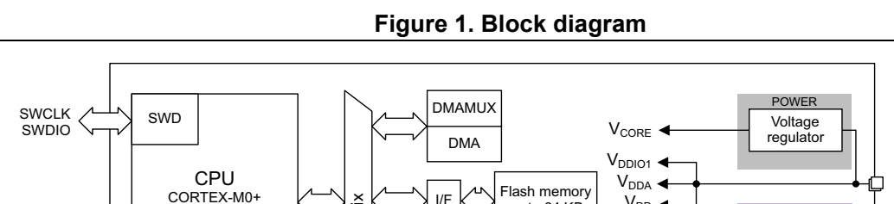

# 2 Description (pp. 9-11)

## 2 Description (p. 9)

The STM32G030x6/x8 mainstream microcontrollers are based on high-performance® ® Arm Cortex -M0+ 32-bit RISC core operating at up to 64 MHz frequency. Offering a high level of integration, they are suitable for a wide range of app lications in consumer, industrial and appliance domains and ready for the Internet of Things (IoT) solutions.

The devices incorporate a memory protection unit (MPU), high-speed embedded memories (8 Kbytes of SRAM and up to 64 Kbytes of flash program memory with read protection, write protection), DMA, an extensive range of system functions, enhanced I/Os, and peripherals.2 2 The devices offer standard communication interfaces (two I Cs, two SPIs / one I S, and two USARTs), one 12-bit ADC (2.5 MSps) with up to 19 channels, a low-power RTC, an advanced control PWM timer, four general-pu rpose 16-bit timers, two watchdog timers, and a SysTick timer.

The devices operate within ambient temperatures from -40 to 85°C and with supply voltages from 2.0 V to 3.6 V. Optimized dynamic cons umption combined with a comprehensive set of power-saving modes allows the design of low-power applications.

VBAT direct battery input allows keeping RTC and backup registers powered.

The devices come in packages with 8 to 48 pins.

**Table 2. STM32G030x6/x8 family device features and peripheral counts (p. 10)**

| Col 1 | Peripheral | Col 3 | Col 4 | STM32G030__J6 _F6 _K6 _K8 _C6 _C8 | Col 6 |
| --- | --- | --- | --- | --- | --- |
|  |  |  | Flash memory (Kbyte) 32 32 32 64 32 64 |  |  |
|  |  | SRAM (Kbyte) 8 with parity |  |  |  |
|  |  | Advanced control 1 (16-bit) |  |  |  |
| Timers |  | General-purpose 4 (16-bit) |  |  |  |
| Timers |  | SysTick 1 |  |  |  |
|  |  | Watchdog 2 |  |  |  |
|  | SPI [I2S] (1) | 0[0] (2) |  |  | 2 [1] (2) |
| Comm. interfaces |  | I2C 2 |  |  |  |
|  |  | USART 2 |  |  |  |
|  |  | RTC Yes |  |  |  |
|  |  | Tamper pins 0 2 |  |  |  |
|  |  | RNG / AES No / No |  |  |  |
|  |  |  | GPIOs 5 17 29 43 |  |  |
|  |  | Wakeup pins 1 4 |  |  |  |
|  | 12-bit ADC channels (external + internal) |  |  | 5 + 2 14 + 2 16 + 2 16 + 3 |  |
|  |  | VREFBUF No |  |  |  |
|  |  | Max. CPU frequency 64 MHz |  |  |  |
|  |  | Operating voltage 2.0 to 3.6 V |  |  |  |
|  | Operating temperature (3) |  |  | Ambient: -40 to 85 °C Junction: -40 to 105 °C |  |
|  |  |  | Number of pins 8 20 32 48 |  |  |
|  | 1. The numbers in brackets denote the count 2. Plus two extra SPIs through USARTs. 3. Depends on order code. Refer to Section 7: Ordering information | of SPI interfaces configurable as I | for details. | 2 S interface. |  |

*Figure 1. Block diagram (p. 11)*

VDD/VDDA VSS/VSSA f max = 64 MHz up to 64 KB SUPPLY NVIC IOPORT Bus matrix SRAM8 KB Parity ResetPORInt SUPERVISIONT sensorPOR NRST HSI16 RC 16 MHz PLLPCLK GPIOs PLLRCLK PLL PAx Port A LSI RC 32 kHz XTAL OSC OSC_IN 4-48 MHz OSC_OUT PBx Port B HSE IWDG PCx Port C decoder CRC RCC LSE I/F V DD VBAT PDx Port D Reset & clock control Low-voltagedetector PFx Port F LSE OSC32_IN AHB System and XTAL32 kHz OSC32_OUT peripheral clocks RTC, TAMP RTC_OUT EXTI Backup regs RTC_REFIN RTC_TS I/F from peripherals AHB-to-APB TAMP_IN

4 channels TIM1 BK, BK2, ETR VREF+ 4 channels TIM3 ETR 16x IN ADC I/F SYSCFG APB TIM14 1 channel TIMER 16/17TIM16 & 17 1 channel BK MISO/MCKMOSI/SD SPI1/I2S APB PWRCTRL USART1 RX, TX SCK/CK CTS, RTS, CK NSS/WS USART2 RX, TX WWDG CTS, RTS, CK MOSI, MISO SPI2 SCK, NSS I2C1 SCL, SDA, SMBA DBGMCU

I2C2 SCL, SDA

Power domain of analog blocks : V BAT V DD V DDA V DDIO1 MSv47958V2
