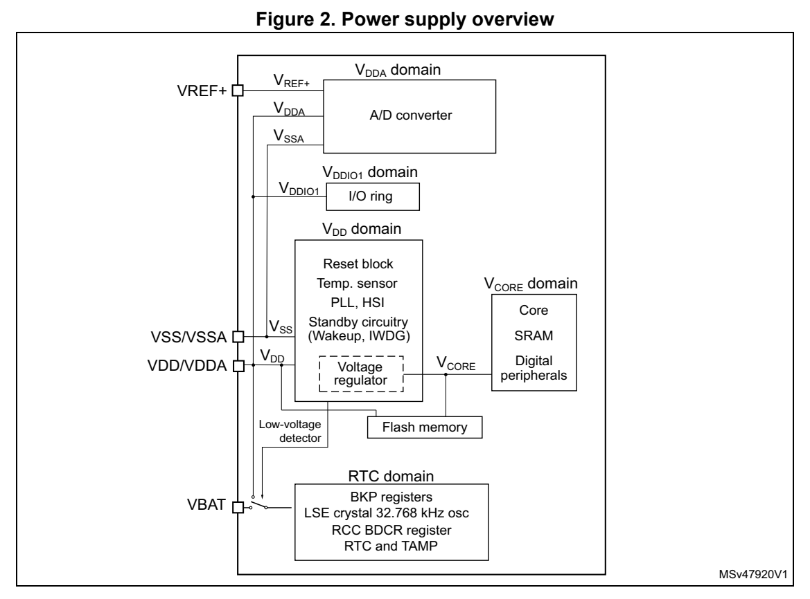

# 3 Functional overview (pp. 12-28)

## 3 Functional overview (p. 12)

## 3.1 Arm® Cortex®-M0+ core with MPU (p. 12)

The Cortex-M0+ is an entry-leve l 32-bit Arm Cortex processor designed for a broad range of embedded applications. It offers signifi cant benefits to developers, including:

- a simple architecture, easy to learn and program

- ultra-low power, energy-efficient operation

- excellent code density

- deterministic, high-performance interrupt handling

- upward compatibility with Cortex-M processor family

- platform security robustness, with integrated Memory Protection Unit (MPU).

The Cortex-M0+ processor is built on a highly area- and power-optimized 32-bit core, with a 2-stage pipeline Von Neumann architecture. The processor delivers exceptional energy efficiency through a small but powerful instru ction set and extensively optimized design, providing high-end processing hardware including a single-cycle multiplier.

The Cortex-M0+ processor provides the exce ptional performance expected of a modern 32-bit architecture, with a higher code density than other 8-bit and 16-bit microcontrollers.

Owing to embedded Arm core, the STM32G030x6/x8 devices are compatible with Arm tools and software.

The Cortex-M0+ is tightly coupled with a nested vectored interrupt controller (NVIC) described in Section 3.13.1.

### 3.2 Memory protection unit (p. 12)

The memory protection unit (MPU) is used to manage the CPU accesses to memory to prevent one task to accidentally corrupt the me mory or resources used by any other active task.

The MPU is especially helpful for applications where some critical or certified code has to be protected against the misbehavior of other tasks. It is usually managed by an RTOS (real-time operating system). If a prog ram accesses a memory location that is prohibited by the MPU, the RTOS can detect it and take action. In an RTOS environment, the kernel can dynamically update the MPU area setting, based on the process to be executed.

The MPU is optional and can be bypasse d for applications that do not need it.

### 3.3 Embedded flash memory (p. 12)

STM32G030x6/x8 devices feature up to 64 Kbytes of embedded flash memory available for storing code and data.

Flexible protections can be configured thanks to option bytes:

- Readout protection (RDP) to protect the wh ole memory. Three levels are available: – Level 0: no readout protection – Level 1: memory readout protection: th e flash memory cannot be read from or written to if either debug features are co nnected, boot in RAM or bootloader is selected – Level 2: chip readout protection: debug fe atures (Cortex-M0+ serial wire), boot in RAM and bootloader selection are disabled. This selection is irreversible.

**Table 3. Access status versus readout protection level and execution modes (p. 13)**

| Area | Protection level | Col 3 | User execution | Col 5 | Col 6 | Debug, boot from RAM or boot from system memory (loader) | Col 8 |
| --- | --- | --- | --- | --- | --- | --- | --- |
|  | level |  |  | Read Write Erase Read Write Erase | Read Write Erase Read Write Erase |  |  |
| User |  |  |  | 1 Yes Yes Yes No No No |  |  |  |
| memory |  |  |  | 2 Yes Yes Yes N/A N/A N/A |  |  |  |
| System |  |  |  | 1 Yes No No Yes No No |  |  |  |
| memory |  |  |  | 2 Yes No No N/A N/A N/A |  |  |  |
| Option |  |  |  | 1 Yes Yes Yes Yes Yes Yes |  |  |  |
| bytes |  |  |  | 2 Yes No No N/A N/A N/A |  |  |  |
| Backup |  | 1 Yes Yes N/A | 1 Yes Yes N/A | (1) |  | No No N/A | (1) |
| registers |  |  |  | 2 Yes Yes N/A N/A N/A N/A |  |  |  |
| OTP |  |  |  | 1 Yes Yes N/A Yes No N/A |  |  |  |
| OTP |  |  |  | 2 Yes Yes N/A N/A N/A N/A |  |  |  |

1. Erased upon RDP change from Level 1 to Level 0.

- Write protection (WRP): the protected area is protected against erasing and programming. Two areas per bank can be selected, with 2-Kbyte granularity.

The whole non-volatile memory embeds the error correction code (ECC) feature supporting:

- single error detection and correction

- double error detection

- readout of the ECC fail address from the ECC register

### 3.4 Embedded SRAM (p. 13)

STM32G030x6/x8 devices have 8 Kbytes of embedded SRAM with parity. Hardware parity check allows memory data errors to be detected, which contributes to increasing functional safety of applications.

The memory can be read/write-accessed at CPU clock speed, with 0 wait states.

### 3.5 Boot modes (p. 14)

At startup, the boot pin and boot selector option bit are used to select one of the three boot options:

- boot from User flash memory

- boot from System memory

- boot from embedded SRAM

The boot pin is shared with a standard GPIO and can be enabled through the boot selector option bit. If the BOOT0 pin selects the boot from the main flash memory of which the first location is empty, the flash memory empty che cker forces the boot from the system memory.

The system memory contains an embedded boot loader. It manages the flash memory reprogramming through one of the following interfaces:

- USART on pins PA9/PA10 or PA2/PA3 2

- I C-bus on pins PB6/PB7 or PB10/PB11

When boot loader is executed, it configures some of the GPIOs out of their by-default high-Z state. Refer to AN2606 for more details on t he boot loader and on the GPIO configuration when booting from the system memory.

### 3.6 Cyclic redundancy che ck calculation unit (CRC) (p. 14)

The CRC (cyclic redundancy check) calculati on unit is used to get a CRC code using a configurable generator polynomial value and size.

Among other applications, CRC-based techniques are used to verify data transmission or storage integrity. In the scope of the EN/I EC 60335-1 standard, they offer a means of verifying the flash memory integrity. The CRC calculation unit helps compute a signature of the software during runtime, to be compared with a reference signature generated at link time and stored at a given memory location.

### 3.7 Power supply management (p. 14)

#### 3.7.1 Power supply schemes (p. 14)

The STM32G030x6/x8 devices require a 2.0 V to 3.6 V operating supply voltage (V DD). Several different power supplies are provided to specific peripherals:

- V DD = 2.0 to 3.6 V V DD is the external power supply for the internal regulator and the system analog such as reset, power management and internal clocks. It is provided externally through VDD/VDDA pin.

- V DDA = 2.0 V to 3.6 V V DDA is the analog power supply for the A/D converter. V DDA voltage level is identical to V DD voltage as it is provided externally through VDD/VDDA pin.

- V DDIO1 = V DD V DDIO1 is the power supply for the I/Os. V DDIO1 voltage level is identical to V DD voltage as it is provided externally through VDD/VDDA pin.

- V BAT = 1.55 V to 3.6 V. V BAT is the power supply (through a power switch) for RTC, TAMP, low-speed external 32.768 kHz oscillator and backup registers when V DD is not present. V BAT is provided externally through VBAT pin. When this pin is not available on the package, VBAT bonding pad is internally bonded to the VDD/VDDA pin.

- V REF+ is the analog peripheral input reference voltage. When V DDA < 2 V, V REF+ must be equal to V DDA. When V DDA ≥ 2 V, V REF+ must be between 2 V and V DDA. It can be grounded when the analog peripherals using V REF+ are not active. V REF+ is delivered through VREF+ pin. On packages without VREF+ pin, V REF+ is internally connected with V DD.

- V CORE is an internal supply for digital peri pherals, SRAM and flash memory. It is produced by an embedded linear voltage regulator. On top of V CORE, the flash memory is also powered from V DD.

*Figure 2. Power supply overview (p. 15)*

#### 3.7.2 Power supply supervisor (p. 15)

The device has an integrated power-on/power-down (POR/PDR) reset active in all power modes and ensuring proper operation upon power-on and power-down. It maintains the device in reset when the supply voltage is below V POR/PDR threshold, without the need for an external reset circuit.

#### 3.7.3 Voltage regulator (p. 15)

Two embedded linear voltage regulators, main regulator (MR) and low-power regulator (LPR), supply most of digital circuitry in the device.

The MR is used in Run and Sleep modes. The LPR is used in Low-power run, Low-power sleep and Stop modes.

In Standby mode, both regulators are powered down and their outputs set in high-impedance state, such as to bring their current consumption close to zero.

#### 3.7.4 Low-power modes (p. 16)

By default, the microcontroller is in Run mode after system or power re set. It is up to the user to select one of the low-power modes described below.

Sleep mode

In Sleep mode, only the CPU is stopped. All peripherals continue to operate and can wake up the CPU when an interrupt/event occurs.

Low-power run mode

This mode is achieved with V CORE supplied by the low-power regulator to minimize the regulator's operating current. The code can be executed from SRAM or from flash memory, and the CPU frequency is limited to 2 MHz. The peripherals with independent clock can be clocked by HSI16.

Low-power sleep mode

This mode is entered from the low-power ru n mode. Only the CPU clock is stopped. When wakeup is triggered by an event or an interrupt, the system reverts to the Low-power run mode.

Stop 0 and Stop 1 modes

In Stop 0 and Stop 1 modes, th e device achieves the lowest power consumption while retaining the SRAM and register contents. All clocks in the V CORE domain are stopped. The PLL, as well as the HSI16 RC oscillator and the HSE crystal oscilla tor are disabled. The LSE or LSI keep running. The RTC can remain active (Stop mode with RTC, Stop mode without RTC).

Some peripherals with wakeup capability can e nable the HSI16 RC during Stop mode, so as to get clock for processing the wakeup event. The main regulator remains active in Stop 0 mode while it is turned off in Stop 1 mode.

Standby mode

The Standby mode is used to achieve the lowest power consumption, with POR/PDR always active in this mode. The main regulator is switched off to power down V CORE domain. The low-power regulator is switched off. The PLL, as well as the HSI16 RC oscillator and the HSE crystal os cillator are also powered down. The RTC can remain active (Standby mode with RTC, Standby mode without RTC).

For each I/O, the software can determine whether a pull-up, a pull-down or no resistor shall be applied to that I/ O during Standby mode.

Upon entering Standby mode, register contents are lost except for registers in the RTC domain and standby circuitry.

The device exits Standby mode upon external reset event (NRST pin), IWDG reset event, wakeup event (WKUP pin, configurable rising or falling edge), RTC event (alarm, periodic wakeup, timestamp), TAMP event, or when a failure is detected on LSE (CSS on LSE).

#### 3.7.5 Reset mode (p. 17)

During and upon exiting reset, the schmitt triggers of I/Os are disabled so as to reduce power consumption. In addition, when the reset source is internal, the built-in pull-up resistor on NRST pin is deactivated.

#### 3.7.6 VBAT operation (p. 17)

The V BAT power domain, consum ing very little energy, includes RTC, and LSE oscillator and backup registers.

In VBAT mode, the RTC domain is supplied from VBAT pin. The power source can be, for example, an external battery or an external supercapacitor. Two anti-tamper detection pins are available.

The RTC domain can also be supplied from V DD.

By means of a built-in switch, an internal voltage supervisor allows automatic switching of RTC domain powering between V DD and voltage from VBAT pin to ensure that the supply voltage of the RTC domain (V BAT) remains within valid operating conditions. If both voltages are valid, the RTC domain is supplied from V DD.

An internal circuit for charging the battery on VBAT pin can be activated if the V DD voltage is within a valid range.

Note: External interrupts and RTC alarm/events can not cause the microcontroller to exit the VBAT mode, as in that mode the V DD is not within a valid range.

### 3.8 Interconnect of peripherals (p. 17)

Several peripherals have direct connecti ons between them. This allows autonomous communication between peripherals, savi ng CPU resources thus power supply consumption. In addition, these hardware co nnections allow fast and predictable latency.

Depending on peripherals, these interconnections can operate in Run, Sleep and Stop modes.

**Table 4. Interconnect of peripherals (pp. 17-18)**

| Interconnect source | Interconnect destination | Interconnect action | Run Low-power run | Sleep Low-power sleep | Stop |
| --- | --- | --- | --- | --- | --- |
|  |  | TIMx Timer synchronization or chaining Y Y - |  |  |  |
| TIMx |  | ADCx Conversion triggers Y Y - |  |  |  |
| TIMx |  | DMA Memory-to-memory transfer trigger Y Y - |  |  |  |
|  |  | ADCx TIM1 Timer triggered by analog watchdog Y Y - |  |  |  |
| RTC |  | TIM16 Timer input channel from RTC events Y Y - |  |  |  |
| All clock sources (internal and external) | TIM14,16,17 | Clock source used as input channel for RC measurement and trimming |  | YY - |  |
| CSS RAM (parity error) Flash memory (ECC error) |  | TIM1,16,17 Timer break Y Y - |  |  |  |
|  |  | CPU (hard fault) TIM1,16,17 Timer break Y - - |  |  |  |
| GPIO |  | TIMx External trigger Y Y - |  |  |  |
| GPIO |  | ADC Conversion external trigger Y Y - |  |  |  |

### 3.9 Clocks and startup (p. 18)

The clock controller distributes the clocks coming from different oscillators to the core and the peripherals. It also manages clock gating for low-power modes and ensures clock robustness. It features:

- Clock prescaler: to get the best trade-off between speed and current consumption, the clock frequency to the CPU and peripherals can be adjusted by a programmable prescaler

- Safe clock switching: clock sources can be changed safely on the fly in run mode through a configuration register.

- Clock management: to reduce power consumption, the clock controller can stop the clock to the core, individual peripherals or memory.

- System clock source: three different so urces can deliver SYSCLK system clock: – 4-48 MHz high-speed oscillator with external crystal or ceramic reso nator (HSE). It can supply clock to system PLL. The HSE can also be configured in bypass mode for an external clock. – 16 MHz high-speed internal RC oscillator (H SI16), trimmable by software. It can supply clock to system PLL. – System PLL with maximum output frequency of 64 MHz. It can be fed with HSE or HSI16 clocks.

- Auxiliary clock source: two ultra-low-power clock sources for the real-time clock (RTC): – 32.768 kHz low-speed oscillator with exte rnal crystal (LSE), supporting four drive capability modes. The LSE can also be configured in bypass mode for using an external clock. – 32 kHz low-speed internal RC oscillator (LSI) with ±5% accuracy, also used to clock an independent watchdog.

- Peripheral clock sources: several peripherals ( I2S, USARTs, I2Cs, ADC) have their own clock independent of the system clock.

- Clock security system (CSS): in the event of HSE clock failure, the system clock is automatically switched to HSI1 6 and, if enabled, a software interrupt is generated. LSE clock failure can also be detected and generate an interrupt. The CCS feature can be enabled by software.

- Clock output: – MCO (microcontroller clock output) provides one of the internal clocks for external use by the application – LSCO (low speed clock output) provides LSI or LSE in all low-power modes (except in VBAT operation).

Several prescalers allow t he application to configure AHB and APB domain clock frequencies, 64 MHz at maximum.

### 3.10 General-purpose in puts/outputs (GPIOs) (p. 19)

Each of the GPIO pins can be configured by software as output (push-pull or open-drain), as input (with or without pull-up or pull-down) or as peripheral alternate function (AF). Most of the GPIO pins are shared with spec ial digital or analog functions.

Through a specific sequence, this special functi on configuration of I/Os can be locked, such as to avoid spurious writing to I/O control registers.

### 3.11 Direct memory a ccess controller (DMA) (p. 19)

The direct memory access (DMA) controller is a bus master and system peripheral with single-AHB architecture.

With 5 channels, it performs data transfers between memory-mapped peripherals and/or memories, to offload the CPU.

Each channel is dedicated to managing me mory access requests from one or more peripherals. The unit includes an arbiter for handling the priority between DMA requests.

Main features of the DMA controller:

- Single-AHB master

- Peripheral-to-memory, memory-to-periphera l, memory-to-memory and peripheral-to-peripheral data transfers

- Access, as source and destination, to on -chip memory-mapped devices such as flash memory, SRAM, and AH B and APB peripherals

- All DMA channels independently configurable: – Each channel is associated either with a DMA request signal coming from a peripheral, or with a softwa re trigger in memory-to-memory transfers. This configuration is done by software. – Priority between the requests is programmable by software (four levels per channel: very high, high, medium, low) an d by hardware in case of equality (such as request to channel 1 has priority over request to channel 2). – Transfer size of source and destination are independent (byte, half-word, word), emulating packing and unpacking. Source and destination addresses must be aligned on the data size. – Support of transfers from/to peripherals to/from memory with circular buffer management 16 – Programmable number of data to be transferred: 0 to 2 - 1

- Generation of an interrupt request per channel. Each interrupt request originates from any of the three DMA events: transfer comp lete, half transfer, or transfer error.

### 3.12 DMA request mu ltiplexer (DMAMUX) (p. 20)

The DMAMUX request multiplexer enables routing a DMA request line between the peripherals and the DMA controller. Each channel selects a unique DMA request line, unconditionally or synchronously with events from its DMAMUX synchronization inputs. DMAMUX may also be used as a DMA request generator from programmable events on its input trigger signals.

### 3.13 Interrupts and events (p. 20)

The device flexibly manages events causing interrupts of linear program execution, called exceptions. The Cortex-M0+ processor core, a nested vectored interrupt controller (NVIC) and an extended interrupt/event controller (EXTI) are the assets contributing to handling the exceptions. Exceptions include core-internal events such as, for example, a division by zero and, core-external events such as logical leve l changes on physical lines. Exceptions result in interrupting the program flow, executing an interrupt service routine (ISR) then resuming the original program flow.

The processor context (contents of program poi nter and status registers) is stacked upon program interrupt and unstacked upon program resume, by hardware. This avoids context stacking and unstacking in the interrupt service routines (ISRs) by software, thus saving time, code and power. The ab ility to abandon and re start load-multiple and store-multiple operations significantly increases the device ’s responsiveness in processing exceptions.

#### 3.13.1 Nested vectored inte rrupt controller (NVIC) (p. 21)

The configurable nested vectored interrupt controller is tightly coupled with the core. It handles physical line events associated with a non-maskable interrupt (NMI) and maskable interrupts, and Cortex-M0+ exceptions. It provides flexible priority management.

The tight coupling of the processor core with NV IC significantly reduces the latency between interrupt events and start of corresponding interrupt service routines (ISRs). The ISR vectors are listed in a vector table, stored in the NVIC at a base address. The vector address of an ISR to execute is hardware-built from the vector table base address and the ISR order number used as offset.

If a higher-priority interrupt event happens while a lower-priority interrupt event occurring just before is waiting for being served, the la ter-arriving higher-priori ty interrupt event is served first. Another optimization is called tail-ch aining. Upon a return from a higher-priority ISR then start of a pending lower-priority ISR, the unnecessary processor context unstacking and stacking is skipped. This reduces latency and contributes to power efficiency.

Features of the NVIC:

- Low-latency interrupt processing

- 4 priority levels

- Handling of a non-maskable interrupt (NMI)

- Handling of 32 maskable interrupt lines

- Handling of 10 Cortex-M0+ exceptions

- Later-arriving higher-priority interrupt processed first

- Tail-chaining

- Interrupt vector re trieval by hardware

#### 3.13.2 Extended interrupt/event controller (EXTI) (p. 21)

The extended in terrupt/event contro ller adds flexibility in handlin g physical line events and allows identifying wake-up events at processor wakeup from Stop mode.

The EXTI controller has a number of channels, of which some wi th rising, falling or rising, and falling edge dete ctor capability. Any GPIO and a few peripheral signals can be connected to these channels.

The channels can be independently masked.

The EXTI controller can capture pulses shorter than the internal clock period.

A register in the EXTI controller latches every event even in Stop mode, which allows the software to identify the or igin of the processor's wake-up from Stop mode or, to identify the GPIO and the edge event having caused an interrupt.

### 3.14 Analog-to-digital converter (ADC) (p. 21)

A native 12-bit analog-to-digital converter is embedded into STM32G030x6/x8 devices. The ADC has up to 16 external channels and 3 in ternal channels (temperature sensor, voltage reference, V BAT monitoring). It performs conversions in single-shot or scan mode. In scan mode, automatic conversion is performed on a selected group of analog inputs.

The ADC frequency is independent from th e CPU frequency, allowing maximum sampling rate of ~2.5 MSps even with a low CPU speed. An auto-shutdown function guarantees that the ADC is powered off except during the active conversion phase.

The ADC can be served by the DMA cont roller. It can operate in the whole V DD supply range.

The ADC features a hardware oversampler up to 256 samples, improving the resolution to 16 bits (refer to AN2668).

An analog watchdog feature allows very precise monitoring of the converted voltage of one, some or all scanned channels. An interrupt is generated when the converted voltage is outside the programmed thresholds.

The events generated by the general-purpose ti mers (TIMx) can be internally connected to the ADC start triggers, to allow the application to synchronize A/D conversions with timers.

#### 3.14.1 Temperature sensor (p. 22)

The temperature sensor (TS) generates a voltage V TS that varies linearly with temperature.

The temperature sensor is internally connected to an ADC input to convert the sensor output voltage into a digital value.

The sensor provides good linearity but it has to be calibrated to obtain good overall accuracy of the temperature measurement. As the offset of the temperature sensor may vary from part to part due to process variation, the uncalibrated internal temperature sensor is suitable only for relative temperature measurements.

To improve the accuracy of the temperature sensor, each part is individually factory-calibrated by ST. The resulting calibration data are stored in the part’s engineering bytes, accessible in read-only mode.

**Table 5. Temperature sensor calibration values (p. 22)**

| Col 1 | Calibration value name Description Memory address | Col 3 |
| --- | --- | --- |
|  | TS ADC raw data acquired at a |  |
| TS_CAL1 | temperature of 30 °C (± 5 °C), | 0x1FFF 75A8 - 0x1FFF 75A9 |
|  | V DDA = V REF+ = 3.0 V (± 10 mV) |  |

#### 3.14.2 Internal voltage reference (V REFINT) (p. 22)

The internal voltage reference (V REFINT) provides a stable (bandgap) voltage output for the ADC. V REFINT is internally connected to an ADC input. The V REFINT voltage is individually precisely measured for each part by ST during production test and stored in the part’s engineering bytes. It is accessible in read-only mode.

**Table 6. Internal voltage reference calibration values (p. 22)**

| Col 2 | Calibration value name Description Memory address | Col 4 |
| --- | --- | --- |
| V REFINT | Raw data acquired at a temperature of 30 °C (± 5 °C), V DDA = V REF+ = 3.0 V (± 10 mV) | 0x1FFF 75AA - 0x1FFF 75AB |

#### 3.14.3 V BAT battery voltage monitoring (p. 23)

This embedded hardware feature allows the application to measure the V BAT battery voltage using an internal ADC input. As the V BAT voltage may be higher than V DDA and thus outside the ADC input range, the VBAT pin is internally connected to a bridge divider by three. As a consequence, the converted digital value is one third the V BAT voltage.

### 3.15 Timers and watchdogs (p. 23)

The device includes an advanced-control time r, four general-purpose timers, two watchdog timers and a SysTick timer. Table 7 compares features of the advanced-control, general-purpose and basic timers.

**Table 7. Timer feature comparison (p. 23)**

| Timer type Timer | Col 2 | Counter resolution | Counter type | Maximum operating frequency | Prescaler factor | DMA request generation | Capture/ compare channels | Comple-mentary outputs |
| --- | --- | --- | --- | --- | --- | --- | --- | --- |
| Advanced-control | TIM1 16-bit | TIM1 16-bit | Up, down, up/down | 64 MHz | Integer from16 1 to 2 | Yes | 4 + 2 internal | 3 |
|  | TIM3 16-bit | TIM3 16-bit | Up, down, up/down | 64 MHz | Integer from16 1 to 2 |  | Yes 4 - |  |
| General- |  | TIM14 16-bit Up 64 MHz | TIM14 16-bit Up 64 MHz |  | Integer from16 1 to 2 |  | No 1 - |  |
| purpose | TIM16 TIM17 |  | 16-bit Up 64 MHz |  | Integer from16 1 to 2 |  | Yes 1 1 |  |

#### 3.15.1 Advanced-control timer (TIM1) (p. 23)

The advanced-control timer can be seen as a three-phase PWM unit multiplexed on 6 channels. It has complementary PWM outputs with programmable inserted dead-times. It can also be seen as a complete general-purpose timer. The four independent channels can be used for:

- input capture

- output compare

- PWM output (edge or center-aligned mode s) with full modulati on capability (0-100%)

- one-pulse mode output

On top of these, there are two in ternal channels that can be used.

In debug mode, the advanced-control timer counter can be frozen and the PWM outputs disabled, so as to turn off any power switches driven by these outputs.

Many features are shared with those of the general-purpose TIMx timers (described in Section 3.15.2) using the same architecture, so the advanced-control timers can work together with the TIMx timers via the Time r Link feature for synchronization or event chaining.

#### 3.15.2 General-purpose time rs (TIM3, 14, 16, 17) (p. 24)

There are four synchronizable general-purpose timers embedded in the device (refer to Table 7 for comparison). Each general-purpose ti mer can be used to generate PWM outputs or act as a simple timebase.

- TIM3 This is a full-featured general-purpose ti mer with 16-bit auto-reload up/downcounter and 16-bit prescaler. It has four independent channels for input capture/output compare, PWM or one-pulse mode output. It can operate in combination with other general-purpose timers via the Timer Link feature for synchronization or event chaining. It can generate independent DMA request and support quadrature encoders. Its counter can be frozen in debug mode.

- TIM14 This timer is based on a 16-bit auto-reload upcounter and a 16-bit prescaler. It has one channel for input capture/output compare, PWM output or one-pulse mode output. Its counter can be frozen in debug mode.

- TIM16, TIM17 These are general-purpose timers featuring: – 16-bit auto-reload upcounter and 16-bit prescaler – 1 channel and 1 complementary channel All channels can be used for input capture/output compare, PWM or one-pulse mode output. The timers can operate together via the Timer Link feature for synchronization or event chaining. They can generate inde pendent DMA request. Their counters can be frozen in debug mode.

#### 3.15.3 Independent watchdog (IWDG) (p. 24)

The independent watchdog is based on an 8-bit prescaler and 12-bit downcounter with user-defined refresh window. It is clocked from an independent 32 kHz internal RC (LSI). Independent of the main clock, it can operate in Stop and Standby modes. It can be used either as a watchdog to reset the device when a problem occurs, or as a free-running timer for application timeout management. It is hardware- or software-configurable through the option bytes. Its co unter can be frozen in debug mode.

#### 3.15.4 System window watchdog (WWDG) (p. 24)

The window watchdog is based on a 7-bit downcounter that can be set as free-running. It can be used as a watchdog to reset the device when a problem occurs. It is clocked by the system clock. It has an early-wa rning interrupt capab ility. Its counter can be frozen in debug mode.

#### 3.15.5 SysTick timer (p. 24)

This timer is dedicated to real-time operating systems, but it can also be used as a standard down counter.

Features of SysTick timer:

- 24-bit down counter

- Autoreload capability

- Maskable system interrupt generation when the counter reaches 0

- Programmable clock source

### 3.16 Real-time clock (RTC), tamp er (TAMP) and backup registers (p. 25)

The device embeds an RTC and five 32-bit ba ckup registers, located in the RTC domain of the silicon die.

The ways of powering the RTC domain are described in Section 3.7.6.

The RTC is an independent BCD timer/counter.

Features of the RTC:

- Calendar with subsecond, seconds, minutes, hours (12 or 24 format), week day, date, month, year, in BCD (binary-coded decimal) format

- Automatic correction for 28, 29 (leap year), 30, and 31 days of the month

- Programmable alarm

- On-the-fly correction from 1 to 32767 RTC cl ock pulses, usable for synchronization with a master clock

- Reference clock detection - a more precise second-source clock (50 or 60 Hz) can be used to improve the calendar precision

- Digital calibration circuit with 0.95 ppm re solution, to compensate for quartz crystal inaccuracy

- Two anti-tamper detection pi ns with programmable filter

- Timestamp feature to save a calendar snapshot, triggered by an event on the timestamp pin or a tamper event, or by switching to VBAT mode

- 17-bit auto-reload wakeup timer (WUT) for periodic events, with programmable resolution and period

- Multiple clock sources and references: – A 32.768 kHz external crystal (LSE) – An external resonator or oscillator (LSE) – The internal low-power RC oscillator (LSI, with typi cal frequency of 32 kHz) – The high-speed external clock (HSE) divided by 32

When clocked by LSE, the RTC operates in VBAT mode and in all low-power modes. When clocked by LSI, the RTC does not operate in VBAT mode, but it does in low-power modes.

All RTC events (Alarm, WakeUp Timer, Timestamp or Tamper) can generate an interrupt and wake the device up from the low-power modes.

The backup registers allow keeping 20 bytes of user application data in the event of V DD failure, if a valid backup supply voltage is provided on VBAT pin. They are not affected by the system reset, power reset, and upon the device’s wakeup from Standby mode.

### 3.17 Inter-integrated ci rcuit interface (I2C) (p. 26)

The device embeds two I2C peripherals. Refer to Table 8 for the features. 2 The I C-bus interface handles communication between the microcontroller and the serial I2C-bus. It controls all I2C-bus-specific sequencing, protocol, arbitration and timing.

Features of the I2C peripheral:

- I2C-bus specification and user manual rev. 5 compatibility: – Slave and master modes, multimaster capability – Standard-mode (Sm), with a bitrate up to 100 kbit/s – Fast-mode (Fm), with a bitrate up to 400 kbit/s – Fast-mode Plus (Fm+), with a bitrate up to 1 Mbit/s and extra output drive I/Os – 7-bit and 10-bit addressing mode, multiple 7-bit slave addresses – Programmable setup and hold times – Clock stretching

- SMBus specification rev 3.0 compatibility: – Hardware PEC (packet error checking) generation and verification with ACK control – Command and data acknowledge control – Address resolution protocol (ARP) support – Host and Device support – SMBus alert – Timeouts and idle condition detection

- PMBus rev 1.3 stand ard compatibility

- Independent clock: a choice of independent clock sources allowing the I2C communication speed to be independent of the PCLK reprogramming

- Wakeup from Stop mode on address match

- Programmable analog and digital noise filters

- 1-byte buffer with DMA capability

**Table 8. I C implementation (p. 26)**

| I2C features (1) | I2C1 I2C2 | I2C1 I2C2 |
| --- | --- | --- |
| Standard mode (up to 100 kbit/s) X X |  |  |
| Fast mode (up to 400 kbit/s) X X |  |  |
| Fast Mode Plus (up to 1 Mbit/s) with extra output drive I/Os X X | drive I/Os X X |  |
| Programmable analog and digital noise filters X X |  |  |
| SMBus/PMBus hardware support X - |  |  |
| Independent clock X - |  |  |
| Wakeup from Stop mode on address match X - |  |  |
| 1. X: supported |  |  |

### 3.18 Universal synchronous/asynch ronous receiver transmitter (p. 27)

## (USART) (p. 27)

The device embeds universal synchronous/a synchronous receivers/transmitters that communicate at speeds of up to 8 Mbit/s.

They provide hardware management of the CTS, RTS and RS485 DE signals, multiprocessor communication mode, SPI synchronous commu nication and single-wire half-duplex communication mode. Some can also support SmartCard communication (ISO 7816), IrDA SIR ENDEC, LIN Master/Slave ca pability and auto baud rate feature, and have a clock domain independent of the CPU clock, which allows them to wake up the MCU from Stop mode. The wakeup events from Stop mode are programmable and can be:

- start bit detection

- any received data frame

- a specific programmed data frame

All USART interfaces can be served by the DMA controller.

**Table 9. USART implementation (p. 27)**

| USART modes/features (1) | USART1 USART2 | USART1 USART2 |
| --- | --- | --- |
| Hardware flow control for modem X X |  |  |
| Continuous communication using DMA X X |  |  |
| Multiprocessor communication X X |  |  |
| SPI emulation master/slave (synchronous mode) X X |  |  |
| Smartcard mode X - |  |  |
| Single-wire half-duplex communication X X |  |  |
| IrDA SIR ENDEC block X - |  |  |
| LIN mode X - |  |  |
| Dual clock domain and wakeup from Stop mode X - |  |  |
| Receiver timeout interrupt X - |  |  |
| Modbus communication X - |  |  |
| Auto baud rate detection X - |  |  |
| Driver Enable X X |  |  |

1. X: supported

### 3.19 Serial peripheral interface (SPI) (p. 27)

The device contains two SPIs running at up to 32 Mbits/s in master and slave modes. It supports half-duplex, full-duplex and simplex communications. A 3-bit prescaler gives eight master mode frequencies. The frame size is co nfigurable from 4 bits to 16 bits. The SPI peripherals support NSS pulse mode, TI mode and hardware CRC calculation.

The SPI peripherals can be served by the DMA controller. 2 The I S interface mode of the SPI peripheral (if su pported, see the followi ng table) supports four different audio standards can operate as master or slave, in half-duplex communication

mode. It can be configured to transfer 16 and 24 or 32 bits with 16-bit or 32-bit data resolution and synchronized by a specific signa l. Audio sampling frequency from 8 kHz up to 192 kHz can be set by an 8-bit programmable linear prescaler. When operating in master mode, it can output a clock for an external audio component at 256 times the sampling frequency.

**Table 10. SPI/I2S implementation (p. 28)**

| SPI features (1) | SPI1 SPI2 | SPI1 SPI2 |
| --- | --- | --- |
| Hardware CRC calculation X X |  |  |
| Rx/Tx FIFO X X |  |  |
| NSS pulse mode X X |  |  |
| I2S mode X - |  |  |
| TI mode X X |  |  |

1. X = supported.

### 3.20 Development support (p. 28)

#### 3.20.1 Serial wire debug port (SW-DP) (p. 28)

An Arm SW-DP interface is provided to allow a serial wire debugging tool to be connected to the MCU.
