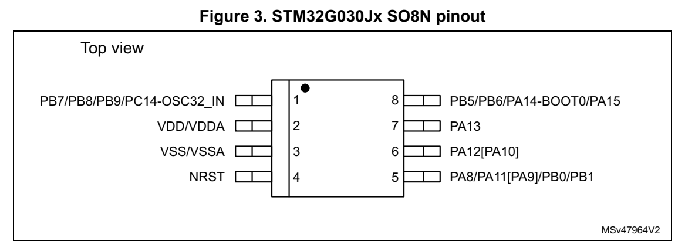
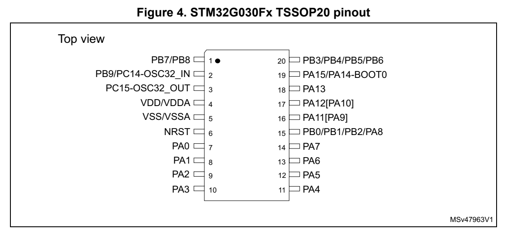
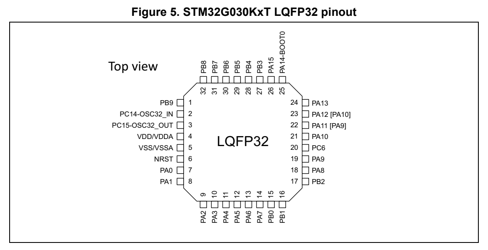
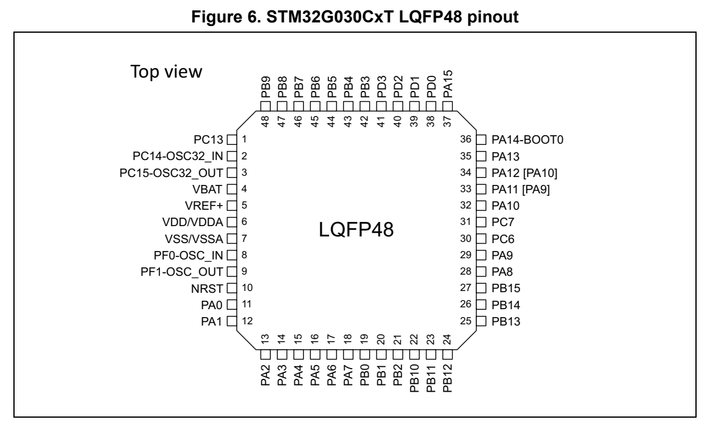

# 4 Pinouts, pin description and alternate functions (pp. 29-37)

## 4 Pinouts, pin description and alternate functions (p. 29)

*Figure 3. STM32G030Jx SO8N pinout (p. 29)*

*Figure 4. STM32G030Fx TSSOP20 pinout (p. 29)*

*Figure 5. STM32G030KxT LQFP32 pinout (p. 29)*

*Figure 6. STM32G030CxT LQFP48 pinout (p. 30)*

**Table 11. Terms and symbols used in Pin assignment and description table (p. 30)**

| Col 1 | Col 2 | Column Symbol Definition | Col 4 |
| --- | --- | --- | --- |
| Pin name | Pin name | Terminal name corresponds to its by-default func parenthesis under the pin name. | tion at reset, unless otherwise specified in |
|  |  | S Supply pin |  |
| Pin type | Pin type | I Input only pin |  |
|  |  |  | I/O Input / output pin |
|  |  | FT 5 V tolerant I/O | FT 5 V tolerant I/O |
|  |  |  | RST Reset pin with embedded weak pull-up resistor |
|  |  |  | Options for FT I/Os |
| I/O structure | I/O structure |  | _f I/O, Fm+ capable |
|  |  |  | _a I/O, with analog switch function |
|  |  |  | _e I/O, with switchable diode to V DDIO1 |
|  |  | Note Upon reset, all I/Os are set as analog inputs, unless otherwise specified. | Note Upon reset, all I/Os are set as analog inputs, unless otherwise specified. |
| Pin | Alternate functions | Functions selected through GPIOx_AFR registers |  |
| functions | Additional functions |  | Functions directly selected/enabled through peripheral registers |

**Table 12. Pin assignment and description (pp. 31-34)**

| SO8N | Pin TSSOP20 | Pin LQFP32 | LQFP48 | Pin name (function upon reset) | Pin type | I/O structure | Note | Alternate functions | Additional functions |
| --- | --- | --- | --- | --- | --- | --- | --- | --- | --- |
|  |  |  |  | - - - 1 PC13 I/O FT |  |  | (1)(2) | TIM1_BK | TAMP_IN1, RTC_TS, RTC_OUT1, WKUP2 |
|  | ---2 | ---2 |  | PC14-OSC32_IN (PC14) |  | I/O FT | (1)(2) | TIM1_BK2 OSC32_IN |  |
|  | 122 - | 122 - |  | PC14-OSC32_IN (PC14) |  | I/O FT | (1)(2) | TIM1_BK2 OSC32_IN, OSC_IN | TIM1_BK2 OSC32_IN, OSC_IN |
|  | -333 | -333 |  | PC15-OSC32_OUT (PC15) |  | I/O FT | (1)(2) | OSC32_EN, OSC_EN OSC32_OUT |  |
|  |  |  |  |  |  |  | - - - 4 VBAT S - - - VBAT |  |  |
|  |  |  |  |  |  |  | - - - 5 VREF+ S - - - - |  |  |
|  |  |  |  |  |  |  | 2 4 4 6 VDD/VDDA S - - - - |  |  |
|  |  |  |  |  |  |  | 3 5 5 7 VSS/VSSA S - - - - |  |  |
|  | ---8 | ---8 |  | PF0-OSC_IN (PF0) |  |  |  | I/O FT - TIM14_CH1 OSC_IN |  |
|  | ---9 | ---9 |  | PF1-OSC_OUT (PF1) |  |  |  | I/O FT - OSC_EN OSC_OUT |  |
|  |  |  |  | 4 6 6 10 NRST I/O RST |  |  | (3) | - NRST |  |
|  |  |  |  | - 7 7 11 PA0 I/O |  | FT_a | (3) | SPI2_SCK, USART2_CTS, | ADC_IN0, TAMP_IN2,WKUP1 |
|  |  |  |  | - 8 8 12 PA1 I/O |  | FT_ea | (3) | SPI1_SCK/I2S1_CK, USART2_RTS_DE_CK, I2C1_SMBA, EVENTOUT | ADC_IN1 |
|  |  |  |  | - 9 9 13 PA2 I/O |  | FT_a | (3) | SPI1_MOSI/I2S1_SD, USART2_TX, | ADC_IN2, WKUP4,LSCO |
|  |  |  |  | - 10 10 14 PA3 I/O |  | FT_ea | - | SPI2_MISO, USART2_RX, EVENTOUT | ADC_IN3 |
|  |  |  |  | - - - 15 PA4 I/O |  | FT_a | - | SPI1_NSS/I2S1_WS, SPI2_MOSI, TIM14_CH1, EVENTOUT | ADC_IN4, RTC_OUT2 |
|  |  |  |  | - 11 11 - PA4 I/O |  | FT_a | - | SPI1_NSS/I2S1_WS, SPI2_MOSI, TIM14_CH1, EVENTOUT | ADC_IN4, TAMP_IN1, RTC_TS, RTC_OUT1, WKUP2 |
|  |  |  |  | - 12 12 16 PA5 I/O |  | FT_ea | - | SPI1_SCK/I2S1_CK, EVENTOUT | ADC_IN5 |
|  |  |  |  | - 13 13 17 PA6 I/O |  | FT_ea | - | SPI1_MISO/I2S1_MCK, TIM3_CH1, TIM1_BK, TIM16_CH1 | ADC_IN6 |
|  |  |  |  | - 14 14 18 PA7 I/O |  | FT_a | - | SPI1_MOSI/I2S1_SD, TIM3_CH2, TIM1_CH1N, TIM14_CH1, TIM17_CH1 | ADC_IN7 |
|  |  |  |  | 5 15 15 19 PB0 I/O |  | FT_ea | - | SPI1_NSS/I2S1_WS, TIM3_CH3, TIM1_CH2N | ADC_IN8 |
|  |  |  |  | 5 15 16 20 PB1 I/O |  | FT_ea | - | TIM14_CH1, TIM3_CH4, TIM1_CH3N, EVENTOUT | ADC_IN9 |
|  |  |  |  | - 15 17 21 PB2 I/O |  | FT_ea |  | - SPI2_MISO, EVENTOUT ADC_IN10 |  |
|  |  |  |  | - - - 22 PB10 I/O |  | FT_fa |  | - SPI2_SCK, I2C2_SCL ADC_IN11 |  |
|  |  |  |  | - - - 23 PB11 I/O |  | FT_fa |  | - SPI2_MOSI, I2C2_SDA ADC_IN15 |  |
|  |  |  |  | - - - 24 PB12 I/O |  | FT_a | - | SPI2_NSS, TIM1_BK, EVENTOUT | ADC_IN16 |
|  |  |  |  | - - - 25 PB13 I/O |  | FT_f | - | SPI2_SCK, TIM1_CH1N, I2C2_SCL, EVENTOUT | - |
|  |  |  |  | - - - 26 PB14 I/O |  | FT_f | - | SPI2_MISO, TIM1_CH2N, I2C2_SDA, EVENTOUT | - |
|  |  |  |  | - - - 27 PB15 I/O |  | FT | - | SPI2_MOSI, TIM1_CH3N, EVENTOUT | RTC_REFIN |
|  |  |  |  | 5 15 18 28 PA8 I/O |  | FT | - | MCO, SPI2_NSS, TIM1_CH1, EVENTOUT | - |
|  |  |  |  | - - 19 29 PA9 I/O |  | FT_f | - | MCO, USART1_TX, TIM1_CH2, SPI2_MISO, I2C1_SCL, EVENTOUT | - |
|  |  |  |  | - - 20 30 PC6 I/O |  | FT |  | - TIM3_CH1 - |  |
|  |  |  |  | - - - 31 PC7 I/O |  | FT |  | - TIM3_CH2 - |  |
|  |  |  |  | - - 21 32 PA10 I/O |  | FT_f | - | SPI2_MOSI, USART1_RX, TIM1_CH3, TIM17_BK, I2C1_SDA, EVENTOUT | - |
|  |  |  |  | - - - 33 PA11 [PA9] I/O |  | FT_f | (4) | SPI1_MISO/I2S1_MCK, USART1_CTS, TIM1_CH4, TIM1_BK2, I2C2_SCL | - |
|  |  |  |  | 5 16 22 - PA11 [PA9] I/O |  | FT_fa | (4) | SPI1_MISO/I2S1_MCK, USART1_CTS, TIM1_CH4, TIM1_BK2, I2C2_SCL | ADC_IN15 |
|  |  |  |  | - - - 34 PA12 [PA10] I/O |  | FT_f | (4) | SPI1_MOSI/I2S1_SD, USART1_RTS_DE_CK, TIM1_ETR, I2S_CKIN, I2C2_SDA | - |
|  |  |  |  | 6 17 23 - PA12 [PA10] I/O |  | FT_fa | (4) | SPI1_MOSI/I2S1_SD, USART1_RTS_DE_CK, TIM1_ETR, I2S_CKIN, I2C2_SDA | ADC_IN16 |
|  |  |  |  | 7 18 24 35 PA13 I/O |  | FT_ea | (5) | SWDIO, IR_OUT, EVENTOUT ADC_IN17 |  |
|  |  |  |  | 8 19 25 36 PA14-BOOT0 I/O |  | FT_a | (5) | SWCLK, USART2_TX, EVENTOUT | ADC_IN18, BOOT0 |
|  |  |  |  | 8 19 26 37 PA15 I/O |  | FT | - | SPI1_NSS/I2S1_WS, USART2_RX, EVENTOUT | - |
|  |  |  |  | - - - 38 PD0 I/O |  | FT | - | EVENTOUT, SPI2_NSS, TIM16_CH1 | - |
|  |  |  |  | - - - 39 PD1 I/O |  | FT | - | EVENTOUT, SPI2_SCK, TIM17_CH1 | - |
|  |  |  |  | - - - 40 PD2 I/O |  | FT |  | - TIM3_ETR, TIM1_CH1N - |  |
|  |  |  |  | - - - 41 PD3 I/O |  | FT | - | USART2_CTS, SPI2_MISO, TIM1_CH2N | - |
|  |  |  |  | - 20 27 42 PB3 I/O |  | FT | - | SPI1_SCK/I2S1_CK, TIM1_CH2, USART1_RTS_DE_CK, EVENTOUT | - |
|  |  |  |  | - 20 28 43 PB4 I/O |  | FT | - | SPI1_MISO/I2S1_MCK, TIM3_CH1, USART1_CTS, TIM17_BK, EVENTOUT | - |
|  |  |  |  | 8 20 29 44 PB5 I/O |  | FT | - | SPI1_MOSI/I2S1_SD, TIM3_CH2, TIM16_BK, I2C1_SMBA | WKUP6 |
|  |  |  |  | 8 20 30 45 PB6 I/O |  | FT_f | - | USART1_TX, TIM1_CH3, TIM16_CH1N, SPI2_MISO, I2C1_SCL, EVENTOUT | - |
|  |  |  |  | - - - 46 PB7 I/O |  | FT_f | - | USART1_RX, SPI2_MOSI, TIM17_CH1N, I2C1_SDA, EVENTOUT | - |
|  |  |  |  | 1 1 31 - PB7 I/O |  | FT_fa | - | USART1_RX, SPI2_MOSI, TIM17_CH1N, I2C1_SDA, EVENTOUT | ADC_IN11 |
|  |  |  |  | 1 1 32 47 PB8 I/O |  | FT_f | - | SPI2_SCK, TIM16_CH1, I2C1_SCL, EVENTOUT | - |
|  |  |  |  | 1 2 1 48 PB9 I/O |  | FT_f | - | IR_OUT, TIM17_CH1, SPI2_NSS, I2C1_SDA, EVENTOUT | - |

1. PC13, PC14 and PC15 are supplied through the power switch. Since the switch only sinks a limited amount of current (3 mA), the use of GPIOs PC13 to PC15 in output mode is limited:

- The speed should not exceed 2 MHz with a maximum load of 30 pF

- These GPIOs must not be used as current sources (for example to drive a LED). 2. After an RTC domain power-up, PC13, PC14 and PC15 operate as GPIOs. Their function then depends on the content of the RTC registers. The RTC registers are not reset upon system reset. For details on how to manage these GPIOs, refer to the RTC domain and RTC regi ster descriptions in the RM0444 reference manual. 3. As in SO8N device, the PA0, PA1, and PA2 GPIOs are bonded with NRST on the pin 4, low level applied to any of these GPIOs provokes the device reset. To prevent the risk of spurious resets, keep these GPIOs configured at all times as analog or digital inputs (as oppo sed to output or alternate function). 4. Pins PA9 and PA10 can be remapped in place of pins PA11 and PA12 (default mapping), using SYSCFG_CFGR1 register. 5. Upon reset, these pins are configured as SW debug alte rnate functions, and the internal pull-up on PA13 pin and the internal pull-down on PA14 pin are activated.

TIM14_CH1 TIM17_CH1 - - Table 13. Port A alternate function mapping Port AF0 AF1 AF2 AF3 AF4 AF5 AF6 AF7 PA0 SPI2_SCK USART2_CTS - - - - - - PA3 SPI2_MISO USART2_RX - - - - - EVENTOUT PA8 MCO SPI2_NSS TIM1_CH1 - - - - EVENTOUT PA9 MCO USART1_TX TIM1_CH2 - SPI2_MISO - I2C1_SCL EVENTOUT PA10 SPI2_MOSI USART1_RX TIM1_CH3 - - TIM17_BKIN I2C1_SDA EVENTOUT PA13 SWDIO IR_OUT - - - - - EVENTOUT PA14 SWCLK USART2_TX - - - - - EVENTOUT

| - - - - I2C1_SMBA EVENTOUT | Col 4 | Col 6 | Col 7 | Col 8 | Col 9 | Col 13 | TIM1_ETR - - I2S_CKIN I2C2_SDA - | Col 17 |
| --- | --- | --- | --- | --- | --- | --- | --- | --- |
|  | USART2_TX - - - - - - | SPI2_MOSI - - TIM14_CH1 - - EVENTOUT | - - - - - - EVENTOUT | TIM3_CH1 TIM1_BKIN - - TIM16_CH1 - - | - | USART1_CTS TIM1_CH4 - - TIM1_BKIN2 I2C2_SCL - |  | USART2_RX - - - - - EVENTOUT |

| USART2_RTS _DE_CK | Col 5 | Col 7 | Col 8 | Col 9 | TIM3_CH2 TIM1_CH1N | Col 14 | USART1_RTS _DE_CK | Col 18 |
| --- | --- | --- | --- | --- | --- | --- | --- | --- |
| SPI1_SCK/ I2S1_CK | SPI1_MOSI/ I2S1_SD | SPI1_NSS/ I2S1_WS | SPI1_SCK/ I2S1_CK | SPI1_MISO/ I2S1_MCK | SPI1_MOSI/ I2S1_SD | SPI1_MISO/ I2S1_MCK | SPI1_MOSI/ I2S1_SD | SPI1_NSS/ I2S1_WS |
| PA1 | PA2 | PA4 | PA5 | PA6 | PA7 | PA11 | PA12 | PA15 |

- - EVENTOUT Table 14. Port B alternate function mapping Port AF0 AF1 AF2 AF3 AF4 AF5 AF6 AF7 SPI1_NSS/TIM3_CH3 TIM1_CH2N - - - - -PB0I2S1_WS PB1 TIM14_CH1 TIM3_CH4 TIM1_CH3N - - - - EVENTOUT PB2 - SPI2_MISO - - - - - EVENTOUT USART1_RTSSPI1_SCK/TIM1_CH2 - -PB3_DE_CKI2S1_CK SPI1_MISO/TIM3_CH1 - - USART1_CTS TIM17_BKIN - EVENTOUTPB4I2S1_MCK SPI1_MOSI/TIM3_CH2 TIM16_BKIN - - - I2C1_SMBA -PB5I2S1_SD PB6 USART1_TX TIM1_CH3 TIM16_CH1N - SPI2_MISO - I2C1_SCL EVENTOUT 7_CH1N - - - I2C1_SDA EVENTOUTPB7 USART1_RX SPI2_MOSI TIM1 PB8 - SPI2_SCK TIM16_CH1 - - - I2C1_SCL EVENTOUT PB9 IR_OUT - TIM17_CH1 - - SPI2_NSS I2C1_SDA EVENTOUT PB10 - - - - - SPI2_SCK I2C2_SCL - PB11 SPI2_MOSI - - - - - I2C2_SDA - PB12 SPI2_NSS - TIM1_BKIN - - - - EVENTOUT PB13 SPI2_SCK - TIM1_CH1N - - - I2C2_SCL EVENTOUT PB14 SPI2_MISO - TIM1_CH2N - - - I2C2_SDA EVENTOUT PB15 SPI2_MOSI - TIM1_CH3N - - - - EVENTOUT

Table 15. Port C alternate function mapping Port AF0 AF1 AF2 AF3 AF4 AF5 AF6 AF7 PC6 - TIM3_CH1 - - - - - - PC7 - TIM3_CH2 - - - - - - PC13 - - TIM1_BKIN - - - - - PC14 - - TIM1_BKIN2 - - - - - PC15 OSC32_EN OSC_EN - - - - - - *Table 16. Port D alternate function mapping Port AF0 AF1 AF2 AF3 AF4 AF5 AF6 AF7 PD0 EVENTOUT SPI2_NSS TIM16_CH1 - - - - - PD1 EVENTOUT SPI2_SCK TIM17_CH1 - - - - - PD2 - TIM3_ETR TIM1_CH1N - - - - - PD3 USART2_CTS SPI2_MISO TIM1_CH2N - - - - - Table 17. Port F alternate function mapping Port AF0 AF1 AF2 AF3 AF4 AF5 AF6 AF7 PF0 - - TIM14_CH1 - - - - - PF1 OSC_EN - - - - - - -
