# 5 Electrical characteristics (pp. 38-82)

## 5 Electrical characteristics (p. 38)

### 5.1 Parameter conditions (p. 38)

Unless otherwise specified, a ll voltages are referenced to V SS.

Parameter values defined at temperatures or in temperature ranges out of the ordering information scope are to be ignored.

Packages used for characterizing certain electrical parameters may differ from the commercial packages as per the ordering information.

#### 5.1.1 Minimum and maximum values (p. 38)

Unless otherwise specified, the minimum and maximum values are guaranteed in the worst conditions of ambient temperature, supply vo ltage and frequencies by tests in production on 100% of the devices with an ambient temperature at T A = 25 °C and T A = T A (max) (given by the selected temperature range).

Data based on characterization results, desig n simulation and/or technology characteristics are indicated in the table footnotes and are not tested in production. Based on characterization, the minimum and maximum valu es refer to sample tests and represent the mean value plus or minus three times the standard deviation (mean ±3 σ).

#### 5.1.2 Typical values (p. 38)

Unless otherwise specified, typical data are based on T A = 25 °C, V DD = V DDA = 3 V. They are given only as design guidelines and are not tested.

Typical ADC accuracy values are determined by ch aracterization of a batch of samples from a standard diffusion lot over the full temperat ure range, where 95% of the devices have an error less than or equal to the value indicated (mean ±2 σ).

#### 5.1.3 Typical curves (p. 38)

Unless otherwise specified, all typical curves are given only as design guidelines and are not tested.

#### 5.1.4 Loading capacitor (p. 38)

The loading conditions used for pin parameter measurement are shown in Figure 7.

5.1.5 Pin input voltage

The input voltage measurement on a pin of the device is described in Figure 8.

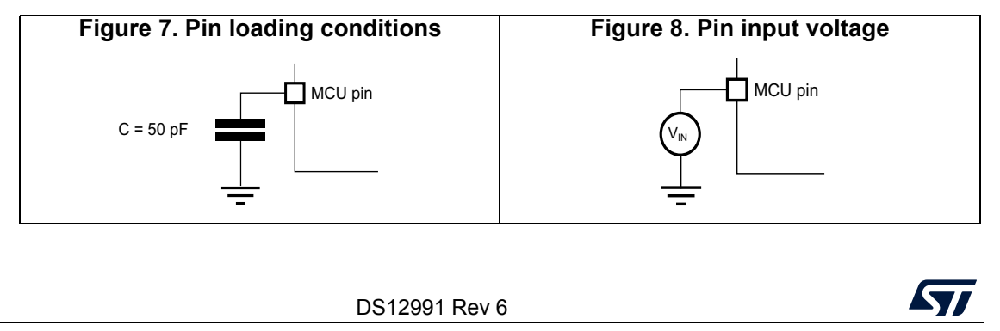
*Figure 7. Pin loading conditions Figure 8. Pin input voltage (p. 38)*

#### 5.1.6 Power supply scheme (p. 39)

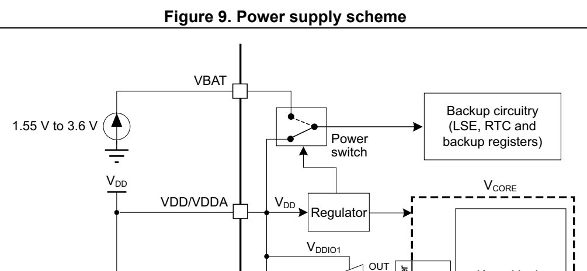
*Figure 9. Power supply scheme (p. 39)*

Kernel logic + 1 x 4.7 μF1 x 100 nF GPIOs IN Level shifter logicIO (CPU, digital andmemories)

V SS

V DDA V REF VREF+

V REF+ ADC 100 nF V REF-

V SSA VSS/VSSA

MSv47984V2

Caution: Power supply pin pair (VDD /VDDA and VSS/VSSA) must be decoupled with filtering ceramic capacitors as shown above. These capacitors must be placed as close as possible to, or below, the appropriate pins on the underside of the PCB to ensure the good functionality of the device.

#### 5.1.7 Current consumption measurement (p. 40)

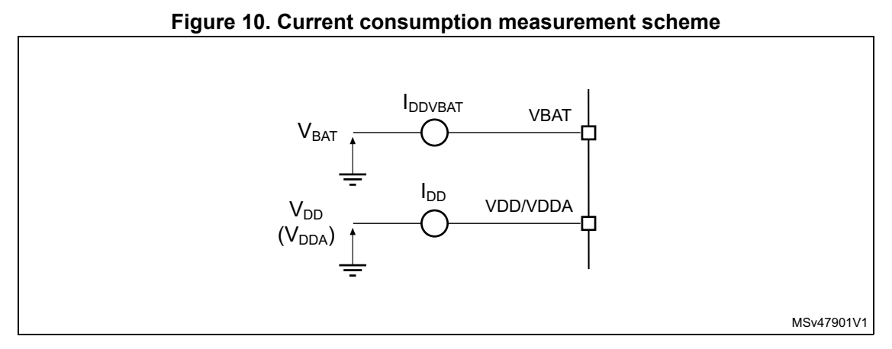
*Figure 10. Current consum ption measurement scheme (p. 40)*

### 5.2 Absolute maximum ratings (p. 40)

Stresses above the absolute maximum ratings listed in Table 18, Table 19 and Table 20 may cause permanent damage to the device. These are stress ratings only and functional operation of the device at these conditions is not implied. Exposure to maximum rating conditions for exte nded periods may affect device reli ability. The device mission profile (application conditions) is compliant with the JEDEC JESD47 qualification standard.

All voltages are defined with respect to V SS.

**Table 18. Voltage characteristics (p. 40)**

| Col 1 | Symbol Ratings Min Max Unit | Col 3 | Col 4 | Col 5 |
| --- | --- | --- | --- | --- |
| V DD | External supply voltage -0.3 4.0 V |  |  |  |
| V BAT | External supply voltage on VBAT pin -0.3 4.0 V |  |  |  |
| V REF+ | External voltage on VREF+ pin -0.3 Min( |  | V DD + 0.4, 4.0) V |  |
|  | Input voltage on FT_xx | -0.3 V | DD + 4.0 (2)(3) |  |
| V IN (1) | Input voltage on any other pin | -0.3 | 4.0 | V |

1. Refer to Table 19 for the maximum allowed injected current values. 2. To sustain a voltage higher than 4 V the inte rnal pull-up/pull-down resistors must be disabled. 3. When an FT_a pin is used by an analog peripheral such as ADC, the maximum V IN is 4 V.

**Table 19. Current characteristics (pp. 40-41)**

| Col 1 | Symbol Ratings Max Unit | Col 3 | Col 4 |
| --- | --- | --- | --- |
| I V DD/VDDA | Current into VDD/VDDA power pin (source) (1) | 100 mA |  |
| I VSS/VSSA | Current out of VSS/VSSA ground pin (sink) (2) | 100 mA |  |
|  | Output current sunk by any I/O and control pin except FT_f 15 |  |  |
| I IO(PIN) | Output current sunk by any FT_f pin 20 |  | mA |
|  | Output current sourced by any I/O and control pin 15 |  |  |
| ∑ I | Total output current sunk by sum of all I/Os and control pins 80 |  | mA |
| ∑ I IO(PIN) | Total output current sourced by sum of all I/Os and control pins 80 |  | mA |
| I INJ(PIN) (2) | Injected current on a FT_xx pin -5 / NA | (3) | mA |
| ∑ \|I INJ(PIN) \| | Total injected current (sum of all I/Os and control pins) (4) | 25 mA |  |

1. All main power (VDD/VDDA, VBAT) and ground (VSS/VSSA) pins must always be connected to the external power supplies, in the permitted range. 2. A positive injection is induced by V IN > V DDIO1 while a negative injection is induced by V IN < V SS. I INJ(PIN) must never be exceeded. Refer also to Table 18: Voltage characteristics for the maximum allowed input voltage values. 3. Positive injection is not possible on these I/Os and does not occur for input voltages lower than the specified maximum value. 4. When several inputs are submitted to a current injection, the maximum ∑ | I INJ(PIN) | is the absolute sum of the negative injected currents (instantaneous values).

**Table 20. Thermal characteristics (p. 41)**

| Col 1 | Symbol Ratings Value Unit |
| --- | --- |
| T STG | Storage temperature range -65 to +150 °C |
| T J | Maximum junction temperature 150 °C |

### 5.3 Operating conditions (p. 41)

#### 5.3.1 General operating conditions (p. 41)

**Table 21. General operating conditions (p. 41)**

| Col 1 | Col 2 | Symbol Parameter Conditions Min Max Unit | Col 4 | Col 5 | Col 6 |
| --- | --- | --- | --- | --- | --- |
| f HCLK |  | Internal AHB clock frequency - 0 64 |  |  | MHz |
| f PCLK |  | Internal APB clock frequency - 0 64 |  |  | MHz |
| V DD/DDA |  | Supply voltage - 2.0 | (1) | 3.6 V |  |
| V BAT |  | Backup operating voltage - 1.55 3.6 V |  |  |  |
| V IN |  | I/O input voltage - -0.3 Min(V |  | DD + 3.6, 5.5) (2) | V |
| T A | Ambient temperature (3) |  |  | - -40 85 °C |  |
| T J |  | Junction temperature - -40 105 °C |  |  |  |

1. When RESET is released functionality is guaranteed down to V PDR min. 2. For operation with voltage higher than V DD +0.3 V, the internal pull-up and pull-down resistors must be disabled. 3. The T A (max) applies to P D (max). At P D < P D (max) the ambient temperature is allowed to go higher than T A (max) provided that the junction temperature T J does not exceed T J (max). Refer to Section 6.6: Thermal characteristics.

#### 5.3.2 Operating conditions at power-up / power-down (p. 42)

The parameters given in Table 22 are derived from tests performed under the ambient temperature condition summarized in Table 21.

**Table 22. Operating conditions at power-up / power-down (p. 42)**

| Col 1 | Col 2 | Symbol Parameter Conditions Min Max Unit | Col 5 | Col 6 |
| --- | --- | --- | --- | --- |
| t V | slew rate | V DD rising - | ∞ | µs/V |
| t VDD V | DD slew rate | V DD falling 10 | ∞ | µs/V |

#### 5.3.3 Embedded reset and power control block characteristics (p. 42)

The parameters given in Table 23 are derived from tests performed under the ambient temperature conditions summarized in Table 21.

**Table 23. Embedded reset and power control block characteristics (p. 42)**

| Col 1 | Symbol Parameter Conditions | (1) | Col 4 | Min Typ Max Unit | Min Typ Max Unit | Col 7 |
| --- | --- | --- | --- | --- | --- | --- |
| t RSTTEMPO (2) | POR temporization when V DD crosses V POR | V DD | rising - 250 400 |  |  | μ s |
| V POR (2) | Power-on reset threshold - 2.06 2.10 2.14 V |  |  |  |  |  |
| V PDR (2) | Power-down reset threshold - 1.96 2.00 2.04 V |  |  |  |  |  |
| V hyst_POR_PDR | Hysteresis of V POR and V PDR | Hysteresis in continuous mode |  | - 20 - |  | mV |
|  |  | Hysteresis in other mode |  | - 30 - |  |  |

1. Continuous mode means Run/Sleep modes, or temperature sensor enable in Low-power run/Low-power sleep modes. 2. Specified by design. Not tested in production.

#### 5.3.4 Embedded voltage reference (p. 42)

The parameters given in Table 24 are derived from tests performed under the ambient temperature and supply voltage conditions summarized in Table 21: General operating conditions.

**Table 24. Embedded internal voltage reference (pp. 42-43)**

| Col 1 | Col 2 | Symbol Parameter Conditions Min Typ Max Unit | Col 4 | Col 5 | Col 6 | Col 8 |
| --- | --- | --- | --- | --- | --- | --- |
| V REFINT | Internal reference voltage -40°C < T | J |  | < 105°C 1.182 1.212 1.232 V |  |  |
| t (1) S_vrefint | ADC sampling time when reading the internal reference voltage | -4 | (2) |  | - - µs |  |
| t start_vrefint | Start time of reference voltage buffer when ADC is enable |  | - - 8 12 |  | (2) | µs |
| I DD(VREFINTBUF) | V REFINT buffer consumption from V DD when converted by ADC |  | - - 12.5 20 |  | (2) | µA |
| ∆V REFINT | Internal reference voltage spread over the temperature range | V DD | = 3 V - 5 7.5 |  | (2) | mV |
| T Coeff_vrefint |  | Temperature coefficient - - 30 50 |  |  | (2) | ppm/°C |
| A Coeff |  | Long term stability 1000 hours, T = 25 °C - 300 1000 |  |  | (2) | ppm |
| V DDCoeff | Voltage coefficient 3.0 V < V | DD | < 3.6 V - 250 1200 |  | (2) | ppm/V |
| V REFINT_DIV1 | 1/4 reference voltage |  |  | 24 25 26 |  |  |
| V REFINT_DIV2 |  | 1/2 reference voltage 49 50 51- |  |  |  | % V REFINT |
| V REFINT_DIV3 |  | 3/4 reference voltage 74 75 76 |  |  |  | REFINT |

1. The shortest sampling time can be determined in the application by multiple iterations. 2. Specified by design. Not tested in production.

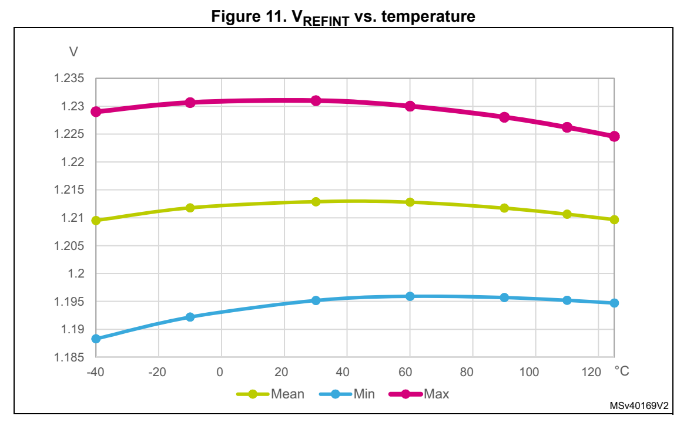
*Figure 11. V REFINT vs. temperature (p. 43)*

#### 5.3.5 Supply current characteristics (p. 43)

The current consumption is a function of several parameters and factors such as the operating voltage, ambient temperature, I/O pin loading, device software configuration, operating frequencies, I/O pin switching rate, program location in memory and executed binary code.

The current consumption is measured as described in Figure 10: Current consumption measurement scheme.

Typical and maximum current consumption

The MCU is placed under the following conditions:

- All I/O pins are in analog input mode

- All peripherals are disabled except when explicitly mentioned

- The flash memory access time is adjusted with the minimum wait states number, depending on the f HCLK frequency (refer to the table “Number of wait states according to CPU clock (HCLK) frequency” available in the RM0454 reference manual).

- When the peripherals are enabled f PCLK = f HCLK

- For flash memory and shared peripherals f PCLK = f HCLK = f HCLKS

Unless otherwise stated, values given in Table 25 through Table 31 are derived from tests performed under ambient temperature and supply voltage conditions summarized in Table 21: General operating conditions.

at different die temperatures

**Table 25. Current consumption in Run and Low-power run modes (pp. 44-45)**

| Col 1 | Col 2 | Col 3 | Col 4 | Conditions Typ Max | Col 6 | Col 7 | Col 8 | (1) | Col 10 |
| --- | --- | --- | --- | --- | --- | --- | --- | --- | --- |
|  | Symbol Parameter | General f | HCLK | Fetch from (2) |  | 25°C 85°C 25°C 85°C | 25°C 85°C 25°C 85°C |  | Unit |
|  |  |  | 64 MHz |  |  | 5.7 5.9 8.0 8.3 | 5.7 5.9 8.0 8.3 |  |  |
|  |  |  |  |  | 56 MHz 5.1 5.2 7.1 7.1 |  |  |  |  |
|  |  |  |  | Flash | 48 MHz 4.6 4.7 5.7 6.0 |  |  |  |  |
|  |  | Range 1; |  | memory | 32 MHz 3.2 3.3 4.6 4.9 |  |  |  |  |
|  |  | Range 1; PLL enabled; |  |  | 24 MHz 2.5 2.6 3.5 3.8 |  |  |  |  |
|  |  | f HCLK = f HSI bypass ( ≤ 16 MHz), |  |  | 16 MHz 1.6 1.7 2.5 2.9 |  |  |  |  |
|  |  | ( ≤ 16 MHz), f HCLK = f PLLRCLK | 64 MHz |  |  | 4.7 4.8 7.2 7.5 | 4.7 4.8 7.2 7.5 |  |  |
|  |  | (>16 MHz);(3) |  |  | 56 MHz 4.2 4.3 6.5 6.7 |  |  |  |  |
| I | Supply current in Run |  |  | SRAM | 48 MHz 3.7 3.9 5.7 6.0 |  |  |  | mA |
| I DD(Run) | current in Run mode |  |  | SRAM | 32 MHz 2.6 2.7 4.1 4.3 |  |  |  | mA |
|  |  |  |  |  | 24 MHz 2.0 2.1 3.2 3.5 |  |  |  |  |
|  |  |  |  |  | 16 MHz 1.3 1.3 2.3 2.4 |  |  |  |  |
|  |  | Range 2; | 16 MHz |  |  | 1.3 1.3 2.0 2.3 | 1.3 1.3 2.0 2.3 |  |  |
|  |  | Range 2; PLL enabled; |  | Flash memory | 8 MHz 0.7 0.8 1.4 1.5 |  |  |  |  |
|  |  | f HCLK = f HSI bypass ( ≤ 16 MHz), |  |  | 2 MHz 0.3 0.3 0.6 0.9 |  |  |  |  |
|  |  | ( ≤ 16 MHz), f HCLK = f PLLRCLK | 16 MHz |  |  | 1.1 1.1 1.9 2.1 | 1.1 1.1 1.9 2.1 |  |  |
|  |  | (>16 MHz);(3) |  | SRAM | 8 MHz 0.6 0.6 1.2 1.4 |  |  |  |  |
|  |  |  |  |  | 2 MHz 0.2 0.3 0.6 0.9 |  |  |  |  |
|  | Symbol Parameter | General f | HCLK | Fetch from (2) |  | 25°C 85°C 25°C 85°C | 25°C 85°C 25°C 85°C |  | Unit |
|  |  |  | 2 MHz |  |  | 182 226 570 790 | 182 226 570 790 |  |  |
|  |  |  |  |  | 1 MHz 99 132 480 700 |  |  |  |  |
|  |  |  |  | Flash memory | 500 kHz 58 89 430 630 |  |  |  |  |
|  | Supply | PLL disabled;; f = f bypass |  |  | 125 kHz 25 56 370 600 |  |  |  |  |
| I | Supply current in | f HCLK = f HSE bypass (> 32 kHz), |  |  | 32 kHz 17 47 330 480 |  |  |  | µA |
| I DD(LPRun) | Low-power run mode | f HCLK = f LSE bypass (= 32 kHz); | 2 MHz |  |  | 161 191 550 800 | 161 191 550 800 |  | µA |
|  | run mode | (= 32 kHz);(3) |  |  | 1 MHz 91 114 470 750 |  |  |  |  |
|  |  |  |  | SRAM | 500 kHz 48 81 410 710 |  |  |  |  |
|  |  |  |  |  | 125 kHz 21 51 360 500 |  |  |  |  |
|  |  |  |  |  | 32 kHz 15 37 310 400 |  |  |  |  |

1. Based on characterization results, not tested in production. 2. Prefetch and cache enabled when fetching from flash memo ry. Code compiled with high optimization for space in SRAM. 3. V DD = 3.0 V for values in Typ columns and 3.6 V for values in Max columns, all peripherals disabled.

**Table 26. Current consumption in Sleep and Low-power sleep modes (p. 45)**

| Col 1 | Col 2 | Col 3 | Col 4 | Col 5 | Col 6 | Conditions Typ Max | Col 9 | Col 10 | (1) | Col 12 |
| --- | --- | --- | --- | --- | --- | --- | --- | --- | --- | --- |
|  |  |  | Symbol Parameter | General | Voltage scaling | f HCLK | 25°C 85°C 25°C 85°C | 25°C 85°C 25°C 85°C |  | Unit |
|  |  |  |  |  |  |  | 64 MHz 1.4 1.5 2.2 2.4 |  |  |  |
|  |  |  |  |  |  |  | 56 MHz 1.3 1.4 1.9 2.1 |  |  |  |
|  |  |  |  | Flash memory enabled; | Range 1 |  | 48 MHz 1.2 1.2 1.9 1.9 |  |  |  |
|  |  |  | Supply | f HCLK = f HSE bypass | Range 1 |  | 32 MHz 0.9 0.9 1.4 1.5 |  |  |  |
| I | I DD(Sleep) | DD(Sleep) | current in | ( ≤ 16 MHz; PLL disabled), f HCLK = f PLLRCLK |  |  | 24 MHz 0.7 0.8 1.1 1.3 |  |  | mA |
|  |  |  | Sleep mode | HCLK PLLRCLK (>16 MHz; PLL enabled); |  |  | 16 MHz 0.4 0.4 0.7 0.8 |  |  |  |
|  |  |  |  | All peripherals disabled |  |  | 16 MHz 0.3 0.4 0.6 0.7 |  |  |  |
|  |  |  |  |  | Range 2 |  | 8 MHz 0.2 0.3 0.3 0.6 |  |  |  |
|  |  |  |  |  |  |  | 2 MHz 0.1 0.2 0.2 0.5 |  |  |  |
|  |  |  |  |  |  |  | 2 MHz 43 77 175 410 |  |  |  |
|  |  |  | Supply | Flash memory disabled; PLL disabled; |  |  | 1 MHz 29 60 150 375 |  |  |  |
| I | DD(LPSleep) | DD(LPSleep) | current in Low-power | f HCLK = f HSE bypass (> 32 kHz), |  |  | 500 kHz 23 52 145 285 |  |  | µA |
|  |  |  | sleep mode | f HCLK = f LSE bypass (= 32 kHz); All peripherals disabled |  |  | 125 kHz 16 46 130 270 |  |  |  |
|  |  |  |  | All peripherals disabled |  |  | 32 kHz 13 44 125 260 |  |  |  |

1. Based on characterization results, not tested in production.

**Table 27. Current consumption in Stop 0 mode (p. 46)**

| Col 1 | Symbol Parameter | Col 3 | Conditions Typ Max | Col 6 | Col 7 | (1) | Unit |
| --- | --- | --- | --- | --- | --- | --- | --- |
|  | Symbol Parameter | V DD |  | 25°C 85°C 25°C 85°C | 25°C 85°C 25°C 85°C |  | Unit |
|  |  |  |  | 2.4 V 290 320 395 540 |  |  |  |
|  |  | HSI kernel ON |  | 3 V 295 325 415 580 |  |  |  |
| I | Supply current |  |  | 3.6 V 295 325 445 595 |  |  | µA |
| I DD(Stop 0) | in Stop 0 mode |  |  | 2.4 V 105 145 145 265 |  |  | µA |
|  |  | HSI kernel OFF |  | 3 V 105 150 150 285 |  |  |  |
|  |  |  |  | 3.6 V 110 150 150 295 |  |  |  |

1. Based on characterization results, not tested in production.

**Table 28. Current consumption in Stop 1 mode (p. 46)**

| Symbol Parameter | Symbol Parameter | Col 3 | Col 4 | Col 5 | Conditions Typ Max | Col 7 | Col 8 | (1) | Unit |
| --- | --- | --- | --- | --- | --- | --- | --- | --- | --- |
| Symbol Parameter | Symbol Parameter |  | RTC V | DD |  | 25°C 85°C 25°C 85°C | 25°C 85°C 25°C 85°C |  | Unit |
|  |  |  |  |  |  | 2.4 V 3.4 28 17 130 |  |  |  |
|  |  |  | Disabled |  |  | 3 V 3.6 28 22 140 |  |  |  |
| I | Supply current in | Flash memory not |  |  |  | 3.6 V 3.9 29 28 155 |  |  | µA |
| I DD(Stop 1) | current in Stop 1 mode | memory not powered | Enabled |  |  | 2.4 V 3.9 28 22 140 |  |  | µA |
|  |  |  | (clocked by LSE |  |  | 3 V 4.1 29 23 155 |  |  |  |
|  |  |  | bypass) |  |  | 3.6 V 4.6 29 28 160 |  |  |  |

1. Based on characterization results, not tested in production.

**Table 29. Current consumption in Standby mode (p. 46)**

| Col 1 | Symbol Parameter | Col 3 | Col 4 | Conditions Typ Max | Col 6 | Col 7 | (1) | Unit |
| --- | --- | --- | --- | --- | --- | --- | --- | --- |
|  | Symbol Parameter | General V | DD |  | 25°C 85°C 25°C 85°C | 25°C 85°C 25°C 85°C |  |  |
|  |  |  |  |  | 2.4 V 1.0 1.8 2.1 14 |  |  |  |
|  |  | RTC disabled |  |  | 3.0 V 1.2 2.1 2.7 16 |  |  |  |
| I | Supply current in |  |  |  | 3.6 V 1.4 2.5 3.0 19 |  |  | µA |
| DD(Standby) | Standby mode | RTC enabled, |  |  | 2.4 V 1.3 2.1 2.2 17 |  |  | µA |
|  |  | RTC enabled, clocked by LSI |  |  | 3.0 V 1.7 2.5 2.9 19 |  |  |  |
|  |  |  |  |  | 3.6 V 2.1 3.0 3.8 19 |  |  |  |
|  | 1. Based on characterization results, not tested in production. |  |  |  |  |  |  |  |

**Table 30. Current consumption in VBAT mode (p. 47)**

| Symbol Parameter | Symbol Parameter | Col 3 | Conditions Typ | Col 5 | Col 6 | Unit |
| --- | --- | --- | --- | --- | --- | --- |
| Symbol Parameter | Symbol Parameter | RTC V | BAT | 25°C 85°C | 25°C 85°C |  |
|  |  | Enabled, clocked by |  | 2.4 V 270 360 |  |  |
|  |  | LSE bypass at |  | 3.0 V 360 460 |  |  |
| I | Supply current in | 32.768 kHz |  | 3.6 V 470 600 |  | nA |
| DD_VBAT | VBAT mode | Enabled, clocked by |  | 2.4 V 410 440 |  |  |
|  |  | LSE crystal at |  | 3.0 V 510 530 |  |  |
|  |  | 32.768 kHz |  | 3.6 V 630 770 |  |  |

I/O system current consumption

The current consumption of the I/O system has two components: static and dynamic.

I/O static current consumption

All the I/Os used with internal or external pull-up or pull-down resistor generate current consumption when the pin is externally or internally tied low or high, respectively. The value of this current consumption can be simply co mputed by using the pull-up/pull-down resistor values. For internal pull-up/p ull-down resistors, the indicative values are given in Table 48: I/O static characteristics. Any other external load must also be considered to estimate the current consumption.

Additional I/O current consumption is due to I/Os configured as inputs if an intermediate voltage level is externally app lied. This current consumption is caused by the input Schmitt trigger circuits used to discriminate the inpu t value. Unless this specific configuration is required by the application, this supply current consumption can be avoided by configuring these I/Os in analog mode. This is notably th e case of ADC input pins which should be configured as analog inputs.

Caution: Any floating input pin can also settle to an intermediate voltage level or switch inadvertently, as a result of external electromagnetic nois e. To avoid current consumption related to floating pins, they must either be configured in analog mode, or forced internally to a definite digital value. This can be done either by usin g pull-up/down resistors or by configuring the pins in output mode.

I/O dynamic current consumption

In addition to the internal peripheral current consumption measured previously (see Table 31: Current consumption of peripherals), the I/Os used by an application also contribute to the current consumption. When an I/O pin switches, it uses the current from the I/O supply voltage to supply the I/O pin ci rcuitry and to charge/discharge the capacitive load (internal and external) connected to the pin:

I = V × f × C SW DDIO1 SW

where I SW is the current sunk by a switching I/O to charge/discharge the capacitive load V DDIO1 is the I/O supply voltage f SW is the I/O switching frequency C is the total capacitance seen by the I/O pin: C = C INT + C EXT + C S C S is the PCB board capacita nce including the pad pin.

The test pin is configured in push-pull output mode and is toggled by software at a fixed frequency.

On-chip peripheral current consumption

The current consumption of the on-chip periphera ls is given in the following table. The MCU is placed under the following conditions:

- All I/O pins are in Analog mode

- The given value is calculated by measuring the difference of the current consumptions: – when the peripheral is clocked on – when the peripheral is clocked off

- Ambient operating temperature and supply voltage conditions summarized in Table 18: Voltage characteristics

- The power consumption of the digital part of the on-chip peripherals is given in the following table. The power consumption of th e analog part of the peripherals (where applicable) is indicated in each related section of the datasheet.

**Table 31. Current consumption of peripherals (pp. 48-49)**

| Col 1 | Col 3 | Consumption in µA/MHz | Col 5 |
| --- | --- | --- | --- |
| Peripheral Bus | Range 1 Range 2 | Range 1 Range 2 | Low-power run and sleep |
|  | IOPORT Bus IOPORT 0.5 0.4 0.3 |  |  |
|  | GPIOA IOPORT 3.1 2.4 3.0 |  |  |
|  | GPIOB IOPORT 2.9 2.3 3.0 |  |  |
|  | GPIOC IOPORT 0.9 0.8 1.0 |  |  |
|  | GPIOD IOPORT 0.7 0.6 1.0 |  |  |
|  | GPIOF IOPORT 0.5 0.5 1.0 |  |  |
|  | Bus matrix AHB 3.2 2.2 2.8 |  |  |
|  | All AHB Peripherals AHB 9.8 8.2 8.5 |  |  |
|  | DMA1/DMAMUX AHB 3.4 2.9 3.0 |  |  |
|  | CRC AHB 0.5 0.4 0.5 |  |  |
|  | FLASH AHB 4.3 3.6 3.5 |  |  |
|  | All APB peripherals APB 23.5 20.0 20.5 |  |  |
| AHB to APB bridge (1) |  | APB 0.2 0.2 0.1 |  |
|  | PWR APB 0.4 0.3 0.5 |  |  |
|  | SYSCFG APB 0.4 0.4 0.5 |  |  |
|  | WWDG APB 0.2 0.3 0.5 |  |  |
| Peripheral Bus | Range 1 Range 2 | Range 1 Range 2 | Low-power run and sleep |
|  | TIM1 APB 7.0 5.9 6.5 |  |  |
|  | TIM3 APB 3.6 3.1 3.5 |  |  |
|  | TIM14 APB 1.5 1.3 1.5 |  |  |
|  | TIM16 APB 2.3 2.0 2.5 |  |  |
|  | TIM17 APB 1.0 0.8 0.3 |  |  |
|  | I2C1 APB 3.2 2.7 3.0 |  |  |
|  | I2C2 APB 0.7 0.6 1.0 |  |  |
|  | SPI1 APB 2.2 1.8 2.0 |  |  |
|  | SPI2 APB 1.3 1.1 1.5 |  |  |
|  | USART1 APB 6.6 5.6 6.0 |  |  |
|  | USART2 APB 1.8 1.5 2.0 |  |  |
|  | ADC APB 1.6 1.5 1.5 |  |  |

1. The AHB to APB Bridge is automatically active when at least one peripheral is ON on the APB.

#### 5.3.6 Wakeup time from low-power modes and voltage scaling (p. 49)

transition times

The wakeup times given in Table 32 are the latency between the event and the execution of the first user instruction.

**Table 32. Low-power mode wakeup times (1) (pp. 49-50)**

| Col 1 | Col 2 | Col 4 | Symbol Parameter Conditions Typ Max Unit | Col 6 | Col 7 | Col 8 |
| --- | --- | --- | --- | --- | --- | --- |
| t | WUSLEEP | Wakeup time from Sleep to Run mode | - 11 11 |  |  | CPU cycles |
| t | WULPSLEEP | Wakeup time from Low-power sleep mode | Transiting to Low-power-run-mode execution in flash memory not powered in Low-power sleep mode; HCLK = HSI16 / 8 = 2 MHz | 11 14 | 11 14 | CPU cycles |
| t |  | Wakeup time from | Transiting to Run-mode execution in flash memory not powered in Stop 0 mode; HCLK = HSI16 = 16 MHz; Regulator in Range 1 or Range 2 | 5.6 6 | 5.6 6 | µs |
| t | WUSTOP0 | Stop 0 | Transiting to Run-mode execution in SRAM or in flash memory powered in Stop 0 mode; HCLK = HSI16 = 16 MHz; Regulator in Range 1 or Range 2 | 2 2.4 | 2 2.4 | µs |
|  |  | Transiting to Run-mode execution in flash memory not powered in Stop 1 mode; HCLK = HSI16 = 16 MHz; Regulator in Range 1 or Range 2 | 9.0 11.2 | 9.0 11.2 |  |  |
| t | Wakeup time from | Transiting to Run-mode execution in SRAM or in flash memory powered in Stop 1 mode; HCLK = HSI16 = 16 MHz; Regulator in Range 1 or Range 2 | 5 7.5 | 5 7.5 | µs |  |
| t WUSTOP1 | Stop 1 | Transiting to Low-power-run-mode execution in flash memory not powered in Stop 1 mode; HCLK = HSI16/8 = 2 MHz; Regulator in low-power mode (LPR = 1 in PWR_CR1) | 22 25.3 | 22 25.3 | µs |  |
|  |  | Transiting to Low-power-run-mode execution in SRAM or in flash memory powered in Stop 1 mode; HCLK = HSI16 / 8 = 2 MHz; Regulator in low-power mode (LPR = 1 in PWR_CR1) |  | 18 23.5 |  |  |
| t WUSTBY | Wakeup time from Standby mode | Transiting to Run mode; HCLK = HSI16 = 16 MHz; Regulator in Range 1 |  | 14.5 30 µs |  |  |
| t WULPRUN | Wakeup time from Low-power run(2) mode | Transiting to Run mode; HSISYS = HSI16/8 = 2 MHz |  | 5 7 µs |  |  |

1. Based on characterization results, not tested in production. 2. Time until REGLPF flag is cleared in PWR_SR2.

**Table 33. Regulator mode transition times (1) (p. 50)**

| Col 1 | Col 2 | Symbol Parameter Conditions Typ Max Unit |
| --- | --- | --- |
| t VOST | Transition times between regulator(2) Range 1 and Range 2 | HSISYS = HSI16 20 40 µs |
|  | 1. Based on characterization results, not tested in production. 2. Time until VOSF flag is cleared in PWR_SR2. |  |

#### 5.3.7 External clock source characteristics (p. 51)

High-speed external user clock generated from an external source

In bypass mode the HSE oscilla tor is switched off and the in put pin is a standard GPIO.

The external clock signal has to respect the I/O characteristics in Section 5.3.14. See Figure 12 for recommended clock input waveform.

**Table 34. High-speed external user clock characteristics (1) (p. 51)**

| Col 1 | Col 2 | Symbol Parameter Conditions Min Typ Max Unit | Col 4 | Col 5 | Col 6 | Col 7 |
| --- | --- | --- | --- | --- | --- | --- |
| f | User external clock source frequency | Voltage scaling Range 1 |  | - 8 48 |  | MHz |
| f HSE_ext | User external clock source frequency | Voltage scaling Range 2 |  | - 8 26 |  | MHz |
| V HSEH | OSC_IN input pin high level voltage - 0.7 V |  | DDIO1 | -V | DDIO1 | V |
| V HSEL | OSC_IN input pin low level voltage - V |  | SS | - 0.3 V | - 0.3 V DDIO1 | V |
| t w(HSEH) | OSC_IN high or low time | Voltage scaling Range 1 |  | 7- - |  | ns |
| t w(HSEL) | OSC_IN high or low time | Voltage scaling Range 2 |  | 18 - - |  | ns |

1. Specified by design. Not tested in production.

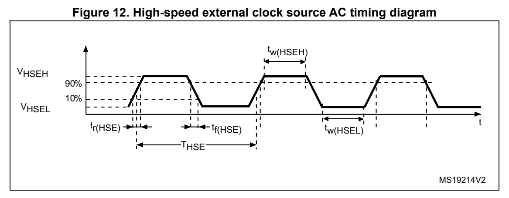
*Figure 12. High-speed external clock source AC timing diagram (p. 51)*

Low-speed external user clock generated from an external source

In bypass mode the LSE oscillator is switched off and the input pin is a standard GPIO.

The external clock signal has to respect the I/O characteristics in Section 5.3.14. See Figure 13 for recommended clock input waveform.

**Table 35. Low-speed external user clock characteristics (1) (pp. 51-52)**

| Col 1 | Col 2 | Col 3 | Symbol Parameter Conditions Min Typ Max Unit | Col 5 | Col 6 | Col 7 | Col 8 |
| --- | --- | --- | --- | --- | --- | --- | --- |
| f | LSE_ext |  | User external clock source frequency - - 32.768 1000 kHz |  |  |  |  |
| V | V LSEH | OSC32_IN input pin high level voltage - 0.7 V |  | DDIO1 | -V | DDIO1 | V |
| V LSEL | OSC32_IN input pin low level voltage - V |  | SS | - 0.3 V | - 0.3 V DDIO1 | V |  |
| t t w(LSEH)w(LSEL) |  | OSC32_IN high or low time - 250 - - ns |  |  |  |  |  |

1. Specified by design. Not tested in production.

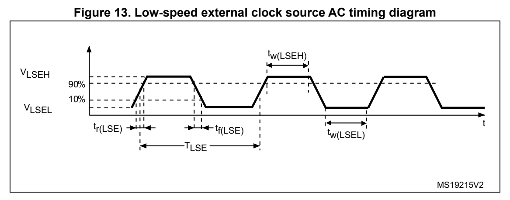
*Figure 13. Low-speed external cl ock source AC timing diagram (p. 52)*

High-speed external clock generated from a crystal/ceramic resonator

The high-speed external (HSE) clock can be supplied with a 4 to 48 MHz crystal/ceramic resonator oscillator. All the information given in this pa ragraph are base d on design simulation results obtained with typical external components specified in Table 36. In the application, the resonator and the load capacito rs have to be placed as close as possible to the oscillator pins in order to minimize outpu t distortion and startup stabilization time. Refer to the crystal resonator manufa cturer for more details on the resonator characteristics (frequency, package, accuracy).

**Table 36. HSE oscillator characteristics (1) (pp. 52-53)**

| Col 1 | Symbol Parameter Conditions | (2) | Min Typ Max Unit | Col 8 |
| --- | --- | --- | --- | --- |
| f OSC_IN |  | Oscillator frequency - 4 8 48 MHz |  |  |
| R F |  | Feedback resistor - - 200 - k |  | Ω |
|  |  | During startup (3) |  | - - 5.5 |
|  |  | V DD = 3 V, Rm = 30 Ω , CL = 10 pF@8 MHz |  | - 0.58 - |
|  |  | V DD = 3 V, Rm = 45 Ω , CL = 10 pF@8 MHz |  | - 0.59 - |
| I DD(HSE) | HSE current consumption | V DD = 3 V, Rm = 30 Ω , CL = 5 pF@48 MHz |  | - 0.89 - |
|  |  | V DD = 3 V, Rm = 30 Ω , CL = 10 pF@48 MHz |  | - 1.14 - |
|  |  | V DD = 3 V, Rm = 30 Ω , CL = 20 pF@48 MHz |  | - 1.94 - |
| G m | Maximum critical crystal transconductance |  | Startup - - 1.5 mA/V |  |
| t SU(HSE) (4) | Startup time V | DD | is stabilized - 2 - ms |  |

1. Specified by design. Not tested in production. 2. Resonator characteristics given by the crystal/ceramic resonator manufacturer. 3. This consumption level occurs during the first 2/3 of the t SU(HSE) startup time 4. t SU(HSE) is the startup time measured from the moment it is enabled (by software) to a stab ilized 8 MHz os cillation is reached. This value is measured for a standard crystal resonator and it can vary signi ficantly with the crystal manufacturer

For C L1 and C L2, it is recommended to use high-quality external ceramic capacitors in the 5 pF to 20 pF range (typ.), designed for high-frequency applications, and selected to match the requirements of the crystal or resonator (see Figure 14). C L1 and C L2 are usually the same size. The crystal manufacturer typically specifies a lo ad capacitance which is the series combination of C L1 and C L2. PCB and MCU pin capacitance must be included (10 pF can be used as a rough estimate of the comb ined pin and board capacitance) when sizing C L1 and C L2.

Note: For information on selecting the crystal, refer to the application note AN2867 “Oscillator design guide for ST microcontrollers” available from the ST website www.st.com.

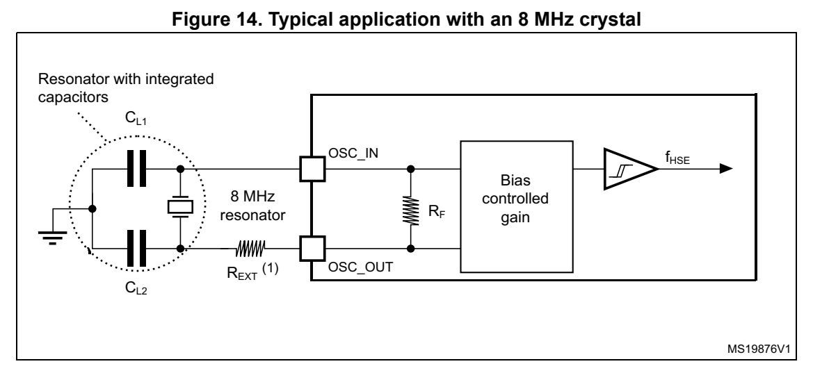
*Figure 14. Typical application with an 8 MHz crystal (p. 54)*

1. R EXT value depends on the crystal characteristics.

Low-speed external clock generated from a crystal resonator

The low-speed external (LSE) clock can be supplied with a 32.768 kHz crystal resonator oscillator. All the info rmation given in this paragraph are based on design simulation results obtained with typical external components specified in Table 37. In the application, the resonator and the load capacitors have to be placed as close as possible to the oscillator pins in order to minimize output distortion a nd startup stabilization time. Refer to the crystal resonator manufacturer for more details on the resonator characteristics (frequency, package, accuracy).

**Table 37. LSE oscillator characteristics (f LSE = 32.768 kHz) (1) (p. 54)**

| Col 1 | Symbol Parameter Conditions | (2) | Min Typ Max Unit | Min Typ Max Unit | Col 7 |
| --- | --- | --- | --- | --- | --- |
|  |  | LSEDRV[1:0] = 00 Low drive capability | - 250 - |  |  |
| I | LSE current consumption | LSEDRV[1:0] = 01 Medium low drive capability | - 315 - |  | nA |
| I DD(LSE) | LSE current consumption | LSEDRV[1:0] = 10 Medium high drive capability | - 500 - |  | nA |
|  |  | LSEDRV[1:0] = 11 High drive capability | - 630 - |  |  |
|  |  | LSEDRV[1:0] = 00 Low drive capability | - - 0.5 |  |  |
| Gm | Maximum critical crystal | LSEDRV[1:0] = 01 Medium low drive capability | - - 0.75 |  | µA/V |
| Gm critmax | gm | LSEDRV[1:0] = 10 Medium high drive capability | - - 1.7 |  | µA/V |
|  |  | LSEDRV[1:0] = 11 High drive capability | - - 2.7 |  |  |
| t SU(LSE) (3) | Startup time V | DD is stabilized - 2 - s |  |  |  |

1. Specified by design. Not tested in production. 2. Refer to the note and caution paragraphs below the table, and to the application note AN2867 “Oscillator design guide for ST microcontrollers”.

3. t SU(LSE) is the startup time measured from the moment it is enab led (by software) to a stabilized 32.768 kHz oscillation is reached. This value is measured for a standard crystal and it can vary significantly with the crystal manufacturer

Note: For information on selecting the crystal, refer to the application note AN2867 “Oscillator design guide for ST microcontrollers” available from the ST website www.st.com.

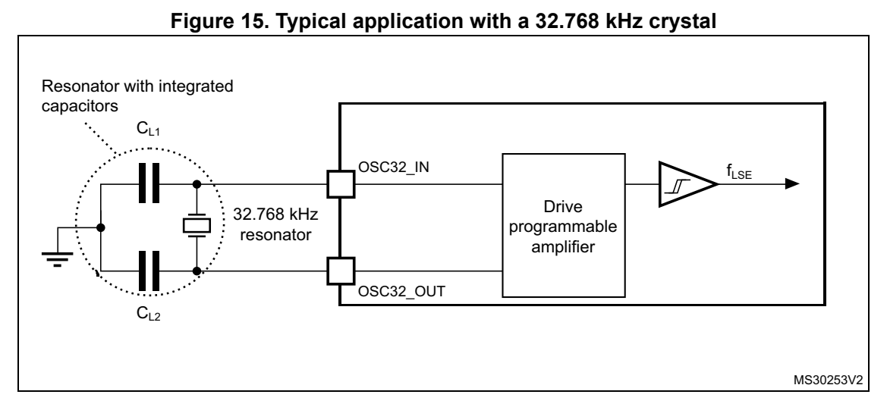
*Figure 15. Typical application with a 32.768 kHz crystal (p. 55)*

Note: An external resistor is not required between OSC32_IN and OSC32_OUT and it is forbidden to add one.

#### 5.3.8 Internal clock source characteristics (p. 55)

The parameters given in Table 38 are derived from tests performed under ambient temperature and supply voltage conditions summarized in Table 21: General operating conditions. The provided curves are characterization results, not tested in production.

High-speed internal (HSI16) RC oscillator

**Table 38. HSI16 oscillator characteristics (1) (pp. 55-56)**

| Col 2 | Col 3 | Symbol Parameter Condi | Col 5 | Col 6 | tions Min Typ Max Unit | Col 9 |
| --- | --- | --- | --- | --- | --- | --- |
| f | HSI16 | HSI16 Frequency V | DD =3.0 V, T A |  | =30 °C 15.88 - 16.08 MHz |  |
| ∆ |  | HSI16 oscillator frequency drift over | T A | = 0 to 85 °C -1 - 1 % |  |  |
| ∆ | Temp(HSI16) | temperature | T A | = -40 to 85 °C -2 - 1.5 |  | % |
| ∆ | VDD(HSI16) | HSI16 oscillator frequency drift over V DD | V DD =V DD | (min) to 3.6 V -0.1 - 0.05 % | (min) to 3.6 V -0.1 - 0.05 % |  |
|  |  |  | From code 127 to 128 -8 -6 -4 |  |  |  |
|  |  | TRIM HSI16 frequency user trimming step | From code 63 to 64 From code 191 to 192 |  | -5.8 -3.8 -1.8 | % |
|  |  |  | For all other code increments |  | 0.2 0.3 0.4 |  |
| D | (2) HSI16 |  | Duty Cycle - 45 - 55 % |  |  |  |
| t su(HSI16) | (2) su(HSI16) | HSI16 oscillator st | art-up time - - 0.8 1.2 |  |  | μ s |
| t (2) stab(HSI16) | HSI16 oscillator st | abilization time - - 3 5 |  | μ s |  |  |
| I (2) DD(HSI16) |  | HSI16 oscillator power consumption - - 155 190 |  | μ A |  |  |

1. Based on characterization results, not tested in production. 2. Specified by design. Not tested in production.

Low-speed internal (LSI) RC oscillator

**Table 39. LSI oscillator characteristics (1) (p. 56)**

| Col 1 | Col 2 | Symbol Parameter Conditions Min Typ Max Unit | Col 4 | Col 5 | Col 7 |
| --- | --- | --- | --- | --- | --- |
|  |  | V DD = 3.0 V, T A = 30 °C 31.04 - 32.96 |  |  |  |
| f LSI | LSI frequency | V DD = V DD (min) to 3.6 V, T A = -40 to 85 °C |  | 29.5 - 34 | kHz |
| t SU(LSI) (2) |  | LSI oscillator start-up time - - 80 130 |  |  | μ s |
| t (2) STAB(LSI) |  | LSI oscillator stabilization time 5% of final frequency - 125 180 |  |  | μ s |
| I DD(LSI) (2) | LSI oscillator power consumption |  | - - 110 180 nA |  |  |

1. Based on characterization results, not tested in production. 2. Specified by design. Not tested in production.

#### 5.3.9 PLL characteristics (p. 56)

The parameters given in Table 40 are derived from tests performed under temperature and V DD supply voltage conditions summarized in Table 21: General operating conditions.

**Table 40. PLL characteristics (1) (pp. 56-57)**

| Col 1 | Col 2 | Symbol Parameter Conditions Min Typ Max Unit | Col 4 | Col 5 | Col 7 |
| --- | --- | --- | --- | --- | --- |
| f PLL_IN | PLL input clock frequency (2) |  | - 2.66 - 16 MHz |  |  |
| D PLL_IN |  | PLL input clock duty cycle - 45 - 55 % |  |  |  |
| f | PLL multiplier output clock P | Voltage scaling Range 1 3.09 - 122 |  |  | MHz |
| f PLL_P_OUT | PLL multiplier output clock P | Voltage scaling Range 2 3.09 - 40 |  |  | MHz |
| f | PLL multiplier output clock R | Voltage scaling Range 1 12 - 64 |  |  | MHz |
| f PLL_R_OUT | PLL multiplier output clock R | Voltage scaling Range 2 12 - 16 |  |  | MHz |
| f | PLL VCO output | Voltage scaling Range 1 96 - 344 |  |  | MHz |
| f VCO_OUT | PLL VCO output | Voltage scaling Range 2 96 - 128 |  |  | MHz |
| t LOCK |  | PLL lock time - - 15 40 |  |  | μ s |
| Jitter | RMS cycle-to-cycle jitter | System clock 56 MHz |  | - 50 - | ±ps |
| Jitter |  | System clock 56 MHz RMS period jitter - 40 - |  |  | ±ps |
|  |  | VCO freq = 96 MHz - 200 260 |  |  |  |
| I DD(PLL) | PLL power consumption(1) on V DD | VCO freq = 192 MHz - 300 380 | μ A |  |  |
|  | DD | VCO freq = 344 MHz - 520 650 |  |  |  |

1. Specified by design. Not tested in production. 2. Make sure to use the appropriate division factor M to obtain the specified PLL input clock values.

#### 5.3.10 Flash memory characteristics (p. 57)

**Table 41. Flash memory characteristics (1) (p. 57)**

| Col 1 | Col 2 | Symbol Parameter Conditions Typ Max Unit | Col 4 | Col 5 | Col 6 |
| --- | --- | --- | --- | --- | --- |
| t prog |  | 64-bit programming time - 85 125 µs |  |  |  |
| t | Row (32 double word) programming time | Normal programming 2.7 4.6 |  |  | ms |
| t prog_row | Row (32 double word) programming time | Fast programming 1.7 2.8 |  |  | ms |
| t | Page (2 Kbyte) programming time | Normal programming 21.8 36.6 |  |  | ms |
| t prog_page | Page (2 Kbyte) programming time | Fast programming 13.7 22.4 |  |  | ms |
| t ERASE |  | Page (2 Kbyte) erase time - 22.0 40.0 ms |  |  |  |
| t | Bank (64 Kbyte (2)) programming time | Normal programming 0.7 1.2 |  |  | s |
| t prog_bank | Bank (64 Kbyte) programming time | Fast programming 0.4 0.7 |  |  | s |
| t ME |  | Mass erase time - 22.1 40.1 ms |  |  |  |
|  |  | Programming 3 - |  |  |  |
| I DD(FlashA) | Average consumption from V DD | Page erase 3 - |  |  | mA |
|  |  | Mass erase 5 - |  |  |  |
| I DD(FlashP) | Maximum current (peak) | Programming, 2 µs peak duration | 7- | 7- | mA |
|  |  | Erase, 41 µs peak duration 7 - |  |  |  |

1. Specified by design. Not tested in production. 2. Values provided also apply to devices with less flash memory than one 64 Kbyte bank

**Table 42. Flash memory endurance and data retention (p. 57)**

| Col 2 | Col 3 | Col 4 | Symbol Parameter Conditions Min | (1) | Unit |
| --- | --- | --- | --- | --- | --- |
| N END | END | Endurance T | A = -40 to +85 °C 1 kcycles |  |  |
| t RET |  | Data retention 1 kcycle | (2) at T A = 85 °C 15 Years |  |  |
|  |  | 1. Guaranteed by characterization results. 2. Cycling performed over the whole temperature range. |  |  |  |

#### 5.3.11 EMC characteristics (p. 58)

Susceptibility tests are performed on a sample basis during device characterization.

Functional EMS (electromagnetic susceptibility)

While a simple application is executed on t he device (toggling 2 LEDs through I/O ports). the device is stressed by two electromagnetic events until a failure occurs. The failure is indicated by the LEDs:

- Electrostatic discharge (ESD) (positive and negative) is applied to all device pins until a functional disturbance occurs. This test is compliant with the IEC 61000-4-2 standard.

- FTB: A Burst of Fast Transient voltage (positive and negative) is applied to V DD and V SS through a 100 pF capacitor, until a functional disturbance occurs. This test is compliant with the IEC 61000-4-4 standard.

A device reset allows normal operations to be resumed.

The test results are given in Table 43. They are based on the EMS levels and classes defined in application note AN1709.

**Table 43. EMS characteristics (p. 58)**

| Col 1 | Symbol Parameter Conditions | Col 3 | Level/ Class |
| --- | --- | --- | --- |
| V FESD | Voltage limits to be applied on any I/O pin to induce a functional disturbance | V DD = 3.3 V, T A = +25 °C, f HCLK = 64 MHz, LQFP48, conforming to IEC 61000-4-2 | 2B |
| V EFTB | Fast transient voltage burst limits to be applied through 100 pF on V DD and V SS pins to induce a functional disturbance | V DD = 3.3 V, T A = +25 °C, f HCLK = 64 MHz, LQFP48, conforming to IEC 61000-4-4 | 5A |
|  | Designing hardened software to avoid noise problems EMC characterization and optimization are per application environment and simplified MCU so performance is highly dependent on the user Therefore it is recommended that the us prequalification tests in re lation with the EMC level requ Software recommendations The software flowchart must include the management of runaway conditions such as: • corrupted program counter • unexpected reset • critical data corruption (for example control registers) | formed at component level with a typical ftware. It should be noted that good EMC application and the software in particular. er applies EMC software optimization and ested for his application. |  |

Prequalification trials

Most of the common failures (unexpected reset and program counter corruption) can be reproduced by manually forc ing a low state on the NRST pin or the Oscillator pins for 1 second.

To complete these trials, ESD stress can be applie d directly on the device, over the range of specification values. When unexpected behavior is detected, the software can be hardened to prevent unrecoverable errors occurring (see application note AN1015).

Electromagnetic Interference (EMI)

The electromagnetic field emitted by the device are monitored while a simple application is executed (toggling 2 LEDs through the I/O ports). This emission test is compliant with IEC 61967-2 standard which specifies the test board and the pin loading.

**Table 44. EMI characteristics (p. 59)**

| Col 1 | Col 2 | Col 3 | Symbol Parameter Conditions Monitored frequency band Value Unit | Col 6 |
| --- | --- | --- | --- | --- |
|  |  |  | 0.1 MHz to 30 MHz -4 |  |
|  | Peak (1) | f HSE = 8 MHz f HCLK = 64 MHz | 30 MHz to 130 MHz 1 | dBµV |
| S EMI | Peak | HCLK V DD = 3.6 V, T A = 25 °C, | 130 MHz to 1 GHz 3 | dBµV |
|  |  | LQFP64 package compliant with IEC 61967-2 | 1 GHz to 2 GHz 8 |  |
|  | Level (2) |  | 0.1 MHz to 2 GHz 2.5 - |  |

1. Refer to AN1709 “EMI radiated test” section. 2. Refer to AN1709 “EMI level classification” section

#### 5.3.12 Electrical sens itivity characteristics (p. 59)

Based on three different tests (ESD, LU) using specific measurement methods, the device is stressed in order to determine its performance in terms of electrical sensitivity.

Electrostatic discharge (ESD)

Electrostatic discharges (a positive then a n egative pulse separated by 1 second) are applied to the pins of each sample according to each pin combinati on. The sample size depends on the number of supply pins in the devi ce (3 parts × (n+1) supply pins). This test conforms to the ANSI/JEDEC standard.

**Table 45. ESD absolute maximum ratings (p. 59)**

| Col 1 | Col 2 | Col 3 | Symbol Ratings Conditions Class | Col 5 | Maximum value (1) | Unit |
| --- | --- | --- | --- | --- | --- | --- |
| V | V ESD(HBM) | ESD(HBM) | Electrostatic discharge voltage (human body model) | T A = +25 °C, conforming to ANSI/ESDA/JEDEC JS-001 | 2 2000 V |  |
| V | V ESD(CDM) | ESD(CDM) | Electrostatic discharge voltage (charge device model) | T A = +25 °C, conforming to ANSI/ESDA/JEDEC JS-002 | C2a 500 V |  |
|  |  |  | 1. Based on characterization results, not tested in production. |  |  |  |

Static latch-up

Two complementary static tests are required on six parts to assess the latch-up performance:

- A supply overvoltage is applied to each power supply pin.

- A current is injected to each input, output and configurable I/O pin.

These tests are compliant with EI A/JESD 78A IC latch-up standard.

**Table 46. Electrical sensitivity (p. 60)**

| Col 2 | Symbol Parameter Conditions Class |
| --- | --- |
| LU Static latch-up class T | A = +85 °C conforming to JESD78 II Level A |

#### 5.3.13 I/O current injection characteristics (p. 60)

As a general rule, current injection to the I/O pins, due to external voltage below V SS or above V DDIO1 (for standard, 3.3 V-capable I/O pi ns) should be avoided during normal product operation. However, in order to gi ve an indication of the robustness of the microcontroller in cases when abnormal injection a ccidentally happens, susceptibility tests are performed on a sample basis during device characterization.

Functional susceptibility to I/O current injection

While a simple application is executed on the device, the device is stressed by injecting current into the I/O pins programmed in floating input mode. While current is injected into the I/O pin, one at a time, the device is checked for functional failures.

The failure is indicated by an out-of-range parameter: ADC error above a certain limit (higher than 5 LSB TUE), induced leakage current on adjacent pins out of conventional limits (-5 µA/+0 µA range) or other functional failure (for example reset occurrence or oscillator freque ncy deviation).

Negative induced leakage current is caused by negative injection and positive induced leakage current is caused by positive injection.

**Table 47. I/O current injection susceptibility (1) (p. 60)**

| Col 1 | Col 2 | Col 3 | Functional susceptibility | Functional susceptibility | Col 6 |
| --- | --- | --- | --- | --- | --- |
|  | Symbol Description |  | Negative injection | Positive injection | Unit |
|  |  | All except PA1, PA3, PA5, PA6, PA13, PB0, PB1, PB2, and PB8 | -5 N/A | -5 N/A |  |
| I INJ | Injected current on pin | PA1, PA5, PA13, PB1, PB2 0 +5 / N/A |  | (2) | mA |
|  | on pin | PA3, PA6, PB0 -5 +5 / N/A |  | (2) |  |
|  |  | PB8 0 N/A |  |  |  |

1. Based on characterization results, not tested in production. 2. The injection current value is applicable when the sw itchable diode is activated, N/A when not activated.

#### 5.3.14 I/O port characteristics (p. 61)

General input/output characteristics

Unless otherwise specified, the parameters given in Table 48 are derived from tests performed under the conditions summarized in Table 21: General operating conditions. All I/Os are designed as CMOS- and TTL-compliant.

Note: For information on GPIO configuration, refer to the application note AN4899 “STM32 GPIO configuration for hardware settings and low-power consumption” available from the ST website www.st.com.

**Table 48. I/O static characteristics (p. 61)**

| Col 1 | Col 2 | Col 3 | Symbol Parameter Conditions Min Typ Max Unit | Col 5 | Col 6 | Col 7 | Col 8 |
| --- | --- | --- | --- | --- | --- | --- | --- |
| V IL(1) | I/O input low level voltage | All V | DD (min) < V DDIO1 | < 3.6 V - - |  | 0.3 x V(2) DDIO1 0.39 x V DDIO1(3) - 0.06 | V |
|  | I/O input high level |  |  | 0.7 x V DDIO1 (2) |  | -- |  |
| V IH (1) | I/O input high level voltage | All V | DD (min) < V DDIO1 < 3.6 V | 0.49 x V DDIO1(3) + 0.26 |  | -- | V |
| V hys (3) | I/O input hysteresis | FT_xx, NRST | V DD (min) < V DDIO1 |  | < 3.6 V - 200 - mV |  |  |
|  |  | All | 0 < V IN ≤ V DDIO1 |  | - - ±70 |  |  |
|  | Input leakage | except | V ≤ V ≤ V DDIO1 IN DDIO1 | +1 V - - 600 |  | (4) | nA |
| I lkg | Input leakage(3) current | FT_e | V DDIO1 +1 V < V IN ≤ 5.5 V (3) |  | - - 150 | (4) |  |
|  |  | (5)FT_e | 0 < V IN ≤ V DDIO1 |  |  | - - 5 µA |  |
| R PU | Weak pull-up equivalent resistor(6) | V IN = V SS | SS |  | 25 40 55 k | 25 40 55 k | Ω |
| R PD | Weak pull-down equivalent(6) resistor | V IN = V | DDIO1 |  | 25 40 55 k | 25 40 55 k | Ω |
| C IO | I/O pin capacitance |  | - |  |  | - 5 - pF |  |

1. Refer to Figure 16: I/O input characteristics. 2. Tested in production. 3. Guaranteed by design. 4. This value represents the pad leakage of the I/O itself. The total product pad leakage is provided by this formula: I Total_Ileak_max = 10 µA + [number of I/Os where V IN is applied on the pad] ₓ I lkg (Max). 5. FT_e with diode enabled. Input leakage current of FT_e I/O s with the diode disabled is the same as standard I/Os. 6. Pull-up and pull-down resistors are designed with a true resistance in seri es with a switchable PMOS/NMOS. This PMOS/NMOS contribution to the series resistance is minimal (~10% order).

All I/Os are CMOS- and TTL-compliant (no software configuration required). Their characteristics cover more than the strict CMOS-technology or TTL parameters, as shown in Figure 16.

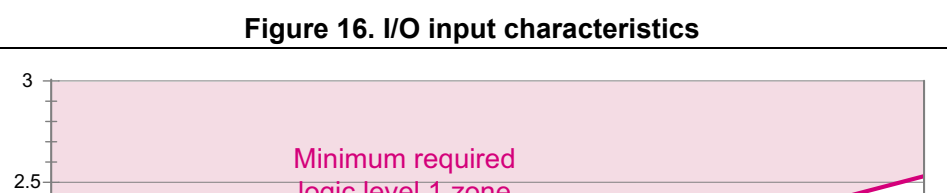
*Figure 16. I/O input characteristics (p. 62)*

| Col 2 | 2.5 2 | Col 4 | Col 5 | Col 6 | Col 7 | Col 8 | Col 9 | logic level 1 zone | (CMOS standard requirement) | Col 12 | Col 13 | Col 15 | Col 16 | TTL standard requirement | TTL standard requirement | Col 20 |
| --- | --- | --- | --- | --- | --- | --- | --- | --- | --- | --- | --- | --- | --- | --- | --- | --- |
| V IN | 2 (V) 1.5 |  | V IHmin | = 0.7 V | = 0.7 V DDIO |  |  |  |  |  |  |  |  |  |  |  |
|  | 1.5 1 |  | V IHmin V | IHmin | = 0.49 V = 0.39 V | DDIO DDIO | + 0.26 0.06 |  |  | Undefined input range |  |  |  |  |  |  |
|  | 0.5 |  | V ILmax V ILmax | ILmax ILmax = 0.3 V | = 0.3 V DDIO | DDIO |  |  | (CMOS standard requirement) |  |  |  |  | TTL standard requirement | TTL standard requirement |  |
|  | 0.5 0 |  |  |  |  |  |  |  |  |  |  | Minimum required logic level 0 zone | Minimum required logic level 0 zone |  |  |  |
|  | 0 Test thresholds | Device characteristics Test thresholds |  |  |  |  |  |  | 2.0 2.2 2.4 2.6 2.8 3.0 3.2 3.4 3.6 V |  | (V) |  |  |  |  | MSv47926V1 |

Characteristics of FT_e I/Os

The following table and figure specify input characteristics of FT_e I/Os.

**Table 49. Input characteristics of FT_e I/Os (p. 62)**

| Col 1 | Col 2 | Symbol Parameter Conditions Min Typ Max Unit | Col 4 | Col 5 | Col 7 |
| --- | --- | --- | --- | --- | --- |
| I INJ |  | Injected current on pin - - - 5 mA |  |  |  |
| V DDIO1 -V IN | Voltage over V DDIO1 | I INJ |  | = 5 mA - - 2 V |  |
| R d | Diode dynamic serial resistor I | INJ | = 5 mA - - 300 |  | Ω |

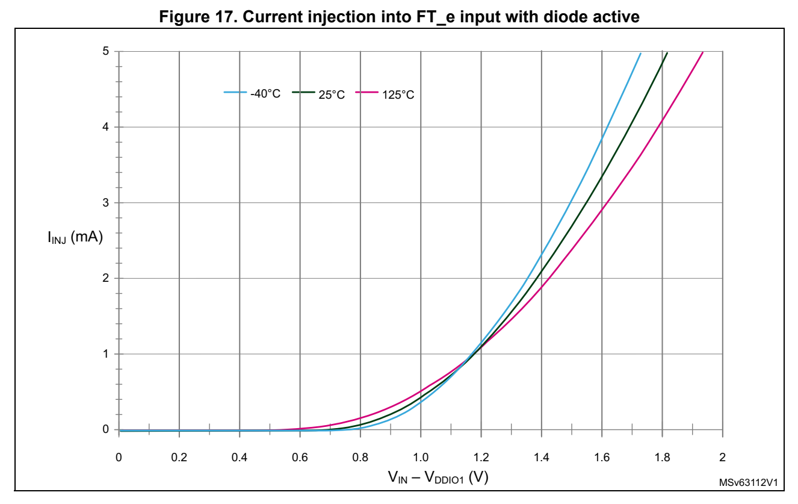
*Figure 17. Current injection into FT_e input with diode active (p. 63)*

Output driving current

The GPIOs (general purpose input/outputs) can sink or source up to ±6 mA, and up to ±15 mA with relaxed V OL/V OH.

In the user application, the number of I/O pi ns which can drive current must be limited to respect the absolute maximum rating specified in Section 5.2:

- The sum of the currents sourced by all the I/Os on V DDIO1, plus the maximum consumption of the MCU sourced on V DD, cannot exceed the absolute maximum rating I VDD (see Table 18: Voltage characteristics).

- The sum of the currents sunk by all the I/Os on V SS, plus the maximum consumption of the MCU sunk on V SS, cannot exceed the absolute maximum rating I VSS (see Table 18: Voltage characteristics).

Output voltage levels

Unless otherwise specified, th e parameters given in the table below are derived from tests performed under the ambient temperature and supply voltage conditions summarized in Table 21: General operating conditions. All I/Os are CMOS- and TTL-compliant (FT OR TT unless otherwise specified).

**Table 50. Output voltage characteristics (1)(2) (p. 64)**

| Col 1 | Col 2 | Symbol Parameter Conditions Min Max Unit | Col 4 | Col 5 | Col 6 |
| --- | --- | --- | --- | --- | --- |
| V OL | Output low level voltage for an I/O pin CMOS port | (3) |  | - 0.4 V |  |
| V OH | Output high level voltage for an I/O pin V | \|I IO \| 6 mA V DDIO1 ≥ 2.7 V | DDIO1 | - 0.4 - V |  |
| V OL(4) | Output low level voltage for an I/O pin TTL port | (3) |  | - 0.4 V |  |
| V OH (4) |  | \|I IO \| = 6 mA Output high level voltage for an I/O pin 2.4 - VV DDIO1 ≥ 2.7 V |  |  |  |
| V OL (4) | Output low level voltage for an I/O pin All I/Os |  |  | - 1.3 V |  |
| V OH (4) | Output high level voltage for an I/O pin V | \|I IO \| = 15 mA V DDIO1 ≥ 2.7 V | DDIO1 | - 1.3 - V |  |
| V OL (4) | Output low level voltage for an I/O pin | \|I IO \| = 3 mA |  | - 0.4 V |  |
| V OH (4) | Output high level voltage for an I/O pin V | V DDIO1 ≥ V DD (min) | DDIO1 | - 0.45 - V |  |
| V OLFM+ | Output low level voltage for an FT I/O | \|I IO \| = 20 mA V DDIO1 ≥ 2.7 V | - 0.4 | - 0.4 | V |
| (4) | pin in FM+ mode (FT I/O with _f option) | \|I IO \| = 9 mA V DDIO1 ≥ V DD (min) | - 0.4 | - 0.4 | V |

1. The I IO current sourced or sunk by the device must always respect the abs olute maximum rating specified in Table 18: Voltage characteristics, and the sum of the currents sourced or sunk by all the I/O s (I/O ports and control pins) must always respect the absolute maximum ratings Σ I IO. 2. As PC13, PC14 and PC15 are supplied through the power switch, the sum of currents sourced by those I/Os must not exceed 3 mA. 3. TTL and CMOS outputs are compatible with JEDEC standards JESD36 and JESD52. 4. Specified by design. Not tested in production.

Output buffer timing characteristics

The definition and values of input/output AC characteristics are given in Figure 18 and Table 51, respectively.

Unless otherwise specified, th e parameters given are derived from tests performed under the ambient temperature and supply voltage conditions summarized in Table 21: General operating conditions.

**Table 51. Non-FT_c I/O output timing characteristics (1)(2) (pp. 64-65)**

| Col 1 | Col 2 | Col 3 | Speed Symbol Parameter Conditions Min Max Unit | Col 5 | Col 7 |
| --- | --- | --- | --- | --- | --- |
|  |  |  | C=50 pF, 2.7 V ≤ V DDIO1 ≤ | 3.6 V - 2 |  |
|  | f | Maximum frequency | C=50 pF, 2.0 V ≤ V DDIO1 ≤ | 2.7 V - 0.35 | MHz |
|  | f max | Maximum frequency | C=10 pF, 2.7 V ≤ V DDIO1 ≤ | 3.6 V - 3 | MHz |
| 00 |  |  | C=10 pF, 2.0 V ≤ V DDIO1 ≤ | 2.7 V - 0.45 |  |
| 00 |  |  | C=50 pF, 2.7 V ≤ V DDIO1 ≤ | 3.6 V - 100 |  |
|  | t /t | Output rise and fall time | C=50 pF, 2.0 V ≤ V DDIO1 ≤ | 2.7 V - 225 | ns |
|  | t r/t f | Output rise and fall time | C=10 pF, 2.7 V ≤ V DDIO1 ≤ | 3.6 V - 75 | ns |
|  |  |  | C=10 pF, 2.0 V ≤ V DDIO1 ≤ | 2.7 V - 150 |  |
|  |  |  | C=50 pF, 2.7 V ≤ V DDIO1 ≤ | 3.6 V - 10 |  |
|  | f | Maximum frequency | C=50 pF, 1.6 V ≤ V DDIO1 ≤ | 2.7 V - 2 |  |
|  | f max | Maximum frequency | C=10 pF, 2.7 V ≤ V DDIO1 ≤ | 3.6 V - 15 |  |
| 01 |  |  | C=10 pF, 1.6 V ≤ V DDIO1 ≤ | 2.7 V - 2.5 |  |
| 01 |  |  | C=50 pF, 2.7 V ≤ V DDIO1 ≤ | 3.6 V - 30 |  |
|  | t /t | Output rise and fall time | C=50 pF, 1.6 V ≤ V DDIO1 ≤ | 2.7 V - 60 |  |
|  | t r/t f | Output rise and fall time | C=10 pF, 2.7 V ≤ V DDIO1 ≤ | 3.6 V - 15 |  |
|  |  |  | C=10 pF, 1.6 V ≤ V DDIO1 ≤ | 2.7 V - 30 |  |
|  |  |  | C=50 pF, 2.7 V ≤ V DDIO1 ≤ | 3.6 V - 30 |  |
|  | f | Maximum frequency | C=50 pF, 1.6 V ≤ V DDIO1 ≤ | 2.7 V - 15 |  |
|  | f max | Maximum frequency | C=10 pF, 2.7 V ≤ V DDIO1 ≤ | 3.6 V - 60 |  |
| 10 |  |  | C=10 pF, 1.6 V ≤ V DDIO1 ≤ | 2.7 V - 30 |  |
| 10 |  |  | C=50 pF, 2.7 V ≤ V DDIO1 ≤ | 3.6 V - 11 |  |
|  | t /t | Output rise and fall time | C=50 pF, 1.6 V ≤ V DDIO1 ≤ | 2.7 V - 22 |  |
|  | t r/t f | Output rise and fall time | C=10 pF, 2.7 V ≤ V DDIO1 ≤ | 3.6 V - 4 |  |
|  |  |  | C=10 pF, 1.6 V ≤ V DDIO1 ≤ | 2.7 V - 8 |  |
|  |  |  | C=30 pF, 2.7 V ≤ V DDIO1 ≤ | 3.6 V - 60 |  |
|  | f | Maximum frequency | C=30 pF, 1.6 V ≤ V DDIO1 ≤ | 2.7 V - 30 |  |
|  | f max | Maximum frequency | C=10 pF, 2.7 V ≤ V DDIO1 ≤ | 3.6 V - 80 | (3) |
| 11 |  |  | C=10 pF, 1.6 V ≤ V DDIO1 ≤ | 2.7 V - 40 |  |
| 11 |  |  | C=30 pF, 2.7 V ≤ V DDIO1 ≤ | 3.6 V - 5.5 |  |
|  | t /t | Output rise and fall time | C=30 pF, 1.6 V ≤ V DDIO1 ≤ | 2.7 V - 11 |  |
|  | t r/t f | Output rise and fall time | C=10 pF, 2.7 V ≤ V DDIO1 ≤ | 3.6 V - 2.5 |  |
|  |  |  | C=10 pF, 1.6 V ≤ V DDIO1 ≤ | 2.7 V - 5 |  |
| Fm+ | f max | Maximum frequency | C=50 pF, 1.6 V ≤ V ≤ 3.6 V |  | - 1 MHz |
| Fm+ | t f | Output fall time (4) | C=50 pF, 1.6 V ≤ V DDIO1 ≤ 3.6 V |  | - 5 ns |

1. The I/O speed is configured with t he OSPEEDRy[1:0] bitfield. The FM+ mode is configured through the SYSCFG_CFGR1 register. Refer to the reference manual RM0454 for the description of the GPIO port configuration. 2. Specified by design. Not tested in production. 3. This value represents the I/O capability but the maximum system frequency is limited to 64 MHz. 4. The fall time is defined between 70% and 30% of the output waveform, according to I2C specification.

**Table 52. FT_c I/O output timing characteristics (1)(2) (pp. 65-66)**

| Col 2 | Col 3 | Col 4 | Speed Symbol Parameter Conditions Min Max Unit | Col 6 | Col 8 |
| --- | --- | --- | --- | --- | --- |
|  | f | Maximum frequency | C=50 pF, 2.7 V ≤ V DDIO1 ≤ | 3.6 V - 2 | MHz |
| 0 | f max | Maximum frequency | C=50 pF, 2.0 V ≤ V DDIO1 ≤ | 2.7 V - 1 | MHz |
| 0 | t /t | Output rise and fall time | C=50 pF, 2.7 V ≤ V DDIO1 ≤ | 3.6 V - 170 | ns |
|  | t r/t f | Output rise and fall time | C=50 pF, 2.0 V ≤ V DDIO1 ≤ | 2.7 V - 330 | ns |
|  | f | Maximum frequency | C=50 pF, 2.7 V ≤ V DDIO1 ≤ | 3.6 V - 10 | MHz |
| 1 | f max | Maximum frequency | C=50 pF, 1.6 V ≤ V DDIO1 ≤ | 2.7 V - 5 | MHz |
| 1 | t /t | Output rise and fall time | C=50 pF, 2.7 V ≤ V DDIO1 ≤ | 3.6 V - 35 | ns |
|  | t r/t f | Output rise and fall time | C=50 pF, 1.6 V ≤ V DDIO1 ≤ | 2.7 V - 65 | ns |

1. The I/O speed is configured using the OSPEEDRy[0] bit. Refer to the reference manual RM0454 for description of the GPIO port configuration. 2. Specified by design. Not tested in production.

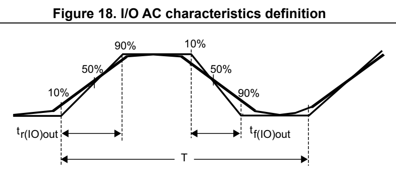
*Figure 18. I/O AC characteristics definition (p. 66)*

Maximum frequency is achieved with a duty cycle at (45 - 55%) when loaded by the specified capacitance.

MS32132V4

#### 5.3.15 NRST input characteristics (p. 66)

The NRST input driver uses CMOS technology. It is connected to a permanent pull-up resistor, R PU.

Unless otherwise specified, th e parameters given in the following table are derived from tests performed under the ambient temperature and supply voltage conditions summarized in Table 21: General operating conditions.

**Table 53. NRST pin characteristics (1) (pp. 66-67)**

| Col 1 | Col 2 | Symbol Parameter Conditions Min Typ Max Unit | Col 4 | Col 6 | Col 7 |
| --- | --- | --- | --- | --- | --- |
| V IL(NRST) | NRST input low level voltage |  | - - - 0.3 x V | DDIO1 | V |
| V IH(NRST) | NRST input high level voltage | - 0.7 x V | - 0.7 x V DDIO1 | - -V |  |
| V hys(NRST) | NRST Schmitt trigger voltage hysteresis |  | - - 200 - mV |  |  |
| R PU | Weak pull-up (2) equivalent resistor | V IN = V SS |  | 25 40 55 k | Ω |
| V F(NRST) | NRST input filtered pulse |  | - - - 70 ns |  |  |
| V NF(NRST) | NRST input not filtered pulse | 2.0 V ≤ V DD ≤ |  | 3.6 V 350 - - ns |  |

1. Specified by design. Not tested in production. 2. The pull-up is designed with a true re sistance in series with a switchable PMOS. This PMOS contribution to the series resistance is minimal (~10% order).

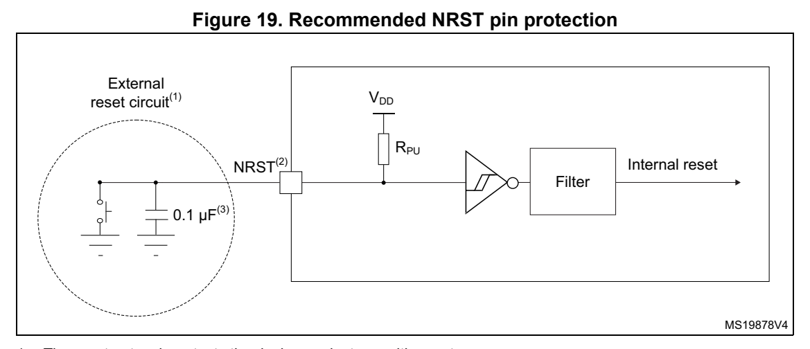
*Figure 19. Recommended NRST pin protection (p. 67)*

1. The reset network protects t he device against parasitic resets. 2. The user must ensure that, upon power-on, the level on the NRST pin can exceed the minimum V IH(NRST) level. Otherwise, the device does not exit the power-on reset. 3. The external capacitor on NRST must be placed as close as pos sible to the device.

#### 5.3.16 Extended interrupt and event cont roller input (EXTI) characteristics (p. 67)

The pulse on the interrupt input must equal or exceed the minimum length, to guarantee that it is detected by the event controller.

Table 54. EXTI input characteristics (1)

Symbol Parameter Min Typ Max Unit

PLEC Pulse length to event controller - - ns

1. Specified by design. Not tested in production.

#### 5.3.17 Analog switch booster (p. 67)

**Table 55. Analog switch booster characteristics (1) (pp. 67-68)**

| Col 4 | Col 5 | Symbol Parameter Min Typ Max Unit | Col 7 |
| --- | --- | --- | --- |
| V DD | Supply voltage V | DD | (min) - 3.6 V |
| t SU(BOOST) |  | Booster startup time - - 240 µs |  |
| I | Booster consumption for V DD ≤ 2.7 V |  | - - 500 |
| I DD(BOOST) | Booster consumption for 2.7 V ≤ V DD ≤ 3.6 V |  | - - 900 |

1. Specified by design. Not tested in production.

#### 5.3.18 Analog-to-digital converter characteristics (p. 68)

Unless otherwise specified, the parameters given in Table 56 are preliminary values derived from tests performed under ambient temperature, f PCLK frequency and V DDA supply voltage conditions su mmarized in Table 21: General operating conditions.

Note: It is recommended to perform a calibration after each power-up.

**Table 56. ADC characteristics (1) (pp. 68-69)**

| Col 1 | Symbol Parameter Conditions | (2) | Col 4 | Col 5 | Min Typ Max Unit | Col 7 | Col 8 |
| --- | --- | --- | --- | --- | --- | --- | --- |
| V DDA |  | Analog supply voltage - 2.0 - 3.6 V |  |  |  |  |  |
| V REF+ | Positive reference voltage |  | - 2 -V |  | DDA | V |  |
| f | ADC clock frequency |  | Range 1 0.14 - 35 |  |  | MHz |  |
| f ADC | ADC clock frequency |  | Range 2 0.14 - 16 |  |  | MHz |  |
| D ADC (3) | ADC analog clock duty cycle |  |  | - 45 - 55 % |  |  |  |
|  |  |  | 12 bits - - 2.50 |  |  |  |  |
| f | Sampling rate |  | 10 bits - - 2.92 |  |  | MSps |  |
| f s | Sampling rate |  | 8 bits - - 3.50 |  |  | MSps |  |
|  |  |  | 6 bits - - 4.38 |  |  |  |  |
| f | External trigger | f ADC | = 35 MHz; 12 bits - - 2.33 |  |  | MHz |  |
| f TRIG | frequency |  | 12 bits - - f |  | ADC/15 | MHz |  |
| V AIN (4) | Conversion voltage range | -V | SSA | -V | REF+ | V |  |
| R AIN | External input impedance |  |  | - - - 50 k |  | Ω |  |
| C ADC | Internal sample and hold capacitor |  |  | - - 5 - pF |  |  |  |
| t STAB |  | ADC power-up time - 2 |  |  |  | Conversion cycle |  |
| t | Calibration time | f ADC |  | = 35 MHz 2.35 µs |  |  |  |
| t CAL | Calibration time |  |  | - 82 1/f |  | ADC | ADC |
|  |  | CKMODE[1:0] = 00 | 1.5 f ADC + 2 f PCLK cycles | - | 1.5 f ADC + 3 f PCLK cycles | - |  |
| W LATENCY | ADC_DR register write latency |  | CKMODE[1:0] = 01 - 4.5 - |  |  |  |  |
|  | latency |  | CKMODE[1:0] = 10 - 8.5 - |  |  | 1/f PCLK |  |
|  |  |  | CKMODE[1:0] = 11 - 2.5 - |  |  |  |  |
|  |  |  | CKMODE[1:0] = 00 2 - 3 1/f |  |  | ADC |  |
| t | Trigger conversion | CKMODE[1:0] = 01 6.5 |  |  |  |  |  |
| t LATR | latency | CKMODE[1:0] = 10 12.5 |  |  |  | 1/f PCLK |  |
|  |  | CKMODE[1:0] = 11 3.5 |  |  |  |  |  |
|  |  |  |  | 0.043 - 4.59 µs | 0.043 - 4.59 µs |  |  |
| t s | Sampling time | f ADC = 35 MHz |  | 1.5 - 160.5 1/f | 1.5 - 160.5 1/f | ADC |  |
| t ADCVREG_STUP | ADC voltage regulator start-up time |  |  | - - - 20 µs |  |  |  |
|  | Total conversion time | f ADC = 35 MHz Resolution = 12 bits |  | 0.40 - 4.95 µs | 0.40 - 4.95 µs |  |  |
| t CONV | (including sampling time) | Resolution = 12 bits | t s | + 12.5 cycles for successive approximation = 14 to 173 |  | 1/f ADC |  |
| t IDLE | Laps of time allowed between two conversions without rearm |  |  | - - - 100 µs |  |  |  |
|  |  | f s | = 2.5 MSps - 410 - |  |  |  |  |
| I DDA(ADC) | ADC consumption from V DDA | f s | = 1 MSps - 164 - |  |  | µA |  |
|  | DDA | f s | = 10 kSps - 17 - |  |  |  |  |
|  |  | f s | = 2.5 MSps - 65 - |  |  |  |  |
| I DDV(ADC) | ADC consumption from V REF+ | f s | = 1 MSps - 26 - |  |  | µA |  |
|  | REF+ | f s | = 10 kSps - 0.26 - |  |  |  |  |

1. Specified by design. Not tested in production. 2. I/O analog switch voltage booster must be enabled (BOOSTEN = 1 in the SYSCFG_CFGR1) when V DDA < 2.4 V and disabled when V DDA ≥ 2.4 V. 3. This requirement is granted when the incoming clock (PCLK or ADC asynchronous clock) is divided by two or more in the ADC. For other cases, refer to the reference manual section ADC clock for information on how to fulfill this requirement. 4. V REF+ is internally connected to V DDA on some packages.Refer to Section 4: Pinouts, pin description and alternate functions for further details.

**Table 57. Maximum ADC R AIN. (p. 70)**

| Col 1 | Resolution Sampling cycle at 35 MHz | Sampling time at 35 MHz [ns] | Max. R AIN (1)(2) ( Ω) |
| --- | --- | --- | --- |
|  |  | 1.5 43 50 |  |
|  |  | 3.5 100 680 |  |
|  |  | 7.5 214 2200 |  |
| 12 bits |  | 12.5 357 4700 |  |
| 12 bits |  | 19.5 557 8200 |  |
|  |  | 39.5 1129 15000 |  |
|  |  | 79.5 2271 33000 |  |
|  |  | 160.5 4586 50000 |  |
|  |  | 1.5 43 68 |  |
|  |  | 3.5 100 820 |  |
|  |  | 7.5 214 3300 |  |
| 10 bits |  | 12.5 357 5600 |  |
| 10 bits |  | 19.5 557 10000 |  |
|  |  | 39.5 1129 22000 |  |
|  |  | 79.5 2271 39000 |  |
|  |  | 160.5 4586 50000 |  |
|  |  | 1.5 43 82 |  |
|  |  | 3.5 100 1500 |  |
|  |  | 7.5 214 3900 |  |
| 8 bits |  | 12.5 357 6800 |  |
| 8 bits |  | 19.5 557 12000 |  |
|  |  | 39.5 1129 27000 |  |
|  |  | 79.5 2271 50000 |  |
|  |  | 160.5 4586 50000 |  |
|  |  | 1.5 43 390 |  |
|  |  | 3.5 100 2200 |  |
|  |  | 7.5 214 5600 |  |
| 6 bits |  | 12.5 357 10000 |  |
| 6 bits |  | 19.5 557 15000 |  |
|  |  | 39.5 1129 33000 |  |
|  |  | 79.5 2271 50000 |  |
|  |  | 160.5 4586 50000 |  |

1. Specified by design. Not tested in production. 2. I/O analog switch voltage booster must be enabled (BOOSTEN = 1 in the SYSCFG_CFGR1) when V DDA < 2.4 V and disabled when V DDA ≥ 2.4 V.

**Table 58. ADC accuracy (1)(2)(3) (p. 71)**

| Col 1 | Symbol Parameter Conditions | (4) | Min Typ Max Unit | Min Typ Max Unit |
| --- | --- | --- | --- | --- |
| ET | Total unadjusted error | V DDA =V REF+ < 3.6 V; f ADC = 35 MHz; f s ≤ 2.5 MSps; T A = entire range |  | - 3 6.5 LSB |
|  | EO Offset error | V DDA =V REF+ < 3.6 V; f ADC = 35 MHz; f s ≤ 2.5 MSps; T A = entire range |  | - 1.5 4.5 LSB |
|  | EG Gain error | V DDA =V REF+ < 3.6 V; f ADC = 35 MHz; f s ≤ 2.5 MSps; T A = entire range |  | - 3 5 LSB |
| ED | Differential linearity error | V DDA =V REF+ < 3.6 V; f ADC = 35 MHz; f s ≤ 2.5 MSps; T A = entire range |  | - 1.2 1.5 LSB |
| EL | Integral linearity error | V DDA =V REF+ < 3.6 V; f ADC = 35 MHz; f s ≤ 2.5 MSps; T A = entire range |  | - 2.5 3 LSB |
| ENOB | Effective number of bits | V DDA =V REF+ < 3.6 V; f ADC = 35 MHz; f s ≤ 2.5 MSps; T A = entire range | 9.6 10.2 - bit | 9.6 10.2 - bit |
| SINAD | Signal-to-noise and distortion ratio | V DDA =V REF+ < 3.6 V; f ADC = 35 MHz; f s ≤ 2.5 MSps; T A = entire range | 59.5 63 - dB | 59.5 63 - dB |
| SNR | Signal-to-noise ratio | V DDA =V REF+ < 3.6 V; f ADC = 35 MHz; f s ≤ 2.5 MSps; T A = entire range | 60 64 - dB | 60 64 - dB |
| THD | Total harmonic distortion | V DDA =V REF+ < 3.6 V; f ADC = 35 MHz; f s ≤ 2.5 MSps; T A = entire range |  | - -74 -70 dB |

1. Based on characterization results, not tested in production. 2. ADC DC accuracy values are measured after internal calibration. 3. Injecting negative current on any anal og input pin significantly reduces t he accuracy of A-to-D conversion of signal on another analog input. It is recommended to add a Schottky diode (pin to ground) to analog pins susceptible to receive negative current. 4. I/O analog switch voltage booster enabled (BOOSTEN = 1 in the SYSCFG_CFGR1) when V DDA < 2.4 V and disabled when V DDA ≥ 2.4 V.

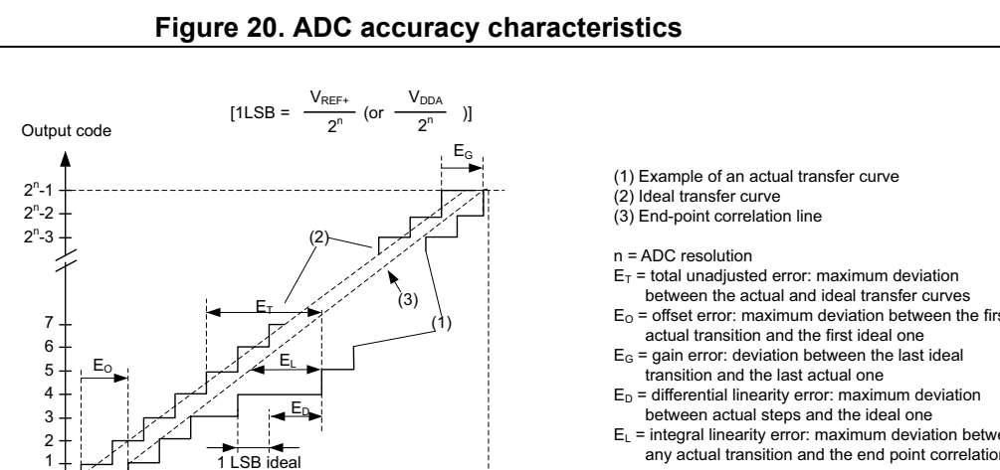
*Figure 20. ADC accuracy characteristics (p. 72)*

0 V REF+ (V DDA) V SSA n(1/2)*VREF+ n(2/2)*VREF+ n(3/2)*VREF+ n(4/2)*VREF+ n(5/2)*VREF+ n(6/2)*VREF+ n(7/2)*VREF+ n-3n(2/2)*VREF+ n-2n(2/2)*VREF+ n-1n(2/2)*VREF+ nn(2/2)*VREF+ MSv19880V6

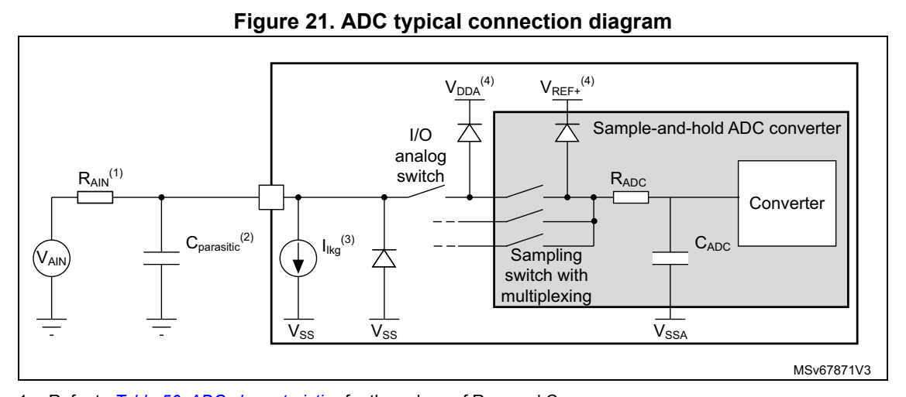
*Figure 21. ADC typical connection diagram (p. 72)*

1. Refer to Table 56: ADC characteristics for the values of R AIN and C ADC. 2. C parasitic represents the capacitance of the PCB (dependent on soldering and PCB layout quality) plus the pad capacitance (refer to Table 48: I/O static characteristics for the value of the pad capacitance). A high C parasitic value downgrades conversion accuracy. To remedy this, f ADC should be reduced. 3. Refer to Table 48: I/O static characteristics for the values of I lkg. 4. Refer to Figure 9: Power supply scheme.

General PCB design guidelines

Power supply decoupling should be performed as shown in Figure 9: Power supply scheme. The 100 nF capacitor should be ceramic (good quality) and it should be placed as close as possible to the chip.

#### 5.3.19 Temperature sensor characteristics (p. 73)

**Table 59. TS characteristics (p. 73)**

| Col 1 | Symbol Parameter Min Typ Max Unit | Col 4 | Col 5 |
| --- | --- | --- | --- |
| T L(1) | V TS linearity with temperature - ±1 ±2 °C |  |  |
| Avg_Slope (2) | Average slope 2.3 2.5 2.7 mV/°C |  |  |
| V 30 | Voltage at 30°C (±5 °C) (3) | 0.742 0.76 0.785 V |  |
| t (1) START(TS_BUF) | Sensor Buffer Start-up time in continuous mode (4) |  | - 8 15 µs |
| t START (1) | Start-up time when entering in continuous mode (4) |  | - 70 120 µs |
| t S_temp (1) | ADC sampling time when reading the temperature 5 - - µs |  |  |
| I DD(TS) (1) | Temperature sensor consumption from V DD, when selected by ADC |  | - 4.7 7 µA |

1. Specified by design. Not tested in production. 2. Based on characterization results, not tested in production. 3. Measured at V DDA = 3.0 V ±10 mV. The V 30 ADC conversion result is stored in the TS_CAL1 byte. 4. Continuous mode means Run/Sleep modes, or temperature sensor enable in Low-power run/Low-power sleep modes.

#### 5.3.20 V BAT monitoring characteristics (p. 73)

**Table 60. V BAT monitoring characteristics (p. 73)**

| Col 1 | Symbol Parameter Min Typ Max Unit | Col 4 | Col 5 | Col 6 |
| --- | --- | --- | --- | --- |
|  | R Resistor bridge for V BAT | - 39 - k | - 39 - k | Ω |
|  | Q Ratio on V BAT measurement - 3 - - |  |  |  |
| Er (1) | Error on Q -10 - 10 % |  |  |  |
| t S_vbat (1) | ADC sampling time when reading the VBAT 12 - - µs |  |  |  |

1. Specified by design. Not tested in production.

**Table 61. V BAT charging characteristics (p. 73)**

| Col 1 | Col 2 | Symbol Parameter Conditions Min Typ Max Unit | Col 7 |
| --- | --- | --- | --- |
|  | Battery | VBRS = 0 - 5 - |  |
| R BC | charging resistor | VBRS = 1 - 1.5 - | kΩ |

#### 5.3.21 Timer characteristics (p. 73)

The parameters given in the following tables are specified by design and not tested in production. Refer to Section 5.3.14: I/O port characteristics for details on the input/output alternate function characteristics (output compare, input capture, external clock, PWM output).

**Table 62. TIMx (1) characteristics (p. 74)**

| Col 1 | Col 2 | Symbol Parameter Conditions Min Max Unit | Col 4 | Col 5 | Col 6 |
| --- | --- | --- | --- | --- | --- |
| t | Timer resolution time |  | - 1 -t |  | TIMxCLK |
| t res(TIM) | Timer resolution time | f TIMxCLK | = 64 MHz 15.625 - ns |  |  |
| f | Timer external clock frequency |  | - 0f | TIMxCLK/2 | MHz |
| f EXT | on CH1 to CH4 | f TIMxCLK | = 64 MHz 0 40 |  | MHz |
| Res TIM | Timer resolution | TIMx - 16 |  |  | bit |
| t | 16-bit counter clock period |  | - 1 65536 t |  | TIMxCLK |
| t COUNTER | 16-bit counter clock period | f TIMxCLK | = 64 MHz 0.015625 1024 µs |  |  |
| t | Maximum possible count with |  | - - 65536 × 65536 t |  | TIMxCLK |
| t MAX_COUNT | 32-bit counter | f TIMxCLK | = 64 MHz - 67.10 s |  |  |

1. TIMx is used as a general term to refer to a timer (for example, TIM1).

**Table 63. IWDG min/max timeout period at 32 kHz LSI clock (1) (p. 74)**

| Prescaler divider PR[2:0] bits Min timeout RL | Col 3 | [11:0]= 0x000 Max timeout RL[11:0]= 0xFFF Unit | Col 5 |
| --- | --- | --- | --- |
|  | /4 0 0.125 512 |  |  |
|  | /8 1 0.250 1024 |  |  |
|  | /16 2 0.500 2048 |  |  |
|  | /32 3 1.0 4096 |  | ms |
|  | /64 4 2.0 8192 |  |  |
|  | /128 5 4.0 16384 |  |  |
|  | /256 6 or 7 8.0 32768 |  |  |

1. The exact timings further depend on the phase of the APB inte rface clock versus the LS I clock, which causes an uncertainty of one RC period.

#### 5.3.22 Characteristics of communication interfaces (p. 74)

2 I C-bus interface characteristics

2 2 The I C-bus interface meets timing requirements of the I C-bus specification and user manual rev. 03 for:

- Standard-mode (Sm): with a bit rate up to 100 kbit/s

- Fast-mode (Fm): with a bit rate up to 400 kbit/s

- Fast-mode Plus (Fm+): with a bit rate up to 1 Mbit/s.

The timings are ensured by design as long as the I2C peripheral is properly configured (refer to the reference manual RM0454) and when the I2CCLK frequency is greater than the minimum shown in the following table.

**Table 64. Minimum I2CCLK frequency (p. 75)**

| Col 1 | Col 2 | Symbol Parameter Condition Typ Unit | Col 4 | Col 5 | Col 6 |
| --- | --- | --- | --- | --- | --- |
|  |  |  | Standard-mode 2 |  |  |
|  |  |  | Analog filter enabled | 9 |  |
|  |  | Fast-mode | DNF = 0 | 9 |  |
|  | Minimum I2CCLK | Fast-mode | Analog filter disabled | 9 |  |
| f I2CCLK(min) | frequency for correct operation of I2C |  | DNF = 1 | 9 | MHz |
|  | peripheral |  | Analog filter enabled | 18 |  |
|  |  | Fast-mode Plus | DNF = 0 | 18 |  |
|  |  | Fast-mode Plus | Analog filter disabled | 16 |  |
|  |  |  | DNF = 1 | 16 |  |

The SDA and SCL I/O requirements are met with the following restrictions: the SDA and SCL I/O pins are not “true” open-drain. Wh en configured as open-drain, the PMOS connected between the I/O pin and V DDIO1 is disabled, but is still present. Only FT_f I/O pins support Fm+ low-level output current maximum requirement. Refer to Section 5.3.14: I/O port characteristics for the I2C I/Os characteristics.

All I2C SDA and SCL I/Os embed an analog filter. Refer to the following table for its characteristics:

**Table 65. I2C analog filter characteristics (1) (p. 75)**

| Col 2 | Col 3 | Symbol Parameter Min Max Unit | Col 5 | Col 6 | Col 7 |
| --- | --- | --- | --- | --- | --- |
| t | t AF | Limiting duration of spikes suppressed(2) by the filter |  | 50 260 ns |  |
|  | SPI/I are: • • • | 1. Based on characterization results, not tested in production. 2. Spikes shorter than the limiting duration are suppressed. 2 SPI/I S characteristics Unless otherwise specified, the parameters given in performed under the ambient temperature, f summarized in Table 21: General operating conditions OSPEEDRy[1:0] set to 11 (output speed) capacitive load C = 30 pF measurement points at CMOS levels: 0.5 x V Refer to Section 5.3.14: I/O port characteristics function characteristics (NSS, | Table 66 PCLKx DD SCK, MOSI, MISO for SPI). | frequency and supply voltage conditions . The additional general conditions for more details on the input/output alternate | for SPI are derived from tests |

**Table 66. SPI characteristics (1) (p. 76)**

| Col 1 | Col 2 | Symbol Parameter Conditions Min Typ Max Unit | Col 4 | Col 5 | Col 6 | Col 7 |
| --- | --- | --- | --- | --- | --- | --- |
|  |  | Master mode V DD (min) < V DD < 3.6 V Range 1 |  |  | 32 |  |
|  |  | Master transmitter V DD (min) < V DD < 3.6 V Range 1 |  |  | 32 |  |
| f SCK 1/t | SPI clock frequency | Slave receiver V DD (min) < V DD < 3.6 V Range 1 | -- |  | 32 | MHz |
| 1/t c(SCK) |  | Slave transmitter/full duplex 2.7 < V DD < 3.6 V Range 1 |  |  | 32 |  |
|  |  | Slave transmitter/full duplex V DD (min) < V DD < 3.6 V Range 1 |  |  | 25 |  |
|  |  | V DD (min) < V DD < 3.6 V Range 2 |  |  | 8 |  |
| t su(NSS) |  | NSS setup time Slave mode, SPI prescaler = 2 4 | ₓ T PCLK |  | - - ns |  |
| t h(NSS) |  | NSS hold time Slave mode, SPI prescaler = 2 2 | ₓ T PCLK |  | - - ns |  |
| t w(SCKH) | SCK high time Master mode |  | T PCLK - 1.5 | T PCLK | T PCLK + 1 | ns |
| t w(SCKL) | SCK low time Master mode |  | T PCLK - 1.5 | T PCLK | T PCLK + 1 | ns |
| t su(MI) | Master data input setup time |  | - 1 - - ns |  |  |  |
| t su(SI) | Slave data input setup time |  | - 3 - - ns |  |  |  |
| t h(MI) | Master data input hold time |  | - 5 - - ns |  |  |  |
| t h(SI) | Slave data input hold time |  | - 2 - - ns |  |  |  |
| t a(SO) |  | Data output access time Slave mode 9 - 34 ns |  |  |  |  |
| t dis(SO) |  | Data output disable time Slave mode 9 - 16 ns |  |  |  |  |
|  |  | 2.7 < V DD < 3.6 V Range 1 |  | - 9 12 |  |  |
| t v(SO) | Slave data output valid time | V DD (min) < V DD < 3.6 V Range 1 |  | - 9 19.5 |  | ns |
|  |  | V DD (min) < V DD < 3.6 V Voltage Range 2 |  | - 11 24 |  |  |
| t v(MO) | Master data output valid time |  | - - 3 5 ns |  |  |  |

**Table 66. SPI characteristics (1) (p. 77)**

| Col 1 | Col 2 | Symbol Parameter Conditions Min Typ Max Unit | Col 4 |
| --- | --- | --- | --- |
| t h(SO) | Slave data output hold time |  | - 5 - - ns |
| t h(MO) | Master data output hold time |  | - 1 - - ns |

1. Based on characterization results, not tested in production.

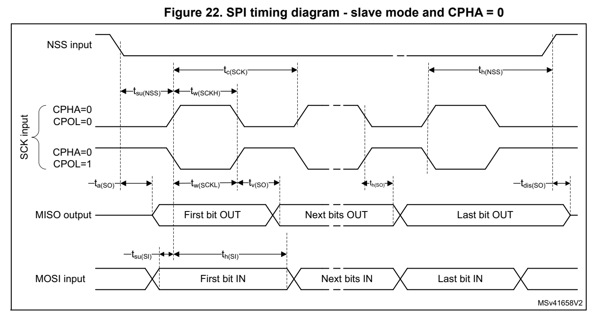
*Figure 22. SPI timing diagram - slave mode and CPHA = 0 (p. 77)*

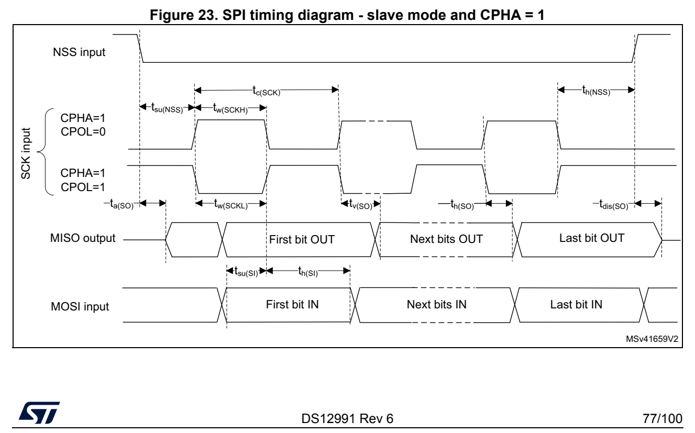
*Figure 23. SPI timing diagram - slave mode and CPHA = 1 (p. 77)*

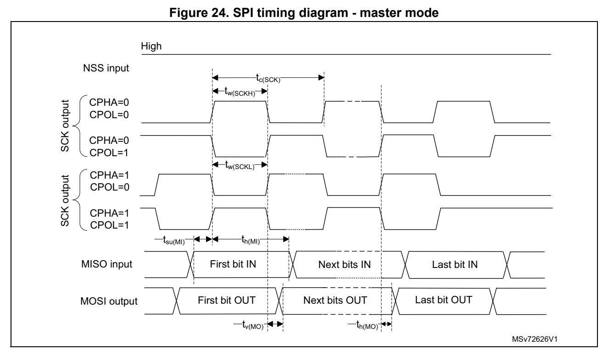
*Figure 24. SPI timing diagram - master mode (p. 78)*

**Table 67. I2S characteristics (1) (p. 78)**

| Col 1 | Symbol Parameter Con | Col 3 | ditions Min Max Unit | Col 5 | Col 6 |
| --- | --- | --- | --- | --- | --- |
| f MCK | I2S main clock output | f MCK = 256 x Fs; (Fs = audio sampling frequency) Fs min = 8 kHz; Fs max = 192 kHz; |  | 2.048 49.152 MHz |  |
| f | I2S clock frequency | Master data - 64xFs |  |  | MHz |
| f CK | I2S clock frequency | Slave data - 64xFs |  |  | MHz |
| D CK | I2S clock frequency duty cycle | Slave receiver 30 70 % |  |  |  |
| t v(WS) |  | WS valid time Master mode - 6 ns |  |  |  |
| t h(WS) |  | WS hold time Master mode 3 - ns |  |  |  |
| t su(WS) |  | WS setup time Slave mode 3 - ns |  |  |  |
| t h(WS) |  | WS hold time Slave mode 2 - ns |  |  |  |
| t su(SD_MR) | Data input setup time | Master receiver 4 - ns |  |  |  |
| t su(SD_SR) | Data input setup time | Slave receiver 5 - ns |  |  |  |
| t h(SD_MR) | Data input hold time | Master receiver 4.5 - ns |  |  |  |
| t h(SD_SR) | Data input hold time | Slave receiver 2 - ns |  |  |  |
|  | Data output valid time - | after enable edge; 2.7 < V DD < 3.6V |  | 10 |  |
| t v(SD_ST) | slave transmitter | after enable edge; V DD (min) < V DD < 3.6V | - | 15 | ns |

**Table 67. I2S characteristics (1) (p. 79)**

| Col 2 | Col 3 | Col 4 | Symbol Parameter Con | Col 6 | Col 7 | Col 8 | Col 10 | Col 11 | Col 12 | ditions Min Max Unit | Col 15 | Col 16 | Col 17 |
| --- | --- | --- | --- | --- | --- | --- | --- | --- | --- | --- | --- | --- | --- |
| t v(SD_MT) |  |  | Data output valid time -master transmitter |  |  |  |  |  | after enable edge - 5.5 ns |  |  |  |  |
| t h(SD_ST) |  |  | Data output hold time -slave transmitter |  |  |  |  |  | after enable edge 7 - ns |  |  |  |  |
| t h(SD_MT) |  |  | Data output hold time -master transmitter |  |  |  |  |  | after enable edge 1 - ns |  |  |  |  |
|  |  |  | 1. Based on characterization results, not tested in production. | Figure 25. I | 2 |  |  | S slave timing diagram (Philips protocol) |  |  |  |  |  |
|  |  |  |  | Figure 25. I |  |  |  | S slave timing diagram (Philips protocol) |  |  |  |  |  |
| CK Input | CPOL = 0 CPOL = 1 WS input SDtransmit SDreceive | WS input | tsu(WS) |  | tc(CK) LSB transmit(2) tsu(SD_SR) LSB receive(2) | tc(CK) | tw(CKL) | MSB transmit Bitn transmit | MSB transmit Bitn transmit |  | th(WS) | th(SD_ST) | MSv39721V1 |
|  |  | byte. | 2. LSB transmit/receive of the previ | 1. Measurement points are done at CMOS levels: 0.3 V |  |  | DDIO1 ously transmitted byte. No LSB transmi | and 0.7 V |  | . | t/receive is sent before the first |  |  |

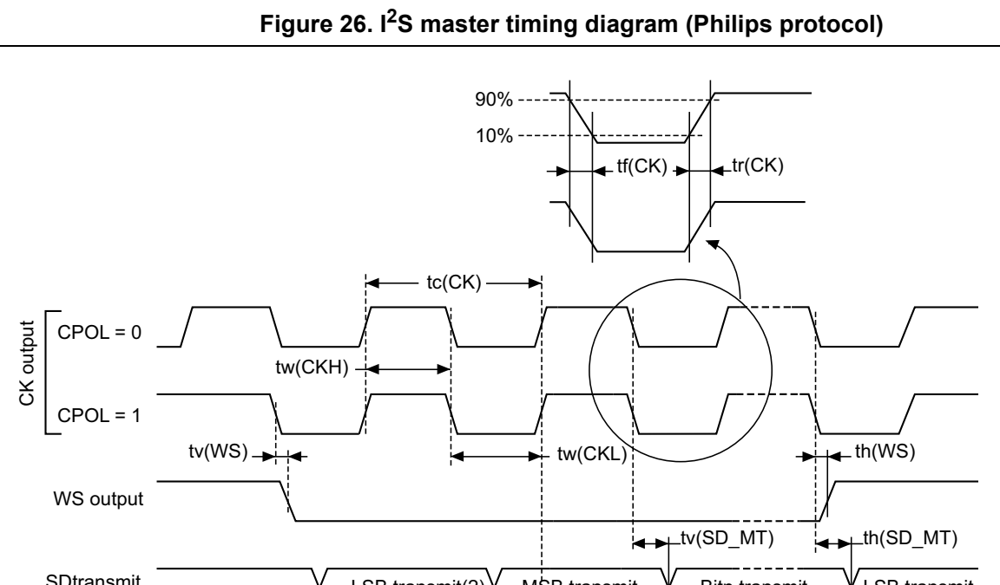
*Figure 26. I S master timing diagram (Philips protocol) (p. 80)*

tsu(SD_MR) th(SD_MR)

SDreceive LSB receive(2) MSB receive Bitn receive LSB receive

MSv39720V1 1. Based on characterization results, not tested in production. 2. LSB transmit/receive of the previ ously transmitted byte. No LSB transmi t/receive is sent before the first byte.

USART (SPI mode) characteristics

Unless otherwise specified, the parameters given in Table 68 for USART are derived from tests performed under the ambient temperature, f PCLKx frequency and supply voltage conditions su mmarized in Table 21: General operating conditions. The additional general conditions are:

- OSPEEDRy[1:0] set to 10 (output speed)

- capacitive load C = 30 pF

- measurement points at CMOS levels: 0.5 x V DD

Refer to Section 5.3.14: I/O port characteristics for more details on the input/output alternate function characteristics (NSS, CK, TX, and RX for USART).

**Table 68. USART characteristics in SPI mode (pp. 80-81)**

| Col 1 | Col 2 | Symbol Parameter Conditions Min Typ Max Unit | Col 4 | Col 6 | Col 8 |
| --- | --- | --- | --- | --- | --- |
| f | USART clock frequency |  | Master mode - - 8 |  | MHz |
| f CK | USART clock frequency |  | Slave mode - - 21 |  | MHz |
| t su(NSS) | NSS setup time Slave mode T |  | (1) ker | + 2 - - ns |  |
| t h(NSS) |  | NSS hold time Slave mode 2 - - ns |  |  |  |
| t w(CKH) | CK high time | Master mode | 1 / f CK / 2 | 1 / f / 2 | 1 / f CK / 2 |
| t w(CKL) | CK low time | Master mode | - 1 | 1 / f CK / 2 | + 1 |
| t | Data input setup time | Master mode T | (1) ker |  | + 2 - - ns |
| t su(RX) | Data input setup time |  | Slave mode 3 - - ns |  |  |
| t | Data input hold time |  | Master mode 2 - - ns |  |  |
| t h(RX) | Data input hold time |  | Slave mode 1 - - ns |  |  |
| t | Data output valid time |  | Master mode - 1 2 ns |  |  |
| t v(TX) | Data output valid time |  | Slave mode - 10 19 ns |  |  |
| t | Data output hold time |  | Master mode 0 - - ns |  |  |
| t h(TX) | Data output hold time |  | Slave mode 7 - - ns |  |  |

1. T ker is the usart_ker_ck_pres clock period

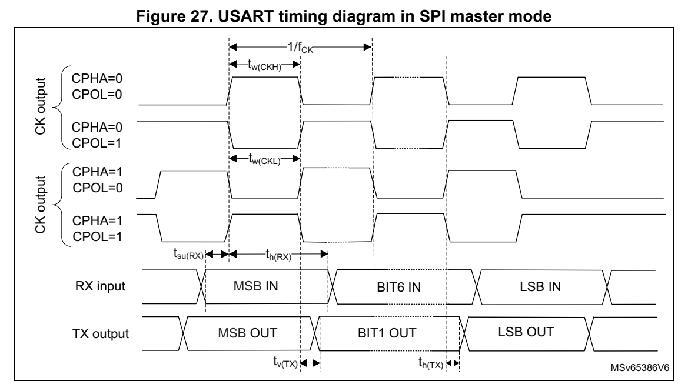
*Figure 27. USART timing diagram in SPI master mode (p. 81)*

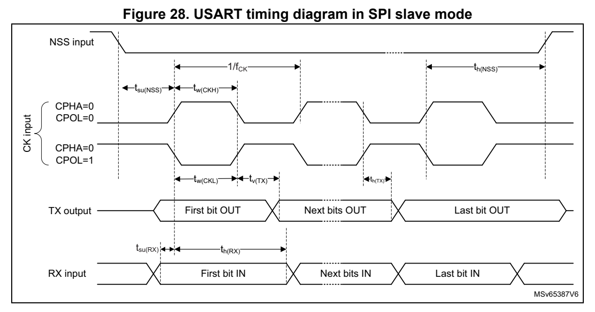
*Figure 28. USART timing diagram in SPI slave mode (p. 82)*
