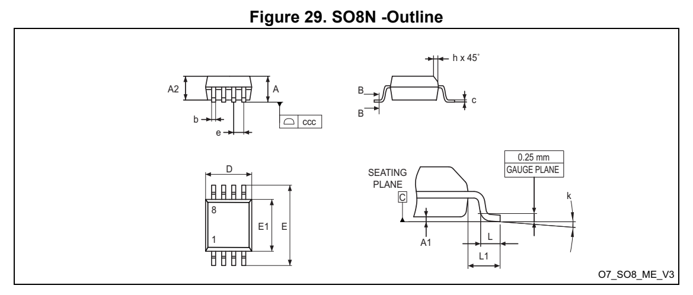
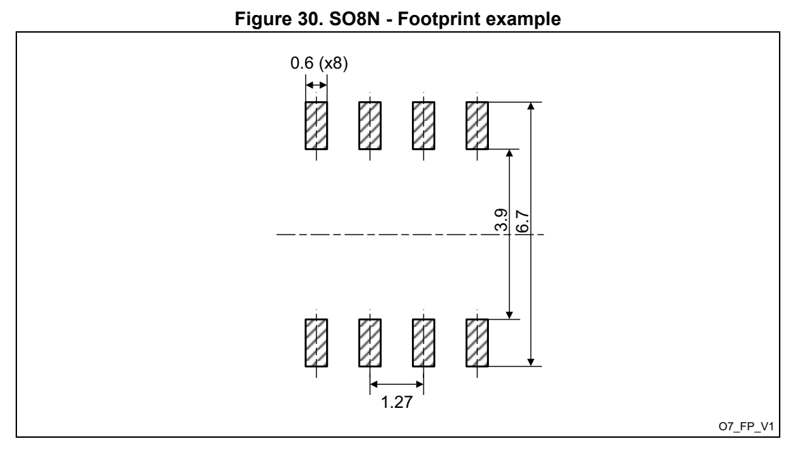
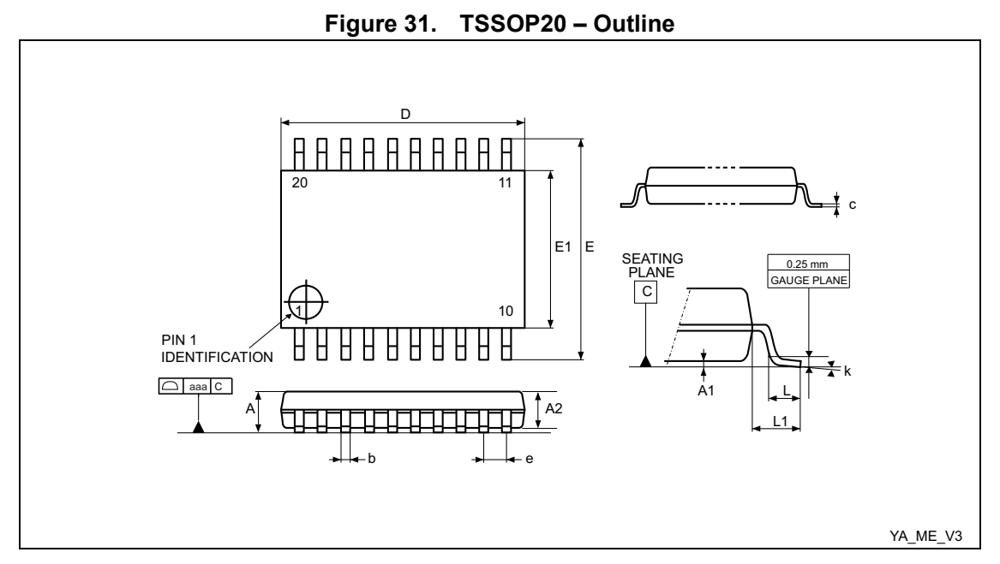
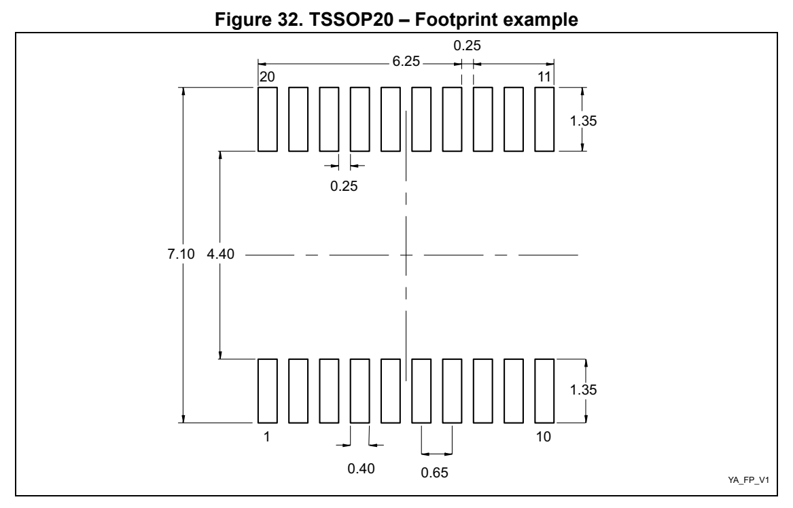
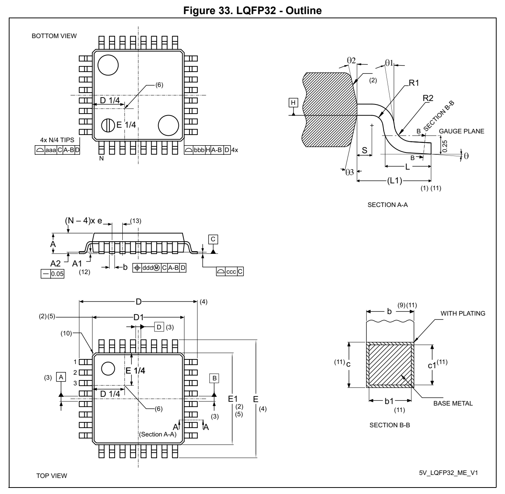
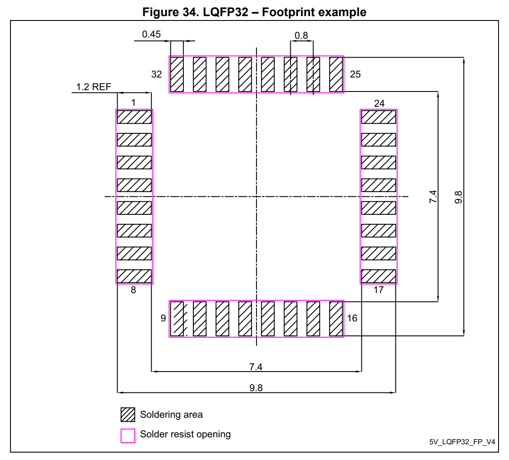
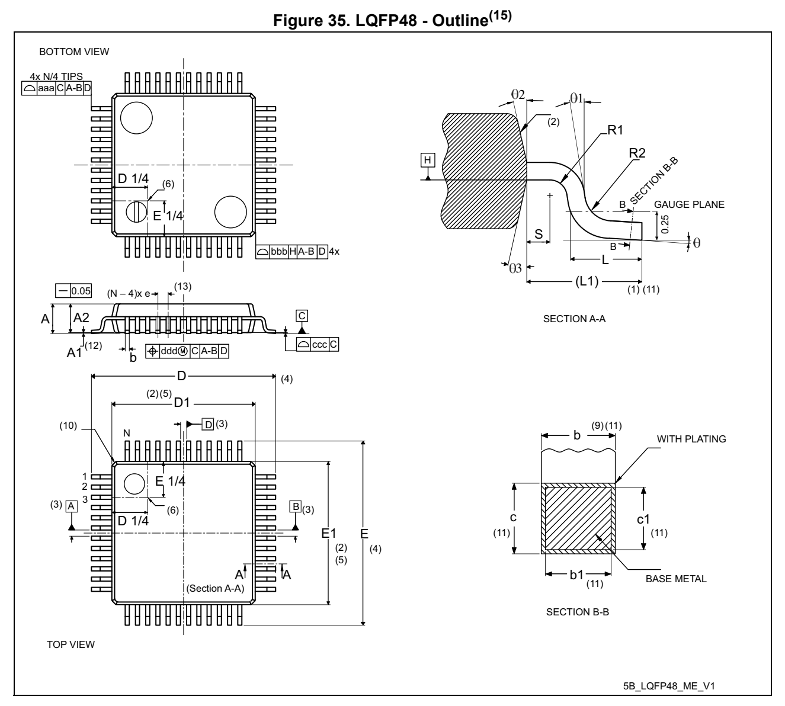
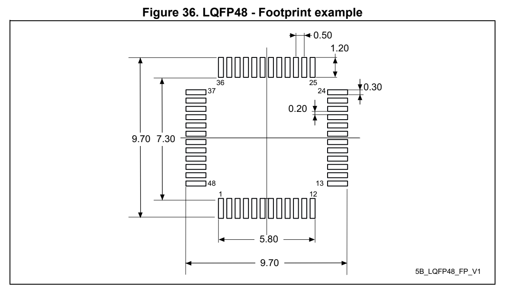

# 6 Package information (pp. 83-95)

## 6 Package information (p. 83)

In order to meet environmental requirements, ST offers these devices in different grades of ECOPACK packages, depending on their level of environmental compliance. ECOPACK specifications, grade definitions a nd product status are available at: www.st.com. ECOPACK is an ST trademark.

### 6.1 Device marking (p. 83)

Refer to technical note “Reference device ma rking schematics for STM32 microcontrollers and microprocessors” (TN1433) available on www.st.com, for the location of pin 1 / ball A1 as well as the location and orientation of the marking areas versus pin 1 / ball A1.

Parts marked as “ES”, “E” or accompanied by an engineering sample notification letter, are not yet qualified and therefore not approved for use in production. ST is not responsible for any consequences resulting from such use. In no event will ST be liable for the customer using any of these engineering samples in production. ST’s Quality department must be contacted prior to any decision to use these engineering samples to run a qualification activity.

A WLCSP simplified marking example (if any) is provided in the corresponding package information subsection.

### 6.2 SO8N package information (O7) (p. 83)

This SO8N is an 8-lead, 4.9 x 6 mm, plastic small outline, 150 mils body width, package.

*Figure 29. SO8N -Outline (p. 83)*

1. Drawing is not to scale.

**Table 69. SO8N -Mechanical data (pp. 83-84)**

| Symbol | millimeters inches | Col 8 | (1) |
| --- | --- | --- | --- |
| Symbol | Min. Typ. Max. Min. Typ. Max. | Min. Typ. Max. Min. Typ. Max. |  |
|  | A - - 1.750 - - 0.0689 |  |  |
|  | A1 0.100 - 0.250 0.0039 - 0.0098 |  |  |
| Symbol | Min. Typ. Max. Min. Typ. Max. | Min. Typ. Max. Min. Typ. Max. |  |
|  | A2 1.250 - - 0.0492 - - |  |  |
|  | b 0.280 - 0.480 0.0110 - 0.0189 |  |  |
|  | c 0.100 - 0.230 0.0039 - 0.0091 |  |  |
| D (2) | 4.800 4.900 5.000 0.1890 0.1929 0.1969 | 4.800 4.900 5.000 0.1890 0.1929 0.1969 |  |
|  | E 5.800 6.000 6.200 0.2283 0.2362 0.2441 |  |  |
| E1 (3) | 3.800 3.900 4.000 0.1496 0.1535 0.1575 | 3.800 3.900 4.000 0.1496 0.1535 0.1575 |  |
|  | e - 1.270 - - 0.0500 - |  |  |
|  | h 0.250 - 0.500 0.0098 - 0.0197 |  |  |
|  | k 0° - 8° 0° - 8° |  |  |
|  | L 0.400 - 1.270 0.0157 - 0.0500 |  |  |
|  | L1 - 1.040 - - 0.0409 - |  |  |
|  | ccc - - 0.100 - - 0.0039 |  |  |

1. Values in inches are converted from mm and rounded to four decimal digits. 2. Dimension “D” does not include mold flash, protrusions or gate burrs. Mold flash, protrusions or gate burrs shall not exceed 0.15mm per side 3. Dimension “E1” does not includ e interlead flash or protrusions. Interlead flash or protrusions shall not exceed 0.25 mm per side.

Note: The package top may be smaller than the package bottom. Dimensions D and E1 are determinated at the outermost extremes of the plastic body exclusive of mold flash, tie bar burrs, gate burrs and interleads flash, but including any mismatch between the top and bottom of plastic body. Measurement side for mold flash, protusions or gate burrs is bottom side.

*Figure 30. SO8N - Footprint example (p. 85)*

1. Dimensions are expressed in millimeters.

### 6.3 TSSOP20 packag e information (YA) (p. 86)

TSSOP20 is a 20-lead, 6.5 x 4.4 mm thin small-outline package with 0.65 mm pitch.

*Figure 31. TSSOP20 – Outline (p. 86)*

1. Drawing is not to scale.

**Table 70. TSSOP20 – Mechanical data (p. 86)**

| Symbol | millimeters inches | Col 5 | (1) |
| --- | --- | --- | --- |
| Symbol | Min. Typ. Max. Min. Typ. Max. | Min. Typ. Max. Min. Typ. Max. |  |
|  | A - - 1.200 - - 0.0472 |  |  |
|  | A1 0.050 - 0.150 0.0020 - 0.0059 |  |  |
|  | A2 0.800 1.000 1.050 0.0315 0.0394 0.0413 |  |  |
|  | b 0.190 - 0.300 0.0075 - 0.0118 |  |  |
|  | c 0.090 - 0.200 0.0035 - 0.0079 |  |  |
| D (2) | 6.400 6.500 6.600 0.2520 0.2559 0.2598 | 6.400 6.500 6.600 0.2520 0.2559 0.2598 |  |
|  | E 6.200 6.400 6.600 0.2441 0.2520 0.2598 |  |  |
| E1 (3) | 4.300 4.400 4.500 0.1693 0.1732 0.1772 | 4.300 4.400 4.500 0.1693 0.1732 0.1772 |  |
|  | e - 0.650 - - 0.0256 - |  |  |
|  | L 0.450 0.600 0.750 0.0177 0.0236 0.0295 |  |  |
|  | L1 - 1.000 - - 0.0394 - |  |  |
|  | k 0° - 8° 0° - 8° |  |  |
|  | aaa - - 0.100 - - 0.0039 |  |  |

1. Values in inches are converted from mm and rounded to four decimal digits. 2. Dimension “D” does not include mold fl ash, protrusions or gate burrs. Mold flash, protrusions or gate burrs shall not exceed 0.15 mm per side. 3. Dimension “E1” does not include interlead flash or protrusions. Interlead flash or protrusions shall not exceed 0.25 mm per side.

*Figure 32. TSSOP20 – Footprint example (p. 87)*

1. Dimensions are expressed in millimeters.

### 6.4 LQFP32 package information (5V) (p. 88)

This LQFP is a 32-pin, 7 x 7 mm, low-profile quad flat package.

Note: Figure 33 is not to scale. Refer to the notes section for the list of notes on Figure 33 and Table 71.

*Figure 33. LQFP32 - Outline (p. 88)*

**Table 71. LQFP32 - Mechanical data (p. 89)**

| Symbol | millimeters inches | Col 8 | (14) |
| --- | --- | --- | --- |
| Symbol | Min Typ Max Min Typ Max | Min Typ Max Min Typ Max |  |
| θ | 0° 3.5° 7° 0° 3.5° 7° | 0° 3.5° 7° 0° 3.5° 7° |  |
| θ1 | 0° - - 0° - - | 0° - - 0° - - |  |
| θ2 | 10° 12° 14° 10° 12° 14° | 10° 12° 14° 10° 12° 14° |  |
| θ3 | 10° 12° 14° 10° 12° 14° | 10° 12° 14° 10° 12° 14° |  |
|  | A - - 1.60 - - 0.0630 |  |  |
| A1 (12) |  | 0.05 - 0.15 0.0020 - 0.0059 |  |
|  | A2 1.35 1.40 1.45 0.0531 0.0551 0.0571 |  |  |
| b (9)(11) |  | 0.30 0.37 0.45 0.0118 0.0146 0.0177 |  |
| b1 (11) |  | 0.30 0.35 0.40 0.0118 0.0128 0.0157 |  |
| c (11) |  | 0.09 - 0.20 0.0035 - 0.0079 |  |
| c1 (11) |  | 0.09 - 0.16 0.0035 - 0.0063 |  |
| D (4) |  | 9.00 BSC 0.3543 BSC |  |
| D1 (2)(5) |  | 7.00 BSC 0.2756 BSC |  |
|  | e 0.80 BSC 0.0315 BSC |  |  |
| E (4) |  | 9.00 BSC 0.3543 BSC |  |
| E1 (2)(5) |  | 7.00 BSC 0.2756 BSC |  |
|  | L 0.45 0.60 0.75 0.0177 0.0236 0.0295 |  |  |
|  | L1 1.00 REF 0.0394 REF |  |  |
| N (13) | 32 | 32 |  |
|  | R1 0.08 - - 0.0031 - - |  |  |
|  | R2 0.08 - 0.20 0.0031 - 0.0079 |  |  |
|  | S 0.20 - - 0.0079 - - |  |  |
| (1)(7)(15) aaa |  | 0.20 0.0079 |  |
| bbb (1)(7)(15) |  | 0.20 0.0079 |  |
| (1)(7)(15) ccc |  | 0.10 0.0039 |  |
| ddd (1)(7)(15) |  | 0.20 0.0079 |  |

Notes:

1. Dimensioning and tolerancing schemes conform to ASME Y14.5M-1994. 2. The top package body size ma y be smaller than the bottom package size by as much as 0.15 mm. 3. Datums A-B and D to be determined at datum plane H. 4. To be determined at the seating datum plane C. 5. Dimensions D1 and E1 do not include mold flash or protrusions. Allowable mold flash or protrusions is “0.25 mm” per side. D1 and E1 are maximum plastic body size dimensions including mold mismatch. 6. Details of pin 1 identifier are optional but must be located within the zone indicated. 7. All dimensions are in millimeters. 8. No intrusion is a llowed inwards the leads. 9. Dimension b does not include a dambar protrusion. Allowable dambar protrusion shall not cause the lead width to exceed the maximum “b” dimension by more than 0.08 mm. Dambar cannot be located on the lower radius or the foot. The minimum space between the protrusion and an adjacent lead is 0.07 mm for 0.4 mm and 0.5 mm pitch packages. 10. The exact shape of each corner is optional. 11. These dimensions apply to the flat sect ion of the lead between 0.10 mm and 0.25 mm from the lead tip. 12. A1 is defined as the distance from the s eating plane to the lowest point on the package body. 13. N is the number of terminal posi tions for the specified body size. 14. Values in inches are converted from mm and rounded to four decimal digits. 15. Recommended values and tolerances.

*Figure 34. LQFP32 – Footprint example (p. 91)*

1. Dimensions are expressed in millimeters.

### 6.5 LQFP48 package information (5B) (p. 92)

This LQFP is a 48-pin, 7 x 7 mm low-profile quad flat package.

Note: See list of notes in the notes section.

*Figure 35. LQFP48 - Outline (15) (p. 92)*

**Table 72. LQFP48 - Mechanical data (p. 93)**

| Symbol | millimeters inches | Col 8 | (14) |
| --- | --- | --- | --- |
| Symbol | Min Typ Max Min Typ Max | Min Typ Max Min Typ Max |  |
|  | A - - 1.60 - - 0.0630 |  |  |
| A1 (12) |  | 0.05 - 0.15 0.0020 - 0.0059 |  |
|  | A2 1.35 1.40 1.45 0.0531 0.0551 0.0571 |  |  |
| b (9)(11) |  | 0.17 0.22 0.27 0.0067 0.0087 0.0106 |  |
| b1 (11) |  | 0.17 0.20 0.23 0.0067 0.0079 0.0090 |  |
| c (11) |  | 0.09 - 0.20 0.0035 - 0.0079 |  |
| c1 (11) |  | 0.09 - 0.16 0.0035 - 0.0063 |  |
| D (4) |  | 9.00 BSC 0.3543 BSC |  |
| D1 (2)(5) |  | 7.00 BSC 0.2756 BSC |  |
| E (4) |  | 9.00 BSC 0.3543 BSC |  |
| E1 (2)(5) |  | 7.00 BSC 0.2756 BSC |  |
|  | e 0.50 BSC 0.1970 BSC |  |  |
|  | L 0.45 0.60 0.75 0.0177 0.0236 0.0295 |  |  |
|  | L1 1.00 REF 0.0394 REF |  |  |
| N (13) | 48 | 48 |  |
| θ | 0° 3.5° 7° 0° 3.5° 7° | 0° 3.5° 7° 0° 3.5° 7° |  |
| θ1 | 0° - - 0° - - | 0° - - 0° - - |  |
| θ2 | 10° 12° 14° 10° 12° 14° | 10° 12° 14° 10° 12° 14° |  |
| θ3 | 10° 12° 14° 10° 12° 14° | 10° 12° 14° 10° 12° 14° |  |
|  | R1 0.08 - - 0.0031 - - |  |  |
|  | R2 0.08 - 0.20 0.0031 - 0.0079 |  |  |
|  | S 0.20 - - 0.0079 - - |  |  |
| aaa (1)(7) |  | 0.20 0.0079 |  |
| bbb (1)(7) |  | 0.20 0.0079 |  |
| ccc (1)(7) | 0.08 0.0031 | 0.08 0.0031 |  |
| ddd (1)(7) | 0.08 0.0031 | 0.08 0.0031 |  |

Notes:

1. Dimensioning and tolerancing schemes conform to ASME Y14.5M-1994. 2. The Top package body size may be smaller than the bottom package size by as much as 0.15 mm. 3. Datums A-B and D to be determined at datum plane H. 4. To be determined at seating datum plane C. 5. Dimensions D1 and E1 do not include mold flash or protrusions. Allowable mold flash or protrusions is “0.25 mm” per side. D1 and E1 are Maximum plastic body size dimensions including mold mismatch. 6. Details of pin 1 identifier are optional but must be located within the zone indicated. 7. All Dimensions are in millimeters. 8. No intrusion allowed inwards the leads. 9. Dimension “b” does not include dambar protrusion. Allowable dambar protrusion shall not cause the lead width to exceed the maximum “b” dimension by more than 0.08 mm. Dambar cannot be located on the lower ra dius or the foot. Minimum space between protrusion and an adjacent lead is 0.07 mm for 0.4 mm and 0.5 mm pitch packages. 10. Exact shape of each corner is optional. 11. These dimensions apply to the flat sect ion of the lead between 0.10 mm and 0.25 mm from the lead tip. 12. A1 is defined as the distance from the s eating plane to the lowest point on the package body. 13. “N” is the number of terminal po sitions for the specified body size. 14. Values in inches are converted from mm and rounded to 4 decimal digits. 15. Drawing is not to scale.

*Figure 36. LQFP48 - Footprint example (p. 94)*

1. Dimensions are expressed in millimeters.

### 6.6 Thermal characteristics (p. 95)

The operating junction temperature T J must never exceed the maximum given in Table 21: General operating conditions

The maximum junction temperature in °C t hat the device can reach if respecting the operating conditions, is:

T J (max) = T A (max) + P D (max) x Θ JA

where:

- T A (max) is the maximum operating ambient temperature in °C,

- Θ JA is the package junction-to-ambi ent thermal resistance, in °C/W,

- P D = P INT + P I/O, –P INT is power dissipation contri bution from product of I DD and V DD –P I/O is power dissipation contributi on from output ports where: P I/O = Σ (V OL × I OL) + Σ ((V DDIO1 – V OH) × I OH), taking into acco unt the actual V OL / I OL and V OH / I OH of the I/Os at low and high level in the application.

**Table 73. Package thermal characteristics (p. 95)**

| Col 1 | Col 2 | Symbol Parameter Package Value Unit | Col 5 |
| --- | --- | --- | --- |
|  |  | SO8N 4.9 × 6 mm 134 |  |
| Θ | Thermal resistance | TSSOP20 6.4 × 4.4 mm 88 | °C/W |
| Θ JA | junction-ambient | LQFP32 7 × 7 mm 84 | °C/W |
|  |  | LQFP48 7 × 7 mm 84 |  |
|  |  | SO8N 4.9 × 6 mm 86 |  |
| Θ | Thermal resistance | TSSOP20 6.4 × 4.4 mm 57 | °C/W |
| Θ JB | junction-board | LQFP32 7 × 7 mm 76 | °C/W |
|  |  | LQFP48 7 × 7 mm 76 |  |
|  |  | SO8N 4.9 × 6 mm 30 |  |
| Θ | Thermal resistance | TSSOP20 6.4 × 4.4 mm 19 | °C/W |
| Θ JC | junction-board | LQFP32 7 × 7 mm 42 | °C/W |
|  |  | LQFP48 7 × 7 mm 42 |  |

#### 6.6.1 Reference document (p. 95)

JESD51-2 Integrated Circuits Thermal Test Method Environment Conditions - Natural Convection (still air). Ava ilable from www.jedec.org.
