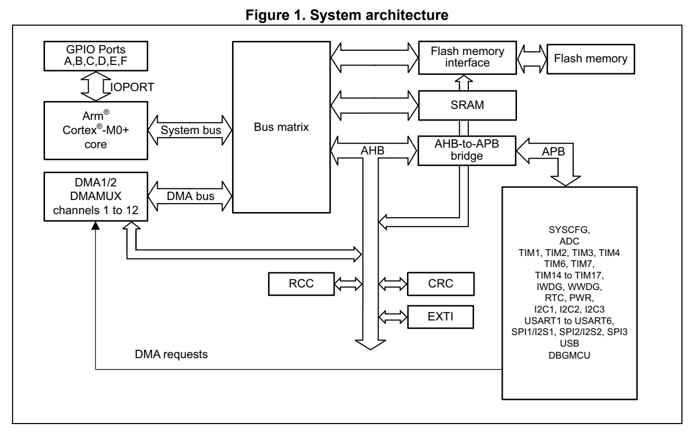
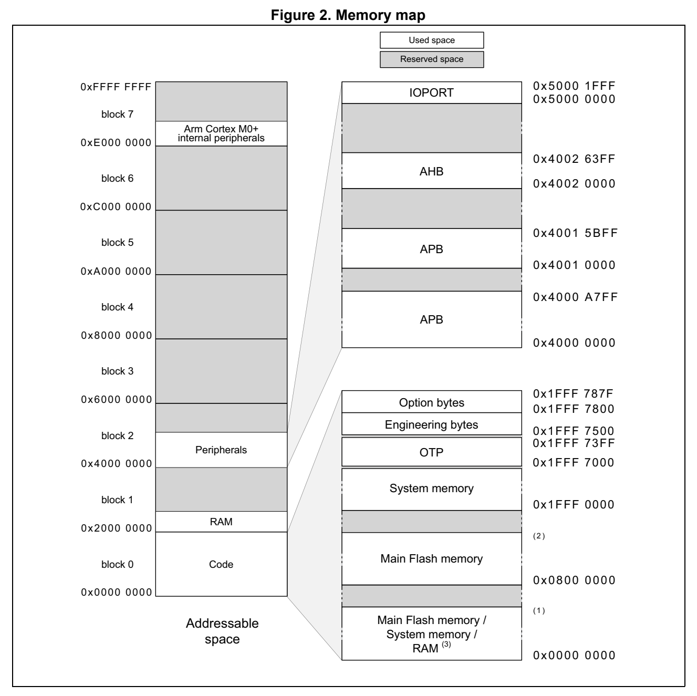

# 2 Memory and bus architecture (pp. 42-52)

## 2 Memory and bus architecture (p. 42)

### 2.1 System a rchitecture (p. 42)

The main system consists of:

- Two masters: – Cortex®-M0+ core – General-purpose DMA

- Three slaves: – Internal SRAM – Internal Flash memory – AHB with AHB-to-APB bridge that connects a ll the APB periphera ls

These are interconnected using a multilayer AHB bus architecture as shown in Figure 1.

*Figure 1. System architecture (p. 42)*

System bus (S-bus) This bus connects the system bus of the Cortex®-M0+ core (peripheral bus) to a bus matrix that manages the arbitration b etween the core and the DMA.

DMA bus

This bus connects the AHB master interface of the DMA to the bu s matrix that manages the access of CPU and DMA to SRAM, F lash memory and AHB/APB periphe rals.

Bus matrix

The bus matrix manages the access arbitration between the core system bus and the DMA master bus. The arbitration uses a Round Robin algorithm. The b us matrix is composed of masters (CPU, DMA) and slaves (Fl ash memory interface, SRAM and AHB-to-APB bridge).

AHB peripherals are connected on system bus through the bus mat rix to allow DMA access.

AHB-to-APB bridge (APB)

The AHB-to-APB bridge provides fu ll synchronous connections between the AHB and the APB bus.

Refer to Section 2.2: Memory organization for the address mapping of the peripherals connected to this bridge.

After each device reset, all peri pheral clocks are disabled (except for the SRAM and Flash memory). Before using a peripheral its clock in the RCC_AHBENR, RCC_APBENRx or RCC_IOPENR register must first be enabled.

Note: When a 16- or 8-bit access is performed on an APB register, the access is transformed into a 32-bit access: the bridge duplicates the 16- or 8-bit data to feed the 32-bit vector.

### 2.2 Memory organization (p. 44)

#### 2.2.1 Introduction (p. 44)

Program memory, data memory, registers and I/O ports are organi zed within the same linear 4-Gbyte address space.

The bytes are coded in memory in Little Endian format. The lowe st numbered byte in a word is considered the word’s least s ignificant byte and the highest numbered byte the most significant.

The addressable memory space is divided into eight main blocks, of 512 Mbytes each.

#### 2.2.2 Memory map and register boundary addresses (p. 45)

*Figure 2. Memory map (p. 45)*

1. STM32G0B0xx: 0x0007 FFFF; STM32G070xx: 0x0001 FFFF; STM32G050xx, STM32G030xx: 0x0000 FFFF. 2. STM32G0B0xx: 0x0807 FFFF; STM32G070xx: 0x0801 FFFF; STM32G050xx, STM32G030xx: 0x0800 FFFF. 3. Depends on boot configuration All the memory map are as that are not alloca ted to on-chip memo ries and peripherals are considered as reserved. For the detailed mapping of available m emory and register areas, refer to the following tables.

**Table 2. STM32G0B0xx memory boundary addresses (p. 46)**

| Col 1 | Col 2 | Col 3 | Type Boundary address Size Memory Area Register description | Col 5 |
| --- | --- | --- | --- | --- |
| SRAM | 0x2002 4000 - 0x3FFF FFFF | ~512 MB | Reserved | - |
| SRAM | 0x2000 0000 - 0x2002 3FFF 144 KB SRAM |  |  | Section 2.3 on page 49 |
|  | 0x1FFF 7880- 0x1FFF FFFF | ~34 KB | Reserved | - |
|  | 0x1FFF 7800 - 0x1FFF |  | 787F 128 B Option bytes | Section 3.4 on page 63 |
|  | 0x1FFF 7500 - 0x1FFF 77F |  | F 768 B Engineering bytes - |  |
|  | 0x1FFF 7400- 0x1FFF 74FF | 256 B | Reserved | - |
|  |  |  | 0x1FFF 7000 - 0x1FFF 73FF 1 KB OTP - |  |
| Code |  |  | 0x1FFF 0000 - 0x1FFF 6FFF 28 KB System memory - |  |
|  | 0x0808 0000 - 0x1FFF D7FF | ~384 MB | Reserved | - |
|  |  | 0x0800 0000 - 0x0807 FFFF 512 KB Main Flash memory |  | Section 3.3.1 on page 53 |
|  | 0x0008 0000 - 0x07FF FFFF | ~7.5 MB | Reserved | - |
|  | 0x0000 0000 - 0x0007 FFFF 512 KB |  | Main Flash memory, system memory or SRAM depending on BOOT configuration | - |

**Table 3. STM32G070xx memory boundary addresses (p. 46)**

| Col 1 | Col 2 | Col 3 | Type Boundary address Size Memory Area Register description | Col 5 |
| --- | --- | --- | --- | --- |
| SRAM | 0x2000 9000 - 0x3FFF FFFF | ~512 MB | Reserved | - |
| SRAM | 0x2000 0000 - 0x2000 8FFF 36 KB SRAM |  |  | Section 2.3 on page 49 |
|  | 0x1FFF 7880- 0x1FFF FFFF | ~34 KB | Reserved | - |
|  | 0x1FFF 7800 - 0x1FFF |  | 787F 128 B Option bytes | Section 3.4 on page 63 |
|  | 0x1FFF 7500 - 0x1FFF 77F |  | F 768 B Engineering bytes - |  |
|  | 0x1FFF 7400- 0x1FFF 74FF | 256 B | Reserved | - |
|  |  |  | 0x1FFF 7000 - 0x1FFF 73FF 1 KB OTP - |  |
| Code |  |  | 0x1FFF 0000 - 0x1FFF 6FFF 28 KB System memory - |  |
|  | 0x0802 0000 - 0x1FFF D7FF | ~384 MB | Reserved | - |
|  |  | 0x0800 0000 - 0x0801 FFFF 128 KB Main Flash memory |  | Section 3.3.1 on page 53 |
|  | 0x0002 0000 - 0x07FF FFFF | ~8 MB | Reserved | - |
|  | 0x0000 0000 - 0x0001 FFFF 128 KB |  | Main Flash memory, system memory or SRAM depending on BOOT configuration | - |

boundary addresses

**Table 4. STM32G030xx and STM32G050xx memory (p. 47)**

| Col 1 | Col 2 | Col 3 | Type Boundary address Size Memory Area Register description | Col 5 |
| --- | --- | --- | --- | --- |
| SRAM | 0x2000 2000 - 0x3FFF FFFF | ~512 MB | Reserved | - |
| SRAM | 0x2000 0000 - 0x2000 1FFF 8 KB SRAM |  |  | Section 2.3 on page 49 |
|  | 0x1FFF 7880- 0x1FFF FFFF | ~34 KB | Reserved | - |
|  | 0x1FFF 7800 - 0x1FFF |  | 787F 128 B Option bytes | Section 3.4 on page 63 |
|  | 0x1FFF 7500 - 0x1FFF 77F |  | F 768 B Engineering bytes - |  |
|  | 0x1FFF 7400- 0x1FFF 74FF | 256 B | Reserved | - |
|  |  |  | 0x1FFF 7000 - 0x1FFF 73FF 1 KB OTP - |  |
|  | 0x1FFF 2000 - 0x1FFF 6FFF | ~20 KB | Reserved | - |
| Code |  |  | 0x1FFF 0000 - 0x1FFF 1FFF 8 KB System memory - |  |
|  | 0x0801 0000 - 0x1FFF D7FF | ~384 MB | Reserved | - |
|  | 0x0800 0000 - 0x0800 FFFF 6 |  | 4 KB Main Flash memory | Section 3.3.1 on page 53 |
|  | 0x0001 0000 - 0x07FF FFFF | ~8 MB | Reserved | - |
|  | 0x0000 0000 - 0x0000 FFFF 64 KB |  | Main Flash memory, system memory or SRAM depending on BOOT configuration | - |

The following table gives the b oundary addresses of the periphe rals.

**Table 5. STM32G0x0 peripheral register boundary addresses (pp. 47-49)**

| Col 2 | Col 3 | Col 4 | Bus Boundary address Size Peripheral Peripheral register map | Col 6 |
| --- | --- | --- | --- | --- |
|  | - 0xE000 0000 - 0xE00F FFFF 1MB |  | Cortex®-M0+ internal peripherals | - |
|  | 0x5000 1800 - 0x5FFF 17FF | ~256 MB | Reserved | - |
|  | 0x5000 1400 - 0x5000 17FF 1 KB GPIOF |  |  | Section 6.4.12 on page 188 |
|  | 0x5000 1000 - 0x5000 13FF 1 KB GPIOE |  |  | Section 6.4.12 on page 188 |
| IOPORT | 0x5000 0C00 - 0x5000 0FFF 1 KB GPIOD |  |  | Section 6.4.12 on page 188 |
|  | 0x5000 0800 - 0x5000 0BFF 1 KB GPIOC |  |  | Section 6.4.12 on page 188 |
|  | 0x5000 0400 - 0x5000 07FF 1 KB GPIOB |  |  | Section 6.4.12 on page 188 |
|  | 0x5000 0000 - 0x5000 03FF 1 KB GPIOA |  |  | Section 6.4.12 on page 188 |
|  | 0x4002 3400 - 0x4FFF FFFF | ~256 MB | Reserved | - |
|  | 0x4002 3000 - 0x4002 33FF 1 KB CRC |  |  | Section 13.4.6 on page 273 |
|  | 0x4002 2400 - 0x4002 2FFF | 3 KB | Reserved | - |
|  | 0x4002 2000 - 0x4002 23FF 1 KB FLASH |  |  | Section 3.7.13 on page 85 |
|  | 0x4002 1C00 - 0x4002 1FFF | 3 KB | Reserved | - |
| AHB | 0x4002 1800 - 0x4002 1BFF 1 KB EXTI |  |  | Section 12.5.9 on page 265 |
| AHB | 0x4002 1400 - 0x4002 17FF | 1 KB | Reserved | - |
|  | 0x4002 1000 - 0x4002 13FF 1 KB RCC |  |  | Section 5.4.24 on page 169 |
|  | 0x4002 0C00 - 0x4002 0FFF | 1 KB | Reserved | - |
|  | 0x4002 0800 - 0x4002 0BFF 2 KB DMAMUX |  |  | Section 10.6.7 on page 248 |
|  | 0x4002 0400 - 0x4002 07FF 1 KB DMA2 |  |  | Section 9.6.7 on page 231 |
|  | 0x4002 0000 - 0x4002 03FF 1 KB DMA1 |  |  | Section 9.6.7 on page 231 |
|  | 0x4001 5C00 - 0x4001 FFFF | 32 KB | Reserved | - |
|  | 0x4001 5800 - 0x4001 5BFF 1 KB DBG |  |  | Section 29.10.5 on page 978 |
|  | 0x4001 4C00 - 0x4001 57FF | 3 KB | Reserved | - |
|  | 0x4001 4800 - 0x4001 4BFF 1 KB TIM17 |  |  | Section 19.6.21 on page 632 |
| APB | 0x4001 4400 - 0x4001 47FF 1 KB TIM16 |  |  | Section 19.6.21 on page 632 |
|  | 0x4001 4000 - 0x4001 43FF 1 KB TIM15 |  |  | Section 19.6.21 on page 632 |
|  | 0x4001 3C00 - 0x4001 3FFF 1 KB USART6 |  |  | Section 26.8.15 on page 861 |
|  | 0x4001 3800 - 0x4001 3BFF 1 KB USART1 |  |  | Section 26.8.15 on page 861 |
|  | 0x4001 3400 - 0x4001 37FF | 1 KB | Reserved | - |
|  | 0x4001 3000 - 0x4001 33FF 1 KB SPI1/I2S1 |  |  | Section 27.9.10 on page 919 |
|  | 0x4001 2C00 - 0x4001 2FFF 1 KB TIM1 |  |  | Section 15.4 on page 396 |
|  | 0x4001 2800 - 0x4001 2BFF | 1 KB | Reserved | - |
|  | 0x4001 2400 - 0x4001 27FF 1 KB ADC |  |  | Section 14.13 on page 333 |
|  | 0x4001 0200 - 0x4001 23FF | 8 KB | Reserved | - |
|  | 0x4001 0080 - 0x4001 01FF |  | SYSCFG(ITLINE) (1) | Section 7.1.31 on page 205 |
| APB | 0x4001 0030 - 0x4001 007F | 1 KB | Reserved | - |
| APB | 0x4001 0000 - 0x4001 002F SYSCFG |  |  | Section 7.1.31 on page 205 |
|  | 0x4000 B400- 0x4000 FFFF | 19 KB | Reserved | - |
|  |  | 0x4000 B000 - 0x4000 B3FF 1 KB TAMP (+ BKP registers) |  | Section 24.6.9 on page 703 |
|  | 0x4000 8C00 - 0x4000 AFFF | 9 KB | Reserved | - |
|  | 0x4000 8800 - 0x4000 8BFF 1 KB I2C3 |  |  | Section 25.7.12 on page 773 |
|  | 0x4000 7400 - 0x4000 87FF | 5 KB | Reserved | - |
|  | 0x4000 7000 - 0x4000 73FF 1 KB PWR |  |  | Section 4.4.20 on page 117 |
|  | 0x4000 6000 - 0x4000 6FFF | 4 KB | Reserved | - |
|  | 0x4000 5C00 - 0x4000 5FFF 1 KB USB |  |  | Section 28.6.3 on page 964 |
|  | 0x4000 5800 - 0x4000 5BFF 1 KB I2C2 |  |  | Section 25.7.12 on page 773 |
|  | 0x4000 5400 - 0x4000 57FF 1 KB I2C1 |  |  | Section 25.7.12 on page 773 |
|  | 0x4000 5000 - 0x4000 53FF 1 KB USART5 |  |  | Section 26.8.15 on page 861 |
|  | 0x4000 4C00 - 0x4000 4FFF 1 KB USART4 |  |  | Section 26.8.15 on page 861 |
|  | 0x4000 4800 - 0x4000 4BFF 1 KB USART3 |  |  | Section 26.8.15 on page 861 |
|  | 0x4000 4400 - 0x4000 47FF 1 KB USART2 |  |  | Section 26.8.15 on page 861 |
|  | 0x4000 4000 - 0x4000 43FF | 1 KB | Reserved | - |
|  | 0x4000 3C00 - 0x4000 3FFF 1 KB SPI3 |  |  | Section 27.9.10 on page 919 |
|  | 0x4000 3800 - 0x4000 3BFF 1 KB SPI2 |  |  | Section 27.9.10 on page 919 |
| APB | 0x4000 3400 - 0x4000 37FF | 1 KB | Reserved | - |
| APB | 0x4000 3000 - 0x4000 33FF 1 KB IWDG |  |  | Section 21.4.6 on page 643 |
|  | 0x4000 2C00 - 0x4000 2FFF 1 KB WWDG |  |  | Section 22.5.4 on page 649 |
|  | 0x4000 2800 - 0x4000 2BFF 1 KB RTC |  |  | Section 23.6.21 on page 687 |
|  | 0x4000 2400 - 0x4000 27FF | 1 KB | Reserved | - |
|  | 0x4000 2000 - 0x4000 23FF 1 KB TIM14 |  |  | Section 18.4.13 on page 545 |
|  | 0x4000 1800 - 0x4000 1FFF | 2 KB | Reserved | - |
|  | 0x4000 1400 - 0x4000 17FF 1 KB TIM7 |  |  | Section 17.4.9 on page 520 |
|  | 0x4000 1000 - 0x4000 13FF 1 KB TIM6 |  |  | Section 17.4.9 on page 520 |
|  | 0x4000 0C00 - 0x4000 0FFF | 1 KB | Reserved | - |
|  | 0x4000 0800 - 0x4000 0BFF 1 KB TIM4 |  |  | Section 16.4.26 on page 505 |
|  | 0x4000 0400 - 0x4000 07FF 1 KB TIM3 |  |  | Section 16.4.26 on page 505 |
|  | 0x4000 0000 - 0x4000 03FF | 1 KB | Reserved | - |

1. SYSCFG (ITLINE) registers us e 0x4001 0000 as reference periph eral base address.

### 2.3 Embedded SRAM (p. 49)

The following table summarizes the SRAM resources on the device s, with parity check enabled and disabled.

. Table 6. SRAM size

| Device | SRAM with parity enabled (Kbyte) | SRAM with parity disabled (Kbyte) |
| --- | --- | --- |
|  | STM32G0B0xx 128 144 |  |
|  | STM32G070xx 32 36 |  |
|  | STM32G050xx 16 18 |  |
|  | STM32G030xx 8 8 |  |

The SRAM can be access ed by bytes, half-words (16 bits) or full words (32 bits), at maximum system clock frequency w ithout wait state and thus by b oth CPU and DMA.

Parity check

The user can enable the parity c heck using the option bit RAM_PARITY_CHECK in the user option byte (refer to Section 3.4: FLASH option bytes).

The data bus width is 36 bits because 4 bits are available for parity check (1 b it per byte) in order to increase memory robustness, as required for instance by Class B or SIL norms.

The parity bits are co mputed and stored when writing into the S RAM. Then, they are automatically checked when re ading. If one bit fails, an NMI is generated. The same error can also be linked to the BRK_IN Break input of TIM1/15/16/17, with the SRAM_PARITY_LOCK control bit in the SYSCFG configuration register 2 (SYSCFG_CFGR2). The SRAM Parity Error flag ( SRAM_PEF) is available in the SYSCFG configuration register 2 (SYSCFG_CFGR2).

Note: When enabling the SRAM parity check, it is advised to initialize by software the whole SRAM at the beginning of the code, to avoid getting parity errors when reading non-initialized locations.

### 2.4 Flash memory overview (p. 50)

The Flash memory is composed of two distinct physical areas:

- The main Flash memory block. It contains the application progra m and user data if necessary.

- The information bl ock. It is composed of three parts: – Option bytes for hardware and m emory protection user configura tion. – System memory which contains t he proprietary boot loader code. – OTP (one-time programmable) area Refer to Section 3: Embedded Flash memory (FLASH) for more details.

The Flash interface implements i nstruction access and data acce ss based on the AHB protocol. It implements the prefetch buffer that speeds up CPU code execution. It also implements the logic necessary to carry out the Flash memory op erations (Program/Erase) controlled through th e Flash registers.

### 2.5 Boot configuration (p. 51)

In the STM32G0x0, three different boot modes can be selected th rough the BOOT0 pin and boot configuration bits nBOOT1, BOOT_SEL and nBOOT0 in the User option byte, as shown in the following table.

**Table 7. Boot modes (p. 51)**

| Boot mode configuration | Col 4 | Selected boot area |
| --- | --- | --- |
| nBOOT1 bit BOOT0 pin nBOOT_SEL bit nBOOT0 bit |  | Selected boot area |
|  | x 0 0 x Main Flash memory |  |
|  | 1 1 0 x System memory |  |
|  | 0 1 0 x Embedded SRAM |  |
|  | x x 1 1 Main Flash memory |  |
|  | 1 x 1 0 System memory |  |
|  | 0 x 1 0 Embedded SRAM |  |

The boot mode configuration is latched on the 4th rising edge of SYSCLK after a reset. It is up to the user to set boot mode co nfiguration related to the re quired boot mode.

The boot mode configuration is als o re-sampled when exiting fro m Standby mode. Consequently they must be kept in the required Boot mode config uration in Standby mode. After this startup delay has ela psed, the CPU fetches the top-of-stack value from address 0x0000 0000, then starts code execution from the boot memory at 0x0000 0004.

Depending on the selected boot m ode, main Flash memory, system memory or SRAM is accessible as follows:

- Boot from main Flash memory: the main Flash memory is aliased i n the boot memory space (0x0000 0000), but still acce ssible from its original memo ry space (0x0800 0000). In other words, th e Flash memory contents can be accessed starting from address 0x0000 0000 or 0x0800 0000.

- Boot from system m emory: the system memory is aliased in the bo ot memory space (0x0000 0000), but still accessible from its origin al memory spa ce 0x1FFF0000.

- Boot from the embedded SRAM: the SRAM is a liased in the boot me mory space (0x0000 0000), but it is still accessible from its original mem ory space (0x2000 0000).

Empty check

Internal empty check flag (the EMPTY bit of the FLASH access control register (FLASH_ACR)) is implemented to allow easy programming of virgin devices by the boot loader. This flag is used when BOOT0 pin is defining Main Flash memory as the target boot area. When the flag is set, the device is considered as empty a nd System memory (boot loader) is selected instead of the Main Flash as a boot area to allow user to program the Flash memory.

This flag is updated only during Option bytes loading: it is se t when the co ntent of the address 0x0800 0000 is read as 0xFFFF FFFF, otherwise it is cle ared. It means a power reset or setting of OBL_LAUNCH bit in FLASH_CR register is need ed to clear this flag after programming of a virgin device to execute user code after Syste m reset. The EMPTY bit can also directly be written by software.

Note: If the device is programmed for a first time but the Option bytes are not reloaded, the device still selects System memory as a boot area after a System reset.

Physical remap

Once the boot mode is selected, the application software can mo dify the memory accessible in the code area. This modificat ion is performed by programming the MEM_MODE bits in the SYSCFG configuration register 1 (SYSCFG_CFGR1).

Embedded boot loader

The embedded boot loader is located in the System memory, programmed by ST during production. It is used to reprogram the Flash memory using one of the following serial interfaces:

- USART1, USART2, I2C1 and I2 C2 (applies to all devices)

- USART3, SPI1, and SPI2 (applies to STM32G070xx and to STM32G0B0xx)

- USB (DFU) (applies to STM32G0B0xx)

For further details, re fer to the device data sheets and AN2606.
