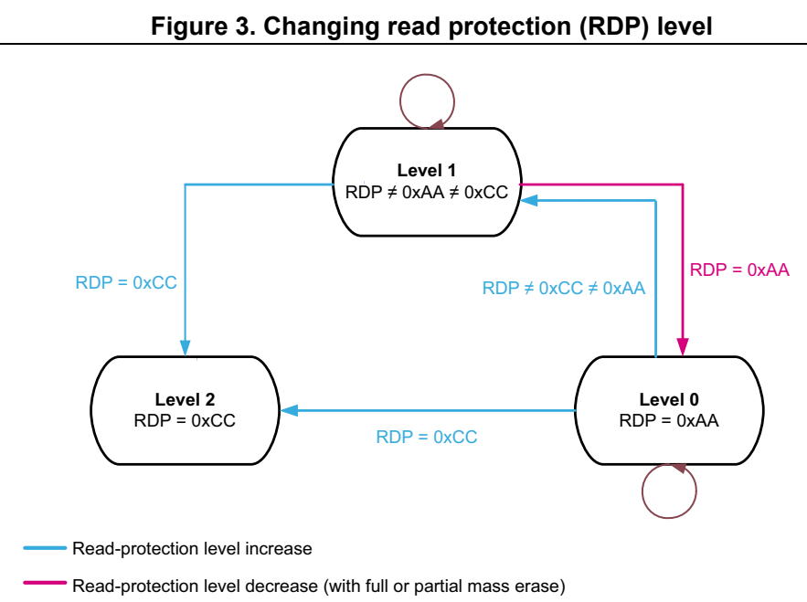

# 3 Embedded Flash memory (FLASH) (pp. 53-85)

## 3 Embedded Flash memory (FLASH) (p. 53)

### 3.1 FLASH Introduction (p. 53)

® The Flash memory interface manages CPU (Cortex -M0+) AHB to the Flash memory. It implements erase and program Fl ash memory operations, read and write protection, and security mechanisms.

The Flash memory interface accel erates code execution with a system of instruction prefetch and cache lines.

### 3.2 FLASH main features (p. 53)

- Up to 512 Kbytes of Flash memory (Main memory): – up to 64 Kbytes for STM32G030xx / STM32G050xx – up to 128 Kbytes for STM32G070xx – up to 512 Kbytes for STM32G0B0xx

- Memory organization: – 1 bank (products with up to 128 Kbytes of Flash memory) – 2 banks (products with more t han 128 Kbytes of Flash memory) – Page size: 2 Kbytes – Subpage size: 512 bytes

- 72-bit wide data read (6 4 bits plus 8 ECC bits)

- 72-bit wide data write ( 64 bits plus 8 ECC bits)

- Page erase (2 Kbytes), bank (sing le-bank) erase, and mass (all-b ank) erase

Flash memory interface features:

- Flash memory read operations

- Flash memory program/erase operations

- Read protection activated by option (RDP)

- Two write protection a reas per bank, selected by option (WRP)

- Flash memory empty check

- Prefetch buffer

- CPU instruction cache: two cache lines of 64 bits (16 bytes RAM)

- Error code correction (ECC): eight bits for 64 bits

- Option byte loader

### 3.3 FLASH functional description (p. 53)

#### 3.3.1 FLASH memory organization (p. 53)

The Flash memory is organized as 72-bit-wide memory cells (64 b its plus 8 ECC bits) that can be used for storing both code and data constants.

The Flash memory is organized as follows:

- A Main memory block containing 1 28 pages of 2 Kbytes, each page with eight rows of 256 bytes.

- An Information block containing: – System memory from which the CPU boots in System memory boot m ode. The area is reserved and contains the boot loader used to reprogram the Flash memory through one of the followi ng interfaces: USART1, USART2, I2C1, and I2C2 (applies to all devices), USART3, SPI1, and SPI2 (applies to STM32G070xx and to STM32G0B0xx), and through USB (DFU) and (applies to STM 32G0B0xx). On the manufacturing line, the dev ices are programmed and prote cted against spurious write/erase operations. For further details, refer to the AN2606 available from www.st.com. – 1 Kbyte (128 double words) OTP (one-time programmable) for user data. The OTP data cannot be erased and can be written only once. If only one bit is at 0, the entire double word (64 bits) cannot be written anymore, eve n with the value 0x0000 0000 0000 0000. The OTP area cannot be read when RDP level is 1 and boot source is not the Main Flash memory area. – Option bytes for user configuration.

The following tables show the mapping of the Flash memory into Information block and Main memory area. The mapping for

**Table 8. Flash memory organization for single-bank devices (p. 54)**

| Col 2 | Area Addresses | Size (bytes) | 64 Kbyte devices | 128 Kbyte devices |
| --- | --- | --- | --- | --- |
|  |  | 0x1FFF 7800 - 0x1FFF 787F 128 Option bytes |  |  |
|  | 0x1FFF 7500 - 0x1FFF 77F |  | F 768 Engineering bytes |  |
| Information | 0x1FFF 7000 - 0x1FFF 73FF 1 K OTP area | 0x1FFF 7000 - 0x1FFF 73FF 1 K OTP area |  |  |
| block | 0x1FFF 2000 - 0x1FFF 6FFF 20 K - |  |  | System memory |
|  | 0x1FFF 0000 - 0x1FFF 1 |  | FFF 8 K System memory |  |
|  | 0x0801 F800 - 0x0801 FFFF 2 K |  |  | Page 63 |
|  |  |  | - |  |
|  | 0x0801 0000 - 0x0 | 801 07FF 2 K Page 32 | 801 07FF 2 K Page 32 |  |
| Main | 0x0800 F800 - 0x0800 FFFF 2 K Page 31 | 0x0800 F800 - 0x0800 FFFF 2 K Page 31 |  |  |
| memory |  |  |  |  |
|  | 0x0800 1000 - 0x0 | 800 17FF 2 K Page 2 |  |  |
|  | 0x0800 0800 - 0x08 | 00 0FFF 2 K Page 1 |  |  |
|  | 0x0800 0000 - 0x0 | 800 07FF 2 K Page 0 |  |  |

**Table 9. Flash memory organizati on for 512 Kbytes dual-bank devi ces (p. 55)**

| Col 1 | Col 2 | Area Addresses Size (bytes) | Col 4 | Memory type |
| --- | --- | --- | --- | --- |
|  |  | Bank 2 0x1FFF F800 - 0x1FFF F80F 16 |  | Option bytes |
|  |  | Bank 1 0x1FFF 7800 - 0x1FFF 780F 16 |  | Option bytes |
| Information block |  | Bank 1 0x1FFF 7000 - 0x1FFF 73FF 1 K OTP area |  |  |
|  |  | Bank 2 0x1FFF 8000 - 0x1FFF EFFF 28 K |  | System memory |
|  |  | Bank 1 0x1FFF 0000 - 0x1FFF 6FFF 28 K |  | System memory |
|  |  | 0x0807 F804 - 0x0807 FFFF 2 K Page 383 |  |  |
|  | Bank 2 | 0x0804 1000 - 0x0 | 804 17FF 2 K Page 258 |  |
|  |  | 0x0804 0800 - 0x08 | 04 0FFF 2 K Page 257 |  |
| Main |  | 0x0804 0000 - 0x0 | 804 07FF 2 K Page 256 |  |
| memory |  | 0x0803 F800 - 0x0803 FFFF 2 K Page 127 |  |  |
|  | Bank 1 | 0x0800 1000 - 0x0 | 800 17FF 2 K Page 2 |  |
|  |  | 0x0800 0800 - 0x08 | 00 0FFF 2 K Page 1 |  |
|  |  | 0x0800 0000 - 0x0 | 800 07FF 2 K Page 0 |  |

#### 3.3.2 FLASH empty check (p. 55)

During the OBL phase, after loading all options, the Flash memo ry interface checks whether the first location of the Main memory is programmed. The result of this check in conjunction with the boot0 an d boot1 information is us ed to determine where the system has to boot from. It prevents the system to boot from Main Flash memory are a when i.e. no user code has been programmed.

The Main Flash memory empty check status can be read from the E MPTY bit in FLASH access control register (FLASH_ACR). Software can modify the Main Flash memory empty status by writing an appropriate value to the EMPTY bit.

#### 3.3.3 FLASH error code correction (ECC) (p. 55)

Data in Flash memory words are 7 2-bits wide: eight bits are add ed per each double word (64 bits). The ECC me chanism supports:

- One error detection and correction

- Two errors detection

When one error is detected and corrected, the flag ECCC (ECC co rrection) is set in FLASH ECC register (FLASH_ECCR). If ECCCIE is set, an interrupt is generated.

When two errors are detected, a flag ECCD (ECC detection) is se t in FLASH ECC register (FLASH_ECCR). In this case, a NMI is generated.

When an ECC erro r is detected, the address of the failing doubl e word is saved in ADDR_ECC[16:0] bitfield of the FLASH_ECCR register. ADDR_ECC[2: 0] are always cleared. The bus-ID of the CPU accessing the address is saved i n CPUID[2:0].

While ECCC or ECCD is set, FLASH_E CCR is not updated if a new E CC error occurs. FLASH_ECCR is updated only when ECC flags are cleared.

Note: For a virgin data: 0xFF FFFF FFFF FFFF FFFF, one error is detected and corrected, but two errors detection is not supported. When an ECC error is reported, a new read at the failing address may not generate an ECC error if the data is still presen t in the current buffer, even if ECCC and ECCD are cleared. If this is not the desired behavior, the user must reset the cache.

#### 3.3.4 FLASH read access latency (p. 56)

To correctly read data from Flash memory, the number of wait states (LATENCY) must be correctly programmed in the FLASH access control register (FLASH_ACR) according to the frequency of the Flash (HCLK) m emory clock and the internal vol tage range of the device V CORE. Refer to Section 4.1.4: Dynamic voltage scaling management.

**Table 10. Number of wait states according to Flash memory clock (HCLK) frequency (p. 56)**

| Wait states (WS) | HCLK (MHz) | HCLK (MHz) |
| --- | --- | --- |
| (LATENCY) | V CORE Range 1 V | CORE Range 2 |
|  | 0 WS (1 HCLK cycles) ≤ 24 ≤ 8 |  |
|  | 1 WS (2 HCLK cycles) ≤ 48 ≤ 16 |  |
|  | 2 WS (3 HCLK cycles) ≤ 64 - |  |

After power reset, the HCLK clock frequency is 16 MHz in Range 1 and 0 wait state (WS) is configured in the FLASH_ACR register.

When wakeup from Standby, the HCL K clock frequency is 16 MHz in Range 1 and 0 wait state (WS) is configured i n the FLASH_ACR register.

When changing the Flash memory clock frequency or Range, the fo llowing software sequences must be applied in order to tune the number of wait states needed to access the Flash memory:

Increasing the CPU frequency

1. Program the new number of wait states to the LATENCY bits of the FLASH access control register (FLASH_ACR). 2. Check that the new number of wa it states is taken into accou nt to access the Flash memory by reading back t he LATENCY bits of the FLASH access control register (FLASH_ACR), and wait until the programmed new number is read. 3. Modify the system cock source by writing the SW bits of the RCC_CFGR register. 4. If needed, modify the core clo ck prescaler by writing the HP RE bits of RCC_CFGR register. 5. Optionally, check that the new system clock source or/and th e new core clock prescaler value is/are taken into account by reading the clock source sta tus (SWS bits) of the

RCC_CFGR register, or/and the AHB prescaler value (HPREF bit), of the RCC_CFGR register.

Decreasing the CPU frequency

1. Modify the system clock source b y writing the SW bits of the RCC_CFGR register. 2. If needed, modify the core clo ck prescaler by writing the HP RE bits of RCC_CFGR. 3. Check that the new system clo ck source or/and the new core c lock prescaler value is/are taken into account by reading the clock source status (S WS bits) of the RCC_CFGR register, or/and the AHB prescaler value (HPREF bit), of the RCC_CFGR register, and wait u ntil the programmed new system clock source or/and new Flash memory clock prescaler value is/are read. 4. Program the new number of wait states to the LATENCY bits of the FLASH access control register (FLASH_ACR). 5. Optionally, check that the new number of wait states is used to access the Flash memory by reading back t he LATENCY bits of the FLASH access control register (FLASH_ACR).

#### 3.3.5 FLASH memory acceleration (p. 57)

Instruction prefetch

Each Flash memory read operation provides 64 bits from either two instructions of 32 bits or four instructions of 16 bits according to the program launched. This 64-bits current instruction line is saved in a cu rrent buffer. So, in case of s equential code, at least two CPU cycles are needed to execute the previous read instruction line. Prefetch on the CPU S-bus can be used to read t he next sequential instruction line from t he Flash memory while the current instruction line is b eing requested by the CPU.

Prefetch is enabled by setti ng the PRFTEN bit of the FLASH access control register (FLASH_ACR). This feature is useful if at least one wait state is needed to access the Flash memory.

When the code is not sequential (branch), the instruction may n ot be present in the currently used instruction line or in the prefetched instruction line. In this case (miss), the penalty in terms of number of cycles is at least equal to the number of wa it states.

If a loop is present in the curren t buffer, no new access is pe rformed.

Cache memory

To limit the time lost due to jumps, it is possible to retain two cache lines of 64 bits (16 bytes) in the instruction cache memory. This feature can be enabled by setting the instruction cache enable (IC EN) bit of the FLASH access control register (FLASH_ACR). Each time a miss occurs (requested data not p resent in the currently used i nstruction line, in the prefetched instruction line or in the instruction cache memory), the line read is copied into the instruction cache memory. If some data contained in the instruction cache memory are requested by the CPU, they are provided without inserting any d elay. Once all the instruction cache memo ry lines are filled, the LRU (least recen tly used) policy is used to determine the lin e to replace in the instruction memory cache. This feature is particularly useful in case of code containing loops.

The Instruction cache memory i s enabled after system reset. No data cache is available on Cortex®-M0+.

#### 3.3.6 FLASH program and erase operations (p. 58)

The device-embedded Flash memory can be programmed using in-circuit programming or in-application programming.

The in-circuit programming (ICP) method is used to update t he entire contents of the Flash memory, using SWD protocol or the supported interfaces by the system boot loader, to load the user application for the CPU, into the microcontrol ler. ICP offers quick and efficient design iterations and e liminates unnecessary package handling or socketing of devices.

In contrast to the ICP method, in-application programming (IAP) can use any2 communication interface supporte d by the microcontroller (I/Os, UART, I C, SPI, etc.) to download programming data into memory. IAP allows the user to re-program the Flash memory while the application is running. Nevertheless, part of the application has to have been previously programmed in the Flash memory using ICP.

The success of a data word programming operation and a page/ban k erase operation is not guaranteed if aborted due to device reset or power loss.

During a program/erase operation to the Flash memory, any attem pt to read the Flash memory stalls the bus. The read operation p roceeds correctly on ce the program/erase operation has completed.

Unlocking the Flash memory

After reset, write into the FLASH control register (FLASH_CR) is not allowed so as to protect the Flash memory against possible unwanted operations d ue, for exa mple, to electric disturbances. The following sequence unlocks these reg isters: 1. Write KEY1 = 0x4567 0123 in the FLASH key register (FLASH_KEYR) 2. Write KEY2 = 0x CDEF 89AB in the FLASH key register (FLASH_KEYR).

Any wrong sequence locks the FLASH _CR registers until the next system reset. In the case of a wrong key sequence, a bus e rror is detected and a Hard Fau lt interrupt is generated.

The FLASH_CR registers can be locked again by software by setti ng the LOCK bit in one of these registers.

Note: The FLASH_CR register cannot be written when the BSY1 bit of the FLASH status register (FLASH_SR) is set. Any attempt to write to this register with the BSY1 bit set causes the AHB bus to stall until the BSY1 bit is cleared.

#### 3.3.7 FLASH Main memory erase sequences (p. 58)

The Flash memory erase operation can be performed at page level (page erase), or on the whole memory (mass erase). Mass erase does not affect the Information block (system Flash memory, OTP and option bytes).

Flash memory page erase

When a page is protected by WRP, it is not erased and the WRPER R bit is set.

To erase a page (2 Kbytes), follow the procedure below: 1. Check that no Flash memory o peration is ongoing by checking t he BSY1 bit of the FLASH status register (FLASH_SR). 2. Check and clear all error programming flags due to a previou s programming. If not, PGSERR is set. 3. Set the PER bit and select the page to erase (PNB) in the FLASH control register (FLASH_CR). 4. Set the STRT bit of the FLASH control register (FLASH_CR). 5. Wait until the BSY1 bit of the FLASH status register (FLASH_SR) is cleared.

Note: The internal oscillator HSI16 (16 MHz) is enabled automatically when STRT bit is set, and disabled automatically when STRT bit is cleare d, except if the HSI16 is previously enabled with HSION in RCC_CR register.

Flash memory bank or mass erase

When WRP is enabled, the Flash memory mass erase is aborted, no erase starts, and the WRPERR bit is set.

To perform a mass erase, follow the procedure below: 1. Check that no Flash memory o peration is ongoing by checking t he BSY1 bit of the FLASH status register (FLASH_SR). 2. Check and clear all error programming flags due to a previou s programming. If not, PGSERR is set. 3. Set the MER1 (for Bank 1 or s ingle-bank device) and/or MER2 (for Bank 2) bit of the FLASH control register (FLASH_CR). 4. Set the STRT bit of the FLASH control register (FLASH_CR). 5. Wait until the BSY1 bit ofthe FLASH status register (FLASH_SR) is cleared.

Note: The internal oscillator HSI16 (16 MHz) is enabled automatically when STRT bit is set, and disabled automatically when STRT bit is cleare d, except if the HSI16 is previously enabled with HSION in RCC_CR register.

#### 3.3.8 FLASH Main memory programming sequences (p. 59)

The Flash memory is programmed 7 2 bits (64-bit data plus 8-bit ECC) at a time.

Programming a previously programmed address with a non-zero data is not allowed. Any such attempt sets P ROGERR flag of the FLASH status register (FLASH_SR).

It is only possible to program a double word (2 x 32-bit data).

- Any attempt to write byte (8 bits) or half-word (16 bits) sets SIZERR flag of the FLASH status register (FLASH_SR).

- Any attempt to write a double wo rd that is not aligned with a d ouble word address sets PGAERR flag of the FLASH status register (FLASH_SR).

Standard programming

The Flash memory programming s equence in standard mode is as fo llows:

1. Check that no Main Flash memory operation is ongoing by check ing the BSY1 bit of the FLASH status register (FLASH_SR).. 2. Check and clear all error programming flags due to a previou s programming. If not, PGSERR is set. 3. Set the PG bit of the FLASH control register (FLASH_CR). 4. Perform the data write operat ion at the desire d memory addre ss, inside Main memory block or OTP area. Only double wo rd (64 bits) can be programmed. a) Write a first word in an a ddress aligned with double word b) Write the second word. 5. Wait until the BSY1 bit of the FLASH status register (FLASH_SR) is cleared. 6. Check that EOP flag of the FLASH status register (FLASH_SR) is set (programming operation succeeded), and clear it by software. 7. Clear the PG bit of the FLASH control register (FLASH_CR) if there no more programming request anymore.

Note: When the Flash memory interface has received a good sequence (a double word), programming is automatically launched and BSY1 bit is se t. The internal oscillator HSI16 (16 MHz) is enabled automatically when PG bit is set, and disabled automatically when PG bit is cleared, except if the HSI16 is previously enabled with HSION in RCC_CR register. ECC is calculated from the double word to program.

Fast programming

The main purpose of this mode is to reduce the page programming time. It is achieved by eliminating the need for verifyi ng the Flash memory locations b efore they are programmed, thus saving the time of high vo ltage ramping and falling for ea ch double word.

This mode allows programming a row (32 double words = 256 bytes).

During fast programming, the Fla sh memory clock (HCLK) frequency must be at least 8 MHz.

Only the Main memory can be programmed in Fast programming mode.

The Main Flash memory programming sequence in standard mode is described below: 1. Perform a mass or page erase. If not, PGSERR is set. 2. Check that no Main Flash memory operation is ongoing by chec king the BSY1 bit of the FLASH status register (FLASH_SR).. 3. Check and clear all error programming flag due to a previous programming. 4. Set the FSTPG bit in FLASH control register (FLASH_CR). 5. Write 32 double words to program a row (256 bytes). 6. Wait until the BSY1 bit of the FLASH status register (FLASH_SR) is cleared. 7. Check that EOP flag of the FLASH status register (FLASH_SR) is set (programming operation succeeded), and clear it by software. 8. Clear the FSTPG bit of the FLASH status register (FLASH_SR) if there are no more programming requests anymore.

Note: When attempting to write in Fast programming mode while a read operation is on going, the programming is aborted without any system notification (no error flag is set). When the Flash memory interface has received the first double word, programming is automatically launched. The BSY1 bit is set when the high voltage is applied for the first

double word, and it is cleared when the last double word has been programmed or in case of error. The internal oscilla tor HSI16 (16 MHz) is enabled automatically when FSTPG bit is set, and disabled automatically when FSTPG bit is cleared, except if th e HSI16 is previously enabled with HSION in RCC_CR register. The 32 double words must be written successively. The high voltage is kept on the Flash memory for all the programming. Maximum time between two double words write requests is the time programming (around 20 µs). If a second double word arrives after this time programming, fast programming is interrupted and MISSERR is set. High voltage must not exceed 8 ms for a full row between two erases. This is guaranteed by the sequence of 32 double words successively written with a clock system greater or equal to 8 MHz. An internal time-out counter counts 7 ms when Fast programming is set and stops the programming when time-out is over. In this case the FASTERR bit is set. If an error occurs, high voltage is stopped and next double word to programmed is not programmed. Anyway, all previous double words have been properly programmed.

Programming errors

Several kind of errors can be detected. In case of error, the F lash memory operation (programming or erasing) is aborted.

- PROGERR: Programming Error In standard programming: PROGERR is set if the word to write is not previously erased (except if the value to program is full zero).

- SIZERR: Size Programming Error In standard programming or in fast programming: only double word can be programmed, and only 32-bit data can be written. SIZERR is set if a byte or an half-word is written.

- PGAERR: Alignment Programming error PGAERR is set if one of the following conditions occurs: – In standard programming: the fi rst word to be programmed is no t aligned with a double word address, or the second word doesn’t belong to the s ame double word address. – In fast programming: the data to program doesn’t belong to the same row than the previous programmed double words, or the address to program is not greater than the previous one.

- PGSERR: Programming Sequence Error PGSERR is set if one of the following conditions occurs: – In the standard programming sequence or the fast programming s equence: a data is written when PG and FSTPG are cleared. – In the standard programming sequence or the fast programming s equence: MER1 and PER are not cleared when PG or FSTPG is set. – In the fast programming sequence: the Mass erase is not performed before setting the FSTPG bit. – In the mass erase sequence: PG, FSTPG, and PER are not cleared when MER1 is set. – In the page erase sequence: PG, FSTPG and MER1 are not cleared when PER is set. – PGSERR is set also if PROGERR, SIZERR, PGAERR, WRPERR, MISSERR, FASTERR or PGSERR is set due to a previous programming error.

- WRPERR: Write Protection Error WRPERR is set if one of the following conditions occurs: – Attempt to program or erase in a write protected area (WRP). – Attempt to perfo rm a mass erase when one page or more is prote cted by WRP. – The debug features are connected or the boot is executed from SRAM or from system Flash memory when the read protection (RDP) is set to Le vel 1. – Attempt to modify th e option bytes when t he read protection (R DP) is set to Level 2.

- MISSERR: Fast Programming Data Miss Error In fast programming: all the da ta must be written successively. MISSERR is set if the previous data programmation is finished and the next data to program is not written yet.

- FASTERR: Fast Programming Error In fast programming: FASTERR is set if one of the following con ditions occurs: – when FSTPG bit is set for more than 8 ms, which generates a tim e-out detection – when the row fast programming h as been interrupted by a MISSER R, PGAERR, WRPERR or SIZERR

If an error occurs during a program or erase operation, one of the following error flags of the FLASH status register (FLASH_SR) is set:

- PROGERR, SIZERR, PGAERR, PGSERR, MISSERR (program error flags)

- WRPERR (protection error flag)

In this case, if the error inte rrupt enable bit ERRIE of the FLASH control register (FLASH_CR) is set, an interrupt is generate d and the operation error flag OPERR of the FLASH status register (FLASH_SR) is set.

Note: If several successive errors are detected (for example, in case of DMA transfer to the Flash memory), the error flags cannot be cleared until the end of the successive write request.

Programming and cache

If an erase operation in Flash m emory also concerns data in the instruction cache, the user has to ensure that these data are rewritten before they are accessed during code execution.

Note: The cache should be flushed only when it is disabled (ICEN = 0).

#### 3.3.9 Read-while-write (RWW) function (p. 62)

Dual-bank devices support read-w hile-write funct ion that allows reading from one bank while erasing or programmi ng within the other bank.

Note: Write-while-write operation, such as erasing within one bank while programming the other, is not allowed.

Reading while page erasing

To erase a page in one bank while executing the code in the oth er bank, proceed as follows:

1. Check that the bu sy flag of the bank to erase ( BSY1 or BSY2) in the FLASH status register (FLASH_SR) is low (no erase/programming in progress). 2. Set up the page e rase, by setting the PER, PSB, and BKER bitfileds of the FLASH control register (FLASH_CR). 3. Trigger the erase operation by setting the STRT bit of the FLASH control register (FLASH_CR). This sets the co rresponding busy flag BSY1 or BSY2.

The erase operation is completed when the corresponding busy fl ag (BSY1 or BSY2) is back to low. The EOP interrupt can be used to indicate that eve nt to the application software.

Reading while bank erasing

To erase a bank while executing the code in the other bank, pro ceed as follows: 1. Check that the bu sy flag of the bank to erase ( BSY1 or BSY2) in the FLASH status register (FLASH_SR) is low (no erase/programming in progress). 2. Set the mass-erasure bit of the bank to erase (MER1 or MER2) in the FLASH control register (FLASH_CR). 3. Trigger the erase operation by setting the STRT bit of the FLASH control register (FLASH_CR). This sets the co rresponding busy flag BSY1 or BSY2.

The erase operation is completed when the corresponding busy fl ag (BSY1 or BSY2) is back to low. The EOP interrupt can be used to indicate that eve nt to the application software.

Reading while programming

To program a bank while executing the code in the other bank, p roceed as follows: 1. Check that the bu sy flag of the bank to program (BSY1 or BSY2) in the FLASH status register (FLASH_SR) is low (no erase/programming in progress). 2. Set the PG bit of the FLASH control register (FLASH_CR). 3. Write a word at a desired address within the bank to program. This sets the corresponding busy flag (BSY1 or BSY2). 4. When the corresponding busy flag (BSY1 or BSY2) is back to l ow an there is more data to write, go to the step 3

The word write operation is completed when the corresponding bu sy flag (BSY1 or BSY2) is back to low. The EOP interrupt can be used to indicate that eve nt to the application software.

### 3.4 FLASH option bytes (p. 63)

#### 3.4.1 FLASH option byte description (p. 63)

The option bytes are configured by the end user depending on th e application requirements. As a configuration exa mple, the watchdog m ay be selected in hardware or software mode (refer to Section 3.4.2: FLASH option byte programming).

A double word is split up in o ption bytes as indicated in Table 11.

**Table 11. Option byte format (p. 64)**

| Col 1 | Col 2 | Col 3 | 63-56 55-48 47-40 39-32 31-24 23-16 15 -8 7-0 | Col 5 | Col 6 | Col 7 | Col 8 |
| --- | --- | --- | --- | --- | --- | --- | --- |
| Complemented option byte 3 | Complemented option byte 2 | Complemented option byte 1 | Complemented option byte 0 | Option byte 3 | Option byte 2 | Option byte 1 | Option byte 0 |

The organization of these bytes in the information block is shown in Table 12 (superset for single-bank and dual-bank device s). The option bytes can be rea d from the Flash memory locations listed in Table 12 or from the Option byte registers:

- FLASH option register (FLASH_OPTR)

- FLASH WRP area A address register (FLASH_WRP1AR)

- FLASH WRP area B address register (FLASH_WRP1BR)

- FLASH WRP2 area A address register (FLASH_WRP2AR)

- FLASH WRP2 area B address register (FLASH_WRP2BR)

**Table 12. Organization of option bytes (p. 64)**

| Address (1) | 31 | 30 | 29 | 28 | 27 | 26 | 25 | 24 | 23 | 22 | 21 | 20 | 19 | 18 | 17 | 16 | 15 | 14 | 13 | 12 | 11 | 10 | 9 | 8 | 7 | 6 | 5 | 4 | 3 | 2 | 1 | 0 |
| --- | --- | --- | --- | --- | --- | --- | --- | --- | --- | --- | --- | --- | --- | --- | --- | --- | --- | --- | --- | --- | --- | --- | --- | --- | --- | --- | --- | --- | --- | --- | --- | --- |
| 0x1FFF7800 |  |  | Reserved |  |  | nBOOT0 | nBOOT1 | nBOOT_SEL | Reserved | RAM_PARITY_CHECK | DUAL_BANK | nSWAP_BANK | WWDG_SW | IWDG_STBY | IWDG_STOP | IWDG_SW | Reserved | nRST_STDBY | nRST_STOP |  |  | Reserved |  |  |  |  |  | RDP | RDP |  |  |  |
| 0x1FFF7808 -0x1FFF7840 |  |  |  |  |  |  |  |  |  |  |  |  |  |  |  | Reserved | Reserved |  |  |  |  |  |  |  |  |  |  |  |  |  |  |  |
|  |  |  |  |  |  |  |  |  |  |  |  |  |  | 0x1FFF7818 Reserved WRP1A_END Reserved WRP1A_STRT |  |  |  |  |  |  |  |  |  |  |  |  |  |  |  |  |  |  |
|  |  |  |  |  |  |  |  |  |  |  |  |  |  | 0x1FFF7820 Reserved WRP1B_END Reserved WRP1B_STRT |  |  |  |  |  |  |  |  |  |  |  |  |  |  |  |  |  |  |
|  |  |  |  |  |  |  |  |  |  |  |  |  |  | 0x1FFF7848 Reserved WRP2A_END Reserved WRP2A_STRT |  |  |  |  |  |  |  |  |  |  |  |  |  |  |  |  |  |  |
|  |  |  |  |  |  |  |  |  |  |  |  |  |  | 0x1FFF7850 Reserved WRP2B_END Reserved WRP2B_STRT |  |  |  |  |  |  |  |  |  |  |  |  |  |  |  |  |  |  |

1. The upper 32-bits of the double-word address contain the inve rted data from the lower 32 bits.

User and read protection option bytes

Flash memory address: 0x1FFF 7800

Reset value: 0xDFFF E1AA (ST production value)

Res. Res. Res. Res. Res. Res. _STDB BOOT0 BOOT1 _SEL _CHEC BANK _BANK _SW _STOP _SW Y K

rrr rrrrrrr

Bits 31:27 Reserved, must be kept at reset value.

Bit 26 nBOOT0: nBOOT0 option bit 0: nBOOT0 = 0 1: nBOOT0 = 1

Bit 25 nBOOT1: Boot configuration Together with the BOOT0 pin or option bit nBOOT0 (depending on nBOOT_SEL option bit configuration), this bit selects boot mode from the Main Flash memory, SRAM or the System memory. Refer to Section 2.5: Boot configuration.

Bit 24 nBOOT_SEL: BOOT0 signal source selection This option bit defines the source of the BOOT0 signal. 0: BOOT0 pin (legacy mode) 1: nBOOT0 option bit

Bit 23 Reserved, must b e kept at reset value.

Bit 22 RAM_PARITY_CHECK: SRAM parity check control enable 0: Enable 1: Disable

Bit 21 DUAL_BANK: Dual-bank on 512 Kbytes Flash memory devices 0: 512 Kbytes single-bank Flash memory, contiguous addresses in Bank 1 1: 512 Kbytes dual-bank F lash memory, Refer to Table 9

Bit 20 nSWAP_BANK: Empty check boot configuration This bit selects the bank that i s the subject of empty check up on boot. 0: Bank 1 1: Bank 2 This bit pertains to dual-bank devices only. In single-bank dev ices, it is reserved.

Bit 19 WWDG_SW: Window watchdog selection 0: Hardware window watchdog 1: Software window watchdog

Bit 18 IWDG_STDBY: Independent watchdog counter freeze in Standby mode 0: Independent watchdog counter is frozen in Standby mode 1: Independent watchdog counter is running in Standby mode

Bit 17 IWDG_STOP: Independent watchdog coun ter freeze in Stop mode 0: Independent watchdog counter is frozen in Stop mode 1: Independent watchdog counter is running in Stop mode

Bit 16 IDWG_SW: Independent watchdog selection 0: Hardware independent watchdog 1: Software independent watchdog

Bit 15 Reserved, must b e kept at reset value.

Bit 14 nRST_STDBY 0: Reset generated when entering the Standby mode 1: No reset generate when entering the Standby mode

Bit 13 nRST_STOP 0: Reset generated when entering the Stop mode 1: No reset generated wh en entering th e Stop mode

Bits 12:8 Reserved, must be kept at reset value.

Bits 7:0 RDP[7:0]: Read protection level 0xAA: Level 0, read p rotection not active 0xCC: Level 2, chip read protection active Others: Level 1, memories read protection active

WRP1A address option bytes

Flash memory address: 0x1FFF 7818

Reset value: 0x0000 00FF (ST production value)

Bits 31:23 Reserved, must be kept at reset value.

Bits 22:16 WRP1A_END[6:0]: WRP area A end offset (Bank 1) WRP1A_END contains t he offset of the last page of the WRP area A (in Bank 1 for dual-bank devices). Note: Values corresponding to addresses outside the Main memory are not allowed.

Bits 15:7 Reserved, must be kept at reset value.

Bits 6:0 WRP1A_STRT[6:0]: WRP area A start offset (Bank 1) WRP1A_STRT contains the offset of the first page of the WRP are a A (in Bank 1 for dual-bank devices). Note: Values corresponding to addresses outside the Main memory are not allowed.

WRP1B address option bytes

Flash memory address: 0x1FFF 7820

Reset value: 0x0000 00FF (ST production value)

Bits 31:23 Reserved, must be kept at reset value.

Bits 22:16 WRP1B_END[6:0]: WRP area B end offset (Bank 1) WRP1B_END contains t he offset of the last page of the WRP area B (in Bank 1 for dual-bank devices). Note: Values corresponding to addresses outside the Main memory are not allowed.

Bits 15:7 Reserved, must be kept at reset value.

Bits 6:0 WRP1B_STRT[6:0]: WRP area B start offset (Bank 1) WRP1B_STRT contains the offset of the first page of the WRP are a B (in Bank 1 for dual-bank devices). Note: Values corresponding to addresses outside the Main memory are not allowed.

WRP2A address option bytes

Flash memory address: 0x1FFF 7848

Reset value: 0x0000 00FF (ST production value)

Bits 31:23 Reserved, must be kept at reset value.

Bits 22:16 WRP2A_END[6:0]: WRP area A end offset, Bank 2 WRP2A_END contains the offset of the last page of the WRP area A in Bank 2 of dual-bank devices. Note: Values corresponding to addresses outside the Main memory are not allowed.

Bits 15:7 Reserved, must be kept at reset value.

Bits 6:0 WRP2A_STRT[6:0]: WRP area A start offset, Bank 2 WRP2A_STRT contains the offset of the first page of the WRP are a A in BAnk 2 of dual-bank devices. Note: Values corresponding to addresses outside the Main memory are not allowed.

WRP2B address option bytes

Flash memory address: 0x1FFF 7850

Reset value: 0x0000 00FF (ST production value)

Bits 31:23 Reserved, must be kept at reset value.

Bits 22:16 WRP2B_END[6:0]: WRP area B end offset, Bank 2 WRP2B_END contains the offset of the last page of the WRP area B in Bank 2 of dual-bank devices. Note: Values corresponding to addresses outside the Main memory are not allowed.

Bits 15:7 Reserved, must be kept at reset value.

Bits 6:0 WRP2B_STRT[6:0]: WRP area B start offset WRP2B_STRT contains the offset of the first page of the WRP are a B in Bank 2 of dual-bank devices. Note: Values corresponding to addresses outside the Main memory are not allowed.

#### 3.4.2 FLASH option byte programming (p. 68)

After reset, the option s related bits of the FLASH control register (FLASH_CR) are write-protected. To run any operation on the option bytes page, the o ption lock bit OPTLOCK of the FLASH control register (FLASH_CR) must be cleared. The fo llowing sequence is used to unlock this register: 1. Unlock the FLASH_CR with the LOCK clearing sequence (refer to Unlocking the Flash memory) 2. Write OPTKEY1=0x08192A3B of the FLASH option key register (FLASH_OPTKEYR) 3. Write OPTKEY2=0x4C5D6E7F of the FLASH option key register (FLASH_OPTKEYR)

Any wrong sequence locks up the Fl ash memory option registers u ntil the next system reset. In the case of a wrong key sequence, a bus error is dete cted and a Hard Fault interrupt is generated.

The user options can b e protected against unwanted erase/progra m operations by setting the OPTLOCK bit by software.

Note: If LOCK is set by software, OPTLOCK is automatically set as well.

Modifying user options

The option bytes are programmed differently from a Main memory user address.

To modify the value of user options, follow the procedure below: 1. Clear OPTLOCK option lock bit with the clearing sequence desc ribed above 2. Write the desired values in the FLASH option registers. 3. Check that no Flash memory o peration is ongoing, by checking the BSY1 bit of the FLASH status register (FLASH_SR).. 4. Set the Options Start bit OPTSTRT of the FLASH control register (FLASH_CR). 5. Wait for the BSY1 b it to be cleared.

Note: Any modification of the value of one option is automatically performed by erasing user option byte pages first, and then programming all the option bytes with the values contained in the Flash memory option registers. The complementary values are automatically computed and written into the complemented option bytes upon setting the OPTSTRT bit.

Caution: Upon an option byte programming failure (for any reason, such a s loss of power or a reset during the option byte change seq uence), the mismatch values of the option bytes are

loaded after reset. Those mismatch values force a secure config uration that might permanently lock the device. To p revent this, only program opti on bytes in a safe environment – safe supply, no pe nding watchdog, and clean reset line.

Option byte loading

After the BSY1 bit is cleared, a ll new options a re updated into the Flash memory, but not applied to the system. A read from the opt ion registers still returns the last loaded option byte values, the new options has effect on the system only afte r they are loaded.

Option bytes loading is p erformed in two cases: – when OBL_LAUNCH bit of the FLASH control register (FLASH_CR) is set – after a power reset ( exit from Standby mode)

Option byte loader performs a rea d of the options block and sto res the data into internal option registers. These internal registers configure the system and can be read by software. Setting OBL_LAUNCH gene rates a reset so the option byte loading is performed under system reset.

Each option bit has also its com plement in the same double word. During option loading, a verification of the option bit an d its complemen t allows to che ck the loading has correctly taken place.

During option byte loading, the options are read by double word. ECC on option words is not taken into accou nt during OBL, but only during direct SW read of option area.

If the word and its complement a re matching, the option word/byte is copied into the option register.

If the comparison between the word and its complement fails, a status bit OPTVERR is set. Mismatch values are forced into the option registers: – For USR OPT option, the value of mismatch is 1 for all option bits. – For WRP option, the value of m ismatch is the default value “No protection”. – For RDP option, the value of m ismatch is the default value “Level 1”.

Upon system reset, the option bytes are copied into the followi ng option registers that can be read and written by software:

- FLASH_OPTR

- FLASH_WRPyxR (x = A or B, y = 1 or 2)

These registers are also used to modify options. If these regis ters are not modified by user, they reflect the options states of the system. See Modifying user options for more details.

### 3.5 FLASH memory protection (p. 69)

The Main Flash memory can be protected against external accesse s with the read protection (RDP). The pages can al so be protected against unwan ted write (WRP) due to loss of program counter context. The write-protection WRP granu larity is 2 Kbytes.

#### 3.5.1 FLASH read protection (RDP) (p. 69)

The read protection is activated by setting the RDP option byte and then, by applying a system reset to reload the new R DP option byte. The read protection protects the Main

Flash memory, the opti on bytes, the backup registe rs (TAMP_BKPx R in TAMP) and the SRAM.

Note: If the read protection is set while the debugger is still connected through SWD, apply power reset instead of system reset.

There are three levels of read protection from no protection (L evel 0) to maximum protection or no debug (Level 2).

The Flash memory is protected when the RDP o ption byte and its complement contain the pair of values shown in Table 13.

**Table 13. Flash memory read protection status (p. 70)**

| Col 1 | RDP byte value RDP complement byte value Read protection level | Col 3 |
| --- | --- | --- |
|  | 0xAA 0x55 Level 0 |  |
| Any values except the | combinations [0xAA, 0x55] and [0xCC, 0x33 | ] Level 1 (default) |
|  | 0xCC 0x33 Level 2 |  |

The System memory area is read-a ccessible whatever the protecti on level. It is never accessible for program/erase operation.

Level 0: no protection

Read, program and erase operati ons within the Main Flash memory area are possible. The option bytes and the backup registers are also accessible by al l operations.

Level 1: Read protection

Level 1 read protection is set w hen the RDP byte and the RDP co mplemented byte contain any value combinations other tha n [0xAA, 0x55] a nd [0xCC, 0x33]. Level 1 is the default protection level when RDP option byte is erased.

- User mode: Code executing in user mode (boot from user Flash memory) can a ccess Main Flash memory, option bytes and backup registers with all o perations.

- Debug, boot from SRAM, and boot from System memory modes: In debug mode or when code boots from SRAM or System memory, the Main Flash m emory and the backup registers (TAMP_BKPxR in TAMP) are totally inaccessible. In these modes, a read or write access to the Flash memory generates a bus error and a Hard Fault interrupt.

Level 2: No debug

In this level, the protection L evel 1 is guaranteed. In additio n, the CPU debu g port, the boot from RAM (boot RAM mode) and the boot from System memory (boot loader mode) are no more available. In user executi on mode (boot FLASH mode), all o perations are allowed on the Main Flash memory.

Note: The CPU debug port is also disabled under reset.

Note: STMicroelectronics is not able to perform analysis on defective parts on which the Level 2 protection has been set.

Changing the read protection level

The read protection level can change:

- from Level 0 to Level 1, upon cha nging the value of the RDP byte to any value except 0xCC

- from Level 0 or Level 1 to Level 2, upon changing the value of the RDP byte to 0xCC

- from Level 1 to Level 0, upon cha nging the value of the RDP byte to 0xAA

Once in Level 2, it is no more po ssible to modify the read protection level.

The change from Level 1 to Level 0 triggers full mass erase of the Main Flash memory. The backup registers (TAMP_BKPxR) are also erased. The user options are set to their previous values copied from FLASH_OPTR and FLASH_WRPyxR (x = A or B, y = 1 or 2). The OTP area is not affected by mass erase and remains unchanged.

Note: Mass erase (full or partial) is only triggered by the RDP regression from Level 1 to Level 0. RDP level increase (Level 0 to Level 1, 1 to 2, or 0 to 2) does not cause any mass erase. To validate the protection level change, the option bytes must be reloaded by setting the OBL_LAUNCH bit of the FLASH control register (FLASH_CR).

*Figure 3. Changing read p rotection (RDP) level (p. 71)*

Erase/program option bytes without changing read-protection level (RDP kept unchanged)

MSv33468V3

**Table 14. Access status versus protection level and execution m odes (pp. 71-72)**

| Area | Col 3 | Protection level | User execution (BootFromFlash) | Col 7 | Col 8 | Debug/ BootFromRam/ BootFromLoader | Col 10 |
| --- | --- | --- | --- | --- | --- | --- | --- |
|  |  | level |  | Read Write Erase Read Write Erase |  |  |  |
| Main Flash |  |  |  | 1 Yes Yes Yes No No No |  |  | (3) |
| memory |  |  | 2 Yes Yes Yes N/A |  | (1) | N/A (1) | N/A (1) |
| System |  |  |  | 1 Yes No No Yes No No |  |  |  |
| memory | (2) |  | 2 Yes No No N/A |  | (1) | N/A (1) | N/A (1) |
|  | level |  |  | Read Write Erase Read Write Erase |  |  |  |
| Option bytes |  | 1 Yes Yes | (3) |  | Yes Yes Yes | (3) | Yes |
| Option bytes |  |  | 2 Yes No No N/A |  | (1) | N/A (1) | N/A (1) |
| Backup |  |  |  | 1 Yes Yes N/A No No No |  |  | (4) |
| registers |  |  | 2 Yes Yes N/A N/A |  | (1) | N/A (1) | N/A (1) |
| OTP |  |  |  | 1 Yes Yes N/A No No N/A |  |  |  |
|  |  |  | 2 Yes Yes N/A N/A |  | (1) | N/A (1) | N/A (1) |

1. When the protection Level 2 is active, the Debug port, the bo ot from RAM and the boot from System memory are disabled. 2. The System memory is only re ad-accessible, whatever the prote ction level (0, 1 or 2) and execution mode. 3. The Flash Main memory is eras ed when the RDP option byte is p rogrammed with all level of p rotections disabled (0xAA). 4. The backup registers are erased when RDP changes from Level 1 to Level 0.

#### 3.5.2 FLASH write protection (WRP) (p. 72)

The user area in Flash memory ca n be protected against unwanted write operations. Two write-protected (WRP) areas ca n be defined, with page (2-Kbyte) granularity. Each area is defined by a start page offset and an end page offset related to the physical Flash memory base address. These offsets are defined in the WRP address regi sters FLASH WRP area A address register (FLASH_WRP1AR) and FLASH WRP area B address register (FLASH_WRP1BR), and, for dual-bank devices, also FLASH WRP2 area A address register (FLASH_WRP2AR) and FLASH WRP2 area B address register (FLASH_WRP2BR).

The WRP x area (x = A, B) of bank y (y = 1 or 2) is defined from the address Flash memory Base address + [WRPyx_STRT x 0x0800] (included)

to the address Flash memory Base address + [(WRPyx_END+1) x 0x0800] (excluded).

The minimum WRP area size is one WRP page (2 Kbytes): WRPyx_END = WRPyx_STRT.

For example, to protect the Bank 1 of Flash memory by WRP from the address 0x0800 1000 (included) to the address 0x0800 3FFF (included): If boot in Flash memory is selected, FLASH_WRP1AR register must be programmed with: – WRP1A_STRT = 0x02. – WRP1A_END = 0x07. WRP1B_STRT and WRP1B_END in FLASH_WRP1BR can be used instead (a rea B in Flash memory).

When WRP is active, it cannot be erased or programmed. Conseque ntly, a software mass erase cannot be performed if one area is write-protected.

If an erase/program operation to a write-protected part of the Flash memory is attempted, the write protection error flag (WRPERR) of the FLASH_SR register is set. Thi s flag is also set for any write access to: – OTP area – part of the Flash memory that c an never be wri tten like the IC P

Note: When the Flash memory read protection level is selected (RDP level = 1), it is not possible to program or erase the memory if the CPU debug features are connected (single wire) or boot code is being executed from SRAM or system Flash memory, even if WRP is not activated. Any attempt generates a hard fault (BusFault).

**Table 15: WRP protection (p. 73)**

| WRP registers values (x = A or B, y= 1 or 2) | WRP-protected area |
| --- | --- |
| WRPyx_STRT = WRPyx_END Page WRPyx |  |
| WRPyx_STRT > WRPyx_END None (unprotected) |  |
| WRPyx_STRT < WRPyx_END P | ages from WRPyx_STRT to WRPyx_END |

Note: To validate the WRP options, the option bytes must be reloaded by setting the OBL_LAUNCH bit in Flash memory control register.

### 3.6 FLASH interrupts (p. 73)

**Table 16. FLASH interrupt requests (p. 73)**

| Interrupt event Event flag | Col 4 | Event flag/i nterrupt clearing method | Interrupt enable control bit |
| --- | --- | --- | --- |
| End of operation EOP | (1) | Write EOP=1 EOPIE |  |
| Operation error OPERR | (2) | Write OPERR=1 ERRIE |  |
|  | Write protection error WRPERR Write WRPERR=1 N/A |  |  |
|  | Size error SIZERR Write SIZERR=1 N/A |  |  |
|  | Programming sequential error PROGERR Write PROGERR=1 N/A |  |  |
|  | Programming alignment error PGAERR Write PGAERR=1 N/A |  |  |
|  | Programming sequence error PGSERR Write PGSERR=1 N/A |  |  |
| Data miss during fast programmi |  | ng error MISSERR Write MISSERR=1 N/ | A |
| Fast programming error F |  | ASTERR Write FASTERR=1 N/A |  |
|  | ECC error correction ECCC Write ECCC=1 ECCCIE |  |  |
|  | ECC double error (NMI) ECCD Write ECCD=1 N/A |  |  |
| 1. EOP is set only if EOPIE is set. 2. OPERR is set only if ERRIE is set. |  |  |  |

### 3.7 FLASH registers (p. 74)

### 3.7.1 [FLASH.FLASH_ACR] Offset: 0x000 | Reset: 0x00040600 (p. 74)

Address offset: 0x000

Reset value: 0x0004 0600

s

Bits 31:17 Reserved, must be kept at reset value.

Bit 16 EMPTY: Main Flash memory area empty This bit indicates whether the first location of the Main Flash memory area is erased or has a programmed value. 0: Main Flash memo ry area programmed 1: Main Flash memory area empty The bit can be set and reset by software.

Bits 15:12 Reserved, must be kept at reset value.

Bit 11 ICRST: CPU Instruction cache reset 0: CPU Instruction cache is not reset 1: CPU Instruction cache is reset This bit can be written only when the instru ction cache is disa bled.

Bit 10 Reserved, must be kept at reset value.

Bit 9 ICEN: CPU Instruction cache enable 0: CPU Instruction cache is disabled 1: CPU Instruction cache is enabled

Bit 8 PRFTEN: CPU Prefetch enable 0: CPU Prefetch disabled 1: CPU Prefetch enabled

Bits 7:3 Reserved, must be kept at reset value.

Bits 2:0 LATENCY[2:0]: Flash memory access latency The value in this bitfield repres ents the ratio of the HCLK clo ck period to the Flash memory access time. 000: Zero wait states 001: One wait state 010: Two wait states Others: Reserved A a new write into the bitfield becomes effective when it returns the same va lue upon read.

### 3.7.2 [FLASH.FLASH_KEYR] Offset: 0x008 | Reset: 0x00000000 (p. 75)

Address offset: 0x008

Reset value: 0x0000 0000

s

Bits 31:0 KEY[31:0]: FLASH key The following values must be wri tten consecutive ly to unlock th e FLASH control register (FLASH_CR), thus enabling programmi ng/erasing operations: KEY1: 0x4567 0123 KEY2: 0xCDEF 89AB

### 3.7.3 [FLASH.FLASH_OPTKEYR] Offset: 0x00C | Reset: 0x00000000 (p. 75)

Address offset: 0x00C

Reset value: 0x0000 0000

s

Bits 31:0 OPTKEY[31:0]: Option byte key The following values must be wri tten consecutive ly to unlock th e Flash memory option registers, enabling option byte programming/erasing operations: KEY1: 0x0819 2A3B KEY2: 0x4C5D 6E7F

### 3.7.4 [FLASH.FLASH_SR] Offset: 0x010 | Reset: 0x000X0000 (p. 75)

Address offset: 0x010

Reset value: 0x000X 0000

es

Res. Res. Res. Res. Res. Res. Re s. Res. Res. Res. Res. Res. Res. CFGBSY BSY2 BSY1

r rr

Bits 31:19 Reserved, must be kept at reset value.

Bit 18 CFGBSY: Programming or erase configuration busy. This flag is set and reset by hardware. (set when first word is sent and reset when program operation completes or is interrupted by an error.) When set to 1 the programming and erase settings in requested by FLASH control register (FLASH_CR) are used (busy), and cannot be changed (a programming or erase operation is ongoing). When reset to 0 programming and erase settings in in FLASH control register (FLASH_CR) can be modified.

Bit 17 BSY2: Busy This flag indicates that a Flash memory Bank 2 operation requested by FLASH control register (FLASH_CR) is in progress. This bit is set at the beginning of the Flash memory operation, and cleared when the o peration finishes or when an e rror occurs.

Bit 16 BSY1: Busy This flag indicates that a Flash memory (Bank 1 for dual-bank d evices) operation requested by FLASH control register (FLASH_CR) is in progress. This bit is set at the beginning of the Flash memory operation, and cl eared when the operation finishes or when an error occurs.

Bit 15 OPTVERR: Option and Engineering bits loading validity error Set by hardware when the options and engineering bits read may not be the one configured by the user or production. If opt ions and engineering bits have n’t been properly loaded, OPTVERR is set again after each system reset. Option bytes that fail loading are forced to a safe value, see Section 3.4.2: FLASH op tion byte programming. Cleared by writing 1.

Bits 14:10 Reserved, must be kept at reset value.

Bit 9 FASTERR: Fast programming error Set by hardware when a fast pro gramming sequence (activated by FSTPG) is interrupted due to an error (alignment, size, w rite protection or data miss). The corresponding status bit (PGAERR, SIZERR, WRPERR or MI SSERR) is set at the same time. Cleared by writing 1.

Bit 8 MISSERR: Fast programming data miss error In Fast programming mode, 32 doub le words (256 bytes) must be s ent to Flash memory successively, and the new data must be sent to the logic contro l before the current data is fully programmed. MISSERR is set by hardware wh en the new data is not present in time. Cleared by writing 1.

Bit 7 PGSERR: Programming sequence error Set by hardware when a write a ccess to the Flash memory is performed by the code while PG or FSTPG have not been set previously. Set also by hardware when PROGERR, SIZERR, PGAERR, WRPERR, MISSERR or FASTERR is set due to a prev ious programming error. Cleared by writing 1.

Bit 6 SIZERR: Size error Set by hardware when the size of the access is a byte or half-word during a program or a fast program sequence. Only double word programming is allowed (cons equently: word access). Cleared by writing 1.

Bit 5 PGAERR: Programming alignment error Set by hardware when the data to program cannot be contained in the same double word (64-bit) Flash memory in case of standard programming, or if th ere is a change of page during fast programming. Cleared by writing 1.

Bit 4 WRPERR: Write protection error Set by hardware when an address to be erased/programmed belongs to a write-protected part (by WRP or RDP Level 1) of the Flash memory. Cleared by writing 1.

Bit 3 PROGERR: Programming error Set by hardware when a double-wo rd address to be programmed con tains a value different from '0xFFFF FFFF' before progra mming, except if the data to write is '0x0000 0000'. Cleared by writing 1.

Bit 2 Reserved, must be kept at reset value.

Bit 1 OPERR: Operation error Set by hardware when a Flash memo ry operation (program / erase) completes unsuccessfully. This bit is set only if error interrupts are enabled (ERRIE=1). Cleared by writing ‘1’.

Bit 0 EOP: End of operation Set by hardware when one or more F lash memory operation (progra mming / erase) has been completed successfully. This bit is set only if the e nd of operation in terrupts are ena bled (EOPIE=1). Cleared by writing 1.

### 3.7.5 [FLASH.FLASH_CR] Offset: 0x014 | Reset: 0xC0000000 (p. 77)

Address offset: 0x014

Reset value: 0xC000 0000

Access: no wait state when no Fla sh memory operation is on goin g, word, half-word and byte access

This register cannot be modified when CFGBSY in FLASH status register (FLASH_SR) is set.

Bit 31 LOCK: FLASH_CR Lock This bit is set only. When set, the FLASH_CR register is locked. It is cleared by hardware after detecting the unlock sequence. In case of an unsuccessful unlo ck operation, this bit remains s et until the next system reset.

Bit 30 OPTLOCK: Options Lock This bit is set only. When set, a ll bits concerning user option in FLASH_CR register and so option page are locked. This bit is cleared by hardware after d etecting the unlock sequence. The LOCK bit must be cleared before doing the unlock sequence for OPTLOCK bit. In case of an unsuccessful unlo ck operation, this bit remains s et until the next reset.

Bits 29:28 Reserved, must be kept at reset value.

Bit 27 OBL_LAUNCH: Option byte load launch When set, this bit triggers the load of option bytes into optio n registers. It is automatically cleared upon the completion of t he load. The high state of the bit indicates pending option byte load. The bit cannot be cleared by software. It cannot be written as long as OPTLOCK is set.

Bit 26 Reserved, must be kept at reset value.

Bit 25 ERRIE: Error interrupt enable This bit enables the interrupt g eneration upon setting the OPER R flag in the FLASH_SR register. 0: Disable 1: Enable

Bit 24 EOPIE: End-of-operation interrupt enable This bit enables the interrupt generation upon se tting the EOP flag in the FLASH _SR register. 0: Disable 1: Enable

Bits 23:19 Reserved, must be kept at reset value.

Bit 18 FSTPG: Fast programming enable 0: Disable 1: Enable

Bit 17 OPTSTRT: Start of modificat ion of option bytes This bit triggers an options operation when set. This bit is set only by software, and is cleared when the BSY1 bit is cleared in FLASH_SR.

Bit 16 STRT: Start erase operation This bit triggers an erase operation when set. This bit is possible to set only by software and to clear only by hardware. The hardware clears it when one of BSY1 and BSY2 flags in the FLASH_SR register transits to zero.

Bit 15 MER2: Mass erase, Bank 2 When set, this bit triggers the mass erase of Ban k 2 (all user pages).

Bits 14 Reserved, must be kept at reset value.

Bit 13 BKER: Bank selection for erase operation This bit selects the target of erase operation (Bank 1 or Bank 2). 0: Bank 1 1: Bank 2 The bit has no effect on the single-bank devices.

Bits 12:3 PNB[9:0]: Page number selection These bits select the page to erase: 0x00: page 0 0x01: page 1

... 0x17F: page 383 Note: Values corresponding to addresses outside the Main memory are not allowed.

Bit 2 MER1: Mass erase (Bank 1) When set, this bit triggers the mass erase, that is, all user p ages (of Bank 1 for dual-bank devices).

Bit 1 PER: Page erase enable 0: Disable 1: Enable

Bit 0 PG: Flash memory programming enable 0: Disable 1: Enable

### 3.7.6 [FLASH.FLASH_ECCR] Offset: 0x018 | Reset: 0x00000000 (p. 79)

Address offset: 0x018

Reset value: 0x0000 0000

Access: no wait state when no Fla sh memory operation is on goin g, word, half-word and byte access

This register applies to single-bank products and to Bank 1 of dual-bank products.

Bit 31 ECCD: ECC detection Set by hardware when two ECC e rrors have been detected. When th is bit is set, a NMI is generated. Cleared by writing 1.

Bit 30 ECCC: ECC correction Set by hardware when one ECC error has been detected and corrected. An interrupt is generated if ECCIE is set. Cleared by writing 1.

Bits 29:25 Reserved, must be kept at reset value.

Bit 24 ECCCIE: ECC correction interrupt enable 0: ECCC interrupt disabled 1: ECCC interrupt enabled

Bits 23:21 Reserved, must be kept at reset value.

Bit 20 SYSF_ECC: System Flash m emory ECC fail This bit indicates that the ECC error correction or double ECC error detection is located in the system Flash memory.

Bits 19:14 Reserved, must be kept at reset value.

Bits 13:0 ADDR_ECC[13:0]: ECC fail double-word address offset In case of ECC error or ECC correction dete cted, this bitfield contains double-word offset (multiple of 64 bits) to Main Flash memory.

### 3.7.7 [FLASH.FLASH_ECCR2] Offset: 0x01C | Reset: 0x00000000 (p. 80)

Address offset: 0x01C

Reset value: 0x0000 0000

Access: no wait state when no Fla sh memory operation is on goin g, word, half-word and byte access

This register applies to Bank 2 of dual-bank products.

Bit 31 ECCD: ECC detection Set by hardware when two ECC e rrors have been detected. When th is bit is set, a NMI is generated. Cleared by writing 1.

Bit 30 ECCC: ECC correction Set by hardware when one ECC error has been detected and corrected. An interrupt is generated if ECCIE is set. Cleared by writing 1.

Bits 29:25 Reserved, must be kept at reset value.

Bit 24 ECCCIE: ECC correction interrupt enable 0: ECCC interrupt disabled 1: ECCC interrupt enabled

Bits 23:21 Reserved, must be kept at reset value.

Bit 20 SYSF_ECC: System Flash m emory ECC fail This bit indicates that the ECC error correction or double ECC error detection is located in the system Flash memory.

Bits 19:14 Reserved, must be kept at reset value.

Bits 13:0 ADDR_ECC[13:0]: ECC fail double-word address offset In case of ECC error or ECC correction dete cted, this bitfield contains double-word offset (multiple of 64 bits) to Main Flash memory.

### 3.7.8 [FLASH.FLASH_OPTR] Offset: 0x020 | Reset: 0b11011XXX (p. 80)

Address offset: 0x020

Reset value: 0b1101 1XXX 1X1 X XXXX 1XX0 0001 XXXX XXXX (The opt ion bits are loaded with values from Flash memory at power-on reset release.)

Access: no wait state when no Fla sh memory operation is on goin g, word, half-word and byte access

Res. Res. Res. Res. Res. Res. PARITY BOOT0 BOOT1 _SEL BANK _BANK _SW _ _STOP _SW STDBY _ CHECK

rw rw rw rw rw rw rw rw rw rw

Bits 31:27 Reserved, must be kept at reset value.

Bit 26 nBOOT0: nBOOT0 option bit 0: nBOOT0=0 1: nBOOT0=1

Bit 25 nBOOT1: Boot configuration Together with the BOOT0 pin or option bit nBOOT0 (depending on nBOOT_SEL option bit configuration), this bit selects boot mode from the Main Flash memory, SRAM or the System memory. Refer to Section 2.5: Boot configuration

Bit 24 nBOOT_SEL 0: BOOT0 signal is defined by BOOT0 pin value (legacy mode) 1: BOOT0 signal is defi ned by nBOOT0 option bit

Bit 23 Reserved, must b e kept at reset value.

Bit 22 RAM_PARITY_CHECK: SRAM parity check control 0: SRAM parity check enable 1: SRAM parity check disable

Bit 21 DUAL_BANK: Dual-bank on 512 Kbytes or 256 Kb ytes Flash memory devices 0: 256 Kbytes/512 Kbytes single- bank Flash memory, contiguous add resses in Bank 1 1: 256 Kbytes/512 Kbytes dual-b ank Flash memory, Refer to Table 9

Bit 20 nSWAP_BANK: Empty check boot configuration This bit selects the bank that i s the subject of empty check up on boot. 0: Bank 1 1: Bank 2

Bit 19 WWDG_SW: Window watchdog selection 0: Hardware window watchdog 1: Software window watchdog

Bit 18 IWDG_STDBY: Independent watchdog counter freeze in Standby mode 0: Independent watchdog counter is frozen in Standby mode 1: Independent watchdog counter is running in Standby mode

Bit 17 IWDG_STOP: Independent watchdog coun ter freeze in Stop mode 0: Independent watchdog counter is frozen in Stop mode 1: Independent watchdog counter is running in Stop mode

Bit 16 IDWG_SW: Independent watchdog selection 0: Hardware independent watchdog 1: Software independent watchdog

Bit 15 Reserved, must b e kept at reset value.

Bit 14 nRST_STDBY 0: Reset generated when entering the Standby mode 1: No reset generated wh en entering th e Standby mode

Bit 13 nRST_STOP 0: Reset generated when entering the Stop mode 1: No reset generated wh en entering th e Stop mode

Bits 12:8 Reserved, must be kept at reset value.

Bits 7:0 RDP[7:0]: Read protection level Note: 0xAA: Level 0, read p rotection not active 0xCC: Level 2, chip read protection active Others: Level 1, memories read protection active

### 3.7.9 [FLASH.FLASH_WRP1AR] Offset: 0x02C | Reset: 0x00XX00XX (p. 82)

Address offset: 0x02C

Reset value: 0x00XX 00XX (The opt ion bits are loaded with value s from Flash memory at power-on reset release.)

Access: no wait state when no Fla sh memory operation is on goin g, word, half-word and byte access.

Bits 31:23 Reserved, must be kept at reset value.

Bits 22:16 WRP1A_END[6:0]: WRP area A end offset (Bank 1) This bitfield contains the offse(1) t of the last page of the WRP a rea A (in Bank 1 for dual-bank devices).

Bits 15:6 Reserved, must be kept at reset value.

Bits 6:0 WRP1A_STRT[6:0]: WRP area A start offset (Bank 1) This bitfield contains the offse(1) t of the first page of the WRP area A (in Bank 1 for dual-bank devices).

1. The number of effective bits depends on the size of Flash mem ory in the device.

### 3.7.10 [FLASH.FLASH_WRP1BR] Offset: 0x030 | Reset: 0b000000000XXXXXXX000000000XXXXXXX (p. 82)

Address offset: 0x030

Reset value: 0b0000 0000 0XXX XXXX 0000 0000 0XXX XXXX (The option bi ts are loaded with values from Flash memory at power-on reset release.)

Access: no wait state when no Fla sh memory operation is on goin g, word, half-word and byte access.

Bits 31:23 Reserved, must be kept at reset value.

Bits 22:16 WRP1B_END[6:0]: WRP area B end offset (Bank 1) This bitfield contains the offset of the last page of the WRP a(1) rea B (in Bank 1 for dual-bank devices).

Bits 15:7 Reserved, must be kept at reset value.

Bits 6:0 WRP1B_STRT[6:0]: WRP area B start offset (Bank 1) This bitfield contains the off(1) set of the first page of the WRP area B (in Bank 1 for dual-bank devices).

1. The number of effective bits depends on the size of Flash mem ory in the device.

### 3.7.11 [FLASH.FLASH_WRP2AR] Offset: 0x04C | Reset: 0b000000000XXXXXXX000000000XXXXXXX (p. 83)

Address offset: 0x04C

Reset value: 0b0000 0000 0XXX XXXX 0000 0000 0XXX XXXX (The option bi ts are loaded with values from Flash memory at power-on reset release.)

Access: no wait state when no Fla sh memory operation is on goin g, word, half-word and byte access.

Bits 31:23 Reserved, must be kept at reset value.

Bits 22:16 WRP2A_END[6:0]: WRP area A end offset, Bank 2 This bitfield contains the offset of the last page of the WRP a rea A in Bank 2. (1)

Bits 15:7 Reserved, must be kept at reset value.

Bits 6:0 WRP2A_STRT[6:0]: WRP area A start offset, Bank 2 This bitfield contains the offset of the first page of the WRP area A in Bank 2. (1)

1. The number of effective bits depends on the size of Flash mem ory in the device.

### 3.7.12 [FLASH.FLASH_WRP2BR] Offset: 0x050 | Reset: 0b000000000XXXXXXX000000000XXXXXXX (p. 84)

Address offset: 0x050

Reset value: 0b0000 0000 0XXX XXXX 0000 0000 0XXX XXXX (The option bi ts are loaded with values from Flash memory at power-on reset release.)

Access: no wait state when no Fla sh memory operation is on goin g, word, half-word and byte access.

Bits 31:23 Reserved, must be kept at reset value.

Bits 22:16 WRP2B_END[6:0]: WRP area B end offset, Bank 2 This bitfield contains the offset of the last page of the WRP a rea B in Bank 2. (1)

Bits 15:7 Reserved, must be kept at reset value.

Bits 6:0 WRP2B_STRT[6:0]: WRP area B start offset, Bank 2 This bitfield contains the offset of the first page of the WRP area B in Bank 2. (1)

1. The number of effective bits depends on the size of Flash mem ory in the device.

#### 3.7.13 FLASH register map (p. 85)

**Table 17. FLASH register map and reset values (p. 85)**

| Col 1 | Offset Register | 31 | 30 | 29 | 28 | 27 | 26 | 25 | 24 | 23 | 22 | 21 | 20 | 19 | 18 | 17 | 16 | 15 | 14 | 13 | 12 | 11 | 10 | 9 | 8 | 7 | 6 | 5 | 4 | 3 | 2 | 1 | 0 |
| --- | --- | --- | --- | --- | --- | --- | --- | --- | --- | --- | --- | --- | --- | --- | --- | --- | --- | --- | --- | --- | --- | --- | --- | --- | --- | --- | --- | --- | --- | --- | --- | --- | --- |
| 0x000 | FLASH_ACR | Res. | Res. | Res. | Res. | Res. | Res. | Res. | Res. | Res. | Res. | Res. | Res. | Res. | Res. | Res. | EMPTY | Res. | Res. | Res. | Res. | ICRST | Res. | ICEN | PRFTEN | Res. | Res. | Res. | Res. | Res. |  | LATENCY [2:0] |  |

Reset value X 0 1 0 0 0 0 0x004 Reserved Res. Res. Res. Res. Res. Res. Res. Res. Res. Res. Res. Res. Res. Res. Res. Res. Res. Res. Res. Res. Res. Res. Res. Res. Res. Res. Res. Res. Res. Res. Res. Res. Reset value FLASH_KEYR KEYR[31:0] 0x008 Reset value 0 0 0 0 0 0 0 0 0 0 0 0 0 0 0 0 0 0 0 0 0 0 0 0 0 0 0 0 0 0 0 0 FLASH_OPT OPTKEY[31:0] 0x00C KEYR Reset value 0 0 0 0 0 0 0 0 0 0 0 0 0 0 0 0 0 0 0 0 0 0 0 0 0 0 0 0 0 0 0 0 0x010 FLASH_SR Res. Res. Res. Res. Res. Res. Res. Res. Res. Res. Res. Res. Res. CFGBSY BSY2 BSY1 OPTVERR Res. Res. Res. Res. Res. FASTERR MISERR PGSERR SIZERR PGAERR WRPERR PROGERR Res. OPERR EOP Reset value 0 0 0 X 0 0 0 0 0 0 0 0 0 0x014 FLASH_CR LOCK OPTLOCK Res. Res. OBL_LAUNCH Res. ERRIE EOPIE Res. Res. Res. Res. Res. FSTPG OPTSTRT STRT MER2 Res. BKER PNB[9:0] MER1 PER PG Reset value 1 1 0 0 0 0 0 0 0 0 0 0 0 0 0 0 0 0 0 0 0 0 0 0x018 FLASH_ECCR ECCD ECCC Res. Res. Res. Res. Res. ECCCIE Res. Res. Res. SYSF_ECC Res. Res. Res. Res. Res. Res. ADDR_ECC[13:0] Reset value 0 0 0 0 0 0 0 0 0 0 0 0 0 0 0 0 0 0 0x020 FLASH_OPTR Res. Res. Res. Res. Res. nBOOT0. nBOOT1 nBOOT_SEL Res. RAM_PARITY_CHECK DUAL_BANK Res. WWDG_SW IWDG_STBY IWDG_STOP IWDG_SW Res. nRST_STDBY nRST_STOP Res. Res. Res. Res. Res. RDP[7:0] Reset value X X X X X X X X X X X X X X X X X X X X

| 0x024 -0x02B | Reserved | Res. | Res. | Res. | Res. | Res. | Res. | Res. | Res. | Res. | Res. | Res. | Res. | Res. | Res. | Res. | Res. | Res. | Res. | Res. | Res. | Res. | Res. | Res. | Res. | Res. | Res. | Res. | Res. | Res. | Res. | Res. | Res. |
| --- | --- | --- | --- | --- | --- | --- | --- | --- | --- | --- | --- | --- | --- | --- | --- | --- | --- | --- | --- | --- | --- | --- | --- | --- | --- | --- | --- | --- | --- | --- | --- | --- | --- |
| 0x02C | FLASH_WRP1AR | Res. | Res. | Res. | Res. | Res. | Res. | Res. | Res. | Res. |  |  |  | WRP1A_END[6:0] |  |  |  | Res. | Res. | Res. | Res. | Res. | Res. | Res. | Res. | Res. |  |  |  | WRP1A_STRT[6:0] |  |  |  |

Reset value X X X X X X X X X X X X X X 0x030 WRP1BRFLASH_ Res. Res. Res. Res. Res. Res. Res. Res. Res. WRP1B_END[6:0] Res. Res. Res. Res. Res. Res. Res. Res. Res. WRP1B_STRT[6:0] Reset value X X X X X X X X X X X X X X 0x04C WRP2ARFLASH_ Res. Res. Res. Res. Res. Res. Res. Res. Res. WRP2A_END[6:0] Res. Res. Res. Res. Res. Res. Res. Res. Res. WRP2A_STRT[6:0] Reset value X X X X X X X X X X X X X X 0x050 WRP2BRFLASH_ Res. Res. Res. Res. Res. Res. Res. Res. Res. WRP2B_END[6:0] Res. Res. Res. Res. Res. Res. Res. Res. Res. WRP2B_STRT[6:0] Reset value X X X X X X X X X X X X X X

| 0x034 -0x07F | Reserved | Res. | Res. | Res. | Res. | Res. | Res. | Res. | Res. | Res. | Res. | Res. | Res. | Res. | Res. | Res. | Res. | Res. | Res. | Res. | Res. | Res. | Res. | Res. | Res. | Res. | Res. | Res. | Res. | Res. | Res. | Res. | Res. |
| --- | --- | --- | --- | --- | --- | --- | --- | --- | --- | --- | --- | --- | --- | --- | --- | --- | --- | --- | --- | --- | --- | --- | --- | --- | --- | --- | --- | --- | --- | --- | --- | --- | --- |
|  | Refer to |  |  |  |  | Section 2.2 on page 44 | Section 2.2 on page 44 |  |  |  |  |  |  |  |  |  |  | for the register boundary addresses. |  |  |  |  |  |  |  |  |  |  |  |  |  |  |  |
