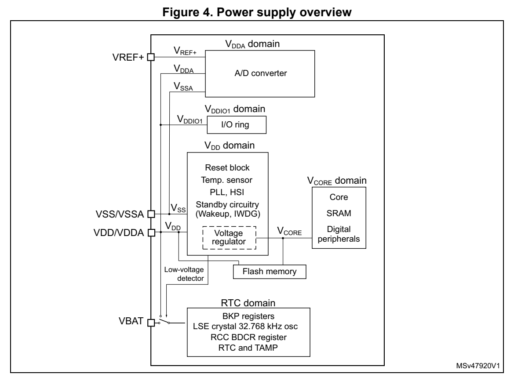
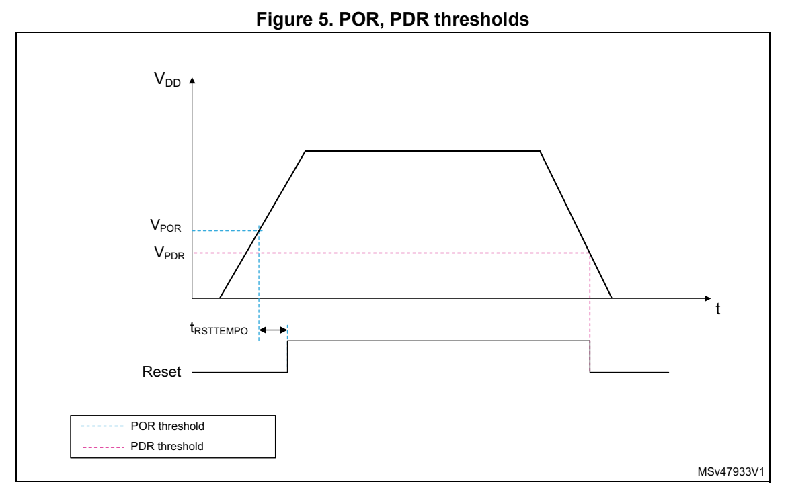
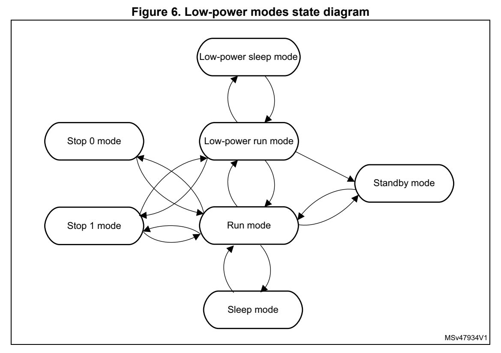

# 4 Power control (PWR) (pp. 86-118)

## 4 Power control (PWR) (p. 86)

### 4.1 Power supplies (p. 86)

The STM32G0x0 devices require a 2.0 V to 3.6 V operating supply voltage (V DD). Several different power supplies are prov ided to specific peripherals:

- V DD = 2.0 V to 3.6 V V DD is the external power supply for the internal regulator and the system analog such as reset, power management and in ternal clocks. It is provided externally through VDD/VDDA pin.

- V DDA = 2.0 V to 3.6 V V DDA is the analog power supply for the A/D converter. V DDA voltage level is identical to V DD voltage as it is provided exte rnally through VDD/VDDA pin.

- V DDIO1 = V DD V DDIO1 is the power supply for the I/Os. V DDIO1 voltage level is identical to V DD voltage as it is provided externa lly through VDD/VDDA pin.

- V BAT = 1.55 V to 3.6 V V BAT is the power supply (through a power switch) for RTC, TAMP, low-speed external 32.768 kHz oscillator and b ackup registers when V DD is not present. V BAT is provided externally through VBAT pin. Whe n this pin is not available on the package, it is internally bond ed to VDD/VDDA.

- V REF+ is the input reference voltage for the ADC. It must be between 2 V and V DDA. It can be grounded when t he ADC is not active. V REF+ is delivered through VREF+ pin. O n packages without VREF+ pin, V REF+ is internally connected with V DD.

- V CORE An embedded linear voltage regul ator is used to supply the V CORE internal digital power. V CORE is the power supply for digital peripherals, SRAM and Flash mem ory. The Flash memory is also supplied by V DD.

*Figure 4. Power supply overview (p. 87)*

#### 4.1.1 ADC reference voltage (p. 87)

To ensure a better accuracy on low-voltage inputs and outputs, the user can connect to V REF+ a separate reference voltage lower than V DDA. V REF+ is the highest voltage, represented by the full scale va lue, for an analo g input (ADC) signal.

#### 4.1.2 Battery backup of RTC domain (p. 87)

To retain the content of the backup registers and supply the RT C and TAMP functions when V DD is turned off, the VBAT pin can be connected to an optional backup voltage supplied by a battery or by another source.

The VBAT pin powers the RTC and TAMP units, the LSE oscillator and the PC13 to PC15 I/Os, allowing the RTC and TAMP to operate even when the main p ower supply is turned off. The switch to the V BAT supply is controlled by the power-down reset embedded in the Reset block.

Warning: During t RSTTEMPO (temporization at V DD startup) or after a PDR has been detected, the power switch between V BAT and V DD remains connected to V BAT. During the startup phase, if V DD is established in less than t RSTTEMPO (refer to the datashe et for the value of t RSTTEMPO) and V DD > V BAT + 0.6 V, a current may be injected into V BAT through an internal diode connected between V DD and the power switch (V BAT). If the power supply/battery connected to the VBAT pin cannot

support this current injection, it is recommended to connect an external low-drop diode between this power supply and the VBAT pin.

If no external battery is used in the user application, it is recommended to connect VBAT pin externally to VDD/VDDA pin with a 100 nF external ceramic decoup ling capacitor.

When the RTC domain is supplied by V DD (power switch connected to V DD), all the related pin functions are available:

When the RTC domain is supplied by V BAT (power switch connected to V BAT because V DD is not present), only the following functions are available:

- PC13, PC14 and PC15 can be controlled only by RTC, TAMP or LSE (refer to Section 23.3: RTC functional description)

- RTC_OUT1 function on PC13

- RTC_TS function on PC13 or PA4

- TAMP_IN1 function on PC13 or PA4 and TAMP_IN2 function on PA0

Note: Due to the fact th at the power switch can transfer only a limited amount of current (3 mA), the use of GPIO PC13 to PC15 in output mode is restricted: the speed has to be limited to 2 MHz with a maximum load of 30 pF and these I/Os must not be used as a current source (e.g. to drive a LED).

RTC domain access

After a system reset, the RTC doma in (RTC registers and backup registers) is protected against possible unwanted write accesses. To enable access to t he RTC domain, proceed as follows: 1. Enable the power interface clo ck by setting the PWREN bits of the APB peripheral clock enable register 1 (RCC_APBENR1). 2. Set the DBP bit of the Power control register 1 (PWR_CR1) to enable a ccess to the RTC domain. 3. Select the RTC clock source in the RTC domain control register (RCC_BDCR). 4. Enable the RTC clock by s etting the RTCEN bit in the RTC domain control register (RCC_BDCR).

VBAT battery charging

When V DD is present, it is possible to ch arge the external battery on V BAT through an internal resistance.

The VBAT charging is done either through a 5 kΩ resistor or thro ugh a 1.55 kΩ resistor depending on the VBRS bit va lue in the PWR_CR4 register.

The battery charging is enabled by setting VBE bit in the PWR_C R4 register. It is automatically disabled in VBAT mode.

#### 4.1.3 Voltage regulator (p. 89)

Two embedded linear voltage regulators supply all the digital c ircuitries, except for the Standby circuitry and the RTC dom ain. The main regulator output voltage (V CORE) can be programmed by software to two different power ranges (Range 1 a nd Range 2) in order to optimize the consumption depending on the system maximum operat ing frequency (refer to Section 5.2.7: Clock source frequency versus voltage scaling and to Section 3.3.4: FLASH read access latency.

The voltage regulators are alwa ys enabled after a reset. Depend ing on the user application modes, the V CORE supply is provided either by the main regulator (MR) or by the low-power regulator (LPR).

- In Run, Sleep and Stop 0 modes, both regulators are enabled and the main regulator (MR) supplies full power to the V CORE domain (core, memories and digital peripherals).

- In Low-power run and Low-power s leep modes, the main regulator is off and the low-power regulator (LPR) su pplies low-power to the V CORE domain, preserving the contents of the reg isters and SRAM.

- In Stop 1 mode, the mai n regulator is off and the low-power reg ulator (LPR) supplies low-power to the V CORE domain, preserving the conten ts of the registers and SRAM.

- In Standby mode, both regulators are powered off. The contents of the registers and SRAM is lost except for the Sta ndby circuitry and the RTC domai n.

#### 4.1.4 Dynamic voltag e scaling management (p. 89)

The dynamic voltage scaling is a power management technique whi ch consists in increasing or decreasing the voltage used for the digital perip herals (V CORE), according to the application performance and power consumption needs.

Dynamic voltage scaling to increase V CORE is known as overvolting. It allows to improve the device performance.

Dynamic voltage sca ling to decrease V CORE is known as undervolting. It is performed to save power, particularly in laptop and other mobile devices whe re the energy comes from a battery and is thus limited.

Two voltage ranges are available:

- Range 1: High-performance range The main regulator provides a typi cal output voltage at 1.2 V. T he system clock frequency can be up to 64 MHz. T he Flash access time for read access is minimum, write and erase operations are possible.

- Range 2: Low-power range The main regulator provides a typi cal output voltage at 1.0 V. T he system clock frequency can be up to 16 MHz.Th e Flash memory access time for a read access is increased as compared to Range 1; write and erase operations are not possible.

The voltage scaling is selected through the VOS bit in the PWR_CR1 register.

The sequence to go from Range 1 to Range 2 is: 1. Reduce the system frequency to a value lower than 16 MHz 2. Adjust number of wait states according new frequency target in Range 2 (LATENCY bits in the FLASH_ACR). 3. Program the VOS[1:0] bits to 10 in the Power control register 1 (PWR_CR1).

The sequence to go from Range 2 to Range 1 is: 1. Program the VOS[1:0] bits to 01 in the Power control register 1 (PWR_CR1). 2. Wait until the VOSF flag is cleared in the Power status register 2 (PWR_SR2). 3. Adjust number of wait states according new frequency target in Range 1 (LATENCY bits in the FLASH access control register (FLASH_ACR). 4. Increase the system frequency.

### 4.2 Power supply supervisor (p. 90)

#### 4.2.1 Power-on reset (POR) / power-down reset (PDR) (p. 90)

The device features an integrated power-on reset (POR) / power- down reset (PDR). The POR/PDR is active in all power modes.

During power-on, the POR keeps t he device under reset until the V DD supply voltage reaches the specified POR threshold (V POR). At this point, the device reset is released and the system can start. Du ring power-down, when V DD drops below the PDR threshold (V PDR), the device is put under reset again.

*Figure 5. POR, PDR thresholds (p. 90)*

### 4.3 Low-power modes (p. 91)

By default, the microcontroller is in Run mode after a system o r a power Reset. Several low-power modes are available to save power when the CPU does not n eed to be kept running, for example when waiting for an external event. It is up to the user to select the mode that gives the best compromise between low-power consumption, short startup time and available wakeup sources.

The device features seven low-power modes: ®

- Sleep mode: CPU clock off, all peripherals including Cortex -M0+ core peripherals such as NVIC, SysTick, etc. can run and wake up the CPU when an interrupt or an event occurs. Refer to Section 4.3.4: Sleep mode.

- Low-power run mode: This mode is achieved when the system clock frequency is reduced below 2 MHz. The code is executed from the SRAM or the F lash memory. The regulator is in low-power mode to minimize the regulator's operating current. Refer to Section 4.3.2: Low-power run mode (LP run).

- Low-power sleep mode: This mode i s entered from the Low-power run mode: Cortex®- M0+ is off. Refer to Section 4.3.5: Low-power sleep mode (LP sleep).

- Stop 0 and Stop 1 modes: SRAM and all registers content are retained. All clocks in the V CORE domain are stopped, the PLL, the HSI16 and the HSE are disable d. The LSI and the LSE can be kept running. The RTC and TAMP can remain active (Stop mode with RTC, Stop mo de without RTC). Some peripherals with the wakeup capability can enable the HSI1 6 RC during the Stop mode to detect their wakeup condition. In Stop 0 mode, the m ain regulator remain s ON, which allows the fastest wakeup time but with higher consumption. The active peripherals and wakeup sources are the same as in Stop 1 mode. The system clock, when exiting Stop 0 or Stop 1 mo de, is the HS ISYS clock. If the device is configured to wake up in Low-power run mode, the HSID IV bits in RCC_CR register must be configured pri or to entering Stop mode to prov ide a frequency not greater than 2 MHz. Refer to Section 4.3.6: Stop 0 mode for details on Stop 0 mode.

- Standby mode: V CORE domain, the main regulator and the low-power regulator are powered off. All clocks in the V CORE domain are stopped and the P LL, the HSI16, and the HSE oscillators are disab led. The LSI and the LSE oscillators can b e kept running. The RTC can remain active (Stand by mode with RTC, Standby mode without RTC). The system clock, when exiting Standby modes, is the HSI16 osci llator clock. Refer to Section 4.3.8: Standby mode.

In addition, the power consumptio n in Run mode can be reduced by one of the following means:

- Slowing down the system clocks

- Gating the clocks to t he APB and AHB periphe rals when they are unused.

*Figure 6. Low-power modes state diagram (p. 92)*

**Table 18. Low-power mode summary (p. 93)**

| Mode name Entry | Col 2 | Wakeup(1) source | Wakeup system clock | Effect on clocks | Voltage regulators MR LPR | Voltage regulators MR LPR |
| --- | --- | --- | --- | --- | --- | --- |
| Sleep (Sleep-now or | WFI or Return from ISR | Any interrupt | Same as before entering Sleep | CPU clock OFF no effect on other clocks | ON |  |
| Sleep-on-exit) |  | WFE Wakeup event | mode | or analog clock sources |  |  |
| Low-power run |  | Set LPR bit Clear LPR bit | Same as Low-power run clock | None |  |  |
| Low-power sleep | Set LPR bit + WFI or Return from ISR | Any interrupt | Same as before entering Low-power sleep | CPU clock OFF no effect on other clocks | OFF |  |
| sleep | Set LPR bit + WFE | Wakeup event | power sleep mode | or analog clock sources |  | ON |
| Stop 0 | LPMS=”000” + SLEEPDEEP bit + WFI or Return from ISR or WFE | Any EXTI line (configured in the EXTI registers) |  |  | ON |  |
| Stop 1 | LPMS=”001” + SLEEPDEEP bit + WFI or Return from ISR or WFE | Specific peripherals events | HSISYS | All clocks OFF except LSI and LSE |  |  |
| Standby | LPMS=”011” + Clear RRS bit + SLEEPDEEP bit + WFI or Return from ISR or WFE | WKUP pin edge, RTC event, TAMP event, external reset on NRST pin, IWDG reset |  |  | OFF | OFF |

1. Refer to Table 19: Functionalities depending on the working mode.

**Table 19. Functionalities de pending on the working mode (1) (pp. 93-94)**

| Col 2 | Col 3 | Col 4 | Col 5 | Col 6 | Col 7 | Stop 0/1 Standby | Stop 0/1 Standby | Col 10 | Col 11 |
| --- | --- | --- | --- | --- | --- | --- | --- | --- | --- |
| Function Run Sleep |  | CPU Y - Y - - | Low-power run | Low-power sleep | - | Wakeup capability -- | --- | Wakeup capability -- | VBAT -- |
| Flash memory Y Y O | Flash memory Y Y O |  | (2) | O (2) | O (2) | -- | -- | -- | -- |
| SRAM Y Y |  | (3) | YY | (3) | Y | -- | -- | -- | -- |
|  | Backup Registers Y Y Y Y Y |  |  |  |  | -Y | -Y |  | -Y |
|  |  | DMA1/2 O O O O - |  |  |  | -- | -- | -- | -- |
| Function Run Sleep | HSI16 O O O O |  | Low-power run | Low-power sleep | -(4) | Wakeup capability -- | --- | Wakeup capability -- | VBAT -- |
|  |  | HSE O O O O - |  |  |  | -- | -- | -- | -- |
|  |  | LSI O O O O O |  |  |  | -O | -O | -- | -- |
|  |  | LSE O O O O O PLL O O - - - |  |  |  | -O -- | -O -- | -- | -O -- |
|  | CSS O O O CSS on LSE O O O O O | CSS on LSE O O O O O | (5) | O (5) | - | --OO | --OO | --O- | --O- |
|  | RTC / Auto wakeup O O O O O TAMP1/2/3 O O O O O USART1/2 O O O O O | TAMP1/2/3 O O O O O USART1/2 O O O O O |  |  | (6) | OO OO O (6) | OO OO - | OO OO -- | OO OO -- |
|  | USART3/4/5/6 O O O O - | I2C1 O O O O O I2C2/3 O O O O - |  |  | (7) | --O (7) -- | ----- | ------ | ------ |
|  | Temperature sensor O O O O - | SPI1/2/3 O O O O -ADC O O O O - |  |  |  | ------ | ------ | ------ | ------ |
|  |  | TIMx O O O O - |  |  |  | -- | -- | -- | -- |
|  |  | IWDG O O O O O |  |  |  | OO | OO | O- | O- |
|  |  | WWDG O O O O - |  |  |  | -- | -- | -- | -- |
|  | SysTick timer O O O O - |  |  |  |  | -- | -- | -- | -- |
|  |  | CRC O O O O - |  |  |  | -- | -- | -- | -- |
|  |  | USB O O - - - |  |  |  | -- | -- | -- | -- |
|  |  | GPIOs O O O O O |  |  |  | O | (8) | up to 5 pins(9) | - |

1. Legend: Y = Yes (Enable). O = O ptional (Disable by default. C an be enabled by software). - = Not available. 2. The Flash memory can be configured in power-down mode. By default, it is not in power-down mode.

3. The SRAM clock can be gated ON or OFF. 4. Some peripherals with wakeup from Stop capability can request HSI16 to be enabled. In this case, HSI16 is woken up by the peripheral, and only feeds the peripheral which requested it. HSI16 is automatically put OFF when the peripheral does not need it anymore. 5. If CSS is used on HSE clock in Low power run or Low power sle ep modes, configure HSIDIV such as not to drive SYSCLK clock above the maximum frequency for either mode, in case of external clock failure detection. 6. USART reception is functional in Stop mode, and generates a wakeup interrupt on Start, address match or received frame event. 7. I2C address detection is functional in Stop mode, and generates a wakeup interrupt in case of address match. 8. I/Os can be configured with i nternal pull-up, pull-down or fl oating in Standby mode. 9. I/Os with wakeup from Stand by mode capability (WKUPx).

Debug mode

By default, the debug connection is lost if the user applicatio n puts the MCU in Stop 0, Stop1, or Standby mode while the debug features are used. This® is due to the fact that the Cortex -M0+ core is no longer clocked.

However, by setting some config uration bits in the DBGMCU_CR re gister, the software can be debugged even when using the low-power modes extensively. Fo r more details, refer to Section 29.9.1: Debug support for low-power modes.

#### 4.3.1 Run mode (p. 95)

Slowing down system clocks

In Run mode, the speed of the system clocks (SYSCLK, HCLK, PCLK) can be reduced by programming the prescaler registers. These prescalers can also be used to slow down the peripherals before entering Sleep mode.

For more details, refer to Section 5.4.3: Clock configuration register (RCC_CFGR).

Peripheral clock gating

In Run mode, the HCLK and PCLK for individual peripherals and m emories can be stopped at any time to reduce the power consumption.

To further reduce the power consumption in Sleep mode, the peri pheral clocks can be disabled prior to exe cuting the WFI or WFE instructions.

The peripheral clock gating is controlled by the RCC_AHBENR and RCC_APBENRx registers.

Disabling the peripherals clocks in Sleep mode can be performed automatically by resetting the corresponding bit in the RCC_AHBSMENR and RCC_APBSMENRx reg isters.

#### 4.3.2 Low-power run mode (LP run) (p. 95)

To further reduce the consumption when the system is in Run mod e, the regulator can be configured in low-power mode. In this mode, the system frequency should not exceed 2 MHz.

Refer to the product datasheet for more details on voltage regu lator and peripherals operating conditions.

I/O states in Low-power run mode

In Low-power run mode, all I/O pi ns keep the same state as in R un mode.

Entering Low-power run mode

To enter Low-power run mode, proceed as follows: 1. Optional: Jump into the SRAM and power-down the Flash memory by setting the FPD_LPRUN bit in the Power control register 1 (PWR_CR1). 2. Decrease the system clo ck frequency below 2 MHz. 3. Force the regulator in low-power mode by setting the LPR bit in the PWR_CR1 register.

Refer to Table 20: Low-power run on how to enter Low-power run mode.

Exiting Low-power run mode

To exit Low-power run mode, proceed as follows: 1. Force the regulator in main mode by clearing the LPR bit in t he Power control register 1 (PWR_CR1). 2. Wait until REGLPF bit is cleared in the Power status register 2 (PWR_SR2). 3. Increase the system clock frequency.

Refer to Table 20: Low-power run on how to exit Low-power run mode.

**Table 20. Low-power run (p. 96)**

| Col 1 | Low-power run mode Description |
| --- | --- |
| Mode entry | Decrease the system clo ck frequency below 2 MHz LPR = 1 |
| Mode exit | LPR = 0 Wait until REGLPF = 0 Increase the system clock frequency |
|  | Wakeup latency Regulator wake up time from low-power mode |

#### 4.3.3 Low-power modes (p. 96)

Entering low-power modes

The MCU enters low-power modes b y executing the WFI (wait for i nterrupt), or WFE (wait for event) instructions, or when the SLEEPONEXIT bit in the Cortex®-M0+ system control register is set on return from ISR. Entering low-power mode through WFI or WFE is executed only if no interrupt is pending or no event is pending.

Exiting low-power modes

The MCU exits Sleep and Stop low-power modes in a way depending on how the low-power

mode was entered:

- If the WFI instruction or Return from ISR was used to enter low-power mode, any peripheral interrupt acknowledged by the NVIC can wake up the d evice.

- If the WFE instruction is used to enter low-power mode, the MCU exits low-power mode as soon as an event occurs. The wakeup event can be genera ted either by: – NVIC IRQ interrupt. When SEVONPEND = 0 in the Cortex®-M0+ system control register: by enabling an interrupt in the peripheral control register and in the NVIC. When the MCU resumes from WFE, the peripheral interrupt pending bit and the NVIC peripheral IRQ channel pending bit (in the NVIC interrupt clear pending re gister) have to be cleared. When SEVONPEND = 1 in the Cortex®-M0+ system control register: by enabling an interrupt in the peripheral control register and optionally in the NVIC. When the MCU resumes from WFE, the perip heral interrupt pending bit and when enabled the NVIC peripheral IRQ channel pending bit (in the NVIC interrupt clear pending register) have to be cleared. All NVIC interrupts wake the MC U up, even the disabled ones. – Event Configuring a EXTI lin e in event mode. When the CPU resumes fro m WFE, it is not necessary to clear the EXTI peripheral interrupt pending bi t or the NVIC IRQ channel pending bit as the pending bits corresponding to the event line is not set. It may be necessary to clear the interrupt flag in the peripheral. The MCU exits Standby low-power m ode upon an external reset (NRST pin), an IWDG reset, a rising or fa lling edge on one of enabled WKUPx pins, o r upon an RTC event. See Figure 228: RTC block diagram. After waking up from Standby mode, program execution restarts i n the same way as after a reset (boot pin samplin g, option bytes loading, reset vector is fetched, etc.).

#### 4.3.4 Sleep mode (p. 97)

I/O states in Sleep mode

In Sleep mode, all I/O pins keep the same state as in Run mode.

Entering Sleep mode

The MCU enters Sleep mod e according to section Entering low-power modes, when the SLEEPDEEP bit in the Cortex®-M0+ System Control register is clear. Refer to Table 21: Sleep mode summary for details on how to enter Sleep mode.

Exiting Sleep mode

The MCU exits Sleep mode according to Exiting low-power modes.

Refer to Table 21: Sleep mode summary for more details on how to exit Sleep mode.

**Table 21. Sleep mode summary (p. 98)**

| Col 1 | Characteristic Description |
| --- | --- |
|  | WFI (Wait for Interrupt) or W FE (Wait for Event) while: – SLEEPDEEP = 0 – No interrupt (for WFI) or event (for WFE) is pending Refer to the Cortex®-M0+ system control register. |
| Mode entry | On return from ISR while: – SLEEPDEEP = 0 and – SLEEPONEXIT = 1 – No interrupt is pending Refer to the Cortex®-M0+ system control register. |
| Mode exit | If WFI or return from ISR was used for entry Interrupt: refer to Table 45: Vector table If WFE was used for en try and SEVONPEND = 0: Wakeup event: refer to Section 12.3.2: EXTI direct event input wakeup If WFE was used for en try and SEVONPEND = 1: Interrupt even when disabled in NVIC: refer to Table 45: Vector table or Wakeup event: refer to Section 12.3.2: EXTI direct event input wakeup |
| Wakeup latency None |  |

#### 4.3.5 Low-power sleep mode (LP sleep) (p. 98)

Refer to the product datasheet for more details on voltage regu lator and peripherals operating conditions.

I/O states in Low-power sleep mode

In Low-power sleep mod e, all I/O pins keep the same state as in Run mode.

Entering Low-power sleep mode

The MCU enters Low-power sleep mode from Low-power run mode acc® ording to Entering low-power modes, when the SLEEPDEEP bit in the Cortex -M0+ System Control register is clear.

Refer to Table 22: Low-power sleep mode summary for details on how to enter Low-power sleep mode.

Exiting Low-power sleep mode

The MCU exits Low-power sleep mode according to Exiting low-power modes. When exiting Low-power sleep mode by issuing an interrupt or an event, the M CU is in Low-power run mode.

Refer to Table 22: Low-power sleep mode summary for details on how to exit Low-power sleep mode.

**Table 22. Low-power sleep mode summary (p. 99)**

| Col 1 | Characteristic Description |
| --- | --- |
|  | Low-power sleep mode is entered from the Low- power run mode. WFI (Wait for Interrupt) or W FE (Wait for Event) while: – SLEEPDEEP = 0 – No interrupt (for WFI) or event (for WFE) is pending Refer to the Cortex®-M0+ System Cont rol register. |
| Mode entry | Low-power sleep mode is entered from the Low- power run mode. On return from ISR while: – SLEEPDEEP = 0 and – SLEEPONEXIT = 1 – No interrupt is pending Refer to the Cortex®-M0+ System Cont rol register. |
| Mode exit | If WFI or Return from I SR was used for entry Interrupt: refer to Table 45: Vector table If WFE was used for en try and SEVONPEND = 0: Wakeup event: refer to Section 12.3.2: EXTI direct event input wakeup If WFE was used for en try and SEVONPEND = 1: Interrupt even when disabled in NVIC: refer to Table 45: Vector table Wakeup event: refer to Section 12.3.2: EXTI direct event input wakeup After exiting Low-power sleep m ode, the MCU is i n Low-power run mode. |
| Wakeup latency None |  |

#### 4.3.6 Stop 0 mode (p. 99)

® The Stop 0 mode is based on the Cortex -M0+ deepsleep mode combined with the peripheral clock gating. The vol tage regulator is configured in main regulator mode. In Stop 0 mode, all clocks in the V CORE domain are stopped; the PL L, the HSI16 and the HSE oscillators are disabled. Some p eripherals with the wakeup capa bility (I2C1, USART1, USART2) can switch on the HSI16 to receive a frame, and switch off the HSI16 after receiving the frame if it is no t a wakeup frame. In this case, the HSI16 clock is propagated only to the peripheral requesting it.

SRAM and register contents are preserved.

I/O states in Stop 0 mode

In the Stop 0 mode, all I/O pins keep the same state as in the Run mode.

Entering Stop 0 mode

The MCU enters Stop 0 mo de according to section Entering low-power modes, when the SLEEPDEEP bit in the Cortex®-M0+ System Control register is set. Refer to Table 23: Stop 0 mode summary for details on how to enter Stop 0 mode.

If Flash memory programming is on going, the Stop 0 mode entry i s delayed until the memory access is finished.

If an access to the APB domain is ongoing, The Stop 0 mode entry is delayed until the APB access is finished.

In Stop 0 mode, the following feat ures can be selected by programming individual control bits:

- Independent watc hdog (IWDG): the IWDG is started by writing to its Key register or by hardware option. Once started, i t cannot be stopped except upon a reset. See Section 21.3: IWDG functional description.

- real-time clock (RTC): this is configured by the RTCEN bit in t he RTC domain control register (RCC_BDCR).

- Internal RC oscillator (LSI): this is config ured by the LSION b it in the Control/status register (RCC_CSR).

- External 32.768 kHz oscillator (L SE): this is configured by the LSEON bit in the RTC domain control register (RCC_BDCR).

Several peripherals can be used in Stop 0 mode and can add cons umption if they are enabled and clocked by LSI or L SE, or when they request the HSI 16 clock: USART1, USART2, and I2C1.

The ADC and the temperature sensor can consume power during the Stop 0 mode, unless they are disabled before entering this mode.

Exiting Stop 0 mode

The MCU exits Stop 0 mod e according to section Entering low-power modes.

Refer to Table 23: Stop 0 mode summary for details on how to exit Stop 0 mode.

When exiting Stop 0 mode by issuing an interrupt or a wakeup event, the HSISYS oscillator is selected as system clock. If t he device is configured to wake up in Low-power run mode, the HSIDIV bits in RCC_CR register must be configured prior to entering Stop 0 mode to provide a frequency not greater than 2 MHz.

When exiting Stop 0 mode, the MCU is either in Run mode (Range 1 or Range 2 depending on VOS bit in PWR_CR1) or in Low-power run mode if the bit LPR is set in the Power control register 1 (PWR_CR1).

**Table 23. Stop 0 mode summary (p. 100)**

| Col 2 | Characteristic Description |
| --- | --- |
|  | WFI (Wait for Interrupt) or W FE (Wait for Event) while: – SLEEPDEEP bit is set in Cortex®-M0+ System Control register – No interrupt (for WFI) or event (for WFE) is pending – LPMS = “000” in PWR_CR1 |
| Mode entry | On Return from ISR while: – SLEEPDEEP bit is set in Cortex®-M0+ System Control register – SLEEPONEXIT = 1 – No interrupt is pending – LPMS = “000” in PWR_CR1 |
|  | Note: To enter Stop 0 mode, all EXTI Line pending bits (in EXTI rising edge pending register 1 (EXTI_RPR1) and EXTI falling edge pending register 1 (EXTI_FPR1)), and the peripheral flags generating wakeup interrupts must be cleared. Otherwise, the Stop 0 mode entry procedure is ignored and program execution continues. |

Table 23. Stop 0 mode summary (continued)

Characteristic Description

If WFI or Return from I SR was used for entry Any EXTI Line configured in Interrupt mode (the corresponding E XTI Interrupt vector must be enabled in the NVIC). The interrupt so urce can be external interrupts or peri pherals with wakeup capability. Refer to Table 45: Vector table. If WFE was used for en try and SEVONPEND = 0: Any EXTI Line configured in event mode. Refer to Section 12.3.2: EXTI Mode exit direct event input wakeup. If WFE was used for en try and SEVONPEND = 1: Any EXTI Line configured in Interrupt mode (even if the corresp onding EXTI Interrupt vector is disabled in the NVIC). The interrupt s ource can be external interrupts or peri pherals with wakeup capability. Refer to Table 45: Vector table. Wakeup event: refer to Section 12.3.2: EXTI direct event input wakeup

Longest wakeup time between HSI16 wakeup time and Flash wakeup time Wakeup latency from Stop 0 mode.

#### 4.3.7 Stop 1 mode (p. 101)

The Stop 1 mode is the same as Stop 0 mode except that the main regulator is off, and only the low-power regulato r is on. Stop 1 mode can be entered from Run mode and from Low-power run mode.

Refer to Table 24: Stop 1 mode summary for details on how to enter and exit Stop 1 mode.

**Table 24. Stop 1 mode summary (p. 101)**

| Col 3 | Characteristic Description |
| --- | --- |
|  | WFI (Wait for Interrupt) or W FE (Wait for Event) while: – SLEEPDEEP bit is set in Cortex®-M0+ System Control register – No interrupt (for WFI) or event (for WFE) is pending – LPMS = “001” in PWR_CR1 |
| Mode entry | On Return from ISR while: – SLEEPDEEP bit is set in Cortex®-M0+ System Control register – SLEEPONEXIT = 1 – No interrupt is pending – LPMS = “001” in PWR_CR1 |
|  | Note: To enter Stop 1 mode, all EXTI Line pending bits (in EXTI rising edge pending register 1 (EXTI_RPR1) and EXTI falling edge pending register 1 (EXTI_FPR1)), and the peripheral flags generating wakeup interrupts must be cleared. Otherwise, the Stop 1 mode entry procedure is ignored and program execution continues. |

Table 24. Stop 1 mode summary

Characteristic Description

If WFI or Return from I SR was used for entry Any EXTI Line configured in Interrupt mode (the corresponding E XTI Interrupt vector must be enabled in the NVIC). The interrupt so urce can be external interrupts or peri pherals with wakeup capability. Refer to Table 45: Vector table. If WFE was used for en try and SEVONPEND = 0: Any EXTI Line configured in event mode. Refer to Section 12.3.2: EXTI Mode exit direct event input wakeup. If WFE was used for en try and SEVONPEND = 1: Any EXTI Line configured in Interrupt mode (even if the corresp onding EXTI Interrupt vector is disabled in the NVIC). The interrupt s ource can be external interrupts or peri pherals with wakeup capability. Refer to Table 45: Vector table. Wakeup event: refer to Section 12.3.2: EXTI direct event input wakeup

Longest wakeup time between HSI16 wakeup tim e and regulator wakeup Wakeup latency time from Low-power mode + Flash wakeup time from Stop 1 mode.

#### 4.3.8 Standby mode (p. 102)

The Standby mode allows to achiev® e the lowest power consumption. It is based on the Cortex -M0+ deepsleep mode, with the voltage regulators disabled (exce pt when the SRAM content is preserved). The PLL, the HSI16 and the HSE osci llators are also switched off.

The content of the regi sters is lost except for the registers i n the RTC domain and Standby circuitry (see Figure 4). The SRAM content is lost.

I/O states in Standby mode

In the Standby mode, the I/Os can be configured either with a p ull-up (refer to PWR_PUCRx registers (x=A, B, C, D, F), or with a pull-down (refer to PWR_ PDCRx registers (x=A, B, C, D, F)), or can be kept in analog mode.

The RTC outputs on PC13 and PA4 are functional in Standby mode. PC14 and PC15 used for LSE are also functional. Five wakeup pins (WKUPx, x=1,2,4,5,6) and the two tampers are available.

Entering Standby mode

The MCU enters Standby mode according to Entering low-power modes, when the SLEEPDEEP bit in the Cortex®-M0+ System Control register is set. Refer to Table 25: Standby mode summary for details on how to enter Standby mode.

In Standby mode, the following fe atures can be selected by prog ramming individual control bits:

- Independent watc hdog (IWDG): the IWDG is started by writing to its Key register or by hardware option. Once started it cannot be stopped except by a reset. See Section 21.3: IWDG functional description.

- Real-time clock (RTC) and tamper ( TAMP): this is configured by the RTCEN bit in the RTC domain control register (RCC_BDCR)

- Internal RC oscillator (LSI): this is config ured by the LSION b it in the Control/status register (RCC_CSR).

- External 32.768 kHz os cillator (LSE): this is configured by the LSEON bit in the RTC domain control register (RCC_BDCR)

Exiting Standby mode

The MCU exits Standby mo de according to section Entering low-power modes. The SBF status flag in the Power control register 3 (PWR_CR3) indicates that the MCU was in Standby mode. All registers are reset after wakeup from Standby except for Power control register 3 (PWR_CR3). Refer to Table 25: Standby mode summary for more details on how to exit Standby mode.

**Table 25. Standby mode summary (p. 103)**

| Col 1 | Characteristic Description |
| --- | --- |
|  | WFI (Wait for Interrupt) or W FE (Wait for Event) while: – SLEEPDEEP bit is set in Cortex®-M0+ System Control register – No interrupt (for WFI) or event (for WFE) is pending – LPMS = “011” in Power control register 1 (PWR_CR1) – WUFx bits are cleared in Power status register 1 (PWR_SR1) |
| Mode entry | On return from ISR while: – SLEEPDEEP bit is set in Cortex®-M0+ System Control register – SLEEPONEXIT = 1 – No interrupt is pending – LPMS = “011” in Power control register 1 (PWR_CR1) – WUFx bits are cleared in Power status register 1 (PWR_SR1) – The RTC flag corresponding to t he chosen wakeup source (RTC Al arm A, RTC Alarm B, RTC wakeup, tampe r or timestamp flags) is cleared |
| Mode exit | WKUPx pin edge, RTC event, TAMP event, external reset on NRST p in, IWDG reset |
| Wakeup latency Reset phase | Wakeup latency Reset phase |

#### 4.3.9 Auto-wakeup from low-power mode (p. 103)

The RTC can be used to wakeup t he MCU from low-power mode witho ut depending on an external interrupt (Auto-wakeup mode). The RTC provides a programmable time base for waking up from Stop (0, 1) or Standby modes at regular interval s. For this purpose, two of

the three alternative RTC clock sources can be selected by prog ramming the RTCSEL[1:0] bits in the RTC domain control register (RCC_BDCR):

- Low-power 32.768 kHz external crystal oscillator (LSE OSC) This clock source provides a pre cise time base with very low-power consumption.

- Low-power internal RC Oscillator (LSI) This clock source has the advantage of saving the cost of the 3 2.768 kHz crystal. This internal RC Oscillator is design ed to add minimum power consump tion.

To wake up from Stop mode with an RTC alarm or an RTC wakeup event, it is necessary to:

- Configure the EXTI Line 19 to be sensitive to rising edge.

- Configure the RTC to generate the wakeup event.

To wake up from Standby mode, th ere is no need to configure the EXTI line 19.

### 4.4 PWR registers (p. 104)

The peripheral registers can be a ccessed by half-words (16-bit) or words (32-bit).

### 4.4.1 [PWR.PWR_CR1] Offset: 0x00 | Reset: 0x00000208 (p. 104)

Address offset: 0x00

Reset value: 0x0000 0208. This re gister is reset after wakeup from Standby mode.

Bits 31:15 Reserved, must be kept at reset value.

Bit 14 LPR: Low-power run When this bit is set, the regul ator is switched from main mode (MR) to low-power mode (LPR).

Bits 13:11 Reserved, must be kept at reset value.

Bits 10:9 VOS: Voltage scaling range selection 00: Cannot be written (forbidden by hardware) 01: Range 1 10: Range 2 11: Cannot be written (forbidden by hardware)

Bit 8 DBP: Disable RTC domai n write protection In reset state, the RTC and backup registers are protected agai nst parasitic write access. This bit must be set to enable write access to t hese registers. 0: Access to RTC and backup registers disabled 1: Access to RTC and backup registers enabled

Bits 7:6 Reserved, must be kept at reset value.

Bit 5 FPD_LPSLP: Flash memory powered down during Low-power sleep mode This bit determines whether the Flash memory is put in power-down mode or remains in idle mode when the device enters Low-power sleep mode. 0: Flash memory idle 1: Flash memory powered down

Bit 4 FPD_LPRUN: Flash memory powered down during Low-power run mode This bit determines whether the Flash memory is put in power-down mode or remains in idle mode when the device enters Low-power run mode. The Flash memory can be put in power-down mode only when the user code is executed from SRAM. 0: Flash memory idle 1: Flash memory powered down

Bit 3 FPD_STOP: Flash memory powered down during Stop mode This bit determines whether the Flash memory is put in power-down mode or remains in idle mode when the device enters Stop mode. 0: Flash memory idle 1: Flash memory powered down

Bits 2:0 LPMS[2:0]: Low-power mode selection These bits select the low-power m ode entered when CPU enters de epsleep mode. 000: Stop 0 mode 001: Stop 1 mode 010: Reserved 011: Standby mode

Note: 1xx: Reserved

### 4.4.2 [PWR.PWR_CR2] Offset: 0x04 | Reset: 0x00000000 (p. 105)

This register is available on S TM32G0B0xx only. It is reserved otherwise.

Address offset: 0x04

Reset value: 0x0000 0000. This re gister is reset when exiting S tandby mode.

Bits 31:11 Reserved, must be kept at reset value.

Bit 10 USV: USB supply enable 0: Disable 1: Enable The bit must be set for the USB peripheral to operate.

Bits 9:0 Reserved, must be kept at reset value.

### 4.4.3 [PWR.PWR_CR3] Offset: 0x08 | Reset: 0x00008000 (p. 106)

Address offset: 0x08

Reset value: 0x0000 8000. This re gister is not reset when exiti ng Standby modes and with the PWRRST bit in the APB peripheral reset register 1 (RCC_APBRSTR1).

Access: Additional APB cycles a re needed to acce ss this registe r vs. a standard APB access (3 for a write and 2 for a read).

Bits 31:16 Reserved, must be kept at reset value.

Bit 15 EIWUL: Enable internal wakeup line 0: Disable 1: Enable

Bits 14:11 Reserved, must be kept at reset value.

Bit 10 APC: Apply pull-up and pull-down configuration This bit determines w hether the I/O pull- up and pull-down confi gurations defined in the PWR_PUCRx and PWR_PDCRx registers are applied. 0: Not applied 1: Applied

Bit 9 Reserved, must be kept at reset value.

Bit 8 Reserved, must be kept at reset value.

Bits 7:6 Reserved, must be kept at reset value.

Bit 5 EWUP6: Enable WKUP6 wakeup pin When this bit is set, the WKUP6 external wakeup pin is enabled and triggers a wakeup from Standby mode when a rising or a falling edge occurs. The active edge is configured through WP6 bit in the PWR_CR4 register.

Bit 4 EWUP5: Enable WKUP5 wakeup pin When this bit is set, the WKUP5 external wakeup pin is enabled and triggers a wakeup from Standby mode when a rising or a falling edge occurs.The active edge is configured via the WP5 bit in the PWR_CR4 register.

Bit 3 EWUP4: Enable WKUP4 wakeup pin When this bit is set, the WKUP4 external wakeup pin is enabled and triggers a wakeup from Standby mode when a rising or a falling edge occurs. The active edge is configured via the WP4 bit in the PWR_CR4 register.

Bit 2 EWUP3: Enable WKUP3 wakeup pin When this bit is set, the WKUP3 external wakeup pin is enabled and triggers a wakeup from Standby mode when a rising or a falling edge occurs. The active edge is configured via the WP3 bit of the PWR_CR4 register.

Bit 1 EWUP2: Enable WKUP2 wakeup pin When this bit is set, the WKUP2 external wakeup pin is enabled and triggers a wakeup from Standby mode when a rising or a falling edge occurs. The active edge is configured via the WP2 bit of the PWR_CR4 register.

Bit 0 EWUP1: Enable WKUP1 wakeup pin When this bit is set, the WKUP1 external wakeup pin is enabled and triggers a wakeup from Standby mode when a rising or a falling edge occurs. The active edge is configured via the WP1 bit of the PWR_CR4 register.

### 4.4.4 [PWR.PWR_CR4] Offset: 0x0C | Reset: 0x00000000 (p. 107)

Address offset: 0x0C

Reset value: 0x0000 0000. This re gister is not reset when exiti ng Standby modes and with the PWRRST bit in the APB peripheral reset register 1 (RCC_APBRSTR1).

Access: Additional APB cycles a re needed to acce ss this registe r vs. a standard APB access (3 for a write and 2 for a read).

Bits 31:10 Reserved, must be kept at reset value.

Bit 9 VBRS: V BAT battery charging resistor selection 0: 5 kΩ 1: 1.5 kΩ

Bit 8 VBE: V BAT battery charging enable 0: Disable 1: Enable

Bits 7:6 Reserved, must be kept at reset value.

Bit 5 WP6: WKUP6 wakeup pin polarity WKUP6 external wakeup signal polarity (level or edge) triggerin g wakeup event: 0: High level or rising edge 1: Low level or falling edge

Bit 4 WP5: WKUP5 wakeup pin polarity WKUP5 external wakeup signal polarity (level or edge) triggerin g wakeup event: 0: High level or rising edge 1: Low level or falling edge

Bit 3 WP4: WKUP4 wakeup pin polarity WKUP4 external wakeup signal polarity (level or edge) triggerin g wakeup event: 0: High level or rising edge 1: Low level or falling edge

Bit 1 WP3: WKUP3 wakeup pin polarity WKUP3 external wakeup signal polarity (level or edge) triggerin g wakeup event: 0: High level or rising edge 1: Low level or falling edge

Bit 1 WP2: WKUP2 wakeup pin polarity WKUP2 external wakeup signal polarity (level or edge) triggerin g wakeup event: 0: High level or rising edge 1: Low level or falling edge

Bit 0 WP1: WKUP1 wakeup pin polarity WKUP1 external wakeup signal polarity (level or edge) triggerin g wakeup event: 0: High level or rising edge 1: Low level or falling edge

### 4.4.5 [PWR.PWR_SR1] Offset: 0x10 | Reset: 0x00000000 (p. 108)

Address offset: 0x10

Reset value: 0x0000 0000. This re gister is not reset when exiti ng Standby modes and with the PWRRST bit in the APB peripheral reset register 1 (RCC_APBRSTR1).

Access: 2 additional APB cycles a re needed to re ad this registe r vs. a standard APB read.

Bits 31:16 Reserved, must be kept at reset value.

Bit 15 WUFI: Wakeup flag internal This bit is set when a wakeup is detected on the internal wakeu p line. It is c leared when all internal wakeup sources are cleared.

Bits 14:9 Reserved, must be kept at reset value.

Bit 8 SBF: Standby flag This bit is set by hardware when the device enters Standby mode and is cleared by setting the CSBF bit in the PWR_SCR regi ster, or by a power-on reset. I t is not cleared by the system reset. 0: The device did not enter Standby mode 1: The device ente red Standby mode

Bits 7:6 Reserved, must be kept at reset value.

Bit 5 WUF6: Wakeup flag 6 This bit is set when a wakeup even t is detected on WKUP6 wakeup pin. It is cleared by writing 1 in the CWUF6 bit of the PWR_SCR register.

Bit 4 WUF5: Wakeup flag 5 This bit is set when a wakeup even t is detected on WKUP5 wakeup pin. It is cleared by writing 1 in the CWUF5 bit of the PWR_SCR register.

Bit 3 WUF4: Wakeup flag 4 This bit is set when a wakeup even t is detected on WKUP4 wakeup pin. It is cleared by writing 1 in the CWUF4 bit of the PWR_SCR register.

Bit 2 WUF3: Wakeup flag 3 This bit is set when a wakeup even t is detected on WKUP3 wakeup pin. It is cleared by writing 1 in the CWUF3 bit of the PWR_SCR register.

Bit 1 WUF2: Wakeup flag 2 This bit is set when a wakeup even t is detected on WKUP2 wakeup pin. It is cleared by writing 1 in the CWUF2 bit of the PWR_SCR register.

Bit 0 WUF1: Wakeup flag 1 This bit is set when a wakeup even t is detected on WKUP1 wakeup pin. It is cleared by writing 1 in the CWUF1 bit of the PWR_SCR register.

### 4.4.6 [PWR.PWR_SR2] Offset: 0x14 | Reset: 0x00000000 (p. 109)

Address offset: 0x14

Reset value: 0x0000 0000. This re gister is partially reset when exiting Standby mode.

Bits 31:11 Reserved, must be kept at reset value.

Bit 10 VOSF: Voltage scaling flag A delay is required for the internal regulator to be ready afte r the voltage scaling has been changed. VOSF indicates that the regulator reached the voltage level defined with VOS bits of the PWR_CR1 register. 0: The regulator is ready in the selected voltage range 1: The regulator output voltage i s changing to the required vol tage level

Bit 9 REGLPF: Low-power regulator flag This bit is set by hardware when the MCU is in Low-power run mo de. When the MCU exits the Low-power run mode, this bit remains at 1 until the regulator is ready in main mode. A polling on this bit must be done before increasing the product frequency. This bit is cleared by hardware when the regulator is ready. 0: The regulator is ready in main mode (MR) 1: The regulator is in low-power mode (LPR)

Bit 8 REGLPS: Low-power regulator started This bit provides the information whether the low-power regulator is ready after a power-on reset or Standby. If the Standby m ode is entered w hile REGLPS b it is still cleared, the wakeup from Standby mode time may be increased. 0: The low-power regu lator is not ready 1: The low-power regulator is ready

Bit 7 FLASH_RDY: Flash ready flag This bit is set by hardware to i ndicate when the Flash memory i s ready to be accessed after wakeup from power-down. To place the Flash memory in power-down, set either FPD_LPRUN, FPD_LPSLP or FPD_STP bits. 0: Flash memory in power-down 1: Flash memory re ady to be accessed Note: If the system boots from SRAM, the user application must wait till FLASH_RDY bit is set, prior to jumping to Flash memory.

Bits 6:0 Reserved, must be kept at reset value.

### 4.4.7 [PWR.PWR_SCR] Offset: 0x18 | Reset: 0x00000000 (p. 110)

Address offset: 0x18

Reset value: 0x0000 0000.

Access: three additional APB cycl es are needed to write this re gister, compared to a standard APB write.

Bits 31:9 Reserved, must be kept at reset value.

Bit 8 CSBF: Clear standby flag Setting this bit clears the SBF flag in the PWR_SR1 register.

Bits 7:6 Reserved, must be kept at reset value.

Bit 5 CWUF6: Clear wakeup flag 6 Setting this bit clears the WU F6 flag in the PWR_SR1 register.

Bit 4 CWUF5: Clear wakeup flag 5 Setting this bit clears the WU F5 flag in the PWR_SR1 register.

Bit 3 CWUF4: Clear wakeup flag 4 Setting this bit clears the WU F4 flag in the PWR_SR1 register.

Bit 2 CWUF3: Clear wakeup flag 3 Setting this bit clears the WU F3 flag in the PWR_SR1 register.

Bit 1 CWUF2: Clear wakeup flag 2 Setting this bit clears the WU F2 flag in the PWR_SR1 register.

Bit 0 CWUF1: Clear wakeup flag 1 Setting this bit clears the WU F1 flag in the PWR_SR1 register.

### 4.4.8 [PWR.PWR_PUCRA] Offset: 0x20 | Reset: 0x00000000 (p. 111)

Address offset: 0x20

Reset value: 0x0000 0000. This re gister is not reset when exiti ng Standby modes and with PWRRST bit in the APB peripheral reset register 1 (RCC_APBRSTR1).

Access: Additional APB cycles a re needed to acce ss this registe r vs. a standard APB access (3 for a write and 2 for a read).

Bits 31:16 Reserved, must be kept at reset value.

Bits 15:0 PUy: Port A pull-up bi t y (y = 0 to 15) Setting PUy bit while the corresponding PDy bit is zero and the APC bit of the PWR_CR3 register is set activates a pu ll-up device on the PA[y] I/O.

### 4.4.9 [PWR.PWR_PDCRA] Offset: 0x24 | Reset: 0x00000000 (p. 111)

Address offset: 0x24

Reset value: 0x0000 0000. This re gister is not reset when exiti ng Standby modes and with PWRRST bit in the APB peripheral reset register 1 (RCC_APBRSTR1).

Access: Additional APB cycles a re needed to acce ss this registe r vs. a standard APB access (3 for a write and 2 for a read).

Bits 31:16 Reserved, must be kept at reset value.

Bits 15:0 PDy: Port A pull-down bit y (y = 0 to 15) Setting PDy bit while t he APC bit of the PW R_CR3 register is se t activates a pull-down device on the PA[y] I/O.

### 4.4.10 [PWR.PWR_PUCRB] Offset: 0x28 | Reset: 0x00000000 (p. 112)

Address offset: 0x28

Reset value: 0x0000 0000. This re gister is not reset when exiti ng Standby modes and with PWRRST bit in the APB peripheral reset register 1 (RCC_APBRSTR1).

Access: Additional APB cycles a re needed to acce ss this registe r vs. a standard APB access (3 for a write and 2 for a read).

Bits 31:16 Reserved, must be kept at reset value.

Bits 15:0 PUy: Port B pull-up bit y (y = 0 to 15) Setting PUy bit while the corresponding PDy bit is zero and the APC bit of the PWR_CR3 register is set activates a pu ll-up device on the PB[y] I/O.

### 4.4.11 [PWR.PWR_PDCRB] Offset: 0x2C | Reset: 0x00000000 (p. 112)

Address offset: 0x2C

Reset value: 0x0000 0000. This re gister is not reset when exiti ng Standby modes and with PWRRST bit in the APB peripheral reset register 1 (RCC_APBRSTR1).

Access: Additional APB cycles a re needed to acce ss this registe r vs. a standard APB access (3 for a write and 2 for a read).

Bits 31:16 Reserved, must be kept at reset value.

Bits 15:0 PDy: Port B pull-down bit y (y = 0 to 15) Setting PDy bit while t he APC bit of the PW R_CR3 register is se t activates a pull-down device on the PB[y] I/O.

### 4.4.12 [PWR.PWR_PUCRC] Offset: 0x30 | Reset: 0x00000000 (p. 113)

Address offset: 0x30

Reset value: 0x0000 0000. This re gister is not reset when exiti ng Standby modes and with PWRRST bit in the APB peripheral reset register 1 (RCC_APBRSTR1).

Access: Additional APB cycles a re needed to acce ss this registe r vs. a standard APB access (3 for a write and 2 for a read).

Bits 31:16 Reserved, must be kept at reset value.

Bits 15:0 PUy: Port C pull-up b it y (y = 0 to 15) (1) Setting PUy bit while the corresponding PDy bit is zero and the APC bit of the PWR_CR3 register is set activates a pu ll-up device on the PC[y] I/O. 1. In STM32G030xx as well as ST M32G050xx devices, the bits PD0 to PD5 and PD8 to PD12 are reserved.

### 4.4.13 [PWR.PWR_PDCRC] Offset: 0x34 | Reset: 0x00000000 (p. 113)

Address offset: 0x34

Reset value: 0x0000 0000. This re gister is not reset when exiti ng Standby modes and with PWRRST bit in the APB peripheral reset register 1 (RCC_APBRSTR1).

Access: Additional APB cycles a re needed to acce ss this registe r vs. a standard APB access (3 for a write and 2 for a read).

Bits 31:16 Reserved, must be kept at reset value.

Bits 15:0 PDy: Port C pull-down b it y (y = 0 to 15) (1) Setting PDy bit while t he APC bit of the PW R_CR3 register is se t activates a pull-down device on the PC[y] I/O. 1. In STM32G030xx as well as ST M32G050xx devices, the bits PD0 to PD5 and PD8 to PD12 are reserved.

### 4.4.14 [PWR.PWR_PUCRD] Offset: 0x38 | Reset: 0x00000000 (p. 114)

Address offset: 0x38

Reset value: 0x0000 0000. This re gister is not reset when exiti ng Standby modes and with PWRRST bit in the APB peripheral reset register 1 (RCC_APBRSTR1).

Access: Additional APB cycles a re needed to acce ss this registe r vs. a standard APB access (3 for a write and 2 for a read).

Bits 31:16 Reserved, must be kept at reset value.

Bits 15:0 PUy: Port D pull-up b it y (y = 0 to 15) (1) Setting PUy bit while the corresponding PDy bit is zero and the APC bit of the PWR_CR3 register is set activates a pu ll-up device on the PD[y] I/O. 1. In STM32G070xx devices, the bits PU15 to PU10 and PU7 are res erved. In STM32G030xx as well as in STM32G050xx devices, P U15 to PU4 are reserved.

### 4.4.15 [PWR.PWR_PDCRD] Offset: 0x3C | Reset: 0x00000000 (p. 114)

Address offset: 0x3C

Reset value: 0x0000 0000. This re gister is not reset when exiti ng Standby modes and with PWRRST bit in the APB peripheral reset register 1 (RCC_APBRSTR1).

Access: Additional APB cycles a re needed to acce ss this registe r vs. a standard APB access (3 for a write and 2 for a read).

Bits 31:16 Reserved, must be kept at reset value.

Bits 15:0 PDy: Port D pull-down b it y (y = 0 to 15) (1) Setting PDy bit while t he APC bit of the PW R_CR3 register is se t activates a pull-down device on the PD[y] I/O. 1. In STM32G070xx devices, the bits PD15 to PD10 and PD7 are res erved. In STM32G030xx as well as in STM32G050xx devices, P D15 to PD4 are reserved.

### 4.4.16 [PWR.PWR_PUCRE] Offset: 0x40 | Reset: 0x00000000 (p. 115)

Address offset: 0x40

Reset value: 0x0000 0000. This re gister is not reset when exiti ng Standby modes and with PWRRST bit in the APB peripheral reset register 1 (RCC_APBRSTR1).

Access: Additional APB cycles a re needed to acce ss this registe r vs. a standard APB access (3 for a write and 2 for a read).

Bits 31:16 Reserved, must be kept at reset value.

Bits 15:0 PUy: Port E pull-up bit y (y = 0 to 15) (1) Setting PUy bit while the corresponding PDy bit is zero and the APC bit of the PWR_CR3 register is set activates a pu ll-up device on the PE[y] I/O. 1. Only applies to STM32G0B0xx dev ices. Reserved for the other d evices.

### 4.4.17 [PWR.PWR_PDCRE] Offset: 0x44 | Reset: 0x00000000 (p. 115)

Address offset: 0x44

Reset value: 0x0000 0000. This re gister is not reset when exiti ng Standby modes and with PWRRST bit in the APB peripheral reset register 1 (RCC_APBRSTR1).

Access: Additional APB cycles a re needed to acce ss this registe r vs. a standard APB access (3 for a write and 2 for a read).

Bits 31:16 Reserved, must be kept at reset value.

Bits 15:0 PDy: Port E pull-down bit y (y = 0 to 15) (1) Setting PDy bit while t he APC bit of the PW R_CR3 register is se t activates a pull-down device on the PE[y] I/O. 1. Only applies to STM32G0B0xx dev ices. Reserved for the other d evices.

### 4.4.18 [PWR.PWR_PUCRF] Offset: 0x48 | Reset: N/A (p. 115)

Address offset: 0x48

Reset value: 0x0000 0000. This re gister is not reset when exiti ng Standby modes and with PWRRST bit in the APB peripheral reset register 1 (RCC_APBRSTR1).

Access: Additional APB cycles a re needed to acce ss this registe r vs. a standard APB access (3 for a write and 2 for a read).

Bits 31:14 Reserved, must be kept at reset value.

Bits 13:0 PUy: Port F pull-up bit y (y = 0 to 13) (1) Setting PUy bit while the corresponding PDy bit is zero and the APC bit of the PWR_CR3 register is set activates a pu ll-up device on the PF[y] I/O. 1. Bits PU13 to PU3 only applies to STM32G0B0xx devices. Reserve d for the other devices.

### 4.4.19 [PWR.PWR_PDCRF] Offset: 0x4C | Reset: 0x00000000 (p. 116)

Address offset: 0x4C.

Reset value: 0x0000 0000. This re gister is not reset when exiti ng Standby modes and with PWRRST bit in the APB peripheral reset register 1 (RCC_APBRSTR1).

Access: Additional APB cycles a re needed to acce ss this registe r vs. a standard APB access (3 for a write and 2 for a read).

Bits 31:14 Reserved, must be kept at reset value.

Bits 13:0 PDy: Port F pull-down bit y (y = 0 to 13) (1) Setting PDy bit while the APC bit of the PWR_CR3 register is set activates a pull-down device on the PF[y] I/O. 1. Bits PU13 to PU3 only applies to STM32G0B0xx devices. Reserve d for the other devices.

#### 4.4.20 PWR register map (p. 117)

**Table 26. PWR register map and reset values (p. 117)**

| Col 1 | Offset Register | 31 | 30 | 29 | 28 | 27 | 26 | 25 | 24 | 23 | 22 | 21 | 20 | 19 | 18 | 17 | 16 | 15 | 14 | 13 | 12 | 11 | 10 | 9 | 8 | 7 | 6 | 5 | 4 | 3 | 2 | 1 | 0 |
| --- | --- | --- | --- | --- | --- | --- | --- | --- | --- | --- | --- | --- | --- | --- | --- | --- | --- | --- | --- | --- | --- | --- | --- | --- | --- | --- | --- | --- | --- | --- | --- | --- | --- |
| 0x000 | PWR_CR1 | Res. | Res. | Res. | Res. | Res. | Res. | Res. | Res. | Res. | Res. | Res. | Res. | Res. | Res. | Res. | Res. | Res. | LPR | Res. | Res. | Res. | VOS [1:0] | VOS [1:0] | DBP | Res. | Res. | FPD_LPSLP | FPD_LPRUN | FPD_STOP |  | LPMS [2:0] |  |

Reset value 0 0 1 0 0 0 1 0 0 0 0x004 PWR_CR2 Res. Res. Res. Res. Res. Res. Res. Res. Res. Res. Res. Res. Res. Res. Res. Res. Res. Res. Res. Res. Res. USV Res. Res. Res. Res. Res. Res. Res. Res. Res. Res. Reset value 0 0x008 PWR_CR3 Res. Res. Res. Res. Res. Res. Res. Res. Res. Res. Res. Res. Res. Res. Res. Res. EIWUL Res. Res. Res. Res. APC Res. Res. Res. Res. EWUP6 EWUP5 EWUP4 Res. EWUP2 EWUP1 Reset value 1 0 0 0 0 0 0 0x00C PWR_CR4 Res. Res. Res. Res. Res. Res. Res. Res. Res. Res. Res. Res. Res. Res. Res. Res. Res. Res. Res. Res. Res. Res. VBRS VBE Res. Res. WP6 WP5 WP4 Res. WP2 WP1 Reset value 00 000 00 0x010 PWR_SR1 Res. Res. Res. Res. Res. Res. Res. Res. Res. Res. Res. Res. Res. Res. Res. Res. WUFI Res. Res. Res. Res. Res. Res. SBF Res. Res. WUF6 WUF5 WUF4 Res. WUF2 WUF1 Reset value 0 0 0 0 0 0 0 0x014 PWR_SR2 Res. Res. Res. Res. Res. Res. Res. Res. Res. Res. Res. Res. Res. Res. Res. Res. Res. Res. Res. Res. Res. VOSF REGLPF REGLPS FLASH_RDY Res. Res. Res. Res. Res. Res. Res. Reset value 0000 0x018 PWR_SCR Res. Res. Res. Res. Res. Res. Res. Res. Res. Res. Res. Res. Res. Res. Res. Res. Res. Res. Res. Res. Res. Res. Res. CSBF Res. Res. CWUF6 CWUF5 CWUF4 Res. CWUF2 CWUF1 Reset value 0 000 00 0x020 PWR_PUCRA Res. Res. Res. Res. Res. Res. Res. Res. Res. Res. Res. Res. Res. Res. Res. Res. PU15 PU14 PU13 PU12 PU11 PU10 PU9 PU8 PU7 PU6 PU5 PU4 PU3 PU2 PU1 PU0 Reset value 0 0 0 0 0 0 0 0 0 0 0 0 0 0 0 0 0x024 PWR_PDCRA Res. Res. Res. Res. Res. Res. Res. Res. Res. Res. Res. Res. Res. Res. Res. Res. PD15 PD14 PD13 PD12 PD11 PD10 PD9 PD8 PD7 PD6 PD5 PD4 PD3 PD2 PD1 PD0 Reset value 0 0 0 0 0 0 0 0 0 0 0 0 0 0 0 0 0x028 PWR_PUCRB Res. Res. Res. Res. Res. Res. Res. Res. Res. Res. Res. Res. Res. Res. Res. Res. PU15 PU14 PU13 PU12 PU11 PU10 PU9 PU8 PU7 PU6 PU5 PU4 PU3 PU2 PU1 PU0 Reset value 0 0 0 0 0 0 0 0 0 0 0 0 0 0 0 0 0x02C PWR_PDCRB Res. Res. Res. Res. Res. Res. Res. Res. Res. Res. Res. Res. Res. Res. Res. Res. PD15 PD14 PD13 PD12 PD11 PD10 PD9 PD8 PD7 PD6 PD5 PD4 PD3 PD2 PD1 PD0 Reset value 0 0 0 0 0 0 0 0 0 0 0 0 0 0 0 0 0x030 PWR_PUCRC Res. Res. Res. Res. Res. Res. Res. Res. Res. Res. Res. Res. Res. Res. Res. Res. PU15 PU14 PU13 PU12 PU11 PU10 PU9 PU8 PU7 PU6 PU5 PU4 PU3 PU2 PU1 PU0 Reset value 0 0 0 0 0 0 0 0 0 0 0 0 0 0 0 0 0x034 PWR_PDCRC Res. Res. Res. Res. Res. Res. Res. Res. Res. Res. Res. Res. Res. Res. Res. Res. PD15 PD14 PD13 PD12 PD11 PD10 PD9 PD8 PD7 PD6 PD5 PD4 PD3 PD2 PD1 PD0 Reset value 0 0 0 0 0 0 0 0 0 0 0 0 0 0 0 0

**Table 26. PWR register map an d reset values (continued) (p. 118)**

| Col 1 | Offset Register | 31 | 30 | 29 | 28 | 27 | 26 | 25 | 24 | 23 | 22 | 21 | 20 | 19 | 18 | 17 | 16 | 15 | 14 | 13 | 12 | 11 | 10 | 9 | 8 | 7 | 6 | 5 | 4 | 3 | 2 | 1 | 0 |
| --- | --- | --- | --- | --- | --- | --- | --- | --- | --- | --- | --- | --- | --- | --- | --- | --- | --- | --- | --- | --- | --- | --- | --- | --- | --- | --- | --- | --- | --- | --- | --- | --- | --- |
| 0x038 | PWR_PUCRD | Res. | Res. | Res. | Res. | Res. | Res. | Res. | Res. | Res. | Res. | Res. | Res. | Res. | Res. | Res. | Res. | PU15 | PU14 | PU13 | PU12 | PU11 | PU10 | PU9 | PU8 | PU7 | PU6 | PU5 | PU4 | PU3 | PU2 | PU1 | PU0 |

Reset value 0 0 0 0 0 0 0 0 0 0 0 0 0 0 0 0 0x03C PWR_PDCRD Res. Res. Res. Res. Res. Res. Res. Res. Res. Res. Res. Res. Res. Res. Res. Res. PD15 PD14 PD13 PD12 PD11 PD10 PD9 PD8 PD7 PD6 PD5 PD4 PD3 PD2 PD1 PD0 Reset value 0 0 0 0 0 0 0 0 0 0 0 0 0 0 0 0 0x040 PWR_PUCRE Res. Res. Res. Res. Res. Res. Res. Res. Res. Res. Res. Res. Res. Res. Res. Res. PU15 PU14 PU13 PU12 PU11 PU10 PU9 PU8 PU7 PU6 PU5 PU4 PU3 PU2 PU1 PU0 Reset value 0 0 0 0 0 0 0 0 0 0 0 0 0 0 0 0 0x044 PWR_PDCRE Res. Res. Res. Res. Res. Res. Res. Res. Res. Res. Res. Res. Res. Res. Res. Res. PD15 PD14 PD13 PD12 PD11 PD10 PD9 PD8 PD7 PD6 PD5 PD4 PD3 PD2 PD1 PD0 Reset value 0 0 0 0 0 0 0 0 0 0 0 0 0 0 0 0 0x048 PWR_PUCRF Res. Res. Res. Res. Res. Res. Res. Res. Res. Res. Res. Res. Res. Res. Res. Res. Res. Res. PU13 PU12 PU11 PU10 PU9 PU8 PU7 PU6 PU5 PU4 PU3 PU2 PU1 PU0 Reset value 00000000000000 0x04C PWR_PDCRF Res. Res. Res. Res. Res. Res. Res. Res. Res. Res. Res. Res. Res. Res. Res. Res. Res. Res. PD13 PD12 PD11 PD10 PD9 PD8 PD7 PD6 PD5 PD4 PD3 PD2 PD1 PD0 Reset value 00000000000000

Refer to Section 2.2 on page 44 for the register boundary addresses.
