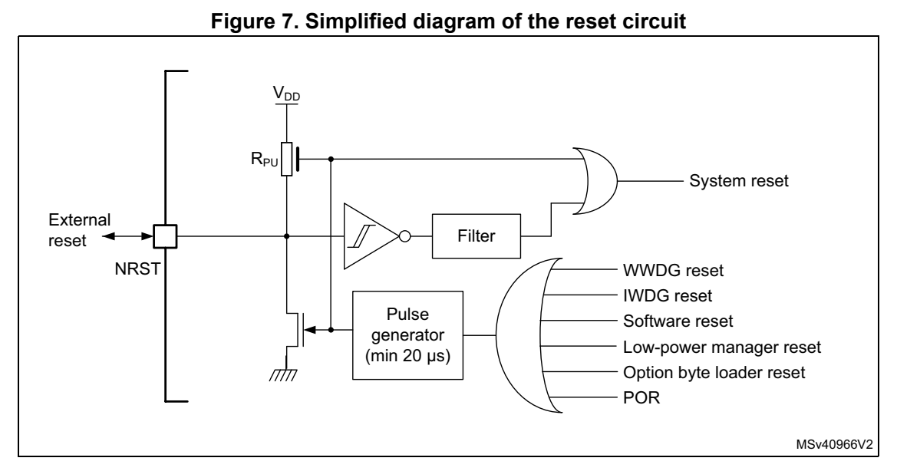
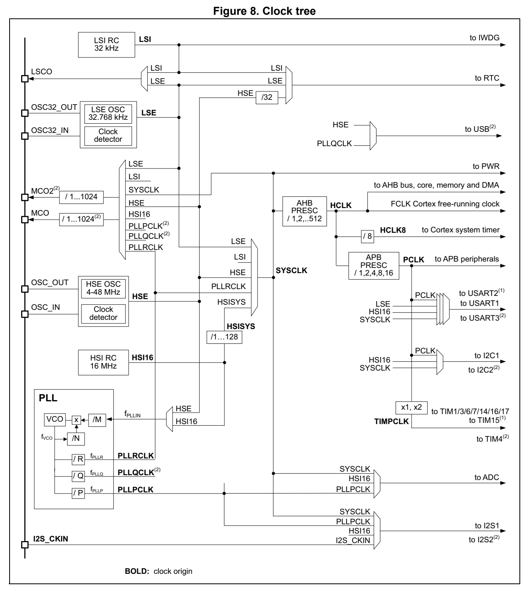
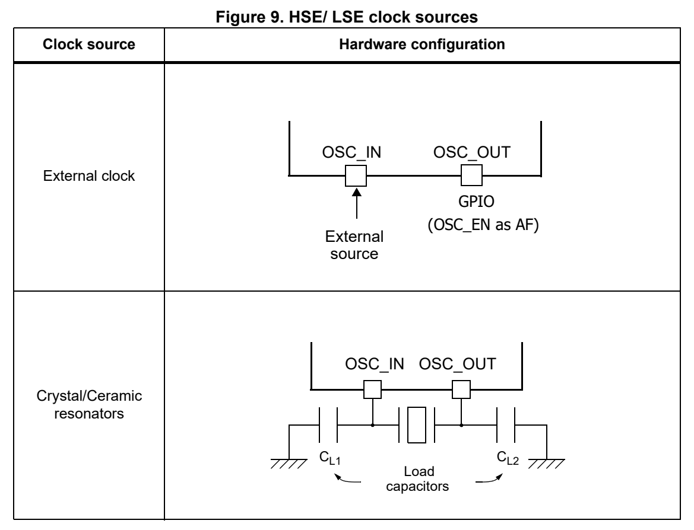
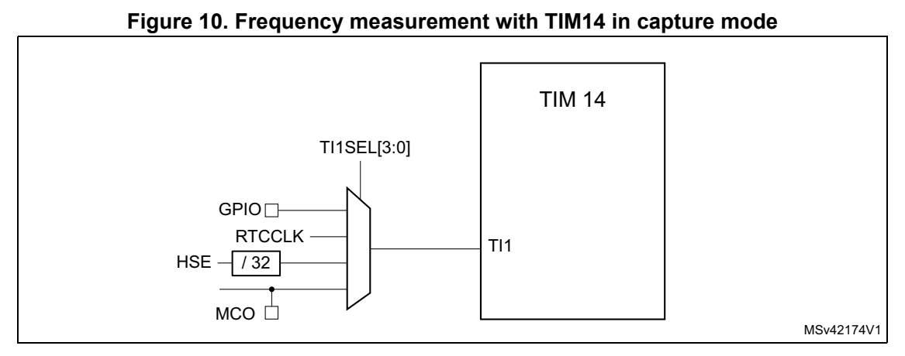
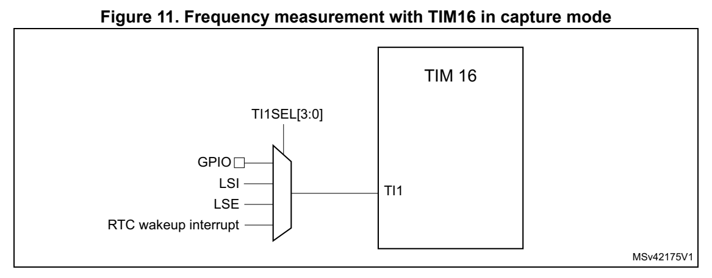
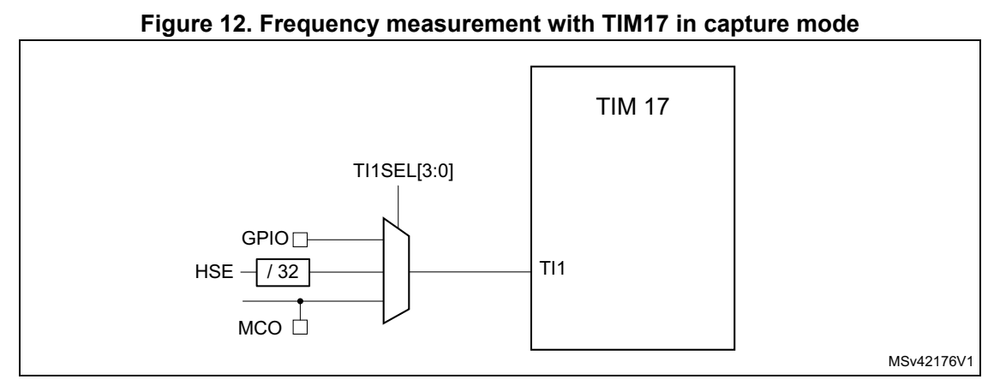

# 5 Reset and clock control (RCC) (pp. 119-172)

## 5 Reset and clock control (RCC) (p. 119)

### 5.1 Reset (p. 119)

There are three types of reset, defined as system reset, power reset and RTC domain reset.

#### 5.1.1 Power reset (p. 119)

A power reset is generated when one of the following events occ urs:

- power-on reset (POR)

- exit from Standby mode

Power reset set all registers to their reset values except the registers of the RTC domain.

When exiting Standby mode, all registers in the V CORE domain are set to t heir reset value. Registers outside the V CORE domain (RTC, WKUP, IWDG, and Standby mode control) is not impacted.

#### 5.1.2 System reset (p. 119)

System reset sets all registers to their reset values except th e reset flags in the clock control/status register (RCC_CSR) and the registers in the RTC domain.

System reset is generated when one of the following events occu rs:

- low level on the NRST pin (external reset)

- window watchdog event (WWDG reset)

- independent watchdog event (IWDG reset)

- software reset (SW reset) (see Software reset)

- low-power mode security reset (see Low-power mode security reset)

- option byte loader reset (see Option byte loader reset)

- power-on reset

The reset source can be identifi ed by checking the reset flags in the RCC_CSR register (see Section 5.4.23: Control/status register (RCC_CSR)).

NRST pin (external reset):

Valid reset signal on the pin is propagated to the internal log ic, and each internal reset source is led to a pulse generato r the output of which drives t his pin. The pulse generator guarantees a minimum reset pulse duration of 20 µs for each inte rnal reset source to be output on the NRST pin.

*Figure 7. Simplified diag ram of the reset circuit (p. 120)*

Caution: Upon power reset, the NRST pin is configured as Reset input/out put and driven low by the system until it is reconfigured to the expected mode when the o ption bytes are loaded, in the fourth clock cycle after the end of trstempo.

Software reset

The SYSRESETREQ bit in Cortex®-M0+ Application interrupt and reset control register must be set to force a software reset on th e device (refer to t he programming manual PM0223).

Low-power mode security reset

To prevent that critical applicat ions mistakenly enter a low-power mode, two low-power mode security resets are availabl e. If enabled in option bytes, the resets are generated in the following conditions:

- Entering Standby mode This type of reset is enabled by resetting nRST_STDBY bit in us er option bytes. In this case, whenever a Standby mode ent ry sequence is successfully executed, the device is reset instead of en tering Standby mode.

- Entering Stop mode This type of reset is e nabled by resetting nRST_STOP bit in use r option bytes. In this case, whenever a Stop mode entry sequence is successfully execu ted, the device is reset instead of entering Stop mode.

For further information on the user option bytes, refer to Section 3.4.1: FLASH option byte description.

Option byte loader reset

The option byte loader reset is generated when the OBL_LAUNCH b it (bit 27) is set in the FLASH_CR register. This bit is used to launch the option byte l oading by software.

#### 5.1.3 RTC domain reset (p. 121)

The RTC domain has two specific resets.

A RTC domain reset is generated when one of the following events occurs:

- Software reset, triggered by setting the BDRST bit in the RTC domain control register (RCC_BDCR).

- V DD or V BAT power on, if both supplies have previously been powered off.

A RTC domain reset only affects the LSE oscillator, the RTC, th e backup registers and the RCC RTC domain control register.

### 5.2 Clocks (p. 121)

The device provides the following clock sources producing prima ry clocks:

- HSI16 RC - a high-speed fu lly-integrated RC o scillator producing HSI16 clock (about 16 MHz)

- HSE OSC - a high-speed oscillator with external crystal/ceramic resonator or external clock source, producing HSE clock (4 to 48 MHz)

- LSI RC - a low-speed ful ly-integrated RC o scillator producing LSI clock (about 32 kHz)

- LSE OSC - a low-speed oscillator with external crystal/ceramic resonator or external clock source, producing LSE clock (accurate 32.768 kHz or external clock up to 1 MHz)

- I2S_CKIN - pin for direct clock in put for I2S1 peripheral

Each oscillator can be switched on or off i ndependently when it is not used, to optimize power consumption. Check sub-sect ions of this section for more functional details. For electrical characteristics of the internal and external clock s ources, refer to the device datasheet.

The device produces secondary cl ocks by dividing or/and multipl ying the primary clocks:

- HSISYS - a clock derived from HSI16 through division by a factor prog rammable from 1 to 128

- PLLPCLK, PLLQCLK and PLLRCLK - clocks output from the PLL block

- SYSCLK - a clock obtained th rough selecting one of LSE, LSI, HSE, PLL RCLK, and HSISYS clocks

- HCLK - a clock derived from SYSCLK t hrough division by a factor pro grammable from 1 to 512

- HCLK8 - a clock derived from HC LK through division by eight

- PCLK - a clock derived from HCLK through division by a factor programmable from 1 to 16

- TIMPCLK - a clock derived from PCLK, running at PCLK frequency if the APB prescaler division factor is se t to 1, or at twice the PCLK fre quency otherwise

More secondary clocks are generated by fixed division of HSE, H SI16 and HCLK clocks.

The HSISYS is used as system clock source after startup from re set, with the division by 1 (producing HSI16 frequency).

The HCLK clock and PCLK clock are used for clocking the AHB and the APB domains, respectively. Their maximum allowed frequency is 64 MHz.

The peripherals are clocked with the cl ocks from the bus they a re attached to (HCLK for AHB, PCLK for APB) except:

- TIMx, with these clock sources to select from: – TIMPCLK (selectable for all ti mers) running at PCLK frequency if the APB prescaler division factor is set to 1, or at twice the PCLK fre quency otherwise

- ADC, with these clock sources to select from: – SYSCLK (system clock) – HSI16 – PLLPCLK

- USARTx, with these clock sources to select from: – SYSCLK (system clock) – HSI16 – LSE – PCLK (APB clock) The wakeup from Stop mode is sup ported only when the clock is H SI16 or LSE.

- I2Cx, with these clock sources to select from: – SYSCLK (system clock) – HSI16 – PCLK (APB clock) The wakeup from Stop mode is sup ported only when the clock is H SI16.

- I2Sx, with these clock sources to select from: – SYSCLK (system clock) – HSI16 – PLLPCLK – I2S_CKIN pin

- RTC, with these clock sources to select from: – LSE – LSI – HSE clock divided by 32 The functionality in Stop mode ( including wakeup) is supported only when the clock is LSI or LSE.

- IWDG, always clocked with LSI clock.

- USB, with these clocks to select from: – HSE – PLLQCLK

- SysTick (Cortex® core system timer), with these clock sources to select from: – HCLK (AHB clock) – HCLK clock divided by 8 The selection is done through S ysTick control and status register. HCLK is used as Cortex®-M0+ free-running clock (FCLK). For more details, refer to the programming manual PM0223.

*Figure 8. Clock tree (p. 124)*

1. Only applies to STM32G070xx and to STM32G0B0xx. 2. Only applies to STM32G0B0xx.

#### 5.2.1 HSE clock (p. 125)

The high speed external clock si gnal (HSE) can be generated fro m two possible clock sources:

- HSE external crystal /ceramic resonator

- HSE user external clock

The resonator and the load capac itors have to be placed as clos e as possible to the oscillator pins in order to minim ize output disto rtion and startup stabilization time. The loading capacitance values must be adjusted according to the se lected oscillator.

*Figure 9. HSE/ LSE clock sources (p. 125)*

External crystal/ceramic resonator (HSE crystal)

The 4 to 48 MHz external oscillato r has the advantage of produci ng a very accurate rate on the main clock.

The associated hardware co nfiguration is shown in Figure 9. Refer to the electrical characteristics section of the datasheet for more details.

The HSERDY flag in the Clock control register (RCC_CR) indicates if the HSE oscillator is stable or not. At startup, the clock is not released until this bit is set by hardware. An interrupt can be generated if enabled in the Clock interrupt enable register (RCC_CIER).

The HSE Crystal can be switched on and off using the HSEON bit in the Clock control register (RCC_CR).

External source (HSE bypass)

In this mode, an external clock source must be provided. It can have a frequency of up to 48 MHz. This mode is selected by setting the HSEBYP and HSEON bits in the Clock control register (RCC_CR). The external clock signal (square, sinus or triangle) with ~4 0-60 % duty cycle depending on the frequency (refer to the datasheet) must drive the OSC_IN pin, on devices where OSC_IN and OSC_OUT pins are available (see Figure 9). The OSC_OUT pin can be used as a GPIO.

The OSC_OUT pin can be used as a GPIO or it can be configured a s OSC_EN alternate function, to provide an enable signal to external clock synthes izer. It allows stopping the external clock source when the device enters low power modes.

Note: For details on pin availability, refer to the pinout section in the corresponding device datasheet.

To minimize the consumption, it is recommended to use the square signal.

#### 5.2.2 HSI16 clock (p. 126)

The HSI16 clock signal is generated from an internal 16 MHz RC o scillator.

The HSI16 RC oscillator has the advantage of prov iding a clock source at low cost (no external components). It also ha s a faster startup time than th e HSE crystal oscillator. However, even after calibration, it is les s accurate than an os cillator using a frequency reference such as quartz crystal or ceramic resonator.

The HSISYS clock derive d from HSI16 can be selected as system c lock after wakeup from Stop modes (Stop 0 or Stop 1). Refer to Section 5.3: Low-power modes. It can also be used as a backup clock source (auxilia ry clock) if the HSE crystal o scillator fails. Refer to Section 5.2.8: Clock security system (CSS).

Calibration

RC oscillator frequencies can vary from one chip to another due to manufacturing process variations.

After reset, the factory calibration value is loaded in the HSI CAL[7:0] bits in the Internal clock source calibration register (RCC_ICSCR).

Voltage or temperature variations in the application may affect the HSI16 frequency of the RC oscillator. It can be trimmed using the HS ITRIM[6:0] bits in the Internal clock source calibration register (RCC_ICSCR).

For more details on how to measu re the HSI16 frequency variatio n, refer to Section 5.2.15: Internal/external clock measurement with TIM14/TIM16/TIM17.

The HSIRDY flag in the Clock control register (RCC_CR) indicates if the HSI16 RC is stable or not. At startup, the HSI16 RC output clock is not released u ntil this bit is set by hardware.

The HSI16 RC can be switched on and off using the HSION bit in the Clock control register (RCC_CR).

The HSI16 signal can also be used as a ba ckup source (auxiliary clock) if the HSE crystal oscillator fails. Refer to Section 5.2.8: Clock security system (CSS) on page 129.

#### 5.2.3 PLL (p. 127)

The internal PLL multiplies the frequency of HSI16- or HSE-base d clock fetched on its input, to produce three independent clock outputs. The allowed input frequency range is from 2.66 to 16 MHz. The dedicated divider PLLM with division factor programmable from one to eight allows setting a frequency within the valid PLL input range. Refer to Figure 8: Clock tree and PLL configuration register (RCC_PLLCFGR).

The PLL configuration (selection of the input clock and multipl ication factor) must be done before enabling the PLL. Once the PLL is enabled, these parameters cannot be changed.

To modify the PLL configuration, proceed as follows: 1. Disable the PLL by setting PLLON to 0 in Clock control register (RCC_CR). 2. Wait until PLLRDY is cleared. The PLL is now fully stopped. 3. Change the desired parameter. 4. Enable the PLL again b y setting PLLON to 1. 5. Enable the desired PLL outputs by configuring PLLPEN, PLLQEN, and PLLREN in PLL configuration register (RCC_PLLCFGR).

An interrupt can be generated wh en the PLL is ready, if enabled in the Clock interrupt enable register (RCC_CIER).

The enable bit of each PLL output clock (PLLPEN, PLLQEN, and PL LREN) can be modified at any time without stopping the PLL. PLLREN cannot be cleared if PLLRCLK is used as system clock.

#### 5.2.4 LSE clock (p. 127)

The LSE crystal is a 32.768 kHz c rystal or ceramic resonator. It has the advantage of providing a low-power but highly accurate clock source to the real-time clock peripheral (RTC) for clock/calendar or other timing functions.

The LSE crystal is switched on an d off using the LSEON bit in RTC domain control register (RCC_BDCR). The crystal oscillato r driving strength can be changed at run time using the LSEDRV[1:0] bits in the RTC domain control register (RCC_BDCR) to obtain the best compromise between robustness and short start-up time on one si de and low-power-consumption on the other side. The LSE drive can be decreased to the lower drive capability (LSEDRV=00) when the LSE is ON. However, once LSEDRV is selected, the drive capability can not be increased if LSEON=1.

The LSERDY flag in the RTC domain control register (RCC_BDCR) indicates whether the LSE crystal is stable or not. At startup, the LSE crystal outpu t clock signal is not released until this bit is set b y hardware. An interrupt can be generate d if enabled in the Clock interrupt enable register (RCC_CIER).

External source (LSE bypass)

In this mode, an external clock source must be provided. It can have a frequency of up to 1 MHz. This mode is selected by setting the LSEBYP and LSEON bits in the AHB peripheral clock enable in Sleep/Stop mode register (RCC_AHBSMENR). The external clock signal (square, sinus or triangle) with ~50 % duty cycle has to drive t he OSC32_IN pin while the OSC32_OUT pin can be u sed as GPIO. See Figure 9.

#### 5.2.5 LSI clock (p. 128)

The LSI RC acts as a low-power clock source that can be kept ru nning in Stop and Standby mode for the independent watchdog (IWDG) and RTC. The clock fre quency is 32 kHz. For more details, refer to the elect rical characteristics section of the datasheets.

The LSI RC can be switched on and off using the LSION bit in th e Control/status register (RCC_CSR).

The LSIRDY flag in the Control/status register (RCC_CSR) indicates if the LSI oscillator is stable or not. At startup, the clock is not released until this bit is set by hardware. An interrupt can be generated if enabled in the Clock interrupt enable register (RCC_CIER).

#### 5.2.6 System clock (SYSCLK) selection (p. 128)

One of the following clocks can be selected as system clock (SYSCLK):

- LSI

- LSE

- HSISYS

- HSE

- PLLRCLK

The system clock maximum frequen cy is 64 MHz. Upon system reset, the HSISYS clock derived from HSI16 oscillator is s elected as system clock. When a clock source is used directly or through the PLL as a system clock, it is not possib le to stop it.

A switch from one clock source to another occurs only if the ta rget clock source is ready (clock stable after startup delay or PLL locked). If a clock so urce which is not yet ready is selected, the switch occurs when the clock source becomes ready. Status bits in the Internal clock source calibration register (RCC_ICSCR) indicate which clock( s) is (are) ready and which clock is currently used as a system clock.

#### 5.2.7 Clock source freque ncy versus voltage scaling (p. 128)

The following table gives the di fferent clock source frequencie s depending on the product voltage range.

**Table 27. Clock source frequency (pp. 128-129)**

| Clock | Maximum clock frequency (MHz) | Maximum clock frequency (MHz) |
| --- | --- | --- |
| Clock | Range 1 Range 2 | Range 1 Range 2 |
| HSI16 | 16 16 | 16 16 |
| HSE | 48 16 | 48 16 |
| PLLPCLK | 122 (1) | 40 (2) |
| Clock | Range 1 Range 2 | Range 1 Range 2 |
| PLLQCLK | 128 (1) | 32 (2) |
| PLLRCLK | 64 (1) | 16 (2) |

1. Maximum VCO frequency is 344 MHz. 2. Maximum VCO frequency is 128 MHz.

#### 5.2.8 Clock security system (CSS) (p. 129)

Clock security system can be acti vated by software. In this cas e, the clock detector is enabled after the HSE oscillator startup de lay, and disabled wh en this oscillator is stopped.

If a failure is detected on the HSE clock:

- the HSE oscillator is a utomatically disabled

- a clock failure event is sent to the break input of TIM1, TIM15, TIM16 and TIM17 timers

- CSSI (clock security syste m interrupt) is generated The CSSI is linked to the Cortex®-M0+ NMI (non-maskable interrupt) exception vector. It makes the software aware of a HSE clock fa ilure to allow it to perform rescue operations.

Note: If the CSS is enabled and the HSE clock fails, the CSSI occurs and an NMI is automatically generated. The NMI is executed infinitely unless the CSS interrupt pending bit is cleared. It is therefore necessary that the NMI ISR clears the CSSI by setting the CSSC bit in the Clock interrupt clear register (RCC_CICR).

If HSE is selected directly or in directly (PLLRCLK selected for SYSCLK and HSE selected as PLL input) as system clock, and a failure of HSE clock is detected, the system clock switches automatica lly to HSISYS and the HSE oscillator is disa bled. If the HSE clock (divided or not) is the clock entry of the PLL and PLLRCLK is u sed as system clock when the failure occurs, the PLL is disabled, too.

#### 5.2.9 Clock security system for LSE clock (LSECSS) (p. 129)

A clock security system on LSE ca n be activated by setting the LSECSSON bit in RTC domain control register (RCC_BDCR). This bit can be cleared only by a hardware reset or RTC software reset, or after LSE clock failure detection. LSECS SON must be written after LSE and LSI are enabled (LSEON an d LSION enabled) and ready (LS ERDY and LSIRDY flags set by hardware), and after selecting the RTC clock by RT CSEL.

The LSECSS works in a ll modes except VBAT. It keeps working als o under system reset (excluding power-on reset). If a failure is detected on the LSE oscillator, the LSE clock is no longer supplied to the RTC but its registers are not impacted.

Note: If the LSECSS is enabled and the LSE clock fails, the LSECSSI occurs and an NMI is automatically generated. The NMI is executed infinitely unless the LSECSS interrupt pending bit is cleared. It is therefore nece ssary that the NMI ISR clears the LSECSSI by setting the LSECSSC bit in the Clock interrupt clear register (RCC_CICR).

If LSE is used as system clock, and a failure of LSE clock is d etected, the system clock switches automatically to LSI. In low-power modes, an LSE clock failure generates a wakeup. The interrupt flag must t hen be cleared within the RCC registers.

The software must then disable the LSECSSON bit, stop the defective 32 kHz oscill ator (by clearing LSEON), and change the RT C clock source (no clock, LSI or HSE, with RTCSEL), or take any appropria te action to secure the application.

The frequency of the LSE oscillato r must exceed 30 kHz to avoid false positive detections.

#### 5.2.10 ADC clock (p. 130)

The ADC clock is derived from th e system clock, or from the PLL PCLK output. It can reach 122 MHz and can be divided by the following presca lers values: 1,2,4,6,8,10,12,16,32,64,128 or 256 by configuring the ADC1_CCR register. It is asynchronous to the AHB clock. A lternatively, the ADC clock can be derived from the AHB clock of the ADC bus interface, divided by a programmable facto r (1, 2 or 4). This programmable factor is configured using the CKMODE bitfields in the ADC1_CCR.

If the programmed factor is 1, the AHB prescaler must be set to 1.

#### 5.2.11 RTC clock (p. 130)

The RTCCLK clock source can be ei ther the HSE/32, LSE or LSI cl ock. It is selected by programming the RTCSEL[1:0] bits in the RTC domain control register (RCC_BDCR). This selection cannot be modified without resetting the RTC domain. The system must always be configured so as to get a PCLK frequency greater then or equal to the RTCCLK frequency for a proper operation of the RTC.

The LSE clock is in the RTC domain, whereas the HSE and LSI clo cks are not. Consequently:

- If LSE is selected as RTC clock: – The RTC continues to work even if the V DD supply is switched off, provided the V BAT supply is maintained.

- If LSI is selected as the RTC clock: – The RTC state is not guaranteed if the V DD supply is powered off.

- If the HSE clock divided by a pres caler is used as the RTC cloc k: – The RTC state is not guaranteed if the V DD supply is powered off or if the internal voltage regulator is powered off (removing power from the V CORE domain).

When the RTC clock is LSE or LSI, the RTC remains clocked and functional under system reset.

#### 5.2.12 Timer clock (p. 130)

The timer clock TIMPCL K is derived from PC LK (used for APB) as follows: 1. If the APB prescaler is set to 1, TIMPCLK frequ ency is equal to PCLK frequency. 2. Otherwise, the TIMPCLK frequency is set to twice the PCLK frequency.

#### 5.2.13 Watchdog clock (p. 130)

If the Independent watchdog (IWDG) is started by either hardware option or software access, the LSI oscilla tor is forced ON and cannot be disabled. After the LSI oscillator temporization, the clock i s provided to the IWDG.

#### 5.2.14 Clock-out capability (p. 131)

MCO and MCO2

The MCO and MCO2 pins output, i ndependently of each other, the clock selected from:

- LSI

- LSE

- SYSCLK

- HSI16

- HSE

- PLLPCLK

- PLLQCLK

- PLLRCLK

- RTCCLK

- RTC WAKEUP

The multiplexers for MCO and MCO 2, respectively, are controlled by the MCOSEL[3:0] and MCO2SEL[3:0] bitfields of the Clock configuration register (RCC_CFGR). Their outputs are further divided by a factor set through the MCOPRE[2:0] and MCO 2PRE[2:0] bitfields of the Clock configuration register (RCC_CFGR).

Note: The MCO2 output and the associated MCO2SEL[3:0] and MCO2PRE[2: 0] bitfields are only available on the STM32G0B0xx devices. On the other devices, the divider ratio is limited to 128 and the clock sources do not include PLLPCLK, PLLQCLK, RTCCLK, and RTC WAKEUP.

LSCO

The LSCO pin allows outputting on of low-speed clocks:

- LSI

- LSE

The selection is controlled by the LSCOSEL bit and enabled with the LSCOEN bit of the RTC domain control register (RCC_BDCR). The configuration registers of the corresponding GPIO port must be programmed in alternate functio n mode.

This function remains available in Stop 0, Stop 1 and Standby m odes.

#### 5.2.15 Internal/external clock m easurement with TIM14/TIM16/TIM 17 (p. 131)

It is possible to indirectly measure the frequency of all on-bo ard clock sources with the TIM14, TIM16 and TIM17 channel 1 input capture, as represented in Figure 10, Figure 11 and Figure 12.

TIM14

By setting the TI1SEL[3:0] field of the TIM14_TISEL register, t he clock selected for the input capture channel1 of TIM14 can be one of:

- GPIO (refer to the alternate function mappin g in the device datasheets)

- RTC clock (RTCCLK)

- HSE clock divided by 32

- MCO (MCU clock output)

The last option is controlled by the MCOSEL[3:0] field of the c lock configuration register (RCC_CFGR). All clock sources can be selected for the MCO pin.

*Figure 10. Frequency measurement with TIM14 in capture mode (p. 132)*

TIM16

By setting the TI1SEL[3:0] field of the TIM16_TISEL register, t he clock selected for the input capture channel1 of TIM16 can be one of:

- GPIO (refer to the alternate function mappin g in the device datasheets).

- LSI clock

- LSE clock

- RTC wakeup interrupt signal

The last option requires to enable the RTC interrupt.

*Figure 11. Frequency measurement with TIM16 in capture mode (p. 132)*

TIM17

By setting the TI1SEL[3:0] field of the TIM17_TISEL register, t he clock selected for the input capture channel1 of TIM17 can be one of:

- GPIO Refer to the alternate function mapping in the device data sheets.

- HSE divided by 32

- MCO (MCU clock output)

The last option is controlled by the MCOSEL[3:0] field of the c lock configuration register (RCC_CFGR). All clock sources can be selected for the MCO pin.

*Figure 12. Frequency measurement with TIM17 in capture mode (p. 133)*

Calibration of the HSI16 oscillator

For TIM14, TIM15 and TIM17, the primary purpose of connecting the LSE to the channel 1 input capture is to precisely measure HSI SYS (derived from HSI1 6) selected as system clock. Counting HSISYS clock pulses between consecuti ve edges of the LSE clock (the time referen ce) allows measu ring the HSISYS (a nd HSI16) clock p eriod. Such measurement can determine the HS I16 oscillator frequency with n early the same accuracy as the accuracy of the 32.768 kHz quartz crystal used with the L SE oscillator (typically a few tens of ppm). The HSI16 oscillato r can then be trimmed to compe nsate for deviations from target frequency, due to manufacturing, process, temperature an d/or voltage variation.

The HSI16 oscillator h as dedicated user-accessible calibration bits for this purpose.

The basic concept consists in providing a relative measurement (for example, the HSISYS/LSE ratio): the measurement accuracy is the refore closel y related to the ratio between the two clock sources. Increasing the ratio allows improving the measurement accuracy.

Generated by the HSE oscillator, the HSE clock (d ivided by 32) used as time reference is the second best method for reac hing a good HSI16 frequency meas urement accuracy. It is recommended in absence of the LSE clock.

In order to further improve the precisi on of the HS I16 oscillator calibration, it is advised to employ one or a combination of t he following measures to increa se the frequency measurement accuracy:

- set the HSISYS divider to 1 for HSISYS frequency to be equal to HSI16 frequency

- average the results of multi ple consecutive measurements

- use the input capture prescaler of the timer (one capture every up to eight periods)

- use LSE clock for the RTC and th e RTC wakeup interrupt signal a s time reference

The last point significantly increases the reference period for HSI16 clock pulse counting, which improves the accuracy of a single measurement. For operat ion, the RTC wakeup interrupt must be enabled.

Calibration of the LSI oscillator

The calibration of the LSI osc illator uses the same principle a s that for calibrating the HSI16 oscillator. TIM16 channe l1 input capture must be used for LSI c lock, and HSE selected as system clock source. The number of HSE clock pulses between con secutive edges of the LSI signal, counted by TIM16, is t hen representative of the LSI clock period.

#### 5.2.16 Peripheral clock enable registers (p. 134)

Each peripheral clock can be enab led by the corresponding enabl e bit of the RCC_AHBENR or RCC_A PBENRx registers.

When the peripheral clock is not active, the peripheral registe rs read or write accesses are not supported.

Caution: The enable bit has a synchroniz ation mechanism to create a glitch-free clock for the peripheral. After the enable bi t is set, there is a 2-clock-cyc le delay before the clock be active, which the software must take into account.

### 5.3 Low-power modes (p. 134)

- AHB and APB peripheral clocks, including D MA clock, can be disa bled by software.

- Sleep and Low Power Sleep modes stops the CPU clock. The memory interface clocks (Flash memory and SRAM interfaces) can be stopped by software d uring sleep mode. The AHB to APB bridge clocks are disabled by hardware during Sl eep mode when all the clocks of the peripherals co nnected to them are disabled.

- Stop modes (Stop 0 and Stop 1) stop all the clocks in the V CORE domain and disable the PLL as well as the HSI16 and HSE oscillators. The USART1, USART2, USART3, I2C1, and I2C2 peripherals can enab le the HSI16 oscillator even when the MCU is in Stop mode (if HSI16 is selected as clock source for one of those peripherals). The USART1,USART2, and USART3 peripherals can also operate with the clock from the LSE oscillator when the system is in Stop mode, if LSE is s elected as clock source for that peripheral a nd the LSE oscillator is enabled (LSEON set). In that case, the LSE oscillator remains active when the device enters Stop mode (the se peripherals do not have the capability to tur n on the LSE oscillator).

- Standby mode stops all clocks in the V CORE domain and disable the PLL, as well as the HSI16 and HSE oscillators.

The CPU deepsleep mode can be ove rridden for debugging, by sett ing the DBG_STOP or DBG_STANDBY bits in the DBGMCU_CR register.

When leaving the Stop 0 or Sto p 1 modes, HSISYS becomes automat ically the system clock.

When leaving the Stand by mode, HSISYS (with frequency equal to HSI16) becomes automatically the system clock. At wakeup from Standby mode, th e user trim is lost.

If a Flash memory programming ope ration is ongoing, Stop and Standby entry is delayed until the Flash memory interfa ce access is finished. If an acce ss to the APB domain is ongoing, the Stop and Standby e ntry is delayed until the APB access is finished.

### 5.4 RCC registers (p. 135)

Unless otherwise specified, the RCC registe rs support word, hal f-word, and b yte access, without any wait state.

### 5.4.1 [RCC.RCC_CR] Offset: 0x00 | Reset: 0x00000500 (p. 135)

Address offset: 0x00

Power-on reset value: 0x0000 0500

Other types of reset: same as p ower-on re set, except HSEBYP bit that keeps its previous value.

Bits 31:26 Reserved, must be kept at reset value.

Bit 25 PLLRDY: PLL clock ready flag Set by hardware to indica te that the PLL is locked. 0: PLL unlocked 1: PLL locked

Bit 24 PLLON: PLL enable Set and cleared by software to enable the PLL. Cleared by hardware when enteri ng Stop or Standby mode. This bi t cannot be reset if the PLL clock is used as the system clock. 0: PLL OFF 1: PLL ON

Bits 23:20 Reserved, must be kept at reset value.

Bit 19 CSSON: Clock security system enable Set by software to enable the cl ock security system. When CSSON is set, the clock detector is enabled by hardware when the HSE oscillator is ready, and di sabled by hardware if a HSE clock failure is detected. This bit is set only and is cleared by reset. 0: Clock security system OFF (clock detector OFF) 1: Clock security system ON (Clo ck detector ON if the HSE oscil lator is stable, OFF if not).

Bit 18 HSEBYP: HSE crystal oscillator bypass Set and cleared by software to b ypass the oscillator with an external clock. The external clock must be enabled with the H SEON bit set, to be used by the device. The HSEBYP bit can be written only if the HSE oscillator is disabled. 0: HSE crystal oscillator not bypassed 1: HSE crystal oscillator by passed with external clock

Bit 17 HSERDY: HSE clock ready flag Set by hardware to i ndicate that the HSE oscillator is stable. 0: HSE oscillator not ready 1: HSE oscillator ready Note: Once the HSEON bit is cleared, HSERDY goes low after 6 HSE clock cycles.

Bit 16 HSEON: HSE clock enable Set and cleared by software. Cleared by hardware to stop the HSE oscillator when entering Stop or Standby mode. This bit cannot be reset if the HSE oscilla tor is used directly or indirectly as the system clock. 0: HSE oscillator OFF 1: HSE oscillator ON

Bits 15:14 Reserved, must be kept at reset value.

Bits 13:11 HSIDIV[2:0]: HSI16 clock di vision factor This bitfield controlled by software sets division factor of th e HSI16 clock divider to produce HSISYS clock: 000: 1 001: 2 010: 4 011: 8 100: 16 101: 32 110: 64 111: 128

Bit 10 HSIRDY: HSI16 clock ready flag Set by hardware to i ndicate that HSI16 oscillator is stable. Th is bit is set only when HSI16 is enabled by software by setting HSION. 0: HSI16 oscillator not ready 1: HSI16 oscillator ready Note: Once the HSION bit is cleared, HSIRDY goes low after 6 HSI16 clock cycles.

Bit 9 HSIKERON: HSI16 always enable for peripheral kernels. Set and cleared by software to force HSI16 ON eve n in Stop mode s. The HSI16 can only feed USART1, USART2, and I2C1 peripherals configured with HSI16 as kernel clock. Keeping the HSI16 ON in Stop mode allows avoiding to slow down the communication speed because of the HSI16 startup time. This bit has no effect on HS ION value. 0: No effect on HSI16 oscillator. 1: HSI16 oscillator is forced ON even in Stop mode.

Bit 8 HSION: HSI16 clock enable Set and cleared by software. Cleared by hardware to stop the HSI16 oscillator when entering Stop or Standby mode. Forced by hardware to keep the HS I16 oscillator O N when it is u sed directly or indirectly as system clock (also when leaving S top or Standby modes, or in ca se of failure of the HSE oscillator used for system clock). 0: HSI16 oscillator OFF 1: HSI16 oscillator ON

Bits 7:0 Reserved, must be kept at reset value.

### 5.4.2 [RCC.RCC_ICSCR] Offset: 0x04 | Reset: N/A (p. 136)

Address offset: 0x04

Reset value: 0x0000 40XX, whe re X is factory-programmed.

Bits 31:15 Reserved, must be kept at reset value.

Bits 14:8 HSITRIM[6:0]: HSI16 clock trimming These bits provide an additional user-programmable trimming val ue that is ad ded to the HSICAL[7:0] bits. It can be programmed to adjust to variations in voltage and temperature that influence the frequency of the HSI16 clock. The default value is 64.

Bits 7:0 HSICAL[7:0]: HSI16 clock calibration These bits are initialized at startup with the factory-programm ed HSI16 calibration trim value. When HSITRIM is written, HSICAL is updated with the sum of HSIT RIM and the factory trim value. Refer to DS for the tri mming steps granularity. The freq uency progression presents discontinuities when HSICAL crosses multiples of 64.

### 5.4.3 [RCC.RCC_CFGR] Offset: 0x08 | Reset: 0x00000000 (p. 137)

One or two wait states are inserted if this register is accesse d during clock source switch, and between zero and 15 wait sta tes are inserted if during an u pdate of APB or AHB prescaler values.

Address offset: 0x08

Reset value: 0x0000 0000

1. Only significant on devices i ntegrating the corresponding out put, otherwise reserved. Refer to Section 1.4: Availability of peripherals.

Bits 31:28 MCOPRE[3:0]: Microcontroller clock output prescaler This bitfield is controlled by s oftware. It sets the division factor of the clock sent to the MCO output as follows: 0000: 1 0001: 2 0010: 4

... 0111: 128 1000: 256 1001: 512 1010: 1024 Other: reserved It is highly recommend ed to set this field b efore the MCO outpu t is enabled. Note: Values above 0111 are only significant for STM32G0B0xx. Reserved for the other devices.

Bits 27:24 MCOSEL[3:0]: Microcontroller clo ck output clock selector This bitfield is controlled by s oftware. It sets the clock sele ctor for MCO output as follows: 0000: no clock, MCO output disabled 0001: SYSCLK 0010: Reserved 0011: HSI16 0100: HSE 0101: PLLRCLK 0110: LSI 0111: LSE 1000: PLLPCLK 1001: PLLQCLK 1010: RTCCLK 1011: RTC WAKEUP Note: This clock output may have some truncate d cycles at startup or during MCO clock source switching. Values above 0111 are only significant for STM32G0B0xx. Reserved for the other devices.

Bits 23:20 MCO2PRE[3:0]: Microcontroller clo ck output 2 prescaler (1) This bitfield is controlled by software. It sets the division factor of the clock sent to the MCO2 output as follows: 0000: 1 0001: 2 0010: 4

... 0111: 128 1000: 256 1001: 512 1010: 1024 Other: reserved It is highly recommend ed to set this field b efore the MCO2 outp ut is enabled.

Bits 19:16 MCO2SEL[3:0]: Microcontroller clock output 2 clock selector (1) This bitfield is controlled by s oftware. It sets the clock sele ctor for MCO2 output as follows: 0000: no clock, MCO 2 output disabled 0001: SYSCLK 0010: Reserved 0011: HSI16 0100: HSE 0101: PLLRCLK 0110: LSI 0111: LSE 1000: PLLPCLK 1001: PLLQCLK 1010: RTCCLK 1011: RTC WAKEUP Note: This clock output may have some truncate d cycles at startup or during MCO2 clock source switching.

Bit 15 Reserved, must be kept at reset value.

Bits 14:12 PPRE[2:0]: APB prescaler This bitfield is controlled by software. To produce PCLK clock, it sets the division factor of HCLK clock as follows: 0xx: 1 100: 2 101: 4 110: 8 111: 16

Bits 11:8 HPRE[3:0]: AHB prescaler This bitfield is controlled by software. To produce HCLK clock, it sets the division factor of SYSCLK clock as follows: 0xxx: 1 1000: 2 1001: 4 1010: 8 1011: 16 1100: 64 1101: 128 1110: 256 1111: 512 Caution: Depending on the device voltage range, the software has to set correctly these bits to ensure that the system frequency does not exceed the maximum al lowed frequency (for more details, refer to Section 4.1.4: Dynamic voltage scaling management). After a write operation to t hese bits and before decreasing the volta ge range, this register must be read to be sure that the new value has been taken into account.

Bits 7:6 Reserved, must be kept at reset value.

Bits 5:3 SWS[2:0]: System clock switch status This bitfield is controlled by hardware to indicate the clock s ource used as system clock: 000: HSISYS 001: HSE 010: PLLRCLK 011: LSI 100: LSE Others: Reserved

Bits 2:0 SW[2:0]: System clock switch This bitfield is controlled by s oftware and hardware. The bitfi eld selects the clock for SYSCLK as follows: 000: HSISYS 001: HSE 010: PLLRCLK 011: LSI 100: LSE Others: Reserved The setting is forced by hardware to 000 (HSISYS selected) when the MCU exits Stop or Standby mode, or when the setti ng is 001 (HSE se lected) and HSE oscillator failure is detected.

### 5.4.4 [RCC.RCC_PLLCFGR] Offset: 0x0C | Reset: 0x00001000 (p. 140)

Address offset: 0x0C

Reset value: 0x0000 1000

This register configures the PLL clock outputs according to the formulas:

- f VCO = f PLLIN × (N / M)

- f PLLP = f VCO / P

- f PLLQ = f VCO / Q

- f PLLR = f VCO / R

where f PLLIN is the PLL input clock frequency, f VCO is the PLL VCO frequency, and P, Q and R are f VCO division factors and f PLLP, f PLLQ and f PLLR the clock frequencies of the PLLPCLK, PLLQCLK and PLLRCLK PLL cl ock outputs, respectively.

1. Only significant on devices integrating PLLQCLK, otherwise re served. Refer to Section 1.4: Availability of peripherals.

Bits 31:29 PLLR[2:0]: PLL VCO division factor R for PLLRCLK clock output This bitfield is controlled by s oftware. It sets the PLL VCO di vision factor R as follows: 000: Reserved 001: 2 010: 3 011: 4 100: 5 101: 6 110: 7 111: 8 The bitfield can be written only when th e PLL is disabled. The PLLRCLK clock can be selected as system clock. Caution: The software must set this bitfield so as not to exceed 64 MHz on this clock.

Bit 28 PLLREN: PLLRCLK clock output enable This bit is controlled by software to enable/disable the PLLRCL K clock output of the PLL: 0: Disable 1: Enable This bit cannot be written when P LLRCLK output of the PLL is se lected for system clock. Disabling the PLLRCLK clock out put, when not used, allows savin g power.

Bits 27:25 PLLQ[2:0]: PLL VCO division factor Q for PLLQCLK clock output (1) This bitfield is controlled by s oftware. It sets the PLL VCO di vision factor Q as follows: 000: Reserved 001: 2 010: 3 011: 4 100: 5 101: 6 110: 7 111: 8 The bitfield can be written only when th e PLL is disabled. Caution: The software must set this b itfield so as not to exceed 128 MH z on this clock.

Bit 24 PLLQEN: PLLQCLK clock output enable (1) This bit is controlled by software to enable/disable the PLLQCL K clock output of the PLL: 0: Disable 1: Enable Disabling the PLLQCLK clock out put, when not used, allows savin g power.

Bits 23:22 Reserved, must be kept at reset value.

Bits 21:17 PLLP[4:0]: PLL VCO division factor P for PLLPCLK clock output This bitfield is controlled by s oftware. It sets the PLL VCO di vision factor P as follows: 00000: Reserved 00001: 2

... 11111: 32 The bitfield can be written only when th e PLL is disabled. Caution: The software must set this b itfield so as not to exceed 122 MH z on this clock.

Bit 16 PLLPEN: PLLPCLK clock output enable This bit is controlled by software to enable/disable the PLLPCL K clock output of the PLL: 0: Disable 1: Enable Disabling the PLLPCLK clock output, when not used, allows savin g power.

Bit 15 Reserved, must be kept at reset value.

Bits 14:8 PLLN[6:0]: PLL frequency multiplication factor N This bit is controlled by software to set the division factor of the f VCO feedback divider (that determines the PLL multiplication ratio) as follows: 0000000: Invalid 0000001: Reserved

... 0000111: Reserved 0001000: 8 0001001: 9

... 1010101: 85 1010110: 86 1010111: Reserved

... 1111111: Reserved

The bitfield can be written only when th e PLL is disabled. Caution: The software must set these bi ts so that the VC O output frequ ency is between 64 and 344 MHz.

Bit 7 Reserved, must be kept at reset value.

Bits 6:4 PLLM: Division factor M of the PLL input clock divider This bit is controlled by software to divide the PLL input cloc k before the actual phase-locked loop, as follows: 000: 1 001: 2 010: 3 011: 4 100: 5 101: 6 110: 7 111: 8 The bitfield can be written only when th e PLL is disabled. Caution: The software must set these bi ts so that the PLL input freque ncy after the /M divider is between 2.66 and 16 MHz.

Bits 3:2 Reserved, must be kept at reset value.

Bits 1:0 PLLSRC: PLL input clock source This bit is controlled by software to select PLL clock source, as follows: 00: No clock 01: Reserved 10: HSI16 11: HSE The bitfield can be written only when th e PLL is disabled. When the PLL is not u sed, selecting 00 allows saving power.

### 5.4.5 [RCC.RCC_CIER] Offset: 0x18 | Reset: 0x00000000 (p. 143)

Address offset: 0x18

Reset value: 0x0000 0000

Bits 31:6 Reserved, must be kept at reset value.

Bit 5 PLLRDYIE: PLL ready interrupt enable Set and cleared by software to enable/disable interrupt caused by PLL lock: 0: Disable 1: Enable

Bit 4 HSERDYIE: HSE ready interrupt enable Set and cleared by software to enable/disable interrupt caused by the HSE oscillator stabilization: 0: Disable 1: Enable

Bit 3 HSIRDYIE: HSI16 ready interrupt enable Set and cleared by software to enable/disable interrupt caused by the HSI16 oscillator stabilization: 0: Disable 1: Enable

Bit 2 Reserved, must be kept at reset value.

Bit 1 LSERDYIE: LSE ready interrupt enable Set and cleared by software to enable/disable interrupt caused by the LSE oscillator stabilization: 0: Disable 1: Enable

Bit 0 LSIRDYIE: LSI ready interrupt enable Set and cleared by software to enable/disable interrupt caused by the LSI oscillator stabilization: 0: Disable 1: Enable

### 5.4.6 [RCC.RCC_CIFR] Offset: 0x1C | Reset: 0x00000000 (p. 143)

Address offset: 0x1C

Reset value: 0x0000 0000

Bits 31:10 Reserved, must be kept at reset value.

Bit 9 LSECSSF: LSE clock security system inte rrupt flag Set by hardware when a failure i s detected in the LSE oscillato r. Cleared by software by setting the LSECSSC bit. 0: No clock security interru pt caused by LSE clock failure 1: Clock security interrupt caused by LSE clock failure

Bit 8 CSSF: HSE clock security system interrupt flag Set by hardware when a failure i s detected in the HSE oscillato r. Cleared by software s etting the CSSC bit. 0: No clock security interru pt caused by HSE clock failure 1: Clock security interrupt caused by HSE clock failure

Bits 7:6 Reserved, must b e kept at reset value.

Bit 5 PLLRDYF: PLL ready interrupt flag Set by hardware when the P LL locks and PLLRDYIE is set. Cleared by software setting the PLLRDYC bit. 0: No clock ready interrupt caused by PLL lock 1: Clock ready interrupt caused by PLL lock

Bit 4 HSERDYF: HSE ready interrupt flag Set by hardware when the HSE clock becomes stable and HSERDYIE is set. Cleared by software setting the HSERDYC bit. 0: No clock ready interrupt caused by the HSE oscillator 1: Clock ready interrupt caused by the HSE oscillator

Bit 3 HSIRDYF: HSI16 ready interrupt flag Set by hardware when the HSI16 clock becomes stable and HSIRDYI E is set in a response to setting the HSION (refer to Clock control register (RCC_CR)). When HSION is not set but the HSI16 oscillator is enab led by the peripheral through a clock request, this bit is not set and no interrupt is generated. Cleared by software setting the HSIRDYC bit. 0: No clock ready interrupt caused by the HSI16 oscillator 1: Clock ready interrupt caus ed by the HSI 16 oscillator

Bit 2 Reserved, must be kept at reset value.

Bit 1 LSERDYF: LSE ready interrupt flag Set by hardware when t he LSE clock becomes stable and LSERDYDIE is set. Cleared by software setting the LSERDYC bit. 0: No clock ready interrupt caused by the LSE oscillator 1: Clock ready interrupt caus ed by the LSE oscillator

Bit 0 LSIRDYF: LSI ready interrupt flag Set by hardware when t he LSI clock becomes stable and LSIRDYDIE is set. Cleared by software setting the LSIRDYC bit. 0: No clock ready interrupt caused by the LSI oscillator 1: Clock ready interrupt caused by the LSI oscillator

### 5.4.7 [RCC.RCC_CICR] Offset: 0x20 | Reset: 0x00000000 (p. 145)

Address offset: 0x20

Reset value: 0x0000 0000

Bits 31:10 Reserved, must be kept at reset value.

Bit 9 LSECSSC: LSE Clock security system interrupt clear This bit is set by software to clear the LSECSSF flag. 0: No effect 1: Clear LSECSSF flag

Bit 8 CSSC: Clock security system interrupt clear This bit is set by software to clear the HSECSSF flag. 0: No effect 1: Clear CSSF flag

Bits 7:6 Reserved, must b e kept at reset value.

Bit 5 PLLRDYC: PLL ready interrupt clear This bit is set by software to clear the PLLRDYF flag. 0: No effect 1: Clear PLLRDYF flag

Bit 4 HSERDYC: HSE ready interrupt clear This bit is set by software to clear the HSERDYF flag. 0: No effect 1: Clear HSERDYF flag

Bit 3 HSIRDYC: HSI16 ready interrupt clear This bit is set software to clear the HSIRDYF flag. 0: No effect 1: Clear HSIRDYF flag

Bit 2 Reserved, must be kept at reset value.

Bit 1 LSERDYC: LSE ready interrupt clear This bit is set by software to clear the LSERDYF flag. 0: No effect 1: Clear LSERDYF flag

Bit 0 LSIRDYC: LSI ready interrupt clear This bit is set by software to clear the LSIRDYF flag. 0: No effect 1: Clear LSIRDYF flag

### 5.4.8 [RCC.RCC_IOPRSTR] Offset: 0x24 | Reset: 0x00000000 (p. 146)

Address: 0x24

Reset value: 0x0000 0000

1. Only significant on devices integrating the corresponding peripheral, otherwise reserved. Refer to Section 1.4: Availability of peripherals.

Bits 31:6 Reserved, must be kept at reset value.

Bit 5 GPIOFRST: I/O port F reset This bit is set and cleared by software. 0: no effect 1: Reset I/O port F

Bit 4 GPIOERST: I/O port E reset (1) This bit is set and cleared by software. 0: no effect 1: Reset I/O port E

Bit 3 GPIODRST: I/O port D reset This bit is set and cleared by software. 0: no effect 1: Reset I/O port D

Bit 2 GPIOCRST: I/O port C reset This bit is set and cleared by software. 0: no effect 1: Reset I/O port C

Bit 1 GPIOBRST: I/O port B reset This bit is set and cleared by software. 0: no effect 1: Reset I/O port B

Bit 0 GPIOARST: I/O port A reset This bit is set and cleared by software. 0: no effect 1: Reset I/O port A

### 5.4.9 [RCC.RCC_AHBRSTR] Offset: 0x28 | Reset: 0x00000000 (p. 147)

Address offset: 0x28

Reset value: 0x0000 0000

1. Only significant on devices i ntegrating the corresponding peripheral, otherwise reserved. Refer to Section 1.4: Availability of peripherals.

Bits 31:19 Reserved, must be kept at reset value.

Bit 18 Reserved, must be kept at reset value.

Bit 17 Reserved, must be kept at reset value.

Bit 16 Reserved, must be kept at reset value.

Bits 15:13 Reserved, must be kept at reset value.

Bit 12 CRCRST: CRC reset Set and cleared by software. 0: No effect 1: Reset CRC

Bits 11:9 Reserved, must be kept at reset value.

Bit 8 FLASHRST: Flash memory interface reset Set and cleared by software. 0: No effect 1: Reset Flash memory interface This bit can only be set when the Flash memory is in power down mode.

Bits 7:2 Reserved, must be kept at reset value.

Bit 0 DMA2RST: DMA2 and DMAMUX reset (1) Set and cleared by software. 0: No effect 1: Reset DMA2 and DMAMUX

Bit 0 DMA1RST: DMA1 and DMAMUX reset Set and cleared by software. 0: No effect 1: Reset DMA1 and DMAMUX

### 5.4.10 [RCC.RCC_APBRSTR1] Offset: 0x2C | Reset: 0x00000000 (p. 148)

Address offset: 0x2C

Reset value: 0x0000 0000

1. Only significant on devices i ntegrating the corresponding peripheral, otherwise reserved. Refer to Section 1.4: Availability of peripherals.

Bit 31 Reserved, must be kept at reset value.

Bit 30 Reserved, must be kept at reset value.

Bit 29 Reserved, must be kept at reset value.

Bit 28 PWRRST: Power interface reset Set and cleared by software. 0: No effect 1: Reset PWR

Bit 27 DBGRST: Debug support reset Set and cleared by software. 0: No effect 1: Reset DBG

Bit 26 Reserved, must be kept at reset value.

Bit 25 Reserved, must be kept at reset value.

Bit 24 Reserved, must be kept at reset value.

Bit 23 I2C3RST: I2C3 reset (1) Set and cleared by software. 0: No effect 1: Reset I2C3

Bit 22 I2C2RST: I2C2 reset Set and cleared by software. 0: No effect 1: Reset I2C2

Bit 21 I2C1RST: I2C1 reset Set and cleared by software. 0: No effect 1: Reset I2C1

Bit 20 Reserved, must be kept at reset value.

Bit 19 USART4RST: USART4 reset (1) Set and cleared by software. 0: No effect 1: Reset USART4

Bit 18 USART3RST: USART3 reset (1) Set and cleared by software. 0: No effect 1: Reset USART3 Note:

Bit 17 USART2RST: USART2 reset Set and cleared by software. 0: No effect 1: Reset USART2

Bits 16 Reserved, must be kept at reset value.

Bit 15 SPI3RST: SPI3 reset (1) Set and cleared by software. 0: No effect 1: Reset SPI3

Bit 14 SPI2RST: SPI2 reset Set and cleared by software. 0: No effect 1: Reset SPI2

Bit 13 USBRST: USB reset (1) Set and cleared by software. 0: No effect 1: Reset USB

Bits 12:10 Reserved, must be kept at reset value.

Bit 9 USART6RST: USART3 reset (1) Set and cleared by software. 0: No effect 1: Reset USART6

Bit 8 USART5RST: USART3 reset (1) Set and cleared by software. 0: No effect 1: Reset USART5

Bits 7:6 Reserved, must be kept at reset value.

Bit 5 TIM7RST: TIM7 timer reset (1) Set and cleared by software. 0: No effect 1: Reset TIM7

Bit 4 TIM6RST: TIM6 timer reset (1) Set and cleared by software. 0: No effect 1: Reset TIM6

Bit 3 Reserved, must be kept at reset value.

Bit 2 TIM4RST: TIM3 timer reset (1) Set and cleared by software. 0: No effect 1: Reset TIM4

Bit 1 TIM3RST: TIM3 timer reset Set and cleared by software. 0: No effect 1: Reset TIM3

Bit 0 Reserved, must be kept at reset value.

### 5.4.11 [RCC.RCC_APBRSTR2] Offset: 0x30 | Reset: 0x00000000 (p. 150)

Address offset: 0x30

Reset value: 0x0000 0000

RST RST RST RST (1)

rw rw rw rw

1. Only significant on devices i ntegrating the corresponding peripheral, otherwise reserved. Refer to Section 1.4: Availability of peripherals.

Bits 31:21 Reserved, must be kept at reset value.

Bit 20 ADCRST: ADC reset Set and cleared by software. 0: No effect 1: Reset ADC

Bit 19 Reserved, must be kept at reset value.

Bit 18 TIM17RST: TIM16 timer reset Set and cleared by software. 0: No effect 1: Reset TIM17 timer

Bit 17 TIM16RST: TIM16 timer reset Set and cleared by software. 0: No effect 1: Reset TIM16 timer

Bit 16 TIM15RST: TIM15 timer reset (1) Set and cleared by software. 0: No effect 1: Reset TIM15 timer

Bit 15 TIM14RST: TIM14 timer reset Set and cleared by software. 0: No effect 1: Reset TIM14 timer

Bit 14 USART1RST: USART1 reset Set and cleared by software. 0: No effect 1: Reset USART1

Bit 13 Reserved, must be kept at reset value.

Bit 12 SPI1RST: SPI1 reset Set and cleared by software. 0: No effect 1: Reset SPI1

Bit 11 TIM1RST: TIM1 timer reset Set and cleared by software. 0: No effect 1: Reset TIM1 timer

Bits 10:1 Reserved, must be kept at reset value.

Bit 0 SYSCFGRST: SYSCFG reset Set and cleared by software. 0: No effect 1: Reset SYSCFG

### 5.4.12 [RCC.RCC_IOPENR] Offset: 0x34 | Reset: 0x00000000 (p. 151)

Address: 0x34

Reset value: 0x0000 0000

1. Only significant on devices integrating the corresponding peripheral, otherwise reserved. Refer to Section 1.4: Availability of peripherals.

Bits 31:6 Reserved, must be kept at reset value.

Bit 5 GPIOFEN: I/O port F clock enable This bit is set and cleared by software. 0: Disable 1: Enable

Bit 4 GPIOEEN: I/O port E clock enable (1) This bit is set and cleared by software. 0: Disable 1: Enable

Bit 3 GPIODEN: I/O port D clock enable This bit is set and cleared by software. 0: Disable 1: Enable

Bit 2 GPIOCEN: I/O port C clock enable This bit is set and cleared by software. 0: Disable 1: Enable

Bit 1 GPIOBEN: I/O port B clock enable This bit is set and cleared by software. 0: Disable 1: Enable

Bit 0 GPIOAEN: I/O port A clock enable This bit is set and cleared by software. 0: Disable 1: Enable

### 5.4.13 [RCC.RCC_AHBENR] Offset: 0x38 | Reset: 0x000000100 (p. 152)

Address offset: 0x38

Reset value: 0x00000 0100

1. Only significant on devices i ntegrating the corresponding peripheral, otherwise reserved. Refer to Section 1.4: Availability of peripherals.

Bits 31:19 Reserved, must be kept at reset value.

Bit 18 Reserved, must be kept at reset value.

Bit 17 Reserved, must be kept at reset value.

Bit 16 Reserved, must be kept at reset value.

Bits 15:13 Reserved, must be kept at reset value.

Bit 12 CRCEN: CRC clock enable Set and cleared by software. 0: Disable 1: Enable

Bits 11:9 Reserved, must be kept at reset value.

Bit 8 FLASHEN: Flash memory interface clock enable Set and cleared by software. 0: Disable 1: Enable This bit can only be cleared when the Flash memory is in power down mode.

Bits 7:2 Reserved, must be kept at reset value.

Bit 1 DMA2EN: DMA2 and DMAMUX clock enable (1) Set and cleared by software. 0: Disable 1: Enable DMAMUX is enabled as long as at l east one DMA peripheral is ena bled.

Bit 0 DMA1EN: DMA1 and DMAMUX clock enable Set and cleared by software. 0: Disable 1: Enable DMAMUX is enabled as long as at l east one DMA peripheral is ena bled.

### 5.4.14 [RCC.RCC_APBENR1] Offset: 0x3C | Reset: 0x00000000 (p. 153)

Address offset: 0x3C

Reset value: 0x0000 0000

1. Only significant on devices i ntegrating the corresponding peripheral, otherwise reserved. Refer to Section 1.4: Availability of peripherals.

Bit 31 Reserved, must be kept at reset value.

Bit 30 Reserved, must be kept at reset value.

Bit 29 Reserved, must be kept at reset value.

Bit 28 PWREN: Power interface clock enable Set and cleared by software. 0: Disable 1: Enable

Bit 27 DBGEN: Debug support clock enable Set and cleared by software. 0: Disable 1: Enable

Bit 26 Reserved, must be kept at reset value.

Bit 25 Reserved, must be kept at reset value.

Bit 24 Reserved, must be kept at reset value.

Bit 23 I2C3EN: I2C3 clock enable (1) Set and cleared by software. 0: Disable 1: Enable

Bit 22 I2C2EN: I2C2 clock enable Set and cleared by software. 0: Disable 1: Enable

Bit 21 I2C1EN: I2C1 clock enable Set and cleared by software. 0: Disable 1: Enable

Bit 20 Reserved, must be kept at reset value.

Bit 19 USART4EN: USART4 clock enable (1) Set and cleared by software. 0: Disable 1: Enable

Bit 18 USART3EN: USART3 clock enable (1) Set and cleared by software. 0: Disable 1: Enable

Bit 17 USART2EN: USART2 clock enable Set and cleared by software. 0: Disable 1: Enable

Bit 16 Reserved, must be kept at reset value.

Bit 15 SPI3EN: SPI3 clock enable (1) Set and cleared by software. 0: Disable 1: Enable

Bit 14 SPI2EN: SPI2 clock enable Set and cleared by software. 0: Disable 1: Enable

Bit 13 USBEN: USB clock enable (1) Set and cleared by software. 0: Disable 1: Enable

Bit 12 Reserved, must be kept at reset value.

Bit 11 WWDGEN: WWDG clock enable Set by software to enable the window watchdog cl ock. Cleared by hardware system reset 0: Disable 1: Enable This bit can also be set by hard ware if the WWDG_SW option bit is 0.

Bit 10 RTCAPBEN: RTC APB clock enable Set and cleared by software. 0: Disable 1: Enable

Bit 9 USART6EN: USART6 clock enable (1) Set and cleared by software. 0: Disable 1: Enable

Bit 8 USART5EN: USART5 clock enable (1) Set and cleared by software. 0: Disable 1: Enable

Bits 7:6 Reserved, must be kept at reset value.

Bit 5 TIM7EN: TIM7 timer clock enable (1) Set and cleared by software. 0: Disable 1: Enable

Bit 4 TIM6EN: TIM6 timer clock enable (1) Set and cleared by software. 0: Disable 1: Enable

Bit 2 TIM4EN: TIM4 timer clock enable (1) Set and cleared by software. 0: Disable 1: Enable

Bit 1 TIM3EN: TIM3 timer clock enable Set and cleared by software. 0: Disable 1: Enable

Bit 0 Reserved, must be kept at reset value.

### 5.4.15 [RCC.RCC_APBENR2] Offset: 0x40 | Reset: 0x00000000 (p. 155)

Address offset: 0x40

Reset value: 0x0000 0000

EN EN EN EN (1)

rw rw rw rw

1. Only significant on devices i ntegrating the corresponding peripheral, otherwise reserved. Refer to Section 1.4: Availability of peripherals.

Bits 31:21 Reserved, must be kept at reset value.

Bit 20 ADCEN: ADC clock enable Set and cleared by software. 0: Disable 1: Enable

Bit 19 Reserved, must be kept at reset value.

Bit 18 TIM17EN: TIM16 timer clock enable Set and cleared by software. 0: Disable 1: Enable

Bit 17 TIM16EN: TIM16 timer clock enable Set and cleared by software. 0: Disable 1: Enable

Bit 16 TIM15EN: TIM15 timer clock enable (1) Set and cleared by software. 0: Disable 1: Enable

Bit 15 TIM14EN: TIM14 timer clock enable Set and cleared by software. 0: Disable 1: Enable

Bit 14 USART1EN: USART1 clock enable Set and cleared by software. 0: Disable 1: Enable

Bit 13 Reserved, must be kept at reset value.

Bit 12 SPI1EN: SPI1 clock enable Set and cleared by software. 0: Disable 1: Enable

Bit 11 TIM1EN: TIM1 timer clock enable Set and cleared by software. 0: Disable 1: Enable

Bits 10:1 Reserved, must be kept at reset value.

Bit 0 SYSCFGEN: SYSCFG clock enable Set and cleared by software. 0: Disable 1: Enable

#### 5.4.16 I/O port in Sleep mode clo ck enable register (RCC_IOPSME NR) (p. 157)

Address: 0x44

Reset value: 0x0000 003F

1. Only significant on devices integrating the corresponding peripheral, otherwise reserved wi th zero reset value. Refer to Section 1.4: Availability of peripherals.

Bits 31:6 Reserved, must be kept at reset value.

Bit 5 GPIOFSMEN: I/O port F clock enable during Sleep mode Set and cleared by software. 0: Disable 1: Enable

Bit 4 GPIOESMEN: I/O port E clock enable during Sleep mode (1) Set and cleared by software. 0: Disable 1: Enable

Bit 3 GPIODSMEN: I/O port D clock enable during Sleep mode Set and cleared by software. 0: Disable 1: Enable

Bit 2 GPIOCSMEN: I/O port C clock enable during Sleep mode Set and cleared by software. 0: Disable 1: Enable

Bit 1 GPIOBSMEN: I/O port B clock enable during Sleep mode Set and cleared by software. 0: Disable 1: Enable

Bit 0 GPIOASMEN: I/O port A clock enable during Sleep mode Set and cleared by software. 0: Disable 1: Enable

### 5.4.17 [RCC.RCC_AHBSMENR] Offset: 0x48 | Reset: 0x00051303 (p. 158)

Address offset: 0x48

Reset value: 0x0005 1303

Res. Res. Res. Res. Res. Re s. Res. Res. Res. Res. Res. Res. Res. Res. Res. Res.

1. Only significant on devices i ntegrating the corresponding peripheral, otherwise reserved with zero reset value. Refer to Section 1.4: Availability of peripherals.

Bits 31:19 Reserved, must be kept at reset value.

Bit 18 Reserved, must be kept at reset value.

Bits 17 Reserved, must be kept at reset value.

Bit 16 Reserved, must be kept at reset value.

Bits 15:13 Reserved, must be kept at reset value.

Bit 12 CRCSMEN: CRC clock enable during Sleep mode Set and cleared by software. 0: Disable 1: Enable

Bits 11:10 Reserved, must be kept at reset value.

Bit 9 SRAMSMEN: SRAM clock enable during Sleep mode Set and cleared by software. 0: Disable 1: Enable

Bit 8 FLASHSMEN: Flash memory interface cl ock enable during Sleep mode Set and cleared by software. 0: Disable 1: Enable This bit can be activated only wh en the Flash memo ry is in powe r down mode.

Bits 7:2 Reserved, must be kept at reset value.

Bit 1 DMA2SMEN: DMA2 and DMAMUX clock enable during Sleep mode (1) Set and cleared by software. 0: Disable 1: Enable Clock to DMAMUX during Sleep mode is enabled as long as the clo ck in Sleep mode is enabled to at least one DMA peripheral.

Bit 0 DMA1SMEN: DMA1 and DMAMUX clock enable during Sleep mode Set and cleared by software. 0: Disable 1: Enable Clock to DMAMUX during Sleep mode is enabled as long as the clo ck in Sleep mode is enabled to at least one DMA peripheral.

### 5.4.18 [RCC.RCC_APBSMENR1] Offset: 0x4C | Reset: 0b00011000111011101110111100110110 (p. 159)

Address offset: 0x4C

Reset value: 0b0001 1000 1110 1110 1110 1111 0011 0110

(1) (1) SMEN (1) (1) (1) (1) (1)

rw rw rw rw rw rw rw rw rw rw rw

1. Only significant on devices i ntegrating the corresponding peripheral, otherwise reserved with zero reset value. Refer to Section 1.4: Availability of peripherals.

Bit 31 Reserved, must be kept at reset value.

Bit 30 Reserved, must be kept at reset value.

Bit 29 Reserved, must be kept at reset value.

Bit 28 PWRSMEN: Power interface clock enable during Sleep mode Set and cleared by software. 0: Disable 1: Enable

Bit 27 DBGSMEN: Debug support clock en able during Sleep mode Set and cleared by software. 0: Disable 1: Enable

Bit 26 Reserved, must be kept at reset value.

Bit 25 Reserved, must be kept at reset value.

Bit 24 Reserved, must be kept at reset value.

Bit 23 I2C3SMEN: I2C3 clock enable during Sleep mode (1) Set and cleared by software. 0: Disable 1: Enable

Bit 22 I2C2SMEN: I2C2 clock enable during Sleep mode Set and cleared by software. 0: Disable 1: Enable

Bit 21 I2C1SMEN: I2C1 clock enable duri ng Sleep and Stop modes Set and cleared by software. 0: Disable 1: Enable

Bit 20 Reserved, must be kept at reset value.

Bit 19 USART4SMEN: USART4 clock enable during Sleep mode (1) Set and cleared by software. 0: Disable 1: Enable

Bit 18 USART3SMEN: USART3 clock enable during Sleep mode (1) Set and cleared by software. 0: Disable 1: Enable

Bit 17 USART2SMEN: USART2 clock enable during Sleep and Stop modes Set and cleared by software. 0: Disable 1: Enable

Bit 16 Reserved, must be kept at reset value.

Bit 15 SPI3SMEN: SPI3 clock enable during Sleep mode (1) Set and cleared by software. 0: Disable 1: Enable

Bit 14 SPI2SMEN: SPI2 clock enable during Sleep mode Set and cleared by software. 0: Disable 1: Enable

Bit 13 USBSMEN: USB clock enable during Sleep mode (1) Set and cleared by software. 0: Disable 1: Enable

Bit 12 Reserved, must be kept at reset value.

Bit 11 WWDGSMEN: WWDG clock enable duri ng Sleep and Stop modes Set and cleared by software. 0: Disable 1: Enable

Bit 10 RTCAPBSMEN: RTC APB clock enable during Sleep mode Set and cleared by software. 0: Disable 1: Enable

Bit 9 USART6SMEN: USART6 clock enable during Sleep mode (1) Set and cleared by software. 0: Disable 1: Enable

Bit 8 USART5SMEN: USART5 clock enable during Sleep mode (1) Set and cleared by software. 0: Disable 1: Enable

Bits 7:6 Reserved, must be kept at reset value.

Bit 5 TIM7SMEN: TIM7 timer clock enable during Sleep mode (1) Set and cleared by software. 0: Disable 1: Enable

Bit 4 TIM6SMEN: TIM6 timer clock enable during Sleep mode (1) Set and cleared by software. 0: Disable 1: Enable

Bit 3 Reserved, must be kept at reset value.

Bit 2 TIM4SMEN: TIM4 timer clock enable during Sleep mode (1) Set and cleared by software. 0: Disable 1: Enable

Bit 1 TIM3SMEN: TIM3 timer clock enable during Sleep mode Set and cleared by software. 0: Disable 1: Enable

Bit 0 Reserved, must be kept at reset value.

### 5.4.19 [RCC.RCC_APBSMENR2] Offset: 0x50 | Reset: 0x0017D801 (p. 161)

Address offset: 0x50

Reset value: 0x0017 D801

SMEN SMEN SMEN MEN (1)

rw rw rw rw

1. Only significant on devices i ntegrating the corresponding peripheral, otherwise reserved with zero reset value. Refer to Section 1.4: Availability of peripherals.

Bits 31:21 Reserved, must be kept at reset value.

Bit 20 ADCSMEN: ADC clock enable during Sleep mode Set and cleared by software. 0: Disable 1: Enable

Bit 19 Reserved, must be kept at reset value.

Bit 18 TIM17SMEN: TIM16 timer clock enable during Sleep mode Set and cleared by software. 0: Disable 1: Enable

Bit 17 TIM16SMEN: TIM16 timer clock enable during Sleep mode Set and cleared by software. 0: Disable 1: Enable

Bit 16 TIM15SMEN: TIM15 timer clock enable during Sleep mode (1) Set and cleared by software. 0: Disable 1: Enable

Bit 15 TIM14SMEN: TIM14 timer clock enable during Sleep mode Set and cleared by software. 0: Disable 1: Enable

Bit 14 USART1SMEN: USART1 clock enable during Sleep and Stop modes Set and cleared by software. 0: Disable 1: Enable

Bit 13 Reserved, must be kept at reset value.

Bit 12 SPI1SMEN: SPI1 clock enable during Sleep mode Set and cleared by software. 0: Disable 1: Enable

Bit 11 TIM1SMEN: TIM1 timer clock enable during Sleep mode Set and cleared by software. 0: Disable 1: Enable

Bits 10:1 Reserved, must be kept at reset value.

Bit 0 SYSCFGSMEN: SYSCFG clock enable duri ng Sleep and Stop modes Set and cleared by software. 0: Disable 1: Enable

#### 5.4.20 Peripherals independent cl ock configurati on register (RC C_CCIPR) (p. 163)

Address: 0x54

Reset value: 0x0000 0000

1. Only significant on devices i ntegrating the corresponding peripheral supporting independent clock selection (or supporting the corresponding function), otherwise reserved. Refer to Section 1.4: Availability of peripherals and Section 26.4: USART implementation.

Bits 31:30 ADCSEL[1:0]: ADCs clock source selection This bitfield is controlled by software to select the clock sou rce for ADC: 00: System clock 01: PLLPCLK 10: HSI16 11: Reserved

Bits 29:28 Reserved, must be kept at reset value.

Bits 27:26 Reserved, must be kept at reset value.

Bit 25 Reserved, must be kept at reset value.

Bit 24 TIM15SEL: TIM15 clock source selection (1) This bit is set and cleared by software. It selects TIM15 clock source as follows: 0: TIMPCLK 1: PLLQCLK

Bit 23 Reserved, must be kept at reset value.

Bit 22 TIM1SEL: TIM1 clock source selection This bit is set and cleared by software. It selects TIM1 clock source as follows: 0: TIMPCLK 1: PLLQCLK (1)

Bits 21:20 Reserved, must be kept at reset value.

Bits 19:18 Reserved, must be kept at reset value.

Bits 17:16 Reserved, must be kept at reset value.

Bits 15:14 I2C2I2S1SEL[1:0]: I2C2/I2S1 clock source selection This bitfield is controlled by software to select I2S1/I2C2 clo ck source as follows: 00: PCLK/SYSCLK 01: SYSCLK/PLLPCLK 10: HSI16/HSI16 11: Reserved/I2S_CKIN Note: On the STM32G0B0xx, the bitfield selects the clo ck to the I2C2 peripheral. On the other devices, it selects the clock to the I2S1 peripheral.

Bits 13:12 I2C1SEL[1:0]: I2C1 clock source selection This bitfield is controlled by s oftware to select I2C1 clock so urce as follows: 00: PCLK 01: SYSCLK 10: HSI16 11: Reserved

Bits 11:7 Reserved, must be kept at reset value.

Bit 6 Reserved, must be kept at reset value.

Bits 5:4 USART3SEL[1:0]: USART3 clock source selection (1) This bitfield is controlled by s oftware to select USART2 clock source as follows: 00: PCLK 01: SYSCLK 10: HSI16 11: LSE

Bits 3:2 USART2SEL[1:0]: USART2 clock source selection (1) This bitfield is controlled by s oftware to select USART2 clock source as follows: 00: PCLK 01: SYSCLK 10: HSI16 11: LSE

Bits 1:0 USART1SEL[1:0]: USART1 clock source selection This bitfield is controlled by s oftware to select USART1 clock source as follows: 00: PCLK 01: SYSCLK 10: HSI16 11: LSE

### 5.4.21 [RCC.RCC_CCIPR2] Offset: 0x58 | Reset: 0x00000000 (p. 164)

This register is only available on STM32G0B0xx. Reserved on the other devices.

Address: 0x58

Reset value: 0x0000 0000

1. Only significant on devices i ntegrating the corresponding peripheral or function, otherwise reserved with zero reset value. Refer to Section 1.4: Availability of peripherals.

Bits 31:14 Reserved, must be kept at reset value.

Bits 13:12 USBSEL[1:0]: USB clock source selection This bitfield is controlled by software to select the USB clock as follows: 00: Reserved 01: PLLQCLK (1) 10: HSE 11: Reserved

Bits 11:4 Reserved, must be kept at reset value.

Bits 3:2 I2S2SEL[1:0]: I2S2 clock source selection This bitfield is controlled by s oftware to select I2S2 clock so urce as follows: 00: SYSCLK 01: PLLPCLK 10: HSI16 11: External I2S clo ck selected as I2S2

Bits 1:0 I2S1SEL[1:0]: I2S1 clock source selection This bitfield is controlled by s oftware to select I2S1 clock so urce as follows: 00: SYSCLK 01: PLLPCLK 10: HSI16 11: External I2S clo ck selected as I2S1

### 5.4.22 [RCC.RCC_BDCR] Offset: 0x5C | Reset: 0x00000000 (p. 165)

Up to three wait states are inserted in case of successive acce sses to this register. As this register is ou tside of the V CORE domain, it is write-protected upon reset. The DBP bit of the Power control register 1 (PWR_CR1) must be set to allow their modification. Refer to Section 4.1.2: Battery backup of RTC domain on page 87 for further information.

The register bits are only reset upon RTC domain reset (see Section 5.1.3: RTC domain reset), except the LSCOSEL, LSCOEN, and BDRST bits that are only res et upon RTC domain power-on reset. Any internal or external reset has no effect on these bits.

Address offset: 0x5C

Reset value: 0x0000 0000

Bits 31:26 Reserved, must be kept at reset value.

Bit 25 LSCOSEL: Low-speed clock output selection Set and cleared by software to select the low-speed output cloc k: 0: LSI 1: LSE

Bit 24 LSCOEN: Low-speed clock ou tput (LSCO) enable Set and cleared by software. 0: Disable 1: Enable

Bits 23:17 Reserved, must be kept at reset value.

Bit 16 BDRST: RTC domain software reset Set and cleared by software to reset the RTC domain: 0: No effect 1: Reset

Bit 15 RTCEN: RTC clock enable Set and cleared by software. The bit enables clock to RTC and TAMP. 0: Disable 1: Enable

Bits 14:10 Reserved, must be kept at reset value.

Bits 9:8 RTCSEL[1:0]: RTC clock source selection Set by software to se lect the clock source for the RTC as follows: 00: No clock 01: LSE 10: LSI 11: HSE divided by 32 Once the RTC clock source is se lected, it cannot be changed any more unless the RTC domain is reset, or unl ess a failure is detected on LSE (LSECSS D is set). The BDRST bit can be used to reset this bitfield to 00.

Bit 7 Reserved, must be kept at reset value.

Bit 6 LSECSSD CSS on LSE failure Detection Set by hardware to indicate when a failure is detected by the c lock security system on the external 32 kHz oscillator (LSE): 0: No failure detected 1: Failure detected

Bit 5 LSECSSON CSS on LSE enable Set by software to ena ble the clock security system on LSE (32 k Hz) oscillator as follows: 0: Disable 1: Enable LSECSSON must be enabled after the LSE oscillator is enabled (L SEON bit enabled) and ready (LSERDY flag set by hardware), and after the RTCSEL bit i s selected. Once enabled, this bit cannot b e disabled, except after a LSE failure detection (LSECSSD =1). In that case the software must disable the LSECSSON bit.

Bits 4:3 LSEDRV[1:0] LSE oscillator drive capability Set by software to select the L SE oscillator drive capability a s follows: 00: low driving capability 01: medium-low driving capability 10: medium-high driving capability 11: high driving capability Applicable when the LSE oscillato r is in Xtal mode, as opposed to bypass mode.

Bit 2 LSEBYP: LSE oscillator bypass Set and cleared by software to bypass the LSE oscillator (in de bug mode). 0: Not bypassed 1: Bypassed This bit can be written only when the external 32 kHz oscillator is disabled (LSEON=0 and LSERDY=0).

Bit 1 LSERDY: LSE oscillator ready Set and cleared by hardware to indicate when the external 32 kHz oscillator is ready (stable): 0: Not ready 1: Ready After the LSEON bit is cleared, LSERDY goes low after 6 externa l low-speed oscillator clock cycles.

Bit 0 LSEON: LSE oscillator enable Set and cleared by software to enable LSE oscillator: 0: Disable 1: Enable

### 5.4.23 [RCC.RCC_CSR] Offset: 0x60 | Reset: 0xXX000000 (p. 167)

Up to three wait states are inserted in case of successive acce sses to this register. The register is reset upon system reset, except for reset flags tha t are only res et upon power reset.

Address: 0x60

Reset value: 0xXX00 0000

Bit 31 LPWRRSTF: Low-power reset flag Set by hardware when a reset occu rs due to illegal Stop or Stan dby mode entry. Cleared by setting the RMVF bit. 0: No illegal mode reset occurred 1: Illegal mode reset occurred This operates only if nRST_STOP o r nRST_STDBY option bits are c leared.

Bit 30 WWDGRSTF: Window watchdog reset flag Set by hardware when a window watchdog reset occurs. Cleared by setting the RMVF bit. 0: No window watchdog reset occurred 1: Window watchdog reset occurred

Bit 29 IWDGRSTF: Independent window watchdog reset flag Set by hardware when an independe nt watchdog reset domain occurs. Cleared by setting the RMVF bit. 0: No independent watchdog reset occurred 1: Independent watchdog reset occurred

Bit 28 SFTRSTF: Software reset flag Set by hardware when a software reset occurs. Cleared by setting the RMVF bit. 0: No software reset occurred 1: Software re set occurred

Bit 27 PWRRSTF: POR/PDR flag Set by hardware when a POR/PDR occurs. Cleared by setting the RMVF bit. 0: No POR occurred 1: POR occurred

Bit 26 PINRSTF: Pin reset flag Set by hardware when a reset from the NRST pin occurs. Cleared by setting the RMVF bit. 0: No reset from NRST pin occurred 1: Reset from NRST pin occurred

Bit 25 OBLRSTF: Option byte loader reset flag Set by hardware when a reset fro m the Option byte loading occurs. Cleared by setting the RMVF bit. 0: No reset from Option byte loading occurred 1: Reset from Option byte loading occurred

Bit 24 Reserved, must be kept at reset value.

Bit 23 RMVF: Remove reset flags Set by software to clear the reset flags. 0: No effect 1: Clear reset flags

Bits 22:2 Reserved, must be kept at reset value.

Bit 1 LSIRDY: LSI oscillator ready Set and cleared by hardware to indicate when the LSI oscillator is ready (stable): 0: Not ready 1: Ready After the LSION bit is cleared, LSIRDY goes low after 3 LSI osc illator clock cycl es. This bit can be set even if LSION = 0 if the LSI is requested by the Clo ck Security System on LSE, by the Independent Watchdog or by the RTC.

Bit 0 LSION: LSI oscillator enable Set and cleared by software to enable/disable the LSI oscillato r: 0: Disable 1: Enable

#### 5.4.24 RCC register map (p. 169)

The following table gives the RCC register map and the reset va lues.

**Table 28. RCC register map and reset values (p. 169)**

| Off-set | Register | 31 | 30 | 29 | 28 | 27 | 26 | 25 | 24 | 23 | 22 | 21 | 20 | 19 | 18 | 17 | 16 | 15 | 14 | 13 | 12 | 11 | 10 | 9 | 8 | 7 | 6 | 5 | 4 | 3 | 2 | 1 | 0 |
| --- | --- | --- | --- | --- | --- | --- | --- | --- | --- | --- | --- | --- | --- | --- | --- | --- | --- | --- | --- | --- | --- | --- | --- | --- | --- | --- | --- | --- | --- | --- | --- | --- | --- |
| 0x00 | RCC_CR | Res. | Res. | Res. | Res. | Res. | Res. | PLLRDY | PLLON | Res. | Res. | Res. | Res. | CSSON | HSEBYP | HSERDY | HSEON | Res. | Res. |  | HSIDIV[2:0] |  | HSIRDY | HSIKERON | HSION | Res. | Res. | Res. | Res. | Res. | Res. | Res. | Res. |

Reset value 00 0000 000101 RCC_ICSCR Res. Res. Res. Res. Res. Res. Res. Res. Res. Res. Res. Res. Res. Res. Res. Res. Res. HSITRIM[6:0] HSICAL[7:0] 0x04 Reset value 1000000XXX XXXXX 0x08 RCC_CFGR MCOPRE[3:0] MCOSEL[3:0] MCO2PRE[3:0] MCO2SEL[3:0] Res. PPRE[2:0] HPRE[3:0] Res. Res. SWS[2:0] SW[2:0] Reset value 0000000000000000 0000000 000000

PLL RCC_PLL PLLM 0x0C CFGR PLLR[2:0] PLLREN PLLQ[2:0] PLLQEN Res. Res. PLLP[4:0] PLLPEN Res. PLLN[6:0] Res. [2:0] Res. Res. SRC[1:0] Reset value 00000000 000000 0010000 000 00

| Col 1 | 0x10 Reserved | Res. | Res. | Res. | Res. | Res. | Res. | Res. | Res. | Res. | Res. | Res. | Res. | Res. | Res. | Res. | Res. | Res. | Res. | Res. | Res. | Res. | Res. | Res. | Res. | Res. | Res. | Res. | Res. | Res. | Res. | Res. | Res. |
| --- | --- | --- | --- | --- | --- | --- | --- | --- | --- | --- | --- | --- | --- | --- | --- | --- | --- | --- | --- | --- | --- | --- | --- | --- | --- | --- | --- | --- | --- | --- | --- | --- | --- |
|  | 0x14 Reserved | Res. | Res. | Res. | Res. | Res. | Res. | Res. | Res. | Res. | Res. | Res. | Res. | Res. | Res. | Res. | Res. | Res. | Res. | Res. | Res. | Res. | Res. | Res. | Res. | Res. | Res. | Res. | Res. | Res. | Res. | Res. | Res. |
| 0x18 | RCC_CIER | Res. | Res. | Res. | Res. | Res. | Res. | Res. | Res. | Res. | Res. | Res. | Res. | Res. | Res. | Res. | Res. | Res. | Res. | Res. | Res. | Res. | Res. | Res. | Res. | Res. | Res. | PLLRDYIE | HSERDYIE | HSIRDYIE | Res. | LSERDYIE | LSIRDYIE |
| 0x1C | RCC_CIFR | Res. | Res. | Res. | Res. | Res. | Res. | Res. | Res. | Res. | Res. | Res. | Res. | Res. | Res. | Res. | Res. | Res. | Res. | Res. | Res. | Res. | Res. | LSECSSF | CSSF | Res. | Res. | PLLRDYF | HSERDYF | HSIRDYF | Res. | LSERDYF | LSIRDYF |

Reset value 000 00

Reset value 00 000 00 0x20 RCC_CICR Res. Res. Res. Res. Res. Res. Res. Res. Res. Res. Res. Res. Res. Res. Res. Res. Res. Res. Res. Res. Res. Res. LSECSSC CSSC Res. Res. PLLRDYC HSERDYC HSIRDYC Res. LSERDYC LSIRDYC Reset value 00 000 00 0x24 IOPRSTRRCC_ Res. Res. Res. Res. Res. Res. Res. Res. Res. Res. Res. Res. Res. Res. Res. Res. Res. Res. Res. Res. Res. Res. Res. Res. Res. Res. GPIOFRST GPIOERST GPIODRST GPIOCRST GPIOBRST GPIOARST Reset value 000000 . . 0x28 AHBRSTRRCC_ Res. Res. Res. Res. Res. Res. Res. Res. Res. Res. Res. Res. Res. Res.. Res. Res.. Res. Res. Res. CRCRST Res. Res. Res. FLASHRST Res. Res. Res. Res. Res. Res. DMA2RST DMA1RST Reset value 0 0 00 0x2C APBRSTR1RCC_ Res. Res. Res. PWRRST DBGRST Res. Res. Res. I2C3RST I2C2RST I2C1RST Res. USART4RST USART3RST USART2RST Res. SPI3RST SPI2RST USBRST Res. Res. Res. USART6RST USART5RST Res. Res. TIM7RST TIM6RST Res. TIM4RST TIM3RST Res. Reset value 00 000 000 000 00 00 00 0x30 APBRSTR2RCC_ Res. Res. Res. Res. Res. Res. Res. Res. Res. Res. Res. ADCRST Res. TIM17RST TIM16RST TIM15RST TIM14RST USART1RST Res. SPI1RST TIM1RST Res. Res. Res. Res. Res. Res. Res. Res. Res. Res. SYSCFGRST Reset value 0 00000 00 0 0x34 IOPENRRCC_ Res. Res. Res. Res. Res. Res. Res. Res. Res. Res. Res. Res. Res. Res. Res. Res. Res. Res. Res. Res. Res. Res. Res. Res. Res. Res. GPIOFEN GPIOEEN GPIODEN GPIOCEN GPIOBEN GPIOAEN Reset value 000000 0x38 AHBENRRCC_ Res. Res. Res. Res. Res. Res. Res. Res. Res. Res. Res. Res. Res. Res.. Res. Res.. Res. Res. Res. CRCEN Res. Res. Res. FLASHEN Res. Res. Res. Res. Res. Res. DMA2EN DMA1EN Reset value 0 1 00

**Table 28. RCC register map and reset values (continued) (p. 171)**

| Off-set | Register | 31 | 30 | 29 | 28 | 27 | 26 | 25 | 24 | 23 | 22 | 21 | 20 | 19 | 18 | 17 | 16 | 15 | 14 | 13 | 12 | 11 | 10 | 9 | 8 | 7 | 6 | 5 | 4 | 3 | 2 | 1 | 0 |
| --- | --- | --- | --- | --- | --- | --- | --- | --- | --- | --- | --- | --- | --- | --- | --- | --- | --- | --- | --- | --- | --- | --- | --- | --- | --- | --- | --- | --- | --- | --- | --- | --- | --- |
| 0x3C | RCC_APBENR1 | Res. | Res. | Res. | PWREN | DBGEN | Res. | Res. | Res. | I2C3EN | I2C2EN | I2C1EN | Res. | USART4EN | USART3EN | USART2EN | Res. | SPI3EN | SPI2EN | USBEN | Res. | Res. | Res. | USART6EN | USART5EN | Res. | Res. | TIM7EN | TIM6EN | Res. | TIM4EN | TIM3EN | Res. |

Reset value 00 000 000 000 00 00 00 0x40 APBENR2RCC_ Res. Res. Res. Res. Res. Res. Res. Res. Res. Res. Res. ADCEN Res. TIM17EN TIM16EN TIM15EN TIM14EN USART1EN Res. SPI1EN TIM1EN Res. Res. Res. Res. Res. Res. Res. Res. Res. Res. SYSCFGEN Reset value 0 00000 00 0 0x44 IOPSMENRRCC_ Res. Res. Res. Res. Res. Res. Res. Res. Res. Res. Res. Res. Res. Res. Res. Res. Res. Res. Res. Res. Res. Res. Res. Res. Res. Res. GPIOFSMEN GPIOESMEN GPIODSMEN GPIOCSMEN GPIOBSMEN GPIOASMEN Reset value 111111 0x48 AHBSMENRRCC_ Res. Res. Res. Res. Res. Res. Res. Res. Res. Res. Res. Res. Res. Res.. Res. Res.. Res. Res. Res. CRCSMEN Res. Res. SRAMSMEN FLASHSMEN Res. Res. Res. Res. Res. Res. DMA2SMEN DMA1SMEN Reset value 1 11 11 0x4C APBSMENR1RCC_ Res. Res. Res. PWRSMEN DBGSMEN Res. Res. Res. I2C3SMEN I2C2SMEN I2C1SMEN Res. USART4SMEN USART3SMEN USART2SMEN Res. SPI3SMEN SPI2SMEN USBSMEN Res. Res. Res. USART6SMEN USART5SMEN Res. Res. TIM7SMEN TIM6SMEN Res. TIM4SMEN TIM3SMEN Res. Reset value 11 111 111 111 11 11 11 0x50 APBSMENR2RCC_ Res. Res. Res. Res. Res. Res. Res. Res. Res. Res. Res. ADCSMEN Res. TIM17SMEN TIM16SMEN TIM15SMEN TIM14SMEN USART1SMEN Res. SPI1SMEN TIM1SMEN Res. Res. Res. Res. Res. Res. Res. Res. Res. Res. SYSCFGSMEN Reset value 1 11111 11 1 0x54 RCC_CCIPR ADCSEL[1:0] Res. Res. Res. TIM15SEL Res. TIM1SEL Res. Res. Res. Res. I2C2I2S1SEL[1:0] I2C1SEL[1:0] Res. Res. Res. Res. USART3SEL[1:0] USART2SEL[1:0] USART1SEL[1:0] Reset value 00 0 0 0000 000000

**Table 28. RCC register map and reset values (continued) (p. 172)**

| Off-set | Register | 31 | 30 | 29 | 28 | 27 | 26 | 25 | 24 | 23 | 22 | 21 | 20 | 19 | 18 | 17 | 16 | 15 | 14 | 13 | 12 | 11 | 10 | 9 | 8 | 7 | 6 | 5 | 4 | 3 | 2 | 1 | 0 |
| --- | --- | --- | --- | --- | --- | --- | --- | --- | --- | --- | --- | --- | --- | --- | --- | --- | --- | --- | --- | --- | --- | --- | --- | --- | --- | --- | --- | --- | --- | --- | --- | --- | --- |
| 0x58 | RCC_CCIPR2 | Res. | Res. | Res. | Res. | Res. | Res. | Res. | Res. | Res. | Res. | Res. | Res. | Res. | Res. | Res. | Res. | Res. | Res. | USBSEL[1:0] | USBSEL[1:0] | Res. | Res. | Res. | Res. | Res. | Res. | Res. | Res. | I2S2SEL[1:0] | I2S2SEL[1:0] | I2S1SEL[1:0] | I2S1SEL[1:0] |

Reset value 00 0000 0x5C RCC_BDCR Res. Res. Res. Res. Res. Res. LSCOSEL LSCOEN Res. Res. Res. Res. Res. Res. Res. BDRST RTCEN Res. Res. Res. Res. Res. RTC SEL[1:0] Res. LSECSSD LSECSSON LSE DRV[1:0] LSEBYP LSERDY LSEON Reset value 00 00 00 0000000 0x60 RCC_CSR LPWRRSTF WWDGRSTF IWDGRSTF SFTRSTF PWRRSTF PINRSTF OBLRSTF Res. RMVF Res. Res. Res. Res. Res. Res. Res. Res. Res. Res. Res. Res. Res. Res. Res. Res. Res. Res. Res. Res. Res. LSIRDY LSION Reset value 0000000 0 00

Refer to Section 2.2 on page 44 for the register boundary addresses.
