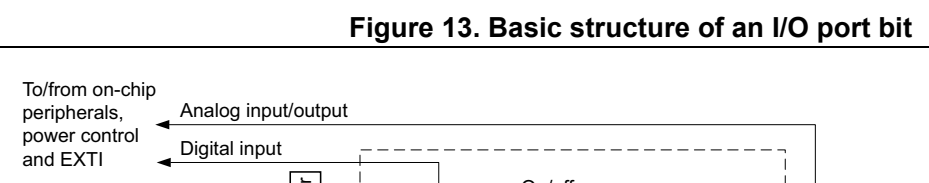
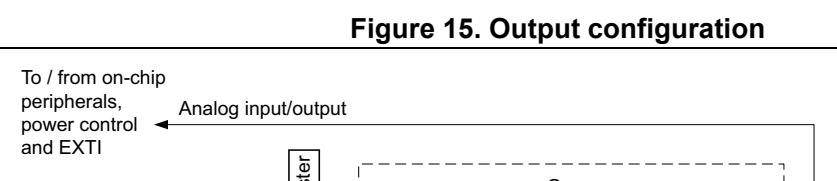
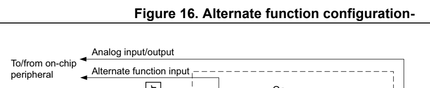
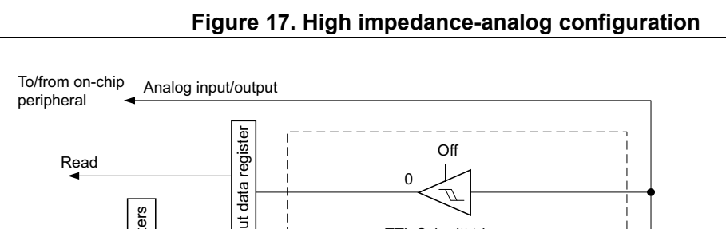

# 6 General-purpose I/Os (GPIO) (pp. 173-188)

## 6 General-purpose I/Os (GPIO) (p. 173)

### 6.1 Introduction (p. 173)

Each general-purpose I/O port has four 32-bit configuration reg isters (GPIOx_MODER, GPIOx_OTYPER, GPIOx_OSPEEDR and G PIOx_PUPDR), two 32-bit data registers (GPIOx_IDR and GPIOx_ODR) and a 32-bit set/reset register (GPIO x_BSRR). In addition all GPIOs have a 32-bit locking register (GPIOx_LCKR) and two 3 2-bit alternate function selection registers (GP IOx_AFRH and GPIOx_AFRL).

### 6.2 GPIO main features (p. 173)

- Output states: push-pull or open drain + pull-up/down

- Output data from output data reg ister (GPIOx_ODR) or peripheral (alternate function output)

- Speed selection for each I/O

- Input states: floating, pull-up/down, analog

- Input data to input data registe r (GPIOx_IDR) or peripheral (al ternate function input)

- Bit set and reset register (GPIOx_ BSRR) for bitwise write acce ss to GPIOx_ODR

- Locking mechanism (GPIOx_LCKR) provided to freeze the I/O port configurations

- Analog function

- Alternate function selection reg isters (at most 8 AFs possible per I/O)

- Fast toggle capable of changing every two clock cycles

- Highly flexible pin multiplexing allows the use of I/O pins as GPIOs or as one of several peripheral functions

### 6.3 GPIO functional description (p. 173)

Subject to the specific hardware characteristics of each I/O po rt listed in the datasheet, each port bit of the general-purpose I/O (GPIO) ports can be individ ually configured by software in several modes:

- Input floating

- Input pull-up

- Input-pull-down

- Analog

- Output open-drain with pull- up or pull-down capability

- Output push-pull with pull-up or pu ll-down capability

- Alternate function push-pull wit h pull-up or pull-down capabili ty

- Alternate function open-drain w ith pull-up or pull-down capabil ity

Each I/O port bit is freely prog rammable, however the I/O port registers have to be accessed as 32-bit words, half-wo rds or bytes. The purpose of t he GPIOx_BSRR and GPIOx_BRR registers is to allow atomic read/modify accesses to any of the GPIOx_ODR registers. In this way, there is no risk of an IRQ occurring be tween the read and the modify access.

Figure 13 shows the basic st ructures of a stand ard I/O port bit. Table 29 gives the possible port bit configurations.

*Figure 13. Basic structu re of an I/O port bit (p. 174)*

WriteRead Bit set/reset registers Input data register Input driver TTL Schmitt trigger on/offV DDIOx upPull I/O pin Read/write Output data register Output drivercontrolOutput V DDIOxN-MOSP-MOS on/off V SS downPull Alternate function V SS Push-pull, From on-chip output open-drain peripheral or disabled

MSv33182V2

**Table 29. Port bit c onfiguration table (1) (pp. 174-175)**

| MODE(i) [1:0] | OTYPE(i) | OSPEED(i) [1:0] | PUPD(i) [1:0] | PUPD(i) [1:0] | I/O configuration | I/O configuration |
| --- | --- | --- | --- | --- | --- | --- |
|  | 0 |  |  |  | 0 0 GP output PP |  |
|  |  |  |  | 0 0 1 GP output PP + PU |  |  |
|  |  |  |  | 0 1 0 GP output PP + PD |  |  |
| 01 |  | SPEED | 0 1 1 Reserved |  |  |  |
| 01 |  | [1:0] | 1 0 0 GP output OD |  |  |  |
|  |  |  |  | 1 0 1 GP output OD + PU |  |  |
|  |  |  |  | 1 1 0 GP output OD + PD |  |  |
|  |  |  |  | 1 1 1 Reserved (GP output OD) |  |  |
|  | 0 |  |  |  | 0 0 AF PP |  |
|  |  |  |  | 0 0 1 AF PP + PU |  |  |
|  |  |  |  | 0 1 0 AF PP + PD |  |  |
| 10 |  | SPEED | 0 1 1 Reserved |  |  |  |
| 10 |  | [1:0] | 1 0 0 AF OD |  |  |  |
|  |  |  |  | 1 0 1 AF OD + PU |  |  |
|  |  |  |  | 1 1 0 AF OD + PD |  |  |
|  |  |  | 1 1 1 Reserved |  |  |  |
|  |  |  |  | x x x 0 0 Input Floating |  |  |
| 00 |  |  | x x x 0 1 Input PU |  |  |  |
| 00 |  |  | x x x 1 0 Input PD |  |  |  |
|  |  |  | x x x 1 1 Reserved (input floating) | x x x 1 1 Reserved (input floating) |  |  |
|  |  |  | x x x 0 0 Input/output Analog | x x x 0 0 Input/output Analog |  |  |
| 11 |  | x xx 0 1 |  |  |  |  |
| 11 |  | x xx 1 0 |  |  | Reserved |  |
|  |  | x xx 1 1 |  |  |  |  |

1. GP = general-purpose, PP = pus h-pull, PU = pull-up, PD = pull -down, OD = open-drain, AF = alternate function.

#### 6.3.1 General-purpose I/O (GPIO) (p. 175)

During and just after reset, the alternate functions are not active and most of the I/O ports are configured in analog mode.

The debug pins are in AF pull- up/pull-down after reset:

- PA14: SWCLK in pull-down

- PA13: SWDIO in pull-up

Note: PA14 is shared with BOOT0 functionality. Caution is required as the debugging device can manipulate BOOT0 pin value.

Upon reset, the FT_c I/O structure presents a pull-down resisto r that can be disabled by setting the UCPDx_STROBE bit of the SYSCFG_CFGR1 register.

When the pin is configured as out put, the value written to the output data register (GPIOx_ODR) is output on the I/O pin. It is possible to use the output driver in push-pull mode or open-drain mode (only the low level is driven, high level is HI-Z).

The input data register (GPIOx_IDR) captures the data present o n the I/O pin at every AHB clock cycle.

All GPIO pins have weak internal pull-up and pull-down resistors, which can be activated or not depending on the value in the GPIOx_PUPDR register.

#### 6.3.2 I/O pin alternate function multiplexer and mapping (p. 175)

The device I/O pins are connected to on-bo ard peripherals/modul es through a multiplexer that allows only one peripheral a lternate function (AF) connected to an I/O pin at a time. In this way, there can be no conflict between peripherals availabl e on the same I/O pin.

Each I/O pin has a multiplexer with up to eight alternate funct ion inputs (AF0 to AF7) that can be configured through the GPIOx_AFRL (for pin 0 to 7) and G PIOx_AFRH (for pin 8 to 15) registers:

- After reset the multip lexer selection is a lternate function 0 (AF0). The I/Os are configured in alternate function mode through GPIOx_MODER register.

- The specific alternate functio n assignments for each pin are de tailed in the device datasheet.

In addition to th is flexible I/O multiplexing arc hitecture, eac h peripheral has alternate functions mapped onto different I/O pins to optimize the number of peripherals available in smaller packages.

To use an I/O in a given configuration, the user has to proceed as follows:

- Debug function: after each device reset these pins are assigned as alternate function pins immediately usable by the debugger host

- GPIO: configure the desired I/O as output, inpu t or analog in the GP IOx_MODER register.

- Peripheral alternate function: – Connect the I/O to the desired AFx in one of the GPIOx_AFRL or GPIOx_AFRH register. – Select the type, pull-up/pull-down and output sp eed via the GP IOx_OTYPER, GPIOx_PUPDR and GPIOx_OSPEEDER registers, respectively. – Configure the desired I/O as an alternate function in the GPIOx_MODER register.

- Additional functions: – ADC connection can be enabled in ADC registers regardless the configured GPIO mode. When ADC uses a GPIO, it is recommended to configure the GPIO in analog mode, through the GPIOx_MODER register. – For the additional functions like RTC, TAMP, WKUPx and oscilla tors, configure the required function in the related RTC, TAMP, PWR and RCC registe rs. These functions have priority over th e configuration in the standard GPIO registers.

Refer to the “Alternate function mapping” table in the device d atasheet for the detailed mapping of the alternate function I/O pins.

#### 6.3.3 I/O port control registers (p. 176)

Each of the GPIO ports has four 32-bit memory-mapped control re gisters (GPIOx_MODER, GPIOx_OTYPER, GPIOx_O SPEEDR, GPIOx_PUPDR) to configure up to 16 I/Os. The GPIOx_MODER register is used to select the I/O mode (input, out put, AF, analog). The GPIOx_OTYPER and GPIOx_OSPEEDR re gisters are used to select the output type (push-pull or open-drain) and speed. The GPIOx_PUPDR register is used to select the pull-up/pull-down whatever the I/O direction.

#### 6.3.4 I/O port data registers (p. 176)

Each GPIO has two 16-bit memory-mapped data registers: input an d output data registers (GPIOx_IDR and GPIOx_ODR). GPIOx_ODR stores the data to be outp ut, it is read/write accessible. The data input thro ugh the I/O are stored into the input data register (GPIOx_IDR), a read-only register.

See Section 6.4.5: GPIO port input data register (GPIOx_IDR) (x = A to F) and Section 6.4.6: GPIO port output data register (GPIOx_ODR) (x = A to F) for the register descriptions.

#### 6.3.5 I/O data bitwise handling (p. 177)

The bit set reset register (GPIOx_BSRR) is a 32-bit register wh ich allows the a pplication to set and reset each individual bi t in the output d ata register ( GPIOx_ODR). The bit set reset register has twice the size of GPIOx_ODR.

To each bit in GPIOx_ODR, corresp ond two control bits in GPIOx_ BSRR: BS(i) and BR(i). When written to 1, bit BS(i) sets the corresponding ODR(i) bit. W hen written to 1, bit BR(i) resets the ODR(i) corresponding bit.

Writing any bit to 0 in GPIOx_BSRR does not have any effect on the corresponding bit in GPIOx_ODR. If there is an attempt to both set and reset a bit i n GPIOx_BSRR, the set action takes priority.

Using the GPIOx_BSRR register to change the values of individua l bits in GPIOx_ODR is a “one-shot” effect that does not l ock the GPIOx_ODR bits. The GP IOx_ODR bits can always be accessed directly. The GPIOx_BSRR register provides a way of performing atomic bitwise handling.

There is no need for the software to disable interrupts when programming the GPIOx_ODR at bit level: it is possible to m odify one or more bits in a si ngle atomic AHB write access.

#### 6.3.6 GPIO lo cking mechanism (p. 177)

It is possible to freeze the GPIO control registers by applying a specific write sequence to the GPIOx_LCKR register. The froz en registers are GPIOx_MODER, GPIOx_OTYPER, GPIOx_OSPEEDR, GPIOx_PUPDR, G PIOx_AFRL and GPIOx_AFRH.

To write the GPIOx_LCKR register, a specific write / read seque nce has to be applied. When the right LOCK sequence is applied to bit 16 in this register, the value of LCKR[15:0] is used to lock the configurat ion of the I/Os (duri ng the write sequence the LCKR[15:0] value must be the same). When the LOCK sequence has been applied to a port bit, the value of the port bit can no longer be modified until the next MCU reset or perip heral reset. Each GPIOx_LCKR bit freezes the corres ponding bit in the control reg isters (GPIOx_MODER, GPIOx_OTYPER, GPIOx_OSPEEDR, GPI Ox_PUPDR, GPIOx_A FRL and GPIOx_AFRH.

The LOCK sequence (refer to Section 6.4.8: GPIO port configuration lock register (GPIOx_LCKR) (x = A to F)) can only be performed using a word (32-bit long) access to th e GPIOx_LCKR register due to the fact that GPIOx_LCKR bit 16 has to be set at the same time as the [15:0] bits.

For more details refer to LCKR register description in Section 6.4.8: GPIO port configuration lock register (GPIOx_LCKR) (x = A to F).

#### 6.3.7 I/O alternate function input/output (p. 177)

Two registers are provided to select one of the alternate funct ion inputs/outputs available for each I/O. With these registers, the user can connect an alternate function to some other pin as required by the application.

This means that a number of possible peripheral functions are m ultiplexed on each GPIO using the GPIOx_AFRL and GPIOx_A FRH alternate function registers. The application can

thus select any one of the possible functions for each I/O. The AF selection signal being common to the alternate functi on input and alternate function o utput, a single channel is selected for the alternate functi on input/output of a given I/O.

To know which functions are multi plexed on each GPIO pin refer to the device datasheet.

#### 6.3.8 External interrupt/wakeup lines (p. 178)

All ports have external interru pt capability. To use external i nterrupt lines, the given pin must not be configured in analog mode or being used as oscillator pi n, so the input trigger is kept enabled.

Refer to Section 12: Extended interrupt and event controller (EXTI).

#### 6.3.9 Input configuration (p. 178)

When the I/O port is programmed as input:

- The output buffer is disabled

- The Schmitt trigger input is activated

- The pull-up and pull-down resisto rs are activated depending on the value in the GPIOx_PUPDR register

- The data present on the I/O pin are sampled into the input data register every AHB clock cycle

- A read access to the input data re gister provides the I/O state

Figure 14 shows the input configura tion of the I/O port bit.

and EXTI Figure 14. Input floating/pull up/pull down configurations

On WriteRead Bit set/reset registers Input data register Input driver TTL Schmitt trigger on/offV DDIOxupPull I/O pin Read/write Output data register Output driver on/off V SSdownPull

MSv33183V2

#### 6.3.10 Output c onfiguration (p. 179)

When the I/O port is programmed as output:

- The output buffer is enabled: – Open drain mode: A “0” in the Ou tput register activates the N- MOS whereas a “1” in the Output register leaves t he port in Hi-Z (the P-MOS is never activated) – Push-pull mode: A “0” in the Ou tput register act ivates the N-M OS whereas a “1” in the Output register activates the P-MOS

- The Schmitt trigger input is activated

- The pull-up and pull-down resisto rs are activated depending on the value in the GPIOx_PUPDR register

- The data present on the I/O pin are sampled into the input data register every AHB clock cycle

- A read access to the input data register gets the I/O state

- A read access to the output data register gets the last written value

Figure 15 shows the output configuration of the I/O port bit.

*Figure 15. Output configuration (p. 179)*

On WriteRead Bit set/reset registers Input data register Input driver TTL Schmitt trigger on/offV DDIOxupPull I/O pin Read/write Output data register Output drivercontrolOutput V DDIOxN-MOSP-MOS on/off V SSdownPull V SS Push-pull or open-drain MSv33184V3

#### 6.3.11 Alternate function configuration (p. 179)

When the I/O port i s programmed as alternate function:

- The output buffer can be configured in open-drain or push-pull mode

- The output buffer is driven by th e signals coming from the peri pheral (transmitter enable and data)

- The Schmitt trigger input is activated

- The weak pull-up and pull-down res istors are activated or not d epending on the value in the GPIOx_PUPDR register

- The data present on the I/O pin are sampled into the input data register every AHB clock cycle

- A read access to the input data register gets the I/O state

Figure 16 shows the Alternate function configuration of the I/O port bit.

*Figure 16. Alternate function configuration- (p. 180)*

WriteRead Bit set/reset registers Input data register Input driverTTL Schmitt trigger on/offV DDIOx upPull I/O pin Read/write Output data register Output drivercontrolOutput V DDIOxN-MOSP-MOS on/off V SS downPull V SS From on-chip Alternate function output Push-pull peripheral or open-drain

MSv31479V2

#### 6.3.12 Analog configuration (p. 180)

When the I/O port is programmed as analog configuration:

- The output buffer is disabled

- The Schmitt trigger input is deact ivated, providing zero consum ption for every analog value of the I/O pin. The output of the Schmitt trigger is forced to a constant value (0).

- The weak pull-up and pull-down resistors are disabled by hardwa re

- Read access to the input data register gets the value “0”

Figure 17 shows the high-impedance, analog-input configuration of the I/O port bits.

*Figure 17. High impedance-analog configuration (p. 180)*

Bit set/reset registers Output data register Output driverInput driver I/O pin Read/write

TTL Schmitt trigger Write

MSv33185V2

#### 6.3.13 Using the HSE or LSE oscillator pins as GPIOs (p. 181)

When the HSE or LSE oscillator is switched OFF (d efault state after reset), the related oscillator pins can be u sed as normal GPIOs.

When the HSE or LSE oscillator is switched ON (by setting the H SEON or LSEON bit in the RCC_CSR register) the oscillator takes cont rol of its associate d pins and the GPIO configuration of these pins has no effect.

When the oscillator is configured in a user external clock mode, only the OSC_IN or OSC32_IN pin is reserved for clock input and the OSC_OUT or OSC 32_OUT pin can still be used as normal GPIO.

#### 6.3.14 Using the GPIO pins in the RTC domain (p. 181)

The PC13/PC14/PC15 GPIO functiona lity is lost when the core sup ply domain is powered off (when the device en ters Standby mode). In this case, if the ir GPIO configuration is not bypassed by the RTC configuration, these pins are set in an ana log input mode.

For details about I/O control by the RTC, refer to Section 23.3: RTC functional description.

### 6.4 GPIO registers (p. 182)

This section gives a detailed de scription of the GPIO registers.

For a summary of register bits, register address offsets and re set values, refer to Table 30.

The peripheral registers can be w ritten in word, half word or byte mode.

### 6.4.1 [GPIO.GPIOx_MODER] Offset: 0x00 | Reset: 0xEBFFFFFF (p. 182)

(x =A to F)

Address offset:0x00

Reset value: 0xEB FF FFFF for port A

Reset value: 0xFFFF FFFF for other ports

Bits 31:0 MODE[15:0][1:0]: Port x configuration I/O pin y (y = 15 to 0) These bits are written by software to configure the I/O mode. 00: Input mode 01: General purpose output mode 10: Alternate function mode 11: Analog mode (reset state)

### 6.4.2 [GPIO.GPIOx_OTYPER] Offset: 0x04 | Reset: 0x00000000 (p. 182)

(x = A to F)

Address offset: 0x04

Reset value: 0x0000 0000

Bits 31:16 Reserved, must be kept at reset value.

Bits 15:0 OT[15:0]: Port x configuration I/O pin y (y = 15 to 0) These bits are written by softwa re to configure the I/O output type. 0: Output push-pull (reset state) 1: Output open-drain

### 6.4.3 [GPIO.GPIOx_OSPEEDR] Offset: 0x08 | Reset: 0x0C000000 (p. 183)

(x = A to F)

Address offset: 0x08

Reset value: 0x0C00 0000 (for port A)

Reset value: 0x0000 000 0 (for other ports)

Bits 31:0 OSPEED[15:0][1:0]: Port x configuration I/O pin y (y = 15 to 0) These bits are written by softwa re to configure the I/O output speed. 00: Very low speed 01: Low speed 10: High speed 11: Very high speed Note: Refer to the device datasheet for the frequency specifications and the power supply and load conditions for each speed.. The FT_c GPIOs cannot be set to high speed.

### 6.4.4 [GPIO.GPIOx_PUPDR] Offset: 0x0C | Reset: 0x24000000 (p. 183)

(x = A to F)

Address offset: 0x0C

Reset value: 0x2400 0000 (for port A)

Reset value: 0x0000 000 0 (for other ports)

Bits 31:0 PUPD[15:0][1:0]: Port x configuration I/O pin y (y = 15 to 0) These bits are written by software to configure the I/O pull-up or pull-down 00: No pull-up, pull-down 01: Pull-up 10: Pull-down 11: Reserved

### 6.4.5 [GPIO.GPIOx_IDR] Offset: 0x10 | Reset: 0x0000XXXX (p. 184)

(x = A to F)

Address offset: 0x10

Reset value: 0x0000 XXXX

Bits 31:16 Reserved, must be kept at reset value.

Bits 15:0 ID[15:0]: Port x input data I/O pin y (y = 15 to 0) These bits are read-only. They contain the input value of the corresponding I/O port.

### 6.4.6 [GPIO.GPIOx_ODR] Offset: 0x14 | Reset: 0x00000000 (p. 184)

(x = A to F)

Address offset: 0x14

Reset value: 0x0000 0000

Bits 31:16 Reserved, must be kept at reset value.

Bits 15:0 OD[15:0]: Port output data I/O pin y (y = 15 to 0) These bits can be read and written by software. Note: For atomic bit set/reset, the OD bits can be individually set and/or reset by writing to the GPIOx_BSRR register (x = A..D, F).

### 6.4.7 [GPIO.GPIOx_BSRR] Offset: 0x18 | Reset: 0x00000000 (p. 184)

(x = A to F)

Address offset: 0x18

Reset value: 0x0000 0000

Bits 31:16 BR[15:0]: Port x reset I/O pin y (y = 15 to 0) These bits are write-only. A rea d to these bits returns the val ue 0x0000. 0: No action on the corresponding ODRx bit 1: Resets the corresponding ODRx bit Note: If both BSx and BRx are set, BSx has priority.

Bits 15:0 BS[15:0]: Port x set I/O pin y (y = 15 to 0) These bits are write-only. A rea d to these bits returns the val ue 0x0000. 0: No action on the corresponding ODRx bit 1: Sets the corresponding ODRx bit

### 6.4.8 [GPIO.GPIOx_LCKR] Offset: 0x1C | Reset: 0x00000000 (p. 185)

(x = A to F)

This register is used to lock the configuration of the port bits when a correct write sequence is applied to bit 16 (L CKK). The value of b its [15:0] is used to lock the configuration of the GPIO. During the write sequence, the value of LCKR[15:0] must n ot change. When the LOCK sequence has be en applied on a port bit, the value of this port bit can no longer be modified until the next MCU reset or peripheral reset.

Note: A specific write se quence is used to write to the GPIOx_LCKR register. Only word access (32-bit long) is allowed during this locking sequence.

Each lock bit freezes a specific configuration register (contro l and alternate function registers).

Address offset: 0x1C

Reset value: 0x0000 0000

Res. Res. Res. Res. Res. Res. Res. Re s. Res. Res. Res. Res. Res. Res. Res. LCKK

rw

Bits 31:17 Reserved, must be kept at reset value.

Bit 16 LCKK: Lock key This bit can be read any time. It can only be modified using th e lock key write sequence. 0: Port configuration lock key not active 1: Port configuration lock key active. The GPIOx_LCKR register is locked until the next MCU reset or peri pheral reset. LOCK key write sequence: WR LCKR[16] = ‘1’ + LCKR[15:0] WR LCKR[16] = ‘0’ + LCKR[15:0] WR LCKR[16] = ‘1’ + LCKR[15:0] RD LCKR RD LCKR[16] = ‘1’ (this read ope ration is optional but it confi rms that the lock is active) Note: During the LOCK key write sequence, the value of LCK[15:0] must not change. Any error in the lock sequence aborts the lock. After the first lock sequence on any bit of the port, any read access on the LCKK bit returns ‘1’ until the next MCU reset or peripheral reset.

Bits 15:0 LCK[15:0]: Port x lock I/O pin y (y = 15 to 0) These bits are read/write but can only be w ritten when the LCKK bit is ‘0. 0: Port configuration not locked 1: Port configuration locked

### 6.4.9 [GPIO.GPIOx_AFRL] Offset: 0x20 | Reset: 0x00000000 (p. 186)

(x = A to F)

Address offset: 0x20

Reset value: 0x0000 0000

Bits 31:0 AFSELy[3:0]: Alternate function selection for port x pin y (y = 0..7) These bits are written by software to configure al ternate funct ion I/Os

AFSELy selection: 1000: Reserved 0000: AF0 1001: Reserved 0001: AF1 1010: Reserved 0010: AF2 1011: Reserved 0011: AF3 1100: Reserved 0100: AF4 1101: Reserved 0101: AF5 1110: Reserved 0110: AF6 1111: Reserved 0111: AF7

### 6.4.10 [GPIO.GPIOx_AFRH] Offset: 0x24 | Reset: 0x00000000 (p. 187)

(x = A to F)

Address offset: 0x24

Reset value: 0x0000 0000

Bits 31:0 AFSELy[3:0]: Alternate function selection for port x pin y (y = 8..15) These bits are written by software to configure al ternate funct ion I/Os

AFSELy selection: 0000: AF0 1000: Reserved 0001: AF1 1001: Reserved 0010: AF2 1010: Reserved 0011: AF3 1011: Reserved 0100: AF4 1100: Reserved 0101: AF5 1101: Reserved 0110: AF6 1110: Reserved 0111: AF7 1111: Reserved

### 6.4.11 [GPIO.GPIOx_BRR] Offset: 0x28 | Reset: 0x00000000 (p. 187)

Address offset: 0x28

Reset value: 0x0000 0000

Bits 31:16 Reserved, must be kept at reset value.

Bits 15:0 BR[15:0]: Port x reset IO pin y (y = 15 to 0) These bits are write-only. A rea d to these bits returns the val ue 0x0000. 0: No action on the corresponding ODx bit 1: Reset the corresponding ODx bit

#### 6.4.12 GPIO register map (p. 188)

The following table gives the GP IO register map and reset value s.

**Table 30. GPIO register map and reset values (p. 188)**

| Col 1 | Offset Register name | 31 | 30 | 29 | 28 | 27 | 26 | 25 | 24 | 23 | 22 | 21 | 20 | 19 | 18 | 17 | 16 | 15 | 14 | 13 | 12 | 11 | 10 | 9 | 8 | 7 | 6 | 5 | 4 | 3 | 2 | 1 | 0 |
| --- | --- | --- | --- | --- | --- | --- | --- | --- | --- | --- | --- | --- | --- | --- | --- | --- | --- | --- | --- | --- | --- | --- | --- | --- | --- | --- | --- | --- | --- | --- | --- | --- | --- |
| 0x00 | GPIOx_MODER | MODE15[1:0] | MODE15[1:0] | MODE14[1:0] | MODE14[1:0] | MODE13[1:0] | MODE13[1:0] | MODE12[1:0] | MODE12[1:0] | MODE11[1:0] | MODE11[1:0] | MODE10[1:0] | MODE10[1:0] | MODE9[1:0] | MODE9[1:0] | MODE8[1:0] | MODE8[1:0] | MODE7[1:0] | MODE7[1:0] | MODE6[1:0] | MODE6[1:0] | MODE5[1:0] | MODE5[1:0] | MODE4[1:0] | MODE4[1:0] | MODE3[1:0] | MODE3[1:0] | MODE2[1:0] | MODE2[1:0] | MODE1[1:0] | MODE1[1:0] | MODE0[1:0] | MODE0[1:0] |

Reset value port A 1 1 1 0 1 0 1 1 1 1 1 1 1 1 1 1 1 1 1 1 1 1 1 1 1 1 111111 Reset value 11111111111111111111111111 111111 port B to F

0x04 GPIOx_OTYPER(x = A to F) Res. Res. Res. Res. Res. Res. Res. Res. Res. Res. Res. Res. Res. Res. Res. Res. OT15 OT14 OT13 OT12 OT11 OT10 OT9 OT8 OT7 OT6 OT5 OT4 OT3 OT2 OT1 OT0

Reset value 0 0 0 0 0 0 0 0 0 0 0 0 0 0 0 0 0x08 GPIOx_OSPEEDR(x = A to F) OSPEED15[1:0] OSPEED14[1:0] OSPEED13[1:0] OSPEED12[1:0] OSPEED11[1:0] OSPEED10[1:0] OSPEED9[1:0] OSPEED8[1:0] OSPEED7[1:0] OSPEED6[1:0] OSPEED5[1:0] OSPEED4[1:0] OSPEED3[1:0] OSPEED2[1:0] OSPEED1[1:0] OSPEED0[1:0] Reset value port A 0 0 0 0 1 1 0 0 0 0 0 0 0 0 0 0 0 0 0 0 0 0 0 0 0 0 000000 Reset value 00000000000000000000000000 000000 port B to F 0x0C GPIOx_PUPDR(x = A to F) PUPD15[1:0] PUPD14[1:0] PUPD13[1:0] PUPD12[1:0] PUPD11[1:0] PUPD10[1:0] PUPD9[1:0] PUPD8[1:0] PUPD7[1:0] PUPD6[1:0] PUPD5[1:0] PUPD4[1:0] PUPD3[1:0] PUPD2[1:0] PUPD1[1:0] PUPD0[1:0] Reset value port A 0 0 1 0 0 1 0 0 0 0 0 0 0 0 0 0 0 0 0 0 0 0 0 0 0 0 000000 Reset value 00000000000000000000000000 000000 port B to F 0x10 GPIOx_IDR(x = A to F) Res. Res. Res. Res. Res. Res. Res. Res. Res. Res. Res. Res. Res. Res. Res. Res. ID15 ID14 ID13 ID12 ID11 ID10 ID9 ID8 ID7 ID6 ID5 ID4 ID3 ID2 ID1 ID0 Reset value x x x x x x x x x x x x x x x x 0x14 GPIOx_ODR(x = A to F) Res. Res. Res. Res. Res. Res. Res. Res. Res. Res. Res. Res. Res. Res. Res. Res. OD15 OD14 OD13 OD12 OD11 OD10 OD9 OD8 OD7 OD6 OD5 OD4 OD3 OD2 OD1 OD0 Reset value 0 0 0 0 0 0 0 0 0 0 0 0 0 0 0 0 0x18 GPIOx_BSRR(x = A to F) BR15 BR14 BR13 BR12 BR11 BR10 BR9 BR8 BR7 BR6 BR5 BR4 BR3 BR2 BR1 BR0 BS15 BS14 BS13 BS12 BS11 BS10 BS9 BS8 BS7 BS6 BS5 BS4 BS3 BS2 BS1 BS0 Reset value 0 0 0 0 0 0 0 0 0 0 0 0 0 0 0 0 0 0 0 0 0 0 0 0 0 0 000000 0x1C GPIOx_LCKR(x = A to F) Res. Res. Res. Res. Res. Res. Res. Res. Res. Res. Res. Res. Res. Res. Res. LCKK LCK15 LCK14 LCK13 LCK12 LCK11 LCK10 LCK9 LCK8 LCK7 LCK6 LCK5 LCK4 LCK3 LCK2 LCK1 LCK0 Reset value 0 0 0 0 0 0 0 0 0 0 0 0 0 0 0 0 0 GPIOx_AFRL AFSEL7 AFSEL6 AFSEL5 AFSEL4 AFSEL3 AFSEL2 AFSEL1 AFSEL0 0x20 (x = A to F) [3:0] [3:0] [3:0] [3:0] [3:0] [3:0] [3:0] [3:0] Reset value 0 0 0 0 0 0 0 0 0 0 0 0 0 0 0 0 0 0 0 0 0 0 0 0 0 0 000000 GPIOx_AFRH AFSEL15 AFSEL14 AFSEL13 AFSEL12 AFSEL11 AFSEL10 AFSEL9 AFSEL8 0x24 (x = A to F) [3:0] [3:0] [3:0] [3:0] [3:0] [3:0] [3:0] [3:0] Reset value 0 0 0 0 0 0 0 0 0 0 0 0 0 0 0 0 0 0 0 0 0 0 0 0 0 0 000000 0x28 (where x =GPIOx_BRRA..D, F)) Res. Res. Res. Res. Res. Res. Res. Res. Res. Res. Res. Res. Res. Res. Res. Res. BR15 BR14 BR13 BR12 BR11 BR10 BR9 BR8 BR7 BR6 BR5 BR4 BR3 BR2 BR1 BR0 Reset value 0 0 0 0 0 0 0 0 0 0 0 0 0 0 0 0

Refer to Section 2.2 on page 44 for the register boundary addresses.
