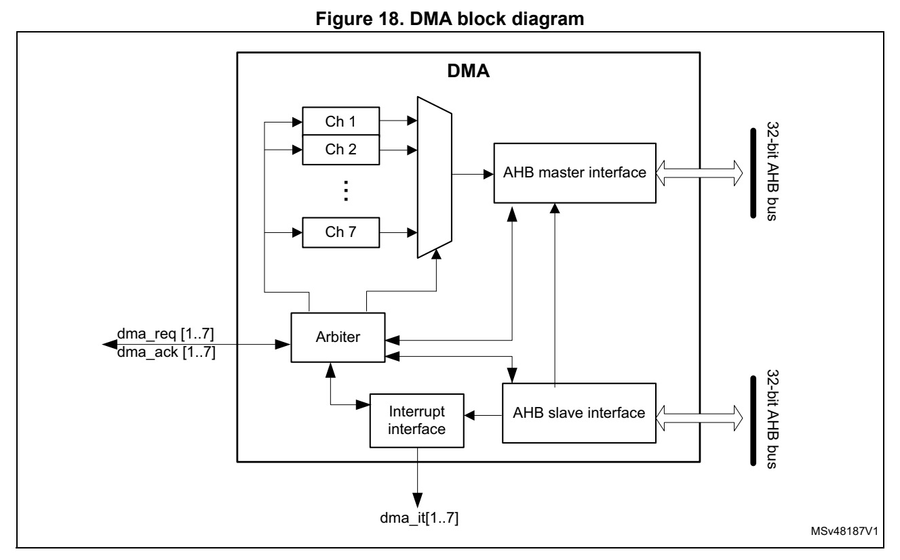

# 9 Direct memory access controller (DMA) (pp. 213-233)

## 9 Direct memory access controller (DMA) (p. 213)

### 9.1 Introduction (p. 213)

The direct memory access (DMA) controller is a bus master and system peripheral.

The DMA is used to perform progra mmable data transfers between memory-mapped peripherals and/or memories, upo n the control of an off-loaded CPU.

The DMA controller features a single AHB master architecture.

Refer to Section 9.3 for information on DMA implementation.

Each channel is dedicated to man aging memory access requests from one or more peripherals. The DMA includes an arbiter for handling the priority between DMA requests.

### 9.2 DMA main features (p. 213)

- Single AHB master

- Peripheral-to-memory, memory-to-peripheral, memory-to-memory an d peripheral-to-peripheral data transfers

- Access, as source and destination, to on-chip memory-mapped dev ices such as Flash memory, SRAM, and AH B and APB peripherals

- All DMA channels independently configurable: – Each channel is associated eithe r with a DMA request signal co ming from a peripheral, or with a software trigger in memory-to-memory tran sfers. This configuration is done by software. – Priority between the requests i s programmable by software (4 l evels per channel: very high, high, medium, low) an d by hardware in case of equali ty (such as request to channel 1 has priority over request to channel 2). – Transfer size of source and destination are independent (byte, half-word, word), emulating packing and unpacking. Source and destination address es must be aligned on the data size. – Support of transfers from/to peripherals to/from memory with c ircular buffer management – Programmable number of data to be transferred: 0 to 2 16 -1

- Generation of an interrupt request per channel. Each interrupt request is caused from any of the three DMA events: transfer complete, h alf transfer, or transfer error.

### 9.3 DMA implementation (p. 214)

#### 9.3.1 DMA (p. 214)

The devices incorporate one or two DMA controller instances. Th e following implementation table shows the number of DMA channels for either instance. A d ash indicates that the instance is not implemented.

**Table 33. DMA implementation (p. 214)**

| Number of channels STM32G030xx | Col 2 | STM32G050xx STM32G070xx | STM32G0B0xx |
| --- | --- | --- | --- |
|  | DMA1 5 7 7 |  |  |
|  | DMA2 - - 5 |  |  |

#### 9.3.2 DMA request mapping (p. 214)

The DMA controller is connected to DMA req uests from the AHB/AP B peripherals through the DMAMUX p eripheral.

For the mapping of the diffe rent requests, refer to the Section 10.3: DMAMUX implementation.

### 9.4 DMA functional description (p. 214)

#### 9.4.1 DMA block diagram (p. 214)

The DMA block diagram is s hown in the figure below.

*Figure 18. DMA block diagram (p. 215)*

The DMA controller performs direct memory transfer by sharing t he AHB system bus with other system masters. The bus matrix implements round-robin sch eduling. DMA requests may stop the CPU access to the system bus for a n umber of bus cycles, when CPU and DMA target the same destination (memory or peripheral).

According to its configuration through the AHB slave interface, the DMA controller arbitrates between the DMA channels and t heir associated received requests. The DMA controller also schedules the DMA data transfers over the single AHB port master.

The DMA controller generates an i nterrupt per channel to the in terrupt controller.

#### 9.4.2 DMA pins and internal signals (p. 215)

Table 34. DMA internal input/output signals

Signal name Signal type Description

dma_req[x] Input DMA channel x request

dma_ack[x] Output DMA channel x acknowledge

dma_it[x] Output DMA channel x interrupt

#### 9.4.3 DMA transfers (p. 215)

The software configure s the DMA controller at channel level, in order to perform a block transfer, composed of a se quence of AHB bus transfers.

A DMA block transfer may be requ ested from a peripheral, or tri ggered by the software in case of memory-to-memory transfer.

After an event, the following steps of a single DM A transfer occur: 1. The peripheral sends a single DMA request signal to the DMA controller. 2. The DMA controller serves the request, depending on the prio rity of the channel associated to this peripheral request. 3. As soon as the DMA controlle r grants the peri pheral, an ackn owledge is sent to the peripheral by the DMA controller. 4. The peripheral releases its request as soon as it gets the a cknowledge from the DMA controller. 5. Once the request is de-asserted by the peripheral, the DMA controller releases the acknowledge.

The peripheral may order a further single request and initiate another single DMA transfer.

The request/acknowledge protocol is used when a peripheral is e ither the source or the destination of the transfer. For example, in case of memory-to- peripheral transfer, the peripheral initiates the transfer by driving its single request signal to the DMA controller. The DMA controller reads then a single data in the memory and write s this data to the peripheral.

For a given channel x, a DMA block transfer consists of a repeated sequence of:

- a single DMA transfer, encapsulat ing two AHB transfers of a sin gle data, over the DMA AHB bus master: – a single data read (byte, half-word or word) from the peripheral data register or a location in the memory, addressed through an internal current p eripheral/memory address register. The start address used for the fi rst single transfer is the bas e address of the peripheral or memory, and is programmed in the DMA_CPARx or DMA_CMARx register. – a single data write (byte, half-word or word) to the periphera l data register or a location in the memory, addressed through an internal current p eripheral/memory address register. The start address used for the first transfer is the base addre ss of the peripheral or memory, and is programmed in the DMA_CPARx or DMA_CMARx registe r.

- post-decrementing of the programmed DMA_CNDTRx register This register contains the rem aining number of data items to transfer (number of AHB ‘read followed by w rite’ transfers).

This sequence is repeated until DMA_CNDTRx is null.

Note: The AHB master bus source/destination address must be aligned with the programmed size of the transferred single data to the source/destination.

#### 9.4.4 DMA arbitration (p. 216)

The DMA arbiter manages the pri ority between the different chan nels.

When an active channel x is grante d by the arbiter (hardware re quested or software triggered), a single DMA transfer is issued (such as a AHB ‘rea d followed by write’ transfer of a single data). Then, the arbiter considers again the set of active channels and selects the one with the highest priority.

The priorities are managed in two stages:

- software: priority of each channe l is configured in the DMA_CCRx register, to one of the four different levels: – very high – high – medium – low

- hardware: if two requests have th e same software priority level, the channel with the lowest index gets priority. For example, channel 2 gets priority over channel 4.

When a channel x is programmed fo r a block transfer in memory-to-memory mode, re arbitration is considered betwe en each single DMA transfer of this channel x. Whenever there is another concurrent active requested channel, the DMA a rbiter automatically alternates and grants the other highest-priority requested chan nel, which may be of lower priority than the memory-to-memory channel.

#### 9.4.5 DMA channels (p. 217)

Each channel may handle a DMA transfer between a peripheral reg ister located at a fixed address, and a memory address. T he amount of data items to tran sfer is programmable. The register that contains the a mount of data items to transfer is decremented after each transfer.

A DMA channel is programmed at block transfer level.

Programmable data sizes

The transfer sizes of a single data (byte, half-wo rd, or word) to the peripheral and memory are programmable through, respectively, the PSIZE[1:0] and MSIZ E[1:0] fields of the DMA_CCRx register.

Pointer incrementation

The peripheral and memory pointers may be automatically increme nted after each transfer, depending on the PINC and MINC bits of the DMA_CCRx register.

If the incremented mode is enabled (PINC or MINC set to 1), the address of the next transfer is the address of the previous one incremented by 1, 2 or 4, depending on the data size defined in PSIZE[1:0] or MS IZE[1:0]. The first transfer ad dress is the one programmed in the DMA_CPARx or DMA_CMARx register. During transfers, these registers keep the initially programmed value. The current transfer addresses (in the current internal peripheral/memory address registe r) are not accessible by software.

If the channel x is configured in non-circular mode, no DMA request is served after the last data transfer (once the number of single data to transfer reach es zero). The DMA channel must be disabled in order to relo ad a new number of data items into the DMA_CNDTRx register.

Note: If the channel x is disabled, the DMA registers are not reset. The DMA channel registers (DMA_CCRx, DMA_CPARx and DMA_CMARx) retain the initial values programmed during the channel configuration phase.

In circular mode, after the last data transfer, the DMA_CNDTRx register is auto matically reloaded with the initially programmed value. The current internal address registers are reloaded with the base address values from the DMA_CPARx and DM A_CMARx registers.

Channel configuration procedure

The following sequence is needed to configure a DMA channel x: 1. Set the peripheral register address in the DMA_CPARx register. The data is moved from/to this address to/from the mem ory after the peripheral event, or after the channel is enabl ed in memory-to-memory mode. 2. Set the memory address in the DMA_CMARx register. The data is written to/read from the memory after the periphera l event or after the channel is enabled in memory-to-memory mode. 3. Configure the total number of data to transfer in the DMA_CN DTRx register. After each data transfer, this value is decremented. 4. Configure the parameters liste d below in the DMA_CCRx register: – the channel priority – the data transfer direction – the circular mode – the peripheral and memory incremented mode – the peripheral and memory data size – the interrupt enable at half and/or full transfer and/or transfer error 5. Activate the channel by setti ng the EN bit in the DMA_CCRx register.

A channel, as soon as enabled, may serve any DMA request from t he peripheral connected to this channel, or may start a memory-to-memory block transfer.

Note: The two last steps of the channel configuration procedure may be merged into a single access to the DMA_CCRx register, to configure and enable the channel.

Channel state and disabling a channel

A channel x in active state is an enabled channel (read DMA_CCRx.EN = 1). An active channel x is a channel that must have been enabled by the software (DMA_CCRx.EN set to 1) and afterwards with no occurred transfer error (DMA_ISR.TE IFx = 0). In case there is a transfer error, the channel is a utomatically disabled by hardwa re (DMA_CCRx.EN = 0).

The three following use cases may happen:

- Suspend and resume a channel This corresponds to the two following actions: – An active channel is disabled by software (writing DMA_CCRx.EN = 0 whereas DMA_CCRx.EN = 1). – The software enables the channel again (DMA_CCRx.EN set to 1) without reconfiguring the ot her channel registers (such as DMA_CNDTRx, DMA_CPARx and DMA_CMARx). This case is not suppo rted by the DMA hardware, that does not g uarantee that the remaining data transfers are performed correctly.

- Stop and abort a channel If the application does not need any more the channel, this act ive channel can be disabled by software. The chann el is stopped and aborted but th e DMA_CNDTRx

register content may not correct ly reflect the remaining data t ransfers versus the aborted source and desti nation buffer/register.

- Abort and restart a channel This corresponds to the software sequence: disable an active ch annel, then reconfigure the channel and enable it again. This is supported by the hardware if the following conditions a re met: – The application guarantees that, when the software is disablin g the channel, a DMA data transfer is not occurri ng at the same time over its ma ster port. For example, the applicati on can first disable the peripheral in DM A mode, in order to ensure that there is no pending h ardware DMA request from this peripheral. – The software must ope rate separated write accesses to the same DMA_CCRx register: First disable the channel. Second reconfigure the cha nnel for a next block transfer including the DMA_CCRx if a configuration change is ne eded. There are read-only DMA_CCRx register fiel ds when DMA_CCRx.EN=1. Finally enable again the channel.

When a channel transfer error occurs, the EN bit of the DMA_CCRx register is cleared by hardware. This EN bit can not be set again by software to re-activate the channel x, until the TEIFx bit of the DMA_ISR register is set.

Circular mode (in memory-to-peripheral/peripheral-to-memory tra nsfers)

The circular mode is available to handle circular buffers and continuous data flows (such as ADC scan mode). This feature is enabled using the CIRC bit in t he DMA_CCRx register.

Note: The circular mode must not be used in memory-to-memory mode. Before enabling a channel in circular mode (CIRC = 1), the so ftware must clear the MEM2MEM bit of the DMA_CCRx register. When the circular mode is activated, the amount of data to transfer is automatically reloaded with the initial value programmed during the channel configuration phase, and the DMA requests continue to be served. In order to stop a circular transfer, the softwa re needs to stop the peripheral from generating DMA requests (such as quit the ADC scan mode), before disabling the DMA channel. The software must explicitly program the DMA_CNDTRx value before starting/enabling a transfer, and after having stopped a circular transfer.

Memory-to-memory mode

The DMA channels may operate without being triggered by a reque st from a peripheral. This mode is called memory-to-memory m ode, and is initiated by software.

If the MEM2MEM bit in the DMA_CCRx register i s set, the channel, if enabled, initiates transfers. The transfer stops once the DMA_CNDTRx register reac hes zero.

Note: The memory-to-memory mode must not be used in circular mode. Before enabling a channel in memory-to-memory mode (MEM2MEM = 1), the software must clear the CIRC bit of the DMA_CCRx register.

Peripheral-to-peripheral mode

Any DMA channel can operate in p eripheral-to-peripheral mode:

- when the hardware request from a peripheral is selected to trig ger the DMA channel This peripheral is the DMA initia tor and paces the data transfe r from/to this peripheral to/from a register belonging to another memory-mapped periphera l (this one being not configured in DMA mode).

- when no peripheral request is selected and connected to the DMA channel The software configures a register-to-register transfer by sett ing the MEM2MEM bit of the DMA_CCRx register.

Programming transfer direction, assigning source/destination

The value of the DIR bit of the D MA_CCRx register sets the dire ction of the transfer, and consequently, it identifies the source and the destination, reg ardless the source/destination type (peripheral or memory):

- DIR = 1 defines typically a memory-to-peripheral transfer. More genera lly, if DIR = 1: – The source attributes are defined by the DM A_MARx register, the MSIZE[1:0] field and MINC bit of th e DMA_CCRx register. Regardless of their usual naming, these ‘memory’ register, fiel d and bit are used to define the source peripheral in peripheral-to-peripheral mode. – The destination attributes are defined by the DMA_PARx register, the PSIZE[1:0] field and PINC bit of t he DMA_CCRx register. Regardless of their usual naming, these ‘peripheral’ register, field and bit are used to define the destination memo ry in memory-to-memory mode.

- DIR = 0 defines typically a peripheral-to-memory transfer. More genera lly, if DIR = 0: – The source attributes are defined by the DMA_PARx register, the PSIZE[1:0] field and PINC bit of the D MA_CCRx register. Regardless of their usual naming, these ‘peripheral’ register, field and bit are used to define the source memory in memory-to-memory mode – The destination attributes are defined by t he DMA_MARx register, the MSIZE[1:0] field and MINC bit of the DMA_CCRx register. Regardless of their usual naming, these ‘memory’ register, fiel d and bit are used to define the destination peripheral in peripheral-to-peripheral m ode.

#### 9.4.6 DMA data width, al ignment and endianness (p. 220)

When PSIZE[1:0] and MSIZE[1:0] a re not equal, the DMA controlle r performs some data alignments as described in the table below.

**Table 35. Programmabl e data width and endi an behavior (when PIN C = MINC = 1) (p. 221)**

| Source port width (MSIZE if DIR = 1, else PSIZE) | Destinat ion port width (PSIZE if DIR = 1, else MSIZE) | Number of data items to transfer (NDT) | Source content: address / data (DMA_CMARx if DIR = 1, else DMA_CPARx) | DMA transfers | Destination content: address / data (DMA_CPARx if DIR = 1, else DMA_CMARx) |
| --- | --- | --- | --- | --- | --- |
|  | 884 |  | @0x0 / B0 @0x1 / B1 @0x2 / B2 @0x3 / B3 | 1: read B0[7:0] @0x0 then write B0[7:0] @0x0 2: read B1[7:0] @0x1 then write B1[7:0] @0x1 3: read B2[7:0] @0x2 then write B2[7:0] @0x2 4: read B3[7:0] @0x3 then write B3[7:0] @0x3 | @0x0 / B0 @0x1 / B1 @0x2 / B2 @0x3 / B3 |
|  | 8 16 4 |  | @0x0 / B0 @0x1 / B1 @0x2 / B2 @0x3 / B3 | 1: read B0[7:0] @0x0 then write 00B0[15:0] @0x0 2: read B1[7:0] @0x1 then write 00B1[15:0] @0x2 3: read B2[7:0] @0x2 then write 00B2[15:0] @0x4 4: read B3[7:0] @0x3 then write 00B3[15:0] @0x6 | @0x0 / 00B0 @0x2 / 00B1 @0x4 / 00B2 @0x6 / 00B3 |
|  | 8 32 4 |  | @0x0 / B0 @0x1 / B1 @0x2 / B2 @0x3 / B3 | 1: read B0[7:0] @0x0 then write 000000B0[31:0] @0x0 2: read B1[7:0] @0x1 then write 000000B1[31:0] @0x4 3: read B2[7:0] @0x2 then write 000000B2[31:0] @0x8 4: read B3[7:0] @0x3 then write 000000B3[31:0] @0xC | @0x0 / 000000B0 @0x4 / 000000B1 @0x8 / 000000B2 @0xC / 000000B3 |
|  | 16 8 4 |  | @0x0 / B1B0 @0x2 / B3B2 @0x4 / B5B4 @0x6 / B7B6 | 1: read B1B0[15:0] @0x0 then write B0[7:0] @0x0 2: read B3B2[15:0] @0x2 then write B2[7:0] @0x1 3: read B5B4[15:0] @0x4 then write B4[7:0] @0x2 4: read B7B6[15:0] @0x6 then write B6[7:0] @0x3 | @0x0 / B0 @0x1 / B2 @0x2 / B4 @0x3 / B6 |
|  | 16 16 4 |  | @0x0 / B1B0 @0x2 / B3B2 @0x4 / B5B4 @0x6 / B7B6 | 1: read B1B0[15:0] @0x0 then write B1B0[15:0] @0x0 2: read B3B2[15:0] @0x2 then write B3B2[15:0] @0x2 3: read B5B4[15:0] @0x4 then write B5B4[15:0] @0x4 4: read B7B6[15:0] @0x6 then write B7B6[15:0] @0x6 | @0x0 / B1B0 @0x2 / B3B2 @0x4 / B5B4 @0x6 / B7B6 |
|  | 16 32 4 |  | @0x0 / B1B0 @0x2 / B3B2 @0x4 / B5B4 @0x6 / B7B6 | 1: read B1B0[15:0] @0x0 then write 0000B1B0[31:0] @0x0 2: read B3B2[15:0] @0x2 then write 0000B3B2[31:0] @0x4 3: read B5B4[15:0] @0x4 then write 0000B5B4[31:0] @0x8 4: read B7B6[15:0] @0x6 then write 0000B7B6[31:0] @0xC | @0x0 / 0000B1B0 @0x4 / 0000B3B2 @0x8 / 0000B5B4 @0xC / 0000B7B6 |
|  | 32 8 4 |  | @0x0 / B3B2B1B0 @0x4 / B7B6B5B4 @0x8 / BBBAB9B8 @0xC / BFBEBDBC | 1: read B3B2B1B0[31:0] @0x0 then write B0[7:0] @0x0 2: read B7B6B5B4[31:0] @0x4 then write B4[7:0] @0x1 3: read BBBAB9B8[31:0] @0x8 then write B8[7:0] @0x2 4: read BFBEBDBC[31:0] @0xC then write BC[7:0] @0x3 | @0x0 / B0 @0x1 / B4 @0x2 / B8 @0x3 / BC |
|  | 32 16 4 |  | @0x0 / B3B2B1B0 @0x4 / B7B6B5B4 @0x8 / BBBAB9B8 @0xC / BFBEBDBC | 1: read B3B2B1B0[31:0] @0x0 then write B1B0[15:0] @0x0 2: read B7B6B5B4[31:0] @0x4 then write B5B4[15:0] @0x2 3: read BBBAB9B8[31:0] @0x8 then write B9B8[15:0] @0x4 4: read BFBEBDBC[31:0] @0xC then write BDBC[15:0] @0x6 | @0x0 / B1B0 @0x2 / B5B4 @0x4 / B9B8 @0x6 / BDBC |
|  | 32 32 4 |  | @0x0 / B3B2B1B0 @0x4 / B7B6B5B4 @0x8 / BBBAB9B8 @0xC / BFBEBDBC | 1: read B3B2B1B0[31:0] @0x0 then write B3B2B1B0[31:0] @0x0 2: read B7B6B5B4[31:0] @0x4 then write B7B6B5B4[31:0] @0x4 3: read BBBAB9B8[31:0] @0x8 then write BBBAB9B8[31:0] @0x8 4: read BFBEBDBC[31:0] @0xC then write BFBEBDBC[31:0] @0xC | @0x0 / B3B2B1B0 @0x4 / B7B6B5B4 @0x8 / BBBAB9B8 @0xC / BFBEBDBC |
|  | • • | examples below: | When the DMA controller duplicated on the unused lanes o not generate any error, the DMA c To write the half-word 0xABCD, t 0xABCDABCD with a half-with a byte data size (HSIZE = | Addressing AHB peripherals not supporting byte/half-word write initiates an AHB byte or half-word write transfer, th f the AHB master 32-bit data bu s (HWDATA[31:0]). When the AHB slave peripheral does not support byte or half-wor ontroller writes the 32 HWDATA he DMA controller sets the HWDA word data size (HSIZE = HalfWord in AHB ma To write the byte 0xAB, the DMA controller sets the HWDATA bus Byte in the AHB master bus). | transfers e data are d write transfers and does bits as shown in the two TA bus to ster bus). to 0xABABABAB |

Assuming the AHB/APB bridge is an AHB 32-bit slave peripheral t hat does not take into account the HSIZE data, any AHB byte or half-word transfer is c hanged into a 32-bit APB transfer as described below:

- An AHB byte write tran sfer of 0xB0 to one of the 0x0, 0x1, 0x2 or 0x3 addresses, is converted to an APB word write t ransfer of 0xB0B0B0B0 to the 0x0 address.

- An AHB half-word write transfer of 0xB1B0 to the 0x0 or 0x2 add resses, is converted to an APB word write transfer of 0xB1B0B1B0 to the 0x0 address.

#### 9.4.7 DMA error management (p. 222)

A DMA transfer error is generate d when reading from or writing to a reserved address space. When a DMA transfer error occurs during a DMA read or write access, the faulty channel x is automatically disab led through a hardware clear of its EN bit in the corresponding DM A_CCRx register.

The TEIFx bit of the DMA_ISR register is set. An interrupt is t hen generated if the TEIE bit of the DMA_CCRx register is set.

The EN bit of the DMA_CCRx register can not be set again by software (channel x re-activated) until the TEIFx bit of the DMA_ISR register is cleared (by setting the CTEIFx bit of the DMA_IFCR register).

When the software is notified wit h a transfer error over a chan nel which involves a peripheral, the software has first to stop this peripheral in D MA mode, in order to disable any pending or future DMA request. Then software may normally recon figure both DMA and the peripheral in DMA mode for a new transfer.

### 9.5 DMA interrupts (p. 222)

An interrupt can be generated on a half transfer, transfer comp lete or transfer error for each DMA channel x. Separate interrupt enable bits are available for flexibility.

**Table 36. DMA in terrupt requests (p. 222)**

| Col 1 | Interrupt request Interrupt event Event flag | Col 3 | Interrupt enable bit |
| --- | --- | --- | --- |
|  | Half transfer on channel x HTIFx HTIEx |  |  |
| Channel x interrupt | Transfer complete on channel x TCIFx TCIEx |  |  |
| Channel x interrupt | Transfer error on channel x TEIFx TEIEx |  |  |
|  | Half transfer or transfer complete or transfer error on channel | x GIFx - |  |

### 9.6 DMA registers (p. 222)

Refer to Section 1.2 for a list of abbre viations used in register descriptions.

The DMA registers have to be accessed by words (32-bit).

### 9.6.1 [DMA.DMA_ISR] Offset: 0x00 | Reset: 0x00000000 (p. 223)

Address offset: 0x00

Reset value: 0x0000 0000

Every status bit is cl eared by hardware when the software sets the corresponding clear bit or the corresponding global clear bit CGIFx, in the DMA_IFCR re gister.

Bits 31:28 Reserved, must be kept at reset value.

Bit 27 TEIF7: transfer error (TE) flag for channel 7 0: no TE event 1: a TE event occurred

Bit 26 HTIF7: half transfer (HT) flag for channel 7 0: no HT event 1: a HT event occurred

Bit 25 TCIF7: transfer complete (TC) flag for channel 7 0: no TC event 1: a TC event occurred

Bit 24 GIF7: global interrupt flag for channel 7 0: no TE, HT or TC event 1: a TE, HT or TC event occurred

Bit 23 TEIF6: transfer error (TE) flag for channel 6 0: no TE event 1: a TE event occurred

Bit 22 HTIF6: half transfer (HT) flag for channel 6 0: no HT event 1: a HT event occurred

Bit 21 TCIF6: transfer complete (TC) flag for channel 6 0: no TC event 1: a TC event occurred

Bit 20 GIF6: global interrupt flag for channel 6 0: no TE, HT or TC event 1: a TE, HT or TC event occurred

Bit 19 TEIF5: transfer error (TE) flag for channel 5 0: no TE event 1: a TE event occurred

Bit 18 HTIF5: half transfer (HT) flag for channel 5 0: no HT event 1: a HT event occurred

Bit 17 TCIF5: transfer complete (TC) flag for channel 5 0: no TC event 1: a TC event occurred

Bit 16 GIF5: global interrupt flag for channel 5 0: no TE, HT or TC event 1: a TE, HT or TC event occurred

Bit 15 TEIF4: transfer error (TE) flag for channel 4 0: no TE event 1: a TE event occurred

Bit 14 HTIF4: half transfer (HT) flag for channel 4 0: no HT event 1: a HT event occurred

Bit 13 TCIF4: transfer complete (TC) flag for channel 4 0: no TC event 1: a TC event occurred

Bit 12 GIF4: global interrupt flag for channel 4 0: no TE, HT or TC event 1: a TE, HT or TC event occurred

Bit 11 TEIF3: transfer error (TE) flag for channel 3 0: no TE event 1: a TE event occurred

Bit 10 HTIF3: half transfer (HT) flag for channel 3 0: no HT event 1: a HT event occurred

Bit 9 TCIF3: transfer complete (TC) flag for channel 3 0: no TC event 1: a TC event occurred

Bit 8 GIF3: global interrupt flag for channel 3 0: no TE, HT or TC event 1: a TE, HT or TC event occurred

Bit 7 TEIF2: transfer error (TE) flag for channel 2 0: no TE event 1: a TE event occurred

Bit 6 HTIF2: half transfer (HT) flag for channel 2 0: no HT event 1: a HT event occurred

Bit 5 TCIF2: transfer complete (TC) flag for channel 2 0: no TC event 1: a TC event occurred

Bit 4 GIF2: global interrupt flag for channel 2 0: no TE, HT or TC event 1: a TE, HT or TC event occurred

Bit 3 TEIF1: transfer error (TE) flag for channel 1 0: no TE event 1: a TE event occurred

Bit 2 HTIF1: half transfer (HT) flag for channel 1 0: no HT event 1: a HT event occurred

Bit 1 TCIF1: transfer complete (TC) flag for channel 1 0: no TC event 1: a TC event occurred

Bit 0 GIF1: global interrupt flag for channel 1 0: no TE, HT or TC event 1: a TE, HT or TC event occurred

### 9.6.2 [DMA.DMA_IFCR] Offset: 0x04 | Reset: 0x00000000 (p. 225)

Address offset: 0x04

Reset value: 0x0000 0000

Setting the global clear bit CGIFx of the channel x in this DMA_IFCR register, causes the DMA hardware to clear the corres ponding GIFx bit and any indivi dual flag among TEIFx, HTIFx, TCIFx, in the DMA_ISR register.

Setting any individual clear bit among CTEIFx, CHTIFx, CTCIFx i n this DMA_IFCR register, causes the DMA hardware to clear the corresponding individual flag and the global flag GIFx in the DMA_ISR register, provided that none of the two oth er individual flags is set.

Writing 0 into any flag c lear bit has no effect.

Bits 31:28 Reserved, must be kept at reset value.

Bit 27 CTEIF7: transfer error flag clear for channel 7

Bit 26 CHTIF7: half transfer flag clear for channel 7

Bit 25 CTCIF7: transfer complete flag clear for channel 7

Bit 24 CGIF7: global interrupt flag clear for channel 7

Bit 23 CTEIF6: transfer error flag clear for channel 6

Bit 22 CHTIF6: half transfer flag clear for channel 6

Bit 21 CTCIF6: transfer complete flag clear for channel 6

Bit 20 CGIF6: global interrupt flag clear for channel 6

Bit 19 CTEIF5: transfer error flag clear for channel 5

Bit 18 CHTIF5: half transfer flag clear for channel 5

Bit 17 CTCIF5: transfer complete flag clear for channel 5

Bit 16 CGIF5: global interrupt flag clear for channel 5

Bit 15 CTEIF4: transfer error flag clear for channel 4

Bit 14 CHTIF4: half transfer flag clear for channel 4

Bit 13 CTCIF4: transfer complete flag clear for channel 4

Bit 12 CGIF4: global interrupt flag clear for channel 4

Bit 11 CTEIF3: transfer error flag clear for channel 3

Bit 10 CHTIF3: half transfer flag clear for channel 3

Bit 9 CTCIF3: transfer complete flag clear for channel 3

Bit 8 CGIF3: global interrupt flag clear for channel 3

Bit 7 CTEIF2: transfer error flag clear for channel 2

Bit 6 CHTIF2: half transfer flag clear for channel 2

Bit 5 CTCIF2: transfer complete flag clear for channel 2

Bit 4 CGIF2: global interrupt flag clear for channel 2

Bit 3 CTEIF1: transfer error flag clear for channel 1

Bit 2 CHTIF1: half transfer flag clear for channel 1

Bit 1 CTCIF1: transfer complete flag clear for channel 1

Bit 0 CGIF1: global interrupt flag clear for channel 1

### 9.6.3 [DMA.DMA_CCRx] Offset: 0x08 | Reset: 0x00000000 (p. 226)

Address offset: 0x08 + 0x14 * (x - 1), (x = 1 to 7)

Reset value: 0x0000 0000

The register fields/bits MEM2MEM, PL[1:0], MSIZE[1:0], PSIZE[1: 0], MINC, PINC, and DIR are read-only when EN = 1.

The states of MEM2MEM and CIRC bits must not be both high at th e same time.

Bits 31:15 Reserved, must be kept at reset value.

Bit 14 MEM2MEM: memory-to-memory mode 0: disabled 1: enabled Note: this bit is set and cleared by software. It must not be written when the channel is enabled (EN = 1). It is read-only when the channel is enabled (EN = 1).

Bits 13:12 PL[1:0]: priority level 00: low 01: medium 10: high 11: very high Note: this field is set and cleared by software. It must not be written when the channel is enabled (EN = 1). It is read-only when the channel is enabled (EN = 1).

Bits 11:10 MSIZE[1:0]: memory size Defines the data size of each DMA transfer to the identified me mory. In memory-to-memory m ode, this field identifies the memory source if DIR = 1 and the memory destination if DIR = 0. In peripheral-to-peripheral mode, this field ide ntifies the peripheral source if DIR = 1 and the peripheral destination if DIR = 0. 00: 8 bits 01: 16 bits 10: 32 bits 11: reserved Note: this field is set and cleared by software. It must not be written when the channel is enabled (EN = 1). It is read-only when the channel is enabled (EN = 1).

Bits 9:8 PSIZE[1:0]: peripheral size Defines the data size of each DMA transfer to the identified pe ripheral. In memory-to-memory m ode, this field identifies the memory dest ination if DIR = 1 and the memory source if DIR = 0. In peripheral-to-peripheral mode, this field identifies the per ipheral destination if DIR = 1 and the peripheral source if DIR = 0. 00: 8 bits 01: 16 bits 10: 32 bits 11: reserved Note: this field is set and cleared by software. It must not be written when the channel is enabled (EN = 1). It is read-only when the channel is enabled (EN = 1).

Bit 7 MINC: memory increment mode Defines the incremen t mode for each DMA transfer to the identified memory. In memory-to-memory m ode, this field identifies the memory source if DIR = 1 and the memory destination if DIR = 0. In peripheral-to-peripheral mode, this field ide ntifies the peripheral source if DIR = 1 and the peripheral destination if DIR = 0. 0: disabled 1: enabled Note: this bit is set and cleared by software. It must not be written when the channel is enabled (EN = 1). It is read-only when the channel is enabled (EN = 1).

Bit 6 PINC: peripheral increment mode Defines the incremen t mode for each DMA transfer to the identified peripheral. n memory-to-memory mode, this field identifies the memory desti nation if DIR = 1 and the memory source if DIR = 0. In peripheral-to-peripheral mode, this field identifies the per ipheral destination if DIR = 1 and the peripheral source if DIR = 0. 0: disabled 1: enabled Note: this bit is set and cleared by software. It must not be written when the channel is enabled (EN = 1). It is read-only when the channel is enabled (EN = 1).

Bit 5 CIRC: circular mode 0: disabled 1: enabled Note: this bit is set and cleared by software. It must not be written when the channel is enabled (EN = 1). It is not read-only when the channel is enabled (EN = 1).

Bit 4 DIR: data transfer direction This bit must be set only in me mory-to-peripheral and periphera l-to-memory modes. 0: read from peripheral – Source attributes are defined by PSIZE and PINC, plus the DMA_CPARx register. This is still valid in a memory-to-memory mode. – Destination attributes are defined by MSIZE and MINC, plus the DMA_CMARx register. This is still valid in a peripheral-to-peripheral mod e. 1: read from memory – Destination attributes are defined by PSIZE and PINC, plus the DMA_CPARx register. This is still valid in a memory-to-memory mode. – Source attributes are defined by MSIZE and MINC, plus the DMA_CMARx register. This is still valid in a pe ripheral-to-peripheral mode. Note: this bit is set and cleared by software. It must not be written when the channel is enabled (EN = 1). It is read-only when the channel is enabled (EN = 1).

Bit 3 TEIE: transfer error interrupt enable 0: disabled 1: enabled Note: this bit is set and cleared by software. It must not be written when the channel is enabled (EN = 1). It is not read-only when the channel is enabled (EN = 1).

Bit 2 HTIE: half transfer i nterrupt enable 0: disabled 1: enabled Note: this bit is set and cleared by software. It must not be written when the channel is enabled (EN = 1). It is not read-only when the channel is enabled (EN = 1).

Bit 1 TCIE: transfer complete interrupt enable 0: disabled 1: enabled Note: this bit is set and cleared by software. It must not be written when the channel is enabled (EN = 1). It is not read-only when the channel is enabled (EN = 1).

Bit 0 EN: channel enable When a channel transfer error occu rs, this bit is cleared by ha rdware. It can not be set again by software (channel x re-activated) until the TEIFx bit of the DMA_ISR register is cleared (by setting the CTEIFx bit of the DMA_IFCR register). 0: disabled 1: enabled Note: this bit is set and cleared by software.

#### 9.6.4 DMA channel x number of data to transfer register (DMA_CN DTRx) (p. 229)

Address offset: 0x0C + 0x14 * (x - 1), (x = 1 to 7)

Reset value: 0x0000 0000

Bits 31:16 Reserved, must be kept at reset value.

Bits 15:0 NDT[15:0]: number of data to transfer (0 to 2 16 - 1) This field is updated by hardware when the channel is enabled: – It is decremented after each single DMA ‘read followed by write’ transfer, indicating the remaining amount of data items to transfer. – It is kept at zero whe n the programmed amo unt of data to transfer is reached, if the channel is not in circular mode (CIRC = 0 in the DMA_CCRx registe r). – It is reloaded automatically by the previously programmed valu e, when the transfer is complete, if the channel is in circular mode (CIRC = 1). If this field is zero, no transfer can be served whatever the c hannel status (enabled or not). Note: this field is set and cleared by software. It must not be written when the channel is enabled (EN = 1). It is read-only when the channel is enabled (EN = 1).

### 9.6.5 [DMA.DMA_CPARx] Offset: 0x10 | Reset: 0x00000000 (p. 230)

Address offset: 0x10 + 0x14 * (x - 1), (x = 1 to 7)

Reset value: 0x0000 0000

Bits 31:0 PA[31:0]: peripheral address It contains the base address of t he peripheral data register from/to which the data will be read/written. When PSIZE[1:0] = 01 (16 bits), bit 0 of PA[31:0] is ignored. Access is automat ically aligned to a half-word address. When PSIZE = 10 (32 bits), bits 1 and 0 of PA[31:0] are ignored. Access is automatically aligned to a word address. In memory-to-memory mode, this re gister identifies the memory d estination address if DIR = 1 and the memory source address if DIR = 0. In peripheral-to-peripheral mode, this register identifies the peripheral destination address DIR = 1 and the peri pheral source address if DIR = 0. Note: this register is set and cleared by software. It must not be written when the channel is enabled (EN = 1). It is not read-only when the channel is enabled (EN = 1).

### 9.6.6 [DMA.DMA_CMARx] Offset: 0x14 | Reset: 0x00000000 (p. 230)

Address offset: 0x14 + 0x14 * (x - 1), (x = 1 to 7)

Reset value: 0x0000 0000

Bits 31:0 MA[31:0]: peripheral address It contains the base address of t he memory from/to which the data will be read/written. When MSIZE[1:0] = 01 (16 bits), bit 0 of MA[31:0] is ignored. Access is automatically aligned to a half-word address. When MSIZE = 10 (32 bits), bits 1 and 0 of MA[31:0] are ignored. Access is automatically aligned to a word address. In memory-to-memory mode, this re gister identifies the memory s ource address if DIR = 1 and the memory destination address if DIR = 0. In peripheral-to-peripheral mode, this register identifies the peripheral source address DIR = 1 and the peri pheral destination address if DIR = 0. Note: this register is set and cleared by software. It must not be written when the channel is enabled (EN = 1). It is not read-only when the channel is enabled (EN = 1).

#### 9.6.7 DMA register map (p. 231)

The table below gives the DMA register map and reset values.

**Table 37. DMA register map and reset values (p. 231)**

| Col 1 | Offset Register | 31 | 30 | 29 | 28 | 27 | 26 | 25 | 24 | 23 | 22 | 21 | 20 | 19 | 18 | 17 | 16 | 15 | 14 | 13 | 12 | 11 | 10 | 9 | 8 | 7 | 6 | 5 | 4 | 3 | 2 | 1 | 0 |
| --- | --- | --- | --- | --- | --- | --- | --- | --- | --- | --- | --- | --- | --- | --- | --- | --- | --- | --- | --- | --- | --- | --- | --- | --- | --- | --- | --- | --- | --- | --- | --- | --- | --- |
| 0x000 | DMA_ISR | Res. | Res. | Res. | Res. | TEIF7 | HTIF7 | TCIF7 | GIF7 | TEIF6 | HTIF6 | TCIF6 | GIF6 | TEIF5 | HTIF5 | TCIF5 | GIF5 | TEIF4 | HTIF4 | TCIF4 | GIF4 | TEIF3 | HTIF3 | TCIF3 | GIF3 | TEIF2 | HTIF2 | TCIF2 | GIF2 | TEIF1 | HTIF1 | TCIF1 | GIF1 |

Reset value 0 0 0 0 0 0 0 0 0 0 0 0 0 0 0 0 0 0 0 0 0 0 0 0 0 0 0 0 0x004 DMA_IFCR Res. Res. Res. Res. CTEIF7 CHTIF7 CTCIF7 CGIF7 CTEIF6 CHTIF6 CTCIF6 CGIF6 CTEIF5 CHTIF5 CTCIF5 CGIF5 CTEIF4 CHTIF4 CTCIF4 CGIF4 CTEIF3 CHTIF3 CTCIF3 CGIF3 CTEIF2 CHTIF2 CTCIF2 CGIF2 CTEIF1 CHTIF1 CTCIF1 CGIF1 Reset value 0 0 0 0 0 0 0 0 0 0 0 0 0 0 0 0 0 0 0 0 0 0 0 0 0 0 0 0 0x008 DMA_CCR1 Res. Res. Res. Res. Res. Res. Res. Res. Res. Res. Res. Res. Res. Res. Res. Res. Res. MEM2MEM PL[1:0] MSIZE[1:0] PSIZE[1:0] MINC PINC CIRC DIR TEIE HTIE TCIE EN Reset value 0 0 0 0 0 0 0 0 0 0 0 0 0 0 0 0x00C DMA_CNDTR1 Res. Res. Res. Res. Res. Res. Res. Res. Res. Res. Res. Res. Res. Res. Res. Res. NDTR[15:0] Reset value 0 0 0 0 0 0 0 0 0 0 0 0 0 0 0 0 DMA_CPAR1 PA[31:0] 0x010 Reset value 0 0 0 0 0 0 0 0 0 0 0 0 0 0 0 0 0 0 0 0 0 0 0 0 0 0 0 0 0 0 0 0 DMA_CMAR1 MA[31:0] 0x014 Reset value 0 0 0 0 0 0 0 0 0 0 0 0 0 0 0 0 0 0 0 0 0 0 0 0 0 0 0 0 0 0 0 0

| Col 1 | 0x018 Reserved | Col 3 | Col 4 | Col 5 | Col 6 | Col 7 | Col 8 | Col 9 | Col 10 | Col 11 | Col 12 | Col 13 | Col 14 | Col 15 | Col 16 | Col 17 | Reserved. | Reserved. | Col 20 | Col 21 | Col 22 | Col 23 | Col 24 | Col 25 | Col 26 | Col 27 | Col 28 | Col 29 | Col 30 | Col 31 | Col 32 | Col 33 | Col 34 |
| --- | --- | --- | --- | --- | --- | --- | --- | --- | --- | --- | --- | --- | --- | --- | --- | --- | --- | --- | --- | --- | --- | --- | --- | --- | --- | --- | --- | --- | --- | --- | --- | --- | --- |
| 0x01C | DMA_CCR2 | Res. | Res. | Res. | Res. | Res. | Res. | Res. | Res. | Res. | Res. | Res. | Res. | Res. | Res. | Res. | Res. | Res. | MEM2MEM | PL[1:0] | PL[1:0] | MSIZE[1:0] | MSIZE[1:0] | PSIZE[1:0] | PSIZE[1:0] | MINC | PINC | CIRC | DIR | TEIE | HTIE | TCIE | EN |

Reset value 0 0 0 0 0 0 0 0 0 0 0 0 0 0 0 0x020 DMA_CNDTR2 Res. Res. Res. Res. Res. Res. Res. Res. Res. Res. Res. Res. Res. Res. Res. Res. NDTR[15:0] Reset value 0 0 0 0 0 0 0 0 0 0 0 0 0 0 0 0 DMA_CPAR2 PA[31:0] 0x024 Reset value 0 0 0 0 0 0 0 0 0 0 0 0 0 0 0 0 0 0 0 0 0 0 0 0 0 0 0 0 0 0 0 0 DMA_CMAR2 MA[31:0] 0x028 Reset value 0 0 0 0 0 0 0 0 0 0 0 0 0 0 0 0 0 0 0 0 0 0 0 0 0 0 0 0 0 0 0 0 0x02C Reserved Reserved.

**Table 37. DMA register map and reset values (continued) (p. 232)**

| Col 1 | Offset Register | 31 | 30 | 29 | 28 | 27 | 26 | 25 | 24 | 23 | 22 | 21 | 20 | 19 | 18 | 17 | 16 | 15 | 14 | 13 | 12 | 11 | 10 | 9 | 8 | 7 | 6 | 5 | 4 | 3 | 2 | 1 | 0 |
| --- | --- | --- | --- | --- | --- | --- | --- | --- | --- | --- | --- | --- | --- | --- | --- | --- | --- | --- | --- | --- | --- | --- | --- | --- | --- | --- | --- | --- | --- | --- | --- | --- | --- |
| 0x030 | DMA_CCR3 | Res. | Res. | Res. | Res. | Res. | Res. | Res. | Res. | Res. | Res. | Res. | Res. | Res. | Res. | Res. | Res. | Res. | MEM2MEM | PL[1:0] | PL[1:0] | MSIZE[1:0] | MSIZE[1:0] | PSIZE[1:0] | PSIZE[1:0] | MINC | PINC | CIRC | DIR | TEIE | HTIE | TCIE | EN |

Reset value 0 0 0 0 0 0 0 0 0 0 0 0 0 0 0 0x034 DMA_CNDTR3 Res. Res. Res. Res. Res. Res. Res. Res. Res. Res. Res. Res. Res. Res. Res. Res. NDTR[15:0] Reset value 0 0 0 0 0 0 0 0 0 0 0 0 0 0 0 0 DMA_CPAR3 PA[31:0] 0x038 Reset value 0 0 0 0 0 0 0 0 0 0 0 0 0 0 0 0 0 0 0 0 0 0 0 0 0 0 0 0 0 0 0 0 DMA_CMAR3 MA[31:0] 0x03C Reset value 0 0 0 0 0 0 0 0 0 0 0 0 0 0 0 0 0 0 0 0 0 0 0 0 0 0 0 0 0 0 0 0

| Col 1 | 0x040 Reserved | Col 3 | Col 4 | Col 5 | Col 6 | Col 7 | Col 8 | Col 9 | Col 10 | Col 11 | Col 12 | Col 13 | Col 14 | Col 15 | Col 16 | Col 17 | Reserved. | Reserved. | Col 20 | Col 21 | Col 22 | Col 23 | Col 24 | Col 25 | Col 26 | Col 27 | Col 28 | Col 29 | Col 30 | Col 31 | Col 32 | Col 33 | Col 34 |
| --- | --- | --- | --- | --- | --- | --- | --- | --- | --- | --- | --- | --- | --- | --- | --- | --- | --- | --- | --- | --- | --- | --- | --- | --- | --- | --- | --- | --- | --- | --- | --- | --- | --- |
| 0x044 | DMA_CCR4 | Res. | Res. | Res. | Res. | Res. | Res. | Res. | Res. | Res. | Res. | Res. | Res. | Res. | Res. | Res. | Res. | Res. | MEM2MEM | PL[1:0] | PL[1:0] | MSIZE[1:0] | MSIZE[1:0] | PSIZE[1:0] | PSIZE[1:0] | MINC | PINC | CIRC | DIR | TEIE | HTIE | TCIE | EN |

Reset value 0 0 0 0 0 0 0 0 0 0 0 0 0 0 0 0x048 DMA_CNDTR4 Res. Res. Res. Res. Res. Res. Res. Res. Res. Res. Res. Res. Res. Res. Res. Res. NDTR[15:0] Reset value 0 0 0 0 0 0 0 0 0 0 0 0 0 0 0 0 DMA_CPAR4 PA[31:0] 0x04C Reset value 0 0 0 0 0 0 0 0 0 0 0 0 0 0 0 0 0 0 0 0 0 0 0 0 0 0 0 0 0 0 0 0 DMA_CMAR4 MA[31:0] 0x050 Reset value 0 0 0 0 0 0 0 0 0 0 0 0 0 0 0 0 0 0 0 0 0 0 0 0 0 0 0 0 0 0 0 0

| Col 1 | 0x054 Reserved | Col 3 | Col 4 | Col 5 | Col 6 | Col 7 | Col 8 | Col 9 | Col 10 | Col 11 | Col 12 | Col 13 | Col 14 | Col 15 | Col 16 | Col 17 | Reserved. | Reserved. | Col 20 | Col 21 | Col 22 | Col 23 | Col 24 | Col 25 | Col 26 | Col 27 | Col 28 | Col 29 | Col 30 | Col 31 | Col 32 | Col 33 | Col 34 |
| --- | --- | --- | --- | --- | --- | --- | --- | --- | --- | --- | --- | --- | --- | --- | --- | --- | --- | --- | --- | --- | --- | --- | --- | --- | --- | --- | --- | --- | --- | --- | --- | --- | --- |
| 0x058 | DMA_CCR5 | Res. | Res. | Res. | Res. | Res. | Res. | Res. | Res. | Res. | Res. | Res. | Res. | Res. | Res. | Res. | Res. | Res. | MEM2MEM | PL[1:0] | PL[1:0] | MSIZE[1:0] | MSIZE[1:0] | PSIZE[1:0] | PSIZE[1:0] | MINC | PINC | CIRC | DIR | TEIE | HTIE | TCIE | EN |

Reset value 0 0 0 0 0 0 0 0 0 0 0 0 0 0 0 0x05C DMA_CNDTR5 Res. Res. Res. Res. Res. Res. Res. Res. Res. Res. Res. Res. Res. Res. Res. Res. NDTR[15:0] Reset value 0 0 0 0 0 0 0 0 0 0 0 0 0 0 0 0 DMA_CPAR5 PA[31:0] 0x060 Reset value 0 0 0 0 0 0 0 0 0 0 0 0 0 0 0 0 0 0 0 0 0 0 0 0 0 0 0 0 0 0 0 0 DMA_CMAR5 MA[31:0] 0x064 Reset value 0 0 0 0 0 0 0 0 0 0 0 0 0 0 0 0 0 0 0 0 0 0 0 0 0 0 0 0 0 0 0 0

| Col 1 | 0x068 Reserved | Col 3 | Col 4 | Col 5 | Col 6 | Col 7 | Col 8 | Col 9 | Col 10 | Col 11 | Col 12 | Col 13 | Col 14 | Col 15 | Col 16 | Col 17 | Reserved. | Reserved. | Col 20 | Col 21 | Col 22 | Col 23 | Col 24 | Col 25 | Col 26 | Col 27 | Col 28 | Col 29 | Col 30 | Col 31 | Col 32 | Col 33 | Col 34 |
| --- | --- | --- | --- | --- | --- | --- | --- | --- | --- | --- | --- | --- | --- | --- | --- | --- | --- | --- | --- | --- | --- | --- | --- | --- | --- | --- | --- | --- | --- | --- | --- | --- | --- |
| 0x06C | DMA_CCR6 | Res. | Res. | Res. | Res. | Res. | Res. | Res. | Res. | Res. | Res. | Res. | Res. | Res. | Res. | Res. | Res. | Res. | MEM2MEM | PL[1:0] | PL[1:0] | MSIZE[1:0] | MSIZE[1:0] | PSIZE[1:0] | PSIZE[1:0] | MINC | PINC | CIRC | DIR | TEIE | HTIE | TCIE | EN |

Reset value 0 0 0 0 0 0 0 0 0 0 0 0 0 0 0 0x070 DMA_CNDTR6 Res. Res. Res. Res. Res. Res. Res. Res. Res. Res. Res. Res. Res. Res. Res. Res. NDTR[15:0] Reset value 0 0 0 0 0 0 0 0 0 0 0 0 0 0 0 0 DMA_CPAR6 PA[31:0] 0x074 Reset value 0 0 0 0 0 0 0 0 0 0 0 0 0 0 0 0 0 0 0 0 0 0 0 0 0 0 0 0 0 0 0 0 DMA_CMAR6 MA[31:0] 0x078 Reset value 0 0 0 0 0 0 0 0 0 0 0 0 0 0 0 0 0 0 0 0 0 0 0 0 0 0 0 0 0 0 0 0

| Col 1 | 0x07C Reserved | Col 3 | Col 4 | Col 5 | Col 6 | Col 7 | Col 8 | Col 9 | Col 10 | Col 11 | Col 12 | Col 13 | Col 14 | Col 15 | Col 16 | Col 17 | Reserved. | Reserved. | Col 20 | Col 21 | Col 22 | Col 23 | Col 24 | Col 25 | Col 26 | Col 27 | Col 28 | Col 29 | Col 30 | Col 31 | Col 32 | Col 33 | Col 34 |
| --- | --- | --- | --- | --- | --- | --- | --- | --- | --- | --- | --- | --- | --- | --- | --- | --- | --- | --- | --- | --- | --- | --- | --- | --- | --- | --- | --- | --- | --- | --- | --- | --- | --- |
| 0x080 | DMA_CCR7 | Res. | Res. | Res. | Res. | Res. | Res. | Res. | Res. | Res. | Res. | Res. | Res. | Res. | Res. | Res. | Res. | Res. | MEM2MEM | PL[1:0] | PL[1:0] | MSIZE[1:0] | MSIZE[1:0] | PSIZE[1:0] | PSIZE[1:0] | MINC | PINC | CIRC | DIR | TEIE | HTIE | TCIE | EN |
| 0x084 | DMA_CNDTR7 | Res. | Res. | Res. | Res. | Res. | Res. | Res. | Res. | Res. | Res. | Res. | Res. | Res. | Res. | Res. | Res. |  |  |  |  |  |  |  | NDTR[15:0] | NDTR[15:0] |  |  |  |  |  |  |  |

Reset value 0 0 0 0 0 0 0 0 0 0 0 0 0 0 0

Reset value 0 0 0 0 0 0 0 0 0 0 0 0 0 0 0 0 DMA_CPAR7 PA[31:0] 0x088 Reset value 0 0 0 0 0 0 0 0 0 0 0 0 0 0 0 0 0 0 0 0 0 0 0 0 0 0 0 0 0 0 0 0 DMA_CMAR7 MA[31:0] 0x08C Reset value 0 0 0 0 0 0 0 0 0 0 0 0 0 0 0 0 0 0 0 0 0 0 0 0 0 0 0 0 0 0 0 0

Refer to Section 2.2 for the register b oundary addresses.
