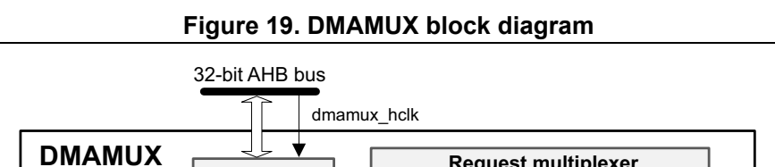
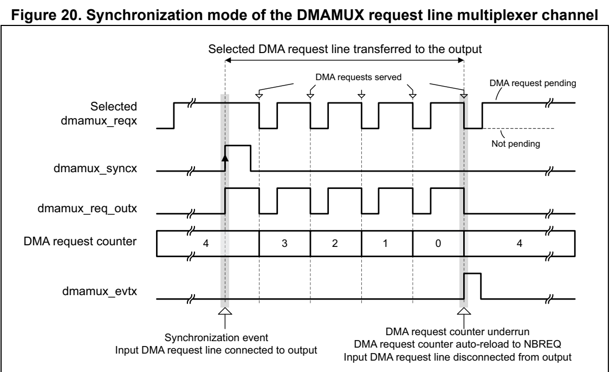
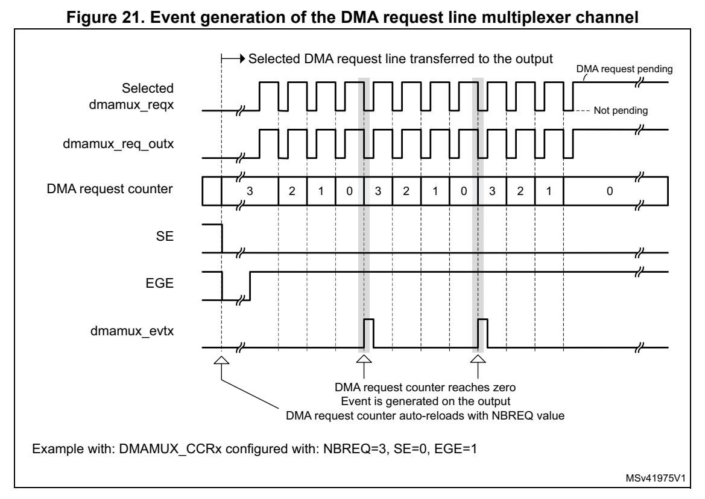

# 10 DMA request multiplexer (DMAMUX) (pp. 234-249)

## 10 DMA request multiplexer (DMAMUX) (p. 234)

### 10.1 Introduction (p. 234)

A peripheral indicates a request for DMA transfer by setting its DMA request signal. The DMA request is pending until it i s served by the DMA controller that generates a DMA acknowledge signal, and the corresponding DMA request signal is deasserted.

In this document, the set of con trol signals required for the D MA request/acknowledge protocol is not explicitly shown or described, and it is referred to as DMA request line.

The DMAMUX request mu ltiplexer enables rout ing a DMA request li ne between the peripherals and the DMA controlle rs of the product. The routing function is ensured by a programmable multi-channel DMA request line multiplexer. Each c hannel selects a unique DMA request line, unconditionally or synchronously with events from its DMAMUX synchronization inputs. The DMAMUX may also be used as a DMA re quest generator from programmable events on its input trigger signals.

The number of DMAMUX instances an d their main characteristics a re specified in Section 10.3.1.

The assignment of DMAMUX request multiplexer inputs to the DMA request lines from peripherals and to the DMAMUX request generator outputs, the as signment of DMAMUX request multiplexer outputs to D MA controller channels, and the assignment of DMAMUX synchronizations and trigger inpu ts to internal and external si gnals depend on the product implementation, and are detailed in Section 10.3.2.

### 10.2 DMAMUX main features (p. 235)

- up to 12-channel programmable DM A request line mu ltiplexer outp ut

- 4-channel DMA request generator

- 21 trigger inputs to DMA request generator

- 21 synchronization inputs

- Per DMA request generator channel: – DMA request trigger input selector – DMA request counter – Event overrun flag for selected DMA request trigger input

- Per DMA request line mult iplexer channel output: – up to 55 input DMA request lines from peripherals – One DMA request line output – Synchronization input selector – DMA request counter – Event overrun flag for sele cted synchronization input – One event output, for DMA request chaining

### 10.3 DMAMUX implementation (p. 235)

#### 10.3.1 DMAMUX instantiation (p. 235)

DMAMUX is instantiated with the hardware configuration paramete rs listed in the following table.

Table 38. DMAMUX instantiation

Feature DMAMUX

Number of DMAMUX output request channels 12/7/5 (1)

Number of DMAMUX reque st generator channels 4

Number of DMAMUX request trigger inputs 23

Number of DMAMUX synchronization inputs 23 Number of DMAMUX peripheral request inputs up to 55 (2)

1. 12 for STM32G0B0xx, seven for STM32G070xx as well as for STM3 2G050xx, and five for STM32G030xx devices. 2. Depending on peripherals available on the device.

#### 10.3.2 DMAMUX mapping (p. 235)

The mapping of resources to DMAMUX is hardwired.

**Table 39. DMAMUX: assignment of multiplexer inputs to resources (p. 236)**

| DMA request MUX input | Resource | DMA request MUX input | Resource | DMA request MUX input | Resource |
| --- | --- | --- | --- | --- | --- |
|  |  |  | 1 dmamux_req_gen0 27 Reserved 53 USART2_TX |  |  |
|  |  |  | 2 dmamux_req_gen1 28 Reserved 54 USART3_RX |  |  |
|  |  |  | 3 dmamux_req_gen2 29 Reserved 55 USART3_TX |  |  |
|  |  |  | 4 dmamux_req_gen3 30 Reserved 56 USART4_RX |  |  |
|  |  |  | 5 ADC 31 Reserved 57 USART4_TX |  |  |
|  |  |  | 6 Reserved 32 TIM3_CH1 58 Reserved |  |  |
|  |  |  | 7 Reserved 33 TIM3_CH2 59 Reserved |  |  |
|  |  |  | 8 Reserved 34 TIM3_CH3 60 Reserved |  |  |
|  |  |  | 9 Reserved 35 TIM3_CH4 61 Reserved |  |  |
|  |  |  | 10 I2C1_RX 36 TIM3_TRIG 62 I2C3_RX |  |  |
|  |  |  | 11 I2C1_TX 37 TIM3_UP 63 I2C3_TX |  |  |
|  |  |  | 12 I2C2_RX 38 TIM6_UP 64 Reserved |  |  |
|  |  |  | 13 I2C2_TX 39 TIM7_UP 65 Reserved |  |  |
|  |  |  | 14 Reserved 40 TIM15_CH1 66 SPI3_RX |  |  |
|  |  |  | 15 Reserved 41 TIM15_CH2 67 SPI3_TX |  |  |
|  |  |  | 16 SPI1_RX 42 TIM15_TRIG_COM 68 TIM4_CH1 |  |  |
|  |  |  | 17 SPI1_TX 43 TIM15_UP 69 TIM4_CH2 |  |  |
|  |  |  | 18 SPI2_RX 44 TIM16_CH1 70 TIM4_CH3 |  |  |
|  |  |  | 19 SPI2_TX 45 TIM16_COM 71 TIM4_CH4 |  |  |
|  |  |  | 20 TIM1_CH1 46 TIM16_UP 72 TIM4_TRIG |  |  |
|  |  |  | 21 TIM1_CH2 47 TIM17_CH1 73 TIM4_UP |  |  |
|  |  |  | 22 TIM1_CH3 48 TIM17_COM 74 USART5_RX |  |  |
|  |  |  | 23 TIM1_CH4 49 TIM17_UP 75 USART5_TX |  |  |
|  |  |  | 24 TIM1_TRIG_COM 50 USART1_RX 76 USART6_RX |  |  |
|  |  |  | 25 TIM1_UP 51 USART1_TX 77 USART6_TX |  |  |
|  |  |  | 26 Reserved 52 USART2_RX - - |  |  |

**Table 40. DMAMUX: assignment of trigger inputs to resources (pp. 236-237)**

| Trigger input Resource Trigger input Resource | Col 4 |
| --- | --- |
|  | 0 EXTI LINE0 12 EXTI LINE12 |
|  | 1 EXTI LINE1 13 EXTI LINE13 |
|  | 2 EXTI LINE2 14 EXTI LINE14 |
|  | 3 EXTI LINE3 15 EXTI LINE15 |
|  | 4 EXTI LINE4 16 dmamux_evt0 |
|  | 5 EXTI LINE5 17 dmamux_evt1 |
|  | 6 EXTI LINE6 18 dmamux_evt2 |
|  | 7 EXTI LINE7 19 dmamux_evt3 |
| 8 EXTI LINE8 20 Reserved | 8 EXTI LINE8 20 Reserved |
| 9 EXTI LINE9 21 Reserved | 9 EXTI LINE9 21 Reserved |
| 10 EXTI LINE10 22 TIM14_OC | 10 EXTI LINE10 22 TIM14_OC |
| 11 EXTI LINE11 23 Reserved | 11 EXTI LINE11 23 Reserved |

**Table 41. DMAMUX: assignment of synchronization inputs to resou rces (p. 237)**

| Sync. input Resource Sync. input Resource | Col 3 |
| --- | --- |
|  | 0 EXTI LINE0 12 EXTI LINE12 |
|  | 1 EXTI LINE1 13 EXTI LINE13 |
|  | 2 EXTI LINE2 14 EXTI LINE14 |
|  | 3 EXTI LINE3 15 EXTI LINE15 |
|  | 4 EXTI LINE4 16 dmamux_evt0 |
|  | 5 EXTI LINE5 17 dmamux_evt1 |
|  | 6 EXTI LINE6 18 dmamux_evt2 |
|  | 7 EXTI LINE7 19 dmamux_evt3 |
| 8 EXTI LINE8 20 Reserved | 8 EXTI LINE8 20 Reserved |
| 9 EXTI LINE9 21 Reserved | 9 EXTI LINE9 21 Reserved |
| 10 EXTI LINE10 22 TIM14_OC | 10 EXTI LINE10 22 TIM14_OC |
| 11 EXTI LINE11 23 Reserved | 11 EXTI LINE11 23 Reserved |

### 10.4 DMAMUX functional description (p. 238)

#### 10.4.1 DMAMUX block diagram (p. 238)

Figure 19 shows the DMAMUX block diagram.

*Figure 19. DMAMUX block diagram (p. 238)*

AHB slave interface Channel m DMAMUX_CmCR

Channel 1 p Channel 0 DMA requests DMAMUX_C0CR from peripherals:dmamux_req_inx 01 dmamux_reqx n+p+2 selectChannel Ctrl m DMA requests 1 to DMA controllers: Request generator 0 dmamux_req_outx n+3 Channel n n DMAMUX_RGCnCR n+2 Sync m DMA channels 1 events: n+1 0 DMAMUX_RGC1CRDMAMUX_RGC0CRChannel 1Channel 0 01 dmamux_req_genx 21 s 1 0 dmamux_evtx

Interrupt interface t 1 0 s 1 0

Control registers Trigger inputs: Interrupt: Synchronization inputs: dmamux_trgx dmamux_ovr_it dmamux_syncx MSv39745V1

DMAMUX features two main sub-blocks: the request line multiplexer and the request line generator.

The implementation assigns:

- DMAMUX request multiplexer sub-block inputs (dmamux_reqx) from peripherals (dmamux_req_inx) and from channel s of the DMAMUX request generator sub-block (dmamux_req_genx)

- DMAMUX request outputs to chann els of DMA controllers (dmamux_req_outx)

- Internal or external signals to D MA request trigger inputs (dma mux_trgx)

- Internal or external signals to s ynchronization inputs (dmamux_syncx)

#### 10.4.2 DMAMUX signals (p. 239)

Table 42 lists the DMAMUX signals.

**Table 42. DMAMUX signals (p. 239)**

| Col 1 | Signal name Description |
| --- | --- |
|  | dmamux_hclk DMAMUX AHB clock |
|  | dmamux_req_inx DMAMUX DMA reques t line inputs from peripherals |
|  | dmamux_trgx DMAMUX DMA request triggers inputs (to request generator sub-block) |
|  | dmamux_req_genx DMAMUX request ge nerator sub-block channels outp uts |
| dmamux_reqx | DMAMUX request multiplexer sub- block inputs (from peripheral requests and request generator channels) |
|  | dmamux_syncx DMAMUX synchronizati on inputs (to requ est multiplexer sub-block) |
|  | dmamux_req_outx DMAMUX requests outputs (to DMA controllers) |
| dmamux_evtx DMAMU | X events outputs |
|  | dmamux_ovr_it DMAMUX overrun interrupts |

#### 10.4.3 DMAMUX channels (p. 239)

A DMAMUX channel is a DMAMUX req uest multiplexer channel that m ay include, depending on the selected input of the request multiplexer, an additional DMAM UX request generator channel.

A DMAMUX request multiplexer channel is connected and dedicated to one single channel of DMA controller(s).

Channel configuration procedure

Follow the sequence be low to configure both a DMAMUX x channel and the related DMA channel y: 1. Set and configure completely the DMA channel y, except enabli ng the channel y. 2. Set and configure completely the related DMAMUX y channel. 3. Last, activate the DMA channel y by setting the EN bit in th e DMA y channel register.

#### 10.4.4 DMAMUX request line multiplexer (p. 239)

The DMAMUX request mult iplexer with its mult iple channels ensures the actual routing of DMA request/acknowledge control signals, named DMA request line s.

Each DMA request line is connected in parallel to all the chann els of the DMAMUX request line multiplexer.

A DMA request is sourced either from the peripherals or from th e DMAMUX request generator.

The DMAMUX request line multiplexer ch annel x selects the DMA request line number as configured by the DMAREQ_ID fiel d in the DMAMUX_CxCR register.

Note: The null value in the field DMAREQ_ID corresponds to no DMA request line selected.

Caution: A same non-null DMAREQ_ID can be assigned to two different chan nels only if the application ensures that these channels are not requested to be served at the same time. In other words, if two different cha nnels receive a same asserted hardware re quest at the same time, an unpredictable DM A hardware behavior occurs.

On top of the DMA request selection, the synchronization mode a nd/or the event generation may be configured and enabled, if required.

Synchronization mode and channel event generation

Each DMAMUX request line multip lexer channel x can be individua lly synchronized by setting the synchronization enable (SE) bit in the DMAMUX_CxCR register.

DMAMUX has multiple synchronization inputs. The synchronization inputs are connected in parallel to all the channels of the request multiplexer.

The synchronization input is selected via the SYNC_ID field in the DMAMUX_CxCR register of a given channel x.

When a channel is in this synchronization mode, the selected in put DMA request line is propagated to the multiplexer ch annel output, once is detected a programmable rising/falling edge on the selected input synchronization signa l, via the SPOL[1:0] field of the DMAMUX_CxCR register.

Additionally, there is a programmable DMA request counter, inte rnally to the DMAMUX request multiplexer, which may be used for the channel request output generation and also possibly for an event generation. An event generation on the ch annel x output is enabled through the EGE bit (event generation enable) of the DMAMUX_CxC R register.

As shown in Figure 21, upon the detected edge of the synchronization input, the pend ing selected input DMA request line is connected to the DMAMUX mult iplexer channel x output.

Note: If a synchronization event occurs while there is no pending selected input DMA request line, it is discarded. The following asserted input request lines is not connected to the DMAMUX multiplexer channel output until a synchronization event occurs again.

From this point on, each time the connected DMAMUX request is s erved by the DMA controller (a served request is deasserted), the DMAMUX request counter is decremented. At its underrun, the DMA request counter is autom atically loade d with the value in NBREQ field of the DMAMUX_CxCR register and the input DMA request lin e is disconnected from the multiplexer channel x output.

Thus, the number of DMA requests transferred to the multiplexer channel x output following a detected synchronization event, is equal to the value in NBRE Q field, plus one.

Note: The NBREQ field value shall only be written by software when both synchronization enable bit SE and event generation enable EGE bit of the corresponding multiplexer channel x are disabled.

*Figure 20. Synchronization mode of the DMAMUX request line mult iplexer channel (p. 241)*

Example: DMAMUX_CCRx configured with: NBREQ=4, SE=1, EGE=1, SPOL=01 (rising edge)

MSv41974V1

*Figure 21. Event generation of the DMA request line multiplexer channel (p. 241)*

If EGE is enabled, the multiplexer channel generates a channel event, as a pulse of one AHB clock cycle, when its DMA re quest counter is automatically reloaded with the value of the programmed NBREQ field, as shown in Figure 20 and Figure 21.

Note: If EGE is enabled and NBREQ = 0, an even t is generated after each served DMA request.

Note: A synchronization event (edge) is detected if the state following the edge remains stable for more than two AHB clock cycles.

Upon writing into DMAMUX_CxCR register, the synchronization events are masked during three AHB clock cycles.

Synchronization overrun and interrupt

If a new synchronization event occurs before the request counte r underrun (the internal request counter programmed via t he NBREQ field of the DMAMUX_CxCR register), the synchronization overrun flag bit SOFx is set in the DMAMUX_CSR status register.

Note: The request multiplexer channel x synchronization must be disabled (DMAMUX_CxCR.SE = 0) at the completion of the use of the related channel of the DMA controller. Else, upon a new detected synchronization event, there is a synchronization overrun due to the absence of a DMA acknowledge (that is, no served request) received from the DMA controller.

The overrun flag SOFx is reset by setting the as sociated clear synchronization overrun flag bit CSOFx in the DMAMUX_CFR register.

Setting the synchronization overrun flag generates an interrupt if the synchronization overrun interrupt enable bit SOIE is set in the DMAMUX_CxCR reg ister.

#### 10.4.5 DMAMUX request generator (p. 242)

The DMAMUX request generator produces DMA requests following trigger events on its DMA request trigger inputs.

The DMAMUX request generator has multiple channels. DMA request trigger inputs are connected in paralle l to all channels.

The outputs of DMAMUX request gen erator channels are inputs to the DMAMUX request line multiplexer.

Each DMAMUX request generator channel x has an enable bit GE (g enerator enable) in the corresponding DMAMUX_RGxCR register.

The DMA request trigger input for the DMAMUX request generator channel x is selected through the SIG_ID (trigger signal ID) field in the correspondi ng DMAMUX_RGxCR register.

Trigger events on a DMA request trigger input can be rising edg e, falling ed ge or either edge. The active edge is selecte d through the GPOL (generator p olarity) fie ld in the corresponding DMAMUX_RGxCR register.

Upon the trigger event, the corresponding generator channel sta rts generating DMA requests on its output. Each ti me the DMAMUX generated request is served by the connected DMA controller (a served request is deasserted), a bu ilt-in (inside the DMAMUX request generator) DMA request counter is decremented. At its u nderrun, the request generator channel stops generatin g DMA requests and the DMA req uest counter is automatically reloaded to its programmed value upon the next trigger event.

Thus, the number of DMA requests generated after the trigger event is GNBREQ + 1.

Note: The GNBREQ field value must be written by software only when the enable GE bit of the corresponding generator channel x is disabled. A trigger event (edge) is detected if the state following the edge remains stable for more than two AHB clock cycles. Upon writing into DMAMUX_RGxCR register, the trigger events are masked during three AHB clock cycles.

Trigger overrun and interrupt

If a new DMA request trigger even t occurs before the DMAMUX req uest generator counter underrun (the internal counter programmed via the GNBREQ field of the DMAMUX_RGxCR register), and if the request g enerator channel x was enabled v ia GE, then the request trigger event overrun flag bit O Fx is asserted by the hardware in the status DMAMUX_RGSR register.

Note: The request generator channel x must be disabled (DMAMUX_RGxCR.GE = 0) at the completion of the usage of the related channel of the DMA controller. Else, upon a new detected trigger event, there is a trigger overrun due to the absence of an acknowledge (that is, no served request) received from the DMA.

The overrun flag OFx is reset by setting the asso ciated clear overrun flag bit COFx in the DMAMUX_RGCFR register.

Setting the DMAMUX request trigg er overrun flag generates an in terrupt if the DMA request trigger event overrun interrupt enable bit OIE is set in the DM AMUX_RGxCR register.

### 10.5 DMAMUX interrupts (p. 243)

An interrupt can be generated upon:

- a synchronization event overrun in each DMA request line multip lexer channel

- a trigger event overrun in each DMA request generator channel

For each case, per-channel individual interrupt enable, status and clear flag register bits are available.

**Table 43. DMAMUX interrupts (p. 243)**

| Interrupt si | gnal Interrupt event Event | flag Clear bit Enable bit |
| --- | --- | --- |
| dmamuxovr_it | Synchronization event overrun on channel x of the DMAMUX request line multiplexer | SOFx CSOFx SOIE |
| dmamuxovr_it | Trigger event overrun on channel x of the DMAMUX request generator | OFx COFx OIE |

### 10.6 DMAMUX registers (p. 244)

Refer to the table containing register boundary addresses for t he DMAMUX base address.

DMAMUX registers may be accessed per (8-bit) byte, (16-bit) hal f-word, or (32-bit) word. The address must be ali gned with the data size.

### 10.6.1 [DMAMUX.DMAMUX_CxCR] Offset: 0x000 | Reset: 0x00000000 (p. 244)

Address offset: 0x000 + 0x04 * x (x = 0 to 11)

Reset value: 0x0000 0000

Bits 31:29 Reserved, must be kept at reset value.

Bits 28:24 SYNC_ID[4:0]: Synchronizatio n identification Selects the synchronization input (see Table 41: DMAMUX: assignme nt of synchronization inputs to resources).

Bits 23:19 NBREQ[4:0]: Number of DMA requests minus 1 to forward Defines the number of DMA requests to forward to the DMA contro ller after a synchronization event, and/or the number of DMA requests before an output event is generated. This field shall only be written when both SE and EGE bits are low.

Bits 18:17 SPOL[1:0]: Synchronization polarity Defines the edge polarity of the selected synchronization input: 00: No event, i.e. no synchronization nor detection. 01: Rising edge 10: Falling edge 11: Rising and falling edges

Bit 16 SE: Synchronization enable 0: synchronization disabled 1: synchronization enabled

Bits 15:10 Reserved, must be kept at reset value.

Bit 9 EGE: Event generation enable 0: event generation disabled 1: event generation enabled

Bit 8 SOIE: Synchronization overrun interrupt enable 0: interrupt disabled 1: interrupt enabled

Bit 7 Reserved, must be kept at reset value.

Bits 6:0 DMAREQ_ID[6:0]: DMA request identification Selects the input DMA request. Se e the DMAMUX table about assig nments of multiplexer inputs to resources.

### 10.6.2 [DMAMUX.DMAMUX_CSR] Offset: 0x080 | Reset: 0x00000000 (p. 245)

Address offset: 0x080

Reset value: 0x0000 0000

Bits 31:12 Reserved, must be kept at reset value.

Bits 11:0 SOF[11:0]: Synchronization overrun event flag The flag is set when a synchronization even t occurs on a DMA re quest line multiplexer channel x, while the DMA request counter value is lower than NB REQ. The flag is cleared by writing 1 to the corresp onding CSOFx bit in DMAMUX_CFR register.

### 10.6.3 [DMAMUX.DMAMUX_CFR] Offset: 0x084 | Reset: 0x00000000 (p. 245)

Address offset: 0x084

Reset value: 0x0000 0000

Bits 31:12 Reserved, must be kept at reset value.

Bits 11:0 CSOF[11:0]: Clear synchronization overrun event flag Writing 1 in each bit clears the corresponding overrun flag SOFx in the DMAMUX_CSR register.

### 10.6.4 [DMAMUX.DMAMUX_RGxCR] Offset: 0x100 | Reset: 0x00000000 (p. 246)

Address offset: 0x100 + 0x04 * x (x = 0 to 3)

Reset value: 0x0000 0000

Bits 31:24 Reserved, must be kept at reset value.

Bits 23:19 GNBREQ[4:0]: Number of DMA requests to be generated (minus 1) Defines the number of DMA reque sts to be generate d after a trig ger event. The actual number of generated DMA requests is GNBREQ +1. Note: This field must be written only when GE bit is disabled.

Bits 18:17 GPOL[1:0]: DMA request generator trigger polarity Defines the edge polarity of the selected trigger input 00: No event, i.e. no trigg er detection nor generation. 01: Rising edge 10: Falling edge 11: Rising and falling edges

Bit 16 GE: DMA request generator channel x enable 0: DMA request generator channel x disabled 1: DMA request generator channel x enabled

Bits 15:9 Reserved, must be kept at reset value.

Bit 8 OIE: Trigger overrun interrupt enable 0: Interrupt on a trigger ove rrun event occurrence is disabled 1: Interrupt on a trigger ove rrun event occurrence is enabled

Bits 7:5 Reserved, must be kept at reset value.

Bits 4:0 SIG_ID[4:0]: Signal identification Selects the DMA request trigger input used for the channel x of the DMA request generator

### 10.6.5 [DMAMUX.DMAMUX_RGSR] Offset: 0x140 | Reset: 0x00000000 (p. 247)

Address offset: 0x140

Reset value: 0x0000 0000

Bits 31:4 Reserved, must be kept at reset value.

Bits 3:0 OF[3:0]: Trigger overrun event flag The flag is set when a new trigger event occurs on DMA request generator channel x, before the request counter underrun (t he internal request counter prog rammed via t he GNBREQ field of the DMAMUX_RGxCR register). The flag is cleared by writing 1 to the corresp onding COFx bit in the DMAMUX_RGCFR register.

### 10.6.6 [DMAMUX.DMAMUX_RGCFR] Offset: 0x144 | Reset: 0x00000000 (p. 247)

Address offset: 0x144

Reset value: 0x0000 0000

Bits 31:4 Reserved, must be kept at reset value.

Bits 3:0 COF[3:0]: Clear trigger overrun event flag Writing 1 in each bit clears the corresponding overrun flag OFx in the DMAMUX_RGSR register.

#### 10.6.7 DMAMUX register map (p. 248)

The following table summarizes th e DMAMUX registers and reset values. Refer to the register boundary address table for the DMAMUX register base ad dress.

**Table 44. DMAMUX register map and reset values (p. 248)**

| Col 1 | Offset Register | 31 | 30 | 29 | 28 | 27 | 26 | 25 | 24 | 23 | 22 | 21 | 20 | 19 | 18 | 17 | 16 | 15 | 14 | 13 | 12 | 11 | 10 | 9 | 8 | 7 | 6 | 5 | 4 | 3 | 2 | 1 | 0 |
| --- | --- | --- | --- | --- | --- | --- | --- | --- | --- | --- | --- | --- | --- | --- | --- | --- | --- | --- | --- | --- | --- | --- | --- | --- | --- | --- | --- | --- | --- | --- | --- | --- | --- |
| 0x000 | DMAMUX_C0CR | Res. | Res. | Res. |  |  |  |  | SYNC_ID[4:0] NBREQ[4:0] | SYNC_ID[4:0] NBREQ[4:0] |  |  |  |  | SPOL | [1:0] | SE | Res. | Res. | Res. | Res. | Res. | Res. | EGE | SOIE | Res. |  |  |  | DMAREQ_ID[6:0] |  |  |  |

Reset value 0 0 0 0 0 0 0 0 0 0 0 0 0 0 0 0 0 0 0 0 0 0 0x004 DMAMUX_C1CR Res. Res. Res. SYNC_ID[4:0] NBREQ[4:0] SPOL [1:0] SE Res. Res. Res. Res. Res. Res. EGE SOIE Res. DMAREQ_ID[6:0] Reset value 0 0 0 0 0 0 0 0 0 0 0 0 0 0 0 0 0 0 0 0 0 0 0x008 DMAMUX_C2CR Res. Res. Res. SYNC_ID[4:0] NBREQ[4:0] SPOL [1:0] SE Res. Res. Res. Res. Res. Res. EGE SOIE Res. DMAREQ_ID[6:0] Reset value 0 0 0 0 0 0 0 0 0 0 0 0 0 0 0 0 0 0 0 0 0 0 0x00C DMAMUX_C3CR Res. Res. Res. SYNC_ID[4:0] NBREQ[4:0] SPOL [1:0] SE Res. Res. Res. Res. Res. Res. EGE SOIE Res. DMAREQ_ID[6:0] Reset value 0 0 0 0 0 0 0 0 0 0 0 0 0 0 0 0 0 0 0 0 0 0 0x010 DMAMUX_C4CR Res. Res. Res. SYNC_ID[4:0] NBREQ[4:0] SPOL [1:0] SE Res. Res. Res. Res. Res. Res. EGE SOIE Res. DMAREQ_ID[6:0] Reset value 0 0 0 0 0 0 0 0 0 0 0 0 0 0 0 0 0 0 0 0 0 0 0x014 DMAMUX_C5CR Res. Res. Res. SYNC_ID[4:0] NBREQ[4:0] SPOL [1:0] SE Res. Res. Res. Res. Res. Res. EGE SOIE Res. DMAREQ_ID[6:0] Reset value 0 0 0 0 0 0 0 0 0 0 0 0 0 0 0 0 0 0 0 0 0 0 0x018 DMAMUX_C6CR Res. Res. Res. SYNC_ID[4:0] NBREQ[4:0] SPOL [1:0] SE Res. Res. Res. Res. Res. Res. EGE SOIE Res. DMAREQ_ID[6:0] Reset value 0 0 0 0 0 0 0 0 0 0 0 0 0 0 0 0 0 0 0 0 0 0 0x01C DMAMUX_C7CR Res. Res. Res. SYNC_ID[4:0] NBREQ[4:0] SPOL [1:0] SE Res. Res. Res. Res. Res. Res. EGE SOIE Res. DMAREQ_ID[6:0] Reset value 0 0 0 0 0 0 0 0 0 0 0 0 0 0 0 0 0 0 0 0 0 0 0x020 DMAMUX_C8CR Res. Res. Res. SYNC_ID[4:0] NBREQ[4:0] SPOL [1:0] SE Res. Res. Res. Res. Res. Res. EGE SOIE Res. DMAREQ_ID[6:0] Reset value 0 0 0 0 0 0 0 0 0 0 0 0 0 0 0 0 0 0 0 0 0 0 0x024 DMAMUX_C9CR Res. Res. Res. SYNC_ID[4:0] NBREQ[4:0] SPOL [1:0] SE Res. Res. Res. Res. Res. Res. EGE SOIE Res. DMAREQ_ID[6:0] Reset value 0 0 0 0 0 0 0 0 0 0 0 0 0 0 0 0 0 0 0 0 0 0 0x028 DMAMUX_C10CR Res. Res. Res. SYNC_ID[4:0] NBREQ[4:0] SPOL [1:0] SE Res. Res. Res. Res. Res. Res. EGE SOIE Res. DMAREQ_ID[6:0] Reset value 0 0 0 0 0 0 0 0 0 0 0 0 0 0 0 0 0 0 0 0 0 0 0x02C DMAMUX_C11CR Res. Res. Res. SYNC_ID[4:0] NBREQ[4:0] SPOL [1:0] SE Res. Res. Res. Res. Res. Res. EGE SOIE Res. DMAREQ_ID[6:0] Reset value 0 0 0 0 0 0 0 0 0 0 0 0 0 0 0 0 0 0 0 0 0 0

| 0x030-0x07C | Reserved | Res. | Res. | Res. | Res. | Res. | Res. | Res. | Res. | Res. | Res. | Res. | Res. | Res. | Res. | Res. | Res. | Res. | Res. | Res. | Res. | Res. | Res. | Res. | Res. | Res. | Res. | Res. | Res. | Res. | Res. | Res. | Res. |
| --- | --- | --- | --- | --- | --- | --- | --- | --- | --- | --- | --- | --- | --- | --- | --- | --- | --- | --- | --- | --- | --- | --- | --- | --- | --- | --- | --- | --- | --- | --- | --- | --- | --- |
| 0x080 | DMAMUX_CSR | Res. | Res. | Res. | Res. | Res. | Res. | Res. | Res. | Res. | Res. | Res. | Res. | Res. | Res. | Res. | Res. | Res. | Res. | Res. | Res. | SOF11 | SOF10 | SOF9 | SOF8 | SOF7 | SOF6 | SOF5 | SOF4 | SOF3 | SOF2 | SOF1 | SOF0 |

Reset value 000000000000 0x084 DMAMUX_CFR Res. Res. Res. Res. Res. Res. Res. Res. Res. Res. Res. Res. Res. Res. Res. Res. Res. Res. Res. Res. CSOF11 CSOF10 CSOF9 CSOF8 CSOF7 CSOF6 CSOF5 CSOF4 CSOF3 CSOF2 CSOF1 CSOF0 Reset value 000000000000

| 0x088 -0x0FC | Reserved | Res. | Res. | Res. | Res. | Res. | Res. | Res. | Res. | Res. | Res. | Res. | Res. | Res. | Res. | Res. | Res. | Res. | Res. | Res. | Res. | Res. | Res. | Res. | Res. | Res. | Res. | Res. | Res. | Res. | Res. | Res. | Res. |
| --- | --- | --- | --- | --- | --- | --- | --- | --- | --- | --- | --- | --- | --- | --- | --- | --- | --- | --- | --- | --- | --- | --- | --- | --- | --- | --- | --- | --- | --- | --- | --- | --- | --- |
| 0x100 | DMAMUX_RG0CR | Res. | Res. | Res. | Res. | Res. | Res. | Res. | Res. |  |  | GNBREQ[4:0] |  |  | GPOL | [1:0] | GE | Res. | Res. | Res. | Res. | Res. | Res. | Res. | OIE | Res. | Res. | Res. |  |  | SIG_ID[4:0] |  |  |

Reset value 0 0 0 0 0 0 0 0 0 0 0 0 0 0

**Table 44. DMAMUX register map and reset values (p. 249)**

| Col 1 | Offset Register | 31 | 30 | 29 | 28 | 27 | 26 | 25 | 24 | 23 | 22 | 21 | 20 | 19 | 18 | 17 | 16 | 15 | 14 | 13 | 12 | 11 | 10 | 9 | 8 | 7 | 6 | 5 | 4 | 3 | 2 | 1 | 0 |
| --- | --- | --- | --- | --- | --- | --- | --- | --- | --- | --- | --- | --- | --- | --- | --- | --- | --- | --- | --- | --- | --- | --- | --- | --- | --- | --- | --- | --- | --- | --- | --- | --- | --- |
| 0x104 | DMAMUX_RG1CR | Res. | Res. | Res. | Res. | Res. | Res. | Res. | Res. |  |  | GNBREQ[4:0] |  |  | GPOL | [1:0] | GE | Res. | Res. | Res. | Res. | Res. | Res. | Res. | OIE | Res. | Res. | Res. |  |  | SIG_ID[4:0] |  |  |

Reset value 0 0 0 0 0 0 0 0 0 0 0 0 0 0 0x108 DMAMUX_RG2CR Res. Res. Res. Res. Res. Res. Res. Res. GNBREQ[4:0] GPOL [1:0] GE Res. Res. Res. Res. Res. Res. Res. OIE Res. Res. Res. SIG_ID[4:0] Reset value 0 0 0 0 0 0 0 0 0 0 0 0 0 0 0x10C DMAMUX_RG3CR Res. Res. Res. Res. Res. Res. Res. Res. GNBREQ[4:0] GPOL [1:0] GE Res. Res. Res. Res. Res. Res. Res. OIE Res. Res. Res. SIG_ID[4:0] Reset value 0 0 0 0 0 0 0 0 0 0 0 0 0 0

| 0x110 -0x13C | Reserved | Res. | Res. | Res. | Res. | Res. | Res. | Res. | Res. | Res. | Res. | Res. | Res. | Res. | Res. | Res. | Res. | Res. | Res. | Res. | Res. | Res. | Res. | Res. | Res. | Res. | Res. | Res. | Res. | Res. | Res. | Res. | Res. |
| --- | --- | --- | --- | --- | --- | --- | --- | --- | --- | --- | --- | --- | --- | --- | --- | --- | --- | --- | --- | --- | --- | --- | --- | --- | --- | --- | --- | --- | --- | --- | --- | --- | --- |
| 0x140 | DMAMUX_RGSR | Res. | Res. | Res. | Res. | Res. | Res. | Res. | Res. | Res. | Res. | Res. | Res. | Res. | Res. | Res. | Res. | Res. | Res. | Res. | Res. | Res. | Res. | Res. | Res. | Res. | Res. | Res. | Res. | OF3 | OF2 | OF1 | OF0 |

Reset value 0000 0x144 DMAMUX_RGCFR Res. Res. Res. Res. Res. Res. Res. Res. Res. Res. Res. Res. Res. Res. Res. Res. Res. Res. Res. Res. Res. Res. Res. Res. Res. Res. Res. Res. COF3 COF2 COF1 COF0 Reset value 0000

| 0x148 -0x3FC | Reserved | Res. | Res. | Res. | Res. | Res. | Res. | Res. | Res. | Res. | Res. | Res. | Res. | Res. | Res. | Res. | Res. | Res. | Res. | Res. | Res. | Res. | Res. | Res. | Res. | Res. | Res. | Res. | Res. | Res. | Res. | Res. | Res. |
| --- | --- | --- | --- | --- | --- | --- | --- | --- | --- | --- | --- | --- | --- | --- | --- | --- | --- | --- | --- | --- | --- | --- | --- | --- | --- | --- | --- | --- | --- | --- | --- | --- | --- |
|  | Refer to |  |  |  | Section 2.2 on page 44 |  |  |  |  |  |  |  |  |  |  |  | for the register boundary addresses. |  |  |  |  |  |  |  |  |  |  |  |  |  |  |  |  |
