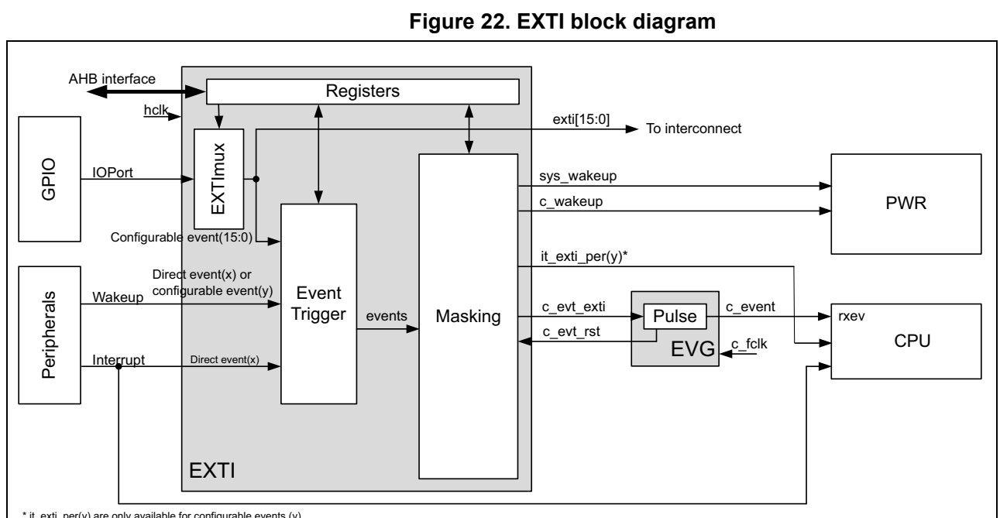
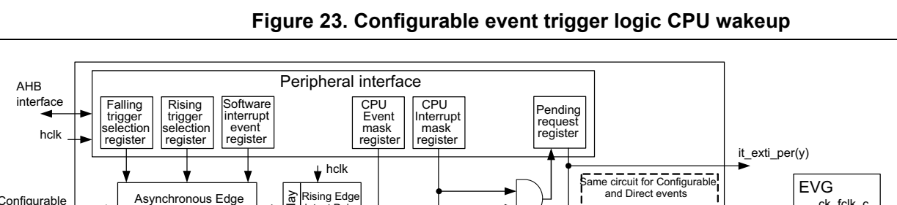
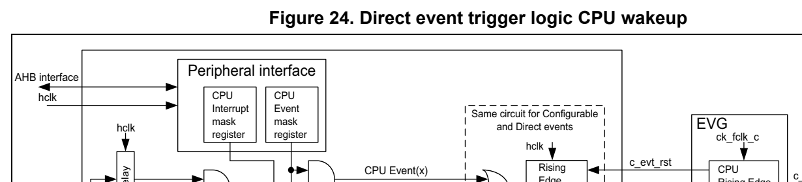
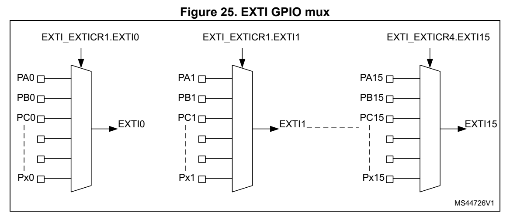

# 12 Extended interrupt and event controller (EXTI) (pp. 253-266)

## 12 Extended interrupt and event controller (EXTI) (p. 253)

The Extended interrupt and event controller (EXTI) manages the CPU and system wakeup through configurable and direct event inputs (lines). It provid es wakeup requests to the power control, and generates an interrupt request to the CPU NV IC and events to the CPU event input. For the CPU an additional event generation block ( EVG) is needed to generate the CPU event signal.

The EXTI wakeup requests allow t he system to be woken up from S top modes.

The interrupt request and event request generation can also be used in Run modes.

The EXTI also includes the EXTI I/O port mux.

### 12.1 EXTI main features (p. 253)

The EXTI main features are the following:

- System wakeup upon event on any input

- Wakeup flag and CPU interrupt generation for events not having a wakeup flag in their source peripheral

- Configurable events (from I/Os, peripherals not having an assoc iated interrupt pending status bit, or peripherals generating a pulse) – Selectable active trigger edge – Independent rising and falling edge interrupt pending status b its – Individual interrupt and event generation mask, used for condi tioning the CPU wakeup, interrupt and event generation – SW trigger possibility

- Direct events (from peripherals having an associated flag and i nterrupt pending status bit) – Fixed rising edge active trigger – No interrupt pending status bit in the EXTI – Individual interrupt and event generation mask for conditionin g the CPU wakeup and event generation – No SW trigger possibility

- I/O port selector

### 12.2 EXTI block diagram (p. 253)

The EXTI consists of a register block accessed via an AHB interface, the event input trigger block, the masking block, and EXTI mux as shown in Figure 22.

The register block contain s all the EXTI registers.

The event input trigger block provides an event input edge trig ger logic.

The masking block provides the e vent input distribution to the different wakeup, interrupt and event outputs, and the masking of these.

The EXTI mux provides the I/O p ort selection on to the EXTI eve nt signal.

*Figure 22. EXTI block diagram (p. 254)*

MS44733V2

**Table 46. EXTI signal overview (p. 254)**

| Col 1 | Col 2 | Signal name I/O Description |
| --- | --- | --- |
| AHB interface I/O |  | EXTI register bus interface. Wh en one event is co nfigured to al low security, the AHB interfa ce support secure accesses |
|  |  | hclk I AHB bus clock and EXTI system clock |
| Configurable event(y) | I | Asynchronous wakeup events from p eripherals that do not have an associated interrupt an d flag in the peripheral |
| Direct event(x) I |  | Synchronous and asynchronous wakeup events from peripherals hav ing an associated interrupt a nd flag in the peripheral |
|  | IOPort(n) I GPIO ports[15:0] |  |
|  |  | exti[15:0] O EXTI output port to trigger other IPs |
|  | it_exti_per (y) O Interrupts to t | he CPU associated with configura ble event (y) |
|  | c_evt_exti O High-level sensitive | event output for CPU synchronou s to hclk |
|  | c_evt_rst I Asynchronous reset | input to clear c_evt_exti |
|  |  | sys_wakeup O Asynchronous system wakeup request to PWR for ck_sys and hclk |
|  | c_wakeup O Wakeup request to PWR | c_wakeup O Wakeup request to PWR for CPU, synchronous to hclk |

**Table 47. EVG pin overview (p. 254)**

| Col 3 | Pin name I/O Description |
| --- | --- |
|  | c_fclk I CPU free-running clock |
| c_evt_in I High-level sensitive | event input from EXTI, asynchrono us to CPU clock |
|  | c_event O Event pulse, synchronous to CPU clock |
| c_evt_rst O Event reset sign | al, synchronous to CPU clock |

#### 12.2.1 EXTI connections between peripherals and CPU (p. 255)

The peripherals able to generate wakeup or interrupt events whe n the system is in Stop mode are connected to the EXTI.

- Peripheral wakeup signals that generate a pulse or that do not have an interrupt status bits in the peripheral, are con nect to an EXTI configurable lin e. For these events the EXTI provides a status pending bit which requires to be cleared. It is the EXT I interrupt associated with the status b it that interrupts the CPU.

- Peripheral interrupt and wakeup s ignals that have a status bit in the peripheral which requires to be cleared in the peripheral, are connected to an E XTI direct line. There is no status pending bit within the EXTI. The interrupt or wakeup is cleared by the CPU in the peripheral. It is the peripheral interrupt that interrupts the CPU directly.

- All GPIO ports input to the EXT I multiplexer, allowing to select a port to wake up the system via a configurable event.

The EXTI configurable event interrupts are connected to the NVI C(a) of the CPU.

The dedicated EXTI/EVG CPU even t is connected to the CPU rxev i nput.

The EXTI CPU wakeup signals are connected to the PWR block, and are used to wake up the system and CPU sub-system bus clocks.

### 12.3 EXTI functional description (p. 255)

Depending on the EXTI line type and wakeup target(s), different logic implementations are used. The applicable features and control or status registers a re:

- rising and falling edge event enable through – EXTI rising trigger selection register (EXTI_RTSR1) – EXTI falling trigger selection register 1 (EXTI_FTSR1)

- software trigger through EXTI software interrupt event register 1 (EXTI_SWIER1)

- pending interrupt flagging through – EXTI rising edge pending register 1 (EXTI_RPR1) – EXTI falling edge pending register 1 (EXTI_FPR1) – EXTI external interrupt selection register (EXTI_EXTICRx)

- CPU wakeup and interrupt enable through – EXTI CPU wakeup with interrupt mask register (EXTI_IMR1)

- CPU wakeup and event enable through – EXTI CPU wakeup with event mask register (EXTI_EMR1)

**Table 48. EXTI event input confi gurations and register control (p. 255)**

| Event input type | Logic implementation | EXTI_RTSR1 | EXTI_FTSR1 | EXTI_SWIER1 | EXTI_R/FPR1 | EXTI_IMR1 | EXTI_EMR1 |
| --- | --- | --- | --- | --- | --- | --- | --- |
|  | Configurable Configurable ev | ent input wakeup logic x x x x x x |  |  |  |  |  |
|  | Direct Direct event input wakeup logic - - - - x x |  |  |  |  |  |  |

#### 12.3.1 EXTI configurable event input wakeup (p. 256)

Figure 23 is a detailed repres entation of the logic associated with configurable event inputs which wake up the CPU sub-system bus clocks and generated an EXTI pending flag and interrupt to the CPU and or a CPU wakeup event.

*Figure 23. Configurable event trigger logic CPU wakeup (p. 256)*

detection circuit hclk Event input(y) generator rst (1) c_evt_rst CPU CPU Event(y) Rising c_event Edge Rising Edge Other CPU Events(x,y) detect rst c_evt_exti detect Pulse generator hclk

Other CPU Wakeups Synch c_wakeup CPU Wakeup(y) Other Wakeups sys_wakeup Wakeup(y) EXTI

MS46537V1

The software interrupt event register allows triggering configu rable events by software, writing the corresponding register bit, irrespective of the edg e selection setting.

The rising edge and falling edge selection registers allow to e nable and select the configurable event active trigger edge or both edges.

The CPU has its dedicated interrupt mask register and a dedicated event mask registers. The enabled event allows generating an event on the CPU. All events for a CPU are OR-ed together into a single CPU even t signal. The event pending regi sters (EXTI_RPR1 and EXTI_FPR1) is not set for an unmasked CPU event.

The configurable events have uni que interrupt pending request registers, shared by the CPU. The pending register is onl y set for an unmasked interrupt. Each configurable event provides a common interrupt to t he CPU. The configurable event interrupts need to be acknowledged by software in the EXTI_RPR1 and/or EXTI_FPR1 regi sters.

When a CPU interrupt or CPU even t is enabled, the asynchronous edge detection circuit is reset by the clocked delay and rising edge detect pulse generator. This guarantees the wakeup of the EXTI hclk clock before the asynchronous edge dete ction circuit is reset.

Note: A detected configurable event interrupt pe nding request can be cleared by the CPU. The system cannot enter low-power modes as long as an interrupt pending request is active.

#### 12.3.2 EXTI direct event input wakeup (p. 256)

Figure 24 is a detailed representation of the logic associated with dire ct event inputs waking up the system.

The direct events do not have an associated EXTI interrupt. The EXTI only wakes up the system and CPU sub-sys tem clocks and may generate a CPU wakeup event. The peripheral synchronous interrupt, associated with the direct wa keup event wakes up the CPU.

The EXTI direct event is able to generate a CPU event. This CPU event wakes up the CPU. The CPU event may occur before the interrupt flag of the associ ated peripheral is set.

*Figure 24. Direct event trigger logic CPU wakeup (p. 257)*

c_event Other CPU Events(x,y) detect rst c_evt_exti detect Pulse Direct generator Event Asynchronous input(x) hclk Rising Edge detect circuit rst CPU Wakeup(x) Synch c_wakeup Other CPU Wakeups Falling Edge detect sys_wakeup Pulse Other Wakeups generator Wakeup(x)

EXTI hclk

MS46536V1

#### 12.3.3 EXTI mux (p. 257)

The EXTI mux allows selecting GPI Os as interrupts and wakeup. T he GPIOs are connected via 16 EXTI mux lines to the first 16 EXTI events as configurab le event. The selection of GPIO port as EXTI mux outpu t is controlled through the EXTI external interrupt selection register (EXTI_EXTICRx) register.

*Figure 25. EXTI GPIO mux (p. 257)*

The EXTIs mux outputs are availa ble as output signals from the EXTI, to trigger other functional blocks. The EXTI mux outputs are available independe ntly of mask setting through the EXTI_IMR and EXTI_EMR registers.

The EXTI lines (event inputs) are connected as s hown in the fol lowing table.

Table 49. EXTI line connections

EXTI line Line source Line type

0-15 GPIO Configurable

16 Reserved -

17 Reserved -

18 Reserved -

19 RTC Direct

20 Reserved -

21 TAMP Direct

22 I2C2 wakeup Direct

23 I2C1 wakeup Direct

24 USART3 wakeup Direct

25 USART1 wakeup Direct

26 USART2 wakeup Direct

27 Reserved -

28 Reserved -

29 Reserved -

30 Reserved -

31 LSE_CSS Direct

32 Reserved -

33 Reserved -

### 12.4 EXTI functional behavior (p. 258)

The direct event inputs are enabl ed in the respective periphera l generating the wakeup event. The configurable events are enabled by enabling at least one of the trigger edges.

Once an event input is enabled, the generation of a CPU wakeup is conditioned by the CPU interrupt mask and CPU event mask.

**Table 50. Masking functionality (p. 258)**

| CPU interrupt enable EXTI_IMR.IMn | CPU event enable EXTI_EMR.EMn | Configurable event inputs EXTI_RPR.RPIFn EXTI_FPR.FPIFn | exti(n) (1) interrupt | CPU event | CPU wakeup |
| --- | --- | --- | --- | --- | --- |
| 0 |  |  | 0 No Masked Masked Masked |  |  |
| 0 |  |  | 1 No Masked Yes Yes |  |  |
| 1 |  | 0 Status latche |  | d Yes Masked Yes | (2) |
| 1 |  |  | 1 Status latched Yes Yes Yes |  |  |

1. The single exti(n) interrup t goes to the CPU. If no interrupt is required for CPU, the exti(n) interrupt must be masked in t he CPU NVIC.

2. Only if CPU interrupt is enabled in EXTI_IMR.IMn.

For configurable event inputs, upo n an edge on the event input, an event request is generated if t hat edge (rising or/and falling) i s enabled. When the associated CPU interrupt is unmasked, the corresponding RPIFn and/or FPIFn bit is/are set in the EXTI_RPR or/and EXTI_FPR register, waking up the CPU subsystem and activating C PU interrupt signal. The RPIFn and/or FPIFn pending bit is cleared by writi ng 1 to it, w hich clears the CPU interrupt request.

For direct event inputs, when enab led in the associated periphe ral, an event request is generated on the rising edge onl y. There is no corresponding CP U pending bit in the EXTI. When the associated CPU interrupt is unmasked, the correspondin g CPU subsystem is woken up. The CPU is woken up (interrupted) by the peripheral synchronous interrupt.

The CPU event must be unmasked to generate an event. Upon an en abled edge occurring on an event input, a CPU event p ulse is generated. There is no event pending bit.

For the configurable event inputs, the software can generate an event request by setting the corresponding bit of the software interrupt/event register EXTI _SWIER1, which has the effect of a rising edge on the event input. The pending rising edge event flag i s set in the EXTI_RPR1 register, irrespective of the EXTI_RTSR1 register setting.

### 12.5 EXTI registers (p. 259)

The EXTI register map is divi ded in the following sections:

Table 51. EXTI register map sections

Address Description

0x000 - 0x01C General configurab le event [31:0] configuration

0x060 - 0x06C EXTI I/O port multiplexer

0x080 - 0x0BC CPU input event configuration

All the registers can be accessed with word (32-bit), half-word (16-bit) and byte (8-bit) access.

### 12.5.1 [EXTI.EXTI_RTSR1] Offset: 0x000 | Reset: 0x00000000 (p. 259)

Address offset: 0x000

Reset value: 0x0000 0000

Contains only register bits for configurable events.

Res. Res. Res. Res. Res. Re s. Res. Res. Res. Res. Res. Res. Res. Res. Res. Res.

Bits 31:16 Reserved, must be kept at reset value.

Bits 15:0 RTx: Rising trigger event configuration bit of configurable line x (x = 15 to 0) (1) Each bit enables/disables the rising edge trigger for the event and interrupt on the corresponding line. 0: Disable 1: Enable

1. The configurable lines are ed ge triggered, no glitch must be generated on these inputs. If a rising edge on the configurabl e line occurs during writing of the register, the associ ated pending bit is not set. Rising edge trigger can be set fo r a line with falling edge tri gger enabled. In this case, both edges generate a trigger.

### 12.5.2 [EXTI.EXTI_FTSR1] Offset: 0x004 | Reset: 0x00000000 (p. 260)

Address offset: 0x004

Reset value: 0x0000 0000

Contains only register bits for configurable events.

Res. Res. Res. Res. Res. Re s. Res. Res. Res. Res. Res. Res. Res. Res. Res. Res.

Bits 31:16 Reserved, must be kept at reset value.

Bits 15:0 FTx: Falling trigger event configuration bit of configurable line x (x = 15 to 0) (1). Each bit enables/disables the falling edge trigger for the even t and interrupt on the corresponding line. 0: Disable 1: Enable

1. The configurable lines are ed ge triggered, no glitch must be generated on these inputs. If a falling edge on the configurable line occurs during writin g of the register, the associ ated pending bit is not set. Falling edge trigger can be set fo r a line with rising edge tri gger enabled. In this case, both edges generate a trigger.

### 12.5.3 [EXTI.EXTI_SWIER1] Offset: 0x008 | Reset: 0x00000000 (p. 260)

Address offset: 0x008

Reset value: 0x0000 0000

Contains only register bits for configurable events.

Res. Res. Res. Res. Res. Re s. Res. Res. Res. Res. Res. Res. Res. Res. Res. Res.

Bits 31:16 Reserved, must be kept at reset value.

Bits 15:0 SWIx: Software rising edge event t rigger on line x (x = 15 to 0) Setting of any bit by software t riggers a rising edge event on the corresponding line x, resulting in an interrupt, inde pendently of EXTI_RTSR1 and EXTI _FTSR1 settings. The bits are automatically cleared by HW. Reading of any bit always retu rns 0. 0: No effect 1: Rising edge event g enerated on the corresponding line, followed by an interrupt

### 12.5.4 [EXTI.EXTI_RPR1] Offset: 0x00C | Reset: 0x00000000 (p. 261)

Address offset: 0x00C

Reset value: 0x0000 0000

Contains only register bits for configurable events.

Bits 31:16 Reserved, must be kept at reset value.

Bits 15:0 RPIFx: Rising edge event pending for configurable line x (x = 15 to 0) Each bit is set upon a rising edge event generated by hardware or by software (through the EXTI_SWIER1 register) on the corresponding line. Each bit is cl eared by writing 1 into it. 0: No rising edge trigger request occurred 1: Rising edge trigger request occurred

### 12.5.5 [EXTI.EXTI_FPR1] Offset: 0x010 | Reset: 0x00000000 (p. 261)

Address offset: 0x010

Reset value: 0x0000 0000

Contains only register bits for configurable events.

Bits 31:16 Reserved, must be kept at reset value.

Bits 15:0 FPIFx: Falling edge event pending for co nfigurable line x (x = 15 to 0) Each bit is set upon a falling edge event generated by hardware or by software (through the EXTI_SWIER1 register) on the corresponding line. Each bit is cl eared by writing 1 into it. 0: No falling edge trigger request occurred 1: Falling edge trigger request occurred

### 12.5.6 [EXTI.EXTI_EXTICRx] Offset: 0x060 | Reset: 0x00000000 (p. 262)

Address offset: 0x060 + 0x4 * (x - 1), (x = 1 to 4)

Reset value: 0x0000 0000

EXTIm fields contain only the num ber of bits in line with the n b_ioport configuration.

Bits 31:24 EXTIm+3[7:0]: EXTIm+3 GPIO port selection (m = 4 * (x - 1)) These bits are written by softwa re to select the source input for EXTIm+3 external interrupt. 0x00: PA[m+3] pin 0x01: PB[m+3] pin 0x02: PC[m+3] pin 0x03: PD[m+3] pin 0x04: reserved 0x05: PF[m+3] pin Others reserved

Bits 23:16 EXTIm+2[7:0]: EXTIm+2 GPIO port selection (m = 4 * (x - 1)) These bits are written by softwa re to select the source input for EXTIm+2 external interrupt. 0x00: PA[m+2] pin 0x01: PB[m+2] pin 0x02: PC[m+2] pin 0x03: PD[m+2] pin 0x04: reserved 0x05: PF[m+2] pin Others reserved

Bits 15:8 EXTIm+1[7:0]: EXTIm+1 GPIO port selection (m = 4 * (x - 1)) These bits are written by softwa re to select the source input for EXTIm+1 external interrupt. 0x00: PA[m+1] pin 0x01: PB[m+1] pin 0x02: PC[m+1] pin 0x03: PD[m+1] pin 0x04: reserved 0x05: PF[m+1] pin Others reserved

Bits 7:0 EXTIm[7:0]: EXTIm GPIO port selection (m = 4 * (x - 1)) These bits are written by software to select the source input for EXTIm external interrupt. 0x00: PA[m] pin 0x01: PB[m] pin 0x02: PC[m] pin 0x03: PD[m] pin 0x04: reserved 0x05: PF[m] pin Others reserved

### 12.5.7 [EXTI.EXTI_IMR1] Offset: 0x080 | Reset: 0xFFF80000 (p. 263)

Address offset: 0x080 (EXTI_IMR1)

Reset value: 0xFFF8 0000

Contains register bits for confi gurable events and direct events.

The reset value is set such as to, by default, enable interrupt from direct lin es, and disable interrupt from configurable lines.

Bit 31 IM31: CPU wakeup with interrupt mask on line 31 Setting/clearing this bit unmasks/ masks the CPU wakeup with interrupt, by an event on the corresponding line. 0: wakeup with interrupt masked 1: wakeup with interrupt unmasked

Bits 30:27 Reserved, must be kept at reset value.

Bits 26:21 IMx: CPU wakeup with interrupt m ask on line x (x = 26 to 21) Setting/clearing each bit unmasks/masks the CPU wakeup with interrupt, by an event on the corresponding line. 0: wakeup with interrupt masked 1: wakeup with interrupt unmasked The IM24 and IM22 bits are only available in STM32G0B0xx. They are reserved in STM32G030xx as well as STM32G 050xx as well as STM32G070xx.

Bit 20 Reserved, must be kept at reset value.

Bit 19 IM19: CPU wakeup with interrupt mask on line 19 Setting/clearing this bit unmasks/ masks the CPU wakeup with interrupt, by an event on the corresponding line. 0: wakeup with interrupt masked 1: wakeup with interrupt unmasked

Bits 18:16 Reserved, must be kept at reset value.

Bits 15:0 IMx: CPU wakeup with interrupt m ask on line x (x = 15 to 0) Setting/clearing each bit unmasks/masks the CPU wakeup with interrupt, by an event on the corresponding line. 0: wakeup with interrupt masked 1: wakeup with interrupt unmasked

### 12.5.8 [EXTI.EXTI_EMR1] Offset: 0x084 | Reset: 0x00000000 (p. 264)

Address offset: 0x084 (EXTI_EMR1)

Reset value: 0x0000 0000

Bit 31 EM31 CPU wakeup with event generation mask on line 31 Setting/clearing this bit unmasks/masks th e CPU wakeup with eve nt generation on the corresponding line. 0: wakeup with event generation masked 1: wakeup with event generation unmasked

Bit 30:27 Reserved, must be kept at reset value.

Bits 26:21 EMx: CPU wakeup with event generation mask on line x (x = 26 to 21) Setting/clearing each bit unmasks/masks the CPU wakeup with eve nt generation on the corresponding line. 0: wakeup with event generation masked 1: wakeup with event generation unmasked The EM24 and EM22 bits are only available in STM32G0B0xx. They are reserved in STM32G030xx as well as STM32G 050xx as well as STM32G070xx.

Bit 20 Reserved, must be kept at reset value.

Bit 19 EM19 CPU wakeup with event generation mask on line 19 Setting/clearing this bit unmasks/masks th e CPU wakeup with eve nt generation on the corresponding line. 0: wakeup with event generation masked 1: wakeup with event generation unmasked

Bits 18:16 Reserved, must be kept at reset value.

Bits 15:0 EMx: CPU wakeup with event generation mask on line x (x = 15 to 0) Setting/clearing each bit unmasks/masks the CPU wakeup with eve nt generation on the corresponding line. 0: wakeup with event generation masked 1: wakeup with event generation unmasked

#### 12.5.9 EXTI register map (p. 265)

The following table gives the EXT I register map and the reset values.

**Table 52. EXTI controller re gister map and reset values (p. 265)**

| Col 1 | Offset Register | 31 | 30 | 29 | 28 | 27 | 26 | 25 | 24 | 23 | 22 | 21 | 20 | 19 | 18 | 17 | 16 | 15 | 14 | 13 | 12 | 11 | 10 | 9 | 8 | 7 | 6 | 5 | 4 | 3 | 2 | 1 | 0 |
| --- | --- | --- | --- | --- | --- | --- | --- | --- | --- | --- | --- | --- | --- | --- | --- | --- | --- | --- | --- | --- | --- | --- | --- | --- | --- | --- | --- | --- | --- | --- | --- | --- | --- |
| 0x000 | EXTI_RTSR1 | Res. | Res. | Res. | Res. | Res. | Res. | Res. | Res. | Res. | Res. | Res. | Res. | Res. | Res. | Res. | Res. |  |  |  |  |  |  |  | RT[15:0] | RT[15:0] |  |  |  |  |  |  |  |

Reset value 0 0 0 0 0 0 0 0 0 0 0 0 0 0 0 0

0x004 EXTI_FTSR1 Res. Res. Res. Res. Res. Res. Res. Res. Res. Res. Res. Res. Res. Res. Res. Res. FT[15:0]

Reset value 0 0 0 0 0 0 0 0 0 0 0 0 0 0 0 0

0x008 EXTI_SWIER1 Res. Res. Res. Res. Res. Res. Res. Res. Res. Res. Res. Res. Res. Res. Res. Res. SWI[15:0]

Reset value 0 0 0 0 0 0 0 0 0 0 0 0 0 0 0 0

0x00C EXTI_RPR1 Res. Res. Res. Res. Res. Res. Res. Res. Res. Res. Res. Res. Res. Res. Res. Res. RPIF[15:0]

Reset value 0 0 0 0 0 0 0 0 0 0 0 0 0 0 0 0

0x010 EXTI_FPR1 Res. Res. Res. Res. Res. Res. Res. Res. Res. Res. Res. Res. Res. Res. Res. Res. FPIF[16:0]

Reset value 0 0 0 0 0 0 0 0 0 0 0 0 0 0 0 0

| 0x014-0x05C | Reserved | Res. | Res. | Res. | Res. | Res. | Res. | Res. | Res. | Res. | Res. | Res. | Res. | Res. | Res. | Res. | Res. | Res. | Res. | Res. | Res. | Res. | Res. | Res. | Res. | Res. | Res. | Res. | Res. | Res. | Res. | Res. | Res. |
| --- | --- | --- | --- | --- | --- | --- | --- | --- | --- | --- | --- | --- | --- | --- | --- | --- | --- | --- | --- | --- | --- | --- | --- | --- | --- | --- | --- | --- | --- | --- | --- | --- | --- |
| 0x060 | EXTI_EXTICR1 |  |  |  |  |  |  |  |  |  |  |  |  |  |  |  | EXTI3[7:0] EXTI2[7:0] EXTI1[7:0] EXTI0[7:0] | EXTI3[7:0] EXTI2[7:0] EXTI1[7:0] EXTI0[7:0] |  |  |  |  |  |  |  |  |  |  |  |  |  |  |  |

Reset value 0 0 0 0 0 0 0 0 0 0 0 0 0 0 0 0 0 0 0 0 0 0 0 0 0 0 0 0 0 0 0 0

EXTI_EXTICR2 EXTI7[7:0] EXTI6[7:0] EXTI5[7:0] EXTI4[7:0] 0x064

Reset value 0 0 0 0 0 0 0 0 0 0 0 0 0 0 0 0 0 0 0 0 0 0 0 0 0 0 0 0 0 0 0 0

EXTI_EXTICR3 EXTI11[7:0] EXTI10[7:0] EXTI9[7:0] EXTI8[7:0] 0x068

Reset value 0 0 0 0 0 0 0 0 0 0 0 0 0 0 0 0 0 0 0 0 0 0 0 0 0 0 0 0 0 0 0 0

EXTI_EXTICR4 EXTI15[7:0] EXTI14[7:0] EXTI13[7:0] EXTI12[7:0] 0x06C

Reset value 0 0 0 0 0 0 0 0 0 0 0 0 0 0 0 0 0 0 0 0 0 0 0 0 0 0 0 0 0 0 0 0 0x070- 0x07C Reserved Res. Res. Res. Res. Res. Res. Res. Res. Res. Res. Res. Res. Res. Res. Res. Res. Res. Res. Res. Res. Res. Res. Res. Res. Res. Res. Res. Res. Res. Res. Res. Res.

**Table 52. EXTI controller regis ter map and reset values (contin ued) (p. 266)**

| Col 1 | Offset Register | 31 | 30 | 29 | 28 | 27 | 26 | 25 | 24 | 23 | 22 | 21 | 20 | 19 | 18 | 17 | 16 | 15 | 14 | 13 | 12 | 11 | 10 | 9 | 8 | 7 | 6 | 5 | 4 | 3 | 2 | 1 | 0 |
| --- | --- | --- | --- | --- | --- | --- | --- | --- | --- | --- | --- | --- | --- | --- | --- | --- | --- | --- | --- | --- | --- | --- | --- | --- | --- | --- | --- | --- | --- | --- | --- | --- | --- |
| 0x080 | EXTI_IMR1 | IM31 | Res. | Res. | Res. | Res. | IM26 | IM25 | IM24 | IM23 | IM22 | IM21 | Res. | IM19 | Res. | Res. | Res. |  |  |  |  |  |  |  | IM[15:0] | IM[15:0] |  |  |  |  |  |  |  |

Reset value 1 1 1 1 1 1 1 1 0 0 0 0 0 0 0 0 0 0 0 0 0 0 0 0

0x084 EXTI_EMR1 EM31 Res. Res. Res. Res. EM26 EM25 EM24 EM23 EM22 EM21 Res. EM19 Res. Res. Res. EM[15:0] Reset value 0 0 0 0 0 0 0 0 0 0 0 0 0 0 0 0 0 0 0 0 0 0 0 0

| 0x088-0x08C | Reserved | Res. | Res. | Res. | Res. | Res. | Res. | Res. | Res. | Res. | Res. | Res. | Res. | Res. | Res. | Res. | Res. | Res. | Res. | Res. | Res. | Res. | Res. | Res. | Res. | Res. | Res. | Res. | Res. | Res. | Res. | Res. | Res. |
| --- | --- | --- | --- | --- | --- | --- | --- | --- | --- | --- | --- | --- | --- | --- | --- | --- | --- | --- | --- | --- | --- | --- | --- | --- | --- | --- | --- | --- | --- | --- | --- | --- | --- |
|  | Refer to |  |  |  |  | Section 2.2 on page 44 | Section 2.2 on page 44 |  |  |  |  |  |  |  |  |  |  | for the register boundary addresses. |  |  |  |  |  |  |  |  |  |  |  |  |  |  |  |
