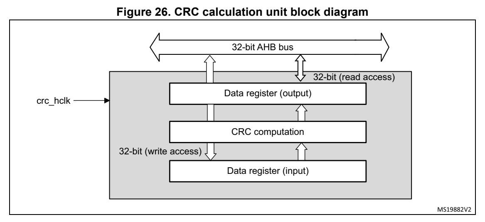

# 13 Cyclic redundancy check calculation unit (CRC) (pp. 267-273)

## 13 Cyclic redundancy ch eck calculation unit (CRC) (p. 267)

### 13.1 Introduction (p. 267)

The CRC (cyclic redundancy check) calculation unit is used to g et a CRC code from 8-, 16-or 32-bit data word and a generator polynomial.

Among other applications, CRC-based techniques are used to veri fy data transmission or storage integrity. In the scope of the functional safety standa rds, they offer a means of verifying the Flash memory integrity. The CRC calculation unit helps compute a signature of the software during runtime, to be compared with a reference si gnature generated at link time and stored at a g iven memory location.

### 13.2 CRC main features (p. 267)

- Uses CRC-32 (Ethernet) polynomial: 0x4C11DB7 X 32 + X 26 + X 23 + X 22 + X 16 + X 12 + X 11 + X 10 +X 8 + X 7 + X 5 + X 4 + X 2 + X +1

- Alternatively, uses fully progra mmable polynomial with programm able size (7, 8, 16, 32 bits)

- Handles 8-,16-, 32-bit data size

- Programmable CRC initial value

- Single input/output 3 2-bit data register

- Input buffer to avoid bus stall during calculation

- CRC computation done in 4 AHB clock cycles (HCLK) for the 32-bi t data size

- General-purpose 8-bit register (can be used for temporary stora ge)

- Reversibility opti on on I/O data

### 13.3 CRC functional description (p. 268)

#### 13.3.1 CRC block diagram (p. 268)

*Figure 26. CRC calculati on unit block diagram (p. 268)*

#### 13.3.2 CRC internal signals (p. 268)

Table 53. CRC internal input/output signals

Signal name Signal type Description

crc_hclk Digital input AHB clock

#### 13.3.3 CRC operation (p. 268)

The CRC calculation unit has a single 32-bit read/write data re gister (CRC_DR). It is used to input new data (write access), and holds the result of the prev ious CRC calculation (read access).

Each write operation to the data register creates a combination of the previous CRC value (stored in CRC_DR) and the new one. CRC computation is done on the whole 32-bit data word or byte by byte depending on the format of the data being written.

The CRC_DR register can be acces sed by word, right-aligned half-word and right-aligned byte. For the o ther registers only 32 -bit access is allowed.

The duration of the computat ion depends on data width:

- 4 AHB clock cycles for 32-bit

- 2 AHB clock cycles for 16-bit

- 1 AHB clock cycles for 8-bit

An input buffer allows a second data to be immediately written without waiting for any wait states due to the prev ious CRC calculation.

The data size can be dynamically adjusted to minimize the numbe r of write accesses for a given number of bytes. For insta nce, a CRC for 5 bytes can be computed with a word write followed by a byte write.

The input data can be reversed, to manage the various endiannes s schemes. The reversing operation can be performed on 8 b its, 16 bits and 32 bits depen ding on the REV_IN[1:0] bits in the CRC_CR register.

For example: input data 0x1A2B3C4D is used for CRC calculation as:

- 0x58D43CB2 with bit-reversal done by byte

- 0xD458B23C with bit-reversal done by half-word

- 0xB23CD458 with bit-reversal done on the full word

The output data can also be reversed by setting the REV_OUT bit in the CRC_CR register.

The operation is done at bit level: for example, output data 0x 11223344 is converted into 0x22CC4488.

The CRC calculator can be initia lized to a programmable value u sing the RESET control bit in the CRC_CR register (the default value is 0xFFFFFFFF).

The initial CRC value can be programmed with the CRC_INIT regis ter. The CRC_DR register is automatically initi alized upon CRC_INIT register write access.

The CRC_IDR register can be used to hold a temporary value rela ted to CRC calculation. It is not affected by the RESET b it in the CRC_CR register.

Polynomial programmability

The polynomial coefficients are fully programmable through the CRC_POL register, and the polynomial size can be configured to be 7, 8, 16 or 32 bits by programming the POLYSIZE[1:0] bits in the CRC_CR register. Even polynomials are not supported.

If the CRC data is less than 32-bit, its value can be read from the least significant bits of the CRC_DR register.

To obtain a reliable CRC calculat ion, the change on-fly of the polynomial value or size can not be performed during a CRC ca lculation. As a result, if a CR C calculation is ongoing, the application must eit her reset it or perform a CRC_ DR read before changing the polynomial.

The default polynomial value is the CRC-32 (Ethernet) polynomia l: 0x4C11DB7.

### 13.4 CRC registers (p. 270)

### 13.4.1 [CRC.CRC_DR] Offset: 0x00 | Reset: 0xFFFFFFFF (p. 270)

Address offset: 0x00

Reset value: 0xFFFF FFFF

Bits 31:0 DR[31:0]: Data register bits This register is used to write new data to the CRC calculator. It holds the previous CRC calcu lation result when it is read. If the data size is less than 32 bits, the least significant bi ts are used to write/read the correct value.

### 13.4.2 [CRC.CRC_IDR] Offset: 0x04 | Reset: 0x00000000 (p. 270)

Address offset: 0x04

Reset value: 0x0000 0000

Bits 31:0 IDR[31:0]: General-purpose 32-bi t data register bits These bits can be used as a tem porary storage location for four bytes. This register is not affected by CRC resets generated by the RE SET bit in the CRC_CR register

### 13.4.3 [CRC.CRC_CR] Offset: 0x08 | Reset: 0x00000000 (p. 271)

Address offset: 0x08

Reset value: 0x0000 0000

Bits 31:8 Reserved, must be kept at reset value.

Bit 7 REV_OUT: Reverse output data This bit controls the reversal of the bit order of the output d ata. 0: Bit order not affected 1: Bit-reversed output format

Bits 6:5 REV_IN[1:0]: Reverse input data These bits control the reversal of the bit order of the input d ata 00: Bit order not affected 01: Bit reversal done by byte 10: Bit reversal done by half-word 11: Bit reversal done by word

Bits 4:3 POLYSIZE[1:0]: Polynomial size These bits control the size of the polynomial. 00: 32 bit polynomial 01: 16 bit polynomial 10: 8 bit polynomial 11: 7 bit polynomial

Bits 2:1 Reserved, must be kept at reset value.

Bit 0 RESET: RESET bit This bit is set by software to reset the CRC calculation unit a nd set the data register to the value stored in the CRC_INIT reg ister. This bit can only be set, it is automatically cleared by hardware

### 13.4.4 [CRC.CRC_INIT] Offset: 0x10 | Reset: 0xFFFFFFFF (p. 272)

Address offset: 0x10

Reset value: 0xFFFF FFFF

Bits 31:0 CRC_INIT[31:0]: Programmable initial CRC value This register is used to w rite the CRC initial value.

### 13.4.5 [CRC.CRC_POL] Offset: 0x14 | Reset: 0x04C11DB7 (p. 272)

Address offset: 0x14

Reset value: 0x04C1 1DB7

Bits 31:0 POL[31:0]: Programmable polynomial This register is used to write the coefficients of the polynomi al to be used for CRC calculation. If the polynomial size is less than 32 bits, the least significant bits have to be used to program the correct value.

#### 13.4.6 CRC register map (p. 273)

**Table 54. CRC register map and reset values (p. 273)**

| Offset | Register name | 31 | 30 | 29 | 28 | 27 | 26 | 25 | 24 | 23 | 22 | 21 | 20 | 19 | 18 | 17 | 16 | 15 | 14 | 13 | 12 | 11 | 10 | 9 | 8 | 7 | 6 | 5 | 4 | 3 | 2 | 1 | 0 |
| --- | --- | --- | --- | --- | --- | --- | --- | --- | --- | --- | --- | --- | --- | --- | --- | --- | --- | --- | --- | --- | --- | --- | --- | --- | --- | --- | --- | --- | --- | --- | --- | --- | --- |
| 0x00 | CRC_DR |  |  |  |  |  |  |  |  |  |  |  |  |  |  |  | DR[31:0] | DR[31:0] |  |  |  |  |  |  |  |  |  |  |  |  |  |  |  |

Reset value 11111111111111111111111111111111

CRC_IDR IDR[31:0] 0x04 Reset value 00000000000000000000000000000000

0x08 CRC_CR Res. Res. Res. Res. Res. Res. Res. Res. Res. Res. Res. Res. Res. Res. Res. Res. Res. Res. Res. Res. Res. Res. Res. Res. REV_OUT REV_IN[1:0] POLYSIZE[1:0] Res. Res. RESET

Reset value 00000 0

CRC_INIT CRC_INIT[31:0] 0x10 Reset value 1 1 1 1 1 1 1 1 1 1 1 1 1 1 1 1 1 1 1 1 1 1 1 1 1 1 1 1 1 1 1 1

CRC_POL POL[31:0] 0x14 Reset value 0 0 0 0 0 1 0 0 1 1 0 0 0 0 0 1 0 0 0 1 1 1 0 1 1 0 1 1 0 1 1 1

Refer to Section 2.2 on page 44 for the register boundary addresses.
