# 14 Analog-to-digital converter (ADC) (pp. 274-334)

## 14 Analog-to-digital converter (ADC) (p. 274)

### 14.1 Introduction (p. 274)

The 12-bit ADC is a successive a pproximation analog-to-digital converter. It has up to 19 multiplexed channels allowing it to measure signals from 16 external and 3 internal sources. A/D conversion of the various ch annels can be performed in sing le, continuous, scan or discontinuous mode. The result of the ADC is stored in a left-a ligned or right-aligned 16-bit data register.

The analog watchdog feature allows the application to detect if the input voltage goes outside the user-defined higher or lower thresholds.

An efficient low-power mode is i mplemented to allow very low co nsumption at low frequency.

A built-in hardware oversampler a llows analog performances to b e improved while off-loading the related computational burden from the CPU.

### 14.2 ADC main features (p. 275)

- High performance – 12-bit, 10-bit, 8-bit or 6-bit configurable resolution – ADC conversion time: 0.4 µs for 12-bit resolution (2.5Msps), faster conversion times can be obtained by lowering resolution. – Self-calibration – Programmable sampling time – Data alignment with built-in data coherency – DMA support

- Low-power – The application can reduce PCLK frequency for low-power operat ion while still keeping optimum ADC performance. For example, 0.4 µs conversion time is kept, whatever the PCLK frequency) – Wait mode: prevents ADC overrun in applications with low PCLK frequency – Auto off mode: ADC is automati cally powered off except during the active conversion phase. This dramatica lly reduces the power consumpti on of the ADC.

- Analog input channels – 16 external analog inputs – 1 channel for internal temperature sensor (V SENSE) – 1 channel for internal reference voltage (V REFINT) – 1 channel for monitoring external V BAT power supply pin

- Start-of-conversion can be initiated: – By software – By hardware triggers with config urable polarity (timer events or GPIO input events)

- Conversion modes – Can convert a single channel o r can scan a sequence of channel s. – Single mode converts selected inputs once per trigger – Continuous mode converts s elected inputs continuously – Discontinuous mode

- Interrupt generation at the end of sampling, end of conversion, end of sequence conversion, and in case of anal og watchdog or overrun events

- Analog watchdog

- Oversampler – 16-bit data register – Oversampling ratio adjustable from 2 to 256x – Programmable data shift up to 8-bits

- ADC supply requirements: 1.62 to 3.6 V

- ADC input range: V SSA ≤ V IN ≤ V REF+

### 14.3 ADC functional description (p. 276)

Figure 27 shows the ADC block diagram and Table 55 gives the ADC p in description.

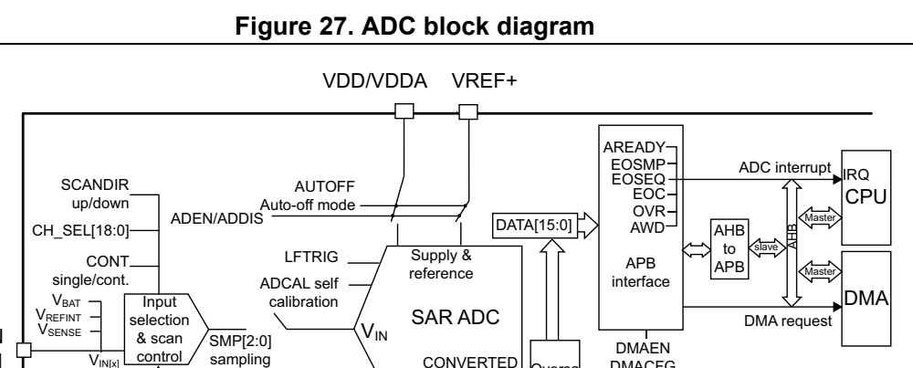
*Figure 27. ADC block diagram (p. 276)*

ADC_IN [18:15, 11:0] time start DATA mpler Start & stop control OVRMODE ADC_AWDx_OUT AUTDLY ADSTART (overrun mode) To analog watchdog Auto-delayed SW trigger ALIGN (left/right) AWDxEN conversion RES[1:0] AWDxSGL ADSTP (12, 10, 8 bits) AWDCHx[4:0] stop conversion JOFFSETx[11:0] LTx[11:0] TOVS JOFFSETx_ HTx[11:0] CH[11:0] OVSS[3:0] TIM1_TRGO2 OVSR[3:0] TIM1_CC4 HW OVSE TIM3_TRGO EXTEND[1:0] trigger Trigger enable DISCEN TIM15_TRGO and edge modeDiscontinuous selection TIM6_TRGO

EXTSEL[1:0] Trigger selection MSv47998V3

#### 14.3.1 ADC pins and internal signals (p. 276)

**Table 55. ADC input/output pins (p. 276)**

| Col 2 | Name Signal type Remarks | Col 4 |
| --- | --- | --- |
| VDDA | Input, analog power supply | Analog power supply and pos itive reference voltage for the ADC, V DDA ≥ V DD |
| VSSA | Input, analog supply ground | Ground for analog powe r supply. Must be at V potential |
| VREF+ | Input, analog reference positive | The higher/positive refe rence voltage for the ADC. |
|  | ADC_INx Analog input signals 16 | external analog input channels |

**Table 56. ADC internal input/output signals (p. 277)**

| Internal signal name | Col 2 | Signal type Description |
| --- | --- | --- |
| V IN [x] | Analog Input channels | Connected either to inte rnal channels or to ADC_IN i external channels |
|  | TRGx Input ADC conversion triggers |  |
| V SENSE |  | Input Internal temperature sensor output voltage |
| V REFINT |  | Input Internal voltage reference output voltage |
| V BAT/3 |  | Input VBAT pin input vo ltage divided by 3 |
| ADC_AWDx_OUT Output |  | Internal analog watchdog output signal connected to on-chip timers (x = Analog watchdog number = 1,2,3) |

Table 57. External triggers

Name Source EXTSEL[2:0]

TRG0 TIM1_TRGO2 000

TRG1 TIM1_CC4 001

TRG2 Reserved 010

TRG3 TIM3_TRGO 011

TRG4 TIM15_TRGO 100

TRG5 TIM6_TRGO 101

TRG6 TIM4_TRGO 110

TRG7 EXTI11 111

#### 14.3.2 ADC voltage re gulator (ADVREGEN) (p. 277)

The ADC has a specific internal voltage regulato r which must be enabled and stable before using the ADC.

The ADC internal voltage regulato r can be enabled by setting ADVREGEN bit to 1 in the ADC_CR register. The software mus t wait for the ADC voltage reg ulator startup time (t ADCVREG_SETUP) before launching a calibration or enabling the ADC. This delay must be managed by software (for details on t ADCVREG_SETUP, refer to the device datasheet). After ADC operations are complete, the ADC is disabled (ADEN = 0). It is then possible to save additional power by disabli ng the ADC voltage regulator (refer to Section : ADC voltage regulator disable sequence).

Note: When the internal voltage regulator is disa bled, the internal analog calibration is kept.

Analog reference from the power control unit

The internal ADC voltag e regulator internally uses an analog reference delivered by the power control unit through a buffer. This buffer is always enab led when the main voltage regulator of the power control u nit operates in normal Run mode (refer to Reset and clock control and power control sections).

If the main volta ge regulator enters low- power mode (such as Low-power run mode), this buffer is disabled and t he ADC cannot be used.

ADC Voltage regulator enable sequence

To enable the ADC voltage regulator, set ADVREGEN bit to 1 in A DC_CR register.

ADC voltage regulator disable sequence

To disable the ADC voltage regu lator, follow the sequence below: 1. Make sure that the ADC is disabled (ADEN = 0). 2. Clear ADVREGEN bit in ADC_CR register.

#### 14.3.3 Calibration (ADCAL) (p. 278)

The ADC has a calibration feature. During the procedure, the AD C calculates a calibration factor which is internally app lied to the ADC unt il the next AD C power-off. The application must not use the ADC during calibration and must wait until it is complete.

Calibration should be performed before starting A/D conversion. It removes the offset error which may vary from c hip to chip due to process variation.

The calibration is initiated by s oftware by setting bit ADCAL = 1. Calibration can only be initiated when the ADC voltage re gulator is enabled (ADVREGEN = 1 and t ADCVREG_SETUP has elapsed) and the ADC is disabled (when ADEN = 0). ADCAL bit stays at 1 during all the calibration sequence. It is then cleared by hardware as soon th e calibration completes. After this, the calibration factor can be read from the ADC_DR register (from bits 6 to 0).

The internal analog calibration i s kept if the ADC is disabled (ADEN = 0). When the ADC operating conditions change (V DDA changes are the main co ntributor to ADC offset variations and temperature change to a lesser exte nd), it is re commended to re-run a calibration cycle.

The calibration factor is l ost in the fo llowing cases:

- The power supply is removed from t he ADC (for example when the product enters STANDBY or VBAT mode)

- The ADC peripheral is reset.

The calibration factor is lost ea ch time power is removed from the ADC (for example when the product enters Standby or V BAT mode). Still, it is possible to save and restore the calibration factor by software to save time when re-starting th e ADC (as long as temperature and voltage are stable during the ADC power-down).

The calibration factor can be written if the ADC is enabled but not converting (ADEN = 1 and ADSTART = 0). Then, at the next s tart of conversion, the calibration factor is automatically injected into the analog ADC. Th is loading is tra nsparent and d oes not add any cycle latency to the start of the conversion.

Software calibration procedure 1. Ensure that ADEN = 0, ADVREGEN = 1 and DMAEN = 0. 2. Set ADCAL = 1. 3. Wait until ADCAL = 0 (or until EOCAL = 1). This can be handled by interrupt if the interrupt is enabled by setting t he EOCALIE bit in the ADC_IER register 4. The calibration factor can b e read from bits 6:0 of ADC_DR o r ADC_CALFACT registers.

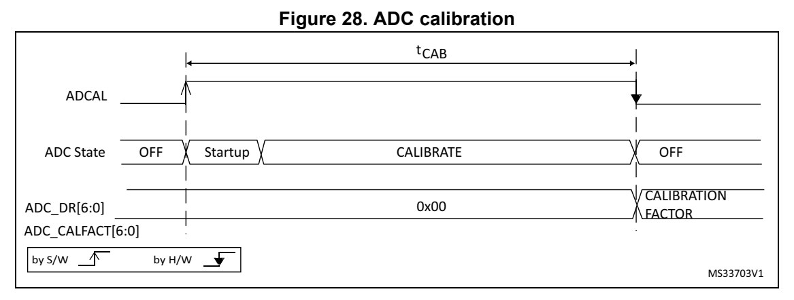
*Figure 28. ADC calibration (p. 279)*

Calibration factor forcing Software Procedure

1. Ensure that ADEN = 1 and ADSTART = 0 (ADC started with no conversion ongoing) 2. Write ADC_CALFACT with th e saved calibration factor 3. The calibration factor is us ed as soon as a new conversion i s launched.

Figure 29. Calibration factor forcing

ADC state Ready (not converting) Converting channel Ready Converting channel Updating (Single ended) (Single ended) calibration Internal calibration factor[6:0] F1 F2 Start conversion (hardware or software)

WRITE ADC_CALFACT CALFACT[6:0] F2

by S/W by H/W MS31925V1

#### 14.3.4 ADC on-off contro l (ADEN, ADDIS, ADRDY) (p. 279)

At power-up, the ADC is disabled and put in power-down mode (AD EN = 0).

As shown in Figure 30, the ADC needs a sta bilization time of t STAB before it starts converting accurately.

Two control bits are used to enable or disable the ADC:

- Set ADEN = 1 to enable the ADC. The ADRDY flag is set as soon a s the ADC is ready for operation.

- Set ADDIS = 1 to disable the AD C and put the ADC in power down mode. The ADEN and ADDIS bits are then automatically cleared by hardware as so on as the ADC is fully disabled.

Conversion can then start either by setting ADSTART to 1 (refer to Section 14.4: Conversion on external trigger and trigger polarity (EXTSEL, EXTEN) on page 289) or when an external trigger event occurs if triggers are enabled.

Follow this procedure to enable the ADC: 1. Clear the ADRDY bit in ADC_IS R register by programming this b it to 1. 2. Set ADEN = 1 in the ADC_CR register. 3. Wait until ADRDY = 1 in the ADC_ISR register (ADRDY is set after the ADC startup time). This can be handled by in terrupt if the interrupt is ena bled by setting the ADRDYIE bit in the ADC_IER register.

Follow this procedure to disable the ADC: 1. Check that ADSTART = 0 in the ADC_CR register to ensure that no conversion is ongoing. If required, stop any on going conversion by writing 1 to the ADSTP bit in the ADC_CR register and waiting un til this bit is read at 0. 2. Set ADDIS = 1 in the ADC_CR register. 3. If required by the application, wait until ADEN = 0 in the ADC_CR register, indicating that the ADC is fully disabled (A DDIS is automatically reset on ce ADEN = 0). 4. Clear the ADRDY bit in ADC_IS R register by programming this bit to 1 (optional).

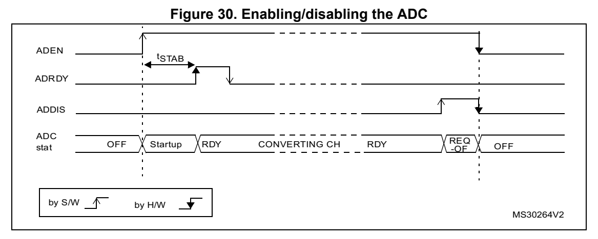
*Figure 30. Enabling/disabling the ADC (p. 280)*

Note: In Auto-off mode (AUTOFF = 1) the power-on/off phases are performed automatically, by hardware and the ADRDY flag is not set.

14.3.5 ADC clock (CKM ODE, PRESC[3:0])

The ADC has a dual clock-domain a rchitecture, so that the ADC can be fed with a clock (ADC asynchronous clo ck) independent from t he APB clock (PCLK).

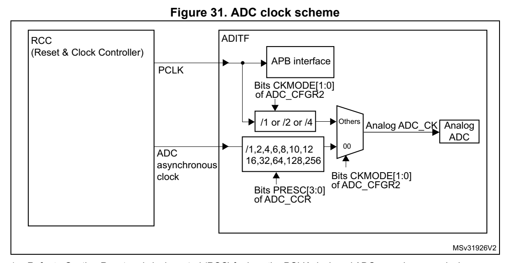
*Figure 31. ADC clock scheme (p. 281)*

1. Refer to Section Reset and clock control (RCC) for how the PCLK clock and ADC asynchronous clock are enabled. The input clock of the analog ADC can be selected between two d ifferent clock sources (see Figure 31: ADC clock scheme to see how the PCLK clock and the ADC asynchronous clock are enabled): a) The ADC clock can be a specific clock source, named “ADC asy nchronous clock“ which is independen t and asynchronous with the APB clock. Refer to RCC Section for more information on generating this cl ock source. To select this scheme, bits CKMO DE[1:0] of the ADC_CFGR2 register must be reset. b) The ADC clock can be derived from the APB clock of the ADC b us interface, divided by a programmable factor (1, 2 or 4) acco rding to bits CKMODE[1:0]. To select this scheme, bits CKMO DE[1:0] of the ADC_CFGR2 register must be different from “00”.

In option a), the generated ADC c lock can eventually be divided by a prescaler (1, 2, 4, 6, 8, 10, 12, 16, 32, 64, 1 28, 256) when programming the bits PRESC[3:0] in the ADC_CCR register).

Option a) has the advantage of rea ching the maximum ADC clock frequency whatever the APB clock scheme selected.

Option b) has the advantage of by passing the clock domain resyn chronizations. This can be useful when the ADC is triggered by a timer and if the applicat ion requires that the ADC is precisely triggered without any uncertainty (otherwise, an unce rtainty of the trigger instant is added by the resynchronizations between the two clock domains).

**Table 58. Latency between trigger and start of conversion (1)(2) (p. 282)**

| ADC clock source CKMODE[1:0] | Latency between the trigger event and the start of conversion |
| --- | --- |
| HSI16, SYSCLK, or(3) PLLPCLK | 00 Latency is not deterministic (jitter) |
| PCLK divided by 2 01 | Latency is deterministic (no jitter) and equal to 3.25 ADC clock cycles |
| PCLK divided by 4 10 | Latency is deterministic (no jitter) and equal to 3.125 ADC clock cycles |
| PCLK divided by 1 11 | Latency is deterministic (no jitter) and equal to 3.5 ADC clock cycles |

1. Refer to the device datasheet for the maximum ADC_CLK frequen cy. 2. If the trigger is generated by TI M1 or TIM15 clocked at twice the CPU clock frequency, then the latency is not deterministic and can be increased by one TIM1 or TIM15 clo ck cycle. 3. Selected with ADCSEL bitfield of the RCC_CCIPR register.

Caution: When selecting CKMODE[1:0] = 11 ( PCLK divided by 1), the user m ust ensure that the PCLK has a 50% duty cycle. This is done by selecting a system c lock with a 50% duty cycle and configuring the APB prescaler in bypa ss modes in the RCC (refer to there Reset and clock controller section). If an i nternal source clock is selected, the AHB and APB prescalers do not divide the clock.

#### 14.3.6 ADC connectivity (p. 283)

ADC inputs are connected to the external channels as well as in ternal sources as described in Figure 32.

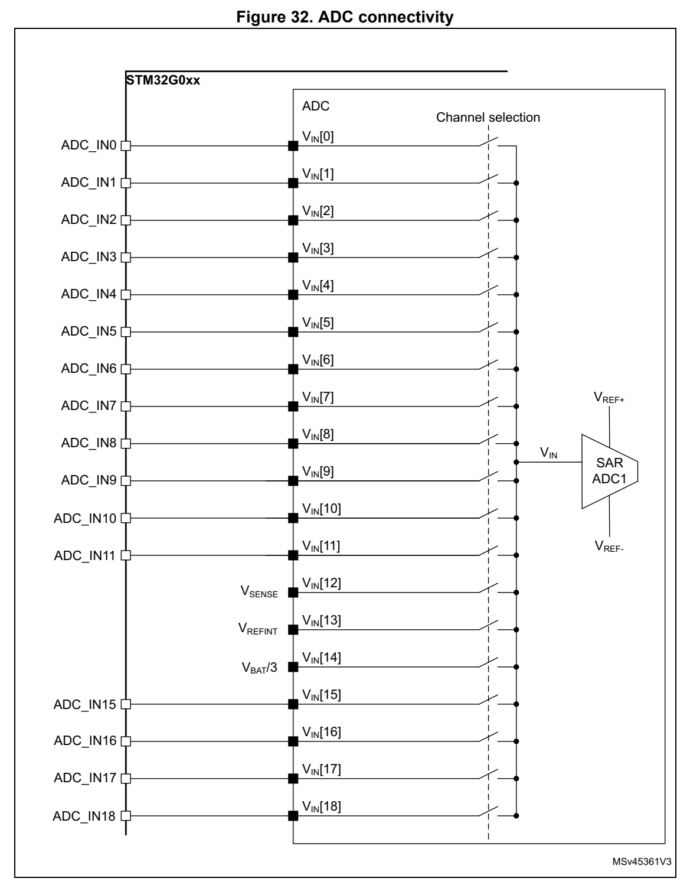
*Figure 32. ADC connectivity (p. 283)*

#### 14.3.7 Configuring the ADC (p. 284)

Software must write to the ADCAL and ADEN bits in the ADC_CR re gister if the ADC is disabled (ADEN must be 0).

Software must only write to the ADSTART and ADDIS bits in the A DC_CR register only if the ADC is enabled and there is no pending reque st to disable t he ADC (ADEN = 1 and ADDIS = 0).

For all the other control bits i n the ADC_IER, ADC_CFGRi, ADC_S MPR, ADC_CHSELR and ADC_CCR registers, refer to the description of the correspo nding control bit in Section 14.12: ADC registers.

ADC_AWDTRx registers can be modi fied when conversion is ongoing.

Software must only write to the ADSTP bit in the ADC_CR registe r if the ADC is enabled (and possibly converting) and th ere is no pending request to di sable the ADC (ADSTART = 1 and ADDIS = 0).

Note: There is no hardware protection preventing software from making write operations forbidden by the above rules. If such a forbidden write access occurs, the ADC may enter an undefined state. To recover correct operation in this case, the ADC must be disabled (clear ADEN = 0 and all the bits in the ADC_CR register).

#### 14.3.8 Channel selection (CHS EL, SCANDIR, CHSELRMOD) (p. 284)

There are up to 19 mu ltiplexed channels:

- 16 analog inputs from GPIO pins (ADC_INx)

- 3 internal analog inputs (Temperature Sensor, Inte rnal Reference Voltage, V BAT channel)

It is possible to convert a singl e channel or a sequence of cha nnels.

The sequence of the channels to be converted can be programmed in the ADC_CHSELR channel selection register: each analog input channel has a ded icated selection bit (CHSELx).

The ADC scan sequence r can be used in two different modes:

- Sequencer not fully configurable: The order in which the channels are scanned is defined by the c hannel number (CHSELRMOD bit must be cleared in ADC_CFGR1 register): – Sequence length configured through CHSELx bits in ADC_CHSELR register – Sequence direction: the channels are scanned in a forward dire ction (from the lowest to the highest channel num ber) or backward direction (from the highest to the lowest channel number) depending on the value of SCANDIR bi t (SCANDIR = 0: forward scan, SCANDIR = 1: backward scan)

– Any channel can belong to in these sequences

- Sequencer fully configurable The CHSELRMOD bit is set in ADC_CFGR1 register. – Sequencer length is up to 8 channels – The order in which the channels are scanned is independent fro m the channel number. Any order can be configu red through SQ1[3:0] to SQ8[3:0] bits in ADC_CHSELR register. – Only channel 0 to channel 14 can be selected in this sequence – If the sequencer detects SQx[3:0] = 0b1111, the following SQx[ 3:0] registers are ignored. – If no 0b1111 is programmed in S Qx[3:0], the se quencer scans fu ll eight channels.

After programming ADC CHSELR, SCANDIR and CHSELRMOD bits, it is mandatory to wait for CCRDY flag before starting conversions. It indicates that t he new channel setting has been applied. If a new configura tion is required, the CCRDY fla g must be cleared prior to starting the conversion.

The software is allowe d to program the CHSEL, SCANDIR, CHSELRMO D bits only when ADSTART bit is cleared to 0 (whic h ensures that no conversion i s ongoing).

Temperature sensor, V REFINT and V BAT internal channels

The temperature sensor is connected to channel ADC V IN [12].

The internal voltage reference V REFINT is connected to channel ADC V IN [13].

The V BAT channel is connected to ADC V IN [14] channel.

14.3.9 Programmable sampling time (SMPx[2:0])

Before starting a conversion, t he ADC needs to establish a dire ct connection between the voltage source to be measured an d the embedded sampling capacitor of the ADC. This sampling time must be enough fo r the input volta ge source to ch arge the samp le and hold capacitor to the in put voltage level.

Having a programmable sampling ti me allows the con version speed to be trimmed according to the input resistan ce of the input voltage source.

The ADC samples the input voltag e for a number of ADC clock cyc les that can be modified using the SMP1[2:0] and SMP2[2:0] bits in the ADC_SMPR register.

Each channel can choose one out of two sampling times configure d in SMP1[2:0] and SMP2[2:0] bitfields, through SMPSE Lx bits in ADC_SMPR register.

The total conversion time i s calculated as follows: t CONV = Sampling time + 12.5 x ADC clock cycles

Example: With ADC_CLK = 16 MHz and a samp ling time of 1.5 ADC clock cycl es: t CONV = 1.5 + 12.5 = 14 ADC clock cycles = 0.875 µs

The ADC indicates the end of th e sampling phase by setting the EOSMP flag.

14.3.10 Single conversion mode (CONT = 0)

In Single conversion mode, the ADC performs a single sequence of conversions, converting all the channels once. This mode is selected when CONT = 0 in the ADC_CFGR1 register. Conversion is started by either:

- Setting the ADSTART bit in the ADC_CR register

- Hardware trigger event

Inside the sequence, after e ach conversion is complete:

- The converted data are stored in the 16-bit ADC_DR register

- The EOC (end of conversion) flag is set

- An interrupt is generated if the EOCIE bit is set

After the sequen ce of conversions is complete:

- The EOS (end of sequence) flag is set

- An interrupt is generated if the EOSIE bit is set

Then the ADC stops unt il a new external trigger event occurs or the ADSTART bit is set again.

Note: To convert a single channel, program a sequence with a length of 1.

14.3.11 Continuous con version mode (CONT = 1)

In continuous conversion mode, when a software or hardware trig ger event occurs, the ADC performs a sequence of conversion s, converting all the channels once and then automatically re-starts and cont inuously performs the same sequ ence of convers ions. This mode is selected when CONT = 1 in the ADC_CFGR1 register. Conversion is started by either:

- Setting the ADSTART bit in the ADC_CR register

- Hardware trigger event

Inside the sequence, after e ach conversion is complete:

- The converted data are stored in the 16-bit ADC_DR register

- The EOC (end of conversion) flag is set

- An interrupt is generated if the EOCIE bit is set

After the sequen ce of conversions is complete:

- The EOS (end of sequence) flag is set

- An interrupt is generated if the EOSIE bit is set

Then, a new sequence restarts i mmediately and the ADC continuou sly repeats the conversion sequence.

Note: To convert a single channel, program a sequence with a length of 1. It is not possible to have both discontinuous mode and continuous mode enabled: it is forbidden to set both bits DISCEN = 1 and CONT = 1.

#### 14.3.12 Starting conversions (ADSTART) (p. 287)

Software starts ADC conversions by setting ADSTART = 1.

When ADSTART is se t, the conversion:

- Starts immediately if EXTEN = 00 (software trigger)

- At the next active edge of the s elected hardware trigger if EXT EN ≠ 00

The ADSTART bit is also used to indicate whether an ADC operati on is currently ongoing. It is possible to re-configure the ADC while ADSTART = 0, indicating that the ADC is idle.

The ADSTART bit is cleared by hardware:

- In single mode with software trigger (CONT = 0, EXTEN = 00) – At any end of conve rsion sequence (EOS = 1)

- In discontinuous mode with software trigger (CONT = 0, DISCEN = 1, EXTEN = 00) – At end of conversion (EOC = 1)

- In all cases (CONT = x, EXTEN = XX) – After execution of the ADSTP procedure invoked by software (se e Section 14.3.14: Stopping an ongoing conversion (ADSTP) on page 289)

Note: In continuous mode (CONT = 1), the ADSTART bit is not cleared by hardware when the EOS flag is set because the sequen ce is automatically relaunched. When hardware trigger is sele cted in single mode (CONT = 0 and EXTEN = 01), ADSTART is not cleared by hardware when the EOS flag is set. This avoids the need for software having to set the ADSTART bit again and ensures the next trigger event is not missed.

After changing channel selection configuration (by programming ADC_CHSELR register or changing CHSELRMOD or SCANDIR), it is mandatory to wait until CCRDY flag is asserted before asserting ADSTART, otherwise the value written to ADSTART is ignored.

#### 14.3.13 Timings (p. 288)

The elapsed time between the start of a conversion and the end of conversion is the sum of the configured sampling time plu s the successive approximation time depending on data resolution:

t CONV = t SMPL + t SAR = [1.5 |min + 12.5 |12bit] x t ADC_CLK

t CONV = t SMPL + t SAR = 42.9 ns |min + 357.1 ns |12bit = 0.400 µs |min (for f ADC_CLK = 35 MHz)

Figure 33. Analog to dig ital conversion time

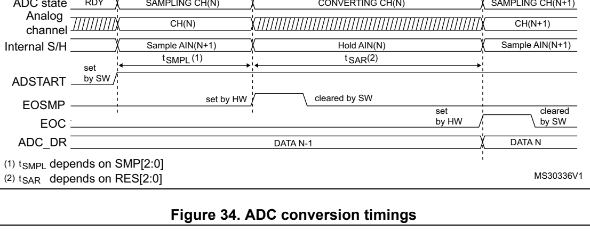
*Figure 34. ADC conversion timings (p. 288)*

ADSTART (1) (2) t LATENCY

ADC state Ready S0 Conversion 0 S1 Conversion 1 S2 Conversion 2 S3 Conversion 3

W (3) W (3) W (3) LATENCY LATENCY LATENCY ADC_DR

Data 0 Data 1 Data 2

MSv33174V1

1. EXTEN = 00 or EXTEN ≠ 00 2. Trigger latency (refer to datasheet for more details) 3. ADC_DR register write latency ( refer to datasheet for more details)

#### 14.3.14 Stopping an ongoing conversion (ADSTP) (p. 289)

The software can decide to stop any ongoing conversions by sett ing ADSTP = 1 in the ADC_CR register.

This resets the ADC operation and the ADC is idle, ready for a new operation.

When the ADSTP bit is set by software, any ongoing conversion i s aborted and the result is discarded (ADC_DR register is not updated with the current conversion).

The scan sequence is also aborte d and reset (meaning that resta rting the ADC would re-start a new sequence).

Once this procedure is complete, the ADSTP and ADSTART bits are both cleared by hardware and the software must wait until ADSTART=0 before starting new conversions.

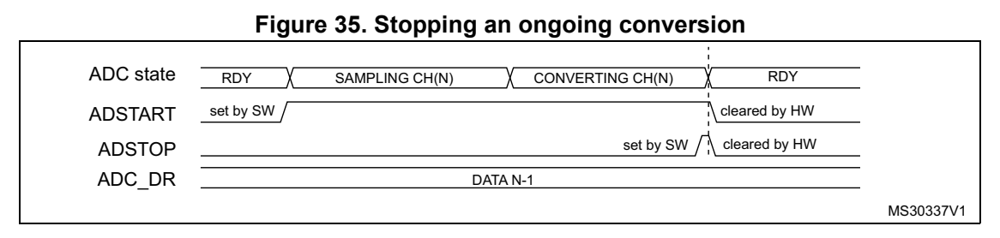
*Figure 35. Stopping an ongoing conversion (p. 289)*

### 14.4 Conversion on external trig ger and trigger polarity (EXTSE L, (p. 289)

## EXTEN) (p. 289)

A conversion or a sequ ence of conversion can be triggered eithe r by software or by an external event (for example ti mer capture). If t he EXTEN[1:0] control bits are not equal to “0b00”, then external events are able to t rigger a conversion w ith the selected polarity. The trigger selection is effective once software has set bit ADSTART = 1.

Any hardware triggers which occur while a conversion is ongoing are ignored.

If bit ADSTART = 0, any hardware triggers which occur are ignored.

Table 59 provides the correspondence between the EXTEN[1:0] values and the trigger polarity.

Table 59. Configuring the trigger polarity

Source EXTEN[1:0]

Trigger detection disabled 00

Detection on rising edge 01

Detection on falling edge 10

Detection on both rising and falling edges 11

Note: The polarity of the external trigger can be changed only when the ADC is not converting (ADSTART = 0).

The EXTSEL[2:0] control bits are used to select which of 8 poss ible events can trigger conversions.

Refer to Table 57: External triggers in Section 14.3.1: ADC pins and internal signals for the list of all the external triggers that can be us ed for regular conversion.

The software source trigger events can be generated by setting the ADSTART bit in the ADC_CR register.

Note: The trigger selection can be changed only when the ADC is not converting (ADSTART = 0).

#### 14.4.1 Discontinuous mode (DISCEN) (p. 290)

This mode is enabled by setting the DISCEN bit in the ADC_CFGR1 register.

In this mode (DISCEN = 1), a hardware or software trigge r event is required to start e ach conversion defined in the sequen ce. On the contrary, if DISCEN = 0, a single hardware or software trigger event successive ly starts all the conversions defined in the sequence.

Example:

- DISCEN = 1, channels to be converted = 0, 3, 7, 10 – 1st trigger: channel 0 is conve rted and an EOC event is generated – 2nd trigger: channel 3 is converted and an EOC event is generated – 3rd trigger: channel 7 is converted and an EOC event is genera ted – 4th trigger: channel 10 is converted and both EOC and EOS even ts are generated. – 5th trigger: channel 0 is con verted an EOC event is generated – 6th trigger: channel 3 is conve rted and an EOC event is genera ted

– ...

- DISCEN = 0, channels to be converted = 0, 3, 7, 10 – 1st trigger: the complete sequence is converted: channel 0, th en 3, 7 and 10. Each conversion generates an EOC event and the last one also generates an EOS event. – Any subsequent trigger events restarts the complete sequence.

Note: It is not possible to have both discontinuous mode and continuous mode enabled: it is forbidden to set both bits DISCEN = 1 and CONT = 1.

#### 14.4.2 Programmable resoluti on (RES) - Fast conversion mode (p. 290)

It is possible to obtain faster conversion times (t SAR) by reducing the ADC resolution.

The resolution can be configured to be either 12, 10, 8, or 6 b its by programming the RES[1:0] bits in the ADC_CFGR1 register. Lower resolution allows faster conversion times for applications where high data precision is not required.

Note: The RES[1:0] bit must only be changed when the ADEN bit is reset.

The result of the conversion i s always 12 bits wide and any unu sed LSB bits are read as zeros.

Lower resolution reduces the conversion time needed for the successive approximation steps as shown in Table 60.

| Col 2 | Col 3 | Table 60. t SAR | timings depending on resolution | Col 6 | Col 7 |
| --- | --- | --- | --- | --- | --- |
| RES[1:0] bits | t SAR (ADC clock cycles) | t SAR (ns) at f ADC = 35 MHz | t SMPL (min) (ADC clock cycles) | t CONV (ADC clock cycles) (with min. t SMPL) | t CONV (ns) at f ADC = 35 MHz |
|  |  |  | 12 12.5 357 1.5 14 400 |  |  |
|  |  |  | 10 10.5 300 1.5 12 343 |  |  |
|  |  |  | 8 8.5 243 1.5 10 286 |  |  |
|  |  |  | 6 6.5 186 1.5 8 229 |  |  |

#### 14.4.3 End of conversion, end of sampling phase (EOC, EOSMP fla gs) (p. 291)

The ADC indicates each end of conversion (EOC) event.

The ADC sets the EOC flag in the ADC_ISR register as soon as a new conversion data result is available in the ADC_DR register. An interrupt can be generated if the EOCIE bit is set in the ADC_IER register. The EOC flag is cleared by software either by writing 1 to it, or by reading the ADC_DR register.

The ADC also indicates the end of sampling phase by setting the EOSMP flag in the ADC_ISR register. The EOSMP flag is cleared by software by writ ing1 to it. An interrupt can be generated if the EOSMPIE bit is set in the ADC_IER register.

The aim of this interrupt is to allow the processing to be sync hronized with the conversions. Typically, an analog mu ltiplexer can be accessed in hidden time during the conversion phase, so that the multiplexer i s positioned when the next samp ling starts.

Note: As there is only a very sh ort time left between the end of the sampling and the end of the conversion, it is recommenced to use polling or a WFE instruction rath er than an interrupt and a WFI instruction.

#### 14.4.4 End of conversion sequence (EOS flag) (p. 291)

The ADC notifies the application of each end of s equence (EOS) event.

The ADC sets the EOS flag in the ADC_ISR register as soon as th e last data result of a conversion sequence is available in the ADC_DR register. An interrupt can be generated if the EOSIE bit is set in the ADC_IER register. The EOS flag is c leared by software by writing 1 to it.

#### 14.4.5 Example timing diagra ms (single/continuous modes (p. 292)

hardware/software triggers)

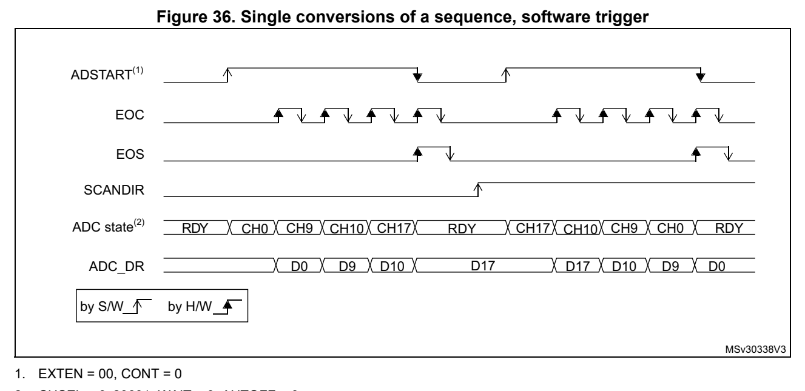
*Figure 36. Single conversions of a sequence, software trigger (p. 292)*

2. CHSEL = 0x20601, WAIT = 0, AUTOFF = 0

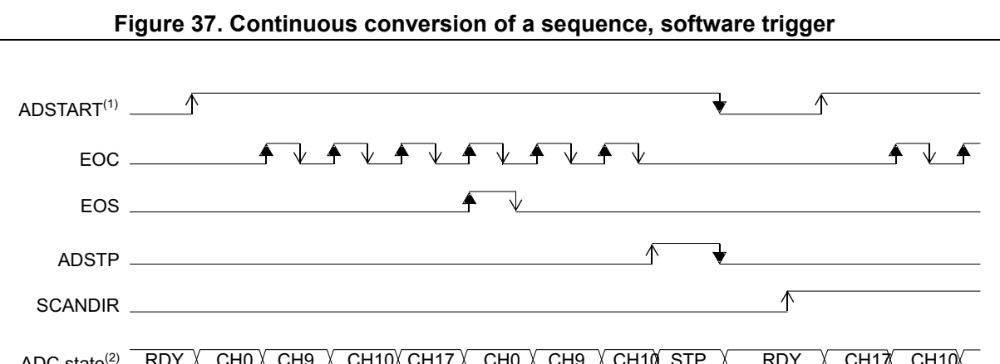
*Figure 37. Continuous conversion of a sequence, software trigge r (p. 292)*

ADC_DR D0 D10D9 D17 D0 D9 D17

by S/W by H/W

MSv30339V2

1. EXTEN = 00, CONT = 1, 2. CHSEL = 0x20601, WAIT = 0, AUTOFF = 0

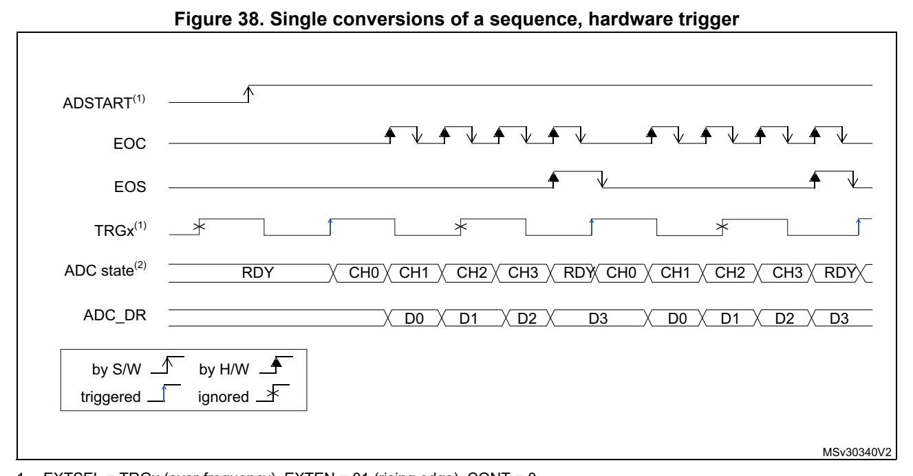
*Figure 38. Single conversions of a sequence, hardware trigger (p. 293)*

2. CHSEL = 0xF, SCANDIR = 0, WAIT = 0, AUTOFF = 0

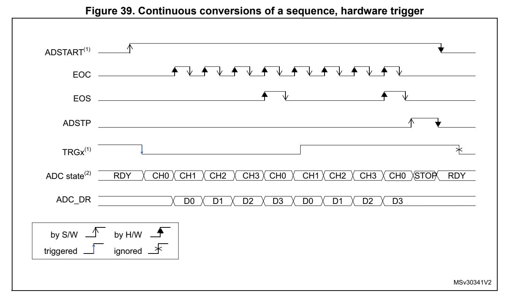
*Figure 39. Continuous conversions of a sequence, hardware trigg er (p. 293)*

1. EXTSEL = TRGx, EXTEN = 10 (falling edge), CONT = 1 2. CHSEL = 0xF, SCANDIR = 0, WAIT = 0, AUTOFF = 0

#### 14.4.6 Low frequen cy trigger mode (p. 294)

Once the ADC is enabled or the la st ADC conversion is complete, the ADC is ready to start a new conversion. The ADC needs to be started at a predefined t ime (t idle) otherwise ADC converted data might be corrupte d due to the transistor leakage (refer to th e device datasheet for the maximum value of t idle).

If the application has to support a time longer than the maximu m t idle value (between one trigger to another for single conversion mode or between the AD C enable and the first ADC conversion), then the ADC internal state needs to be rearmed. T his mechanism can be enabled by setting LFTRIG bit to 1 in ADC_CFGR2 register. By setting this bit, any trigger (software or hardware) sends a rearm command to ADC. The conversion is started after a two ADC clock cycle delay compared to LFTRIG set to 0.

It is not necessary to use this mode when AUTOFF bit is set to 1. For Wait mode, only the first trigger generates an internal rearm command.

### 14.5 Data management (p. 294)

#### 14.5.1 Data register and data alignment (ADC_DR, ALIGN) (p. 294)

At the end of each conversion (w hen an EOC event occurs), the result of the converted data is stored in the ADC_DR data register which is 16-bit wide.

The format of the ADC_ DR depends on the configured data alignme nt and resolution.

The ALIGN bit in the AD C_CFGR1 register sel ects the alignment of the data stored after conversion. Data can be right-a ligned (ALIGN = 0) or left-align ed (ALIGN = 1) as shown in Figure 40.

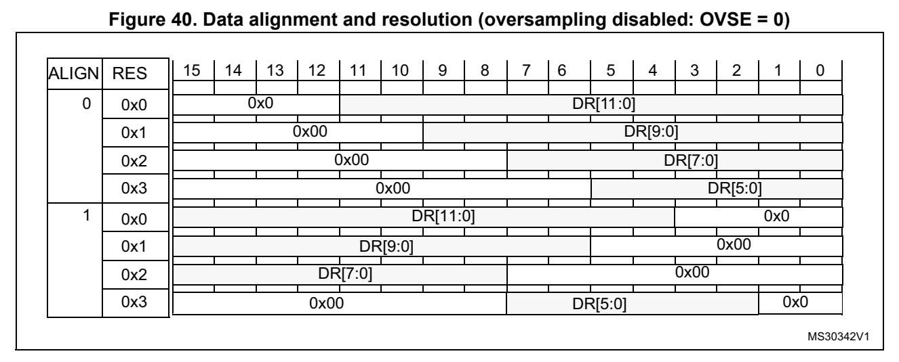
*Figure 40. Data alignment and resolution (oversampling disabled: OVSE = 0) (p. 294)*

#### 14.5.2 ADC overrun (OVR, OVRMOD) (p. 294)

The overrun flag (OVR) indicates a data overrun event, when the converted data was not read in time by the CPU or the D MA, before the da ta from a new conversion is available.

The OVR flag is set in the ADC_ISR register if the EOC flag is still at ‘1’ at the time when a new conversion completes. An interrupt can be generated if the OVRIE bit is set in the ADC_IER register.

When an overrun condition occurs, the ADC keeps operating and can continue to convert unless the software decides to stop and reset the sequence by s etting the ADSTP bit in the ADC_CR register.

The OVR flag is cleared by s oftware by writing 1 to it.

It is possible to configure if th e data is preserved or overwri tten when an overrun event occurs by programming the OVRMOD bit in the ADC_CF GR1 register:

- OVRMOD = 0 – An overrun event preserves the data register from being overwr itten: the old data is maintained and the new conversion is discarded. If OVR remai ns at 1, further conversions can be pe rformed but the result ing data is discarde d.

- OVRMOD = 1 – The data register is overwritte n with the last conversion resu lt and the previous unread data is lost. If OVR remai ns at 1, further conversions can be performed and the ADC_DR register always co ntains the data from the lates t conversion.

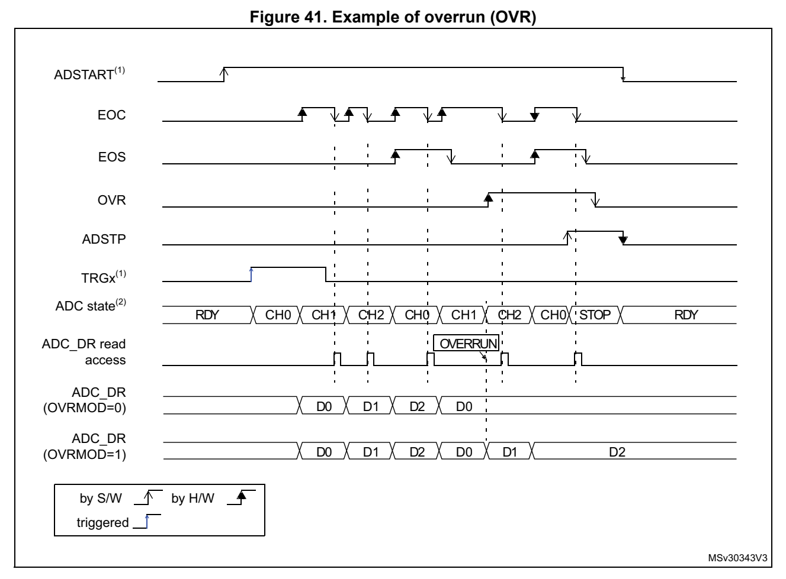
*Figure 41. Example of overrun (OVR) (p. 295)*

#### 14.5.3 Managing a sequence of data converted without using the DMA (p. 296)

If the conversions are slow enough, the conversion sequence can be handled by software. In this case the software must use the EOC flag and its associated interrupt to handle each data result. Each time a conversio n is complete, the EOC bit is set in the ADC_ISR register and the ADC_DR register can be read. The OVRMOD bit in the ADC_CFGR1 register should be configured to 0 to man age overrun even ts as an error.

#### 14.5.4 Managing converted data w ithout using the DMA without overrun (p. 296)

It may be useful to let the ADC co nvert one or m ore channels wi thout reading the data after each conversion. In th is case, the OVRMOD bit must be configure d at 1 and the OVR flag should be ignored by the software. When OVRMOD = 1, an overrun event does not prevent the ADC from continuing to convert and the ADC_DR register alwa ys contains the latest conversion data.

#### 14.5.5 Managing converted data using the DMA (p. 296)

Since all converted channel val ues are stored in a single data register, it is efficient to use DMA when converting more than one channel. This avoids losing t he conversion data results stored in the ADC_DR register.

When DMA mode is enabled (DMAEN b it set to 1 in the ADC_CFGR1 register), a DMA request is generated after the conversion of each channel. This allows the transfer of the converted data from the ADC_DR register to the destination loca tion selected by the software.

Note: The DMAEN bit in the ADC_CFGR1 register must be set after the ADC calibration phase.

Despite this, if an overrun occurs (OVR = 1) because the DMA co uld not serve the DMA transfer request in time, the A DC stops generating DMA requests and the data corresponding to the new conversion is not transferred by the D MA. Which means that all the data transferred to the RAM can be con sidered as valid.

Depending on the configuration of OVRMOD bit, the data is eithe r preserved or overwritten (refer to Section 14.5.2: ADC overrun (OVR, OVRMOD) on page 294).

The DMA transfer requests are bl ocked until the software clears the OVR bit.

Two different DMA modes are proposed depending on the applicati on use and are configured with bit DMACFG i n the ADC_CFGR1 register:

- DMA one shot mode (DMACFG = 0). This mode should be selected whe n the DMA is pro grammed to tran sfer a fixed number of data words.

- DMA circular mode (DMACFG = 1) This mode should be selected when programming the DMA in circul ar mode or double buffer mode.

DMA one shot mode (DMACFG = 0)

In this mode, the ADC generates a DMA transfer request each tim e a new conversion data word is available and stops generating DMA requests once the DM A has reached the last DMA transfer (when a DMA_EOT interrupt occurs, see Section 9: Direct memory access controller (DMA) on page 213) even if a conversion has been started again.

When the DMA transfer is complete (all the transfers configured in the DMA controller have been done):

- The content of the ADC data register is frozen.

- Any ongoing conversion is aborted and its partial result discarded

- No new DMA request is issued to the DMA controller. This avoids generating an overrun error if there are still conversions which are started.

- The scan sequence is stopped and reset

- The DMA is stopped

DMA circular mode (DMACFG = 1)

In this mode, the ADC generates a DMA transfer request each tim e a new conversion data word is available in the data reg ister, even if the DMA has rea ched the last DMA transfer. This allows the DMA to be configured in circular mode to handle a continuous analog input data stream.

### 14.6 Low-power features (p. 297)

#### 14.6.1 Wait mode conversion (p. 297)

Wait mode conversion can be used to simplify the software as we ll as optimizing the performance of applications clo cked at low frequency where there might be a risk of ADC overrun occurring.

When the WAIT bit is set to 1 in the ADC_CFGR1 register, a new conversion can start only if the previous data has been treated, once the ADC_DR register has been read or if the EOC bit has been cleared.

This is a way to automatically adapt the speed of the ADC to th e speed of the system that reads the data.

Note: Any hardware triggers which occur while a conversion is ongoing or during the wait time preceding the read access are ignored.

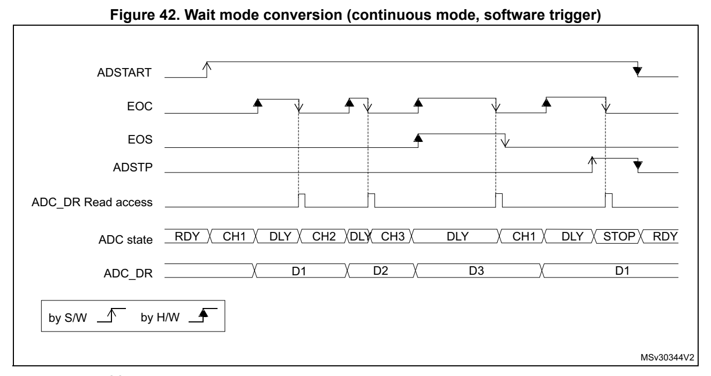
*Figure 42. Wait mode conversion (continuous mode, software trig ger) (p. 298)*

1. EXTEN = 00, CONT = 1 2. CHSEL = 0x3, SCANDIR = 0, WAIT = 1, AUTOFF = 0

#### 14.6.2 Auto-off mode (AUTOFF) (p. 298)

The ADC has an automat ic power management feature which is call ed auto-off mode, and is enabled by setting AUTOFF = 1 in the ADC_CFGR1 register.

When AUTOFF = 1, the ADC is always powered off when not convert ing and automatically wakes-up when a conversion is started (by software or hardware trigger). A startup-time is automatically inserted between th e trigger event which starts t he conversion and the sampling time of the ADC. The A DC is then automatically disable d once the sequence of conversions is complete.

Auto-off mode can cause a dramat ic reduction in the power consu mption of applications which need relatively few conversions or when conversion requests are timed far enough apart (for example with a low frequency hardware trigger) to ju stify the extra power and extra time used for switch ing the ADC on and off.

Auto-off mode can be combined wit h the wait mode conversion (WA IT = 1) for applications clocked at low frequency. This combination can provide significant power savings if the ADC is automatically powered-off duri ng the wait phas e and restarte d as soon as the ADC_DR register is read by the application (see Figure 44: Behavior with WAIT = 1, AUTOFF = 1).

Note: Please refer to the Section Reset and clock control (RCC) for the description of how to manage the dedicated 14 MHz in ternal oscillator. The ADC interface can automatically switch ON/OFF the 14 MHz intern al oscillator to save power.

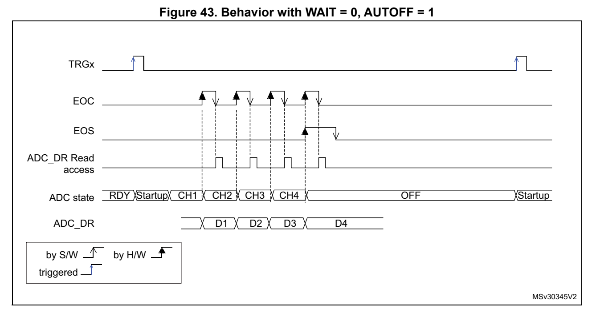
*Figure 43. Behavior with WAIT = 0, AUTOFF = 1 (p. 299)*

1. EXTSEL = TRGx, EXTEN = 01 (risi ng edge), CONT = x, ADSTART = 1, CHSEL = 0xF, SCANDIR = 0, WAIT = 1, AUTOFF = 1

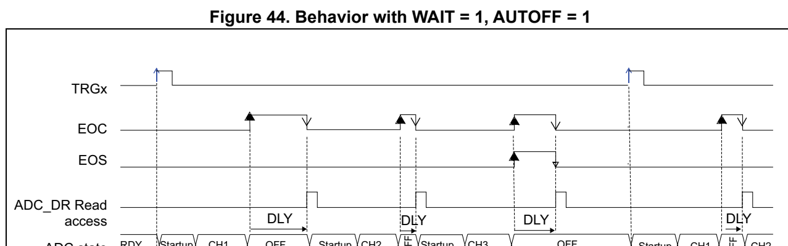
*Figure 44. Behavior with WAIT = 1, AUTOFF = 1 (p. 299)*

D1 D2 D3 D4 ADC_DR

by S/W by H/W triggered

MSv30346V2

1. EXTSEL = TRGx, EXTEN = 01 (risi ng edge), CONT = x, ADSTART = 1, CHSEL = 0xF, SCANDIR = 0, WAIT = 1, AUTOFF = 1

### 14.7 Analog window watchdog (AWD1EN, AWD1SGL, AWD1CH, (p. 300)

## ADC_AWDxCR, ADC_AWDxTR) (p. 300)

The three AWD analog watchdogs m onitor whether some channels re main within a configured voltage range (window).

#### 14.7.1 Description of analog watchdog 1 (p. 300)

AWD1 analog watchdog is enabled by setting the AWD1EN bit in th e ADC_CFGR1 register. It is used to monitor that either one selected channel or all e nabled channels (see Table 62: Analog watchdog 1 channel selection) remain within a configured voltage range (window) as shown in Figure 45.

The AWD1 analog watchdog status b it is set if the analog voltag e converted by the ADC is below a lower threshold or above a higher threshold. These thre sholds are programmed in HT1[11:0] and LT1[11:0] bits of A DC_AWD1TR register. An interru pt can be enabled by setting the AWD1IE bit in the ADC_IER register.

The AWD1 flag is cle ared by software by programing it to 1.

When converting data with a resolution of less than 12-bit (according to bits DRES[1:0]), the LSB of the programmed thresholds must be kept cleared because t he internal comparison is always performed on the full 12-bit raw converted data (left aligned).

Table 61 describes how the comparison is performed for all the possible resolutions.

**Table 61. Analog watchdog comparison (p. 300)**

| Resolution | Col 2 | Analog Watchdog comparison between: | Col 4 |
| --- | --- | --- | --- |
| bits RES[1:0] | Raw converted data, left aligned (1) | Thresholds | Comments |
|  | 00: 12-bit DATA[11:0] LTx[11:0] and HTx[11:0] - |  |  |
|  | 01: 10-bit DATA[11:2],00 LTx[11:0] |  | and HTx[11:0] The user must con figure LTx[1:0] a nd HTx[1:0] to “00” |
|  | 10: 8-bit DATA[11:4],0000 LTx[11:0] and HTx[11:0] |  | The user must configure LTx[3:0] and HTx[3:0] to “0000” |
|  | 11: 6-bit DATA[11:6],000000 | LTx[11:0] and HTx[11:0] | The user must configure LTx[5:0] and HTx[5:0] to “000000” |

1. The watchdog comparison is performed on the raw converted data before any alignment calculation.

Table 62 shows how to configure the AWD1SG L and AWD1EN bits in the ADC_CFGR1 register to enable the analog watchdog on one or more channels.

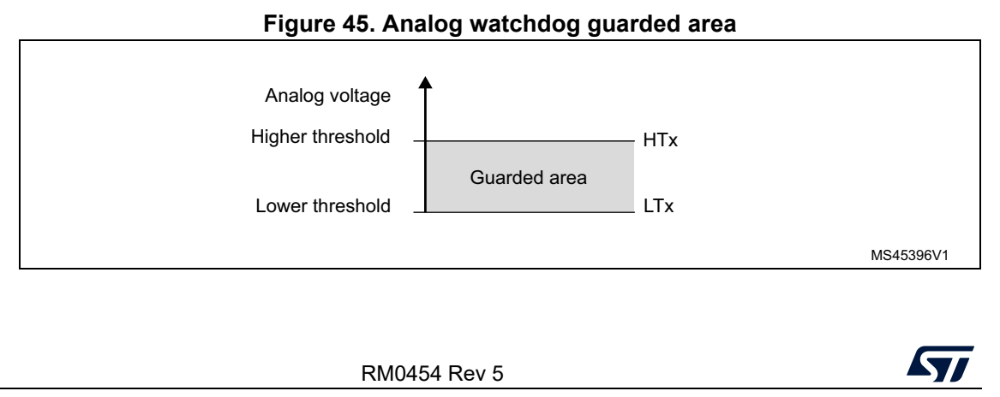
*Figure 45. Analog watchdog guarded area (p. 300)*

**Table 62. Analog watchdog 1 channel selection (p. 301)**

| Channels guarded by the analog watchdog AWD1SGL bit AWD1EN bit | Col 2 | Col 3 |
| --- | --- | --- |
| None x 0 |  |  |
| All channels 0 1 |  |  |
| Single (1) channel | 11 | 11 |

1. Selected by the AWD1CH[4:0] bits

#### 14.7.2 Description of a nalog watchdog 2 and 3 (p. 301)

The second and third analog watc hdogs are more flexible and can guard several selected channels by programming the AWDxCHy in ADC_AWDxCR (x = 2, 3).

The corresponding watc hdog is enabled when a ny AWDxCHy bit (x = 2,3) is set in ADC_AWDxCR register.

When converting data with a reso lution of less than 12 bits (co nfigured through DRES[1:0] bits), the LSB of the programmed thresholds must be kept cleare d because the internal comparison is always performed on the full 12-bit raw converted data (left aligned).

Table 61 describes how the comparison is performed for all the possible resolutions.

The AWD2/3 analog watchdog status bit is set if the analog voltage converted by the ADC is below a low threshold or above a high threshold. These threshol ds are programmed in HTx[11:0] and LTx[11:0] of ADC_AWDxTR registers (x = 2 or 3). A n interrupt can be enabled by setting the AWDxIE b it in the ADC_IER register.

The AWD2 and ADW3 flags are cleared by software by programming them to 1.

#### 14.7.3 ADC_AWDx_OUT output signal generation (p. 301)

Each analog watchdog is associated to an internal hardware sign al, ADC_AWDx_OUT (x being the watchdog number) that i s directly connected to the ET R input (external trigger) of some on-chip timers (refer to the timers section for details on how to select the ADC_AWDx_OUT signal as ETR).

ADC_AWDx_OUT is activated when the associated analog watchdog i s enabled:

- ADC_AWDx_OUT is set when a guarded conversion is outside the programmed thresholds.

- ADC_AWDx_OUT is reset after the end of the next guarded convers ion which is inside the programmed thresh olds. It remains at 1 i f the next guarded conversions are still outside the programmed thresholds.

- ADC_AWDx_OUT is also reset when disabling the ADC (when setting ADDIS to 1). Note that stopping conversions (ADSTP set to 1), might clear th e ADC_AWDx_OUT state.

- ADC_AWDx_OUT state does not chang e when the ADC converts the no ne-guarded channel (see Figure 48)

AWDx flag is set by hardware and reset by software: AWDx flag h as no influence on the generation of ADC_AWDx_OUT (as a n example, ADC_AWDx_OUT can tog gle while AWDx flag remains at 1 if the software has not cleared the flag).

The ADC_AWDx_OUT signal is generated by the ADC_CLK domain. Thi s signal can be generated even the APB clock is stopped.

The AWD comparison is performed at the end of each ADC conversi on. The ADC_AWDx_OUT rising edge and fa lling edge occurs two ADC_CLK cl ock cycles after the comparison.

As ADC_AWDx_OUT is generated by the ADC_CLK domain and AWD flag is generated by the APB clock domain, the rising edges of these signals are not synchronized.

Figure 46. ADC_AWDx_OUT signal generation

ADC STATE RDY Conversion1 Conversion2 Conversion3 Conversion4 Conversion5 Conversion6 Conversion7 inside outside inside outside outside outside inside

EOC FLAG

Cleared Cleared Cleared Cleared AWDx FLAG by SW by SW by SW by SW

ADC_AWDx_OUT

- Converted channels: 1,2,3,4,5,6,7

- Guarded converted channels: 1,2,3,4,5,6,7

MSv45362V1

Figure 47. ADC_AWDx_OUT signal ge neration (AWDx flag not cleare d by software)

ADC STATE RDY Conversion1 Conversion2 Conversion3 Conversion4 Conversion5 Conversion6 Conversion7

inside outside inside outside outside outside inside

EOC FLAG

not cleared by SW AWDx FLAG

ADC_AWDx_OUT

- Converted channels: 1,2,3,4,5,6,7

- Guarded converted channels: 1,2,3,4,5,6,7 MSv45363V1

Figure 48. ADC_AWDx_OUT signal gen eration (on a single channel)

ADC STATE Conversion1 Conversion2 Conversion1 Conversion2 Conversion1 Conversion2 Conversion1 Conversion2

outside inside outside outside

EOC FLAG

EOS FLAG Cleared Cleared by SW by SW AWDx FLAG

ADCy_AWDx_OUT

- Converted channels: 1 and 2

- Only channel 1 is guarded

MSv45364V1

#### 14.7.4 Analog Watchdog threshold control (p. 303)

LTx[11:0] and HTx[11:0] can be c hanged during an analog-to-digi tal conversion (that is between the start of the conversion and the end of conversion of the ADC internal state). If HTx and LTx bits are programmed during the ADC guarded channel conversion, the watchdog function is masked for this conversion. This mask is c leared when starting a new conversion, and the resulting new AWD threshold is applied starting the next ADC conversion result. AWD compariso n is performed at each end of conversion. If t he current ADC data are out of the new thres hold interval, this does not g enerated any interrupt or an ADC_AWDx_OUT signal. The Interrupt and the ADC_AW Dx_OUT generat ion only occurs at the end of the ADC conversion that started after the thresho ld update. If ADC_AWDx_OUT is already asserted, programming the new threshold does not deassert the ADC_AWDx_OUT signal.

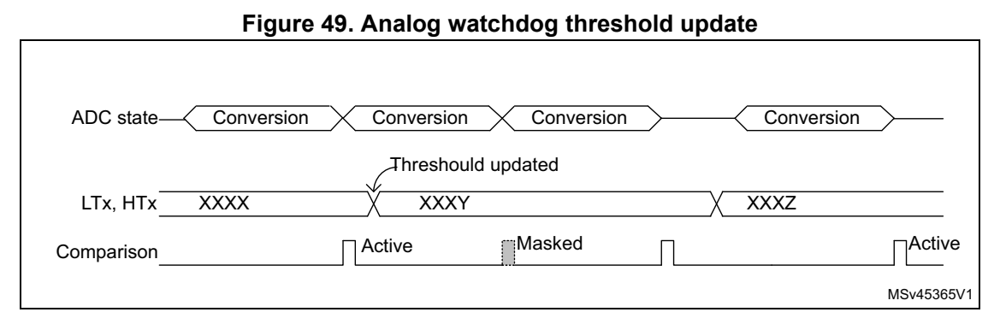
*Figure 49. Analog watchdog threshold update (p. 303)*

### 14.8 Oversampler (p. 304)

The oversampling unit performs data preprocessing to offload th e CPU. It can handle multiple conversions a nd average them into a single data with i ncreased data width, up to 16-bit.

It provides a result with the fo llowing form, whe re N and M can be adjusted:

n N1= – 1 Result = ----M ×  Conversion t()n n0=

It allows the following functions to be performed by hardware: averaging, data rate reduction, SNR improvem ent, basic filtering.

The oversampling ratio N is defined using the OVFS[2:0] bits in the ADC_CFGR2 register. It can range from 2x to 256x. The division coefficient M consists of a right bit shift up to 8 bits. It is configured thro ugh the OVSS[3:0] bits in the A DC_CFGR2 re gister.

The summation unit can yield a result up to 20 bits (256 x 12-b it), which is first shifted right. The upper bits of the result are then truncated, keeping only t he 16 least significant bits rounded to the nearest value usi ng the least significant bits l eft apart by the shifting, before being finally transferred into the ADC_DR data register.

Note: If the intermediate result after the shifting exceeds 16 bits, the upper bits of the result are simply truncated.

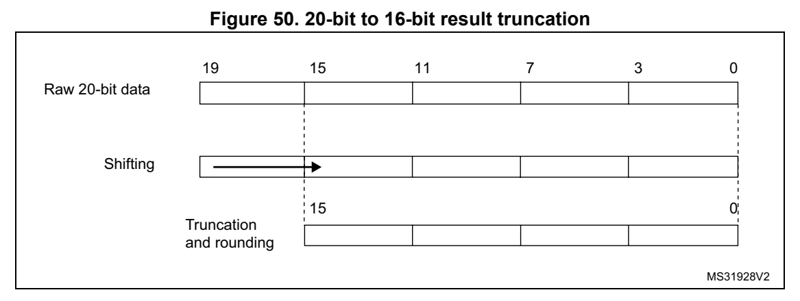
*Figure 50. 20-bit to 16- bit result truncation (p. 304)*

The Figure 51 gives a numerical example of the processing, from a raw 20-bit accumulated data to the final 16-bit result.

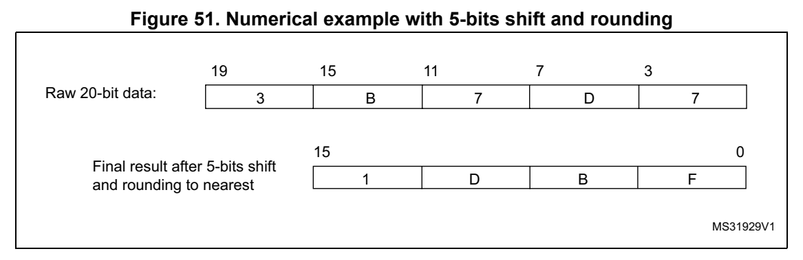
*Figure 51. Numerical example wi th 5-bits shift and rounding (p. 305)*

The Table 63 below gives the data format for the various N and M combinatio n, for a raw conversion data equal to 0xFFF.

**Table 63. Maximum outp ut results vs N and M. Grayed values indi cates truncation (p. 305)**

| Oversa mpling ratio | Max Raw data | No-shift OVSS = 0000 | 1-bit shift OVSS = 0001 | 2-bit shift OVSS = 0010 | 3-bit shift OVSS = 0011 | 4-bit shift OVSS = 0100 | 5-bit shift OVSS = 0101 | 6-bit shift OVSS = 0110 | 7-bit shift OVSS = 0111 | 8-bit shift OVSS = 1000 |
| --- | --- | --- | --- | --- | --- | --- | --- | --- | --- | --- |
|  |  | 2x 0x1FFE 0x1FFE 0x0FFF 0x0800 0x0400 |  |  |  |  |  | 0x0200 0x0100 0x0080 0x0040 0x0020 |  |  |
|  |  | 4x 0x3FFC 0x3FFC 0x1FFE 0x0FFF 0x0800 |  |  |  |  |  | 0x0400 0x0200 0x0100 0x0080 0x0040 |  |  |
|  |  | 8x 0x7FF8 0x7FF8 0x3FFC 0x1FFE 0x0FFF |  |  |  |  |  | 0x0800 0x0400 0x0200 0x0100 0x0080 |  |  |
|  |  | 16x 0xFFF0 0xFFF0 0x7FF8 0x3FFC 0x1FFE |  |  |  |  |  | 0x0FFF 0x0800 0x0400 0x0200 0x0100 |  |  |
|  | 32x 0x1FFE0 |  |  | 0xFFE0 0xFFF0 0x7FF8 0x3FFC 0x1F |  |  |  | FE 0x0FFF 0x0800 0x0400 0x0200 |  |  |
|  | 64x 0x3FFC0 | 0xFFC0 |  |  |  | 0xFFE0 0xFFF0 0x7FF8 0x3FFC 0x1FFE 0x0FFF 0x0800 0x0400 |  |  |  |  |
|  | 128x 0x7FF80 | 0xFF80 | 0xFFC0 |  |  |  | 0xFFE0 0xFFF0 0x7FF8 0x3FFC 0x1FFE 0x0FFF 0x0800 |  |  |  |
|  | 256x 0xFFF00 | 0xFF00 | 0xFF80 | 0xFFC0 |  |  | 0xFFE0 0xFFF0 0x7FF8 0x3FFC 0x1FFE 0x0FFF |  |  |  |
|  | t CONV • • • | = N x (t SMPL the end of the sampli result is available | The conversion timings in oversam conversion mode: the sample time SMPL + t SAR the end of conversion (EOC) occurs the end of sequence (EOCSEQ) occu | sequence. New data are provided every N conversion, with an equ completed (i.e. after N x sequence length conversions total) | is maintained completed (i.e. after N x sequence length conversions total) | pled mode do not change compar ). The flags features are raised as following: ng phase (EOSMP) is set after each samplin | equal during the once every N conversions, wh rs once the sequence of oversa |  | ed to standard whole oversampling ivalent delay equal to N x g phase en the oversampled mpled data is |  |

#### 14.8.1 ADC operating modes s upported when oversampling (p. 306)

In oversampling mode, most of th e ADC operating modes are avail able:

- Single or continuous mode conversions, forward or backward scan ned sequences and up to 8 channels p rogrammed sequence

- ADC conversions start either by software or with triggers

- ADC stop during a conversion (abort)

- Data read via CPU or DMA with overrun detection

- Low-power modes (WAIT, AUTOFF)

- Programmable resolution: in this case, the reduced conversion values (as per RES[1:0] bits in ADC_CFGR1 register) are accumulated, truncated, rounded and shifted in the same way as 12-bit conversions are

Note: The alignment mode is not available when working with oversampled data. The ALIGN bit in ADC_CFGR1 is ignored and the data are always provided right-aligned.

#### 14.8.2 Analog watchdog (p. 306)

The analog watchdog functionality is available (AWDxSGL, AW1DEN and AWDxCH bits), with the following differences:

- the RES[1:0] bits are ignored, comparison is always done on usi ng the full 12-bits values HTx[11:0] and LTx[11:0]

- the comparison is performed on the most significant 12 bits of the 16 bits oversampled results ADC_DR[15:4]

Note: Care must be taken when using high shifting values. This reduces the comparison range. For instance, if the oversampled result is shifted by 4 bits thus yielding a 12-bit data right-aligned, the affective analog watchdog comparison can only be performed on 8 bits. The comparison is done between ADC_DR[11:4] and HTx[7:0] / LTx[[7:0], and HTx[11:8] / LTx[11:8] must be kept reset.

#### 14.8.3 Triggered mode (p. 306)

The averager can also be used fo r basic filtering purposes. Alt hough not a very efficient filter (slow roll-off and limited stop band attenuation), it can be us ed as a notch filter to reject constant parasitic frequencies (typically coming from the mains or from a switched mode power supply). For this purpose, a specific discontinuous mode can be enabled with TOVS bit in ADC_CFGR2, to be able to have an oversamp ling frequency defined by a user and independent from the con version time itself.

Figure 52 below shows how conversions are started in response to triggers in discontinuous mode.

If the TOVS bit is set, the content of the DISCEN bit is ignore d and considered as 1.

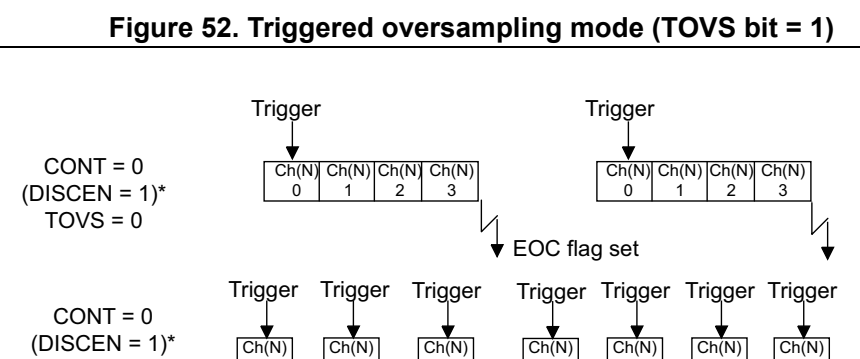
*Figure 52. Triggered overs ampling mode (TOVS bit = 1) (p. 307)*

TOVS = 1 0 1 2 3 0 1 2

EOC flag set (DISCEN = 1)*: DISCEN bit is forced to 1 by software when TOVS bit is set

MS33700V1

### 14.9 Temperature sensor an d internal reference voltage (p. 307)

The temperature sensor can be us ed to measure the junction temp erature (T J) of the device. The temperature sensor i s internally connected to the A DC V IN [12] input channel which is used to convert the sens or’s output voltage to a digital value. The sampling time for the temperature sensor analog pi n must be greater than the mini mum T S_temp value specified in the datasheet. When not in use, the sensor can be put in power down mode.

The internal voltage reference (V REFINT) provides a stable (bandgap) voltage output for the ADC. V REFINT is internally connected to the ADC V IN [13] input channel. The precise voltage of V REFINT is individually measured for each part by ST during production test and stored in the system memory area.

Figure 53 shows the block diagram of conne ctions between the temperature sensor, the internal voltage reference and the ADC.

The TSEN bit must be set to enable the conversion of ADC V IN [12] (temperature sensor) and the VREFEN bit must be set to enable the conversion of ADC V IN [13] (V REFINT).

The temperature sensor output vo ltage changes linearly with tem perature. The offset of this line varies from chip to chip d ue to process variation (up to 4 5 °C from one chip to another).

The uncalibrated internal temperature sensor is more suited for applications that detect temperature variations instead of absolute temperatures. To imp rove the accuracy of the temperature sensor measurement, calibration values are stored i n system memory for each device by ST during production.

During the manufacturing proce ss, the calibration data of the temperature sensor and the internal voltage reference are stored in the system memory area. The user application can then read them and u se them to improve t he accuracy of the temp erature sensor or the internal reference. Refer to the datasheet for additional information.

Main features

- Supported temperature range: -40 to 125 °C

- Linearity: ±2 °C max., precisi on depending on calibration

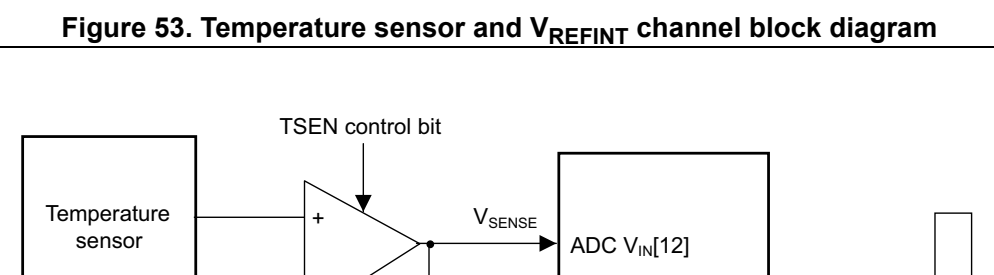
*Figure 53. Temperature sensor and V REFINT channel block diagram (p. 308)*

-

converted data VREFEN control bit Internal powerblock +- V REFINT ADC V INADC[13] Address/data bus

MSv62466V1

Reading the temperature

1. Select the ADC V IN [12] input channel 2. Select an appropriate sampling time specified in the device datasheet (T S_temp). 3. Set the TSEN bit in the ADC_CC R register to wake up the temp erature sensor from power down mode and wait fo r its stabilizat ion time (t START). 4. Start the ADC conversion by s etting the ADSTART bit in the A DC_CR register (or by external trigger) 5. Read the resulting V SENSE data in the ADC_DR register 6. Calculate the temperature using the fo llowing formula

TS_CAL2_TEMP TS_CAL1_TEMP– Temperature in °C() = --------------------------------------------------------------------------------------------------- × ()TS_DATA TS_CAL1– + TS_CAL1_TEMP TS_CAL2 TS_CAL1–

Where:

- TS_CAL2 is the temperature sens or calibration value acquired at TS_CAL2_TEMP (refer to the datasheet for TS_CAL2 value)

- TS_CAL1 is the temperature sens or calibration value acquired at TS_CAL1_TEMP (refer to the datasheet for TS_CAL1 value)

- TS_DATA is the actual temperature sensor output value converted by ADC Refer to the specific device da tasheet for more information abo ut TS_CAL1 and TS_CAL2 calibration points.

Note: The sensor has a startup time after waking from power down mode before it can output V SENSE at the correct level. The ADC also has a startup time after power-on, so to minimize the delay, the ADEN and TSEN bits should be set at the same time.

Calculating the actual V REF+ voltage using the internal reference voltage

V REF+ voltage may be subject to variation or not precisely known. Th e embedded internal reference voltage (V REFINT) and its calibration data acquired by the ADC during the manufacturing process at V REF+_charac can be used to evaluate the actual V REF+ voltage level.

The following formula gives the actual V REF+ voltage supplying the device:

V REF+ = V REF _Charac+ × VREFINT_CAL VREFINT_DATA⁄

Where:

- V REF+_Charac is the value of V REF+ voltage characterized at V REFINT during the manufacturing process. It is spe cified in the dev ice datasheet.

- VREFINT_CAL is the VREF INT calibration value

- VREFINT_DATA is the actual VREFI NT output value converted by AD C

Converting a supply-relative ADC measurement to an absolute vol tage value

The ADC is designed to deliver a digital value corresponding to the ratio between the analog power supply and the voltage app lied on the converted channel. For most application use cases, it is necessary to convert this ratio into a voltage ind ependent of V REF+. For applications where V REF+ is known and ADC converted values are right-aligned you can use the following formula to get this absolute value: V REF+ V CHANNELx = ------------------------------------- × ADC_DATA x FULL_SCALE

For applications where V REF+ value is not known, you mus t use the internal voltage reference and V REF+ can be replaced by the expression provided in Section : Calculating the actual V REF+ voltage using the internal reference voltage, resulting in the following formula:

V REF+_Charac × VREFINT_CAL ADC_DATA× x V CHANNELx = ------------------------------------------------------------------------------------------------------------------------- VREFINT_DATA FULL_SCALE×

Where:

- V REF+_Charac is the value of V REF+ voltage characterized at V REFINT during the manufacturing process. It is spe cified in the dev ice datasheet.

- VREFINT_CAL is the VREF INT calibration value

- ADC_DATA x is the value measured by the ADC on channelx (right-aligned)

- VREFINT_DATA is the actual VREFI NT output value converted by th e ADC

- full_SCALE is the maxim12 um digital value of the ADC output. For8 example with 12-bit resolution, it is 2 - 1 = 4095 or with 8-bit resolution, 2 - 1 = 255.

Note: If ADC measurements are done using an output format other than 12 bit right-aligned, all the parameters must first be converted to a compatible format before the calculation is done.

### 14.10 Battery voltage monitoring (p. 309)

The VBATEN bit in the ADC_CCR regi ster allows the application to measure the backup battery voltage on the VBAT pin. As the V BAT voltage could be higher than V REF+, to ensure

the correct operation of the ADC, the V BAT pin is internally connected to a bridge divider. This bridge is automatically ena bled when VBATEN is set, to con nect V BAT to the ADC V IN [14] input channel. As a consequen ce, the converted digital val ue is half the V BAT voltage. To prevent any unwanted consumption on the battery, it is recommended to enable the bridge divider only when needed for ADC conversion.

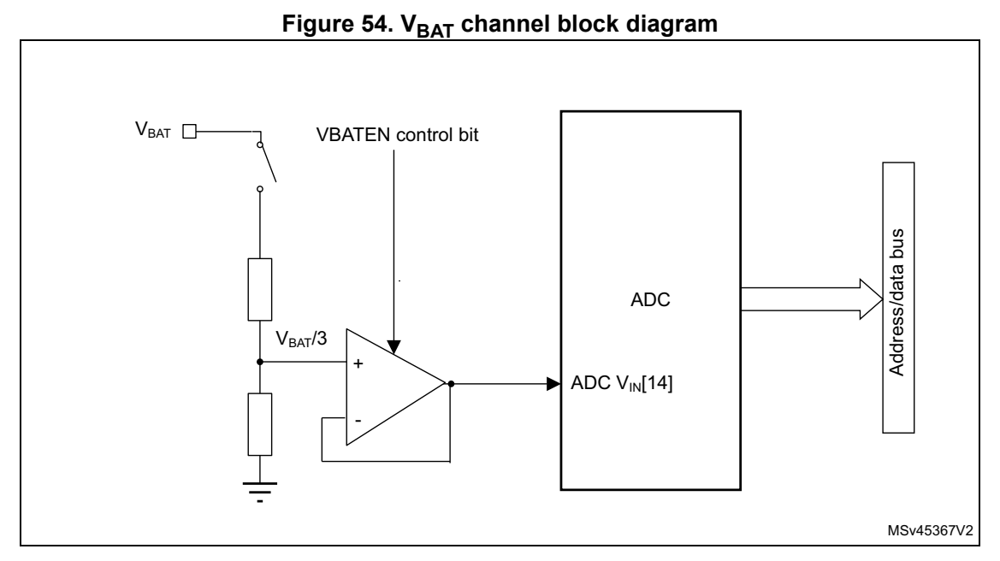
*Figure 54. V BAT channel block diagram (p. 310)*

### 14.11 ADC interrupts (p. 310)

An interrupt can be generated by any of the following events:

- End Of Calibration (EOCAL flag)

- ADC power-up, when the ADC is ready (ADRDY flag)

- End of any conversion (EOC flag)

- End of a sequence of conversions (EOS flag)

- When an analog watchdog detecti on occurs (AWD1, AWD2, AWD3 flag s)

- When the Channel configurat ion is ready (CCRDY flag)

- When the end of sampling phase occurs (EOSMP flag)

- when a data overrun occurs (OVR flag)

Separate interrupt enable bits are available for flexibility.

Table 64. ADC interrupts

Interrupt event Event flag Enable control bit

End Of Calibration EOCAL EOCALIE

ADC ready ADRDY ADRDYIE

End of conversion EOC EOCIE

End of sequence of conversions EOS EOSIE

Analog watchdog 1 status bit is set AWD1 AWD1IE

Table 64. ADC inte rrupts (continued)

Interrupt event Event flag Enable control bit

Analog watchdog 2 status bit is set AWD2 AWD2IE

Analog watchdog 3 status bit is set AWD3 AWD3IE

Channel Configuration Ready CCRDY CCRDYIE

End of sampling phase EOSMP EOSMPIE

Overrun OVR OVRIE

### 14.12 ADC registers (p. 312)

Refer to Section 1.2 for a list of abbre viations used in register descriptions.

### 14.12.1 [ADC.ADC_ISR] Offset: 0x00 | Reset: 0x00000000 (p. 312)

Address offset: 0x00

Reset value: 0x0000 0000

Bits 31:14 Reserved, must be kept at reset value.

Bit 13 CCRDY: Channel Configuration Ready flag This flag bit is set by hardware when the channel configuration is applied after programming to ADC_CHSELR register or changing CHSELRMOD or SCANDIR. It is cle ared by software by programming it to it. 0: Channel configuratio n update not applied. 1: Channel configuratio n update is applied. Note: When the software configures the channels (by programming ADC_CHSELR or changing CHSELRMOD or SCANDIR), it must wait until the CCRDY flag rises before configuring again or starting conversions, otherwise the new configuration (or the START bit) is ignored. Once the flag is asserted, if the softwa re needs to configure again the channels, it must clear the CCRDY flag before proceeding with a new configuration.

Bit 12 Reserved, must be kept at reset value.

Bit 11 EOCAL: End Of Calibration flag This bit is set by hardware when calibration is complete. It is cleared by software writing 1 to it. 0: Calibration is not complete 1: Calibration is complete

Bit 10 Reserved, must be kept at reset value.

Bit 9 AWD3: Analog watchdog 3 flag This bit is set by hardware when the converted voltage crosses the values programmed in ADC_AWD3TR and ADC_AWD3TR regis ters. It is cleared by software by programmi ng it to 1. 0: No analog watchdog event occurred (or the flag event was already acknowledged and cleared by software) 1: Analog watchdog event occurred

Bit 8 AWD2: Analog watchdog 2 flag This bit is set by hardware when the converted voltage crosses the values programmed in ADC_AWD2TR and ADC_AWD2TR regis ters. It is cleared by software programming it it. 0: No analog watchdog event occurred (or the flag event was already acknowledged and cleared by software) 1: Analog watchdog event occurred

Bit 7 AWD1: Analog watchdog 1 flag This bit is set by hardware when the converted voltage crosses the values programmed in ADC_TR1 and ADC_HR1 registers. It is cleared by software by programming it to 1. 0: No analog watchdog event occurred (or the flag event was already acknowledged and cleared by software) 1: Analog watchdog event occurred

Bits 6:5 Reserved, must be kept at reset value.

Bit 4 OVR: ADC overrun This bit is set by hardware when an overrun occurs, meaning tha t a new conversion has complete while the EOC flag was already se t. It is cleared by software w riting 1 to it. 0: No overrun occurred (or the flag event was already acknowled ged and cleared by software) 1: Overrun has occurred

Bit 3 EOS: End of sequence flag This bit is set by hardware at the end of the co nversion of a s equence of channels selected by the CHSEL bits. It is cleared by software writing 1 to it. 0: Conversion sequence not complete (or the flag event was alre ady acknowledged and cleared by software) 1: Conversion sequence complete

Bit 2 EOC: End of conversion flag This bit is set by hardware at t he end of each co nversion of a channel when a new data result is available in the ADC_DR register. It is cleared by software wri ting 1 to it or by reading the ADC_DR register. 0: Channel conversion not complete (or the flag event was alrea dy acknowledged and cleared by software) 1: Channel conversion complete

Bit 1 EOSMP: End of sampling flag This bit is set by hardware durin g the conversion, at the end of the sampling phase.It is cleared by software by programming it to ‘1’. 0: Not at the end of the sampling phase (or the flag event was already acknowledged and cleared by software) 1: End of sampling phase reached

Bit 0 ADRDY: ADC ready This bit is set by hardware afte r the ADC has been enabled (ADE N = 1) and when the ADC reaches a state where it is ready to accept conversion requests. It is cleared by software writing 1 to it. 0: ADC not yet ready to start conversion (or the flag event was already acknowledged and cleared by software) 1: ADC is ready to start conversion

### 14.12.2 [ADC.ADC_IER] Offset: 0x04 | Reset: 0x00000000 (p. 314)

Address offset: 0x04

Reset value: 0x0000 0000

Bits 31:14 Reserved, must be kept at reset value.

Bit 13 CCRDYIE: Channel Configuration Ready Interrupt enable This bit is set and clea red by software to enable/disable the c hannel configuration ready interrupt. 0: Channel configuration ready interrupt disabled 1: Channel configuration ready interrupt enabled Note: The software is allowed to write this bit only when ADSTART bit is cleared to 0 (this ensures that no conversion is ongoing).

Bit 12 Reserved, must be kept at reset value.

Bit 11 EOCALIE: End of calibration interrupt enable This bit is set and clea red by software to enable/disable the e nd of calibration interrupt. 0: End of calibration interrupt disabled 1: End of calibration interrupt enabled Note: The software is allowed to write this bit only when ADSTART bit is cleared to 0 (this ensures that no conversion is ongoing).

Bit 10 Reserved, must be kept at reset value.

Bit 9 AWD3IE: Analog watchdog 3 interrupt enable This bit is set and clea red by software to enable/disable the a nalog watchdog interrupt. 0: Analog watchdog interrupt disabled 1: Analog watchdog interrupt enabled Note: The Software is allowed to write this bit only when ADSTART bit is cleared to 0 (this ensures that no conversion is ongoing).

Bit 8 AWD2IE: Analog watchdog 2 interrupt enable This bit is set and clea red by software to enable/disable the a nalog watchdog interrupt. 0: Analog watchdog interrupt disabled 1: Analog watchdog interrupt enabled Note: The Software is allowed to write this bit only when ADSTART bit is cleared to 0 (this ensures that no conversion is ongoing).

Bit 7 AWD1IE: Analog watchdog 1 interrupt enable This bit is set and clea red by software to enable/disable the a nalog watchdog interrupt. 0: Analog watchdog interrupt disabled 1: Analog watchdog interrupt enabled Note: The Software is allowed to write this bit only when ADSTART bit is cleared to 0 (this ensures that no conversion is ongoing).

Bits 6:5 Reserved, must be kept at reset value.

Bit 4 OVRIE: Overrun interrupt enable This bit is set and cleared by software to enable/disable the overrun interrupt. 0: Overrun interrupt disabled 1: Overrun interrupt enabled. An interrupt is generated when th e OVR bit is set. Note: The software is allowed to write this bit only when ADSTART bit is cleared to 0 (this ensures that no conversion is ongoing).

Bit 3 EOSIE: End of conversion sequence interrupt enable This bit is set and cleared by software to enable/disable the e nd of sequence of conversions interrupt. 0: EOS interrupt disabled 1: EOS interrupt enabled. An in terrupt is generated when the EO S bit is set. Note: The software is allowed to write this bit only when ADSTART bit is cleared to 0 (this ensures that no conversion is ongoing).

Bit 2 EOCIE: End of conversion interrupt enable This bit is set and cleared by software to enable/disable the e nd of conversion interrupt. 0: EOC interrupt disabled 1: EOC interrupt enabled. An interrupt is generated when the EO C bit is set. Note: The software is allowed to write this bit only when ADSTART bit is cleared to 0 (this ensures that no conversion is ongoing).

Bit 1 EOSMPIE: End of sampling flag interrupt enable This bit is set and cleared by software to enable/disable the e nd of the sampling phase interrupt. 0: EOSMP interrupt disabled. 1: EOSMP interrupt enabled. An interrupt is generated when the EOSMP bit is set. Note: The software is allowed to write this bit only when ADSTART bit is cleared to 0 (this ensures that no conversion is ongoing).

Bit 0 ADRDYIE: ADC ready interrupt enable This bit is set and cleared by software to enable/disable the A DC Ready interrupt. 0: ADRDY interrupt disabled. 1: ADRDY interrupt enabled. An interrupt is generated when the ADRDY bit is set. Note: The software is allowed to write this bit only when ADSTART bit is cleared to 0 (this ensures that no conversion is ongoing).

### 14.12.3 [ADC.ADC_CR] Offset: 0x08 | Reset: 0x00000000 (p. 316)

Address offset: 0x08

Reset value: 0x0000 0000

Bit 31 ADCAL: ADC calibration This bit is set by software to start the calibration of the ADC. It is cleared by hardware after calibration is complete. 0: Calibration complete 1: Write 1 to calibrate the ADC. Read at 1 means t hat a calibration is in progress. Note: The software is allowed to set ADCAL only when the ADC is disabled (ADCAL = 0, ADSTART = 0, ADSTP = 0, ADDIS = 0 and ADEN = 0). The software is allowed to update the calibration factor by writing ADC_CALFACT only when ADEN = 1 and ADSTART = 0 (ADC enabled and no conversion is ongoing).

Bits 30:29 Reserved, must be kept at reset value.

Bit 28 ADVREGEN: ADC Voltage Regulator Enable This bit is set by software, to enable the ADC internal voltage regulator. The voltage regulator output is available after t ADCVREG_SETUP. It is cleared by software to dis able the voltage regulator. It can be cleared only if ADEN is et to 0. 0: ADC voltage regulator disabled 1: ADC voltage regulator enabled Note: The software is allowed to program this bit field only when the ADC is disabled (ADCAL = 0, ADSTART = 0, ADSTP = 0, ADDIS = 0 and ADEN = 0).

Bits 27:5 Reserved, must be kept at reset value.

Bit 4 ADSTP: ADC stop conversion command This bit is set by software to s top and discard an ongoing conversion (ADSTP Command). It is cleared by hardware when t he conversion is effectively di scarded and the ADC is ready to accept a new start conversion command. 0: No ADC stop conversion command ongoing 1: Write 1 to stop the ADC. Re ad 1 means that an ADSTP command is in progress. Note: Setting ADSTP to ‘1’ is only effective when ADSTART = 1 and ADDIS = 0 (ADC is enabled and may be converting and there is no pending request to disable the ADC)

Bit 3 Reserved, must be kept at reset value.

Bit 2 ADSTART: ADC start conversion command This bit is set by software to start ADC conversion. Depending on the EXTEN [1:0] configuration bits, a conversion either starts immedi ately (software trigger config uration) or once a hardware trigger event occurs (hardware trigger configuration). It is cleared by hardware: – In single conversion mode (CON T = 0, DISCEN = 0), when software trigger is selected (EXTEN = 00): at the assertion of the end of Conversion Sequence (EOS) flag. – In discontinuous conversion mode(CONT = 0, DISCEN = 1), when t he software trigger is selected (EXTEN = 00): at the assertion of the end of Conversion (EOC) flag. – In all other cases: after the execution of the ADSTP command, at the same time as the ADSTP bit is cleared by hardware. 0: No ADC conversion is ongoing. 1: Write 1 to start the ADC. Read 1 means that the ADC is opera ting and may be converting. Note: The software is allowed to set ADSTART only when ADEN = 1 and ADDIS = 0 (ADC is enabled and there is no pending request to disable the ADC). After writing to ADC_CHSELR register or changing CHSELRMOD or SCANDIRW, it is mandatory to wait until CCRDY flag is asserted before setting ADSTART, otherwise, the value written to ADSTART is ignored.

Bit 1 ADDIS: ADC disable command This bit is set by software to d isable the ADC (ADDIS command) and put it into power-down state (OFF state). It is cleared by hardware once the ADC is effectively disabled (ADEN is also cleared by hardware at this time). 0: No ADDIS command ongoing 1: Write 1 to disable the ADC. Read 1 means that an ADDIS comma nd is in progress. Note: Setting ADDIS to ‘1’ is only effective when ADEN = 1 and ADSTART = 0 (which ensures that no conversion is ongoing)

Bit 0 ADEN: ADC enable command This bit is set by software to enable the ADC. The ADC is effectively ready to operate once the ADRDY flag has been set. It is cleared by hardware when the ADC is disabled, after the e xecution of the ADDIS command. 0: ADC is disabled (OFF state) 1: Write 1 to enable the ADC. Note: The software is allowed to set ADEN only when all bits of ADC_CR registers are 0 (ADCAL = 0, ADSTP = 0, ADSTART = 0, ADDIS = 0 and ADEN = 0)

### 14.12.4 [ADC.ADC_CFGR1] Offset: 0x0C | Reset: 0x00000000 (p. 318)

Address offset: 0x0C

Reset value: 0x0000 0000

Bit 31 Reserved, must be kept at reset value.

Bits 30:26 AWD1CH[4:0]: Analog watchdog channel selection These bits are set and cleared by software. They select the inp ut channel to be guarded by the analog watchdog. 00000: ADC analog input Channel 0 monitored by AWD 00001: ADC analog input Channel 1 monitored by AWD

..... 10001: ADC analog input Channel 17 monitored by AWD 10010: ADC analog input Channel 18 monitored by AWD Others: Reserved Note: The channel selected by the AWDCH[4:0] bits must be also set into the CHSELR register. The software is allowed to write this bit only when ADSTART bit is cleared to 0 (this ensures that no conversion is ongoing).

Bits 25:24 Reserved, must be kept at reset value.

Bit 23 AWD1EN: Analog watchdog enable This bit is set and c leared by software. 0: Analog watchdog 1 disabled 1: Analog watchdog 1 enabled Note: The software is allowed to write this bit only when ADSTART bit is cleared to 0 (this ensures that no conversion is ongoing).

Bit 22 AWD1SGL: Enable the watchdog on a sing le channel or on all channels This bit is set and cleared by software to enable the analog wa tchdog on the channel identified by the AWDCH[4:0] b its or on all the channels 0: Analog watchdog 1 enabled on all channels 1: Analog watchdog 1 enabled on a single channel Note: The software is allowed to write this bit only when ADSTART bit is cleared to 0 (this ensures that no conversion is ongoing).

Bit 21 CHSELRMOD: Mode selection of t he ADC_CHSELR register This bit is set and cleared by s oftware to control the ADC_CHSE LR feature: 0: Each bit of the ADC_CHSEL R register enables an input 1: ADC_CHSELR register is able to sequence up to 8 channels Note: The software is allowed to write this bit only when ADSTART bit is cleared to 0 (this ensures that no conversion is ongoing). If CCRDY is not yet asserted after channel configuration (writing ADC_CHSELR register or changing CHSELRMOD or SCANDIR), the value written to this bit is ignored.

Bits 20:17 Reserved, must be kept at reset value.

Bit 16 DISCEN: Discontinuous mode This bit is set and cleared by s oftware to enable/disable disco ntinuous mode. 0: Discontinuous mode disabled 1: Discontinuous mode enabled Note: It is not possible to have both discontinuous mode and continuous mode enabled: it is forbidden to set both bits DISCEN = 1 and CONT = 1. The software is allowed to write this bit only when ADSTART bit is cleared to 0 (this ensures that no conversion is ongoing).

Bit 15 AUTOFF: Auto-off mode This bit is set and cleared by s oftware to enabl e/disable auto- off mode.. 0: Auto-off mode disabled 1: Auto-off mode enabled Note: The software is allowed to write this bit only when ADSTART bit is cleared to 0 (this ensures that no conversion is ongoing).

Bit 14 WAIT: Wait conversion mode This bit is set and cleared by software to enable/disable wait conversion mode.. 0: Wait conversion mode off 1: Wait conversion mode on Note: The software is allowed to write this bit only when ADSTART bit is cleared to 0 (this ensures that no conversion is ongoing).

Bit 13 CONT: Single / continuous conversion mode This bit is set and cleared by software. If it is set, conversi on takes place continuously until it is cleared. 0: Single conversion mode 1: Continuous conversion mode Note: It is not possible to have both discontinuous mode and continuous mode enabled: it is forbidden to set both bits DISCEN = 1 and CONT = 1. The software is allowed to write this bit only when ADSTART bit is cleared to 0 (this ensures that no conversion is ongoing).

Bit 12 OVRMOD: Overrun management mode This bit is set and cleared by s oftware and config ure the way d ata overruns are managed. 0: ADC_DR register is preserved with the old data when an overrun is detected. 1: ADC_DR register is overwritten with the last conversion resu lt when an overrun is detected. Note: The software is allowed to write this bit only when ADSTART bit is cleared to 0 (this ensures that no conversion is ongoing).

Bits 11:10 EXTEN[1:0]: External trigger enable and polarity selection These bits are set and cleared by software to select the extern al trigger polarity and enable the trigger. 00: Hardware trigger detection d isabled (conversions can be sta rted by software) 01: Hardware trigger detection on the rising edge 10: Hardware trigger detection on the falling edge 11: Hardware trigger detection on both the risi ng and falling e dges Note: The software is allowed to write this bit only when ADSTART bit is cleared to 0 (this ensures that no conversion is ongoing).

Bit 9 Reserved, must be kept at reset value.

Bits 8:6 EXTSEL[2:0]: External trigger selection These bits select the external event used to trigger the start of conversion (refer to Table 57: External triggers for details): 000: TRG0 001: TRG1 010: TRG2 011: TRG3 100: TRG4 101: TRG5 110: TRG6 111: TRG7 Note: The software is allowed to write this bit only when ADSTART bit is cleared to 0 (this ensures that no conversion is ongoing).

Bit 5 ALIGN: Data alignment This bit is set and cleared by software to select right or left alignment. Refer to Figure 40: Data alignment and resolution (oversampling disabled: OVSE = 0) on page 294 0: Right alignment 1: Left alignment Note: The software is allowed to write this bit only when ADSTART bit is cleared to 0 (this ensures that no conversion is ongoing).

Bits 4:3 RES[1:0]: Data resolution These bits are written by softwa re to select the resolution of the conversion. 00: 12 bits 01: 10 bits 10: 8 bits 11: 6 bits Note: The software is allowed to write these bits only when ADEN = 0.

Bit 2 SCANDIR: Scan sequence direction This bit is set and cleared by software to select the direction in which the channels is scanned in the sequence. It is effective only if CHSELMOD bit is cleare d to 0. 0: Upward scan (from CHSEL0 to CHSEL18) 1: Backward scan (from CHSEL18 to CHSEL0) Note: The software is allowed to write this bit only when ADSTART bit is cleared to 0 (this ensures that no conversion is ongoing). If CCRDY is not yet asserted after channel configuration (writing ADC_CHSELR register or changing CHSELRMOD or SCANDIR), the value written to this bit is ignored.

Bit 1 DMACFG: Direct memory access configuration This bit is set and cleared by software to select between two D MA modes of operation and is effective only when DMAEN = 1. 0: DMA one shot mode selected 1: DMA circular mode selected For more deta ils, refer to Section 14.5.5: Managing converted data using the DMA on page 296 Note: The software is allowed to write this bit only when ADSTART bit is cleared to 0 (this ensures that no conversion is ongoing).

Bit 0 DMAEN: Direct memory access enable This bit is set and cleared by software to enable the generatio n of DMA requests. This allows the DMA controller to be used to manage automatically the conve rted data. For more details, refer to Section 14.5.5: Managing converted data using the DMA on page 296. 0: DMA disabled 1: DMA enabled Note: The software is allowed to write this bit only when ADSTART bit is cleared to 0 (this ensures that no conversion is ongoing).

### 14.12.5 [ADC.ADC_CFGR2] Offset: 0x10 | Reset: 0x00000000 (p. 322)

Address offset: 0x10

Reset value: 0x0000 0000

CKMODE[1:0] LFTRIG Res. Res. Res. Res. Res. Res. Re s. Res. Res. Res. Res. Res. Res. rw rw rw

Bits 31:30 CKMODE[1:0]: ADC clock mode These bits are set and cleared b y software to define how the an alog ADC is clocked: 00: ADCCLK (Asynchronous clock mode), generated at product leve l (refer to RCC section) 01: PCLK/2 (Synchronous clock mode) 10: PCLK/4 (Synchronous clock mode) 11: PCLK (Synchronous clock mode). This configurat ion must be e nabled only if PCLK has a 50% duty clock cycle (APB prescaler co nfigured inside the RCC must be bypassed and the system clock must by 50% duty cycle) In all synchronous clock modes, th ere is no jitter in the delay from a timer trigger to the start of a conversion. Note: The software is allowed to write these bits only when the ADC is disabled (ADCAL = 0, ADSTART = 0, ADSTP = 0, ADDIS = 0 and ADEN = 0).

Bit 29 LFTRIG: Low frequency trigger mode enable This bit is set and cl eared by software. 0: Low Frequency Trigger Mode disabled 1: Low Frequency Trigger Mode enabled Note: The software is allowed to write this bit only when ADSTART bit is cleared to 0 (this ensures that no conversion is ongoing).

Bits 28:10 Reserved, must be kept at reset value.

Bit 9 TOVS: Triggered Oversampling This bit is set and cl eared by software. 0: All oversampled conversions for a channel are done consecuti vely after a trigger 1: Each oversampled conversion for a channel needs a trigger Note: The software is allowed to write this bit only when ADSTART = 0 (which ensures that no conversion is ongoing).

Bits 8:5 OVSS[3:0]: Oversampling shift This bit is set and cl eared by software. 0000: No shift 0001: Shift 1-bit 0010: Shift 2-bits 0011: Shift 3-bits 0100: Shift 4-bits 0101: Shift 5-bits 0110: Shift 6-bits 0111: Shift 7-bits 1000: Shift 8-bits Others: Reserved Note: The software is allowed to write this bit only when ADSTART = 0 (which ensures that no conversion is ongoing).

Bits 4:2 OVSR[2:0]: Oversampling ratio This bit filed defin es the number of oversampling ratio. 000: 2x 001: 4x 010: 8x 011: 16x 100: 32x 101: 64x 110: 128x 111: 256x Note: The software is allowed to write this bit only when ADSTART = 0 (which ensures that no conversion is ongoing).

Bit 1 Reserved, must be kept at reset value.

Bit 0 OVSE: Oversampler Enable This bit is set and cl eared by software. 0: Oversampler disabled 1: Oversampler enabled Note: Software is allowed to write this bit only when ADSTART = 0 (which ensures that no conversion is ongoing).

### 14.12.6 [ADC.ADC_SMPR] Offset: 0x14 | Reset: 0x00000000 (p. 323)

Address offset: 0x14

Reset value: 0x0000 0000

Bits 31:27 Reserved, must be kept at reset value.

Bits 26:8 SMPSEL[18:0] Channel-x sampling time selection These bits are written by software to define which sampling tim e is used. 0: Sampling time of CHANNELx use the setting of S MP1[2:0] register. 1: Sampling time of CHANNELx use the setting of S MP2[2:0] register. Note: The software is allowed to write this bit only when ADSTART = 0 (which ensures that no conversion is ongoing).

Bit 7 Reserved, must be kept at reset value.

Bits 6:4 SMP2[2:0]: Sampling time selection 2 These bits are written by software to select the sampling time that applies to all channels. 000: 1.5 ADC clock cycles 001: 3.5 ADC clock cycles 010: 7.5 ADC clock cycles 011: 12.5 ADC clock cycles 100: 19.5 ADC cl ock cycles 101: 39.5 ADC cl ock cycles 110: 79.5 ADC clock cycles 111: 160.5 ADC clock cycles Note: The software is allowed to write this bit only when ADSTART = 0 (which ensures that no conversion is ongoing).

Bit 3 Reserved, must be kept at reset value.

Bits 2:0 SMP1[2:0]: Sampling time selection 1 These bits are written by software to select the sampling time that applies to all channels. 000: 1.5 ADC clock cycles 001: 3.5 ADC clock cycles 010: 7.5 ADC clock cycles 011: 12.5 ADC clock cycles 100: 19.5 ADC cl ock cycles 101: 39.5 ADC cl ock cycles 110: 79.5 ADC clock cycles 111: 160.5 ADC clock cycles Note: The software is allowed to write this bit only when ADSTART = 0 (which ensures that no conversion is ongoing).

### 14.12.7 [ADC.ADC_AWD1TR] Offset: 0x20 | Reset: 0x0FFF0000 (p. 324)

Address offset: 0x20

Reset value: 0x0FFF 0000

Bits 31:28 Reserved, must be kept at reset value.

Bits 27:16 HT1[11:0]: Analog watchdog 1 higher threshold These bits are written by software to define the higher thresho ld for the analog watchdog. Refer to Section 14.7: Analog window watchdog (AWD 1EN, AWD1SGL, AWD1CH, ADC_AWDxCR, ADC_AWDxTR) on page 300.

Bits 15:12 Reserved, must be kept at reset value.

Bits 11:0 LT1[11:0]: Analog watchdog 1 lower threshold These bits are written by software to define the lower threshol d for the analog watchdog. Refer to Section 14.7: Analog window watchdog (AWD 1EN, AWD1SGL, AWD1CH, ADC_AWDxCR, ADC_AWDxTR) on page 300.

### 14.12.8 [ADC.ADC_AWD2TR] Offset: 0x24 | Reset: 0x0FFF0000 (p. 325)

Address offset: 0x24

Reset value: 0x0FFF 0000

Bits 31:28 Reserved, must be kept at reset value.

Bits 27:16 HT2[11:0]: Analog watchdog 2 higher threshold These bits are written by software to define the higher thresho ld for the analog watchdog. Refer to Section 14.7: Analog window watchdog (AWD 1EN, AWD1SGL, AWD1CH, ADC_AWDxCR, ADC_AWDxTR) on page 300.

Bits 15:12 Reserved, must be kept at reset value.

Bits 11:0 LT2[11:0]: Analog watchdog 2 lower threshold These bits are written by software to define the lower threshol d for the analog watchdog. Refer to Section 14.7: Analog window watchdog (AWD 1EN, AWD1SGL, AWD1CH, ADC_AWDxCR, ADC_AWDxTR) on page 300.

### 14.12.9 [ADC.ADC_CHSELR] Offset: 0x28 | Reset: 0x00000000 (p. 326)

Address offset: 0x28

Reset value: 0x0000 0000

The same register can be used in two different modes: – Each ADC_CHSELR bit enables an input (CHSELRMOD = 0 in ADC_CFG R1). Refer to the current section. – ADC_CHSELR is able to sequence up to 8 channels ( CHSELRMOD = 1 in ADC_CFGR1). Refer to next section.

CHSELRMOD = 0 in ADC_CFGR1:

Bits 31:19 Reserved, must be kept at reset value.

Bits 18: 0 CHSEL[18:0]: Channel-x selection These bits are written by software and define wh ich channels are part of the sequence of channels to be converted. 0: Input Channel-x is not selected for conversion 1: Input Channel-x is selected for conversion Note: The software is allowed to write this bit only when ADSTART = 0 (which ensures that no conversion is ongoing). If CCRDY is not yet asserted after channel configuration (writing ADC_CHSELR register or changing CHSELRMOD or SCANDIR), the value written to this bit is ignored.

### 14.12.10 [ADC.ADC_CHSELR] Offset: 0x28 | Reset: 0x00000000 (p. 327)

Address offset: 0x28

Reset value: 0x0000 0000

The same register can be used in two different modes: – Each ADC_CHSELR bit enables an input (CHSELRMOD = 0 in ADC_CFG R1). Refer to the current previous section. – ADC_CHSELR is able to sequence up to 8 channels ( CHSELRMOD = 1 in ADC_CFGR1). Refer to this section.

CHSELRMOD = 1 in ADC_CFGR1:

Bits 31:28 SQ8[3:0]: 8th conversion of the sequence These bits are programmed by software with the channel number ( 0...14) assigned to the 8th conversion of the sequence. 0b1111 indicates the end of the seq uence. When 0b1111 (end of sequence) is programmed to the lower sequen ce channels, these bits are ignored. 0000: CH0 0001: CH1

... 1100: CH12 1101: CH13 1110: CH14 1111: No cha nnel selected (E nd of sequence) Note: The software is allowed to write this bit only when ADSTART = 0 (which ensures that no conversion is ongoing).

Bits 27:24 SQ7[3:0]: 7th conversion of the sequence These bits are programmed by software with the channel number ( 0...14) assigned to the 8th conversion of the sequence. 0b1111 indicates end of the sequence. When 0b1111 (end of sequence) is programmed to the lower sequen ce channels, these bits are ignored. Refer to SQ8[3:0] for a defin ition of channel selection. Note: The software is allowed to write this bit only when ADSTART = 0 (which ensures that no conversion is ongoing).

Bits 23:20 SQ6[3:0]: 6th conversion of the sequence These bits are programmed by software with the channel number ( 0...14) assigned to the 8th conversion of the sequence. 0b1111 indicates end of the sequence. When 0b1111 (end of sequence) is programmed to the lower sequen ce channels, these bits are ignored. Refer to SQ8[3:0] for a defin ition of channel selection. Note: The software is allowed to write this bit only when ADSTART = 0 (which ensures that no conversion is ongoing).

Bits 19:16 SQ5[3:0]: 5th conversion of the sequence These bits are programmed by software with the channel number ( 0...14) assigned to the 8th conversion of the sequence. 0b1111 indicates end of the sequence. When 0b1111 (end of sequence) is programmed to the lower sequen ce channels, these bits are ignored. Refer to SQ8[3:0] for a defin ition of channel selection. Note: The software is allowed to write this bit only when ADSTART = 0 (which ensures that no conversion is ongoing).

Bits 15:12 SQ4[3:0]: 4th conversion of the sequence These bits are programmed by software with the channel number ( 0...14) assigned to the 8th conversion of the sequence. 0b1111 indicates end of the sequence. When 0b1111 (end of sequence) is programmed to the lower sequen ce channels, these bits are ignored. Refer to SQ8[3:0] for a defin ition of channel selection. Note: The software is allowed to write this bit only when ADSTART = 0 (which ensures that no conversion is ongoing).

Bits 11:8 SQ3[3:0]: 3rd conversion of the sequence These bits are programmed by software with the channel number ( 0...14) assigned to the 8th conversion of the sequence. 0b1111 indicates end of the sequence. When 0b1111 (end of sequence) is programmed to the lower sequen ce channels, these bits are ignored. Refer to SQ8[3:0] for a defin ition of channel selection. Note: The software is allowed to write this bit only when ADSTART = 0 (which ensures that no conversion is ongoing).

Bits 7:4 SQ2[3:0]: 2nd conversion of the sequence These bits are programmed by software with the channel number ( 0...14) assigned to the 8th conversion of the sequence. 0b1111 indicates end of the sequence. When 0b1111 (end of sequence) is programmed to the lower sequen ce channels, these bits are ignored. Refer to SQ8[3:0] for a defin ition of channel selection. Note: The software is allowed to write this bit only when ADSTART = 0 (which ensures that no conversion is ongoing).

Bits 3:0 SQ1[3:0]: 1st conversion of the sequence These bits are programmed by software with the channel number ( 0...14) assigned to the 8th conversion of the sequence. 0b1111 indicates end of the sequence. When 0b1111 (end of sequence) is programmed to the lower sequen ce channels, these bits are ignored. Refer to SQ8[3:0] for a defin ition of channel selection. Note: The software is allowed to write this bit only when ADSTART = 0 (which ensures that no conversion is ongoing).

### 14.12.11 [ADC.ADC_AWD3TR] Offset: 0x2C | Reset: 0x0FFF0000 (p. 329)

Address offset: 0x2C

Reset value: 0x0FFF 0000

Bits 31:28 Reserved, must be kept at reset value.

Bits 27:16 HT3[11:0]: Analog watchdog 3 higher threshold These bits are written by software to define the higher thresho ld for the analog watchdog. Refer to Section 14.7: Analog window watchdog (AWD 1EN, AWD1SGL, AWD1CH, ADC_AWDxCR, ADC_AWDxTR) on page 300.

Bits 15:12 Reserved, must be kept at reset value.

Bits 11:0 LT3[11:0]: Analog watchdog 3 lower threshold These bits are written by software to define the lower threshol d for the analog watchdog. Refer to Section 14.7: Analog window watchdog (AWD 1EN, AWD1SGL, AWD1CH, ADC_AWDxCR, ADC_AWDxTR) on page 300.

### 14.12.12 [ADC.ADC_DR] Offset: 0x40 | Reset: 0x00000000 (p. 329)

Address offset: 0x40

Reset value: 0x0000 0000

Bits 31:16 Reserved, must be kept at reset value.

Bits 15:0 DATA[15:0]: Converted data These bits are read-only. They contain the conversion result from the last converted channel. The data are left- or right-aligned as shown in Figure 40: Data alignment and resolution (oversampling disabled: OVSE = 0) on page 294. Just after a calibration is compl ete, DATA[6:0] contains the ca libration factor.

#### 14.12.13 ADC Analog Watchdog 2 Configuration register (ADC_AWD2 CR) (p. 330)

Address offset: 0xA0

Reset value: 0x0000 0000

Bits 31:19 Reserved, must be kept at reset value.

Bits 18: 0 AWD2CH[18:0]: Analog watchdog channel selection These bits are set and cleared by software. They enable and sel ect the input channels to be guarded by analog watchdog 2 (AWD2). 0: ADC analog channel-x is not monitored by AWD2 1: ADC analog channel-x is monitored by AWD2 Note: The channels selected through ADC_AWD2CR must be also configured into the ADC_CHSELR registers. Refer to SQ8[3:0] for a definition of channel selection. The software is allowed to write this bit only when ADSTART = 0 (which ensures that no conversion is ongoing).

#### 14.12.14 ADC Analog Watchdog 3 Configuration register (ADC_AWD3 CR) (p. 330)

Address offset: 0xA4

Reset value: 0x0000 0000

Bits 31:19 Reserved, must be kept at reset value.

Bits 18: 0 AWD3CH[18:0]: Analog watchdog channel selection These bits are set and cleared by software. They enable and sel ect the input channels to be guarded by analog watchdog 3 (AWD3). 0: ADC analog channel-x is not monitored by AWD3 1: ADC analog channel-x is monitored by AWD3 Note: The channels selected through ADC_AWD3CR must be also configured into the ADC_CHSELR registers. Refer to SQ8[3:0] for a definition of channel selection. The software is allowed to write this bit only when ADSTART=0 (which ensures that no conversion is ongoing).

### 14.12.15 [ADC.ADC_CALFACT] Offset: 0xB4 | Reset: 0x00000000 (p. 331)

Address offset: 0xB4

Reset value: 0x0000 0000

Bits 31:7 Reserved, must be kept at reset value.

Bits 6:0 CALFACT[6:0]: Calibration factor These bits are written by hardware or by software. – Once a calibration is complete, t hey are updated by hardware w ith the calibration factors. – Software can write these bits with a new calibration factor. I f the new calibration factor is different from the current one stored into the analog ADC, it is then app lied once a new calibration is launched. – Just after a calibrati on is complete, DATA[6:0] contains the calibration factor. Note: Software can write these bits only when ADEN =1 (ADC is enabled and no calibration is ongoing and no conversion is ongoing). Refer to SQ8[3:0] for a definition of channel selection.

### 14.12.16 [ADC.ADC_CCR] Offset: 0x308 | Reset: 0x00000000 (p. 331)

Address offset: 0x308

Reset value: 0x0000 0000

Bits 31:25 Reserved, must be kept at reset value.

Bit 24 VBATEN: V BAT enable This bit is set and cleared by software to enable/disable the V BAT channel. 0: V BAT channel disabled 1: V BAT channel enabled Note: The software is allowed to write this bit only when ADSTART = 0 (which ensures that no conversion is ongoing)

Bit 23 TSEN: Temperature sensor enable This bit is set and cleared by software to enable/disable the temperature sensor. 0: Temperature sensor disabled 1: Temperature sensor enabled Note: Software is allowed to write this bit only when ADSTART = 0 (which ensures that no conversion is ongoing).

Bit 22 VREFEN: V REFINT enable This bit is set and cleared by software to enable/disable the V REFINT. 0: V REFINT disabled 1: V REFINT enabled Note: Software is allowed to write this bit only when ADSTART = 0 (which ensures that no conversion is ongoing).

Bits 21:18 PRESC[3:0]: ADC prescaler Set and cleared by software to s elect the frequency of the cloc k to the ADC. 0000: input ADC clock not divided 0001: input ADC clock divided by 2 0010: input ADC clock divided by 4 0011: input ADC clock divided by 6 0100: input ADC clock divided by 8 0101: input ADC clock divided by 10 0110: input ADC clock divided by 12 0111: input ADC clock divided by 16 1000: input ADC clock divided by 32 1001: input ADC clock divided by 64 1010: input ADC clock divided by 128 1011: input ADC clock divided by 256 Other: Reserved Note: Software is allowed to write these bits only when the ADC is disabled (ADCAL = 0, ADSTART = 0, ADSTP = 0, ADDIS = 0 and ADEN = 0).

Bits 17:0 Reserved, must be kept at reset value.

### 14.13 ADC register map (p. 333)

The following table summarizes the ADC registers.

**Table 65. ADC register m ap and reset values (p. 333)**

| Col 1 | Offset Register | 31 | 30 | 29 | 28 | 27 | 26 | 25 | 24 | 23 | 22 | 21 | 20 | 19 | 18 | 17 | 16 | 15 | 14 | 13 | 12 | 11 | 10 | 9 | 8 | 7 | 6 | 5 | 4 | 3 | 2 | 1 | 0 |
| --- | --- | --- | --- | --- | --- | --- | --- | --- | --- | --- | --- | --- | --- | --- | --- | --- | --- | --- | --- | --- | --- | --- | --- | --- | --- | --- | --- | --- | --- | --- | --- | --- | --- |
| 0x00 | ADC_ISR | Res. | Res. | Res. | Res. | Res. | Res. | Res. | Res. | Res. | Res. | Res. | Res. | Res. | Res. | Res. | Res. | Res. | Res. | . CCRDY | Res. | EOCAL | Res. | AWD3 | AWD2 | AWD1 | Res. | Res. | OVR | EOS | EOC | EOSMP | ADRDY |

Reset value 0 0 000 00000 0x04 ADC_IER Res. Res. Res. Res. Res. Res. Res. Res. Res. Res. Res. Res. Res. Res. Res. Res. Res. Res. CCRDYIE. Res. EOCALIE Res. AWD3IE AWD2IE AWD1IE Res. Res. OVRIE EOSIE EOCIE EOSMPIE ADRDYIE Reset value 0 0 000 00000 0x08 ADC_CR ADCAL Res. Res. ADVREGEN Res. Res. Res. Res. Res. Res. Res. Res. Res. Res. Res. Res. Res. Res. Res. Res. Res. Res. Res. Res. Res. Res. Res. ADSTP Res. ADSTART ADDIS ADEN Reset value 0 0 0 000

EXTSEL RES 0x0C ADC_CFGR1 Res. AWDCH[4:0] Res. Res. AWD1EN AWD1SGL CHSELRMOD Res. Res. Res. Res. DISCEN AUTOFF WAIT CONT OVRMOD EXTEN[1:0] Res. [2:0] ALIGN [1:0] SCANDIR DMACFG DMAEN Reset value 00000 000 0000000 000000000 0x10 ADC_CFGR2 CKMODE[1:0] LFTRIG Res. Res. Res. Res. Res. Res. Res. Res. Res. Res. Res. Res. Res. Res. Res. Res. Res. Res. Res. TOVS OVSS[3:0] OVSR[2:0] Res. OVSE Reset value 000 0000000000 .

SMP2 SMP1 0x14 ADC_SMPR Res.. Res.. Res.. Res.. Res.. SMPSEL18 SMPSEL17 SMPSEL16 SMPSEL15 SMPSEL14 SMPSEL13 SMPSEL12 SMPSEL11 SMPSEL10 SMPSEL9 SMPSEL8 SMPSEL7 SMPSEL6 SMPSEL5 SMPSEL4 SMPSEL3 SMPSEL2 SMPSEL1 SMPSEL0 Res. [2:0] Res. [2:0] Reset value 0 0 0 0 0 0 0 0 0 0 0 0 0 0 0 0 0 0 0 0 0 0 0 0 0 0x18 Reserved Reserved 0x1C Reserved Reserved 0x20 ADC_AWD1TR Res. Res. Res. Res. HT1[11:0] Res. Res. Res. Res. LT1[11:0] Reset value 111111111111 00000000 0000 0x24 ADC_AWD2TR Res. Res. Res. Res. HT2[11:0] Res. Res. Res. Res. LT2[11:0] Reset value 111111111111 00000000 0000 ADC_CHSELR 0x28 (CHSELRMOD=0) Res. Res. Res. Res. Res. Res. Res. Res. Res Res Res Res Res CHSEL18 CHSEL17 CHSEL16 CHSEL15 CHSEL14 CHSEL13 CHSEL12 CHSEL11 CHSEL10 CHSEL9 CHSEL8 CHSEL7 CHSEL6 CHSEL5 CHSEL4 CHSEL3 CHSEL2 CHSEL1 CHSEL0 Reset value 0000000000000000000 ADC_CHSELR (CHSELRMOD= SQ8[3:0] SQ7[3:0] SQ6[3:0] SQ5[3:0] SQ4[3:0] SQ3[3:0] SQ2[3:0] SQ1[3:0] 0x28 1) Reset value 0 0 0 0 0 0 0 0 0 0 0 0 0 0 0 0 0 0 0 0 0 0 0 0 0 0 0 0 0000 0x2C ADC_AWD3TR Res. Res. Res. Res. HT3[11:0] Res. Res. Res. Res. LT3[11:0] Reset value 111111111111 00000000 0000

**Table 65. ADC register map an d reset values (continued) (p. 334)**

| Col 1 | Offset Register | 31 | 30 | 29 | 28 | 27 | 26 | 25 | 24 | 23 | 22 | 21 | 20 | 19 | 18 | 17 | 16 | 15 | 14 | 13 | 12 | 11 | 10 | 9 | 8 | 7 | 6 | 5 | 4 | 3 | 2 | 1 | 0 |
| --- | --- | --- | --- | --- | --- | --- | --- | --- | --- | --- | --- | --- | --- | --- | --- | --- | --- | --- | --- | --- | --- | --- | --- | --- | --- | --- | --- | --- | --- | --- | --- | --- | --- |
| 0x30 0x34 0x38 0x3C |  |  |  |  |  |  |  | Reserved Reserved |  |  |  |  |  |  |  |  |  |  |  |  |  |  |  |  |  |  |  |  |  |  |  |  |  |
| 0x40 | ADC_DR | Res. | Res. | Res. | Res. | Res. | Res. | Res. | Res. | Res. | Res. | Res. | Res. | Res. | Res. | Res. | Res. |  |  |  |  |  |  |  | DATA[15:0] | DATA[15:0] |  |  |  |  |  |  |  |

Reset value 0000000000000000 ... Reserved Reserved 0xA0 ADC_AWD2CR Res. Res. Res. Res. Res. Res. Res. Res. Res Res Res Res Res AWD2CH18s AWD2CH17 AWD2CH16 AWD2CH15 AWD2CH14 AWD2CH13 AWD2CH12 AWD2CH11 AWD2CH10 AWD2CH9 AWD2CH8 AWD2CH7 AWD2CH6 AWD2CH5 AWD2CH4 AWD2CH3 AWD2CH2 AWD2CH1 AWD2CH0 Reset value 0000000000000000000 0xA4 ADC_AWD3CR Res. Res. Res. Res. Res. Res. Res. Res. Res Res Res Res Res AWD3CH18s AWD3CH17 AWD3CH16 AWD3CH15 AWD3CH14 AWD3CH13 AWD3CH12 AWD3CH11 AWD3CH10 AWD3CH9 AWD3CH8 AWD3CH7 AWD3CH6 AWD3CH5 AWD3CH4 AWD3CH3 AWD3CH2 AWD3CH1 AWD3CH0 Reset value 0000000000000000000 ... Reserved Reserved 0xB4 ADC_CALFACT Res. Res. Res. Res. Res. Res. Res. Res. Res. Res. Res. Res. Res. Res. Res. Res. Res. Res. Res. Res. Res. Res. Res. Res. Res. CALFACT[6:0] Reset value 0000000 ... Reserved Reserved 0x308 ADC_CCR Res. Res. Res. Res. Res. Res. Res. VBATEN TSEN VREFEN PRESC3 PRESC2 PRESC1 PRESC0 Res. Res. Res. Res. Res. Res. Res. Res. Res. Res. Res. Res. Res. Res. Res. Res. Res. Res. Reset value 0000000

Refer to Section 2.2 on page 44 for the register boundary addresses.
