# 15 Advanced-control timer (TIM1) (pp. 335-433)

## 15 Advanced-control timer (TIM1) (p. 335)

In this section, “TIMx” should be understood as “TIM1” since th ere is only one instance of this type of timer fo r the products to which this reference man ual applies.

### 15.1 TIM1 introduction (p. 335)

The advanced-control timer (TIM1) consists of a 16-bit auto-rel oad counter driven by a programmable prescaler.

It may be used for a va riety of purposes, including measuring t he pulse lengths of input signals (input capture) or generating output waveforms (output compare, PWM, complementary PWM with dead-time insertion).

Pulse lengths and waveform periods can be modulated from a few microseconds to several milliseconds using the timer pre scaler and the RC C clock contro ller prescalers.

The advanced-control (TIM1) and general-purpose (TIMy) timers a re completely independent, and do not share an y resources. They can be synchronized together as described in Section 15.3.26: Timer synchronization.

### 15.2 TIM1 main features (p. 336)

TIM1 timer features include:

- 16-bit up, down, up/down auto-reload counter.

- 16-bit programmable prescaler allowing dividing (also “on the fly”) the counter clock frequency either by any fa ctor between 1 and 65536.

- Up to 6 independent channels for: – Input Capture (but channels 5 and 6) – Output Compare – PWM generation (Edge and Center-aligned Mode) – One-pulse mode output

- Complementary outputs wit h programmable dead-time

- Synchronization circuit to contro l the timer with external sign als and to interconnect several timers together.

- Repetition counter to update the timer registers only after a g iven number of cycles of the counter.

- 2 break inputs to put the timer’ s output signals in a safe user selectable configuration.

- Interrupt/DMA generation on the following events: – Update: counter overfl ow/underflow, counte r initialization (by software or internal/external trigger) – Trigger event (counter start, stop, initialization or count by internal/external trigger) – Input capture – Output compare

- Supports incremental (quadrature) encoder and Hall-sensor circu itry for positioning purposes

- Trigger input for external clock or cycle-by-cycle current mana gement

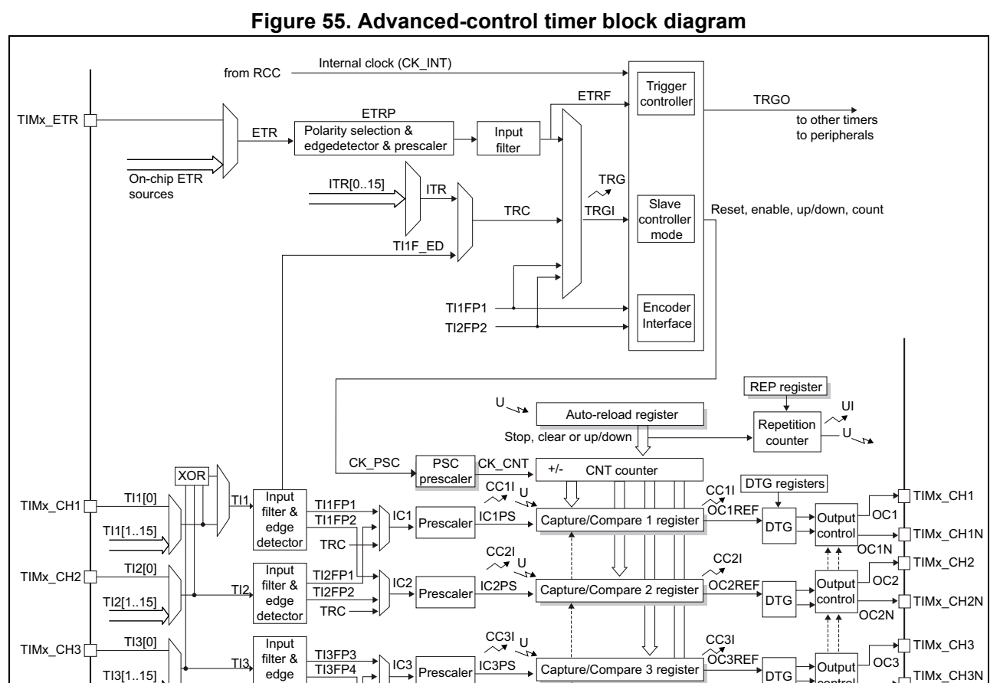
*Figure 55. Advanced-control timer block diagram (p. 337)*

detector TRC CC4I OC3N U CC4I TI4[0] Input TIMx_CH4 TI4FP3 OC4 TI4 filter & IC4 IC4PS OC4REF Output TIMx_CH4 TI4FP4 Prescaler Capture/Compare 4 register TI4[1..15] edge control detector TRC

OC5REF Output OC5 Capture/Compare 5 register control

OC6REF Output OC6 Capture/Compare 6 register control Internal SBIF sources ETRF BIF TIMx_BKIN BRK request

Break and Break2 circuitry (1) B2IF BRK2 request TIMx_BKIN2

Notes: Preload registers transferred Reg to active registers on U event according to control bit Event

Interrupt & DMA output MSv40115V3 1. The internal break event source can be:

- A clock failure event gene rated by CSS. For further information on the CSS, refer to Section 5.2.8: Clock security system (CSS)

- SRAM parity error signal®

- Cortex -M0+ LOCKUP (Hardfault) output.

### 15.3 TIM1 functi onal description (p. 338)

#### 15.3.1 Time-base unit (p. 338)

The main block of the programmable advanced-control timer is a 16-bit counter with its related auto-reload register. The counter can count up, down or both up and down. The counter clock can be d ivided by a prescaler.

The counter, the auto-reload register and t he prescaler registe r can be written or read by software. This is true even when the counter is running.

The time-base unit includes:

- Counter register (TIMx_CNT)

- Prescaler register (TIMx_PSC)

- Auto-reload register (TIMx_ARR)

- Repetition counter register (TIMx_RCR)

The auto-reload register is preloaded. Writing to or reading from the auto-reload register accesses the preload register. Th e content of the preload register are transferred into the shadow register permanently or at each update event (UEV), depe nding on the auto-reload preload enable bit (ARPE) in TIMx_CR1 register. The update even t is sent when the counter reaches the overflow (or underflow when downcounting) and if th e UDIS bit equals 0 in the TIMx_CR1 register. It can also be generated by software. The ge neration of the update event is described in detailed for each configuration.

The counter is clocked by the prescaler output CK_CNT, which is enabled only when the counter enable bit (CEN) in TIMx_CR1 register is set (refer als o to the slave mode controller description to get more details on counter enabling).

Note that the counter starts coun ting 1 clock cycle after setti ng the CEN bit in the TIMx_CR1 register.

Prescaler description

The prescaler can divide the counter clock frequency by any factor between 1 and 65536. It is based on a 16-bit counter controlled through a 16-bit register (in the TIMx_PSC register). It can be changed on the fly as th is control register is buffered. The new prescaler ratio is taken into account at the next update event.

Figure 56 and Figure 57 give some examples of the counter behavior when the prescaler ratio is changed on the fly:

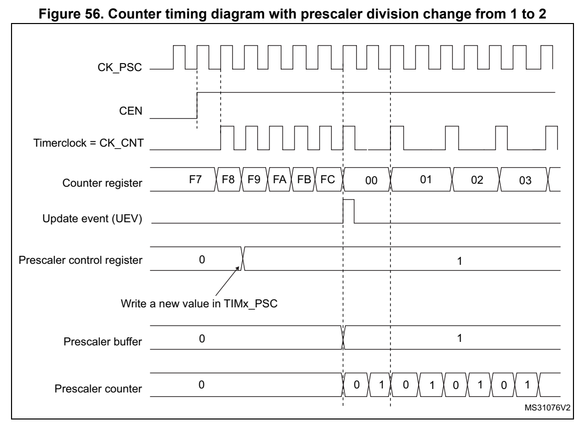
*Figure 56. Counter timing diagra m with prescaler division chang e from 1 to 2 (p. 339)*

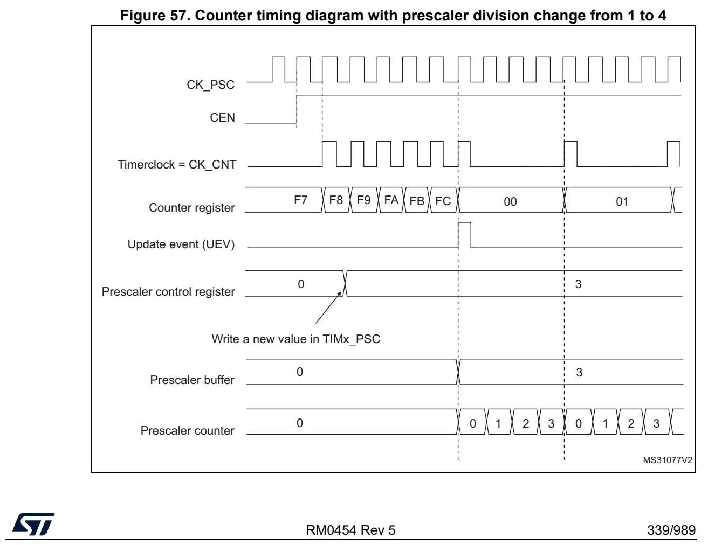
*Figure 57. Counter timing diagra m with prescaler division chang e from 1 to 4 (p. 339)*

#### 15.3.2 Counter modes (p. 340)

Upcounting mode

In upcounting mode, the counter counts from 0 to the auto-reloa d value (content of the TIMx_ARR register), then restarts from 0 and generates a counte r overflow event.

If the repetition counter is used, the update event (UEV) is ge nerated after upcounting is repeated for the number of times programmed in the repetition counter register (TIMx_RCR) + 1. Else th e update event is generated at each coun ter overflow.

Setting the UG bit in the TIMx_E GR register (by software or by using the slave mode controller) also generates an update event.

The UEV event can be disabled by software by setting the UDIS b it in the TIMx_CR1 register. This is to avoid updati ng the shadow registers while writing new values in the preload registers. Then no update event occurs until the UDIS b it has been written to 0. However, the counter restarts from 0, as well as the counter of the prescaler (but the prescale rate does not change). In addition, if the URS bit (up date request selection) in TIMx_CR1 register is set, setti ng the UG bit gen erates an update event UEV but without setting the UIF flag (th us no interrupt or D MA request is sent). This is to avoid generating both update and capture interrupts when clearing the counter on the capture event.

When an update even t occurs, all the registers are updated and the update flag (UIF bit in TIMx_SR register) is set (depending on the URS bit):

- The repetition counter is reload ed with the content of TIMx_RCR register,

- The auto-reload shadow register i s updated with the preload val ue (TIMx_ARR),

- The buffer of the prescaler is reloaded with the preload value (content of the TIMx_PSC register).

The following figures show some examples of the counter behavio r for different clock frequencies when TIMx_ARR=0x36.

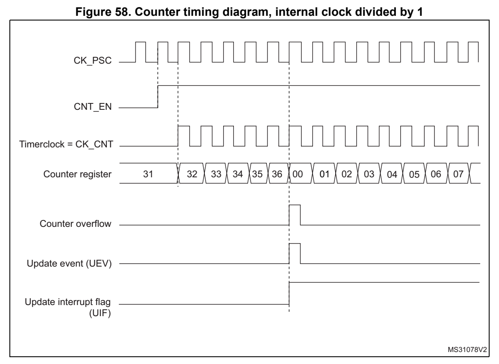
*Figure 58. Counter timing diagra m, internal clock divided by 1 (p. 341)*

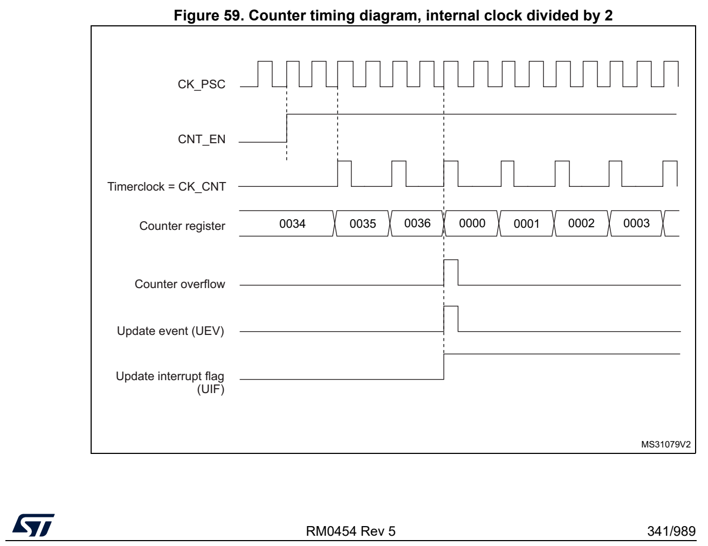
*Figure 59. Counter timing diagra m, internal clock divided by 2 (p. 341)*

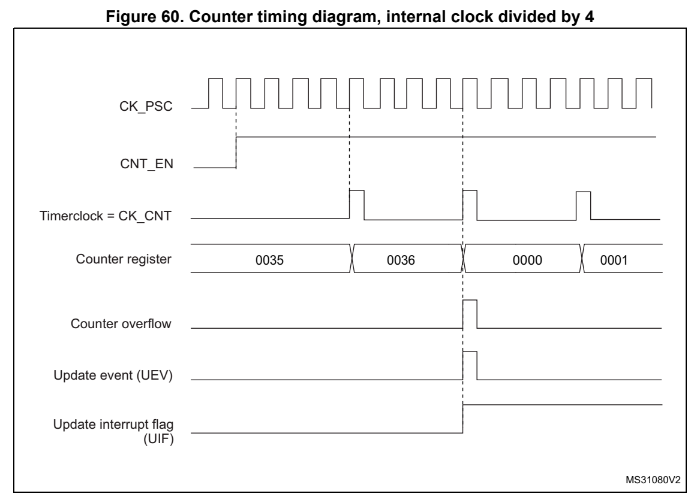
*Figure 60. Counter timing diagra m, internal clock divided by 4 (p. 342)*

*Figure 61. Counter timing diagra m, internal clock divided by N (p. 342)*

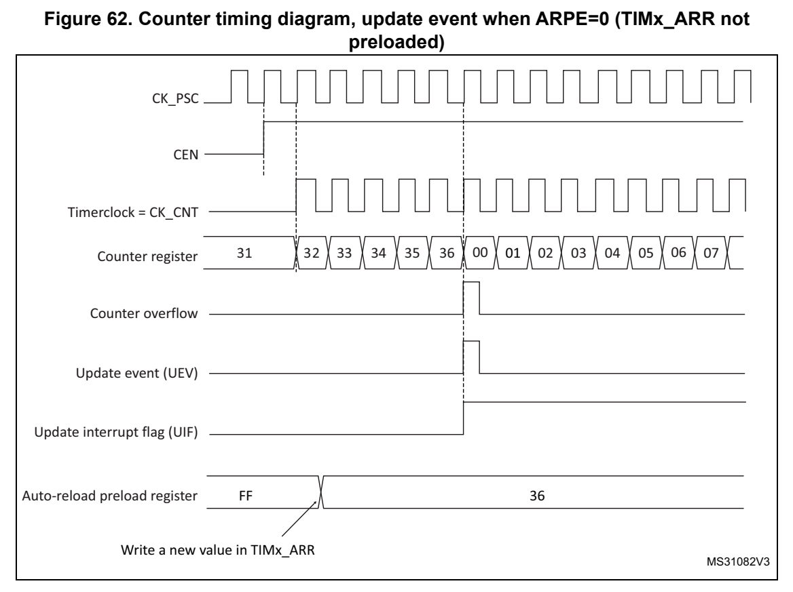
*Figure 62. Counter timing diagram, update event when ARPE=0 (TI Mx_ARR not (p. 343)*

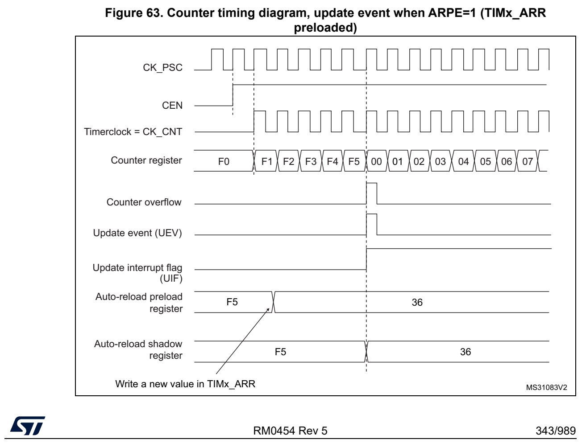
*Figure 63. Counter timing diagram, update event when ARPE=1 (TI Mx_ARR (p. 343)*

Downcounting mode

In downcounting mode, the counter counts from the auto-reload value (content of the TIMx_ARR register) down to 0, then restarts from the auto-reloa d value and generates a counter underflow event.

If the repetition counter is used, the update event (UEV) is ge nerated after downcounting is repeated for the number of times programmed in the repetition counter register (TIMx_RCR) + 1. Else th e update event is generated at each coun ter underflow.

Setting the UG bit in the TIMx_E GR register (by software or by using the slave mode controller) also generates an update event.

The UEV update event can be disa bled by software by setting the UDIS bit in TIMx_CR1 register. This is to avoid updati ng the shadow registers while writing new values in the preload registers. Then no update event occurs u ntil UDIS bit h as been written to 0. However, the counter restarts from the current auto-reload valu e, whereas the counter of the prescaler restarts from 0 (but t he prescale rate doesn’t change).

In addition, if the URS bit (update request selection) in TIMx_CR1 register is set, setting the UG bit generates an update event UEV but without setting the UI F flag (thus no interrupt or DMA request is sent). This is to avoid generating both update a nd capture interrupts when clearing the counter on the capture event.

When an update even t occurs, all the registers are updated and the update flag (UIF bit in TIMx_SR register) is set (depending on the URS bit):

- The repetition counter is reload ed with the content of TIMx_RCR register.

- The buffer of the prescaler is reloaded with the preload value (content of the TIMx_PSC register).

- The auto-reload active register is updated with the preload val ue (content of the TIMx_ARR register). Note that the auto-reload is updated before the counter is reloaded, so that the next period is the expected one.

The following figures show some examples of the counter behavio r for different clock frequencies when TIMx_ARR=0x36.

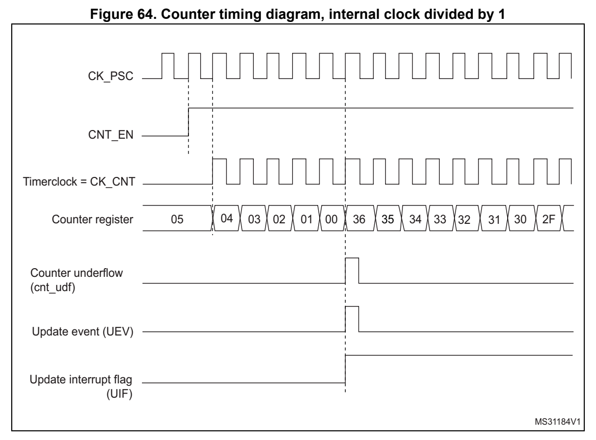
*Figure 64. Counter timing diagra m, internal clock divided by 1 (p. 345)*

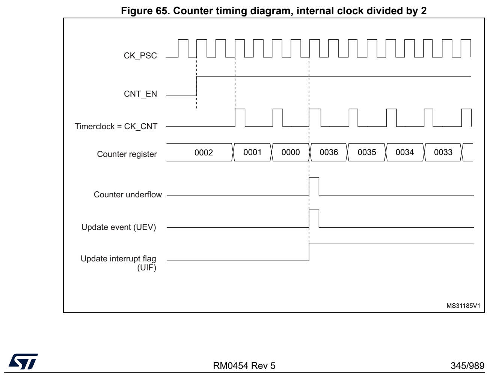
*Figure 65. Counter timing diagra m, internal clock divided by 2 (p. 345)*

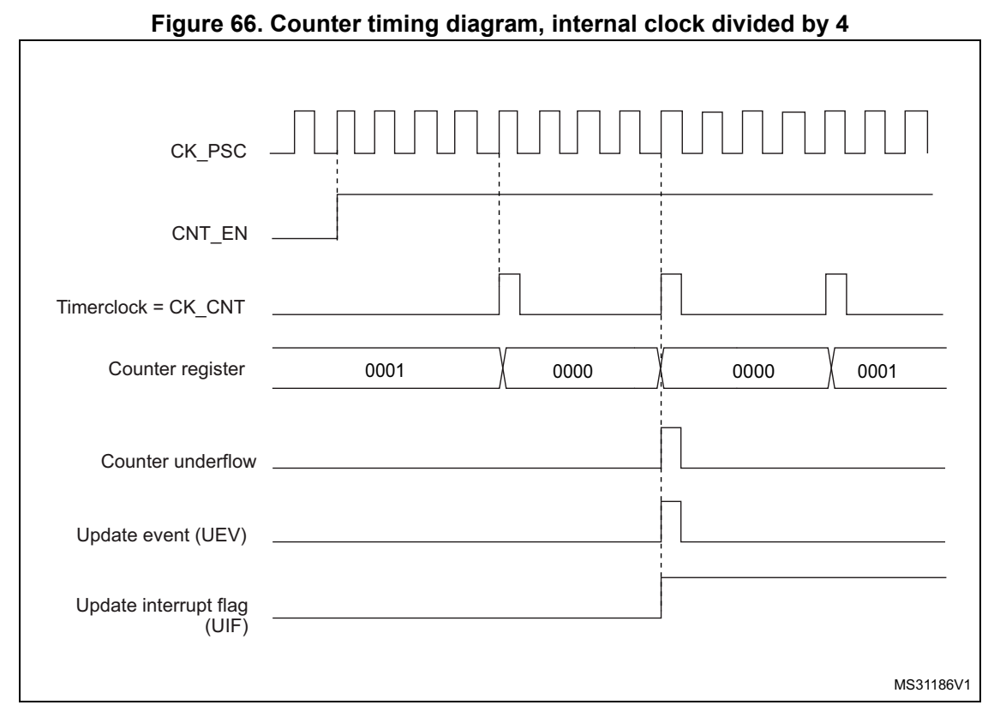
*Figure 66. Counter timing diagra m, internal clock divided by 4 (p. 346)*

*Figure 67. Counter timing diagra m, internal clock divided by N (p. 346)*

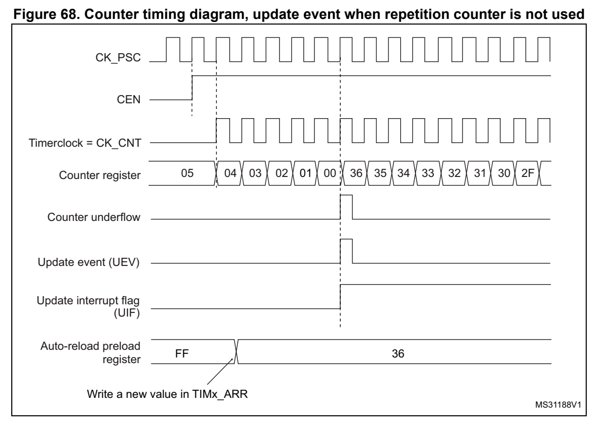
*Figure 68. Counter timing diagra m, update event when repetition counter is not used (p. 347)*

Center-aligned mode (up/down counting)

In center-aligned mode, the counter counts from 0 to the auto-reload value (content of the TIMx_ARR register) – 1, generates a counter overflow event, the n counts from the auto-reload value down to 1 and generates a counter underflow event. Then it restarts counting from 0.

Center-aligned mode is active when the CMS bits in TIMx_CR1 reg ister are not equal to '00'. The Output compare interru pt flag of channels configured in output is set when: the counter counts down (Center ali gned mode 1, CMS = "01"), the co unter counts up (Center aligned mode 2, CMS = "10") the counter counts up and down (Cen ter aligned mode 3, CMS = "11").

In this mode, the DIR direction bi t in the TIMx_CR 1 register ca nnot be written. It is updated by hardware and gives the current direction of the counter.

The update event can be generated at each counter overflow and at each counter underflow or by setting the UG bit in the TIMx_EGR register (by software or by using the slave mode controller) also generates an up date event. In this case, the counter restarts counting from 0, as well as the counter of the prescaler.

The UEV update event can be disabled by software by setting the UDIS bit in the TIMx_CR1 register. This is to avoid updati ng the shadow registers while writing new values in the preload registers. Then no update event occurs u ntil UDIS bit h as been written to 0. However, the counter continues counting up and down, based on t he current auto-reload value.

In addition, if the URS bit (update request selection) in TIMx_CR1 register is set, setting the UG bit generates an UEV update event but without setting the UI F flag (thus no interrupt or

DMA request is sent). This is to avoid generating both update a nd capture interrupts when clearing the counter on the capture event.

When an update even t occurs, all the registers are updated and the update flag (UIF bit in TIMx_SR register) is set (depending on the URS bit):

- The repetition counter is reload ed with the content of TIMx_RCR register

- The buffer of the prescaler is reloaded with the preload value (content of the TIMx_PSC register)

- The auto-reload active register is updated with the preload val ue (content of the TIMx_ARR register). Note that i f the update source is a counter overflow, the auto-reload is updated before the counter is reloaded, so that the n ext period is the expected one (the counter is loa ded with the new value).

The following figures show some examples of the counter behavio r for different clock frequencies.

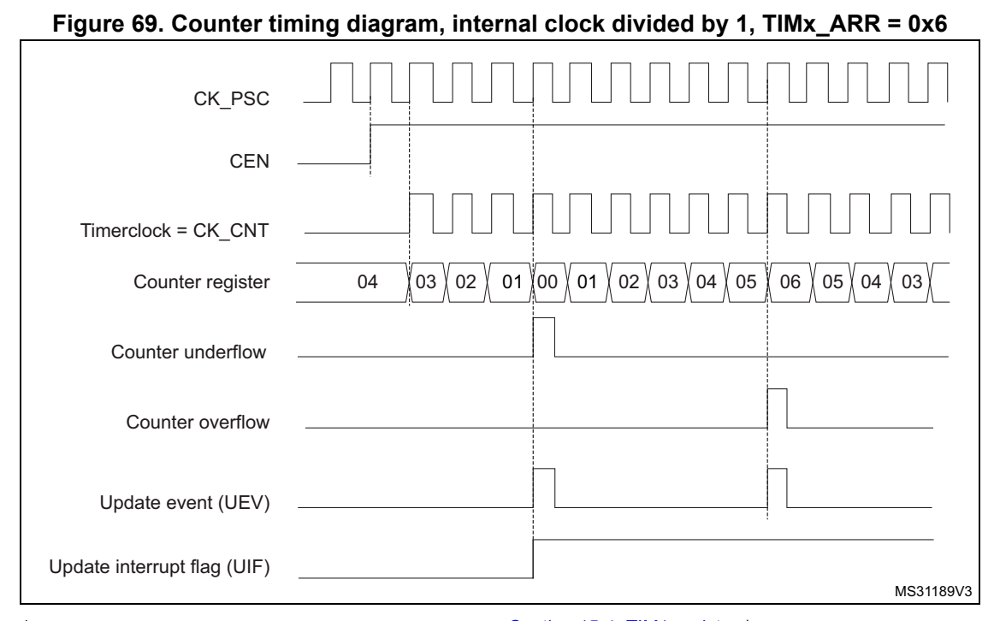
*Figure 69. Counter timing diagram, internal clock divided by 1, TIMx_ARR = 0x6 (p. 348)*

1. Here, center-aligned mode 1 is used (for more details refer to Section 15.4: TIM1 registers).

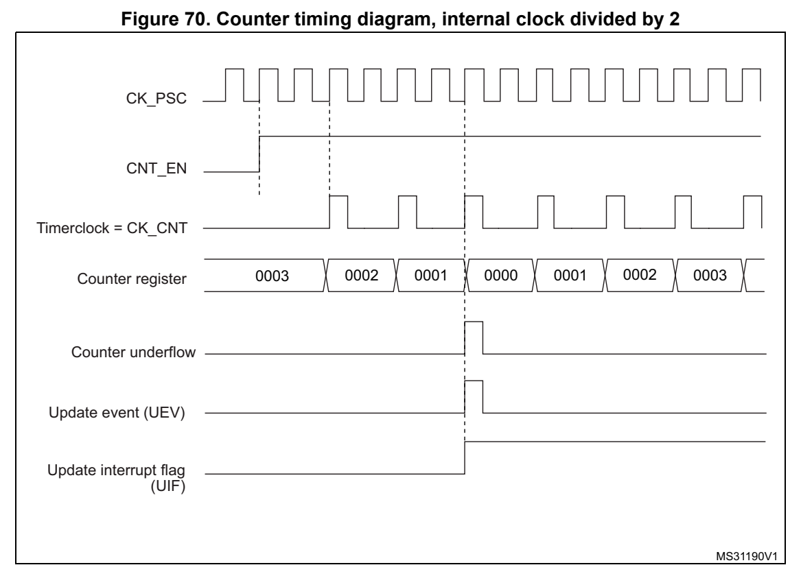
*Figure 70. Counter timing diagra m, internal clock divided by 2 (p. 349)*

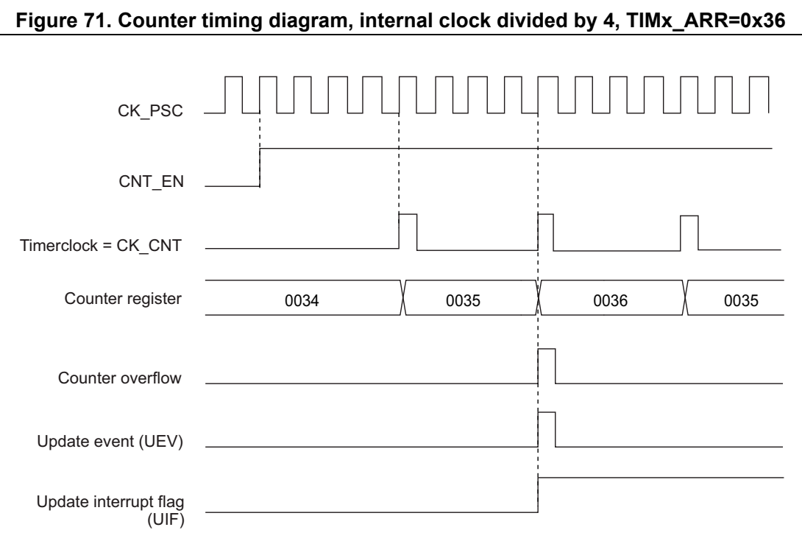
*Figure 71. Counter timing diagram, internal clock divided by 4, TIMx_ARR=0x36 (p. 349)*

Note: Here, center_aligned mode 2 or 3 is updated with an UIF on overflow MS31191V1

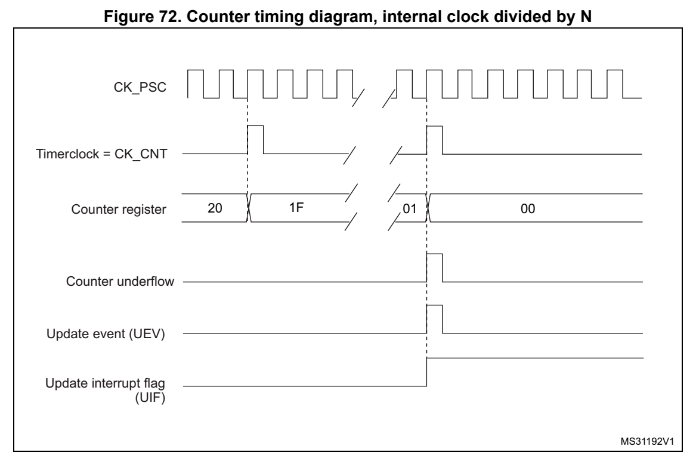
*Figure 72. Counter timing diagra m, internal clock divided by N (p. 350)*

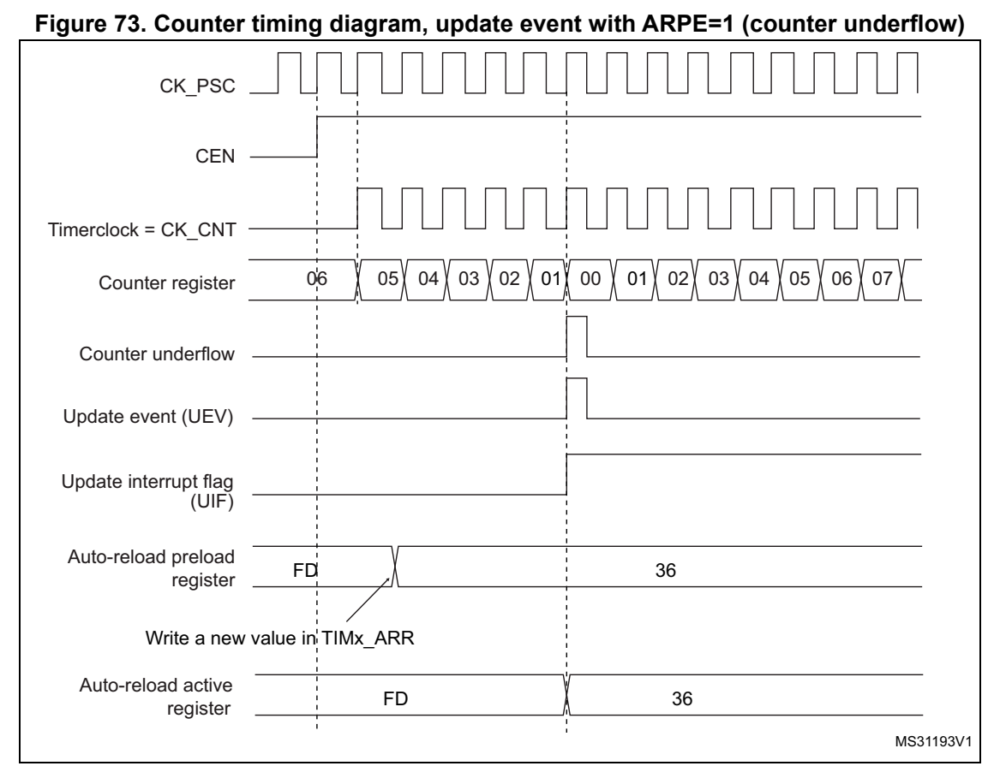
*Figure 73. Counter timing diagram, update event with ARPE=1 (co unter underflow) (p. 350)*

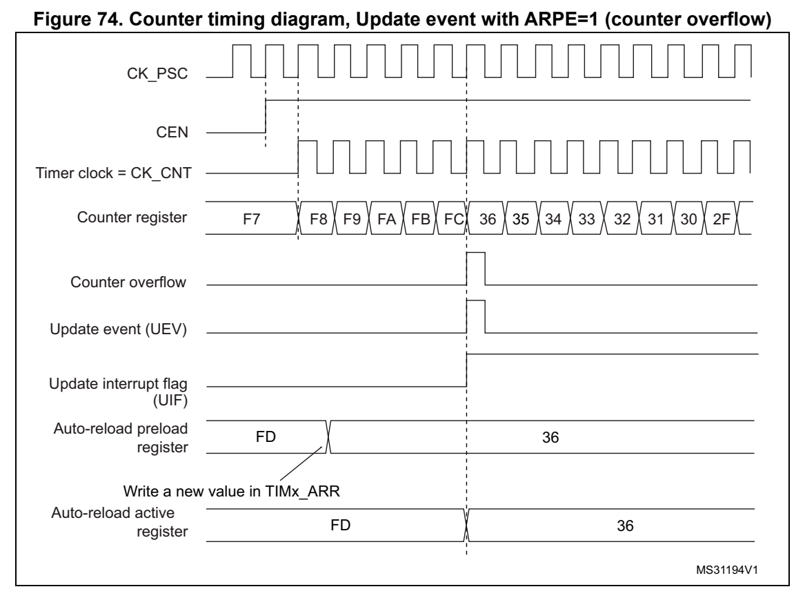
*Figure 74. Counter timing diagra m, Update event with ARPE=1 (co unter overflow) (p. 351)*

#### 15.3.3 Repetition counter (p. 351)

Section 15.3.1: Time-base unit describes how the update event (UEV) is generated with respect to the counter overflows/underflows. It is actually gen erated only when the repetition counter has reached zero. This ca n be useful when generating PW M signals.

This means that data are transferred from the preload registers to the shadow registers (TIMx_ARR auto-reload register, TIMx_PSC prescaler register, bu t also TIMx_CCRx capture/compare registers in com pare mode) every N+1 counter overflows or underflows, where N is the value in the TIMx_RCR repeti tion counter registe r.

The repetition counter is decremented:

- At each counter overfl ow in upcounting mode,

- At each counter underflow in downcounting mode,

- At each counter overflow and at e ach counter underflow in cente r-aligned mode. Although this limits t he maximum number of repetition to 32768 PWM cycles, it makes it possible to update the duty cycle twice per PWM period. When refreshing compare registers only once per PWM period in center-alig ned mode, maxi mum resolution is 2xT ck, due to the symmet ry of the pattern.

The repetition counter is an auto-reload type; the repetition rate is maintained as defined by the TIMx_RCR register value (refer to Figure 75). When the update event is generated by software (by setting the UG bit i n TIMx_EGR register) or by hardware through the slave mode controller, it occurs immediately whatever the value of th e repetition counter is and the repetition counter is reloaded with the content of the TIMx_RCR register.

In Center aligned mode, for odd values of RCR, the update event occurs either on the overflow or on t he underflow depending on when the RCR register was written and when the counter was launch ed: if the RCR was written before launchi ng the counter, the UEV occurs on the underflow. If the RCR was written after launching the counter, the UEV occurs on the overflow.

For example, for RCR = 3, the UEV is generated each 4th overflow or underflow event depending on when t he RCR was written.

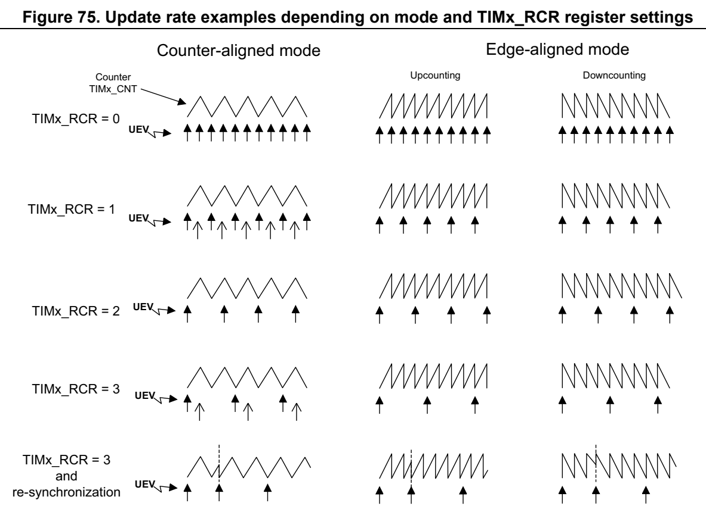
*Figure 75. Update rate examples depe nding on mode and TIMx_RCR register settings (p. 352)*

(by SW) (by SW) (by SW)

UEV Update event: Preload registers transferred to active registers and update interrupt generated Update Event if the repetition counter underflow occurs when the counter is equal to the auto-reload value.

MSv31195V1

#### 15.3.4 External trigger input (p. 353)

The timer features an external trigger input ETR. It can be use d as:

- external clock (externa l clock mode 2, see Section 15.3.5)

- trigger for the slave mode (see Section 15.3.26)

- PWM reset input for cycle-by-cyc le current regulation (see Section 15.3.7)

Figure 76 below describes the ETR input conditioning. The input polarity is defined with the ETP bit in TIMxSMCR register. The trigger can be prescaled with the divider programmed by the ETPS[1:0] bitfield and di gitally filtered w ith the ETF[3:0] bitfield.

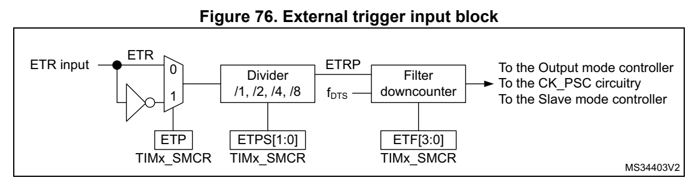
*Figure 76. External trigger input block (p. 353)*

The ETR input comes from multipl e sources: input pins (default configuration) and analog watchdogs. The selection is done with the ETRSEL[3:0] bitfield.

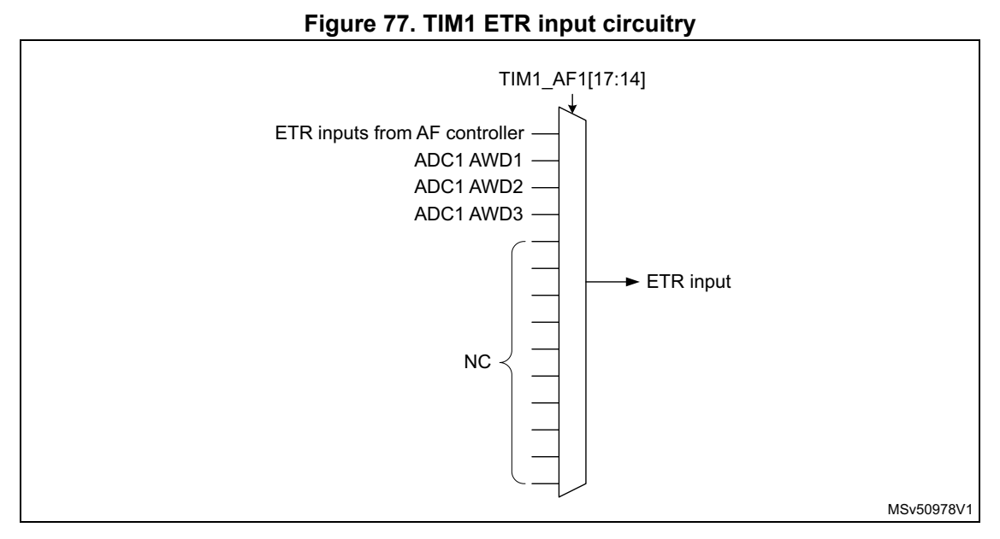
*Figure 77. TIM1 ETR input circuitry (p. 353)*

#### 15.3.5 Clock selection (p. 354)

The counter clock can be provide d by the following clock source s:

- Internal clock (CK_INT)

- External clock mode1: external input pin

- External clock mode2: external trigger input ETR

- Encoder mode

Internal clock source (CK_INT)

If the slave mode controller is d isabled (SMS=000), then the CE N, DIR (in the TIMx_CR1 register) and UG bits (in the TI Mx_EGR register) are actual con trol bits and can be changed only by software (except UG which remains cleared automatically). As soon as the CEN bit is written to 1, the prescaler is clocked by the internal clock CK_INT.

Figure 78 shows the behavior of the control circuit and the upcounter in normal mode, without prescaler.

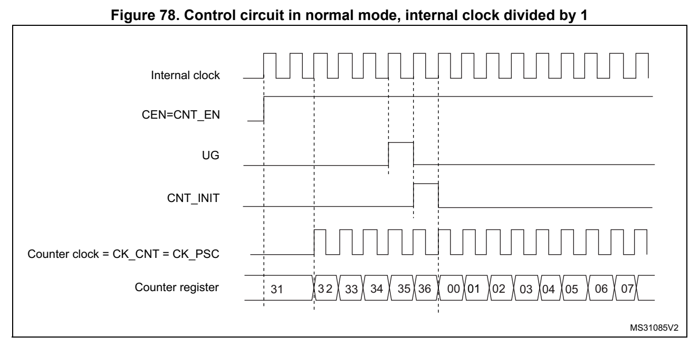
*Figure 78. Control circuit in no rmal mode, internal clock divid ed by 1 (p. 354)*

External clock source mode 1

This mode is selected when SMS=111 in the TIMx_SMCR register. The counter can count at each rising or falling edg e on a selected input.

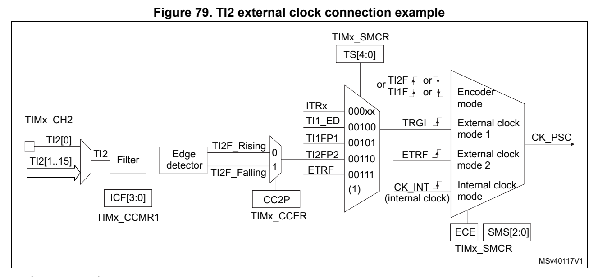
*Figure 79. TI2 external clock connection example (p. 355)*

1. Codes ranging from 01000 to 11111 are reserved For example, to configure the upcounter to count in response to a rising edge on the TI2 input, use the following procedure: 1. Select the proper TI2x source (internal or external) with the TI2SEL[3:0] bits in the TIMx_TISEL register. 2. Configure channel 2 to detect rising edges on the TI2 input by writing CC2S = ‘01’ in the TIMx_CCMR1 register. 3. Configure the input filter duration by writing the IC2F[3:0] bits in the TIMx_CCMR1 register (if no filter is needed, keep IC2F=0000). 4. Select rising edge polarity by writing CC2P=0 and CC2NP=0 in the TIMx_CCER register. 5. Configure the timer in externa l clock mode 1 by writing SMS= 111 in the TIMx_SMCR register. 6. Select TI2 as the trigger in put source by writing TS=00110 i n the TIMx_SMCR register. 7. Enable the counter by writing CEN=1 in the TIMx_CR1 register.

Note: The capture prescaler is not used for trigge ring, so the user does not need to configure it.

When a rising edge occurs on TI2, the counter counts once and t he TIF flag is set.

The delay between the rising edge on TI2 and the actual clock of the counter is due to the resynchronization circuit on TI2 input.

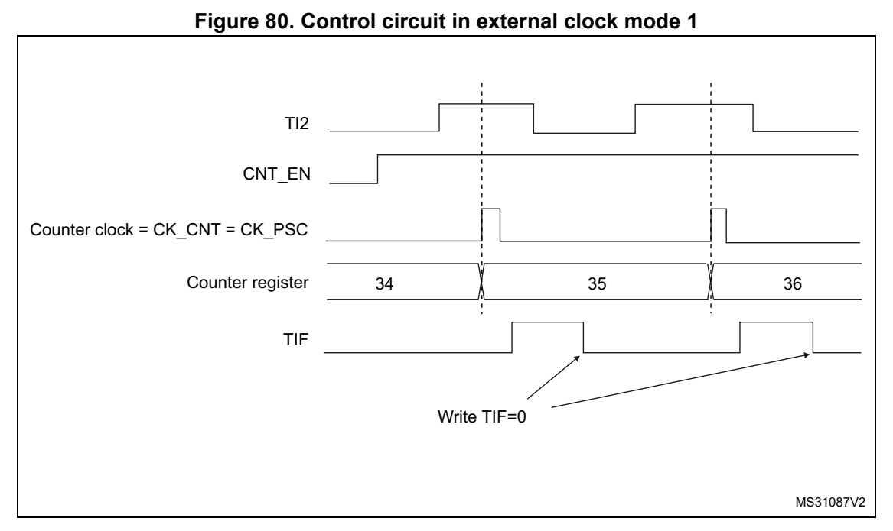
*Figure 80. Control circuit in external clock mode 1 (p. 356)*

External clock source mode 2

This mode is selected by writing ECE=1 in the TIMx_SMCR registe r.

The counter can coun t at each rising or falling edge on the external trigger input ETR.

The Figure 81 gives an overview of the external trigger input block.

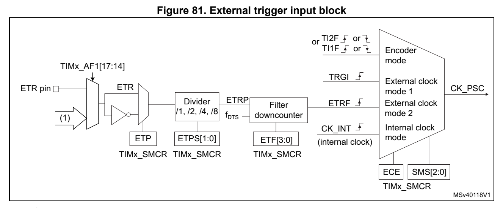
*Figure 81. External trigger input block (p. 356)*

1. Refer to Figure 77: TIM1 ETR input circuitry. For example, to configure the upcounter to count each 2 rising edges on ETR, use the following p rocedure:

1. As no filter is needed in this example, write ETF[3:0]=0000 i n the TIMx_SMCR register. 2. Set the prescaler by writing ETPS[1:0]=01 in the TIMx_SMCR register 3. Select rising edge detection o n the ETR pin by writing ETP=0 in the TIMx_SMCR register 4. Enable external clock mode 2 by writing ECE=1 in the TIMx_SM CR register. 5. Enable the counter by writing CEN=1 in the TIMx_CR1 register.

The counter counts once each 2 ETR rising edges.

The delay between the rising edge on ETR and the actual clock of the counter is due to the resynchronization circuit on the ETRP signal. As a consequence, the maximum frequency which can be correctly captured by the counter is at most ¼ of TIMxCLK frequency. When the ETRP signal is faster, the user should apply a division of the external signal by proper ETPS prescaler setting.

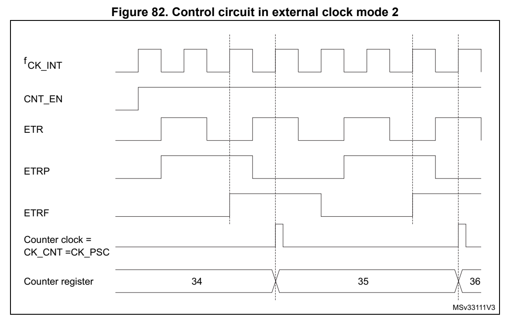
*Figure 82. Control circuit in external clock mode 2 (p. 357)*

#### 15.3.6 Capture/compare channels (p. 358)

Each Capture/Compare channel is built around a capture/compare register (including a shadow register), an i nput stage for capture (with digital filter, multiplexing, and prescaler, except for channels 5 and 6) and an output stage (with comparator and output control).

Figure 83 to Figure 86 give an overview of one Capture/Compare channel.

The input stage samples the corresponding TIx input to generate a filtered signal TIxF. Then, an edge detector with pola rity selection generates a sign al (TIxFPx) which can be used as trigger input by the slave mode controller or as the ca pture command. It is prescaled before the capture register (ICxPS).

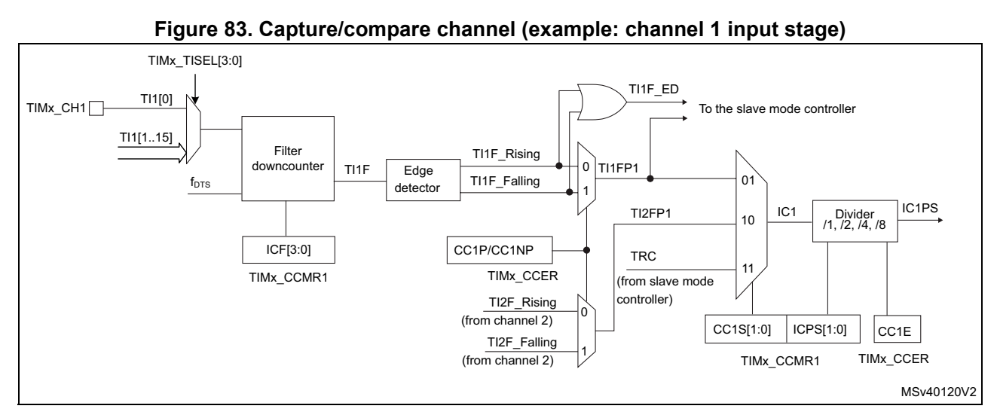
*Figure 83. Capture/compare channe l (example: channel 1 input stage) (p. 358)*

The output stage generates an intermediate waveform which is th en used for reference: OCxRef (active high). The polarity acts at the end of the chain.

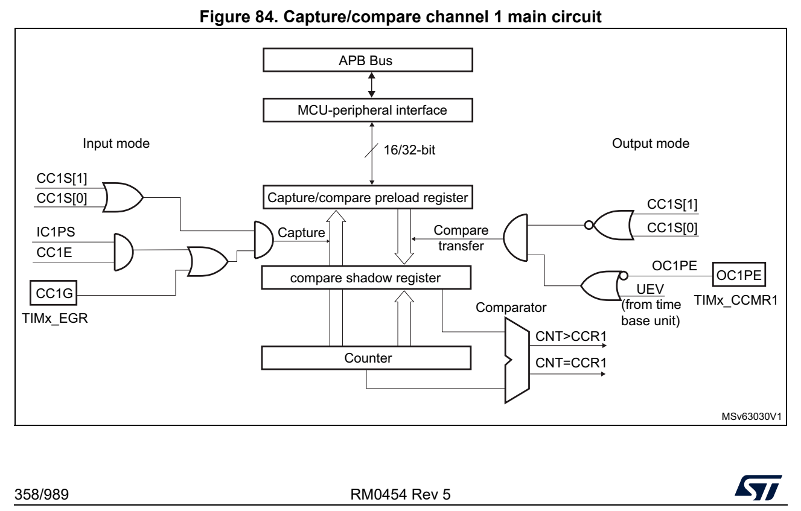
*Figure 84. Capture/compare channel 1 main circuit (p. 358)*

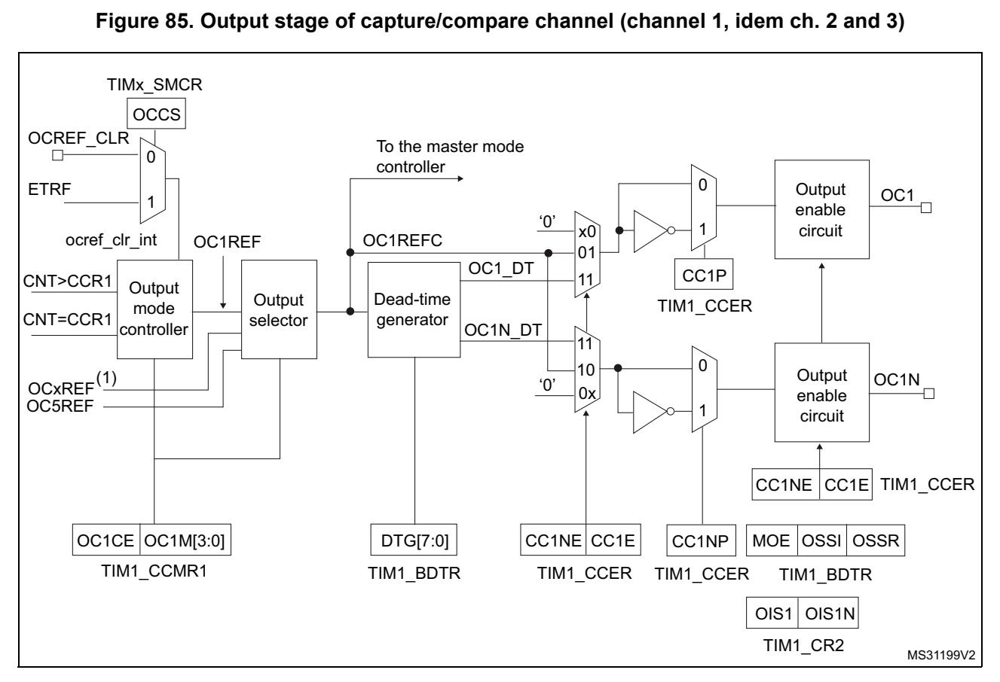
*Figure 85. Output stage of capture/compare channel (channel 1, idem ch. 2 and 3) (p. 359)*

1. OCxREF, where x is the rank of the complementary channel

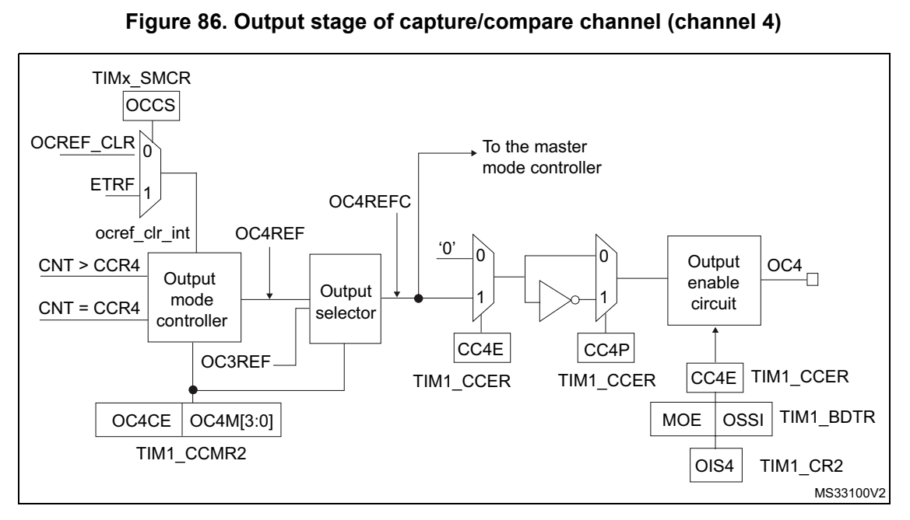
*Figure 86. Output stage of capture/compare channel (channel 4) (p. 359)*

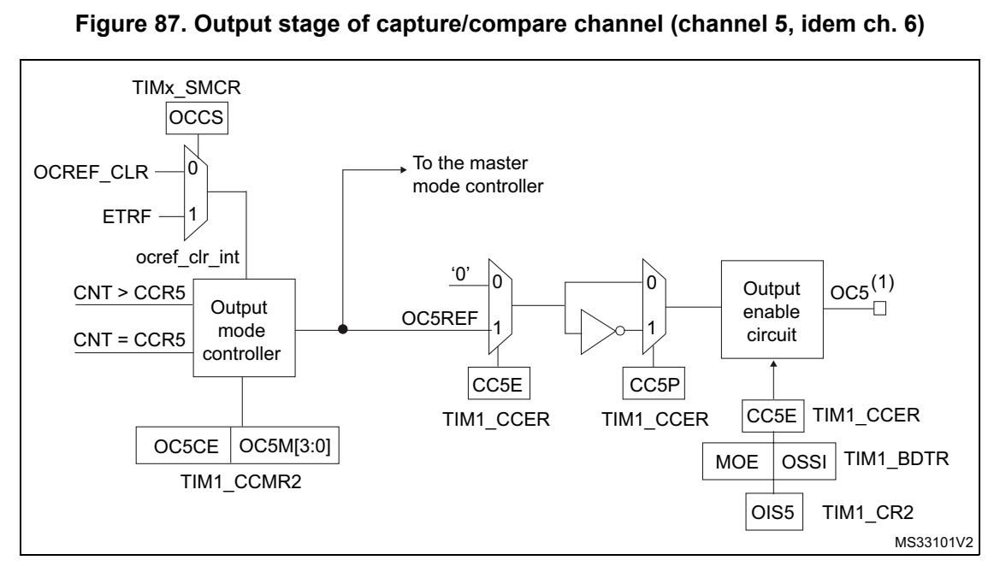
*Figure 87. Output stage of capture/compare channel (channel 5, idem ch. 6) (p. 360)*

1. Not available externally. The capture/compare block is made of one preload register and o ne shadow register. Write and read always access the preload register.

In capture mode, captures are actually done in the shadow register, which is copied into the preload register.

In compare mode, the content of the p reload registe r is copied into the shadow register which is compared to the counter.

#### 15.3.7 Input capture mode (p. 360)

In Input capture mode, the Capture/Compare Registers (TIMx_CCRx) are used to latch the value of the counter after a transition dete cted by the corresp onding ICx signal. When a capture occurs, the corresponding CCXIF flag (TIMx_SR register) is set and an interrupt or a DMA request can be sent if they are enabled. If a capture occ urs while the CCxIF flag was already high, then the over-captu re flag CCxOF (TIMx_SR registe r) is set. CCxIF can be cleared by software by writing i t to ‘0’ or by reading the capt ured data stored in the TIMx_CCRx register. CCxOF is cl eared when written with ‘0’.

The following example shows how to capture the counter value in TIMx_CCR1 when TI1 input rises. To do this, us e the following procedure: 1. Select the proper TI1x source (internal or external) with the TI1SEL[3:0] bits in the TIMx_TISEL register. 2. Select the active input: TIMx_CCR1 must be linked to the TI1 input, so write the CC1S bits to 01 in the TIMx_CCMR1 register. As soon as CC1S becomes different from 00, the channel is configured in inp ut and the TIMx_CCR1 register b ecomes read-only. 3. Program the appropriate input filter duration in relation wi th the signal connected to the timer (when the input is one of the TIx (ICxF bits in the TIMx_CCMRx register). Let’s imagine that, when toggling, the input signal is not stable during at must 5 internal clock cycles. We must program a filter duration lo nger than these 5 c lock cycles. We can validate a transition on TI1 when 8 consecutive samples with th e new level have been

detected (sampled at f DTS frequency). Then write IC1F bits to 0011 in the TIMx_CCMR1 register. 4. Select the edge of the active transition on the TI1 channel by writing CC1P and CC1NP bits to 0 in the TIMx_CCER register (rising edge in this case). 5. Program the input prescaler. In our exa mple, we wish the cap ture to be performed at each valid transition, so the prescaler is disabled (write IC1P S bits to ‘00’ in the TIMx_CCMR1 register). 6. Enable capture from the counter into the capture register by setting the CC1E bit in the TIMx_CCER register. 7. If needed, enable the related interrupt request by setting t he CC1IE bit in the TIMx_DIER register, and/or the DMA request by setting the CC1DE bit in the TIMx_DIER register.

When an input capture occurs:

- The TIMx_CCR1 register gets the value of the counter on the act ive transition.

- CC1IF flag is set (interrupt flag). CC1OF is also set if at lea st two consecutive captures occurred whereas the flag was not cleared.

- An interrupt is generated depending on the CC1IE bit.

- A DMA request is generated depending on the CC1DE bit.

In order to handle the overcapt ure, it is recomm ended to read t he data before the overcapture flag. This is to avoid missing an overcapture which could happen after reading the flag and before reading the data.

Note: IC interrupt and/or DMA requests can be generated by software by setting the corresponding CCxG bit in the TIMx_EGR register.

#### 15.3.8 PWM input mode (p. 361)

This mode is a particular case of input capture mode. The proce dure is the same except:

- Two ICx signals are mapp ed on the same TIx input.

- These 2 ICx signals are active on edges wit h opposite polarity.

- One of the two TIxFP signals is s elected as trigger input and t he slave mode controller is configured in reset mode.

For example, the user can measure the period (in TIMx_CCR1 regi ster) and the duty cycle (in TIMx_CCR2 register) of the PWM applied on TI1 using the fol lowing procedure (depending on CK_INT frequ ency and prescaler value):

1. Select the proper TI1x source (internal or external) with the TI1SEL[3:0] bits in the TIMx_TISEL register. 2. Select the active in put for TIMx_CCR1: write the CC1S bits to 01 in the TIMx_CCMR1 register (TI1 selected). 3. Select the active polarity fo r TI1FP1 (used both for capture in TIMx_CCR1 and counter clear): write the CC1P and CC1NP bits to ‘0’ (active on rising edge). 4. Select the active in put for TIMx_CCR2: write the CC2S bits to 10 in the TIMx_CCMR1 register (TI1 selected). 5. Select the active polarity fo r TI1FP2 (used fo r capture in T IMx_CCR2): write the CC2P and CC2NP bits to CC2P/CC2NP= ’10’ (active on falling edge). 6. Select the valid trigger input: write the TS bits to 00101 i n the TIMx_SMCR register (TI1FP1 selected). 7. Configure the slave mode controller in reset mode: write the SMS bits to 0100 in the TIMx_SMCR register. 8. Enable the captures: write t he CC1E and CC2E bits to ‘1’ in the TIMx_CCER register.

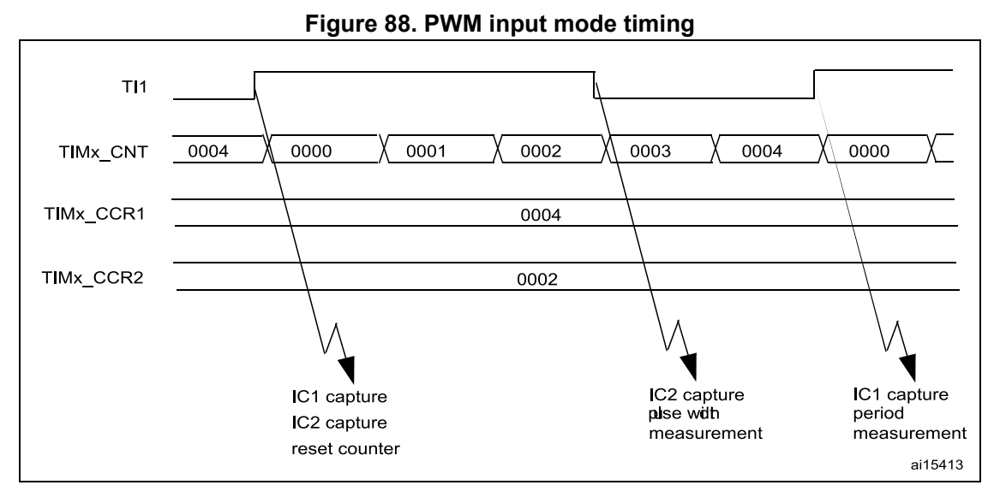
*Figure 88. PWM input mode timing (p. 362)*

#### 15.3.9 Forced output mode (p. 362)

In output mode (CCxS bi ts = 00 in the TIMx_CCMRx register), eac h output compare signal (OCxREF and then OCx/OCxN) can be forced to active or inactive level directly by software, independently of any comparison between the output compare regi ster and the counter.

To force an output compare signal (OCXREF/OCx) to its active level, user just needs to write 0101 in the OCxM bits in the corresponding TIMx_CCMRx reg ister. Thus OCXREF is forced high (OCxREF is always active high) and OCx get opposite value to CCxP polarity bit.

For example: CCxP=0 (OCx active high) => OCx is forced to high level.

The OCxREF signal can be forced low by writing t he OCxM bits to 0100 in the TIMx_CCMRx register.

Anyway, the comparison between the TIMx_CCRx shadow register an d the counter is still performed and allows the flag to be set. Interrupt and DMA requ ests can be sent accordingly. This is described i n the output com pare mode secti on below.

#### 15.3.10 Output compare mode (p. 363)

This function is used to control an output wavefo rm or indicate when a period of time has elapsed. Channels 1 to 4 can be output, while Channel 5 and 6 a re only available inside the device (for instance, for compound waveform generation or for A DC triggering).

When a match is found between the capture/compare register and the counter, the output compare function:

- Assigns the corresponding output pin to a programmable value defined by the output compare mode (OCxM bits in the TIMx_CCMRx register) and the out put polarity (CCxP bit in the TIMx_CCER register). The output pin can keep its level (OCXM=0000), be set active (OCxM=0001), be set inactive (OCxM=0010) or can toggle ( OCxM=0011) on match.

- Sets a flag in the interrupt sta tus register (CCxIF bit in the TIMx_SR register).

- Generates an interrupt if the corresponding interrupt mask is s et (CCXIE bit in the TIMx_DIER register).

- Sends a DMA request if the corresponding enable bit is set (CCx DE bit in the TIMx_DIER register, CCDS bit in the TIMx_CR2 register for the D MA request selection).

The TIMx_CCRx registers can be p rogrammed with or without prelo ad registers using the OCxPE bit in the TIMx_CCMRx register.

In output compare mode, the update event UEV has no effect on O CxREF and OCx output. The timing resolution is one count of the counter. Output compa re mode can also be used to output a single pulse (in One Pulse mode).

Procedure

1. Select the counter clock (i nternal, external, prescaler). 2. Write the desired data in the TIMx_ARR and TIMx_CCRx registe rs. 3. Set the CCxIE bit if an interrupt request is to be generated. 4. Select the output mode. For example: – Write OCxM = 0011 to toggle OCx output pin when CNT matches CC Rx – Write OCxPE = 0 to dis able preload register – Write CCxP = 0 to select active high polarity – Write CCxE = 1 to enable the output 5. Enable the counter by setting the CEN bit in the TIMx_CR1 re gister.

The TIMx_CCRx register can be upd ated at any time by software to control the output waveform, provided that the preload register is not enabled (OCxPE=’0’, else TIMx_CCRx shadow register is updated only at the next update event UEV). An example is given in Figure 89.

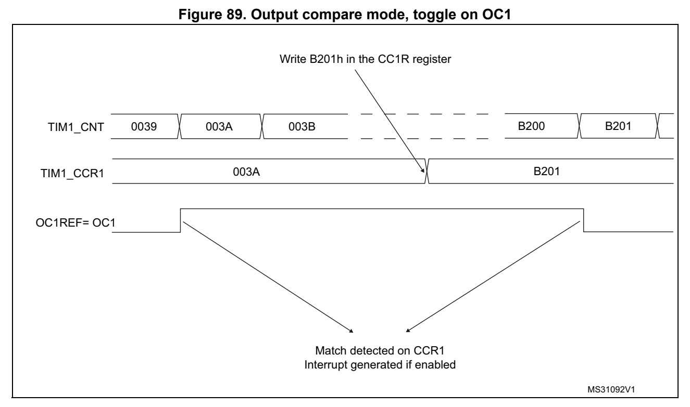
*Figure 89. Output compa re mode, toggle on OC1 (p. 364)*

#### 15.3.11 PWM mode (p. 364)

Pulse Width Modulation mode allows a signal to be generated wit h a frequency determined by the value of the TIMx_ARR regi ster and a duty cycle determin ed by the value of the TIMx_CCRx register.

The PWM mode can be selected i ndependently on each channel (one PWM per OCx output) by writing ‘0110’ (PWM m ode 1) or ‘0111’ (PWM mode 2) i n the OCxM bits in the TIMx_CCMRx register. The corresp onding preload register must be enabled by setting the OCxPE bit in the TIMx_CCMRx regi ster, and eventually the auto-reload preload register (in upcounting or center-aligned mode s) by setting the ARPE bit in the TIMx_CR1 register.

As the preload registers are transferred to the shadow registers only when an update event occurs, before starting the coun ter, all registers must be init ialized by setting the UG bit in the TIMx_EGR register.

OCx polarity is software progra mmable using the CCxP bit in the TIMx_CCER register. It can be programmed as active high or active low. OCx output is e nabled by a combination of the CCxE, CCxNE, MOE, OSSI and OSS R bits (TIMx_CCE R and TIMx_BD TR registers). Refer to the TIMx_CCER register description for more details.

In PWM mode (1 or 2), TIMx_CNT and TIMx_CCRx are always compare d to determine whether TIMx_CCRx ≤ TIMx_CNT or TIMx_CNT ≤ TIMx_CCRx (depending on the direction of the counter).

The timer is able to generate PWM in edge-aligned mode or cente r-aligned mode depending on the CMS bits in the TIMx_CR1 register.

PWM edge-aligned mode

- Upcounting configuration Upcounting is active when the DIR bit in the TIMx_CR1 register is low. Refer to the Upcounting mode on page 340. In the following example, we cons ider PWM mode 1. The reference PWM signal OCxREF is high as long as TIMx_CNT < TIMx_CCRx else it becomes low. If the compare value in TIMx_CCRx is greater than the au to-reload valu e (in TIMx_ARR) then OCxREF is held at ‘1’. If t he compare value is 0 then OCxRef is held at ‘0’. Figure 90 shows some edge-aligned PWM waveforms in an example where TIMx_ARR=8.

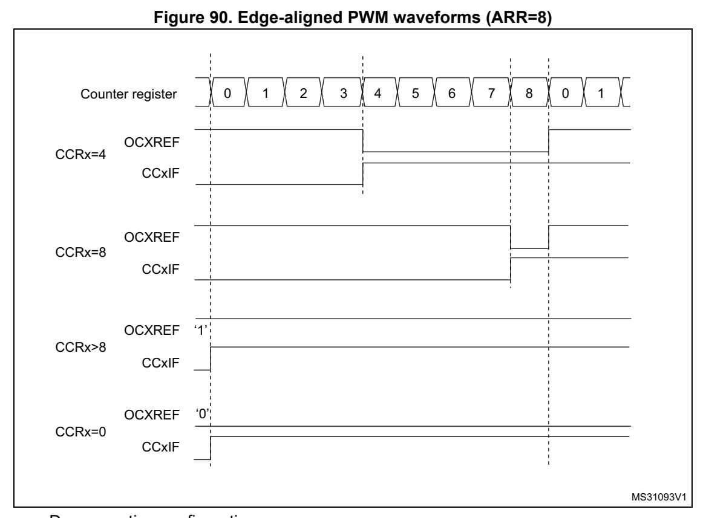
*Figure 90. Edge-aligned PWM waveforms (ARR=8) (p. 365)*

- Downcounting configuration Downcounting is active when DIR bit in TIMx_CR1 register is hig h. Refer to the Downcounting mode on page 344 In PWM mode 1, the reference si gnal OCxRef is l ow as long as TIMx_CNT > TIMx_CCRx else it becomes high. If the compare value in TIMx_CCRx is greater than the auto-reload value in TIMx_ARR, then OCxREF is held at ‘1’. 0% PWM is not possible in this mode.

PWM center-aligned mode

Center-aligned mode is active when the CMS bits in TIMx_CR1 reg ister are different from ‘00’ (all the remaini ng configurations having the same effect o n the OCxRef/O Cx signals). The compare flag is set when th e counter counts up, when it cou nts down or both when it counts up and down depending on the CMS bits configuration. The direction bit (DIR) in the

TIMx_CR1 register is upd ated by hardware and must not be change d by software. Refer to the Center-aligned mode (up/down counting) on page 347.

Figure 91 shows some center-aligned PWM waveforms in an example where:

- TIMx_ARR=8,

- PWM mode is the PWM mode 1,

- The flag is set when the counter counts down corresponding to t he center-aligned mode 1 selected for CMS=01 in TIMx_CR1 register.

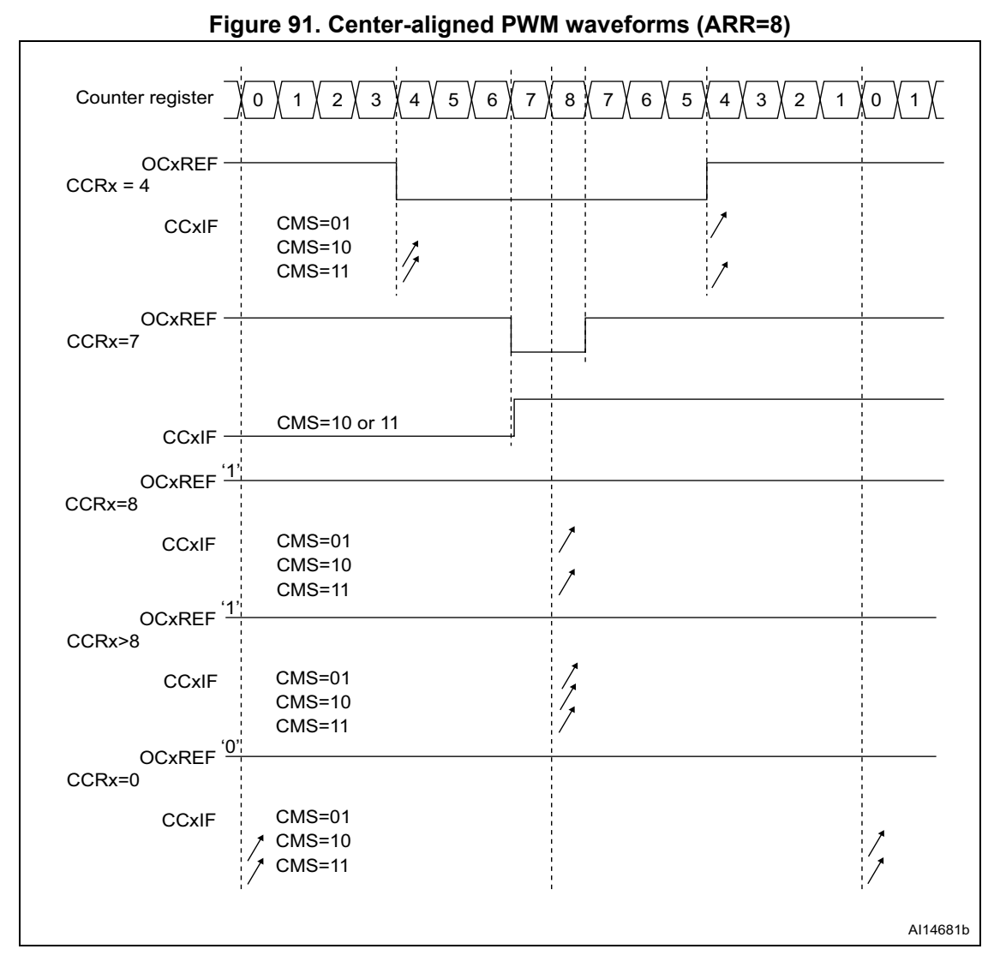
*Figure 91. Cente r-aligned PWM waveforms (ARR=8) (p. 366)*

Hints on using center-aligned mode

- When starting in center-aligned mode, the current up-down confi guration is used. It means that the counter counts up or down depending on the value written in the DIR bit

in the TIMx_CR1 register. Moreover, the DIR and CMS bits must n ot be changed at the same time by the software.

- Writing to the counte r while running in center-aligned mode is not recommended as it can lead to unexpected results. In particular: – The direction is not updated if a value greater than the auto- reload value is written in the counter (TIMx_CNT>TIMx_A RR). For example, if the counter was counting up, it continues to count up. – The direction is updated if 0 or the TIMx_ARR value is written in the counter but no Update Event UEV is generated.

- The safest way to use center-a ligned mode is to generate an upd ate by software (setting the UG bit in the TIMx_E GR register) just before start ing the counter and not to write the counter while it is running.

#### 15.3.12 Asymmetric PWM mode (p. 367)

Asymmetric mode allows two center-aligned PWM signals to be gen erated with a programmable phase shift. While the frequency is determined by the value of the TIMx_ARR register, the duty cycl e and the phase-shift are determined by a pair of TIMx_CCRx register. One register controls the PWM during up-cou nting, the second during down counting, so that PWM is a djusted every half PWM cycle: – OC1REFC (or OC2REFC) is controlled by TIMx_CCR1 and TIMx_CCR2 – OC3REFC (or OC4REFC) is controlled by TIMx_CCR3 and TIMx_CCR4

Asymmetric PWM mode can be selected independently on two channe l (one OCx output per pair of CCR registers) by writing ‘1110’ (Asymmetric PWM mo de 1) or ‘1111’ (Asymmetric PWM mode 2) in the OCxM bits in the TIMx_CCMRx regi ster.

Note: The OCxM[3:0] bit field is split into two pa rts for compatibility reason s, the most significant bit is not contiguous with the 3 least significant ones.

When a given channel is used as asymmetric PWM channel, its com plementary channel can also be used. For instance, if an OC1REFC si gnal is generated on channel 1 (Asymmetric PWM mode 1), it is p ossible to output either the OC 2REF signal on channel 2, or an OC2REFC signal resulting from asymmetric PWM mode 1.

Figure 92 represents an example of signal s that can be generated using Asymmetric PWM mode (channels 1 to 4 are configu red in Asymmetric PWM mode 1). Together with the deadtime generator, this allows a full-bridge phase-shifted DC to DC converter to be controlled.

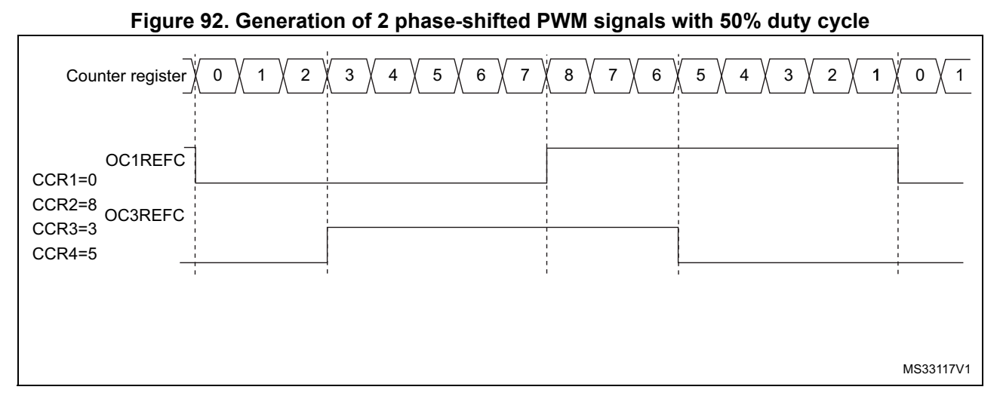
*Figure 92. Generation of 2 phase -shifted PWM signals with 50% d uty cycle (p. 368)*

#### 15.3.13 Combined PWM mode (p. 368)

Combined PWM mode allows two edge or center-aligned PWM signals to be generated with programmable delay and phase shift between respective pulses. W hile the frequency is determined by the value of the TIMx_ARR register, the duty cycl e and delay are determined by the two TIMx_CCRx registers. T he resulting signals, OCxREFC, are made of an OR or AND logical combination of two reference PWMs: – OC1REFC (or OC2REFC) is controlled by TIMx_CCR1 and TIMx_CCR2 – OC3REFC (or OC4REFC) is controlled by TIMx_CCR3 and TIMx_CCR4

Combined PWM mode can be selected independently on two channels (one OCx output per pair of CCR registers) by writing ‘1100’ (Combined PWM mode 1) or ‘1101’ (Combined PWM mode 2) in the OCxM bits in the TIMx_CCMRx register.

When a given channel is used as combined PWM channel, its compl ementary channel must be configured in the opposite PWM mode (for instance, one in Co mbined PWM mode 1 and the other in Combined PWM mode 2).

Note: The OCxM[3:0] bit field is split into two pa rts for compatibility reason s, the most significant bit is not contiguous with the 3 least significant ones.

Figure 93 represents an example of signal s that can be generated using Asymmetric PWM mode, obtained with the following configuration: – Channel 1 is configured in Combined PWM mode 2, – Channel 2 is configured in PWM mode 1, – Channel 3 is configured in Combined PWM mode 2, – Channel 4 is configured in PWM mode 1.

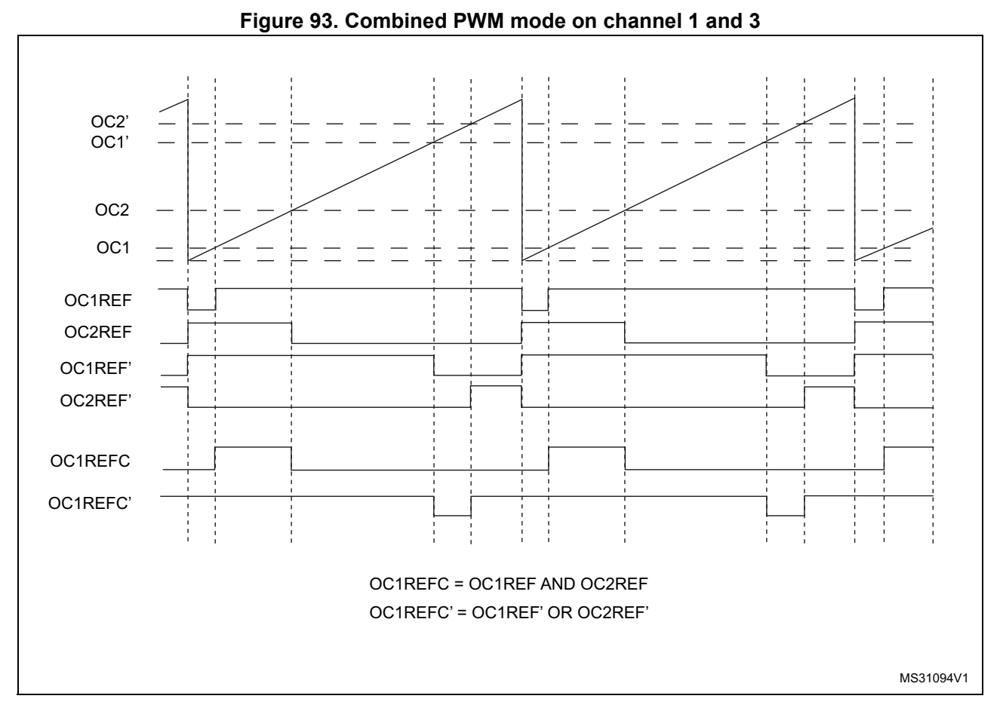
*Figure 93. Combined PWM mode on channel 1 and 3 (p. 369)*

#### 15.3.14 Combined 3-phase PWM mode (p. 369)

Combined 3-phase PWM mode allows one to three center-aligned PW M signals to be generated with a single programmable signal ANDed in the middle of the pulses. The OC5REF signal is used to define the resulting combined signal. The 3-bits GC5C[3:1] in the TIMx_CCR5 allow selectio n on which reference signal the OC5REF is combined. The resulting signals, OCxREFC, are made of an AND l ogical combinat ion of two reference PWMs: – If GC5C1 is set, OC1REFC is cont rolled by TIMx_CCR1 and TIMx_C CR5 – If GC5C2 is set, OC2REFC is cont rolled by TIMx_CCR2 and TIMx_C CR5 – If GC5C3 is set, OC3REFC is cont rolled by TIMx_CCR3 and TIMx_C CR5

Combined 3-phase PWM mode can be selected independently on chan nels 1 to 3 by setting at least one of the 3-bits GC5C[3:1].

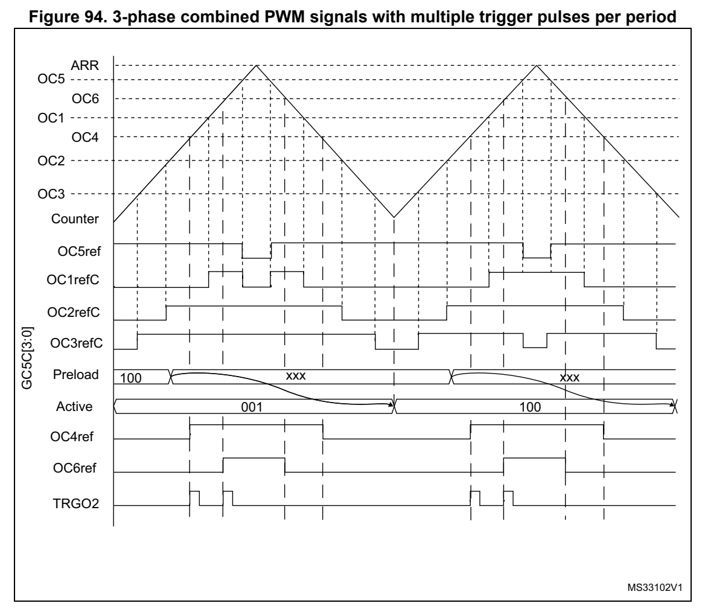
*Figure 94. 3-phase combined PWM signals with multiple trigger p ulses per period (p. 370)*

The TRGO2 waveform shows how t he ADC can be synchronized on given 3-phase PWM signals. Refer to Section 15.3.27: ADC synchronization for more details.

#### 15.3.15 Complementary outputs and dead-time insertion (p. 370)

The advanced-control timers (TIM1) can output two complementary signals and manage the switching-off and th e switching-on instants of the outputs.

This time is generally known as dead-time and it has to be adju sted depending on the devices that are connected to the outputs and their characteristics (intrinsic delays of level-shifters, delays due to power switches...)

The polarity of the outputs (main output OCx or complementary O CxN) can be selected independently for each output. T his is done by writing to the C CxP and CCxNP bits in the TIMx_CCER register.

The complementary signa ls OCx and OCxN are activated by a combi nation of several control bits: the CCxE and CCxNE bits in t he TIMx_CCER register and the MOE, OISx, OISxN, OSSI and OSSR bits in the TIMx_BDTR and TIMx_CR2 registe rs. Refer to Table 70: Output control bits for complementary OCx and OCxN channels with break feature on page 416 for more details. In particular, the dead-time is activated wh en switching to the idle state (MOE falling down to 0).

Dead-time insertion is enabled by setting both CCxE and CCxNE b its, and the MOE bit if the break circuit is present. There is one 10-bit dead-time generator for each channel. From a reference waveform OCxREF, it g enerates 2 outputs OCx and OCxN. If OCx and OCxN are active high:

- The OCx output signal is the sam e as the reference signal excep t for the rising edge, which is delayed relative to the reference rising edge.

- The OCxN output signal is the opp osite of the reference signal except for the rising edge, which is delaye d relative to the reference falling edge.

If the delay is greater than t he width of the act ive output (OCx or OCxN) then the corresponding pulse is not generated.

The following figures show the relationships between the output signals of the dead-time generator and the refe rence signal OCxREF. (we suppose CCxP=0, CCxNP=0, MOE=1, CCxE=1 and CCxNE=1 in these examples)

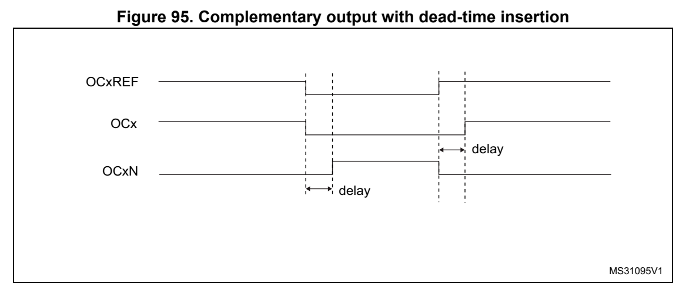
*Figure 95. Complementary output with dead-time insertion (p. 371)*

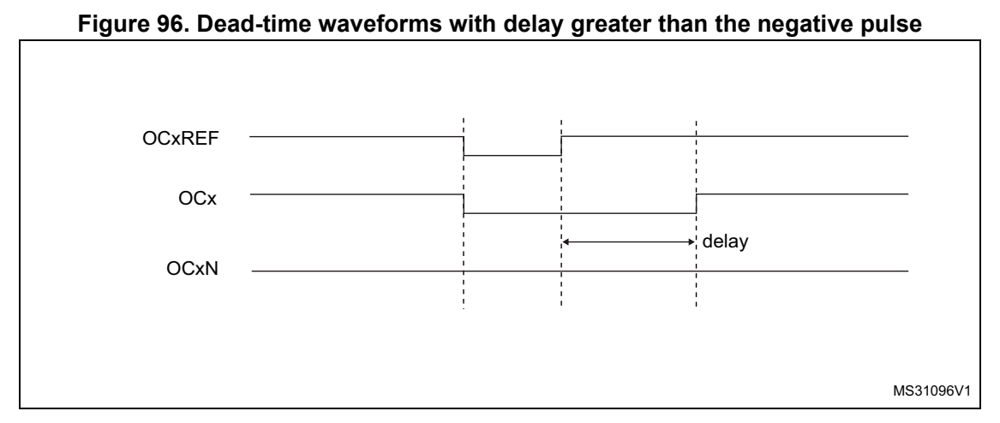
*Figure 96. Dead-time waveforms wit h delay greater than the negative pulse (p. 371)*

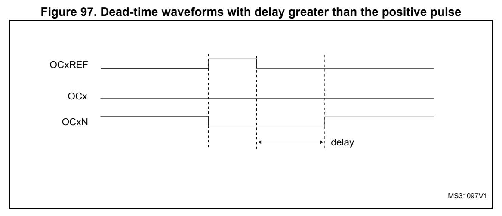
*Figure 97. Dead-time waveforms with delay greater than the posi tive pulse (p. 372)*

The dead-time delay is the same for each of the channels and is programmable with the DTG bits in the TIMx_BDTR register. Refer to Section 15.4.20: TIM1 break and dead-time register (TIM1_BDTR) for delay calculation.

Re-directing OCxREF to OCx or OCxN

In output mode (forced, output co mpare or PWM), O CxREF can be re-directed to the OCx output or to OCxN output by config uring the CCxE and CCxNE bits in the TIMx_CCER register.

This allows a specific waveform to be sent (such as PWM or stat ic active level) on one output while the complementary re mains at its inactive level. Other alternative possibilities are to have both outputs at inactive level or both outputs acti ve and complementary with dead-time.

Note: When only OCxN is enabled (CCxE=0, CCxNE=1), it is not complemented and becomes active as soon as OCxREF is high. For example, if CCxNP=0 then OCxN=OCxRef. On the other hand, when both OCx and OCxN are enabled (CCxE=CCxNE=1) OCx becomes active when OCxREF is high whereas OCxN is complemented and becomes active when OCxREF is low.

#### 15.3.16 Using the break function (p. 372)

The purpose of the break functi on is to protect power switches driven by PWM signals generated with the TIM1 timer. The two break inputs are usually connected to fault outputs of power stages and 3-phase inve rters. When activated, the brea k circuitry shuts down the PWM outputs and forces them to a predefined safe state. A numbe r of internal MCU events can also be selected to tr igger an output shut-down.

The break features two channels. A break channel which gathers both system-level fault (clock failure, parity error,...) and application fault (from i nput pins), and can force the outputs to a predefined level (eit her active or inactive) after a deadtime duration. A break2 channel which only includes application faults and is able to force the outputs to an inactive state.

The output enable sign al and output levels during break are dep ending on several control bits: – the MOE bit in TIMx_BDTR register allows the outputs to be ena bled/disabled by software and is reset in case of break or break2 event. – the OSSI bit in the TIMx_BDTR re gister defines whether the tim er controls the output in inactive state or releases the co ntrol to the GPIO co ntroller (typically to have it in Hi-Z mode) – the OISx and OISxN bi ts in the TIMx_CR2 reg ister which are setting the output shut-down level, eithe r active or inactive. The OCx and OCxN ou tputs cannot be set both to active level at a given time, whatever the OISx and OISxN values. Refer to Table 70: Output control bits for complementary OCx and OCxN channels with break feature on page 416 for more details.

When exiting from reset, the break circuit is disabled and the MOE bit is low. The break functions can be enabled by setting the BKE and BK2E bits in th e TIMx_BDTR register. The break input polarities can be selected by configuring the BKP a nd BK2P bits in the same register. BKE/BK2E and BKP/BK2P can be modified at the same tim e. When the BKE/BK2E and BKP/BK2P bits are w ritten, a delay of 1 APB clock cycle is applied before the writing is effective. Consequently, it is n ecessary to wait 1 APB clock pe riod to correctly read back the bit after the write operation.

Because MOE falling edg e can be asynchronous, a resynchronizati on circuit has been inserted between the actual signa l (acting on the outputs) and the synchronous control bit (accessed in the TIMx_BDTR register). It results in some delays between the asynchronous and the synchronous signals. In particular, if MOE is set to 1 whereas it was low, a delay must be inserted (dummy instructi on) before reading it correctl y. This is because the write acts on the asynchronous signal whereas the read reflects the synchronous signal.

The break can be generated from m ultiple sources which can be i ndividually enabled and with programmable edge sensitivity, using the TIMx_OR2 and TIMx_OR3 registers.

The sources for break (BRK) channel are:

- An external source con nected to one of the BKIN pin (as per sel ection done in the AFIO controller), with polarity selection and optional digital filtering

- An internal source: – the Cortex®-M0+ LOCKUP output – the SRAM parity error signal – a Flash memory ECC dual error detection – a clock failure event generated by the CSS detector

The source for break2 (BRK2) is an external source connected to one of the BKIN pin (as per selection done in the AFIO controller), with polarity selection and optional digital filtering.

Break events can also be generated by software us ing BG and B2G bits in the TIMx_EGR register. The software break generation using BG and B2G is act ive whatever the BKE and BK2E enable bits values.

All sources are ORed before entering the timer BRK or BRK2 inpu ts, as per Figure 98 below.

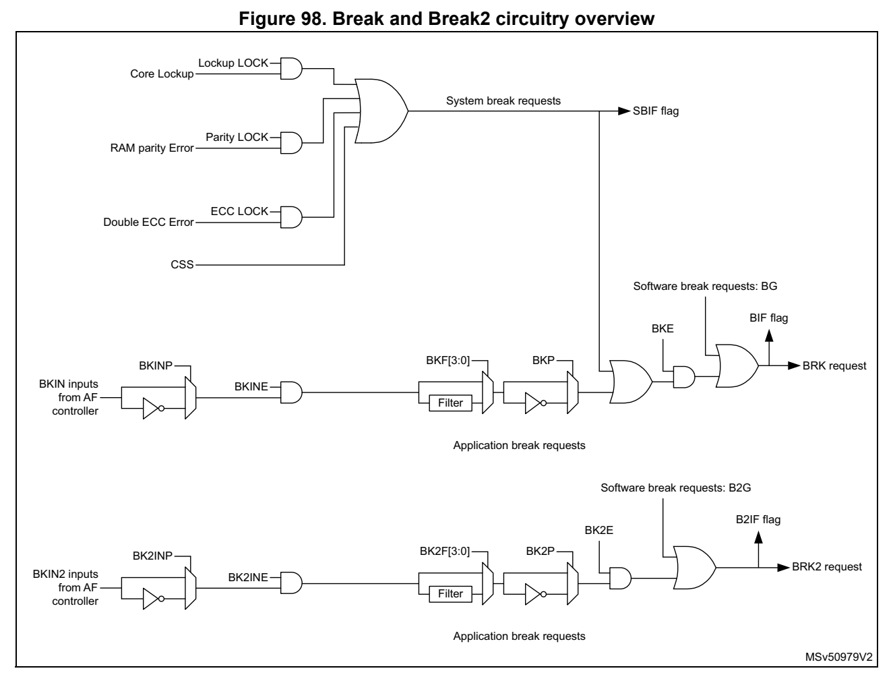
*Figure 98. Break and Break2 circuitry overview (p. 374)*

Note: An asynchronous (clockless) operation is only guaranteed when the programmable filter is disabled. If it is enabled, a fail safe clock mode (for example by using the internal PLL and/or the CSS) must be used to guarantee that break events are handled.

When one of the breaks occurs (selected level on one of the bre ak inputs):

- The MOE bit is cleared asynchronou sly, putting the outputs in i nactive state, idle state or even releasing the control to the GPIO controller (selected by the OSSI bit). This feature is ena bled even if the MCU oscillator is off.

- Each output channel is driven wit h the level programmed in the OISx bit in the TIMx_CR2 register as soon as MOE=0. If OSSI=0, the timer releas es the output control (taken over by the GPIO controller), otherwise the enable outpu t remains high.

- When complementary outputs are used: – The outputs are first put in in active state (depending on the polarity). This is done asynchronously so that it works even if no clock is provided to the timer. – If the timer clock is still pres ent, then the dea d-time genera tor is reactivated in order to drive the outputs with the level programmed in the OIS x and OISxN bits after a dead-time. Even in this case, OCx and OCxN cannot be driven to their

active level together. Note that because of the resynchronizati on on MOE, the dead-time duration is slightly l onger than usual (around 2 ck_t im clock cycles). – If OSSI=0, the timer releases the output control (taken over by the GPIO controller which forces a Hi-Z state), otherwise the enable outputs remain or become high as soon as one of the CCxE or CCxNE bits is high.

- The break status flag (SBIF, BIF and B2IF bits in the TIMx_S R register) is set. An interrupt is generated if the BI E bit in the TIMx_DIER register is set.

- If the AOE bit in the TIMx_BDTR register is set, the MOE bit is automatically set again at the next update event (UEV). As an example, th is can be used to perform a regulation. Otherwise, MOE remai ns low until the application sets it to ‘1’ again. In this case, it can be used for security and the break input can be co nnected to an alarm from power drivers, thermal sensors or any security components.

Note: The break inputs are active on level. Thus, the MOE cannot be set while the break input is active (neither automatically nor by software). In the meantime, the status flag BIF and B2IF cannot be cleared.

In addition to th e break input and the output management, a wri te protection has been implemented inside the break ci rcuit to safeguard the applicati on. It allows the configuration of several parameters to be freezed (dead-time duration, OCx/OCxN polarities and state when disabled, OCxM configuratio ns, break enable and polarity). The application can choose from 3 levels of protectio n selected by the LOCK bits in the TIMx_BDTR register. Refer to Section 15.4.20: TIM1 break and dead-time register (TIM1_BDTR). The LOCK bits can be written only once after an MCU reset.

Figure 99 shows an example of behavior of the outputs in response to a b reak.

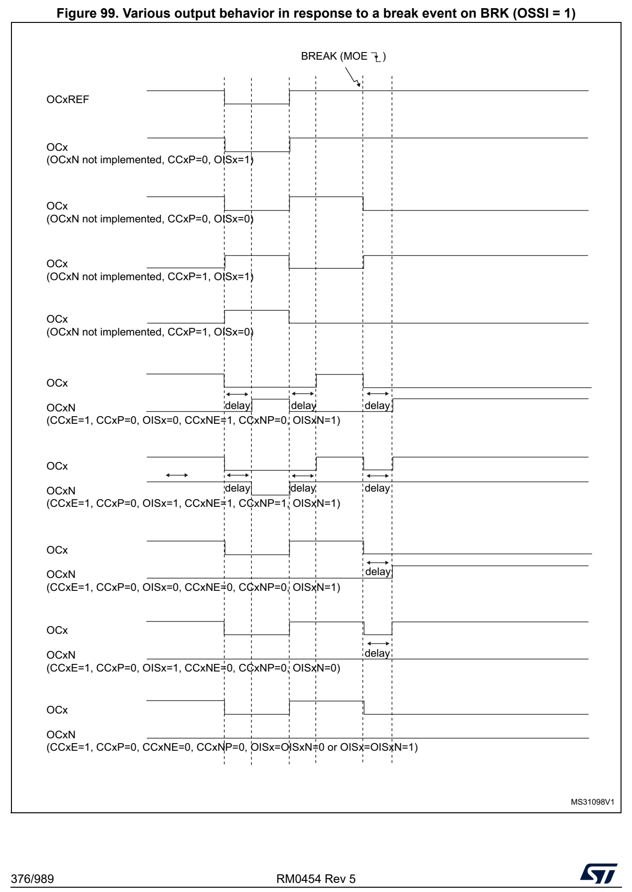
*Figure 99. Various output behavior in response to a break event on BRK (OSSI = 1) (p. 376)*

The two break inputs have different behaviors on timer outputs: – The BRK input can either disable (inactive state) or force the PWM outputs to a predefined safe state. – BRK2 can only disable (inact ive state) the PWM outputs.

The BRK has a higher priority t han BRK2 input, as described in Table 66.

Note: BRK2 must only be used with OSSR = OSSI = 1.

**Table 66. Behavior of timer outputs versus B RK/BRK2 inputs (p. 377)**

| Col 1 | Col 2 | Timer outputs | Typical use case | Typical use case |
| --- | --- | --- | --- | --- |
| BRK BRK2 | BRK BRK2 | Timer outputs state | OCxN output (low side switches) | OCx output (high side switches) |
| Active X |  | – Inactive then forced output state (after a deadtime) – Outputs disabled if OSSI = 0 (control taken over by GPIO logic) | ON after deadtime insertion | OFF |
|  |  | Inactive Active Inactive OFF OFF |  |  |

Figure 100 gives an example of OCx and OCxN output behavior in case of active signals on BRK and BRK2 inputs. In this cas e, both outputs have active hig h polarities (CCxP = CCxNP = 0 in TIMx_CCER register).

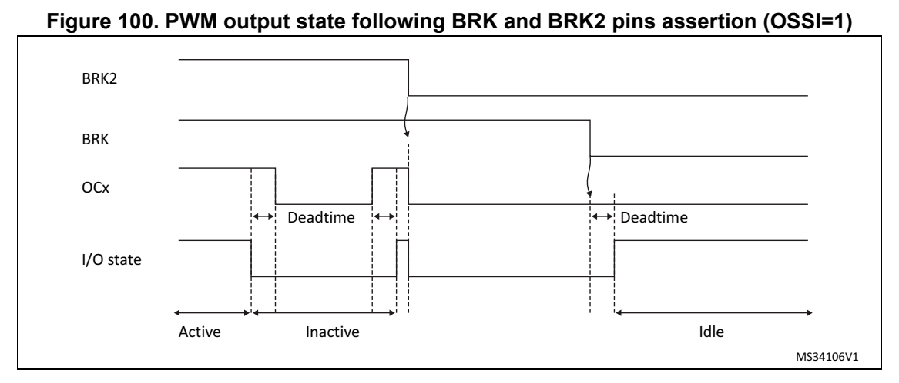
*Figure 100. PWM output state following BRK and BRK2 pins assert ion (OSSI=1) (p. 377)*

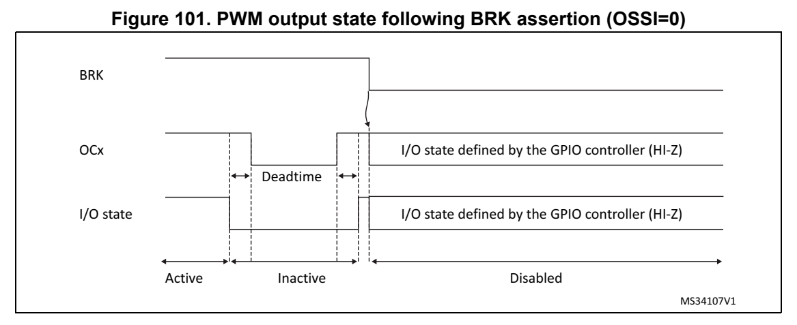
*Figure 101. PWM outpu t state following BRK assertion (OSSI=0) (p. 378)*

#### 15.3.17 Bidirectional break inputs (p. 378)

The TIM1 are featuring bidirectio nal break I/Os, a s represented on Figure 102.

They allow the following:

- A board-level global break signal available for signaling faults to external MCUs or gate drivers, with a unique pin being both an input and an output status pin

- Internal break sources and multi ple external open drain comparator outputs ORed together to trigger a unique bre ak event, when multiple interna l and external break sources must be merged

The break and break2 inputs are co nfigured in bidirectional mod e using the BKBID and BK2BID bits in the TIMxBDTR register. The BKBID programming bits can be locked in read-only mode using the LOCK bits in the TIMxBDTR register (in LOCK level 1 or above).

The bidirectional mode is available for both the break and brea k2 inputs, and require the I/O to be configured in open-drain mode with active low polarity (u sing BKINP, BKP, BK2INP and BK2P bits). Any break request coming either from system (e. g. CSS), from on-chip peripherals or from break inputs forces a low level on the brea k input to signal the fault event. The bidirectional mode is inhibited if the polarity bits are not correctly set (active high polarity), for safety purposes.

The break software events (BG and B2G) also cause the break I/O to be forced to '0' to indicate to the external components that the timer has entered in break state. However, this is valid only if the break is enabled (BK(2)E = 1). When a software break event is generated with BK(2)E = 0, the outputs are p ut in safe state and the brea k flag is set, but there is no effect on the break(2) I/O.

A safe disarming mechanism preve nts the system to be definitive ly locked-up (a low level on the break input triggers a break which enforces a low level on the same input).

When the BKDSRM (BK2DSRM) bit is set to 1, this releases the break output to clear a fault signal and to give t he possibility to re-arm the system.

At no point the break protectio n circuitry can be disabled:

- The break input path is always a ctive: a break event is active even if the BKDSRM (BK2DSRM) bit is set and the open drain control is released. Th is prevents the PWM output to be re-started as long as the break condition is prese nt.

- The BK(2)DSRM bit cannot disarm th e break protection as long as the outputs are enabled (MOE bit is set) (see Table 67)

**Table 67. Break protecti on disarming conditions (p. 379)**

| MOE | BKDIR (BK2DIR) | BKDSRM (BK2DSRM) | Break protection state |
| --- | --- | --- | --- |
|  |  | 0 0 X Armed |  |
|  |  | 0 1 0 Armed |  |
|  |  | 0 1 1 Disarmed |  |
|  |  | 1 X X Armed |  |

Arming and re-arming break circuitry

The break circuitry (i n input or bidirection al mode) is armed by default (peripheral reset configuration).

The following procedure must be followed to re-arm the protecti on after a bre ak (break2) event:

- The BKDSRM (BK2DSRM) bit must be set to release the output cont rol

- The software must wait until th e system break condition disappe ars (if any) and clear the SBIF status flag (o r clear it systematically before re-armi ng)

- The software must poll the BKDSRM (BK2DSRM) bit until it is cle ared by hardware (when the application break condition disappears) From this point, the break circui try is armed and active, and t he MOE bit can be set to re-enable the PWM outputs.

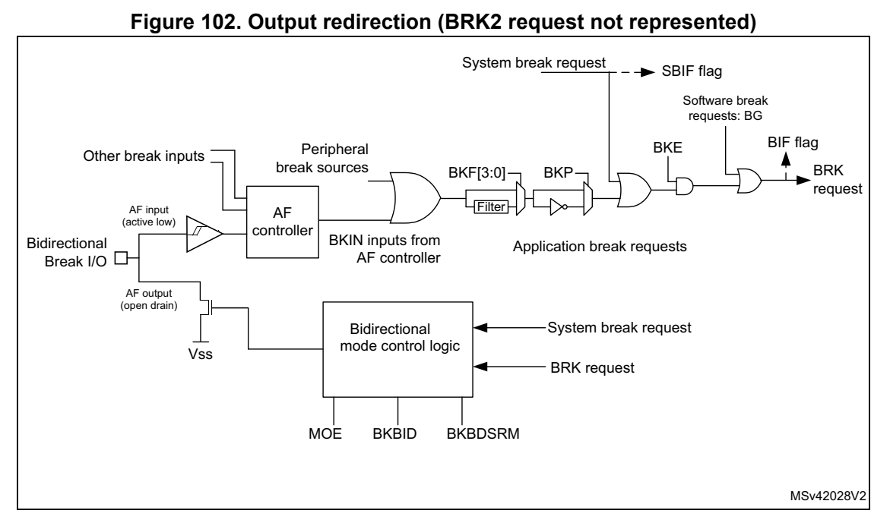
*Figure 102. Output redirection (BRK2 request not represented) (p. 379)*

#### 15.3.18 Clearing the OCxREF signal on an external event (p. 380)

The OCxREF signal of a given cha nnel can be cleared when a high level is applied on the ocref_clr_int input (OCxCE enabl e bit in the corresponding TIMx_CCMRx registe r set to 1). OCxREF remains low until the next update event (UEV) occurs. Th is function can only be used in Output compare and PWM modes. It does not work in Force d mode. ocref_clr_int input can be selected between the OCREF_CLR input and ETRF (ETR after the filter) by configuring the OCCS bit in the TIMx_SMCR register. When ETRF is chosen, ETR mus t be configured as follows: 1. The External Trigger Prescaler should be kept off: bits ETPS[ 1:0] of the TIMx_SMCR register set to ‘00’. 2. The external clock mode 2 must be disabled: bit ECE of the T IMx_SMCR register set to ‘0’. 3. The External Trigger Polarity (ETP) and the External Trigger Filter (ETF) can be configured according to the user needs.

Figure 103 shows the behavior of the OCxREF signal when the ETRF Input be comes High, for both values of the enable bi t OCxCE. In this example, the t imer TIMx is p rogrammed in PWM mode.

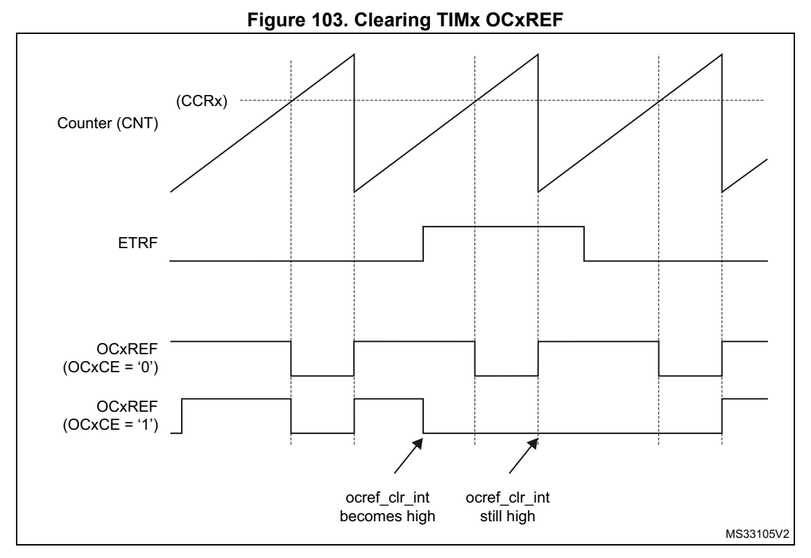
*Figure 103. Clearing TIMx OCxREF (p. 380)*

Note: In case of a PWM with a 100% duty cycle (if CCRx>ARR), then OCxREF is enabled again at the next counter overflow.

15.3.19 6-step PWM generation

When complementary outputs are u sed on a channel, preload bits are available on the OCxM, CCxE and CCxNE bits. The preload bits are transferred to the shadow bits at the COM commutation event. Thus one can program in advance the configuration for the next step and change the configuration of all the channels at the sa me time. COM can be generated by software by setting the COM bit in the TIMx_EGR re gister or by hardware (on TRGI rising edge).

A flag is set when the COM event occurs (CO MIF bit in the TIMx_SR register), which can generate an interrupt (if the COM IE bit is set in the TIMx_DIER register) or a DMA request (if the COMDE bit is set in the TIMx_DIER register).

The Figure 104 describes the behavior of the OCx and OCxN outpu ts when a COM event occurs, in 3 different examples of programmed configurations.

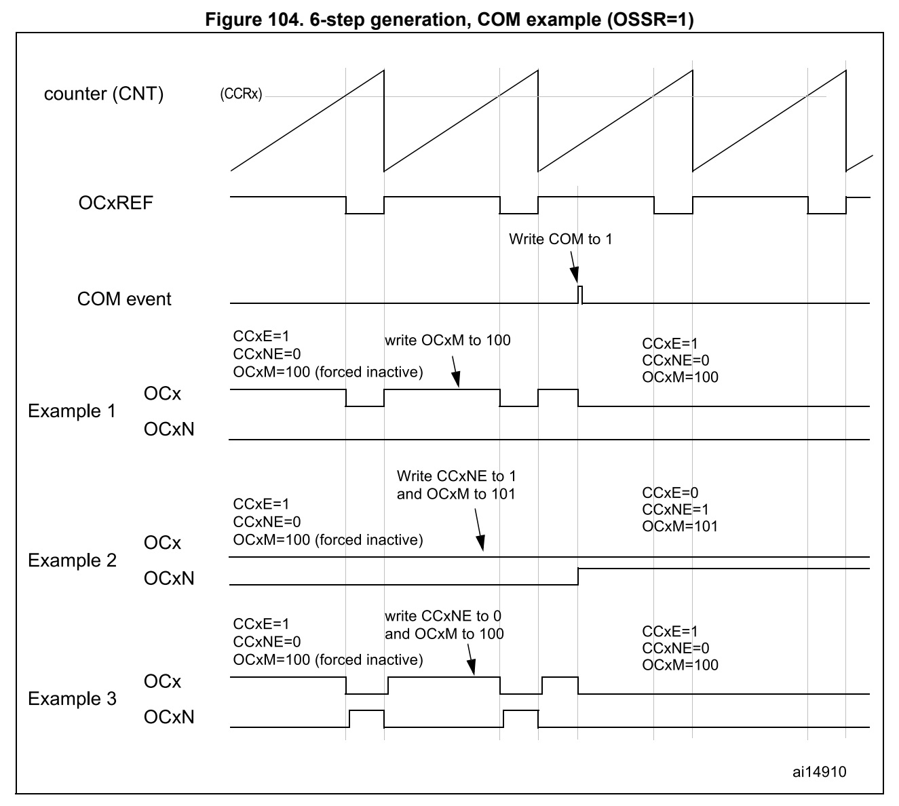
*Figure 104. 6-step generation, COM example (OSSR=1) (p. 381)*

#### 15.3.20 One-pulse mode (p. 382)

One-pulse mode (OPM) is a partic ular case of the previous modes. It allows the counter to be started in response to a stimulus and to generate a pulse wi th a programmable length after a programmable delay.

Starting the counter can be controlled through the slave mode controller. Generating the waveform can be done in output compare mode or PWM mode. One-pu lse mode is selected by setting the OPM bit in the TIMx_CR1 register. This makes the counter stop automatically at the next update event UEV.

A pulse can be correctly genera ted only if the compare value is different from the counter initial value. Before starting (when the timer is waiting for t he trigger), the configuration must be:

- In upcounting: CNT < CCRx ≤ ARR (in particular, 0 < CCRx)

- In downcounting: CNT > CCRx

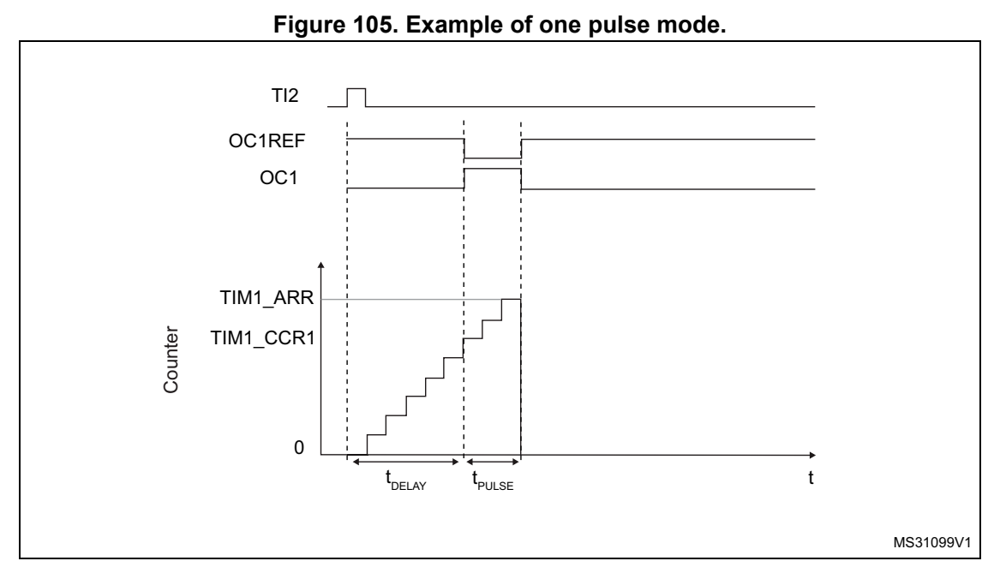
*Figure 105. Example of one pulse mode. (p. 382)*

For example one may want to gene rate a positive pulse on OC1 wi th a length of t PULSE and after a delay of t DELAY as soon as a positive edge is detected on the TI2 input pin.

Let’s use TI2FP2 as trigger 1: 1. Select the proper TI2x source (internal or external) with the TI2SEL[3:0] bits in the TIMx_TISEL register. 2. Map TI2FP2 to TI2 by writing CC2S=’01’ in the TIMx_CCMR1 reg ister. 3. TI2FP2 must detect a rising e dge, write CC2P=’0’ and CC2NP=’ 0’ in the TIMx_CCER register. 4. Configure TI2FP2 as trigger for the slave mode controller (T RGI) by writing TS=00110 in the TIMx_SMCR register. 5. TI2FP2 is used to s tart the counter by writing SMS to ‘110’ in the TIMx_SMCR register (trigger mode).

The OPM waveform is defined by writing the compare registers (taking into account the clock frequency and the counter prescaler).

- The t DELAY is defined by the value writte n in the TIMx_CCR1 register.

- The t PULSE is defined by the difference between the auto-reload value and the compare value (TIMx_A RR - TIMx_CCR1).

- Let’s say one want to build a waveform with a transition from ‘ 0’ to ‘1’ when a compare match occurs and a tran sition from ‘1’ to ‘0’ when the counter reaches the auto-reload value. To do this PWM mode 2 must be enabled by writing OC1M=11 1 in the TIMx_CCMR1 register. O ptionally the preload registers can be en abled by writing OC1PE=’1’ in the TIMx_CCMR1 regi ster and ARPE in the TIMx_CR1 register. In this case one has to write the compare value in the TIMx_CCR1 register, the auto-reload value in the TIMx_ARR register, generate an update by setting t he UG bit and wait for external trigger event on TI2. C C1P is written to ‘0’ in this example.

In our example, the DIR and CMS bits in the TIMx_CR1 register s hould be low.

Since only 1 pulse (Single mode) is needed, a 1 must be written in the OPM bit in the TIMx_CR1 register to stop the counter at the next update event (when the counter rolls over from the auto-reload value back to 0). When OPM bit in the TIMx_CR1 register is set to '0', so the Repetitive Mode is selected.

Particular case: OCx fast enable:

In One-pulse mode, the edge detection on TIx inp ut set the CEN bit which enables the counter. Then the comparison between the counter and the compare value makes the output toggle. But several cloc k cycles are needed for these op erations and it limits the minimum delay t DELAY min we can get.

If one wants to output a waveform with the minimum delay, the O CxFE bit can be set in the TIMx_CCMRx register. Then OCxRef (and OCx) are forced in respon se to the stimulus, without taking in account the comp arison. Its new level is the same as if a compare match had occurred. OCxFE acts only i f the channel is configured in PWM1 or PWM2 mode.

#### 15.3.21 Retriggerable one pulse mode (p. 383)

This mode allows the counter to be started in re sponse to a sti mulus and to generate a pulse with a programmable length, but with the following differences with Non-retriggerable one pulse mode described in Section 15.3.20: – The pulse starts as soon as th e trigger occurs (no programmabl e delay) – The pulse is extended if a new trigger occurs before the previ ous one is completed

The timer must be in Slave mode, with the bits SMS[3:0] = ‘1000 ’ (Combined Reset + trigger mode) in the TIMx_SMCR register, and the OCxM[3:0] bits set to ‘1000’ or ‘1001’ for Retrigerrable OPM mode 1 or 2.

If the timer is configured in Up -counting mode, the correspondi ng CCRx must be set to 0 (the ARR register sets the pulse length). If the timer is confi gured in Down-counting mode, CCRx must be above or equal to ARR.

Note: The OCxM[3:0] and SMS[3:0] bit fields are split into two parts for compatibility reasons, the most significant bit are not contiguo us with the 3 least significant ones. This mode must not be used with center-aligned PWM modes. It is mandatory to have CMS[1:0] = 00 in TIMx_CR1.

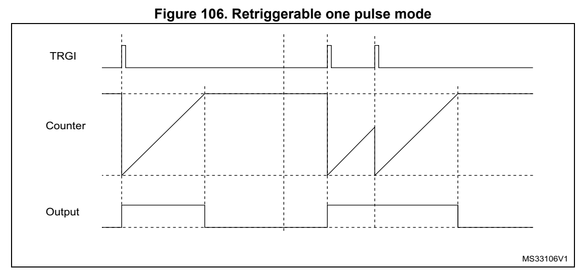
*Figure 106. Retrigge rable one pulse mode (p. 384)*

#### 15.3.22 Encoder interface mode (p. 384)

To select Encoder Interface mode write SMS=‘001’ in the TIMx_SM CR register if the counter is counting on TI2 edges only, SMS=’010’ if it is count ing on TI1 edges only and SMS=’011’ if it is countin g on both TI1 and TI2 edges.

Select the TI1 and TI2 polarity by programming the CC1P and CC2 P bits in the TIMx_CCER register. When needed, the input filter can be programmed as we ll. CC1NP and CC2NP must be kept low.

The two inputs TI1 and TI2 are used to interface to a quadrature encoder. Refer to Table 68. The counter is clocked by each valid transition on TI1FP1 or TI 2FP2 (TI1 and TI2 after input filter and polarity s election, TI1FP1=TI1 if not filtered and n ot inverted, TI2 FP2=TI2 if not filtered and not inverted) assum ing that it is enabled (CEN bit in TIMx_CR1 register written to ‘1’). The sequence of transi tions of the two inputs is evalu ated and generates count pulses as well as the direction signal. Depending on the sequen ce the counter counts up or down, the DIR bit in the TIMx_CR1 register is modified by hardware accordingly. The DIR bit is calculated at each transition on any input (TI1 or TI2), whatever the counter is counting on TI1 only, TI2 only or both TI1 and TI2.

Encoder interface mode acts simp ly as an external clock with di rection selection. This means that the counter just coun ts continuously between 0 and t he auto-reload value in the TIMx_ARR register (0 to ARR or ARR down to 0 depending on the d irection). So the TIMx_ARR must be config ured before starting. In the same way, t he capture, compare, repetition counter, trigger outpu t features continue to work as normal. Encoder mode and External clock mode 2 are not compatible and must not be selected together.

Note: The prescaler must be set to zero when encoder mode is enabled

In this mode, the coun ter is modified auto matically following t he speed and the direction of the quadrature encoder and its content, therefore, always repre sents the encoder’s position. The count direction correspond to the rotation direction of the connected sensor. The table summarizes the possible combinat ions, assuming TI 1 and TI2 do n ot switch at the same time.

**Table 68. Counting directi on versus encoder signals (p. 385)**

| Col 1 | Level on opposite | TI1FP1 signal TI2FP2 signal | TI1FP1 signal TI2FP2 signal |
| --- | --- | --- | --- |
| Active edge | opposite signal (TI1FP1 for TI2, TI2FP2 for TI1) | Rising Falling Rising Falling | Rising Falling Rising Falling |
| Counting on |  | High Down Up No Count No Count |  |
| TI1 only |  | Low Up Down No Count No Count |  |
| Counting on |  | High No Count No Count Up Down |  |
| TI2 only |  | Low No Count No Count Down Up |  |
| Counting on |  | High Down Up Up Down |  |
| TI1 and TI2 |  | Low Up Down Down Up |  |

A quadrature encoder can be connected directly to the MCU witho ut external interface logic. However, comparators are normall y be used to con vert the encode r’s differential outputs to digital signals. This greatly inc reases noise immunity. The thi rd encoder output which indicate the mechanical zero posit ion, may be conn ected to an external interrupt input and trigger a counter reset.

The Figure 107 gives an example of counter o peration, showing count signal ge neration and direction control. It also s hows how input jitter is compen sated where both edges are selected. This might occur if the sensor is positioned near to one of the switching points. For this example we assu me that the configurat ion is the following:

- CC1S=’01’ (TIMx_CCMR1 register, TI1FP1 mapped on TI1).

- CC2S=’01’ (TIMx_CCMR2 register, TI1FP2 mapped on TI2).

- CC1P=’0’ and CC1NP=’0’ (TIMx_CCER register, TI1FP1 non-inverted, TI1FP1=TI1).

- CC2P=’0’ and CC2NP=’0’ (TIMx_CCER register, TI1FP2 non-inverted, TI1FP2= TI2).

- SMS=’011’ (TIMx_SMCR register, both inputs are active on both rising and falling edges).

- CEN=’1’ (TIMx_CR1 register, Counter enabled).

*Figure 107. Example of counter ope ration in encoder interface m ode. (p. 385)*

Figure 108 gives an example of counter behavior when T I1FP1 polarity is i nverted (same configuration as above except CC1P=’1’).

*Figure 108. Example of encoder interface mode with TI1FP1 polarity inverted. (p. 386)*

The timer, when configured in Encoder Interface mode provides i nformation on the sensor’s current position. Dynamic information can be obta ined (speed, a cceleration, deceleration) by measuring the period between two encoder events using a seco nd timer configured in capture mode. The output of the encoder which indicates the mec hanical zero can be used for this purpose. Depen ding on the time between two events, the counter can also be read at regular times. This can be d one by latching the counter valu e into a third input capture register if available (then the capture signal must be periodic and can be generated by another timer). when available, it is also possible to read its value through a DMA request.

The IUFREMAP bit in the TIMx_CR1 register forces a continuous copy of the update interrupt flag (UIF) into the tim er counter register’s bit 31 ( TIMxCNT[31]). This allows both the counter value and a potential roll-over condition signaled by the UIFCPY flag to be read in an atomic way. It eases the ca lculation of angular speed by avoiding race conditions caused, for instance, by a processing shared between a backgrou nd task (counter reading) and an interrupt (update interrupt).

There is no latency between the U IF and UIFCPY flag assertions.

In 32-bit timer implementations, when the IUFREMAP bit is set, bit 31 of the counter is overwritten by the UIFCPY flag upon read access (the counter’s most significant bit is only accessible in write mode).

#### 15.3.23 UIF bit remapping (p. 386)

The IUFREMAP bit in the TIMx_CR1 register forces a continuous copy of the Update Interrupt Flag UIF in to the timer counter register’s bit 31 (TI MxCNT[31]). This allows both the counter value and a potential roll-over condition signaled by the UIFCPY flag to be read in an atomic way. In particular cases, it can ease the calculat ions by avoiding race conditions, caused for instance b y a processing shared between a background task (counter reading) and an interrupt (Update Interrupt).

There is no latency between the U IF and UIFCPY flags assertion.

#### 15.3.24 Timer input XOR function (p. 387)

The TI1S bit in the TIMx_CR2 register, allows the input filter of channel 1 to be connected to the output of an XOR gate, combin ing the three input pins TIMx_CH1, TIMx_CH2 and TIMx_CH3.

The XOR output can be used with a ll the timer input functions s uch as trigger or input capture. It is convenient to measure the interval between edges on two input signals, as per Figure 109 below.

*Figure 109. Measuring time inte rval between edges on 3 signals (p. 387)*

#### 15.3.25 Interfacing with Hall sensors (p. 387)

This is done using the advanced-control timer (TIM1) to generat(a) e PWM signals to drive the motor and another timer TIMx (TIM3, TIM4) referred to as “in terfacing timer” in Figure 110. The “interfacing timer” captures the 3 timer input pins (CC1, CC2, CC3) connected through a XOR to the T I1 input channel (selected by s etting the TI1S bit in the TIMx_CR2 register).

The slave mode controller is configured in reset mode; the slave input is TI1F_ED. Thus, each time one of the 3 inputs toggles, the counte r restarts cou nting from 0. This creates a time base triggered by any change on the Hall inputs.

On the “interfacing timer”, capt ure/compare channel 1 is config ured in capture mode, capture signal is TRC (See Figure 83: Capture/compare channel (example: channel 1 input stage) on page 358). The captured value, which corresponds to the time elapsed between 2 changes on the inputs, gives i nformation about motor speed.

The “interfacing timer” can be u sed in output mode to generate a pulse which changes the configuration of the channels of the advanced-control timer (TI M1) (by triggering a COM event). The TIM1 timer is used to generate PWM signals to drive the motor. To do this, the interfacing timer channel must b e programmed so that a positive pulse is generated after a programmed delay (in output compa re or PWM mode). This pulse is sent to the advanced-control timer (TIM1) th rough the TRGO output.

a. TIM4 is available on STM32G0B0xx salestypes only.

Example: one wants to c hange the PWM configuration of the advan ced-control timer TIM1 after a programmed delay each time a change occurs on the Hall inputs connected to one of the TIMx timers.

- Configure 3 timer inputs ORed to the TI1 input channel by writi ng the TI1S bit in the TIMx_CR2 register to ‘1’,

- Program the time base: write the TIMx_ARR to the max value (the counter must be cleared by the TI1 change. Set t he prescaler to get a maximum counter period longer than the time between 2 changes on the sensors,

- Program the channel 1 in capture mode (TRC selected): write the CC1S bits in the TIMx_CCMR1 register to ‘01’. The digital filter can also be pro grammed if needed,

- Program the channel 2 in PWM 2 mode with the desired delay: wri te the OC2M bits to ‘111’ and the CC2S bits to ‘00’ in the TIMx_CCMR1 register,

- Select OC2REF as trigger output on TRGO: write the MMS bits in the TIMx_CR2 register to ‘101’,

In the advanced-control timer TIM 1, the right ITR input must be selected as trigger input, the timer is programmed to generate PWM signals, the capture/compare control signals are preloaded (CCPC=1 in the TIMx_CR2 register) and the COM event i s controlled by the trigger input (CCUS=1 in the TIMx_CR2 register). The PWM contro l bits (CCxE, OCxM) are written after a COM event for the next step (this can be done i n an interrupt subroutine generated by the rising edge of OC2REF).

The Figure 110 describes this example.

*Figure 110. Example of Hall sensor interface (p. 389)*

#### 15.3.26 Timer synchronization (p. 390)

The TIMx timers are linked together internally for timer synchronization or chaining. Refer to Section 16.3.19: Timer synchronization for details. They can be synchronized in several modes: Reset mode, Gated mode, and Trigger mode.

Slave mode: Reset mode

The counter and its prescaler can be reinitialized in response to an event on a trigger input. Moreover, if the URS bit from th e TIMx_CR1 register is low, an update event UEV is generated. Then all the preloade d registers (TIMx_ARR, TIMx_CCRx) are updated.

In the following examp le, the upcounter is cleared in response to a rising edge on TI1 input:

- Configure the channel 1 to detect rising edges on TI1. Configure the input filter duration (in this example, we do not need any filter, so we keep IC1F=00 00). The capture prescaler is not used for triggering, so it does not need to be configured. The CC1S bits select the input capture source only, CC1S = 01 in the TIMx_CCM R1 register. Write CC1P=0 and CC1NP=’0’ in TIMx_CCE R register to validate the pola rity (and detect rising edges only).

- Configure the timer in reset mod e by writing SMS=100 in TIMx_SM CR register. Select TI1 as the input source by writing TS=00101 in TIMx_SMCR register.

- Start the counter by writing CEN=1 in the TIMx_CR1 register.

The counter starts counting on t he internal clock, then behaves normally until TI1 rising edge. When TI1 rises, the counter is cleared and restarts from 0. In the meantime, the trigger flag is set (TIF bit in the TIMx_SR register) and an in terrupt request, or a DMA request can be sent if enabled (d epending on the TIE and TDE bi ts in TIMx_DIER register).

The following figure shows this behavior when the auto-reload register TIMx_ARR=0x36. The delay between the rising edge on TI1 and the actual reset of the counter is due to the resynchronization circuit on TI1 input.

*Figure 111. Control circuit in reset mode (p. 390)*

Slave mode: Gated mode

The counter can be ena bled depending on the level of a selected input.

In the following examp le, the upcounter counts only when TI1 in put is low:

- Configure the channel 1 to detect low levels on TI1. Configure the input filter duration (in this example, we do not need any filter, so we keep IC1F=00 00). The capture prescaler is not used for triggering, so it does not need to be configured. The CC1S bits select the input capture source only, CC1S=01 in TIMx_CCMR1 reg ister. Write CC1P=1 and CC1NP=’0’ in TIMx_CCE R register to validate the pola rity (and detect low level only).

- Configure the timer in gated mode by writing SMS=101 in TIMx_SM CR register. Select TI1 as the input source by writing TS=00101 in TIMx_SMCR register.

- Enable the counter by writing CEN =1 in the TIMx_CR1 register (i n gated mode, the counter doesn’t start if CEN=0, w hatever is the trigger input l evel).

The counter starts counting on the internal clock as long as TI 1 is low and stops as soon as TI1 becomes high. The TIF flag in the TIMx_SR register is set b oth when the counter starts or stops.

The delay between the rising edge on TI1 and the actual stop of the counter is due to the resynchronization circuit on TI1 input.

*Figure 112. Control circuit in Gated mode (p. 391)*

Slave mode: Trigger mode

The counter can start in response to an event on a selected inp ut.

In the following examp le, the upcounter starts in response to a rising edge on TI2 input:

- Configure the channel 2 to detect rising edges on TI2. Configure the input filter duration (in this example, we do not need any filter, so we keep IC2F=00 00). The capture prescaler is not used for triggering, so it does not need to be configured. The CC2S bits are configured to select the in put capture source only, CC2S=01 in TIMx_CCMR1

register. Write CC2P=1 and CC2NP =0 in TIMx_CCER register to val idate the polarity (and detect low level only).

- Configure the timer in trigger m ode by writing SMS=110 in TIMx_SMCR register. Select TI2 as the input source by writing TS=00110 in TIMx_SMCR register.

When a rising edge occurs on TI2, the counter starts counting o n the internal clock and the TIF flag is set.

The delay between the rising edge on TI2 and the actual start of the counter is due to the resynchronization circuit on TI2 input.

*Figure 113. Control circuit in trigger mode (p. 392)*

Slave mode: Combined reset + trigger mode

In this case, a rising edge of t he selected trigger input (TRGI) reinitializes the counter, generates an update of the reg isters, and starts the counter.

This mode is used for one-pulse mode.

Slave mode: external clock mode 2 + trigger mode

The external clock mode 2 can be used in addition to another sl ave mode (except external clock mode 1 and encoder mode). I n this case, the ETR signal is used as external clock input, and another input can be selected as tri gger input (in reset mode, gated mode or trigger mode). It is recommended not to sel ect ETR as TRGI thro ugh the TS bits of TIMx_SMCR register.

In the following examp le, the upcounter is incremented at each rising edge of the ETR signal as soon as a rising edge of TI1 occurs: 1. Configure the external trigger input circuit by programming t he TIMx_SMCR register as follows: – ETF = 0000: no filter – ETPS = 00: prescaler disabled – ETP = 0: detection of rising edges on ETR and ECE=1 to enable the external clock mode 2. 2. Configure the channel 1 as follows, to detect rising edges o n TI: – IC1F = 0000: no filter. – The capture prescaler is not us ed for triggering and does not need to be configured. – CC1S = 01in TIMx_CCMR1 register to select only the input captu re source – CC1P = 0 and CC1NP = 0 in TIMx_CCER register to validate the p olarity (and detect rising edge only). 3. Configure the timer in trigger mode by writing SMS=110 in TI Mx_SMCR register. Select TI1 as the input source by writing TS=00101 in TIMx_SMCR register.

A rising edge on TI1 enables th e counter and sets the TIF flag. The counter then counts on ETR rising edges.

The delay between the rising e dge of the ETR signal and the act ual reset of the counter is due to the resynchronization circuit on ETRP input.

*Figure 114. Control ci rcuit in external clock mode 2 + trigger mode (p. 393)*

Note: The clock of the slave peripherals (timer, ADC, ...) receiving the TRGO or the TRGO2 signals must be enabled prior to receive events from the master timer, and the clock frequency (prescaler) must not be changed on-the-fly while triggers are received from the master timer.

#### 15.3.27 ADC synchronization (p. 394)

The timer can generate an ADC triggering event with various internal signals, such as reset, enable or compare events. It is al so possible to generate a pul se issued by internal edge detectors, such as: – Rising and fallin g edges of OC4ref – Rising edge on OC5ref or falling edge on OC6ref

The triggers are issued on the TR GO2 internal lin e which is red irected to the ADC. There is a total of 16 possible events, w hich can be selected using the MMS2[3:0] bits in the TIMx_CR2 register.

An example of an application for 3-phase motor drives is given in Figure 94 on page 370.

Note: The clock of the slave peripherals (timer, ADC, ...) receiving the TRGO or the TRGO2 signals must be enabled prior to receive events from the master timer, and the clock frequency (prescaler) must not be changed on-the-fly while triggers are received from the master timer.

Note: The clock of the ADC must be enabled prior to receive events from the master timer, and must not be changed on-the-fly while triggers are received from the timer.

#### 15.3.28 DMA burst mode (p. 394)

The TIMx timers have the capability to generate multiple DMA re quests upon a single event. The main purpose is to be able to re-program part of the timer multiple times without software overhead, but it can also be used to read several regi sters in a row, at regular intervals.

The DMA controller destination is unique and must point to the virtual register TIMx_DMAR. On a given timer event, the timer launches a sequence of DMA re quests (burst). Each write into the TIMx_DMAR register is actually redirected to one of th e timer registers.

The DBL[4:0] bits in the TIMx_DCR register set the DMA burst le ngth. The timer recognizes a burst transfer when a read or a write access is done to the T IMx_DMAR addre ss), i.e. the number of transfers (either in half-words or in bytes).

The DBA[4:0] bits in t he TIMx_DCR registers define the DMA base address for DMA transfers (when read/write acces s are done through the TIMx_DMA R address). DBA is defined as an offset starting fro m the address of the TIMx_CR1 register:

Example:

00000: TIMx_CR1

00001: TIMx_CR2

00010: TIMx_SMCR

As an example, the timer DMA burs t feature is used to update th e contents of the CCRx registers (x = 2, 3, 4) upon an u pdate event, with the DMA tran sferring half words into the CCRx registers.

This is done in the following steps: 1. Configure the correspondi ng DMA channel as follows: – DMA channel peripheral address i s the DMAR register address – DMA channel memory address is th e address of the buffer in the RAM containing the data to be transferred by DMA into CCRx registers. – Number of data to transfer = 3 (See note below). – Circular mode disabled. 2. Configure the DCR register by configuring the DBA and DBL bi t fields as follows: DBL = 3 transfers, DBA = 0xE. 3. Enable the TIMx update DMA request (set the UDE bit in the D IER register). 4. Enable TIMx 5. Enable the DMA channel

This example is for the case where every CCRx register to be up dated once. If every CCRx register is to be updated twice for example, the number of data to transfer should be 6. Let's take the example of a buffer in the RAM containing data1, data2, data3, data4, data5 and data6. The data is transferred to the CCRx registers as follows: on the first update DMA request, data1 is transferred to CCR2, data2 is transferred to CCR3, data3 is transferred to CCR4 and on the second update DMA request, data4 is transferred to CCR2, data5 is transferred to CCR3 and data6 is transferred to CCR4.

Note: A null value can be written to the reserved registers.

#### 15.3.29 Debug mode (p. 395)

® When the microcontroller enters debug mode (Cortex -M0+ core halted), the TIMx counter either continues to work normally or stops, depending on DBG_TI Mx_STOP configuration bit in DBG module.

For safety purposes, when the co unter is stopped, the outputs a re disabled (as if the MOE bit was reset). The outputs can either be forced to an inactive state (OSSI bit = 1), or have their control taken over by the GPIO controller (OSSI bit = 0), typically to force a Hi-Z.

For more details, refer to s ection Debug support (DBG).

### 15.4 TIM1 registers (p. 396)

Refer to for a list of abbreviat ions used in register descripti ons.

The peripheral registers can be a ccessed by half-words (16-bit) or words (32-bit).

### 15.4.1 [TIM1.TIM1_CR1] Offset: 0x00 | Reset: 0x0000 (p. 396)

Address offset: 0x00

Reset value: 0x0000

Bits 15:12 Reserved, must be kept at reset value.

Bit 11 UIFREMAP: UIF status b it remapping 0: No remapping. UIF status bit is not copied to TIMx_CNT register bit 31. 1: Remapping enabled. UIF status bit is copied to TIMx_CNT regi ster bit 31.

Bit 10 Reserved, must be kept at reset value.

Bits 9:8 CKD[1:0]: Clock division This bit-field indicates the division ratio between the timer c lock (CK_INT) frequency and the dead-time and sampling clock (t DTS)used by the dead-t ime generators and t he digital filters (ETR, TIx): 00: t DTS =t CK_INT 01: t DTS =2*t CK_INT 10: t DTS =4*t CK_INT 11: Reserved, d o not program this value Note: t DTS = 1/f DTS, t CK_INT = 1/f CK_INT.

Bit 7 ARPE: Auto-reload preload enable 0: TIMx_ARR register is not buffered 1: TIMx_ARR register is buffered

Bits 6:5 CMS[1:0]: Center-aligned mode selection 00: Edge-aligned mode. The counter counts up or down depending o n the direction bit (DIR). 01: Center-aligned mode 1. The cou nter counts up and down altern atively. Output compare interrupt flags of channels configured in output (CCxS=00 in TI Mx_CCMRx register) are set only when the counter is counting down. 10: Center-aligned mode 2. The cou nter counts up and down altern atively. Output compare interrupt flags of channels configured in output (CCxS=00 in TI Mx_CCMRx register) are set only when the counter is counting up. 11: Center-aligned mode 3. The cou nter counts up and down altern atively. Output compare interrupt flags of channels configured in output (CCxS=00 in TI Mx_CCMRx register) are set both when the counter is counting up or down. Note: Switch from edge-aligned mode to center-aligned mode as long as the counter is enabled (CEN=1) is not allowed

Bit 4 DIR: Direction 0: Counter us ed as upcounter 1: Counter us ed as downcounter Note: This bit is read only when the timer is configured in Center-aligned mode or Encoder mode.

Bit 3 OPM: One pulse mode 0: Counter is not stopped at update event 1: Counter stops coun ting at the next update event (clearing th e bit CEN)

Bit 2 URS: Update request source This bit is set and cleared by software to select the UEV event sources. 0: Any of the following events ge nerate an update interrupt or D MA request if enabled. These events can be: – Counter overflow/underflow – Setting the UG bit – Update generation through the slave mode controller 1: Only counter overflow/underfl ow generates an update interrupt or DMA request if enabled.

Bit 1 UDIS: Update disable This bit is set and cleared by software to enable/disable UEV event generation. 0: UEV enabled. The Update (UEV) event is generated by one of th e following events: – Counter overflow/underflow – Setting the UG bit – Update generation through the slave mode controller Buffered registers are then loaded with their preload values. 1: UEV disabled. The Update event is not generated, shadow registers keep their value (ARR, PSC, CCRx). However the co unter and the pre scaler are rei nitialized if the UG bit is set or if a hardware reset is received from the slave mode controller.

Bit 0 CEN: Counter enable 0: Counter disabled 1: Counter enabled Note: External clock, gated mode and encoder mode can work only if the CEN bit has been previously set by software. However trigger mode can set the CEN bit automatically by hardware.

### 15.4.2 [TIM1.TIM1_CR2] Offset: 0x04 | Reset: 0x00000000 (p. 397)

Address offset: 0x04

Reset value: 0x0000 0000

Bits 31:24 Reserved, must be kept at reset value.

Bits 23:20 MMS2[3:0]: Master mode selection 2 These bits allow the information to be sent to ADC for synchron ization (TRGO2) to be selected. The combi nation is as follows: 0000: Reset - the UG bit from the TIMx_EGR register is used as trigger out put (TRGO2). If the reset is generated by the tri gger input (slave mode control ler configured in reset mode), the signal on TRGO2 is del ayed compared to the actual re set. 0001: Enable - the Counter Enable signal CNT_EN is used as trigger output ( TRGO2). It is useful to start several timers at the same time or to control a window in which a slave timer is enabled. The Counter Enable signal is generated by a l ogic AND between the CEN control bit and the trigger input when configured in Gated mode. When the Counter Enable signal is contro lled by the trigger input, there is a delay on TRGO2, except if the Master/Slave mode is selected (see the MSM bit de scription in TIMx_SMCR register). 0010: Update - the update even t is selected as trigge r output (TRGO2). For instance, a master timer can then be used as a prescaler for a slave timer. 0011: Compare pulse - the trigger output sends a po sitive pulse when the CC1IF fla g is to be set (even if it was already high), as soon as a capture or compare match occurs (TRGO2). 0100: Compare - OC1REFC signal is used a s trigger output (TRGO2) 0101: Compare - OC2REFC signal is used a s trigger output (TRGO2) 0110: Compare - OC3REFC signal is used a s trigger output (TRGO2) 0111: Compare - OC4REFC signal is used a s trigger output (TRGO2) 1000: Compare - OC5REFC signal is used a s trigger output (TRGO2) 1001: Compare - OC6REFC signal is used a s trigger output (TRGO2) 1010: Compare Pulse - OC4REFC rising or falling edg es generate pulses on TRGO2 1011: Compare Pulse - OC6REFC rising or falling edg es generate pulses on TRGO2 1100: Compare Pulse - OC4REFC or OC6REFC rising edges generate pulses on TRGO2 1101: Compare Pulse - OC4REFC rising or OC6REFC fall ing edges generate pulses on TRGO2 1110: Compare Pulse - OC5REFC or OC6REFC rising edges generate pulses on TRGO2 1111: Compare Pulse - OC5REFC rising or OC6REFC fall ing edges generate pulses on TRGO2 Note: The clock of the slave timer or ADC must be enabled prior to receive events from the master timer, and must not be changed on-the-fly while triggers are received from the master timer.

Bit 19 Reserved, must be kept at reset value.

Bit 18 OIS6: Output Idle state 6 (OC6 output) Refer to OIS1 bit

Bit 17 Reserved, must be kept at reset value.

Bit 16 OIS5: Output Idle state 5 (OC5 output) Refer to OIS1 bit

Bit 15 Reserved, must be kept at reset value.

Bit 14 OIS4: Output Idle state 4 (OC4 output) Refer to OIS1 bit

Bit 13 OIS3N: Output Idle state 3 (OC3N output) Refer to OIS1N bit

Bit 12 OIS3: Output Idle state 3 (OC3 output) Refer to OIS1 bit

Bit 11 OIS2N: Output Idle state 2 (OC2N output) Refer to OIS1N bit

Bit 10 OIS2: Output Idle state 2 (OC2 output) Refer to OIS1 bit

Bit 9 OIS1N: Output Idle state 1 (OC1N output) 0: OC1N=0 after a dead-time when MOE=0 1: OC1N=1 after a dead-time when MOE=0 Note: This bit can not be modified as long as LOCK level 1, 2 or 3 has been programmed (LOCK bits in TIMx_BDTR register).

Bit 8 OIS1: Output Idle state 1 (OC1 output) 0: OC1=0 (after a d ead-time if OC1N is im plemented) when MOE=0 1: OC1=1 (after a d ead-time if OC1N is im plemented) when MOE=0 Note: This bit can not be modified as long as LOCK level 1, 2 or 3 has been programmed (LOCK bits in TIMx_BDTR register).

Bit 7 TI1S: TI1 selection 0: The TIMx_CH1 pin is connected to TI1 input 1: The TIMx_CH1, CH2 and CH3 pins are connected to the TI1 inpu t (XOR combination)

Bits 6:4 MMS[2:0]: Master mode selection These bits allow selected inform ation to be sent in master mode to slave timers for synchronization (TRGO). The combination is as follows: 000: Reset - the UG bit from the TIMx_EGR register is used as trigger out put (TRGO). If the reset is generated by the trigger input (slave mode controller configured in reset mode) then the signal on TRGO is delayed compared to t he actual reset. 001: Enable - the Counter Enable signal CNT_EN is used as trigger output ( TRGO). It is useful to start several timers at the same time or to control a window in which a slave timer is enable. The Counter E nable signal is generated by a lo gic AND between CEN control bit and the t rigger input when con figured in gated mode. When the Counter Enable signal is controlled by t he trigger input, there is a de lay on TRGO, except if the master/slave mode is selected (s ee the MSM bit de scription in T IMx_SMCR register). 010: Update - The update event is selected as trigger output (TRGO). For i nstance a master timer can then be used as a prescaler for a slave timer. 011: Compare Pulse - The trigger output send a positive pulse when the CC1IF flag is to be set (even if it was already hig h), as soon as a capture or a co mpare match occurred. (TRGO). 100: Compare - OC1REFC signal is used as trigger output (TRGO) 101: Compare - OC2REFC signal is used as trigger output (TRGO) 110: Compare - OC3REFC signal is used as trigger output (TRGO) 111: Compare - OC4REFC signal is used as trigger output (TRGO) Note: The clock of the slave timer or ADC must be enabled prior to receive events from the master timer, and must not be changed on-the-fly while triggers are received from the master timer.

Bit 3 CCDS: Capture/compare DMA selection 0: CCx DMA request sent when CCx event occurs 1: CCx DMA requests sen t when update event occurs

Bit 2 CCUS: Capture/compare cont rol update selection 0: When capture/compare control bits are preloaded (CCPC=1), they are updated by setting the COMG bit only 1: When capture/compare control bits are preloaded (CCPC=1), the y are updated by setting the COMG bit or when an rising edge occurs on TRGI Note: This bit acts only on channels that have a complementary output.

Bit 1 Reserved, must be kept at reset value.

Bit 0 CCPC: Capture/compare preloaded control 0: CCxE, CCxNE and OCxM bits are not preloaded 1: CCxE, CCxNE and OCxM bits are preloaded, after having been wr itten, they are updated only when a commutation event (COM) occurs ( COMG bit set or ris ing edge detected on TRGI, depending on the CCUS bit). Note: This bit acts only on channels that have a complementary output.

### 15.4.3 [TIM1.TIM1_SMCR] Offset: 0x08 | Reset: 0x00000000 (p. 400)

Address offset: 0x08

Reset value: 0x0000 0000

Bits 31:22 Reserved, must be kept at reset value.

Bits 19:17 Reserved, must be kept at reset value.

Bit 15 ETP: External trigger polarity This bit selects whether ETR or ETR is used for trigger operations 0: ETR is non-inverted, active at high level or rising edge. 1: ETR is inverted, active at low level or falling edge.

Bit 14 ECE: External clock enable This bit enables External clock mode 2. 0: External clock mode 2 disabled 1: External clock mode 2 enabled. T he counter is clocked by any active edge on the ETRF signal. Note: Setting the ECE bit has the same effect as selecting external clock mode 1 with TRGI connected to ETRF (SMS=111 and TS=00111). It is possible to simultaneously use external clock mode 2 with the following slave modes: reset mode, gated mode and trigger mode. Nevertheless, TRGI must not be connected to ETRF in this case (TS bits must not be 00111). If external clock mode 1 and external clock mode 2 are enabled at the same time, the external clock input is ETRF.

Bits 13:12 ETPS[1:0]: External trigger prescaler External trigger signal ETRP frequency must be a t most 1/4 of f CK_INT frequency. A prescaler can be enabled to reduce ETRP frequency. It is useful when inputting fast external clocks. 00: Prescaler OFF 01: ETRP frequency divided by 2 10: ETRP frequency divided by 4 11: ETRP frequency divided by 8

Bits 11:8 ETF[3:0]: External trigger filter This bit-field then defines the frequency used to sample ETRP s ignal and the length of the digital filter applied to ETRP. The digital filter is made of a n event counte r in which N consecutive events are needed to validate a transition on the o utput: 0000: No filter, samp ling is done at f DTS 0001: f SAMPLING =f CK_INT, N=2 0010: f SAMPLING =f CK_INT, N=4 0011: f SAMPLING =f CK_INT, N=8 0100: f SAMPLING =f DTS/2, N=6 0101: f SAMPLING =f DTS/2, N=8 0110: f SAMPLING =f DTS/4, N=6 0111: f SAMPLING =f DTS/4, N=8 1000: f SAMPLING =f DTS/8, N=6 1001: f SAMPLING =f DTS/8, N=8 1010: f SAMPLING =f DTS/16, N=5 1011: f SAMPLING =f DTS/16, N=6 1100: f SAMPLING =f DTS/16, N=8 1101: f SAMPLING =f DTS/32, N=5 1110: f SAMPLING =f DTS/32, N=6 1111: f SAMPLING =f DTS/32, N=8

Bit 7 MSM: Master/slave mode 0: No action 1: The effect of an event on the trigger input (TRGI) is delayed to allow a perfect synchronization between the current timer and its slaves (throu gh TRGO). It is useful if we want to synchronize several timers on a single external even t.

Bits 21, 20, 6, 5, 4 TS[4:0]: Trigger selection This bit-field selects the trigg er input to be used to synchron ize the counter. 00000: Internal Trigger 0 (ITR0) 00001: Internal Trigger 1 (ITR1) 00010: Internal Trigger 2 (ITR2) 00011: Internal Trigger 3 (ITR3) 00100: TI1 Edge Detector (TI1F_ED) 00101: Filtered Timer Input 1 (TI1FP1) 00110: Filtered Timer Input 2 (TI2FP2) 00111: External Trigger input (ETRF) Others: Reserved See Table 69: TIM1 internal trigger connection on page 402 for more detai ls on ITRx meaning for each Timer. Note: These bits must be changed only when they are not used (e.g. when SMS=000) to avoid wrong edge detections at the transition.

Bit 3 OCCS: OCREF clear selection This bit is used to select the OCREF clear source. 0: OCREF_CLR_INT is not connected (reserved configuration) 1: OCREF_CLR_INT is connected to ETRF

Bits 16, 2, 1, 0 SMS[3:0]: Slave mode selection When external signals are selected the active ed ge of the trigg er signal (TRGI) is linked to the polarity selected on the external input (see Input Control register and Cont rol Register description. 0000: Slave mode disabled - if CEN = ‘1’ then the prescaler is clocked directly by the internal clock. 0001: Encoder mode 1 - Counter counts up/down on TI1FP1 edge de pending on TI2FP2 level. 0010: Encoder mode 2 - Counter counts up/down on TI2FP2 edge de pending on TI1FP1 level. 0011: Encoder mode 3 - Counter counts up/down on both TI1FP1 an d TI2FP2 edges depending on the level of the other input. 0100: Reset Mode - Rising edge of the selected trigger input (T RGI) reinitializes the counter and generates an update of the registers. 0101: Gated Mode - The counter clock is enabled when the trigge r input (TRGI) is high. The counter stops (but is not reset) as soon as the t rigger becomes low. Both start and stop of the counter are controlled. 0110: Trigger Mode - The counter starts at a ris ing edge of the trigger TRGI (but it is not reset). Only the start of the counter is controlled. 0111: External Clock Mode 1 - Rising edges of the selected trig ger (TRGI) clock the counter. 1000: Combined reset + trigger mo de - Rising edge of the selected trigger input (TRGI) reinitializes the counter, generates an update of the registers and starts t he counter. Codes above 1000: Reserved. Note: The gated mode must not be used if TI1F_ED is selected as the trigger input (TS=00100). Indeed, TI1F_ED outputs 1 pulse for each transition on TI1F, whereas the gated mode checks the level of the trigger signal. Note: The clock of the slave peripherals (timer, ADC, ...) receiving th e TRGO or the TRGO2 signals must be enabled prior to receive events from the master timer, and the clock frequency (prescaler) must not be changed on- the-fly while triggers are received from the master timer.

**Table 69. TIM1 internal trigger connection (p. 402)**

| Slave TIM ITR0 (TS = 00000) ITR1 ( | Col 3 | TS = 00001) ITR2 (TS = 00010) ITR | 3 (TS = 00011) |
| --- | --- | --- | --- |
|  | TIM1 TIM15 Not connected TIM3 TIM17 OC1 |  |  |

### 15.4.4 [TIM1.TIM1_DIER] Offset: 0x0C | Reset: 0x0000 (p. 402)

Address offset: 0x0C

Reset value: 0x0000

Bit 15 Reserved, must be kept at reset value.

Bit 14 TDE: Trigger DMA request enable 0: Trigger DMA request disabled 1: Trigger DMA request enabled

Bit 13 COMDE: COM DMA request enable 0: COM DMA request disabled 1: COM DMA request enabled

Bit 12 CC4DE: Capture/Compare 4 DMA request enable 0: CC4 DMA request disabled 1: CC4 DMA request enabled

Bit 11 CC3DE: Capture/Compare 3 DMA request enable 0: CC3 DMA request disabled 1: CC3 DMA request enabled

Bit 10 CC2DE: Capture/Compare 2 DMA request enable 0: CC2 DMA request disabled 1: CC2 DMA request enabled

Bit 9 CC1DE: Capture/Compare 1 DMA request enable 0: CC1 DMA request disabled 1: CC1 DMA request enabled

Bit 8 UDE: Update DMA request enable 0: Update DMA request disabled 1: Update DMA request enabled

Bit 7 BIE: Break interrupt enable 0: Break interrupt disabled 1: Break interrupt enabled

Bit 6 TIE: Trigger interrupt enable 0: Trigger interrupt disabled 1: Trigger interrupt enabled

Bit 5 COMIE: COM interrupt enable 0: COM interrupt disabled 1: COM interrupt enabled

Bit 4 CC4IE: Capture/Compare 4 interrupt enable 0: CC4 interrupt disabled 1: CC4 interrupt enabled

Bit 3 CC3IE: Capture/Compare 3 interrupt enable 0: CC3 interrupt disabled 1: CC3 interrupt enabled

Bit 2 CC2IE: Capture/Compare 2 interrupt enable 0: CC2 interrupt disabled 1: CC2 interrupt enabled

Bit 1 CC1IE: Capture/Compare 1 interrupt enable 0: CC1 interrupt disabled 1: CC1 interrupt enabled

Bit 0 UIE: Update interrupt enable 0: Update interrupt disabled 1: Update interrupt enabled

### 15.4.5 [TIM1.TIM1_SR] Offset: 0x10 | Reset: 0x00000000 (p. 404)

Address offset: 0x10

Reset value: 0x0000 0000

Bits 31:18 Reserved, must be kept at reset value.

Bit 17 CC6IF: Compare 6 interrupt flag Refer to CC1IF description (No te: Channel 6 can only be configu red as output)

Bit 16 CC5IF: Compare 5 interrupt flag Refer to CC1IF description (No te: Channel 5 can only be configu red as output)

Bits 15:14 Reserved, must be kept at reset value.

Bit 13 SBIF: System Break interrupt flag This flag is set by hardware as s oon as the system break input goes active. It can be cleared by software if the sys tem break input is not active. This flag must be reset to re-start PWM operation. 0: No break event occurred. 1: An active level has been detected on the system break input. An interrupt is generated if BIE=1 in the TIM x_DIER register.

Bit 12 CC4OF: Capture/Compare 4 overcapture flag Refer to CC1OF description

Bit 11 CC3OF: Capture/Compare 3 overcapture flag Refer to CC1OF description

Bit 10 CC2OF: Capture/Compare 2 overcapture flag Refer to CC1OF description

Bit 9 CC1OF: Capture/Compare 1 overcapture flag This flag is set by hardware onl y when the corresponding channe l is configured in input capture mode. It is cl eared by software by writing it to ‘0’. 0: No overcapture has been detected. 1: The counter value has been captured in TI Mx_CCR1 register whi le CC1IF flag was already set

Bit 8 B2IF: Break 2 interrupt flag This flag is set by hardware as s oon as the break 2 input goes active. It can be cleared by software if the break 2 input is not active. 0: No break event occurred. 1: An active level has been detected on the break 2 input. An in terrupt is generated if BIE=1 in the TIMx_DIER register.

Bit 7 BIF: Break interrupt flag This flag is set by hardware as s oon as the break input goes active. It can be cleared by software if the break input is not active. 0: No break event occurred. 1: An active level has been detected on the break input. An inte rrupt is generated if BIE=1 in the TIMx_DIER register.

Bit 6 TIF: Trigger interrupt flag This flag is set by hardware on t he TRG trigger event (active e dge detected on TRGI input when the slave mode controller i s enabled in all modes but gate d mode. It is set when the counter starts or stops when gated mode is selected. It is clea red by software. 0: No trigger event occurred. 1: Trigger interrupt pending.

Bit 5 COMIF: COM interrupt flag This flag is set by hardware on COM event (w hen Capture/compare Control bits - CCxE, CCxNE, OCxM - have been updated). It is cleared by software. 0: No COM event occurred. 1: COM interrupt pending.

Bit 4 CC4IF: Capture/Compare 4 interrupt flag Refer to CC1IF description

Bit 3 CC3IF: Capture/Compare 3 interrupt flag Refer to CC1IF description

Bit 2 CC2IF: Capture/Compare 2 interrupt flag Refer to CC1IF description

Bit 1 CC1IF: Capture/Compare 1 interrupt flag This flag is set by hardware. It is cleared by software (input capture or out put compare mode) or by reading the TIMx_CCR1 register (input capture mode only). 0: No compare match / No input capture occurred 1: A compare match or an input capture occurred. If channel CC1 is configured as output: this flag is set when he content of the counter TIMx_CNT matches the content of the TIMx_C CR1 register. When th e content of TIMx_CCR1 is greater t han the content of TI Mx_ARR, the CC1IF bi t goes high on the counter overflow (in up-counti ng and up/down-counting modes) or underflow (in down-counting mode). There are 3 possible option s for flag setting i n center-aligned mode, refer to the CMS bits in the TIMx_CR1 register for the full descripti on. If channel CC1 is configured as input: this bit is set when counter value has been captured in TIMx_CCR1 register (an edge has been detected on IC 1, as per the edge sensitivity defined wit h the CC1P and CC1NP b its setting, in TI Mx_CCER).

Bit 0 UIF: Update interrupt flag This bit is set by ha rdware on an update event. It is cleared by software. 0: No update occurred. 1: Update interrupt pending. This bit is set by hardware when t he registers are updated: – At overflow or underflow regarding the repetition counter valu e (update if repetition counter = 0) and if the UDIS=0 in the TI Mx_CR1 register. – When CNT is reinitialized by software using the UG bit in TIMx_EGR register, if URS=0 and UDIS=0 in the TIMx_CR1 register. – When CNT is reinitialized by a trigger eve nt (refer to Section 15.4.3: TIM1 slave mode control register (TIM1_SMCR)), if URS=0 and UDIS=0 in the TIMx_CR1 register.

### 15.4.6 [TIM1.TIM1_EGR] Offset: 0x14 | Reset: 0x0000 (p. 406)

Address offset: 0x14

Reset value: 0x0000

Bits 15:9 Reserved, must be kept at reset value.

Bit 8 B2G: Break 2 generation This bit is set by software in order to generate an event, it i s automaticall y cleared by hardware. 0: No action 1: A break 2 event is generated. M OE bit is cleared and B2IF fla g is set. Related interrupt can occur if enabled.

Bit 7 BG: Break generation This bit is set by software in order to generate an event, it i s automaticall y cleared by hardware. 0: No action 1: A break event is generated. MOE bit is cleared and BIF flag i s set. Related interrupt or DMA transfer can occur if enabled.

Bit 6 TG: Trigger generation This bit is set by software in order to generate an event, it i s automaticall y cleared by hardware. 0: No action 1: The TIF flag is set i n TIMx_SR register. Related interrupt or DMA transfer can occur if enabled.

Bit 5 COMG: Capture/Compare cont rol update generation This bit can be set by software, it is automatically cleared by hardware 0: No action 1: When CCPC bit is set, it allows CCxE, CCxNE and OCxM bits to be updated. Note: This bit acts only on channels having a complementary output.

Bit 4 CC4G: Capture/Compare 4 generation Refer to CC1G description

Bit 3 CC3G: Capture/Compare 3 generation Refer to CC1G description

Bit 2 CC2G: Capture/Compare 2 generation Refer to CC1G description

Bit 1 CC1G: Capture/Compare 1 generation This bit is set by software in order to generate an event, it i s automaticall y cleared by hardware. 0: No action 1: A capture/compare event is generated on channel 1: If channel CC1 is co nfigured as output: CC1IF flag is set, Corresponding interrupt or DMA request is se nt if enabled. If channel CC1 is co nfigured as input: The current value of the counter is captured in TIMx_CCR1 regis ter. The CC1IF flag is set, the corresponding interrupt or DMA request is sent if enabled. The CC1OF flag is set if the CC1IF flag was already high.

Bit 0 UG: Update generation This bit can be set by software, it is automatically cleared by hardware. 0: No action 1: Reinitialize the counter and generates an update of the registers. The prescaler internal counter is also cleared (the pre scaler ratio is not affected). The counter is cleared if the center-aligned mode is selected or if DIR=0 (upcounting), else it takes the auto-reload value (TIMx_ARR) if DIR=1 (downcounting).

### 15.4.7 [TIM1.TIM1_CCMR1] Offset: 0x18 | Reset: 0x00000000 (p. 407)

Address offset: 0x18

Reset value: 0x0000 0000

The same register can be used fo r input capture m ode (this sect ion) or for output compare mode (next section). The directi on of a channel is defined by configuring the corresponding CCxS bits. All the other bits of this register have a different function for input capture and for output compare modes. It is possible to combine both modes inde pendently (e.g. channel 1 in input capture mode and channel 2 in output compare mode).

Input capture mode:

Bits 31:16 Reserved, must be kept at reset value.

Bits 15:12 IC2F[3:0]: Input capture 2 filter Refer to IC1F[3:0] description.

Bits 11:10 IC2PSC[1:0]: Input capture 2 prescaler Refer to IC1PSC[1: 0] description.

Bits 9:8 CC2S[1:0]: Capture/Compare 2 selection This bit-field defines the direction of the channel (input/outp ut) as well as t he used input. 00: CC2 channel is configured as output 01: CC2 channel is configured a s input, IC2 is mapped on TI2 10: CC2 channel is configured a s input, IC2 is mapped on TI1 11: CC2 channel is configured as input, IC2 is mapped on TRC. Th is mode is work ing only if an internal trigger input is selected through TS bit (TIMx_SMCR re gister) Note: CC2S bits are writable only when the channel is OFF (CC2E = ‘0’ in TIMx_CCER).

Bits 7:4 IC1F[3:0]: Input capture 1 filter This bit-field defines the frequency used to sample TI1 input a nd the length of the digital filter applied to TI1. The digital filter is m ade of an event counter in which N consecutive events are needed to validate a transition on the output: 0000: No filter, sampling is done at f DTS 0001: f SAMPLING =f CK_INT, N=2 0010: f SAMPLING =f CK_INT, N=4 0011: f SAMPLING =f CK_INT, N=8 0100: f SAMPLING =f DTS/2, N=6 0101: f SAMPLING =f DTS/2, N=8 0110: f SAMPLING =f DTS/4, N=6 0111: f SAMPLING =f DTS/4, N=8 1000: f SAMPLING =f DTS/8, N=6 1001: f SAMPLING =f DTS/8, N=8 1010: f SAMPLING =f DTS/16, N=5 1011: f SAMPLING =f DTS/16, N=6 1100: f SAMPLING =f DTS/16, N=8 1101: f SAMPLING =f DTS/32, N=5 1110: f SAMPLING =f DTS/32, N=6 1111: f SAMPLING =f DTS/32, N=8

Bits 3:2 IC1PSC[1:0]: Input capture 1 prescaler This bit-field defi nes the ratio of the prescaler acting on CC1 input (IC1). The prescaler is reset as soon as CC1E=’0’ (TIMx_CCER register). 00: no prescaler, capture is do ne each time an ed ge is detected on the capture input 01: capture is done once every 2 events 10: capture is done once every 4 events 11: capture is done once every 8 events

Bits 1:0 CC1S[1:0]: Capture/Compare 1 Selection This bit-field defines the direction of the channel (input/outp ut) as well as t he used input. 00: CC1 channel is configured as output 01: CC1 channel is configured a s input, IC1 is mapped on TI1 10: CC1 channel is configured a s input, IC1 is mapped on TI2 11: CC1 channel is configured as i nput, IC1 is mapped on TRC. T his mode is work ing only if an internal trigger input is selected through TS bit (TIMx_SMCR re gister) Note: CC1S bits are writable only when the channel is OFF (CC1E = ‘0’ in TIMx_CCER).

### 15.4.8 [TIM1.TIM1_CCMR1] Offset: 0x18 | Reset: 0x00000000 (p. 408)

Address offset: 0x18

Reset value: 0x0000 0000

The same register can be used fo r output compare mode (this section) or for input capture mode (previous section). The di rection of a channel is defined by configuring the

corresponding CCxS bits. All the other bits of this register ha ve a different function for input capture and for output compare modes. It is possible to combine both modes independently (e.g. channel 1 in in put capture mode and channel 2 in output compare mode).

Output compare mode:

Bits 31:25 Reserved, must be kept at reset value.

Bits 23:17 Reserved, must be kept at reset value.

Bit 15 OC2CE: Output Compare 2 clear enable Refer to OC1CE description.

Bits 24, 14:12 OC2M[3:0]: Output Compare 2 mode Refer to OC1M[3:0] description.

Bit 11 OC2PE: Output Compare 2 preload enable Refer to OC1PE description.

Bit 10 OC2FE: Output Compare 2 fast enable Refer to OC1FE description.

Bits 9:8 CC2S[1:0]: Capture/Compare 2 selection This bit-field defines the dire ction of the chan nel (input/outp ut) as well as the used input. 00: CC2 channel is configured as output 01: CC2 channel is configured a s input, IC2 is mapped on TI2 10: CC2 channel is configured a s input, IC2 is mapped on TI1 11: CC2 channel is configured as input, IC2 is mapped on TRC. T his mode is working only if an internal trigger input is selected through the TS bit (TIMx_SMCR register) Note: CC2S bits are writable only when the ch annel is OFF (CC2E = ‘0’ in TIMx_CCER).

Bit 7 OC1CE: Output Compare 1 clear enable 0: OC1Ref is not affected by the ocref_clr_int signal 1: OC1Ref is cleared as soon as a High level is detected on ocref_clr_int signal (OCREF_CLR input or ETRF input)

Bits 16, 6:4 OC1M[3:0]: Output Compare 1 mode These bits define the behavior of the output reference signal O C1REF from which OC1 and OC1N are derived. OC1REF is act ive high whereas OC1 and OC1N active level depends on CC1P and CC1NP bits. 0000: Frozen - The comparison between the output compare registe r TIMx_CCR1 and the counter TIMx_CNT has no effect on the outputs.(this mode is use d to generate a timing base). 0001: Set channel 1 to active leve l on match. OC1REF signal is forced high when the counter TIMx_CNT matches the capture/compare register 1 (TIMx_C CR1). 0010: Set channel 1 to inactive level on match. OC1REF signal is forced low when the counter TIMx_CNT matches the capture/compare register 1 (TIMx_C CR1). 0011: Toggle - OC1REF toggles when TIMx_CNT=TIMx_CCR1. 0100: Force inactive level - OC1REF is forced low. 0101: Force active level - OC1REF is forced high. 0110: PWM mode 1 - In upcounting, channel 1 is active as long as TIMx_CNT<TIMx_CCR1 else inactive. In downcounting, channel 1 is inactive (OC1REF=‘ 0’) as long as TIMx_CNT>TIMx_CCR1 else active (OC1REF=’1’). 0111: PWM mode 2 - In upcounting, channel 1 is inactive as long as TIMx_CNT<TIMx_CCR1 else active. In downcounting, channel 1 is a ctive as long as TIMx_CNT>TIMx_CCR1 else inactive. 1000: Retrigerrable OPM mode 1 - In up-counting mode, the channel is active until a trigger event is detected (on TRGI signal). Then, a comparison is perfo rmed as in PWM mode 1 and the channels becomes active again at the next update. In down-counting mode, the channel is inactive unt il a trigger event is detected (on TRGI signal). Then, a comparison is performed as i n PWM mode 1 and the channels becomes inactive again at the next update. 1001: Retrigerrable OPM mode 2 - In up-counting mode, the channel is inactive until a trigger event is detected (on TR GI signal). Then, a comparison is performed as in PWM mode 2 and the channels becomes inactive again at the next update. In down-counting mode, the channel is acti ve until a trigger event is d etected (on TRGI signal). Then, a comparison is performed as in PWM mode 1 and t he channels becomes active again at the next update. 1010: Reserved, 1011: Reserved, 1100: Combined PWM mode 1 - OC1REF has the same behavior as in PWM mode 1. OC1REFC is the logical OR b etween OC1REF and OC2REF. 1101: Combined PWM mode 2 - OC1REF has the same behavior as in PWM mode 2. OC1REFC is the logical AND between OC1REF and OC2REF. 1110: Asymmetric PWM mode 1 - OC1RE F has the same behavior as in PWM mode 1. OC1REFC outputs OC1REF when the counter is counting up, OC2REF when it is counting down. 1111: Asymmetric PWM mode 2 - OC1RE F has the same behavior as in PWM mode 2. OC1REFC outputs OC1REF when the counter is counting up, OC2REF when it is counting down. Note: These bits can not be modified as long as LOCK level 3 has been programmed (LOCK bits in TIMx_BDTR register) and CC1S=’00’ (the channel is configured in output). Note: In PWM mode, the OCREF level changes only when the result of the comparison changes or when the output compare mode switches from “frozen” mode to “PWM” mode. Note: On channels having a complementary output, th is bit field is preloaded. If the CCPC bit is set in the TIMx_CR2 register then the OC 1M active bits take the new value from the preloaded bits only when a COM event is generated. Note: The OC1M[3] bit is not contiguous, located in bit 16.

Bit 3 OC1PE: Output Compare 1 preload enable 0: Preload register on TIMx_CCR 1 disabled. TIMx_CCR1 can be written at anytime, the new value is taken in account immediately. 1: Preload register on TIMx_CCR1 enabled. Read/Write operations access the preload register. TIMx_CCR1 preload val ue is loaded in the active regis ter at each update event. Note: These bits can not be modified as long as LOCK level 3 has been programmed (LOCK bits in TIMx_BDTR register) and CC1S=’00’ (the channel is configured in output). The PWM mode can be used without validating the preload register only in one pulse mode (OPM bit set in TIMx_CR1 register). Else the behavior is not guaranteed.

Bit 2 OC1FE: Output Compare 1 fast enable This bit decreases the latency between a trigger event and a transition on the timer output. It must be used in one- pulse mode (OPM bit set in TIMx_CR1 regi ster), to have the output pulse starting as soon as possi ble after the starting trigger. 0: CC1 behaves normally dependi ng on counter and CCR1 values eve n when the trigger is ON. The minimum delay to activate CC1 output when an edge occurs on the trigger input is 5 clock cycles. 1: An active edge on the trigger input acts like a compare match on CC1 output. Then, OC is set to the compare level indepen dently from the re sult of the comparison. Delay to sample the trigger input and to a ctivate CC1 output is reduced to 3 clock cycles. OCFE acts only if the channel is configured in PWM1 or PWM2 mode.

Bits 1:0 CC1S[1:0]: Capture/Compare 1 selection This bit-field defines the dire ction of the chan nel (input/outp ut) as well as the used input. 00: CC1 channel is configured as output 01: CC1 channel is configured a s input, IC1 is mapped on TI1 10: CC1 channel is configured a s input, IC1 is mapped on TI2 11: CC1 channel is configured as input, IC1 is mapped on TRC. T his mode is working only if an internal trigger inpu t is selected through TS bit (TIMx_SMCR register) Note: CC1S bits are writable only when the ch annel is OFF (CC1E = ‘0’ in TIMx_CCER).

### 15.4.9 [TIM1.TIM1_CCMR2] Offset: 0x1C | Reset: 0x00000000 (p. 411)

Address offset: 0x1C

Reset value: 0x0000 0000

The same register can be used fo r input capture m ode (this sect ion) or for output compare mode (next section). The directi on of a channel is defined by configuring the corresponding CCxS bits. All the other bits of this register have a different function for input capture and for output compare modes. It is possible to combine both modes inde pendently (e.g. channel 1 in input capture mode and channel 2 in output compare mode).

Input capture mode:

Res. Res. Res. Res. Res. Re s. Res. Res. Res. Res. Res. Res. Res. Res. Res. Res.

Bits 31:16 Reserved, must be kept at reset value.

Bits 15:12 IC4F[3:0]: Input capture 4 filter Refer to IC1F[3:0] description.

Bits 11:10 IC4PSC[1:0]: Input capture 4 prescaler Refer to IC1PSC[1:0] description.

Bits 9:8 CC4S[1:0]: Capture/Compare 4 selection This bit-field defines the dire ction of the cha nnel (input/outp ut) as well as t he used input. 00: CC4 channel is configured as output 01: CC4 channel is configured a s input, IC4 is mapped on TI4 10: CC4 channel is configured a s input, IC4 is mapped on TI3 11: CC4 channel is configured as input, IC4 is mapped on TRC. T his mode is working only if an internal trigger input is selected through TS bit (TIMx_SMCR register) Note: CC4S bits are writable only when the channel is OFF (CC4E = ‘0’ in TIMx_CCER).

Bits 7:4 IC3F[3:0]: Input capture 3 filter Refer to IC1F[3:0] description.

Bits 3:2 IC3PSC[1:0]: Input capture 3 prescaler Refer to IC1PSC[1:0] description.

Bits 1:0 CC3S[1:0]: Capture/compare 3 selection This bit-field defines the dire ction of the cha nnel (input/outp ut) as well as t he used input. 00: CC3 channel is configured as output 01: CC3 channel is configured a s input, IC3 is mapped on TI3 10: CC3 channel is configured a s input, IC3 is mapped on TI4 11: CC3 channel is configured as input, IC3 is mapped on TRC. T his mode is working only if an internal trigger input is selected through TS bit (TIMx_SMCR register) Note: CC3S bits are writable only when the channel is OFF (CC3E = ‘0’ in TIMx_CCER).

### 15.4.10 [TIM1.TIM1_CCMR2] Offset: 0x1C | Reset: 0x00000000 (p. 412)

Address offset: 0x1C

Reset value: 0x0000 0000

The same register can be used fo r output compare mode (this section) or for input capture mode (previous section). The di rection of a channel is defined by configuring the corresponding CCxS bits. All the other bits of this register ha ve a different function for input capture and for output compare modes. It is possible to combine both modes independently (e.g. channel 1 in in put capture mode and channel 2 in output compare mode).

Output compare mode

Bits 31:25 Reserved, must be kept at reset value.

Bits 23:17 Reserved, must be kept at reset value.

Bit 15 OC4CE: Output compare 4 clear enable Refer to OC1CE description.

Bits 24, 14:12 OC4M[3:0]: Output compare 4 mode Refer to OC3M[3:0] description.

Bit 11 OC4PE: Output compare 4 preload enable Refer to OC1PE description.

Bit 10 OC4FE: Output compare 4 fast enable Refer to OC1FE description.

Bits 9:8 CC4S[1:0]: Capture/Compare 4 selection This bit-field defines the direction of the ch annel (input/outp ut) as well as the used input. 00: CC4 channel is configured as output 01: CC4 channel is configured as input, IC4 is mapped on TI4 10: CC4 channel is configured as input, IC4 is mapped on TI3 11: CC4 channel is configured as input, IC4 is mapped on TRC. T his mode is working only if an internal trigger input is sele cted through TS bit (TIMx_SMCR register) Note: CC4S bits are writable only when the channel is OFF (CC4E = ‘0’ in TIMx_CCER).

Bit 7 OC3CE: Output compare 3 clear enable Refer to OC1CE description.

Bits 16, 6:4 OC3M[3:0]: Output compare 3 mode Refer to OC1M[3:0] description.

Bit 3 OC3PE: Output compare 3 preload enable Refer to OC1PE description.

Bit 2 OC3FE: Output compare 3 fast enable Refer to OC1FE description.

Bits 1:0 CC3S[1:0]: Capture/Compare 3 selection This bit-field defines the direction of the ch annel (input/outp ut) as well as the used input. 00: CC3 channel is configured as output 01: CC3 channel is configured as input, IC3 is mapped on TI3 10: CC3 channel is configured as input, IC3 is mapped on TI4 11: CC3 channel is configured as input, IC3 is mapped on TRC. T his mode is working only if an internal trigger input is sele cted through TS bit (TIMx_SMCR register) Note: CC3S bits are writable only when the channel is OFF (CC3E = ‘0’ in TIMx_CCER).

### 15.4.11 [TIM1.TIM1_CCER] Offset: 0x20 | Reset: 0x00000000 (p. 414)

Address offset: 0x20

Reset value: 0x0000 0000

Bits 31:22 Reserved, must be kept at reset value.

Bit 21 CC6P: Capture/Compare 6 output polarity Refer to CC1P description

Bit 20 CC6E: Capture/Compare 6 output enable Refer to CC1E description

Bits 19:18 Reserved, must be kept at reset value.

Bit 17 CC5P: Capture/Compare 5 output polarity Refer to CC1P description

Bit 16 CC5E: Capture/Compare 5 output enable Refer to CC1E description

Bit 15 CC4NP: Capture/Compare 4 comple mentary output polarity Refer to CC1NP description

Bit 14 Reserved, must b e kept at reset value.

Bit 13 CC4P: Capture/Compare 4 output polarity Refer to CC1P description

Bit 12 CC4E: Capture/Compare 4 output enable Refer to CC1E description

Bit 11 CC3NP: Capture/Compare 3 comple mentary output polarity Refer to CC1NP description

Bit 10 CC3NE: Capture/Compare 3 complementary output enable Refer to CC1NE description

Bit 9 CC3P: Capture/Compare 3 output polarity Refer to CC1P description

Bit 8 CC3E: Capture/Compare 3 output enable Refer to CC1E description

Bit 7 CC2NP: Capture/Compare 2 comple mentary output polarity Refer to CC1NP description

Bit 6 CC2NE: Capture/Compare 2 complementary output enable Refer to CC1NE description

Bit 5 CC2P: Capture/Compare 2 output polarity Refer to CC1P description

Bit 4 CC2E: Capture/Compare 2 output enable Refer to CC1E description

Bit 3 CC1NP: Capture/Compare 1 comple mentary output polarity CC1 channel configured as output: 0: OC1N active high. 1: OC1N active low. CC1 channel configured as input: This bit is used in conjunction with CC1P to define the polarity of TI1FP1 and TI2FP1. Refer to CC1P description. Note: This bit is not writable as soon as LOCK level 2 or 3 has been programmed (LOCK bits in TIMx_BDTR register) and CC1S=”00” (channel configured as output). On channels having a complementary output, this bit is preloaded. If the CCPC bit is set in the TIMx_CR2 register then the CC1NP active bit ta kes the new value from the preloaded bit only when a Commutation event is generated.

Bit 2 CC1NE: Capture/Compare 1 complementary output enable 0: Off - OC1N is not active. OC1N level is then function of MOE, OSSI, OSSR, OIS1, OIS1N and CC1E bits. 1: On - OC1N signal is output on the corresponding output pin de pending on MOE, OSSI, OSSR, OIS1, OIS1N and CC1E bits. On channels having a complementary output, this bit is preloaded. If the CCPC bit is set in the TIMx_CR2 register then the CC1NE active bit takes the new value from the preloaded bit only when a Commutation event is generated.

Bit 1 CC1P: Capture/Compare 1 output polarity 0: OC1 active high (output mode) / Edge sensitivity selection ( input mode, see below) 1: OC1 active low (output mode) / Edge sensitivity selection (i nput mode, see below) When CC1 channel is configured as input, both CC1NP/CC1P bits s elect the active polarity of TI1FP1 and TI2FP1 for trigger or capture operations. CC1NP=0, CC1P=0: non-inverted/risi ng edge. The circuit is sensit ive to TIxFP1 rising edge (capture or trigger operations i n reset, external clock or trig ger mode), TIxFP1 is not inverted (trigger operation in gated mode or enco der mode). CC1NP=0, CC1P=1: inverted/falling edge. The circuit is sensitive to TIxFP1 falling edge (capture or trigger operations i n reset, external clock or trig ger mode), TIxFP1 is inverted (trigger operation in gated mode or encoder mode). CC1NP=1, CC1P=1: non-inverted/bot h edges/ The circuit is sensiti ve to both TIxFP1 rising and falling edges (capture or trigger operations in reset, exte rnal clock or trigger mode), TIxFP1is not i nverted (trigger operation in g ated mode). This configuration must not be used i n encoder mode. CC1NP=1, CC1P=0: The configuratio n is reserved, it must not be u sed. Note: This bit is not writable as soon as LOCK level 2 or 3 has been programmed (LOCK bits in TIMx_BDTR register). On channels having a complementary output, this bit is preloaded. If the CCPC bit is set in the TIMx_CR2 register then the CC1P active bit takes the new value from the preloaded bit only when a Commutation event is generated.

Bit 0 CC1E: Capture/Compare 1 output enable 0: Capture mode disabled / OC 1 is not active (see below) 1: Capture mode enabled / OC1 s ignal is output on the correspon ding output pin When CC1 channel is configured as output, the OC1 level depends on MOE, OSSI, OSSR, OIS1, OIS1N and CC1NE bits, regardless of the CC1E bits s tate. Refer to Table 70 for details. Note: On channels having a complementary output, this bit is preloaded. If the CCPC bit is set in the TIMx_CR2 register then the CC1E active bit takes the new value from the preloaded bit only when a Commutation event is generated.

**Table 70. Output control bits fo r complementary OCx and OCxN ch annels with break feature (p. 416)**

| Col 1 | Col 2 | Col 3 | Col 4 | Col 5 | Control bits Output states | (1) |
| --- | --- | --- | --- | --- | --- | --- |
|  |  |  |  | MOE bit OSSI bit OSSR bit CCxE bit CCxNE bit OCx output state OCxN ou |  | tput state |
|  |  |  | X0 0 |  | Output disabled (not dri OCx=0, OCxN=0 | ven by the timer: Hi-Z) |
|  |  |  | 00 1 |  | Output disabled (not driven by the timer: Hi-Z) OCx=0 | OCxREF + Polarity OCxN = OCxREF xor CCxNP |
| 1X | 1X |  | 01 0 |  | OCxREF + Polarity OCx=OCxREF xor CCxP | Output Disabled ( not driven by the timer: Hi-Z) OCxN=0 |
| 1X | 1X |  | X1 1 |  | OCREF + Polarity + dead-time | Complementary to OCREF (not OCREF) + Polarity + dead-time |
|  |  |  | 10 1 |  | Off-State (output enabled with inactive state) OCx=CCxP | OCxREF + Polarity OCxN = OCxREF x or CCxNP |
|  |  |  | 11 0 |  | OCxREF + Polarity OCx=OCxREF xor CCxP | Off-State (out put enabled with inactive state) OCxN=CCxNP |
|  | 0 |  | XX 00 | XX 00 | Output disabled (not dri | ven by the timer: Hi-Z). |
| 0 | 1 | X | 11 | 10 11 | 0 1 Off-State (output enable Asynchronously: OCx=CCxP, OCxN=CCxNP (if BRK or BRK2 is triggered). Then (this is valid only if BRK i present: OCx=OISx and OCxN= assuming that OISx and OISxN and OCxN both in active state (may cause a short circuit when driving switches in hal Note: BRK2 can only be used if OSSI = OSSR = 1. | d with inactive state) s triggered), if the clock is OISxN after a dead-time, do not corre spond to OCX and OCxN both in active state (may cause a short circuit f-bridge configuration). : BRK2 can only be used if OSSI = OSSR = 1. |

1. When both outputs of a channel are not used (control taken over by GPIO), the OISx, OISxN, CCxP and CCxNP bits must be kept cleared.

Note: The state of the external I/O pins connected to the complementary OCx and OCxN channels depends on the OCx and OCxN channel state and the GPIO registers.

### 15.4.12 [TIM1.TIM1_CNT] Offset: 0x24 | Reset: 0x00000000 (p. 417)

Address offset: 0x24

Reset value: 0x0000 0000

CPY

r

Bit 31 UIFCPY: UIF copy This bit is a read-only copy of the UIF bit of the TIMx_ISR reg ister. If the UIFREMAP bit in the TIMxCR1 is reset, bit 31 is reserved and read at 0.

Bits 30:16 Reserved, must be kept at reset value.

Bits 15:0 CNT[15:0]: Counter value

### 15.4.13 [TIM1.TIM1_PSC] Offset: 0x28 | Reset: 0x0000 (p. 417)

Address offset: 0x28

Reset value: 0x0000

Bits 15:0 PSC[15:0]: Prescaler value The counter clock frequen cy (CK_CNT) is equal to f CK_PSC / (PSC[15:0] + 1). PSC contains the value to be loa ded in the active prescaler reg ister at each update event (including when the counter is cleared through UG bit of TIMx_E GR register or through trigger controller when configured in “reset mode”).

### 15.4.14 [TIM1.TIM1_ARR] Offset: 0x2C | Reset: 0xFFFF (p. 417)

Address offset: 0x2C

Reset value: 0xFFFF

Bits 15:0 ARR[15:0]: Auto-reload value ARR is the value to be loaded in the actual auto-reload registe r. Refer to the Section 15.3.1: Time-base unit on page 338 for more details about ARR update and behavior. The counter is blocked while the auto-reload value is null.

### 15.4.15 [TIM1.TIM1_RCR] Offset: 0x30 | Reset: 0x0000 (p. 418)

Address offset: 0x30

Reset value: 0x0000

Bits 15:0 REP[15:0]: Repetition counter value These bits allow the user to se t-up the update rate of the comp are registers (i.e. periodic transfers from preload to active registers) when preload registers are enable, as well as the update interrupt generation rate, if this interrupt is enable. Each time the REP_CNT related downcounter reaches zero, an upda te event is generated and it restarts counting from REP value. As REP_CNT is reloaded with REP value only at the repetition update event U_RC, any write to the TIMx_RCR reg ister is not taken in account until the next repetition update event. It means in PWM mode (REP+1) corresponds to: the number of PWM periods in edge-aligned mode the number of half PWM period in center-aligned mode.

### 15.4.16 [TIM1.TIM1_CCR1] Offset: 0x34 | Reset: 0x0000 (p. 418)

Address offset: 0x34

Reset value: 0x0000

Bits 15:0 CCR1[15:0]: Capture/Compare 1 value If channel CC1 is con figured as output: CCR1 is the value to be loaded in the actual capture/compare 1 regi ster (preload value). It is loaded permanently if the preload feature is not selected in the TIMx_CCMR1 register (bit OC1PE). Else the preload value is copied in the active cap ture/compare 1 register when an update event occurs. The active capture/compare register contains the value to be co mpared to the counter TIMx_CNT and sig naled on OC1 output.

If channel CC1 is configured as input: CR1 is the counter value t ransferred by the last input capture 1 event (IC1). The TIMx_CCR1 register is read-onl y and cannot be programmed.

### 15.4.17 [TIM1.TIM1_CCR2] Offset: 0x38 | Reset: 0x0000 (p. 419)

Address offset: 0x38

Reset value: 0x0000

Bits 15:0 CCR2[15:0]: Capture/Compare 2 value If channel CC2 is con figured as output: CCR2 is the value to be loaded in the actual capture/compare 2 regi ster (preload value). It is loaded permanently if the preload feature is not selected in the TIMx_CCMR1 register (bit OC2PE). Else the preload value is copied in the active cap ture/compare 2 register when an update event occurs. The active capture/compare register contains the value to be co mpared to the counter TIMx_CNT and sig naled on OC2 output. If channel CC2 is configured as input: CCR2 is the counter value transferred by the last input capture 2 event (IC2). The TIMx_CCR2 register is read-onl y and cannot be programmed.

### 15.4.18 [TIM1.TIM1_CCR3] Offset: 0x3C | Reset: 0x0000 (p. 419)

Address offset: 0x3C

Reset value: 0x0000

Bits 15:0 CCR3[15:0]: Capture/Compare value If channel CC3 is co nfigured as output: CCR3 is the value to b e loaded in the actual capture/compare 3 regi ster (preload value). It is loaded permanently if the p reload feature i s not selected in the TIMx_CCMR2 register (bit OC3PE). Else the preload value is copied in the active capture/compare 3 register when an update event occurs. The active capture/compare register contains the value to be co mpared to the counter TIMx_CNT and signalled on OC3 output.

If channel CC3 is co nfigured as input: CCR3 is the counter val ue transferred by the last input capture 3 event (IC3). The TIMx_CCR3 register is read-onl y and cannot be programmed.

### 15.4.19 [TIM1.TIM1_CCR4] Offset: 0x40 | Reset: 0x0000 (p. 420)

Address offset: 0x40

Reset value: 0x0000

Bits 15:0 CCR4[15:0]: Capture/Compare value If channel CC4 is configured as output: CCR4 is the value to be loaded in the actual capture/compare 4 register (preload value). It is loaded permanent ly if the preload feat ure is not selected in the TIMx_CCMR2 register (bit OC4PE). Else the preload value is copied in the active cap ture/compare 4 register when an update event occurs. The active capture/compare regi ster contains the value to be co mpared to th e counter TIMx_CNT and signa lled on OC4 output. If channel CC4 is configured as input: CCR4 is the counter value transferred by the last input capture 4 even t (IC4). The TIMx_CCR4 register is read-onl y and cannot be programmed.

### 15.4.20 [TIM1.TIM1_BDTR] Offset: 0x44 | Reset: 0x00000000 (p. 420)

Address offset: 0x44

Reset value: 0x0000 0000

Note: As the bits BK2BID, BKBID, BK2DSRM, BKDSRM, BK2P, BK2E, BK2F[3:0], BKF[3:0], AOE, BKP, BKE, OSSI, OSSR and DTG[7:0] can be write-locked depen ding on the LOCK configuration, it can be necessary to configure all of them during the first write access to the TIMx_BDTR register.

Bits 31:30 Reserved, must be kept at reset value.

Bit 29 BK2BID: Break2 bidirectional Refer to BKBID description

Bit 28 BKBID: Break Bidirectional 0: Break input BRK in input mode 1: Break input BRK in bidirectional mode In the bidirectional mode (BKBI D bit set to 1), the break input is configured both in input mode and in open drain output mode. Any active break event asse rts a low logic level on the Break input to indicate an internal break e vent to external dev ices. Note: This bit cannot be modified as long as LOCK level 1 has been programmed (LOCK bits in TIMx_BDTR register). Note: Any write operation to this bit takes a delay of 1 APB clock cycle to become effective.

Bit 27 BK2DSRM: Break2 Disarm Refer to BKDSRM description

Bit 26 BKDSRM: Break Disarm 0: Break input BRK is armed 1: Break input BRK is disarmed This bit is cleared by hardware when no break source is active. The BKDSRM bit must be set by software to release the bidirecti onal output control (open-drain output in Hi-Z state) and t hen be polled it until it is reset by hardware, indicating that the fault condition has disappeared. Note: Any write operation to this bit takes a delay of 1 APB clock cycle to become effective.

Bit 25 BK2P: Break 2 polarity 0: Break input BRK2 is active low 1: Break input BRK2 is active high Note: This bit cannot be modified as long as LOCK level 1 has been programmed (LOCK bits in TIMx_BDTR register). Note: Any write operation to this bit takes a delay of 1 APB clock cycle to become effective.

Bit 24 BK2E: Break 2 enable 0: Break input BRK2 disabled 1: Break input BRK2 enabled Note: The BRK2 must only be used with OSSR = OSSI = 1. Note: This bit cannot be modified when LOCK level 1 has been programmed (LOCK bits in TIMx_BDTR register). Note: Any write operation to this bit takes a delay of 1 APB clock cycle to become effective.

Bits 23:20 BK2F[3:0]: Break 2 filter This bit-field defines the frequency used to sample BRK2 input and the length of the digital filter applied to BRK2. The dig ital filter is m ade of an event counter in which N consecutive events are needed to validate a transition on the output: 0000: No filter, BRK2 acts asynchronously 0001: f SAMPLING =f CK_INT, N=2 0010: f SAMPLING =f CK_INT, N=4 0011: f SAMPLING =f CK_INT, N=8 0100: f SAMPLING =f DTS/2, N=6 0101: f SAMPLING =f DTS/2, N=8 0110: f SAMPLING =f DTS/4, N=6 0111: f SAMPLING =f DTS/4, N=8 1000: f SAMPLING =f DTS/8, N=6 1001: f SAMPLING =f DTS/8, N=8 1010: f SAMPLING =f DTS/16, N=5 1011: f SAMPLING =f DTS/16, N=6 1100: f SAMPLING =f DTS/16, N=8 1101: f SAMPLING =f DTS/32, N=5 1110: f SAMPLING =f DTS/32, N=6 1111: f SAMPLING =f DTS/32, N=8 Note: This bit cannot be modified when LOCK level 1 has been programmed (LOCK bits in TIMx_BDTR register).

Bits 19:16 BKF[3:0]: Break filter This bit-field defines the freq uency used to sample BRK input a nd the length of the digital filter applied to BRK. The digi tal filter is ma de of an event counter in which N consecutive events are needed to validate a transition on the output: 0000: No filter, BRK acts asynchronously 0001: f SAMPLING =f CK_INT, N=2 0010: f SAMPLING =f CK_INT, N=4 0011: f SAMPLING =f CK_INT, N=8 0100: f SAMPLING =f DTS/2, N=6 0101: f SAMPLING =f DTS/2, N=8 0110: f SAMPLING =f DTS/4, N=6 0111: f SAMPLING =f DTS/4, N=8 1000: f SAMPLING =f DTS/8, N=6 1001: f SAMPLING =f DTS/8, N=8 1010: f SAMPLING =f DTS/16, N=5 1011: f SAMPLING =f DTS/16, N=6 1100: f SAMPLING =f DTS/16, N=8 1101: f SAMPLING =f DTS/32, N=5 1110: f SAMPLING =f DTS/32, N=6 1111: f SAMPLING =f DTS/32, N=8 Note: This bit cannot be modified when LOCK level 1 has been programmed (LOCK bits in TIMx_BDTR register).

Bit 15 MOE: Main output enable This bit is cleared asynchronously by hardware as soon as one of the break inputs is active (BRK or BRK2). It is set by software or automatically depending on the AOE bit. It is acting only on the channel s which are configured in output. 0: In response to a break 2 event. OC and OCN out puts are disabl ed In response to a break event or if MOE is written to 0: OC and OCN outputs are disabled or forced to idle state depending on the OSSI bit. 1: OC and OCN outputs are enabled if their respective enable bits are set (CCxE, CCxNE in TIMx_CCER register). See OC/OCN enable descrip tion for more details ( Section 15.4.11: TIM1 capture/compare enable register (TIM1_CCER)).

Bit 14 AOE: Automatic output enable 0: MOE can be set only by software 1: MOE can be set by software or automatically at the next update event (if none of the break inputs BRK and BRK2 is active) Note: This bit can not be modified as long as LOCK level 1 has been programmed (LOCK bits in TIMx_BDTR register).

Bit 13 BKP: Break polarity 0: Break input BRK is active low 1: Break input BRK is active high Note: This bit can not be modified as long as LOCK level 1 has been programmed (LOCK bits in TIMx_BDTR register). Note: Any write operation to this bit takes a delay of 1 APB clock cycle to become effective.

Bit 12 BKE: Break enable This bit enables the complete bre ak protection (including all s ources connected to bk_acth and BKIN sources, as per Figure 98: Break and Break2 circuitry overview). 0: Break function disabled 1: Break function enabled Note: This bit cannot be modified when LOCK level 1 has been programmed (LOCK bits in TIMx_BDTR register). Note: Any write operation to this bit takes a delay of 1 APB clock cycle to become effective.

Bit 11 OSSR: Off-state select ion for Run mode This bit is used when MOE=1 on channels having a complementary output which are configured as outputs. OSSR is not implemented if no complementary output is implemented in the timer. See OC/OCN enable descrip tion for more details ( Section 15.4.11: TIM1 capture/compare enable register (TIM1_CCER)). 0: When inactive, OC/OCN outputs are disabled (the timer release s the output control which is taken over by the GPIO logic, which forces a Hi-Z state). 1: When inactive, OC/OCN outputs a re enabled with their inactive level as soon as CCxE=1 or CCxNE=1 (the outpu t is still controlled by the timer). Note: This bit can not be modified as soon as the LOCK level 2 has been programmed (LOCK bits in TIMx_BDTR register).

Bit 10 OSSI: Off-state selecti on for Idle mode This bit is used when M OE=0 due to a break event or by a softwa re write, on channels configured as outputs. See OC/OCN enable descrip tion for more details ( Section 15.4.11: TIM1 capture/compare enable register (TIM1_CCER)). 0: When inactive, OC/OCN outputs are disabled (the timer release s the output control which is taken over by the GPIO logic an d which imposes a Hi-Z state). 1: When inactive, OC/OCN outputs are first forced with their ina ctive level then forced to their idle level after the deadtime. The timer maintains its control over the output. Note: This bit can not be modified as soon as the LOCK level 2 has been programmed (LOCK bits in TIMx_BDTR register).

Bits 9:8 LOCK[1:0]: Lock configuration These bits offer a write prote ction against software errors. 00: LOCK OFF - No bit is write protected. 01: LOCK Level 1 = DTG bits in T IMx_BDTR register, OISx and OISx N bits in TIMx_CR2 register and B K2BID, BKBID, BK2DSRM, BKDSRM, BK2P, BK2E, BK2F[3:0], BKF[3:0], AOE, BKP, BKE, OSSI, OSSR and DTG[7:0] bits in TIMx_BDTR reg ister can no longer be written. 10: LOCK Level 2 = LOCK Level 1 + CC Polarity bits (CCxP/CCxNP b its in TIMx_CCER register, as long as the related channel is configured in outpu t through the CCxS bits) as well as OSSR and OSSI bits can no longer be written. 11: LOCK Level 3 = LOCK Level 2 + CC Control bits (OCxM and OCxP E bits in TIMx_CCMRx registers, as long as the related channel is configu red in output through the CCxS bits) can no longer be written. Note: The LOCK bits can be written only once after the reset. Once the TIMx_BDTR register has been written, their content is frozen until the next reset.

Bits 7:0 DTG[7:0]: Dead-time generator setup This bit-field defines the durat ion of the dead-time inserted b etween the complementary outputs. DT correspond to this duration. DTG[7:5] = 0xx => DT = DTG[7:0] x t DTG with t DTG = t DTS. DTG[7:5] = 10x => DT = (64 + DTG[5:0]) x t DTG with t DTG = 2 x t DTS. DTG[7:5] = 110 => DT = (32 + DTG[4:0]) x t DTG with t DTG = 8 x t DTS. DTG[7:5] = 111 => DT = (32 + DTG[4:0]) x t DTG with t DTG = 16 x t DTS. Example if t DTS = 125 ns (8 MHz), dead-ti me possible values are: 0 to 15875 ns by 125 ns steps, 16 μs to 31750 ns by 250 ns steps, 32 μs to 63 μs by 1 μs steps, 64 μs to 126 μs by 2 μs steps Note: This bit-field can not be modified as long as LOCK level 1, 2 or 3 has been programmed (LOCK bits in TIMx_BDTR register).

### 15.4.21 [TIM1.TIM1_DCR] Offset: 0x48 | Reset: 0x0000 (p. 424)

Address offset: 0x48

Reset value: 0x0000

Bits 15:13 Reserved, must be kept at reset value.

Bits 12:8 DBL[4:0]: DMA burst length This 5-bit vector defines the le ngth of DMA transfers (the time r recognizes a burst transfer when a read or a write access is done to th e TIMx_DMAR address), i.e. the number of transfers. Transfers can be in half-words or in bytes (see exam ple below). 00000: 1 transfer 00001: 2 transfers 00010: 3 transfers

... 10001: 18 transfers Example: Let us consider the following transfer: DBL = 7 bytes & DBA = TIMx_CR1. – If DBL = 7 bytes and DBA = TI Mx_CR1 represents the address of the byte to be transferred, the address of the transfer should be given by the following equation: (TIMx_CR1 address) + DBA + (DMA index), where DMA index = DBL In this example, 7 bytes are added to (TIMx_CR1 address) + DBA, which gives us the address from/to which the data is copi ed. In this case, the tra nsfer is done to 7 registers starting from the following address: (TIMx_CR1 address) + DBA According to the confi guration of the DMA Da ta Size, several ca ses may occur: – If the DMA Data Size is config ured in half-words, 16-bit data is transferred to each of the 7 registers. – If the DMA Data Size is configured in bytes, the data is also transferred to 7 registers: the first register contains the first MSB byte, the second register, the first LSB byte and so on. So with the transfer Timer, one also has to specify the size of data transferred by DMA.

Bits 7:5 Reserved, must be kept at reset value.

Bits 4:0 DBA[4:0]: DMA base address This 5-bits vector defines the base-address for DMA transfers (when read/write access are done through the TIMx_DMAR addres s). DBA is defined as an offset starting from the address of the TI Mx_CR1 register. Example: 00000: TIMx_CR1, 00001: TIMx_CR2, 00010: TIMx_SMCR,

...

### 15.4.22 [TIM1.TIM1_DMAR] Offset: 0x4C | Reset: 0x00000000 (p. 425)

Address offset: 0x4C

Reset value: 0x0000 0000

Bits 31:0 DMAB[31:0]: DMA register for burst accesses A read or write operation to the DMAR register accesses the reg ister located at the address (TIMx_CR1 address) + ( DBA + DMA index) x 4 where TIMx_CR1 address is the ad dress of the control register 1, DBA is the DMA base address configured in TIMx_DCR register, DMA index is automatically controlled by the DMA transfer, and ranges from 0 to DBL (DBL configured in TIMx_DCR).

### 15.4.23 [TIM1.TIM1_CCMR3] Offset: 0x54 | Reset: 0x00000000 (p. 426)

Address offset: 0x54

Reset value: 0x0000 0000

The channels 5 and 6 can on ly be configured in output.

Output compare mode:

Bits 31:25 Reserved, must be kept at reset value.

Bits 23:17 Reserved, must be kept at reset value.

Bit 15 OC6CE: Output compare 6 clear enable Refer to OC1CE description.

Bits 24, 14, 13, 12 OC6M[3:0]: Output compare 6 mode Refer to OC1M description.

Bit 11 OC6PE: Output compare 6 preload enable Refer to OC1PE description.

Bit 10 OC6FE: Output compare 6 fast enable Refer to OC1FE description.

Bits 9:8 Reserved, must be kept at reset value.

Bit 7 OC5CE: Output compare 5 clear enable Refer to OC1CE description.

Bits 16, 6, 5, 4 OC5M[3:0]: Output compare 5 mode Refer to OC1M description.

Bit 3 OC5PE: Output compare 5 preload enable Refer to OC1PE description.

Bit 2 OC5FE: Output compare 5 fast enable Refer to OC1FE description.

Bits 1:0 Reserved, must be kept at reset value.

### 15.4.24 [TIM1.TIM1_CCR5] Offset: 0x58 | Reset: 0x00000000 (p. 427)

Address offset: 0x58

Reset value: 0x0000 0000

GC5C3 GC5C2 GC5C1 Res. Res. Res. Res. Res. Res. Re s. Res. Res. Res. Res. Res. Res.

rw rw rw

Bit 31 GC5C3: Group Channel 5 and Channel 3 Distortion on Channel 3 output: 0: No effect of OC5REF on OC3REFC 1: OC3REFC is the logical AND of OC3REFC and OC5REF This bit can either have immediate effect or be p reloaded and taken into account after an update event (if preload feature is selected in TIMxCCMR2). Note: it is also possible to apply this distortion on combined PWM signals.

Bit 30 GC5C2: Group Channel 5 and Channel 2 Distortion on Channel 2 output: 0: No effect of OC5REF on OC2REFC 1: OC2REFC is the logical AND of OC2REFC and OC5REF This bit can either have immediate effect or be p reloaded and taken into account after an update event (if preload feature is selected in TIMxCCMR1). Note: it is also possible to apply this distortion on combined PWM signals.

Bit 29 GC5C1: Group Channel 5 and Channel 1 Distortion on Channel 1 output: 0: No effect of OC5REF on OC1REFC5 1: OC1REFC is the logical AND of OC1REFC and OC5REF This bit can either have immediate effect or be p reloaded and taken into account after an update event (if preload feature is selected in TIMxCCMR1). Note: it is also possible to apply this distortion on combined PWM signals.

Bits 28:16 Reserved, must be kept at reset value.

Bits 15:0 CCR5[15:0]: Capture/Compare 5 value CCR5 is the value to be loaded in the actual capture/compare 5 register (preload value). It is loaded permanently if the p reload feature i s not selected in the TIMx_CCMR3 register (bit OC5PE). Else the preload value is copied in the active cap ture/compare 5 register when an update event occurs. The active capture/compare register contains the value to be co mpared to the counter TIMx_CNT and signaled on OC5 output.

### 15.4.25 [TIM1.TIM1_CCR6] Offset: 0x5C | Reset: 0x0000 (p. 428)

Address offset: 0x5C

Reset value: 0x0000

Bits 15:0 CCR6[15:0]: Capture/Compare 6 value CCR6 is the value to be loaded in the actual capture/compare 6 register (preload value). It is loaded permanently if the p reload feature i s not selected in the TIMx_CCMR3 register (bit OC6PE). Else the preload value is copied in the active cap ture/compare 6 register when an update event occurs. The active capture/compare register contains the value to be co mpared to the counter TIMx_CNT and signaled on OC6 output.

### 15.4.26 [TIM1.TIM1_AF1] Offset: 0x60 | Reset: 0x00000001 (p. 428)

Address offset: 0x60

Reset value: 0x0000 0001

Bits 31:18 Reserved, must be kept at reset value.

Bits 17:14 ETRSEL[3:0]: ETR source selection These bits select the ETR input source. 0000: ETR legacy mode 0011: ADC1 AWD1 0100: ADC1 AWD2 0101: ADC1 AWD3 Others: Reserved Note: These bits can not be modified as long as LOCK level 1 has been programmed (LOCK bits in TIMx_BDTR register).

Bits 13:10 Reserved, must be kept at reset value.

Bit 9 BKINP: BRK BKIN input polarity This bit selects the BKIN alternate function input sensitivity. It must be programmed together with the BKP po larity bit. 0: BKIN input polarity is not inverted (active low if BKP=0, active high if BKP=1) 1: BKIN input polarity is inverted (active high if BKP=0, active low if BKP=1) Note: This bit can not be modified as long as LOCK level 1 has been programmed (LOCK bits in TIMx_BDTR register).

Bits 8:1 Reserved, must be kept at reset value.

Bit 0 BKINE: BRK BKIN input enable This bit enables the BKIN altern ate function input for the time r’s BRK input. BKIN input is ‘ORed’ with the other BRK sources. 0: BKIN input disabled 1: BKIN input enabled Note: This bit can not be modified as long as LOCK level 1 has been programmed (LOCK bits in TIMx_BDTR register).

Note: Refer to Figure 77: TIM1 ETR input circuitry and to Figure 98: Break and Break2 circuitry overview.

### 15.4.27 [TIM1.TIM1_AF2] Offset: 0x64 | Reset: 0x00000001 (p. 429)

Address offset: 0x64

Reset value: 0x0000 0001

Bits 31:10 Reserved, must be kept at reset value.

Bit 9 BK2INP: BRK2 BKIN2 input polarity This bit selects the BKIN2 alternate function i nput sensitivity. It must be programmed together with the BK2P polarity bit. 0: BKIN2 input polarity is not inverted (active low if BK2P=0, active high if BK2P=1) 1: BKIN2 input polarity is inverted (active high if BK2P=0, act ive low if BK2P=1) Note: This bit can not be modified as long as LOCK level 1 has been programmed (LOCK bits in TIMx_BDTR register).

Bits 8:1 Reserved, must be kept at reset value.

Bit 0 BK2INE: BRK2 BKIN input enable This bit enables the BKIN2 alternate function input for the tim er’s BRK2 input. BKIN2 input is ‘ORed’ with the other BRK2 sources. 0: BKIN2 input disabled 1: BKIN2 input enabled Note: This bit can not be modified as long as LOCK level 1 has been programmed (LOCK bits in TIMx_BDTR register).

Note: Refer to Figure 98: Break and Break2 circuitry overview.

### 15.4.28 [TIM1.TIM1_TISEL] Offset: 0x68 | Reset: 0x00000000 (p. 430)

Address offset: 0x68

Reset value: 0x0000 0000

Bits 31:28 Reserved, must be kept at reset value.

Bits 27:24 TI4SEL[3:0]: selects TI4[0] to TI4[15] input 0000: TIM1_CH4 input Others: Reserved

Bits 23:20 Reserved, must be kept at reset value.

Bits 19:16 TI3SEL[3:0]: selects TI3[0] to TI3[15] input 0000: TIM1_CH3 input Others: Reserved

Bits 15:12 Reserved, must be kept at reset value.

Bits 11:8 TI2SEL[3:0]: selects TI2[0] to TI2[15] input 0000: TIM1_CH2 input Others: Reserved

Bits 7:4 Reserved, must be kept at reset value.

Bits 3:0 TI1SEL[3:0]: selects TI1[0] to TI1[15] input 0000: TIM1_CH1 input Others: Reserved

#### 15.4.29 TIM1 register map (p. 431)

TIM1 registers are mapped as 16-b it addressable registers as de scribed in the table below:

**Table 71. TIM1 register map and reset values (p. 431)**

| Offset | Register name | 31 | 30 | 29 | 28 | 27 | 26 | 25 | 24 | 23 | 22 | 21 | 20 | 19 | 18 | 17 | 16 | 15 | 14 | 13 | 12 | 11 | 10 | 9 | 8 | 7 | 6 | 5 | 4 | 3 | 2 | 1 | 0 |
| --- | --- | --- | --- | --- | --- | --- | --- | --- | --- | --- | --- | --- | --- | --- | --- | --- | --- | --- | --- | --- | --- | --- | --- | --- | --- | --- | --- | --- | --- | --- | --- | --- | --- |
| 0x00 | TIM1_CR1 | Res. | Res. | Res. | Res. | Res. | Res. | Res. | Res. | Res. | Res. | Res. | Res. | Res. | Res. | Res. | Res. | Res. | Res. | Res. | Res. | UIFREMAP | Res. | CKD [1:0] | CKD [1:0] | ARPE | CMS [1:0] | CMS [1:0] | DIR | OPM | URS | UDIS | CEN |

Reset value 0 0000000000

MMS 0x04 TIM1_CR2 Res. Res. Res. Res. Res. Res. Res. Res. MMS2[3:0] Res. OIS6 Res. OIS5 Res. OIS4 OIS3N OIS3 OIS2N OIS2 OIS1N OIS1 TI1S [2:0] CCDS CCUS Res. CCPC Reset value 0000 0 0 0000000000000 0

ETP TS 0x08 TIM1_SMCR Res. Res. Res. Res. Res. Res. Res. Res. Res. Res. [4:3] Res. Res. Res. SMS[3] ETP ECE [1:0]S ETF[3:0] MSM TS[2:0] OCCS SMS[2:0] Reset value 0 0 0 0 0 0 0 0 0 0 0 0 0 0 0 0 0 0 0

0x0C TIM1_DIER Res. Res. Res. Res. Res. Res. Res. Res. Res. Res. Res. Res. Res. Res. Res. Res. Res. TDE COMDE CC4DE CC3DE CC2DE CC1DE UDE BIE TIE COMIE CC4IE CC3IE CC2IE CC1IE UIE Reset value 000000000000000

0x10 TIM1_SR Res. Res. Res. Res. Res. Res. Res. Res. Res. Res. Res. Res. Res. Res. CC6IF CC5IF Res. Res. SBIF CC4OF CC3OF CC2OF CC1OF B2IF BIF TIF COMIF CC4IF CC3IF CC2IF CC1IF UIF Reset value 00 0 0000000000000

0x14 TIM1_EGR Res. Res. Res. Res. Res. Res. Res. Res. Res. Res. Res. Res. Res. Res. Res. Res. Res. Res. Res. Res. Res. Res. Res. B2G BG TG COMG CC4G CC3G CC2G CC1G UG Reset value 000000000

TIM1_CCMR1 CC2 CC1 OC2M OC1M Compare modeOutput Res. Res. Res. Res. Res. Res. Res. OC2M[3] Res. Res. Res. Res. Res. Res. Res. OC1M[3] OC2CE [2:0] OC2PE OC2FE [1:0]S OC1CE [2:0] OC1PE OC1FE [1:0]S Reset value 0 00000000000000000 0x18 TIM1_CCMR1 IC2 CC2 IC1 CC1 Input Capture Res. Res. Res. Res. Res. Res. Res. Res. Res. Res. Res. Res. Res. Res. Res. Res. IC2F[3:0] PSC S IC1F[3:0] PSC S mode [1:0] [1:0] [1:0] [1:0]

Reset value 0000000000000000

TIM1_CCMR2 CC4 CC3 OC4M OC3M Compare modeOutput Res. Res. Res. Res. Res. Res. Res. OC4M[3] Res. Res. Res. Res. Res. Res. Res. OC3M[3] OC4CE [2:0] OC4PE OC4FE [1:0]S OC3CE [2:0] OC3PE OC3FE [1:0]S Reset value 0 00000000000000000 0x1C TIM1_CCMR2 IC4 CC4 IC3 CC3 Input Capture Res. Res. Res. Res. Res. Res. Res. Res. Res. Res. Res. Res. Res. Res. Res. Res. IC4F[3:0] PSC S IC3F[3:0] PSC S mode [1:0] [1:0] [1:0] [1:0]

Reset value 0000000000000000

0x20 TIM1_CCER Res. Res. Res. Res. Res. Res. Res. Res. Res. Res. CC6P CC6E Res. Res. CC5P CC5E CC4NP Res. CC4P CC4E CC3NP CC3NE CC3P CC3E CC2NP CC2NE CC2P CC2E CC1NP CC1NE CC1P CC1E Reset value 00 00 0 00000000000000

**Table 71. TIM1 register map and reset values (continued) (p. 432)**

| Offset | Register name | 31 | 30 | 29 | 28 | 27 | 26 | 25 | 24 | 23 | 22 | 21 | 20 | 19 | 18 | 17 | 16 | 15 | 14 | 13 | 12 | 11 | 10 | 9 | 8 | 7 | 6 | 5 | 4 | 3 | 2 | 1 | 0 |
| --- | --- | --- | --- | --- | --- | --- | --- | --- | --- | --- | --- | --- | --- | --- | --- | --- | --- | --- | --- | --- | --- | --- | --- | --- | --- | --- | --- | --- | --- | --- | --- | --- | --- |
| 0x24 | TIM1_CNT | UIFCP | Res. | Res. | Res. | Res. | Res. | Res. | Res. | Res. | Res. | Res. | Res. | Res. | Res. | Res. | Res. |  |  |  |  |  |  |  | CNT[15:0] | CNT[15:0] |  |  |  |  |  |  |  |

Reset value 0 0000000000000000

0x28 TIM1_PSC Res. Res. Res. Res. Res. Res. Res. Res. Res. Res. Res. Res. Res. Res. Res. Res. PSC[15:0] Reset value 0000000000000000

0x2C TIM1_ARR Res. Res. Res. Res. Res. Res. Res. Res. Res. Res. Res. Res. Res. Res. Res. Res. ARR[15:0] Reset value 1111111111111111

0x30 TIM1_RCR Res. Res. Res. Res. Res. Res. Res. Res. Res. Res. Res. Res. Res. Res. Res. Res. REP[15:0] Reset value 0000000000000000

0x34 TIM1_CCR1 Res. Res. Res. Res. Res. Res. Res. Res. Res. Res. Res. Res. Res. Res. Res. Res. CCR1[15:0] Reset value 0000000000000000

0x38 TIM1_CCR2 Res. Res. Res. Res. Res. Res. Res. Res. Res. Res. Res. Res. Res. Res. Res. Res. CCR2[15:0] Reset value 0000000000000000

0x3C TIM1_CCR3 Res. Res. Res. Res. Res. Res. Res. Res. Res. Res. Res. Res. Res. Res. Res. Res. CCR3[15:0] Reset value 0000000000000000

0x40 TIM1_CCR4 Res. Res. Res. Res. Res. Res. Res. Res. Res. Res. Res. Res. Res. Res. Res. Res. CCR4[15:0] Reset value 0000000000000000

LOC 0x44 TIM1_BDTR Res. Res. BK2BID BKBID BK2DSRM BKDSRM BK2P BK2E BK2F[3:0] BKF[3:0] MOE AOE BKP BKE OSSR OSSI [1:0]K DT[7:0] Reset value 0 0 0 0 00000000000000000000000000

0x48 TIM1_DCR Res. Res. Res. Res. Res. Res. Res. Res. Res. Res. Res. Res. Res. Res. Res. Res. Res. Res. Res. DBL[4:0] Res. Res. Res. DBA[4:0] Reset value 00000 00000

TIM1_DMAR DMAB[31:0] 0x4C Reset value 0000000000000000

| 0x50 | Reserved | Col 3 | Col 4 | Col 5 | Col 6 | Col 7 | Col 8 | Col 9 | Col 10 | Col 11 | Col 12 | Col 13 | Col 14 | Col 15 | Col 16 | Col 17 | Res. | Res. | Col 21 | Col 23 | Col 24 | Col 25 | Col 26 | Col 27 | Col 29 | Col 31 | Col 32 | Col 33 | Col 34 |
| --- | --- | --- | --- | --- | --- | --- | --- | --- | --- | --- | --- | --- | --- | --- | --- | --- | --- | --- | --- | --- | --- | --- | --- | --- | --- | --- | --- | --- | --- |
| 0x54 | TIM1_CCMR3 Output Compare mode | Res. | Res. | Res. | Res. | Res. | Res. | Res. | OC6M[3] | Res. | Res. | Res. | Res. | Res. | Res. | Res. | OC5M[3] | OC6CE | OC6M [2:0] | OC6PE | OC6FE | Res. | Res. | OC5CE | OC5M [2:0] | OC5PE | OC5FE | Res. | Res. |

Reset value 0 0000000 000000

0x58 TIM1_CCR5 GC5C3 GC5C2 GC5C1 Res. Res. Res. Res. Res. Res. Res. Res. Res. Res. Res. Res. Res. CCR5[15:0] Reset value 000 0000000000000000

**Table 71. TIM1 register map and reset values (continued) (p. 433)**

| Offset | Register name | 31 | 30 | 29 | 28 | 27 | 26 | 25 | 24 | 23 | 22 | 21 | 20 | 19 | 18 | 17 | 16 | 15 | 14 | 13 | 12 | 11 | 10 | 9 | 8 | 7 | 6 | 5 | 4 | 3 | 2 | 1 | 0 |
| --- | --- | --- | --- | --- | --- | --- | --- | --- | --- | --- | --- | --- | --- | --- | --- | --- | --- | --- | --- | --- | --- | --- | --- | --- | --- | --- | --- | --- | --- | --- | --- | --- | --- |
| 0x5C | TIM1_CCR6 | Res. | Res. | Res. | Res. | Res. | Res. | Res. | Res. | Res. | Res. | Res. | Res. | Res. | Res. | Res. | Res. |  |  |  |  |  |  |  | CCR6[15:0] | CCR6[15:0] |  |  |  |  |  |  |  |

Reset value 0000000000000000

Res 0x60 TIM1_AF1 Res. Res. Res. Res. Res. Res. Res. Res. Res. Res. Res. Res. Res. Res. ETRSEL[3:0] Res. Res. Res. Res. BKINP Res. Res. Res. Res. Res. Res. Res. Res. BKINE

Reset value 0 0 0 0 0 1

0x64 TIM1_AF2 Res. Res. Res. Res. Res. Res. Res. Res. Res. Res. Res. Res. Res. Res. Res. Res. Res. Res. Res. Res. Res. Res. BK2INP Res. Res. Res. Res. Res. Res. Res. Res. BK2INE Reset value 01

TIM1_TISEL Res. Res. Res. Res. TI4SEL[3:0] Res. Res. Res. Res. TI3SEL[3:0] Res. Res. Res. Res. TI2SEL[3:0] Res. Res. Res. Res. TI1SEL[3:0] 0x68 Reset value 0 0 0 0 0 0 0 0 0 0 0 0 0 0 0 0

Refer to Section 2.2 on page 44 for the register boundary addresses.
