# 16 General-purpose timers (TIM3/TIM4) (pp. 434-507)

## 16 General-purpose timers (TIM3/TIM4) (p. 434)

### 16.1 TIM3/TIM4 introduction (p. 434)

The general-purpose timers consist of a 16-bit auto-reload coun ter driven by a programmable prescaler.

They may be used for a variety of purposes, including measuring the pulse lengths of input signals ( input capture) or generating output waveforms ( output compare and PWM).

Pulse lengths and waveform periods can be modulated from a few microseconds to several milliseconds using the timer pre scaler and the RC C clock contro ller prescalers.

The timers are completely indepe ndent, and do not share any res ources. They can be synchronized together as described in Section 16.3.19: Timer synchronization.

### 16.2 TIM3/TIM4 main features (p. 434)

General-purpose TIMx timer features include:

- 16-bit TIM3, TIM4 (a) up, down, up/down auto-reload counter.

- 16-bit programmable prescaler us ed to divide (als o “on the fly”) the counter clock frequency by any factor between 1 and 65535.

- Up to 4 independent channels for: – Input capture – Output compare – PWM generation (Edge- and Center-aligned modes) – One-pulse mode output

- Synchronization circuit to contro l the timer with external sign als and to interconnect several timers.

- Interrupt/DMA generation on the following events: – Update: counter overfl ow/underflow, counte r initialization (by software or internal/external trigger) – Trigger event (counter start, stop, initialization or count by internal/external trigger) – Input capture – Output compare

- Supports incremental (quadrature) encoder and hall-sensor circu itry for positioning purposes

- Trigger input for external clock or cycle-by-cycle current mana gement

a. TIM4 is available on STM32G0B0xx salestypes only).

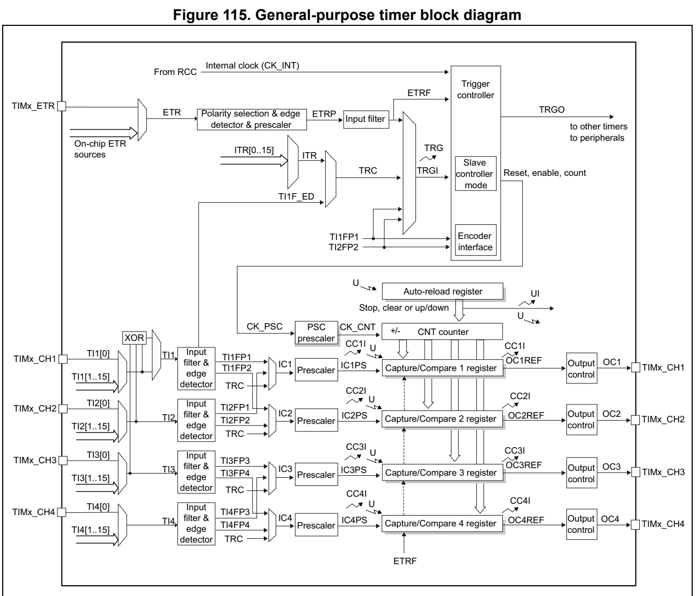
*Figure 115. General-purpos e timer block diagram (p. 435)*

Notes: Preload registers transferred Reg to active registers on U event according to control bit Event

Interrupt & DMA output MSv62393V2

### 16.3 TIM3/TIM4 functional description (p. 436)

#### 16.3.1 Time-base unit (p. 436)

The main block of the programmabl e timer is a 16-bit counter wi th its related auto-reload register. The counter can count up, down or both up and down bu t also down or both up and down. The counter clock can be divided by a prescaler.

The counter, the auto-reload register and t he prescaler registe r can be written or read by software. This is true even when the counter is running.

The time-base unit includes:

- Counter Register (TIMx_CNT)

- Prescaler Register (TIMx_PSC)

- Auto-Reload Register (TIMx_ARR)

The auto-reload register is preloaded. Writing to or reading from the auto-reload register accesses the preload register. Th e content of the preload register are transferred into the shadow register permanently or at each update event (UEV), depe nding on the auto-reload preload enable bit (ARPE) in TIMx_CR1 register. The update even t is sent when the counter reaches the overflow (or underflow when downcounting) and if th e UDIS bit equals 0 in the TIMx_CR1 register. It can also be generated by software. The ge neration of the update event is described in detail for each configuration.

The counter is clocked by the prescaler output CK_CNT, which is enabled only when the counter enable bit (CEN) in TIMx_CR1 register is set (refer als o to the slave mode controller description to get more details on counter enabling).

Note that the actual counter enabl e signal CNT_EN is set 1 cloc k cycle after CEN.

Prescaler description

The prescaler can divide the counter clock frequency by any factor between 1 and 65536. It is based on a 16-bit counter controlled through a 16-bit/32-bit register (in the TIMx_PSC register). It can be changed on the fly as this control registe r is buffered. The new prescaler ratio is taken into accoun t at the next update event.

Figure 116 and Figure 117 give some examples of the counter behavior when the prescaler ratio is changed on the fly:

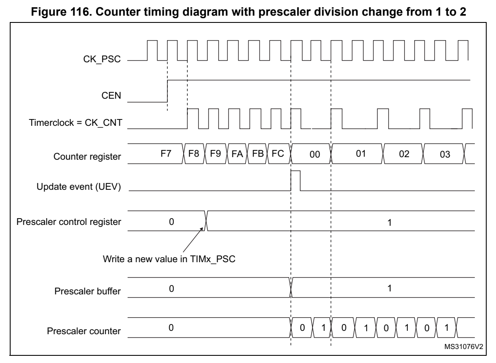
*Figure 116. Counter timing diagra m with prescaler division chan ge from 1 to 2 (p. 437)*

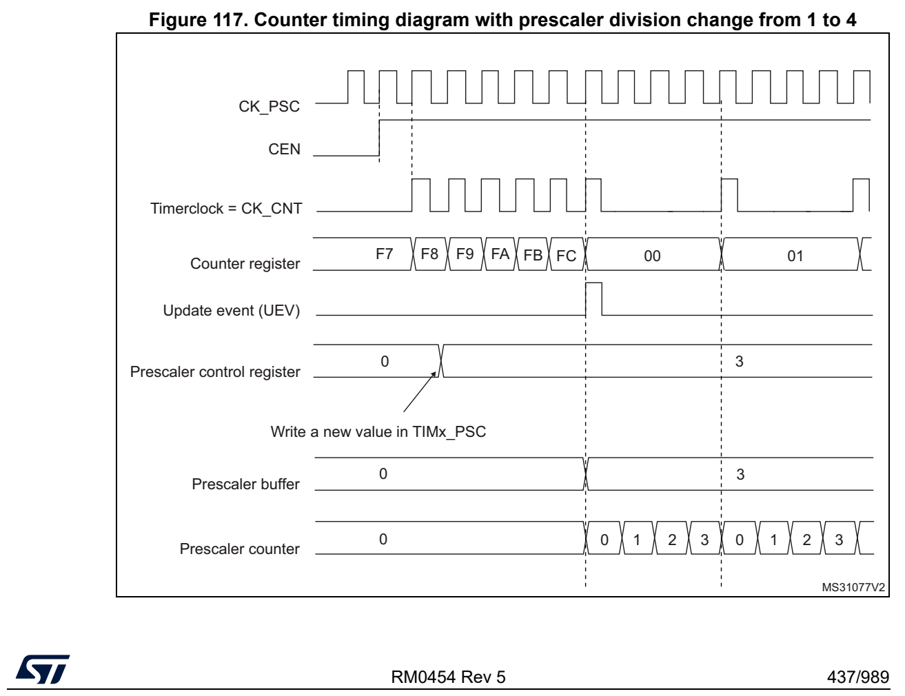
*Figure 117. Counter timing diagra m with prescaler division chan ge from 1 to 4 (p. 437)*

#### 16.3.2 Counter modes (p. 438)

Upcounting mode

In upcounting mode, the counter counts from 0 to the auto-reloa d value (content of the TIMx_ARR register), then restarts from 0 and generates a counte r overflow event.

An Update event can be generated at each counter overflow or by setting the UG bit in the TIMx_EGR register (by s oftware or by using the slave mode controller).

The UEV event can be disabled by software by setting the UDIS b it in TIMx_CR1 register. This is to avoid updating the s hadow registers while writing new values in the preload registers. Then no update event occurs until the UDIS bit has b een written to 0. However, the counter restarts from 0, as well as the counter of the pres caler (but the prescale rate does not change). In addition, if the URS bit (update request s election) in TIMx_CR1 register is set, setting the UG bit generates an update event U EV but without setting the UIF flag (thus no interrupt or DMA request is sent). This is to avo id generating both update and capture interrupts when clearing the counter on the capture eve nt.

When an update even t occurs, all the registers are updated and the update flag (UIF bit in TIMx_SR register) is set (depending on the URS bit):

- The buffer of the prescaler is reloaded with the preload value (content of the TIMx_PSC register)

- The auto-reload shadow register i s updated with the preload val ue (TIMx_ARR)

The following figures show some examples of the counter behavio r for different clock frequencies when TIMx_ARR=0x36.

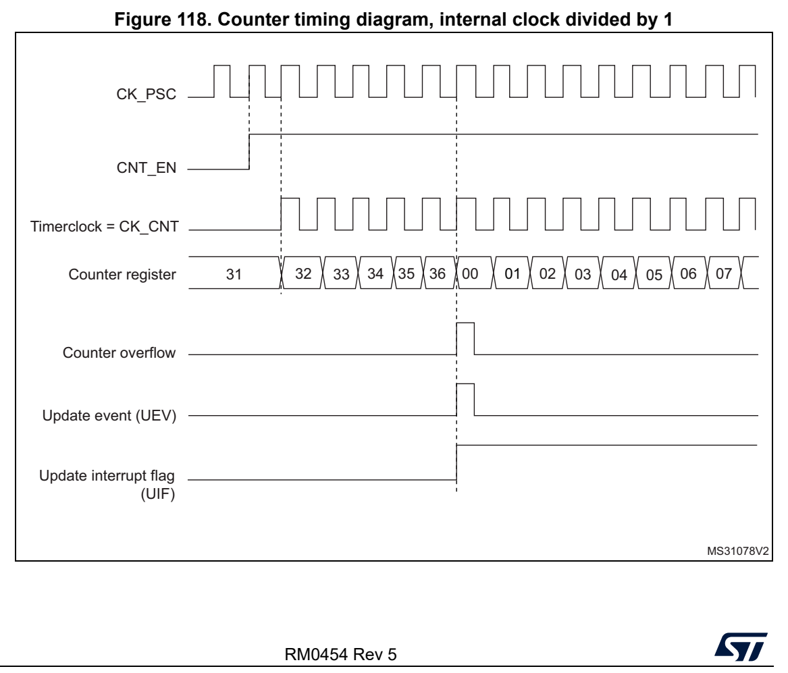
*Figure 118. Counter timing diagra m, internal clock divided by 1 (p. 438)*

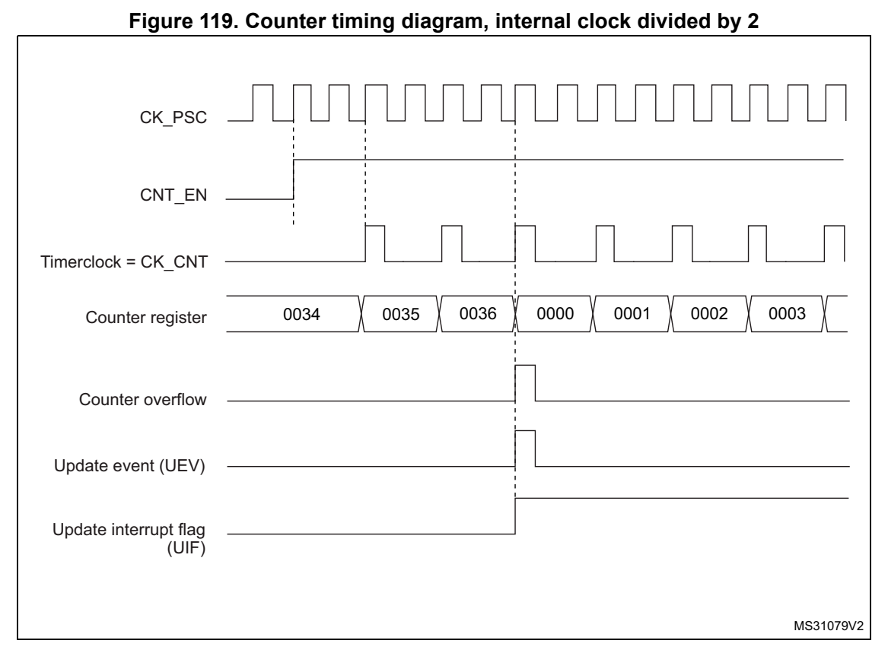
*Figure 119. Counter timing diagra m, internal clock divided by 2 (p. 439)*

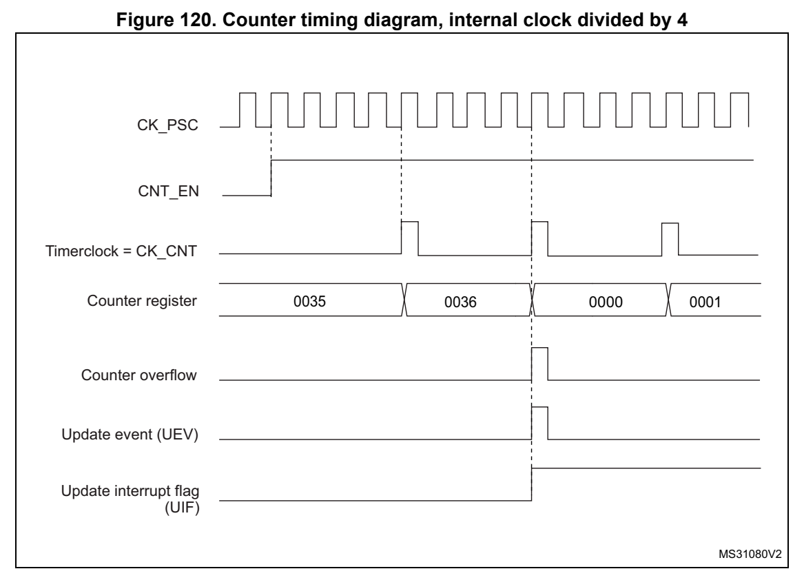
*Figure 120. Counter timing diagram, internal clock divided by 4 (p. 439)*

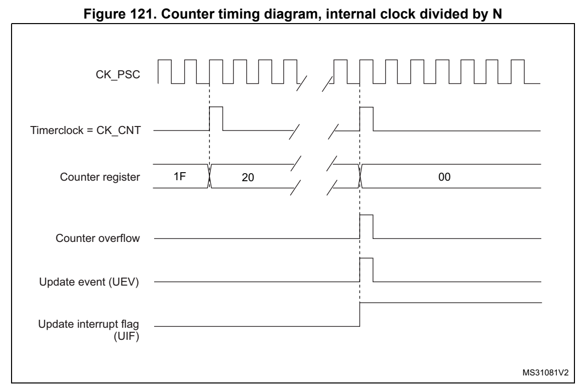
*Figure 121. Counter timing diagram, internal clock divided by N (p. 440)*

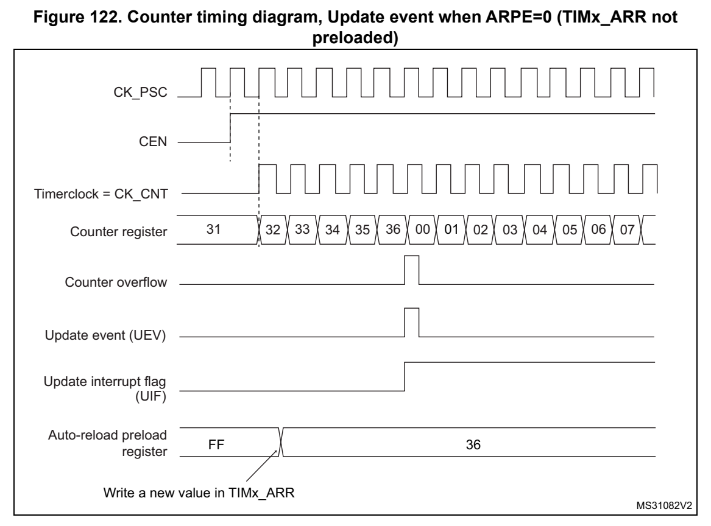
*Figure 122. Counter timing diagram, Update event when ARPE=0 (T IMx_ARR not (p. 440)*

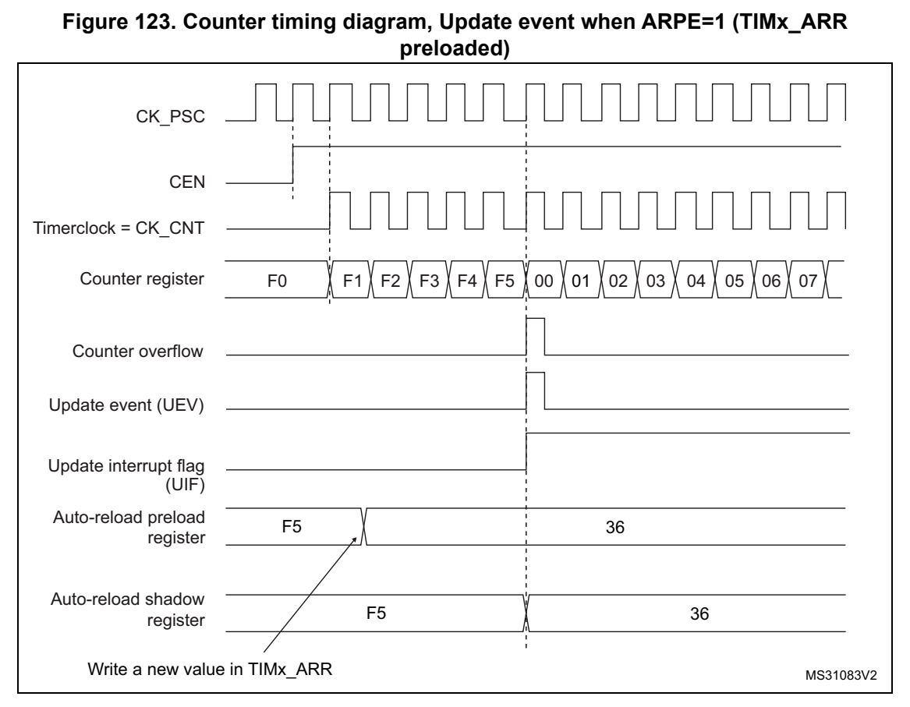
*Figure 123. Counter timing diag ram, Update event when ARPE=1 (T IMx_ARR (p. 441)*

Downcounting mode

In downcounting mode, the counter counts from the auto-reload value (content of the TIMx_ARR register) down to 0, then restarts from the auto-reloa d value and generates a counter underflow event.

An Update event can be generate at each coun ter underflow or by setting the UG bit in the TIMx_EGR register (by s oftware or by using the slave mode controller)

The UEV update event can be disa bled by software by setting the UDIS bit in TIMx_CR1 register. This is to avoid updati ng the shadow registers while writing new values in the preload registers. Then no update event occurs u ntil UDIS bit h as been written to 0. However, the counter restarts from the current auto-reload valu e, whereas the counter of the prescaler restarts from 0 (but t he prescale rate doesn’t change).

In addition, if the URS bit (update request selection) in TIMx_CR1 register is set, setting the UG bit generates an update event UEV but without setting the UI F flag (thus no interrupt or DMA request is sent). This is to avoid generating both update a nd capture interrupts when clearing the counter on the capture event.

When an update even t occurs, all the registers are updated and the update flag (UIF bit in TIMx_SR register) is set (depending on the URS bit):

- The buffer of the prescaler is reloaded with the preload value (content of the TIMx_PSC register).

- The auto-reload active register is updated with the preload val ue (content of the TIMx_ARR register). Note that the auto-reload is updated before the counter is reloaded, so that the next period is the expected one.

The following figures show some examples of the counter behavio r for different clock frequencies when TIMx_ARR=0x36.

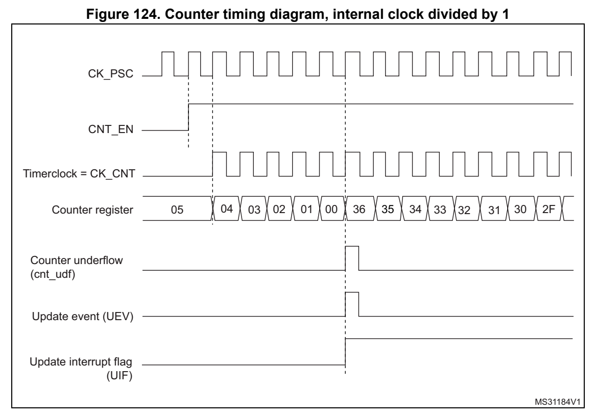
*Figure 124. Counter timing diagram, internal clock divided by 1 (p. 442)*

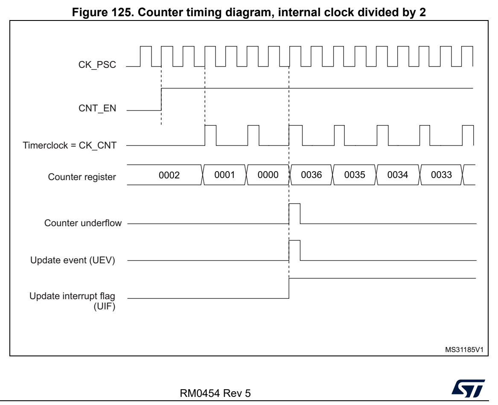
*Figure 125. Counter timing diagram, internal clock divided by 2 (p. 442)*

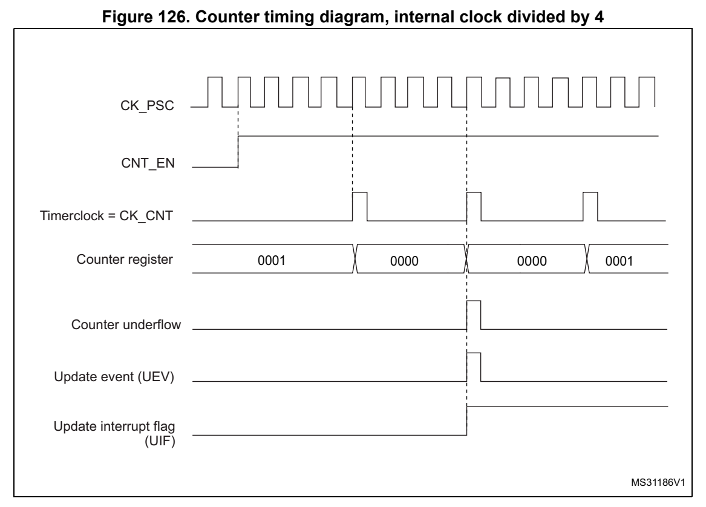
*Figure 126. Counter timing diagram, internal clock divided by 4 (p. 443)*

*Figure 127. Counter timing diagram, internal clock divided by N (p. 443)*

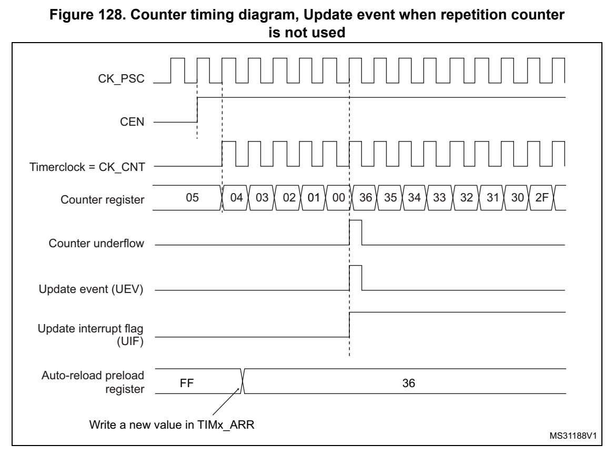
*Figure 128. Counter timing diagra m, Update event when repetitio n counter (p. 444)*

Center-aligned mode (up/down counting)

In center-aligned mode, the counter counts from 0 to the auto-reload value (content of the TIMx_ARR register) – 1, generates a counter overflow event, the n counts from the auto-reload value down to 1 and generates a counter underflow event. Then it restarts counting from 0.

Center-aligned mode is active when the CMS bits in TIMx_CR1 reg ister are not equal to '00'. The Output compare interru pt flag of channels configured in output is set when: the counter counts down (Center ali gned mode 1, CMS = "01"), the co unter counts up (Center aligned mode 2, CMS = "10") the counter counts up and down (Cen ter aligned mode 3, CMS = "11").

In this mode, the direction bit (DIR from TIMx_CR1 register) ca nnot be written. It is updated by hardware and gives the current direction of the counter.

The update event can be generated at each counter overflow and at each counter underflow or by setting the UG bit in the TIMx_EGR register (by software or by using the slave mode controller) also generates an up date event. In this case, the counter restarts counting from 0, as well as the counter of the prescaler.

The UEV update event can be disa bled by software by setting the UDIS bit in TIMx_CR1 register. This is to avoid updati ng the shadow registers while writing new values in the preload registers. Then no update event occurs until the UDIS b it has been written to 0. However, the counter continues counting up and down, based on t he current auto-reload value.

In addition, if the URS bit (update request selection) in TIMx_CR1 register is set, setting the UG bit generates an update event UEV but without setting the UI F flag (thus no interrupt or

DMA request is sent). This is to avoid generating both update a nd capture interrupt when clearing the counter on the capture event.

When an update even t occurs, all the registers are updated and the update flag (UIF bit in TIMx_SR register) is set (depending on the URS bit):

- The buffer of the prescaler is reloaded with the preload value (content of the TIMx_PSC register).

- The auto-reload active register is updated with the preload val ue (content of the TIMx_ARR register). Note that i f the update source is a counter overflow, the auto-reload is updated before the counter is reloaded, so that the n ext period is the expected one (the counter is loa ded with the new value).

The following figures show some examples of the counter behavio r for different clock frequencies.

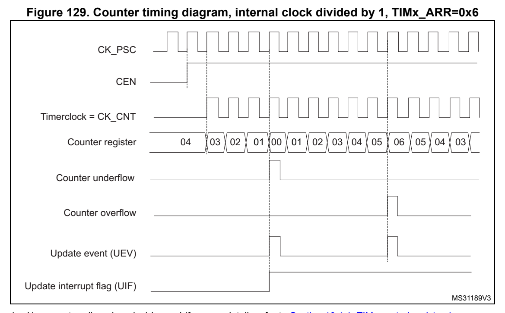
*Figure 129. Counter timing diagra m, internal clock divided by 1, TIMx_ARR=0x6 (p. 445)*

1. Here, center-aligned mode 1 is used (for more details refer to Section 16.4.1: TIMx control register 1 (TIMx_CR1)(x = 3 to 4) on page 479).

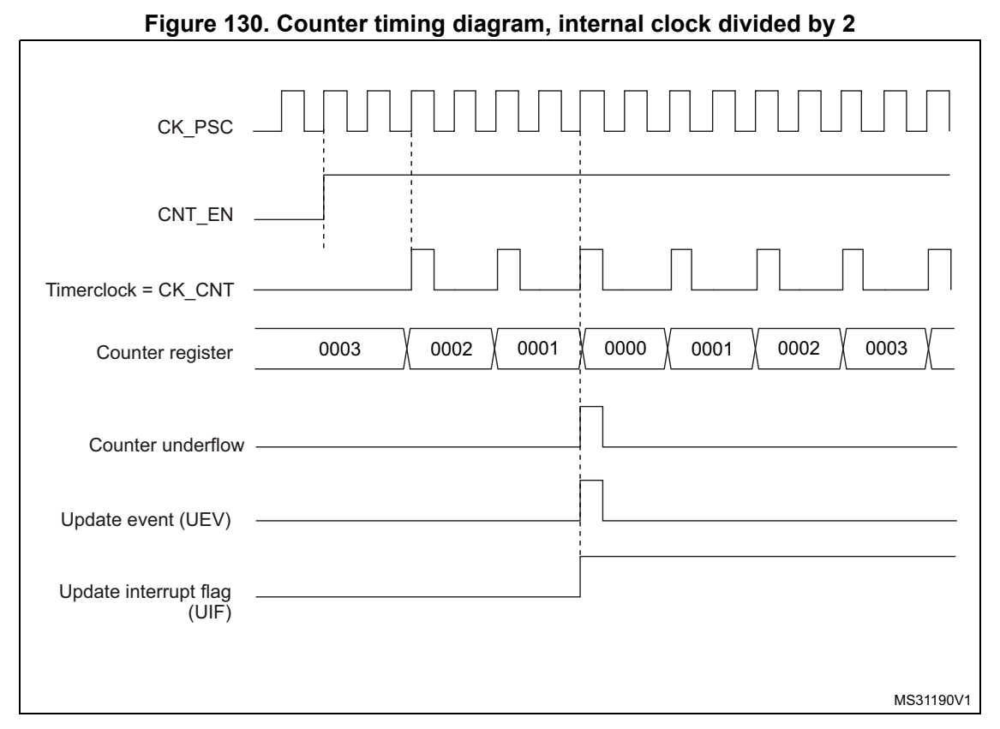
*Figure 130. Counter timing diagram, internal clock divided by 2 (p. 446)*

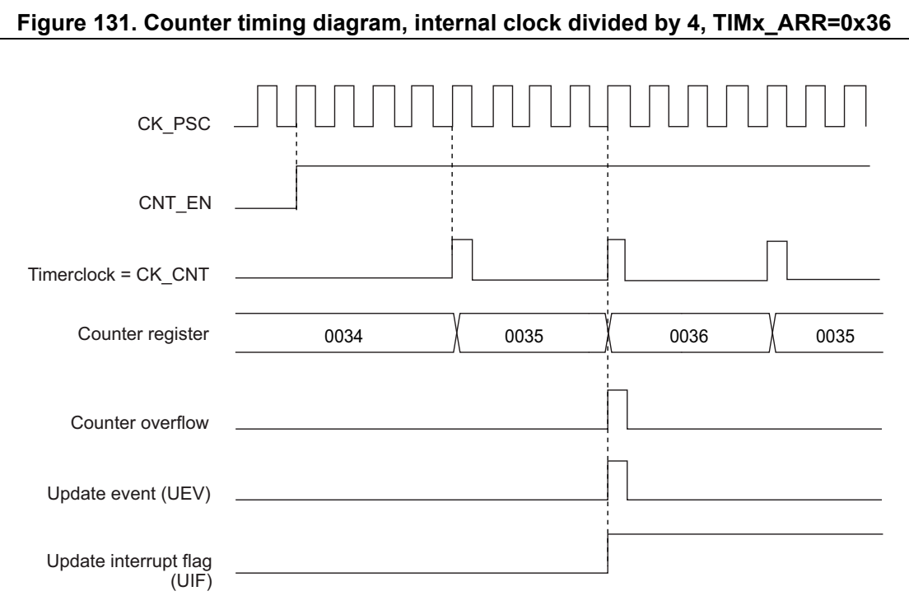
*Figure 131. Counter timing diagra m, internal clock divided by 4, TIMx_ARR=0x36 (p. 446)*

Note: Here, center_aligned mode 2 or 3 is updated with an UIF on overflow MS31191V1

1. Center-aligned mode 2 or 3 is used with an UIF on overflow.

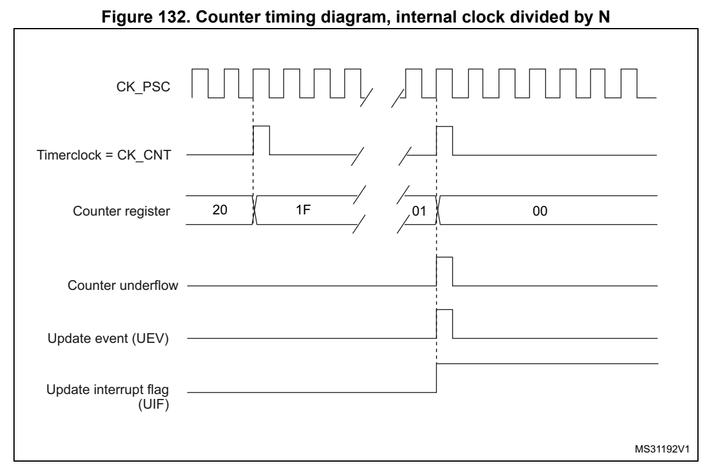
*Figure 132. Counter timing diagram, internal clock divided by N (p. 447)*

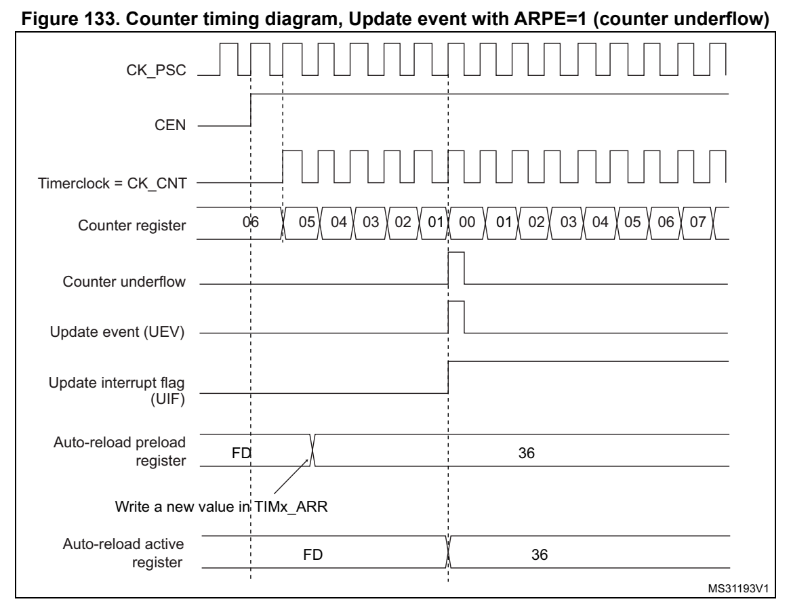
*Figure 133. Counter timing diagra m, Update event with ARPE=1 (c ounter underflow) (p. 447)*

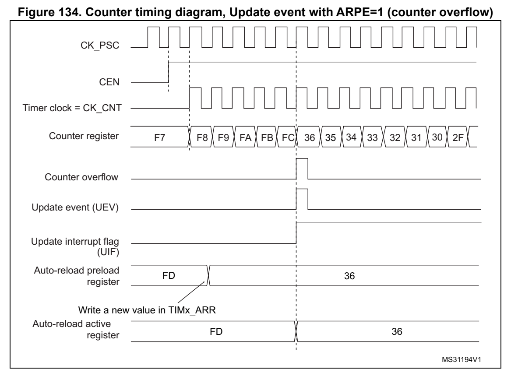
*Figure 134. Counter timing diag ram, Update event with ARPE=1 (c ounter overflow) (p. 448)*

#### 16.3.3 Clock selection (p. 448)

The counter clock can be provide d by the following clock source s:

- Internal clock (CK_INT)

- External clock mode1: external input pin (TIx)

- External clock mode2: external trigger input (ETR)

- Internal trigger inputs (ITRx): u sing one timer as prescaler fo r another timer, for example, Timer X can be configured to act as a prescaler for Ti mer Y. Refer to: Using one timer as prescaler for another timer on page 473 for more details.

Internal clock source (CK_INT)

If the slave mode controller is disabled (SMS=000 in the TIMx_S MCR register), then the CEN, DIR (in the TIMx_CR1 register) and UG bits (in the TIMx_EG R register) are actual control bits and can b e changed only by software (except UG whi ch remains cleared automatically). As soon as the CEN bit is written to 1, the pre scaler is clocked by the internal clock CK_INT.

Figure 135 shows the behavior of the contro l circuit and the upcounter in normal mode, without prescaler.

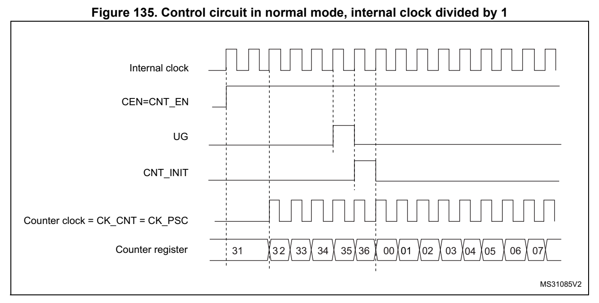
*Figure 135. Control circuit in no rmal mode, internal clock divi ded by 1 (p. 449)*

External clock source mode 1

This mode is selected when SMS=111 in the TIMx_SMCR register. The counter can count at each rising or falling edg e on a selected input.

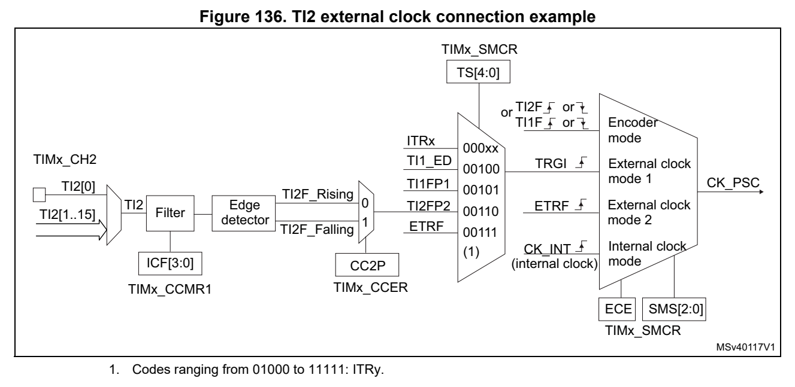
*Figure 136. TI2 external clock connection example (p. 449)*

For example, to configure the upcounter to count in response to a rising edge on the TI2 input, use the following procedure: 1. Select the proper TI2x source (internal or external) with the TI2SEL[3:0] bits in the TIMx_TISEL register. 2. Configure channel 2 to detect rising edges on the TI2 input by writing CC2S= ‘01 in the TIMx_CCMR1 register. 3. Configure the input filter duration by writing the IC2F[3:0] bits in the TIMx_CCMR1 register (if no filter is needed, keep IC2F=0000).

Note: The capture prescaler is not used for triggering, so it does not need to be configured. 4. Select rising edge polarity by writing CC2P=0 and CC2NP=0 an d CC2NP=0 in the TIMx_CCER register. 5. Configure the timer in externa l clock mode 1 by writing SMS= 111 in the TIMx_SMCR register. 6. Select TI2 as the input source by writing TS=00110 in the TI Mx_SMCR register. 7. Enable the counter by writing CEN=1 in the TIMx_CR1 register.

When a rising edge occurs on TI2, the counter counts once and t he TIF flag is set.

The delay between the rising edge on TI2 and the actual clock of the counter is due to the resynchronization circuit on TI2 input.

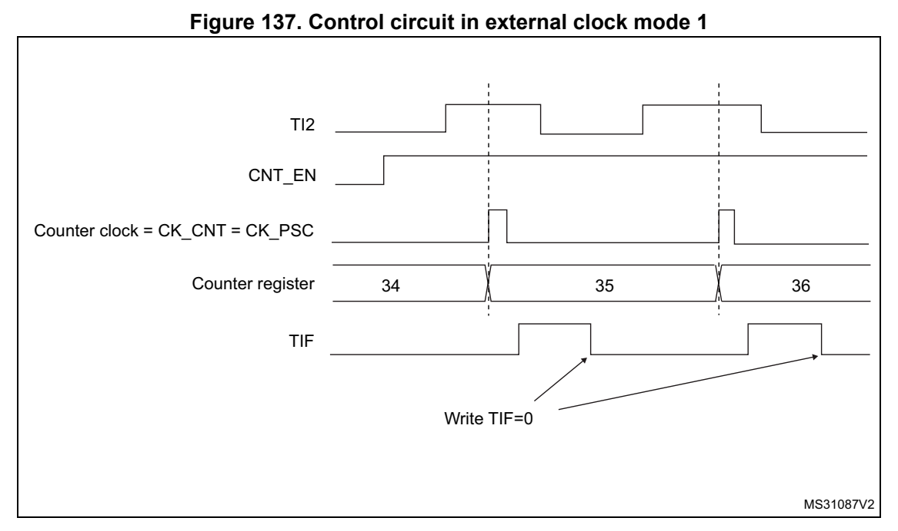
*Figure 137. Control circuit in external clock mode 1 (p. 450)*

External clock source mode 2

This mode is selected by writing ECE=1 in the TIMx_SMCR registe r.

The counter can coun t at each rising or falling edge on the external trigger input ETR.

Figure 138 gives an overview of the external trigger input block.

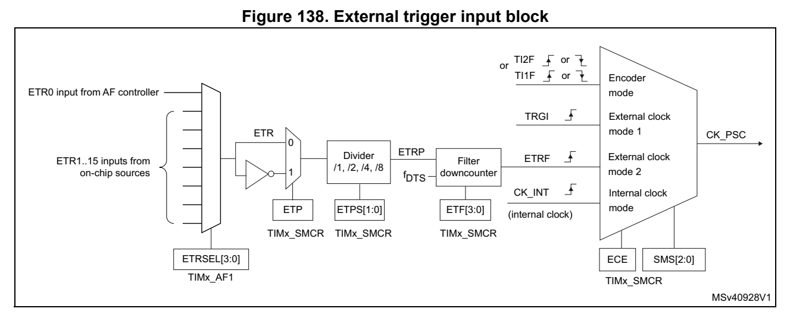
*Figure 138. External trigger input block (p. 451)*

For example, to configure the upcounter to count each 2 rising edges on ETR, use the following p rocedure: 1. Select the proper ETR source ( internal or external) with the ETRSEL[3:0] bits in the TIMx_AF1 register. 2. As no filter is needed in this example, write ETF[3:0]=0000 in the TIMx_SMCR register. 3. Set the prescaler by writing ETPS[1:0]=01 in the TIMx_SMCR register 4. Select rising edge detection o n the ETR pin by writing ETP=0 in the TIMx_SMCR register 5. Enable external clock mode 2 by writing ECE=1 in the TIMx_SM CR register. 6. Enable the counter by writing CEN=1 in the TIMx_CR1 register.

The counter counts once each 2 ETR rising edges.

The delay between the rising edge on ETR and the actual clock of the counter is due to the resynchronization circuit on the ETRP signal. As a consequence, the maximum frequency which can be correctly captured by the counter is at most ¼ of TIMxCLK frequency. When the ETRP signal is faster, the user should apply a division of the external signal by a proper ETPS prescaler setting.

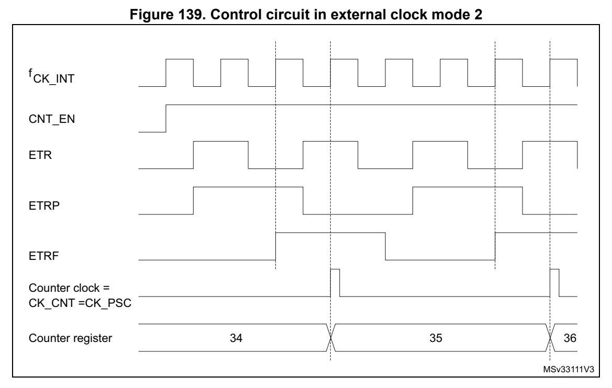
*Figure 139. Control circuit in external clock mode 2 (p. 452)*

#### 16.3.4 Capture/Compare channels (p. 452)

Each Capture/Compare channel is built around a capture/compare register (including a shadow register), a input stage for capture (with digital filte r, multiplexing and prescaler) and an output stage (with comparator and output control).

The following figure gives an overview of one Capture/Compare c hannel.

The input stage samples the corresponding TIx input to generate a filtered signal TIxF. Then, an edge detector with pola rity selection generates a sign al (TIxFPx) which can be used as trigger input by the slave mode controller or as the ca pture command. It is prescaled before the capture register (ICxPS).

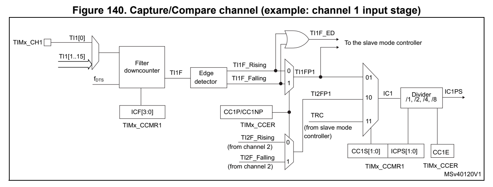
*Figure 140. Capture/Compare channel (example: channel 1 input s tage) (p. 452)*

The output stage generates an intermediate waveform which is th en used for reference: OCxRef (active high). The polarity acts at the end of the chain.

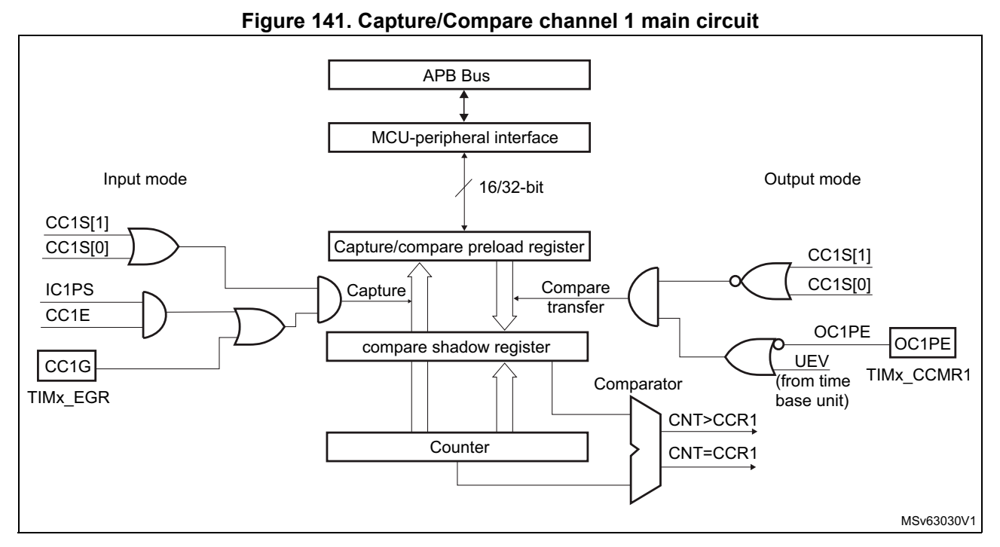
*Figure 141. Capture/Compare channel 1 main circuit (p. 453)*

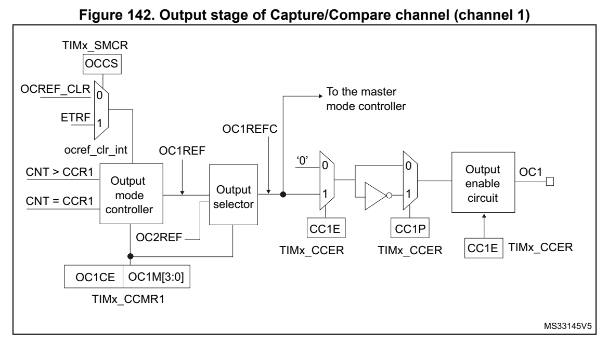
*Figure 142. Output stage of Capture/Compare channel (channel 1) (p. 453)*

The capture/compare block is made of one preload register and o ne shadow register. Write and read always access the preload register.

In capture mode, captures are actually done in the shadow register, which is copied into the preload register.

In compare mode, the content of the p reload registe r is copied into the shadow register which is compared to the counter.

#### 16.3.5 Input capture mode (p. 454)

In Input capture mode, the Capture/Compare Registers (TIMx_CCRx) are used to latch the value of the counter after a transition dete cted by the corresp onding ICx signal. When a capture occurs, the corresponding CCXIF flag (TIMx_SR register) is set and an interrupt or a DMA request can be sent if they are enabled. If a capture occ urs while the CCxIF flag was already high, then the over-captu re flag CCxOF (TIMx_SR registe r) is set. CCxIF can be cleared by software by writing i t to 0 or by rea ding the captured data stored in the TIMx_CCRx register. CCxOF is clea red when it is written with 0.

The following example shows how to capture the counter value in TIMx_CCR1 when TI1 input rises. To do this, us e the following procedure: 1. Select the proper TI1x source (internal or external) with the TI1SEL[3:0] bits in the TIMx_TISEL register. 2. Select the active input: TIMx_CCR1 must be linked to the TI1 input, so write the CC1S bits to 01 in the TIMx_CCMR1 register. As soon as CC1S becomes different from 00, the channel is configured in inp ut and the TIMx_CCR1 register b ecomes read-only. 3. Program the appropriate input filter duration in relation wi th the signal connected to the timer (when the input is one of the TIx (ICxF bits in the TIMx_CCMRx register). Let’s imagine that, when toggling, the input signal is not stable during at must 5 internal clock cycles. We must program a filter duration lo nger than these 5 c lock cycles. We can validate a transition on TI1 when 8 consecutive samples with th e new level have been detected (sampled at f DTS frequency). Then write IC1F bits to 0011 in the TIMx_CCMR1 register. 4. Select the edge of the activ e transition on the TI1 channel by writing the CC1P and CC1NP and CC1NP bits to 000 in the TIMx_CCER register (rising e dge in this case). 5. Program the input prescaler. In our exa mple, we wish the cap ture to be performed at each valid transition, so the prescaler is disabled (write IC1P S bits to 00 in the TIMx_CCMR1 register). 6. Enable capture from the counter into the capture register by setting the CC1E bit in the TIMx_CCER register. 7. If needed, enable the related interrupt request by setting t he CC1IE bit in the TIMx_DIER register, and/or the DMA request by setting the CC1DE bit in the TIMx_DIER register.

When an input capture occurs:

- The TIMx_CCR1 register gets the value of the counter on the act ive transition.

- CC1IF flag is set (interrupt flag). CC1OF is also set if at lea st two consecutive captures occurred whereas the flag was not cleared.

- An interrupt is generated depending on the CC1IE bit.

- A DMA request is generated depending on the CC1DE bit.

In order to handle the overcapt ure, it is recomm ended to read t he data before the overcapture flag. This is to avoid missing an overcapture which could happen after reading the flag and before reading the data.

Note: IC interrupt and/or DMA requests can be generated by software by setting the corresponding CCxG bit in the TIMx_EGR register.

#### 16.3.6 PWM input mode (p. 455)

This mode is a particular case of input capture mode. The proce dure is the same except:

- Two ICx signals are mapp ed on the same TIx input.

- These 2 ICx signals are active on edges wit h opposite polarity.

- One of the two TIxFP signals is s elected as trigger input and t he slave mode controller is configured in reset mode.

For example, one can m easure the period (in TIMx_CCR1 register) and the duty cycle (in TIMx_CCR2 register) of the PWM applied on TI1 using the followi ng procedure (depending on CK_INT frequency and prescaler value): 1. Select the proper TI1x source (internal or external) with the TI1SEL[3:0] bits in the TIMx_TISEL register. 2. Select the active in put for TIMx_CCR1: write the CC1S bits to 01 in the TIMx_CCMR1 register (TI1 selected). 3. Select the active polarity fo r TI1FP1 (used both for capture in TIMx_CCR1 and counter clear): write the CC1P to ‘0’ an d the CC1NP bit to ‘0’ (active on rising edge). 4. Select the active in put for TIMx_CCR2: write the CC2S bits to 10 in the TIMx_CCMR1 register (TI1 selected). 5. Select the active polarity fo r TI1FP2 (used fo r capture in T IMx_CCR2): write the CC2P bit to ‘1’ and the CC2 NP bit to ’0’ (active on falling edge). 6. Select the valid trigger input: write the TS bits to 00101 i n the TIMx_SMCR register (TI1FP1 selected). 7. Configure the slave mode controller in reset mode: write the SMS bits to 100 in the TIMx_SMCR register. 8. Enable the captures: write t he CC1E and CC2E bits to ‘1 in t he TIMx_CCER register.

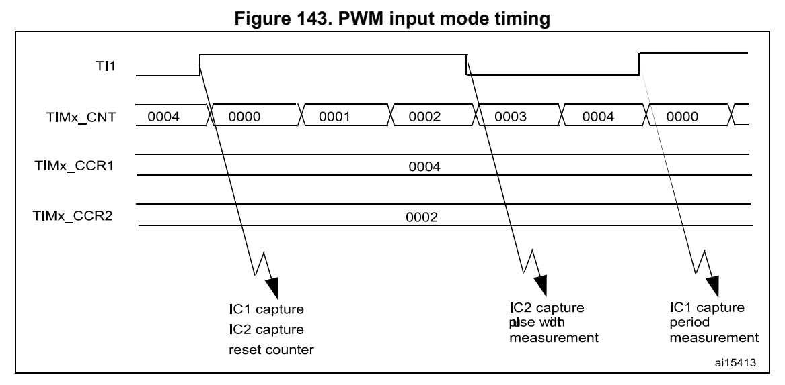
*Figure 143. PWM input mode timing (p. 455)*

1. The PWM input mode can be used only with the TIMx_CH1/TIMx_CH 2 signals due to the fact that only TI1FP1 and TI2FP2 are connected to the slave mode controller.

#### 16.3.7 Forced output mode (p. 456)

In output mode (CCxS bi ts = 00 in the TIMx_CCMRx register), eac h output compare signal (OCxREF and then OCx) can be forced to active or inactive level directly by software, independently of any comparison between the output compare regi ster and the counter.

To force an output compare signal (ocxref/OCx) to its active le vel, one just needs to write 101 in the OCxM bits in the corresponding TIMx_CCMRx register. Thus ocxref is forced high (OCxREF is always active high) an d OCx get opposite value to CCxP polarity bit.

e.g.: CCxP=0 (OCx active high) => OCx is forced to high level.

ocxref signal can be forced low by writing the OCxM bits to 100 in the TIMx_CCMRx register.

Anyway, the comparison between the TIMx_CCRx shadow register an d the counter is still performed and allows the flag to be set. Interrupt and DMA requ ests can be sent accordingly. This is described i n the Output Com pare Mode secti on.

#### 16.3.8 Output compare mode (p. 456)

This function is used to control an output wavefo rm or indicati ng when a period of time has elapsed.

When a match is found between the capture/compare register and the counter, the output compare function:

- Assigns the corresponding output pin to a programmable value defined by the output compare mode (OCxM bits in the TIMx_CCMRx register) and the out put polarity (CCxP bit in the TIMx_CCER re gister). The output p in can keep its level (OCXM=000), be set active (OCxM=001), be set inactive (OCxM=010) or can toggle (OCxM=011) on match.

- Sets a flag in the interrupt sta tus register (CCxIF bit in the TIMx_SR register).

- Generates an interrupt if the corresponding interrupt mask is s et (CCXIE bit in the TIMx_DIER register).

- Sends a DMA request if the corresponding enable bit is set (CCx DE bit in the TIMx_DIER register, CCDS bit in the TIMx_CR2 register for the D MA request selection).

The TIMx_CCRx registers can be p rogrammed with or without prelo ad registers using the OCxPE bit in the TIMx_CCMRx register.

In output compare mode, the update event UEV has no effect on o cxref and OCx output. The timing resolution is one count of the counter. Output compa re mode can also be used to output a single pulse (in One-pulse mode).

Procedure

1. Select the counter clock (i nternal, external, prescaler). 2. Write the desired data in the TIMx_ARR and TIMx_CCRx registe rs. 3. Set the CCxIE and/or CCxDE bits if an interrupt and/or a DMA request is to be generated. 4. Select the output mode. For example, one must write OCxM=011, OCxPE=0, CCxP=0 and CCxE=1 to toggle OCx output p in when CNT matches CCRx, CCRx preload is not used, OCx is enabled and active high. 5. Enable the counter by setting the CEN bit in the TIMx_CR1 re gister.

The TIMx_CCRx register can be upd ated at any time by software to control the output waveform, provided that the preload register is not enabled (OCxPE=0, else TIMx_CCRx shadow register is updated only at the next update event UEV). An example is given in Figure 144.

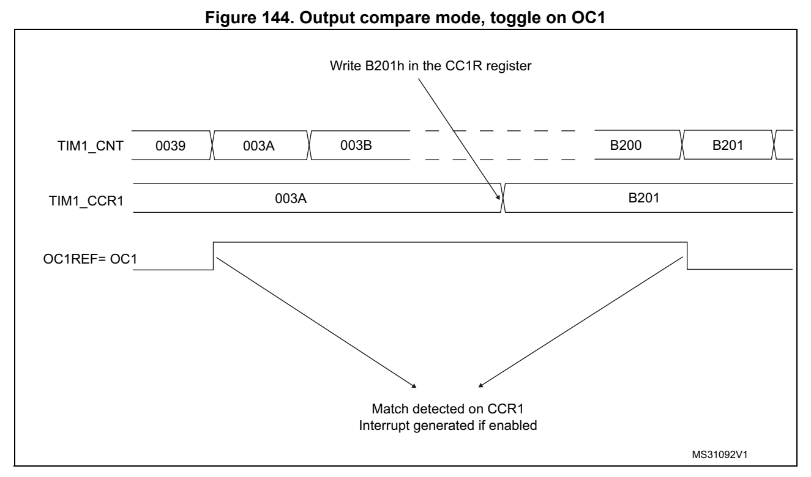
*Figure 144. Output compare mode, toggle on OC1 (p. 457)*

#### 16.3.9 PWM mode (p. 457)

Pulse width modulation mode permits to generate a signal with a frequency de termined by the value of the TIMx_ARR register and a duty cycle determined by the value of the TIMx_CCRx register.

The PWM mode can be selected i ndependently on each channel (one PWM per OCx output) by writing 110 (PWM mode 1) or ‘111 (PWM mode 2) in the OCxM bits in the TIMx_CCMRx register. The corresp onding preload register must be enabled by setting the OCxPE bit in the TIMx_CCMRx regi ster, and eventually the auto-reload preload register (in upcounting or center-aligned mode s) by setting the ARPE bit in the TIMx_CR1 register.

As the preload registers are transferred to the shadow registers only when an update event occurs, before starting the coun ter, all registers must be init ialized by setting the UG bit in the TIMx_EGR register.

OCx polarity is software progra mmable using the CCxP bit in the TIMx_CCER register. It can be programmed as active high or active low. OCx output is e nabled by the CCxE bit in the TIMx_CCER register. Refer to the TIMx_CCERx register descri ption for more details.

In PWM mode (1 or 2), TIMx_CNT and TIMx_CCRx are always compare d to determine whether TIMx_CCRx ≤ TIM x_CNT or TIMx_CNT ≤ TIMx_CCRx (depending on the direction of the counter). Howeve r, to comply with the OCREF_CLR function ality (OCREF can be

cleared by an external event through the ETR signal until the n ext PWM period), the OCREF signal is asserted only:

- When the result of the comparison or

- When the output compare mode (OCxM bits in TIMx_CCMRx register) switches from the “frozen” configuration (no co mparison, OCxM=‘000) to one of the PWM modes (OCxM=‘110 or ‘111).

This forces the PWM by software while the tim er is running.

The timer is able to generate PWM in edge-aligned mode or cente r-aligned mode depending on the CMS bits in the TIMx_CR1 register.

PWM edge-aligned mode

Upcounting configuration

Upcounting is active when the DI R bit in the TIMx_CR1 register is low. Refer to Upcounting mode on page 438.

In the following example, we consider PWM mode 1. The reference PWM signal OCxREF is high as long as TIMx_CNT <TIMx_CCRx else it becomes low. If the compare value in TIMx_CCRx is greater than the auto-reload value (in TIMx_ARR) t hen OCxREF is held at ‘1. If the compare value is 0 th en OCxREF is held at ‘0. Figure 145 shows some edge-aligned PWM waveforms in an example where TIMx_ARR=8.

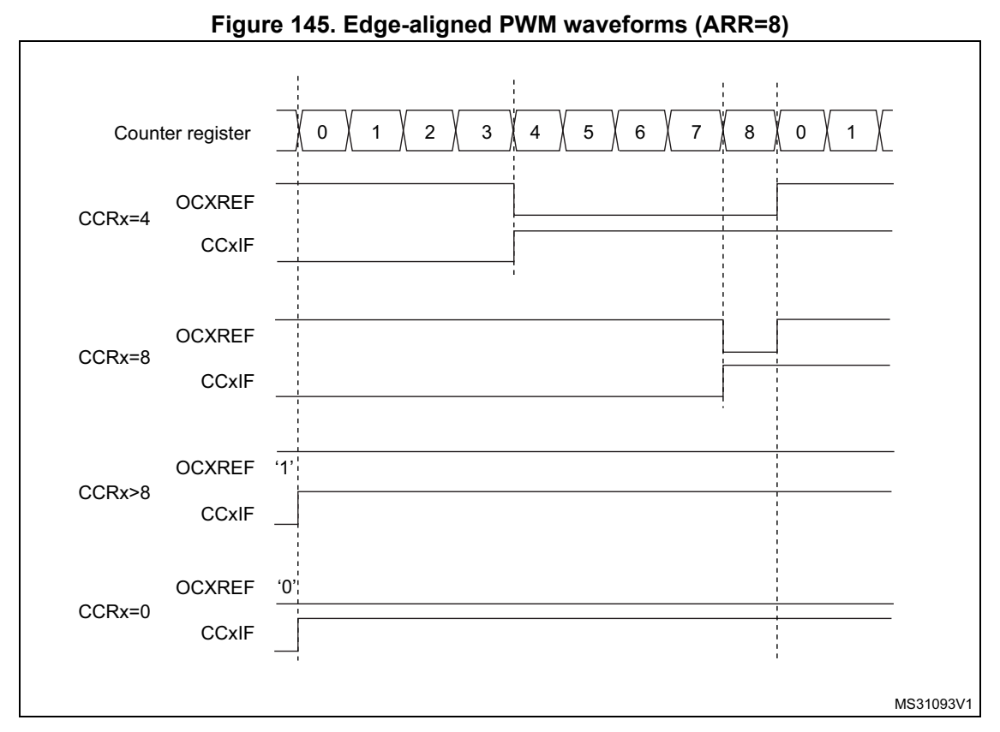
*Figure 145. Edge-aligned PWM waveforms (ARR=8) (p. 458)*

Downcounting configuration

Downcounting is active when DIR bit in TIMx_CR1 register is hig h. Refer to Downcounting mode on page 441.

In PWM mode 1, the reference signal ocxref is low as long as TI Mx_CNT>TIMx_CCRx else it becomes high. If the compare value in TIMx_CCRx is greater t han the auto-reload value in TIMx_ARR, then ocxref is held a t 100%. PWM is not possible in t his mode.

PWM center-aligned mode

Center-aligned mode is active when the CMS bits in TIMx_CR1 reg ister are different from ‘00 (all the remaining configurations having the same effect on the ocxref/OCx signals). The compare flag is set when the counter counts up, when it counts down or both when it counts up and down depending on the CMS bits configuration. The direct ion bit (DIR) in the TIMx_CR1 register is upd ated by hardware and must not be change d by software. Refer to Center-aligned mode (up/down counting) on page 444.

Figure 146 shows some center-aligned PWM waveforms in an example where:

- TIMx_ARR=8,

- PWM mode is the PWM mode 1,

- The flag is set when the counter counts down corresponding to t he center-aligned mode 1 selected for CMS=01 in TIMx_CR1 register.

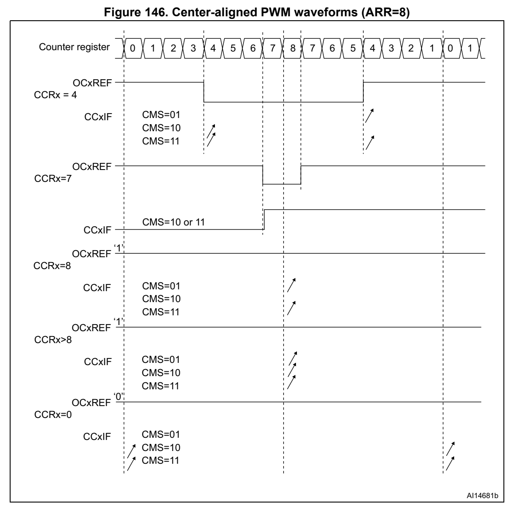
*Figure 146. Center-aligned PWM waveforms (ARR=8) (p. 460)*

Hints on using center-aligned mode:

- When starting in center-aligned mode, the current up-down confi guration is used. It means that the counter counts up or down depending on the value written in the DIR bit in the TIMx_CR1 register. Moreover, the DIR and CMS bits must n ot be changed at the same time by the software.

- Writing to the counte r while running in center-aligned mode is not recommended as it can lead to unexpected results. In particular: – The direction is not updated if a value greater than the auto- reload value is written in the counter (TIMx_CNT>TIMx_A RR). For example, if the counter was counting up, it continues to count up. – The direction is updated if 0 or the TIMx_ARR value is written in the counter but no Update Event UEV is generated.

- The safest way to use center-a ligned mode is to generate an upd ate by software (setting the UG bit in the TIMx_E GR register) just before start ing the counter and not to write the counter while it is running.

#### 16.3.10 Asymmetric PWM mode (p. 461)

Asymmetric mode allows two center-aligned PWM signals to be gen erated with a programmable phase shift. While the frequency is determined by the value of the TIMx_ARR register, the duty cycl e and the phase-shift are determined by a pair of TIMx_CCRx registers. One register controls the PWM during up-co unting, the second during down counting, so that PWM is adjusted every half PWM cycle:

- OC1REFC (or OC2REFC) is controlled by TIM x_CCR1 and TIMx_CCR2

- OC3REFC (or OC4REFC) is controlled by TIM x_CCR3 and TIMx_CCR4

Asymmetric PWM mode can be selected independently on two channe ls (one OCx output per pair of CCR registers) by writing ‘1110’ (Asymmetric PWM mo de 1) or ‘1111’ (Asymmetric PWM mode 2) in the OCxM bits in the TIMx_CCMRx regi ster.

Note: The OCxM[3:0] bit field is split into two pa rts for compatibility reason s, the most significant bit is not contiguous with the 3 least significant ones.

When a given channel is used as asymmetric PWM channel, its secondary channel can also be used. For instance, if an OC1REFC signal is generated on cha nnel 1 (Asymmetric PWM mode 1), it is possible to outpu t either the OC2REF signal on c hannel 2, or an OC2REFC signal resulting from asymmetric PWM mode 2.

Figure 147 shows an example of signals tha t can be generated using Asymmetric PWM mode (channels 1 to 4 are configu red in Asymmetric PWM mode 1).

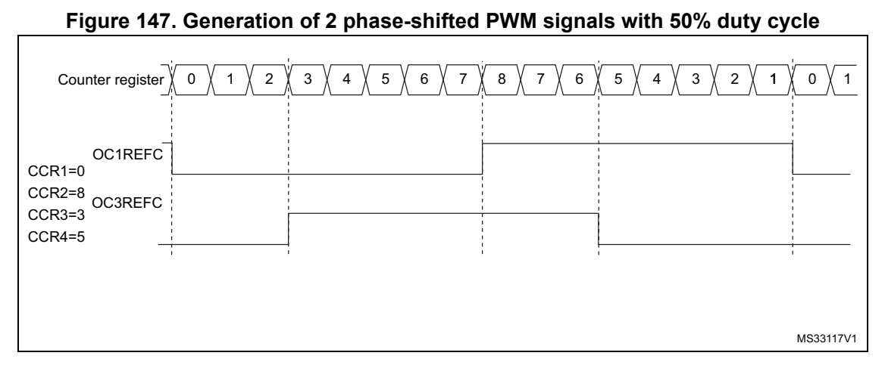
*Figure 147. Generation of 2 phase -shifted PWM signals with 50% duty cycle (p. 461)*

#### 16.3.11 Combined PWM mode (p. 461)

Combined PWM mode allows two edge or center-aligned PWM signals to be generated with programmable delay and phase shift between respective pulses. W hile the frequency is determined by the value of the TIMx_ARR register, the duty cycl e and delay are determined by the two TIMx_CCRx registers. T he resulting signals, OCxREFC, are made of an OR or AND logical combination of two reference PWMs:

– OC1REFC (or OC2REFC) is cont rolled by TIMx_CCR1 and TIMx_CCR2

– OC3REFC (or OC4REFC) is cont rolled by TIMx_CCR3 and TIMx_CCR4

Combined PWM mode can be selected independently on two channels (one OCx output per pair of CCR registers) by writing ‘1100’ (Combined PWM mode 1) or ‘1101’ (Combined PWM mode 2) in the OCxM bits in the TIMx_CCMRx register.

When a given channel is used a s combined PWM channel, its secon dary channel must be configured in the opposite PWM mode (for instance, one in Combi ned PWM mode 1 and the other in Combined PWM mode 2).

Note: The OCxM[3:0] bit field is split into two pa rts for compatibility reason s, the most significant bit is not contiguous with the 3 least significant ones.

Figure 148 shows an example of signals tha t can be generated using Asymmetric PWM mode, obtained with the following configuration:

- Channel 1 is configured in Combined PWM mode 2,

- Channel 2 is configured in PWM mode 1,

- Channel 3 is configured in Combined PWM mode 2,

- Channel 4 is configured in PWM mode 1

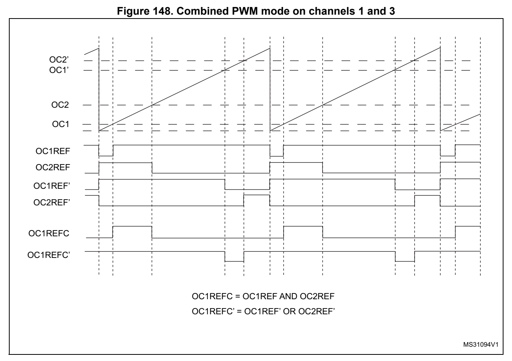
*Figure 148. Combined PWM mode on channels 1 and 3 (p. 462)*

#### 16.3.12 Clearing the OCxREF signal on an external event (p. 462)

The OCxREF signal of a given cha nnel can be cleared when a high level is applied on the ocref_clr_int input (OCxCE enabl e bit in the corresponding TIMx_CCMRx registe r set to 1). OCxREF remains low until the next update event (UEV) occurs. Th is function can only be used in Output compare and PWM modes. It does not work in Force d mode.

OCREF_CLR_INPUT can be selected between the OCREF_CLR input and ETRF (ETR after the filter) by configuring the OCCS bit in the TIMx_SMCR register.

The OCxREF signal for a given ch annel can be reset by applying a high level on the ETRF input (OCxCE enable bit set to 1 in the corresponding TIMx_CCMRx register). OCxREF remains low until the next update event (UEV) occurs.

This function can be us ed only in the output compare and PWM mo des. It does not work in forced mode.

For example, the OCxREF signal can be connected to the output of a comparator to be used for current handling. In this case, ETR must be configured as follows: 1. The external trigger prescaler should be kept off: bits ETPS[ 1:0] in the TIMx_SMCR register are cleared to 00. 2. The external clock mode 2 must be disabled: bit ECE in the T IM1_SMCR register is cleared to 0. 3. The external trigger polari ty (ETP) and the external trigger filter (ETF) can be configured according to the application’s needs.

Figure 149 shows the behavior of the OCxR EF signal when the ETRF input be comes high, for both values of the OCxCE enab le bit. In this example, the t imer TIMx is p rogrammed in PWM mode.

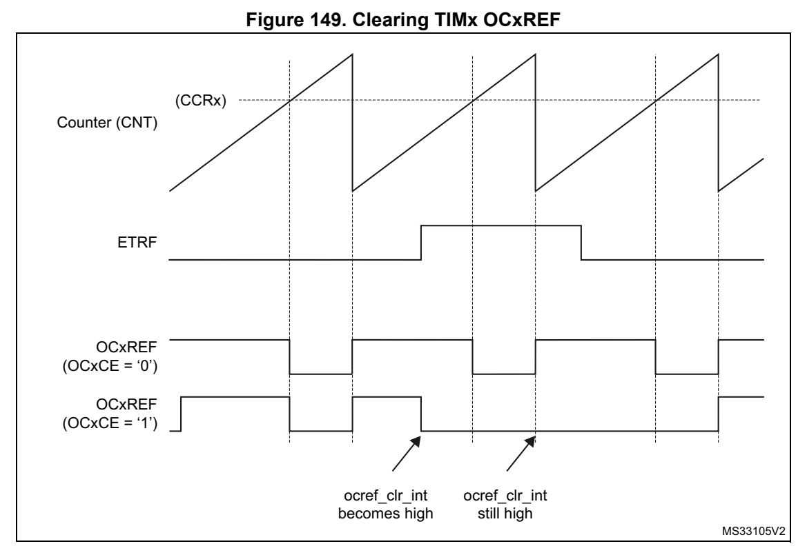
*Figure 149. Clearing TIMx OCxREF (p. 463)*

Note: In case of a PWM with a 100% duty cycle (if CCRx>ARR), OCxREF is enabled again at the next counter overflow.

#### 16.3.13 One-pulse mode (p. 464)

One-pulse mode (OPM) is a partic ular case of the previous modes. It allows the counter to be started in response to a stimulus and to generate a pulse wi th a programmable length after a programmable delay.

Starting the counter can be controlled through the slave mode controller. Generating the waveform can be done in output compare mode or PWM mode. One-pu lse mode is selected by setting the OPM bit in the TIMx_CR1 register. This makes the counter stop automatically at the next update event UEV.

A pulse can be correctly genera ted only if the compare value is different from the counter initial value. Before starting (when the timer is waiting for t he trigger), the configuration must be:

- CNT<CCRx ≤ ARR (in particular, 0<CCRx),

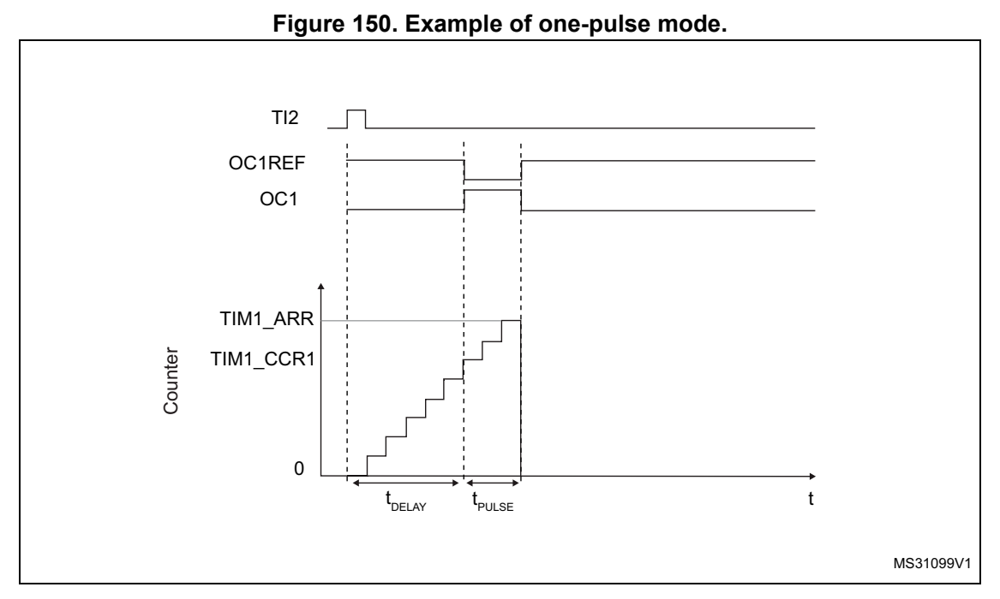
*Figure 150. Example of one-pulse mode. (p. 464)*

For example one may want to gene rate a positive pulse on OC1 wi th a length of t PULSE and after a delay of t DELAY as soon as a positive edge is detected on the TI2 input pin.

Let’s use TI2FP2 as trigger 1: 1. Select the proper TI2x source (internal or external) with the TI2SEL[3:0] bits in the TIMx_TISEL register. 2. Map TI2FP2 on TI2 by writing CC2S=01 in the T IMx_CCMR1 register. 3. TI2FP2 must detect a rising edge, write CC2P=0 and CC2NP=’0’ in the TIMx_CCER register. 4. Configure TI2FP2 as trigger for the slave mode controller (T RGI) by writing TS=00110 in the TIMx_SMCR register. 5. TI2FP2 is used to s tart the counter by writing SMS to ‘110 i n the TIMx_SMCR register (trigger mode).

The OPM waveform is defined by writing the compare registers (taking into account the clock frequency and the counter prescaler).

- The t DELAY is defined by the value writte n in the TIMx_CCR1 register.

- The t PULSE is defined by the difference between the auto-reload value and the compare value (TIMx_A RR - TIMx_CCR1).

- Let’s say one want to build a waveform with a transition from ‘ 0 to ‘1 when a compare match occurs and a transition from ‘1 to ‘0 when the counter re aches the auto-reload value. To do this PWM mode 2 must be enabled by writing OC1M=11 1 in the TIMx_CCMR1 register. O ptionally the preload registers can be en abled by writing OC1PE=1 in the TIMx_CCM R1 register and ARPE in the TIMx_CR1 reg ister. In this case one has to write the compare value in the TIMx_CCR1 register, the auto-reload value in the TIMx_ARR register, generate an update by setting t he UG bit and wait for external trigger event on TI2. C C1P is written to ‘0 in this example.

In our example, the DIR and CMS bits in the TIMx_CR1 register s hould be low.

Since only 1 pulse (Single mode) is needed, a 1 must be written in the OPM bit in the TIMx_CR1 register to stop the counter at the next update event (when the counter rolls over from the auto-reload value back to 0). When OPM bit in the TIMx_CR1 register is set to '0', so the Repetitive Mode is selected.

Particular case: OCx fast enable:

In One-pulse mode, the edge detection on TIx inp ut set the CEN bit which enables the counter. Then the comparison between the counter and the compare value makes the output toggle. But several cloc k cycles are needed for these op erations and it limits the minimum delay t DELAY min we can get.

If one wants to output a waveform with the minimum delay, the O CxFE bit can be set in the TIMx_CCMRx register. Then OCxRef (and OCx) is forced in respons e to the stimulus, without taking in account the comp arison. Its new level is the same as if a compare match had occurred. OCxFE acts only i f the channel is configured in PWM1 or PWM2 mode.

#### 16.3.14 Retriggerable one pulse mode (p. 465)

This mode allows the counter to be started in response to a sti mulus and to generate a pulse with a programma ble length, but with the following differences with Non-retriggerable one pulse mode described in Section 16.3.13:

- The pulse starts as soon as the trigger occurs (no programmable delay)

- The pulse is extended if a new trigger occurs before the previo us one is completed

The timer must be in Slave mode, with the bits SMS[3:0] = ‘1000 ’ (Combined Reset + trigger mode) in the TIMx_SMCR registe r, and the OCxM[3:0] bits set to ‘1000’ or ‘1001’ for Retriggerable OPM mode 1 or 2.

If the timer is configured in Up -counting mode, the correspondi ng CCRx must be set to 0 (the ARR register sets the puls e length). If the timer is confi gured in Down-counting mode CCRx must be above or equal to ARR.

Note: In retriggerable one pulse mode, the CCxIF flag is not significant. The OCxM[3:0] and SMS[3: 0] bit fields are split into two parts for compatibility reasons, the most significant bit is not contiguous with the 3 least significant ones. This mode must not be used with center-aligned PWM modes. It is mandatory to have CMS[1:0] = 00 in TIMx_CR1.

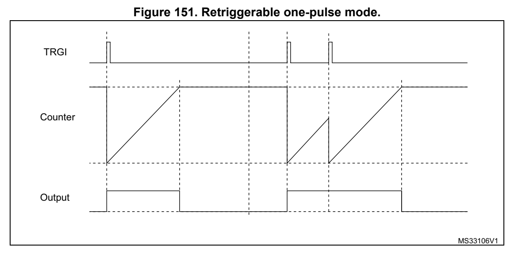
*Figure 151. Retriggerable one-pulse mode. (p. 466)*

#### 16.3.15 Encoder interface mode (p. 466)

To select Encoder Interface mode write SMS=‘001 in the TIMx_SMC R register if the counter is counting on TI2 edges only, SMS=010 if it is counting on TI1 edges only and SMS=011 if it is counting on bot h TI1 and TI2 edges.

Select the TI1 and TI2 polarity by programming the CC1P and CC2 P bits in the TIMx_CCER register. CC1NP and CC2NP must be kept cleared. When needed, th e input filter can be programmed as well. CC1NP and CC2NP must be kept low.

The two inputs TI1 and TI2 are u sed to interface to an incremen tal encoder. Refer to Table 72. The counter is clocked by each valid transition on TI1FP1 or TI2FP2 (TI1 and TI2 after input filter and polarity selection, TI1FP1=TI1 if not fi ltered and not inverted, TI2FP2=TI2 if not filtered and not inverted) assuming that it i s enabled (CEN bit in TIMx_CR1 register written to ‘1). The sequence of transitions of the two inputs is evaluated and generates count pulses as well as the direction signal. Dep ending on the sequence the counter counts up or d own, the DIR bit in the TIMx_CR1 register is modified by hardware accordingly. The DIR bit is calc ulated at each transition on an y input (TI1 or TI2), whatever the counter is counting on TI1 only, TI2 only or both TI1 and T I2.

Encoder interface mode acts simp ly as an external clock with di rection selection. This means that the counter just coun ts continuously between 0 and t he auto-reload value in the TIMx_ARR register (0 to ARR or ARR down to 0 depending on the d irection). So the TIMx_ARR must be config ured before starting. In the same way, t he capture, compare, prescaler, trigger output features continue to work as normal.

In this mode, the coun ter is modified auto matically following t he speed and the direction of the quadrature encoder and its content, therefore, always represents the encod er’s position. The count direction correspond to the rotation direction of the connected sensor. The table summarizes the possible combinat ions, assuming TI 1 and TI2 do n ot switch at the same time.

**Table 72. Counting directi on versus encoder signals (p. 467)**

| Active edge | Level on opposite signal (TI1FP1 for | TI1FP1 signal TI2FP2 signal | TI1FP1 signal TI2FP2 signal |
| --- | --- | --- | --- |
| Active edge | signal (TI1FP1 for TI2, TI2FP2 for TI1) | Rising Falling Rising Falling | Rising Falling Rising Falling |
| Counting on |  | High Down Up No Count No Count |  |
| TI1 only |  | Low Up Down No Count No Count |  |
| Counting on |  | High No Count No Count Up Down |  |
| TI2 only |  | Low No Count No Count Down Up |  |
| Counting on |  | High Down Up Up Down |  |
| TI1 and TI2 |  | Low Up Down Down Up |  |

An external incremental encoder can be connected directly to th e MCU without external interface logic. However, comparators are normally be used to convert the encoder’s differential outputs to digital signals. This greatly increases noise immunity. The third encoder output which indicate t he mechanical zero position, may be connected to an external interrupt input and trigger a counter reset.

Figure 152 gives an example of counter operation, s howing count signal ge neration and direction control. It also shows how input jitter is compensate d where both edges are selected. This might occur if the sensor is positioned near to one of the switching points. For this example we assu me that the configurat ion is the following:

- CC1S= 01 (TIMx_CCMR1 register, TI1FP1 mapped on TI1)

- CC2S= 01 (TIMx_CCMR2 register, TI2FP2 mapped on TI2)

- CC1P and CC1NP = ‘0’ (TIMx_CCER re gister, TI1FP1 noninverted, T I1FP1=TI1)

- CC2P and CC2NP = ‘0’ (TIMx_CCER re gister, TI2FP2 noninverted, T I2FP2=TI2)

- SMS= 011 (TIMx_SMCR register, both inputs are active on both ri sing and falling edges)

- CEN= 1 (TIMx_CR1 register, Counter is enabled)

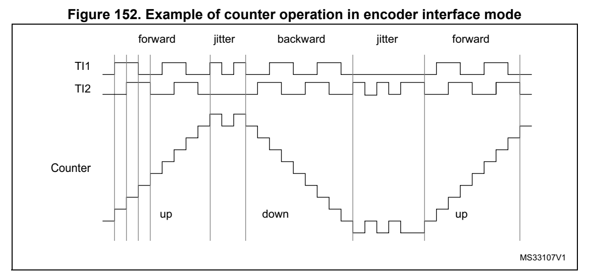
*Figure 152. Example of counter operation in encoder interface m ode (p. 467)*

Figure 153 gives an example of counter behavior when T I1FP1 polarity is i nverted (same configuration as above except CC1P=1).

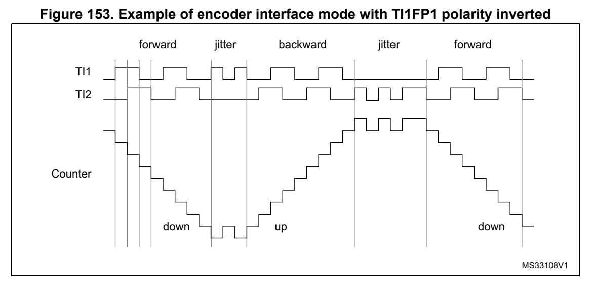
*Figure 153. Example of encoder interface mode with TI1FP1 polarity inverted (p. 468)*

The timer, when configured in Encoder Interface mode provides i nformation on the sensor’s current position. Dynamic information can be obta ined (speed, a cceleration, deceleration) by measuring the period between two encoder events using a seco nd timer configured in capture mode. The output of the encoder which indicates the mec hanical zero can be used for this purpose. Depen ding on the time between two events, the counter can also be read at regular times. This can be d one by latching the counter valu e into a third input capture register if available (then the capture signal must be periodic and can be generated by another timer). when available, it is also possible to read its value through a DMA request generated by a Real-Time clock.

#### 16.3.16 UIF bit remapping (p. 468)

The IUFREMAP bit in the TIMx_CR1 register forces a continuous copy of the update interrupt flag (UIF) into bit 31 of the timer counter register’ s bit 31 (TIMxCNT[31]). This permits to atomically read both the counter value and a potenti al roll-over condition signaled by the UIFCPY flag. It eases the ca lculation of angular speed b y avoiding race conditions caused, for instance, by a processing shared between a backgrou nd task (counter reading) and an interrupt (update interrupt).

There is no latency between the U IF and UIFCPY flag assertions.

In 32-bit timer implementations, when the IUFREMAP bit is set, bit 31 of the counter is overwritten by the UIFCPY flag upon read access (the counter’s most significant bit is only accessible in write mode).

#### 16.3.17 Timer input XOR function (p. 468)

The TI1S bit in the TIM1xx_CR2 register, allows the input filte r of channel 1 to be connected to the output of a XOR gate, comb ining the three input pins TIM x_CH1 to TIMx_CH3.

The XOR output can be used with a ll the timer input functions s uch as trigger or input capture.

An example of this fea ture used to i nterface Hall sensors is gi ven in Section 15.3.25: Interfacing with Hall sensors on page 387.

#### 16.3.18 Timers and external trigger synchronization (p. 469)

The TIMx Timers can be synchronized with an external trigger in several modes: Reset mode, Gated mode and Trigger mode.

Slave mode: Reset mode

The counter and its prescaler can be reinitialized in response to an event on a trigger input. Moreover, if the URS bit from th e TIMx_CR1 register is low, an update event UEV is generated. Then all the preloade d registers (TIMx_ARR, TIMx_CCRx) are updated.

In the following examp le, the upcounter is cleared in response to a rising edge on TI1 input: 1. Configure the channel 1 to detect rising edges on TI1. Config ure the input filter duration (in this example, we do not need any filter, so we keep IC1F=00 00). The capture prescaler is not used for triggering, so it does not need to be configured. The CC1S bits select the input capture source only, CC1S = 01 in the TIMx_CCM R1 register. Write CC1P=0 and CC1NP=0 in TIMx_CCER register to validate the polari ty (and detect rising edges only). 2. Configure the timer in reset m ode by writing SMS=100 in TIMx_SMCR register. Select TI1 as the input source by writing TS=00101 in TIMx_SMCR register. 3. Start the counter by writing CEN=1 in the TIMx_CR1 register.

The counter starts counting on t he internal clock, then behaves normally until TI1 rising edge. When TI1 rises, the counter is cleared and restarts from 0. In the meantime, the trigger flag is set (TIF bit in the TIMx_SR register) and an in terrupt request, or a DMA request can be sent if enabled (d epending on the TIE and TDE bi ts in TIMx_DIER register).

The following figure shows this behavior when the auto-reload register TIMx_ARR=0x36. The delay between the rising edge on TI1 and the actual reset of the counter is due to the resynchronization circuit on TI1 input.

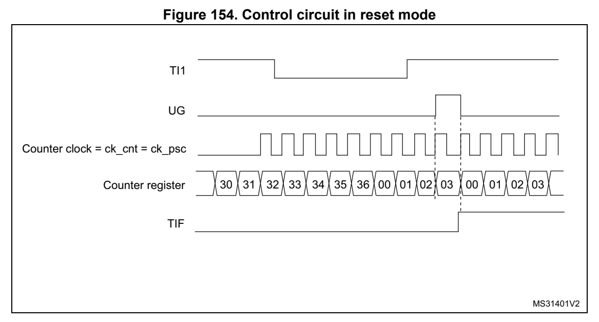
*Figure 154. Control circuit in reset mode (p. 469)*

Slave mode: Gated mode

The counter can be ena bled depending on the level of a selected input.

In the following examp le, the upcounter counts only when TI1 in put is low:

1. Configure the channel 1 to detect low levels on TI1. Configure the input filter duration (in this example, we do not need any filter, so we keep IC1F=00 00). The capture prescaler is not used for triggering, so it does not need to be configured. The CC1S bits select the input capture source only, CC1S=01 in TIMx_CCMR1 reg ister. Write CC1P=1 and CC1NP=0 in TIMx_CCER register to validate the polari ty (and detect low level only). 2. Configure the timer in gated mode by writing SMS=101 in TIMx_SMCR register. Select TI1 as the input source by writing TS=00101 in TIMx_SMCR register. 3. Enable the counter by writing CEN=1 in the TIMx_CR1 register (in gated mode, the counter doesn’t start if CEN=0, w hatever is the trigger input l evel).

The counter starts counting on the internal clock as long as TI 1 is low and stops as soon as TI1 becomes high. The TIF flag in the TIMx_SR register is set b oth when the counter starts or stops.

The delay between the rising edge on TI1 and the actual stop of the counter is due to the resynchronization circuit on TI1 input.

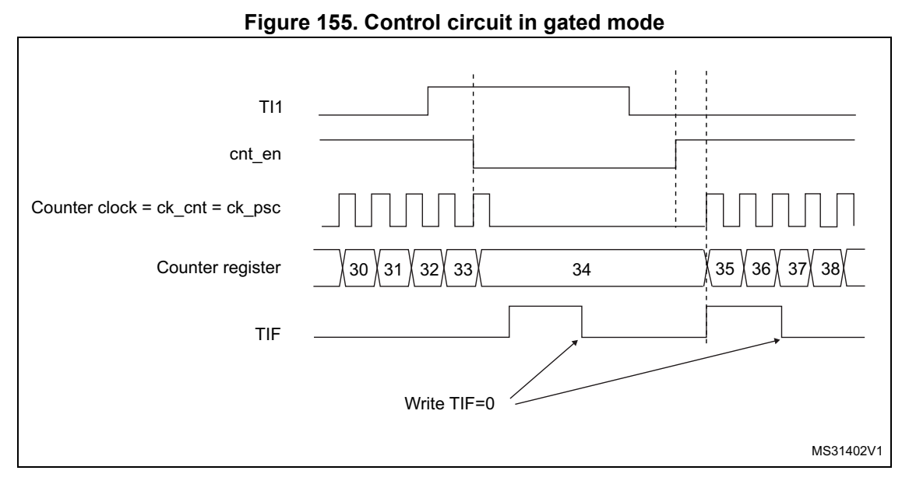
*Figure 155. Control circuit in gated mode (p. 470)*

1. The configuration “CCxP=CCxNP=1” (detection of both rising an d falling edges) does not have any effect in gated mode because gated mode acts on a level and not on an edge. Note: The configuration “CCxP=CCxNP=1” (detection of both rising and falling edges) does not have any effect in gated mode because gated mode acts on a level and not on an edge.

Slave mode: Trigger mode

The counter can start in response to an event on a selected inp ut.

In the following examp le, the upcounter starts in response to a rising edge on TI2 input: 1. Configure the channel 2 to detect rising edges on TI2. Config ure the input filter duration (in this example, we do not need any filter, so we keep IC2F=00 00). The capture prescaler is not used for triggering, so it does not need to be configured. CC2S bits are selecting the input capture source only, CC2S=01 in TIMx_CCMR1 register. Write

CC2P=1 and CC2NP=0 in TIMx_CCER register to validate the polari ty (and detect low level only). 2. Configure the timer in trigger mode by writing SMS=110 in TI Mx_SMCR register. Select TI2 as the input source by writing TS=00110 in TIMx_SMCR register.

When a rising edge occurs on TI2, the counter starts counting o n the internal clock and the TIF flag is set.

The delay between the rising edge on TI2 and the actual start of the counter is due to the resynchronization circuit on TI2 input.

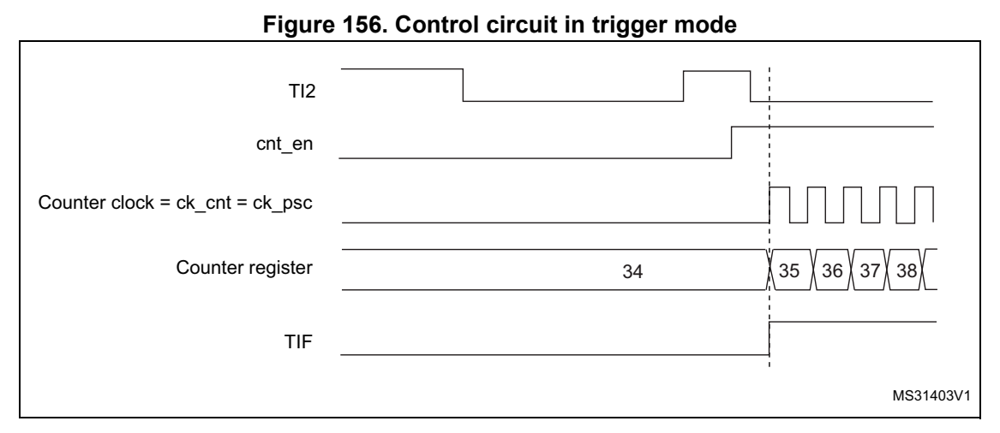
*Figure 156. Control c ircuit in trigger mode (p. 471)*

Slave mode: External Clock mode 2 + trigger mode

The external clock mode 2 can be used in addition to another sl ave mode (except external clock mode 1 and encoder mode). I n this case, the ETR signal is used as external clock input, and another input can be selected as trigger input when operating in reset mode, gated mode or trigger mode. It is recommended not to select ETR as TRGI through the TS bits of TIMx_SMCR register.

In the following examp le, the upcounter is incremented at each rising edge of the ETR signal as soon as a rising edge of TI1 occurs: 1. Configure the external trigger input circuit by programming t he TIMx_SMCR register as follows: – ETF = 0000: no filter – ETPS=00: prescaler disabled – ETP=0: detection of rising edges on ETR and ECE=1 to enable th e external clock mode 2. 2. Configure the channel 1 as follows, to detect rising edges o n TI: – IC1F=0000: no filter. – The capture prescaler is not us ed for triggering and does not need to be configured. – CC1S=01in TIMx_CCMR1 register to select only the input capture source – CC1P=0 and CC1NP=0 in TIMx_CCER register to validate the polarity (and detect rising edge only). 3. Configure the timer in trigger mode by writing SMS=110 in TI Mx_SMCR register. Select TI1 as the input source by writing TS=00101 in TIMx_SMCR register.

A rising edge on TI1 enables th e counter and sets the TIF flag. The counter then counts on ETR rising edges.

The delay between the rising e dge of the ETR signal and the act ual reset of the counter is due to the resynchronization circuit on ETRP input.

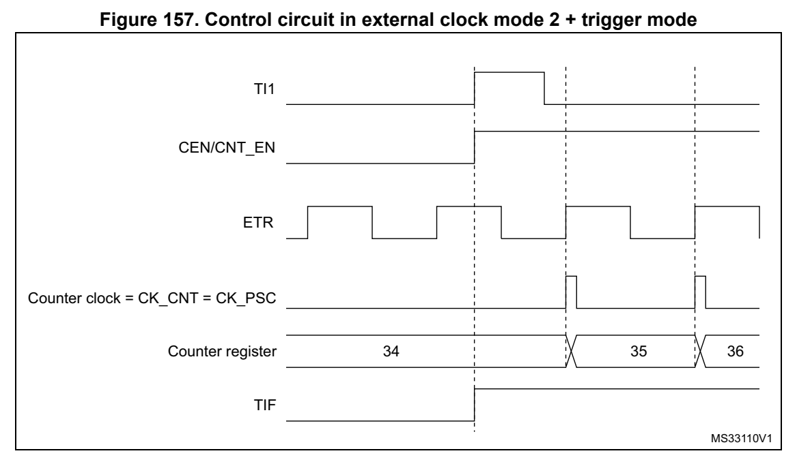
*Figure 157. Control circuit in external clock mode 2 + trigger mode (p. 472)*

#### 16.3.19 Timer synchronization (p. 472)

The TIMx timers are linked together internally for timer synchronization or chaining. When one Timer is configured in Maste r Mode, it can reset, start, stop or clock the counter of another Timer configured in Slave Mode.

Figure 158: Master/Slave timer example and Figure 159: Master/slave connection example with 1 channel only timers present an overview of the trigger selection and the master mo de selection blocks.

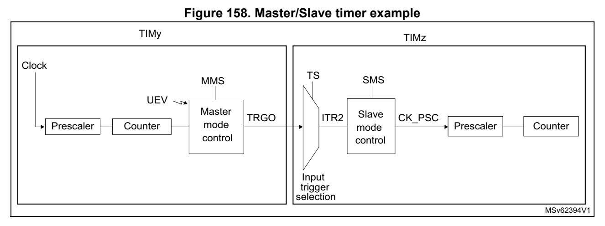
*Figure 158. Master/Slave timer example (p. 472)*

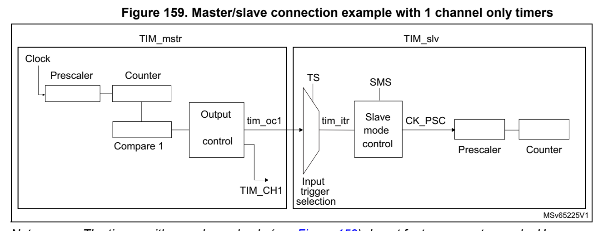
*Figure 159. Master/slave connection example with 1 channel only timers (p. 473)*

Note: The timers with one channel only (see Figure 159) do not feature a master mode. However, the OC1 output signal can be used to trigger some other timers (including timers described in other sections of this document). Check the “TIMx internal trigger connection” table of any TIMx_SMCR register on the device to identify which timers can be targeted as slave. The OC1 signal pulse width must be progra mmed to be at least 2 clock cycles of the destination timer, to make sure the slave timer will detect the trigger. For instance, if the destination's timer CK_INT clock is 4 times slower than the source timer, the OC1 pulse width must be 8 clock cycles.

Using one timer as prescaler for another timer

For example, TIMy can be configured to act as a prescaler for T IMz. Refer to Figure 158. To do this: 1. Configure TIMy in master mode so that it outputs a periodic t rigger signal on each update event UEV. If MMS=010 is wr itten in the TIMy_CR2 registe r, a rising edge is output on TRGO each time an update event is generated. 2. To connect the TRG O output of TIMy to TIMz, TIMz must be con figured in slave mode using ITR as internal trigger. Th is is selected through the TS bits in the TIMz_SMCR register (writing TS=00). 3. Then the slave mode controller must be put in external clock mode 1 (write SMS=111 in the TIMz_SMCR register). This ca uses TIMz to be clocked by the rising edge of the periodic TIMy trigger signal (which correspond to the TIMy coun ter overflow). 4. Finally both timers must be e nabled by setting their respect ive CEN bits (TIMx_CR1 register).

Note: If OCx is selected on TIMy as the trigger output (MMS=1xx), its rising edge is used to clock the counter of TIMz.

Using one timer to enable another timer

In this example, we control the enable of TIMz with the output compare 1 of Timer y. Refer to Figure 158 for connections. TIMz counts o n the divided internal clock onl y when OC1REF of TIMy is high. Both counter cl ock frequencies are divided by 3 by the prescaler compared to CK_INT (f CK_CNT = f CK_INT/3).

1. Configure TIMy master mode to send its Output Compare 1 Reference (OC1REF) signal as trigger output (MMS=100 in the TIMy_CR2 register). 2. Configure the TIMy OC1REF waveform (TIMy_CCMR1 register). 3. Configure TIMz to get the inpu t trigger from TIMy (TS=00 in the TIMz_SMCR register). 4. Configure TIMz in gated mode (SMS=101 in TIMz_SMCR register). 5. Enable TIMz by writing ‘1 in the CEN bit (TIM z_CR1 register). 6. Start TIMy by writing ‘1 in t he CEN bit (TIMy_CR1 register).

Note: The counter z clock is not synchronized with counte r 1, this mode only affects the TIMz counter enable signal.

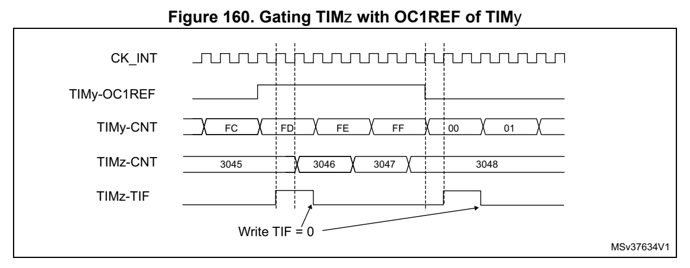
*Figure 160. Gating TIM z with OC1REF of TIM y (p. 474)*

In the example in Figure 160, the TIMz counter and prescale r are not initialized before bei ng started. So they start counting from their current value. It is possible to start from a given value by resetting both timers b efore starting TIMy. Then any value can be written in the timer counters. The timers can e asily be reset by software usin g the UG bit in the TIMx_EGR registers.

In the next examp le (refer to Figure 161), we synchronize TIMy and TIMz. TIMy is the master and starts from 0. TIMz is the slave and starts from 0xE 7. The prescaler ratio is the same for both timers. TIMz stops when TIMy is disabled by writi ng ‘0 to the CEN bit in the TIMy_CR1 register: 1. Configure TIMy master mode to send its Output Compare 1 Reference (OC1REF) signal as trigger output (MMS=100 in the TIMy_CR2 register). 2. Configure the TIMy OC1REF waveform (TIMy_CCMR1 register). 3. Configure TIMz to get the inpu t trigger from TIMy (TS=00 in the TIMz_SMCR register). 4. Configure TIMz in gated mode (SMS=101 in TIMz_SMCR register). 5. Reset TIMy by writing ‘1 in UG bit (TIMy_EGR register). 6. Reset TIMz by writing ‘1 in UG bit (TIMz_EGR register). 7. Initialize TIMz to 0xE7 by writing ‘0xE7’ in the TIMz counte r (TIMz_CNTL). 8. Enable TIMz by writing ‘1 in the CEN bit (TIM z_CR1 register). 9. Start TIMy by writing ‘1 in t he CEN bit (TIMy_CR1 register). 10. Stop TIMy by writing ‘0 in the CEN bit (TIMy_CR1 register).

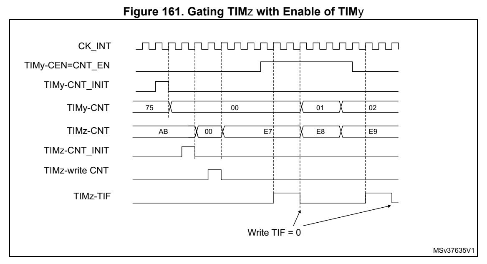
*Figure 161. Gating TIM z with Enable of TIM y (p. 475)*

Using one timer to start another timer

In this example, we se t the enable of Timer z with the update event of Timer y. Refer to Figure 158 for connections. Timer z starts counting from its current valu e (which can be non-zero) on the divided internal clo ck as soon as the update event is generated by Timer 1. When Timer z receives the trigger signal its CEN bit is automat ically set and the counter counts until we write ‘0 to the CEN bit in the TIMz_CR1 registe r. Both counter clock frequencies are divided by 3 by the prescaler compared to CK_IN T (f CK_CNT = f CK_INT/3). 1. Configure TIMy master mode to send its Update Event (UEV) as trigger output (MMS=010 in the TIMy_CR2 register). 2. Configure the TIMy period (TIMy_ARR registers). 3. Configure TIMz to get the inpu t trigger from TIMy (TS=00 in the TIMz_SMCR register). 4. Configure TIMz in trigger mode (SMS=110 in TIMz_SMCR registe r). 5. Start TIMy by writing ‘1 in t he CEN bit (TIMy_CR1 register).

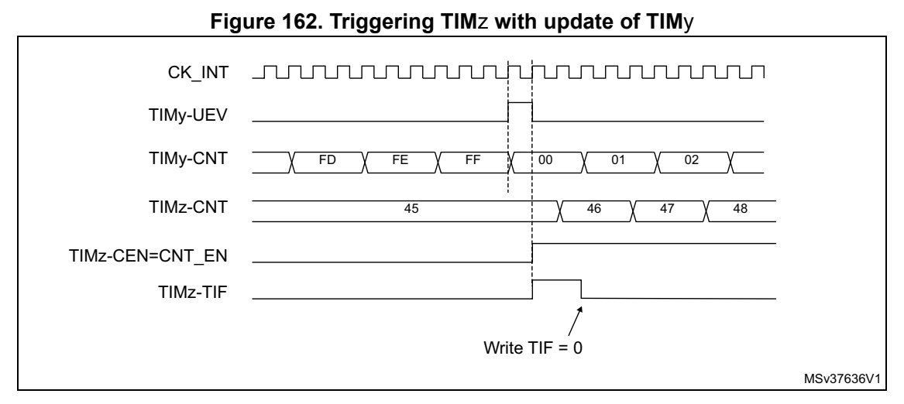
*Figure 162. Triggering TIM z with update of TIM y (p. 475)*

As in the previous example, both counters can be initialized before starting counting. Figure 163 shows the behavior with the same configuration as in Figure 162 but in trigger mode instead of gated mode (SMS =110 in the TIMz_SMCR register).

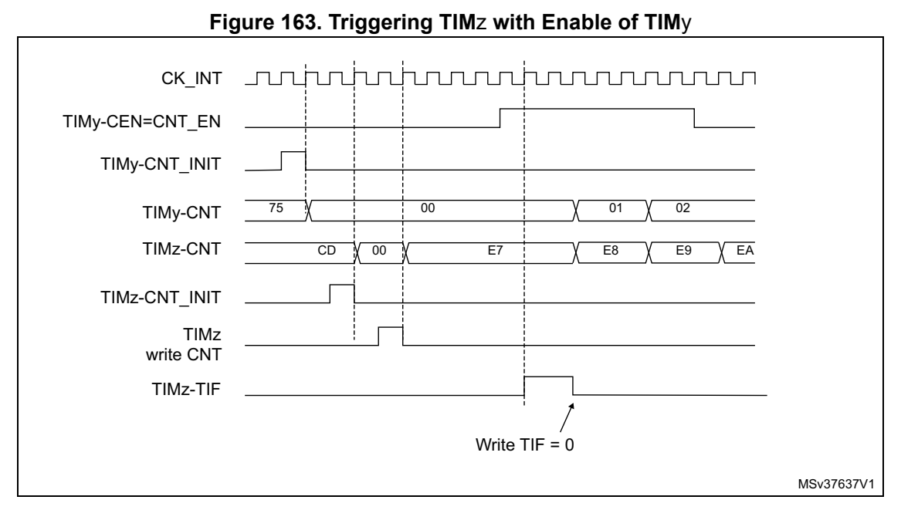
*Figure 163. Triggering TIM z with Enable of TIM y (p. 476)*

Starting 2 timers synchronously in response to an external trig ger

In this example, we se t the enable of TIMy when its TI1 input r ises, and the enable of TIMz with the enable of TIMy. Refer to Figure 158 for connections. To ens ure the coun ters are aligned, TIMy must be configured in Master/Slave mode (slave wi th respect to TI1, master with respect to TIMz): 1. Configure TIMy master mode to send its Enable as trigger outp ut (MMS=001 in the TIMy_CR2 register). 2. Configure TIMy sla ve mode to get the in put trigger from TI1 (TS=00100 in the TIMy_SMCR register). 3. Configure TIMy in trigger mode (SMS=110 in the TIMy_SMCR reg ister). 4. Configure the TIMy in Master/S lave mode by writing MSM=1 (TI My_SMCR register). 5. Configure TIMz to get the input trigger from TIMy (TS=00000 in the TIMz_SMCR register). 6. Configure TIMz in trigger mode (SMS=110 in the TIMz_SMCR reg ister).

When a rising edge occurs on TI1 (TIMy), both counters starts counting synchronously on the internal clock and b oth TIF flags are set.

Note: In this example both timers are initialized be fore starting (by setting their respective UG bits). Both counters starts from 0, but an o ffset can easily be inserted between them by writing any of the counter registers (TIMx_CN T). One can see that the master/slave mode insert a delay between CNT_EN and CK_PSC on TIMy.

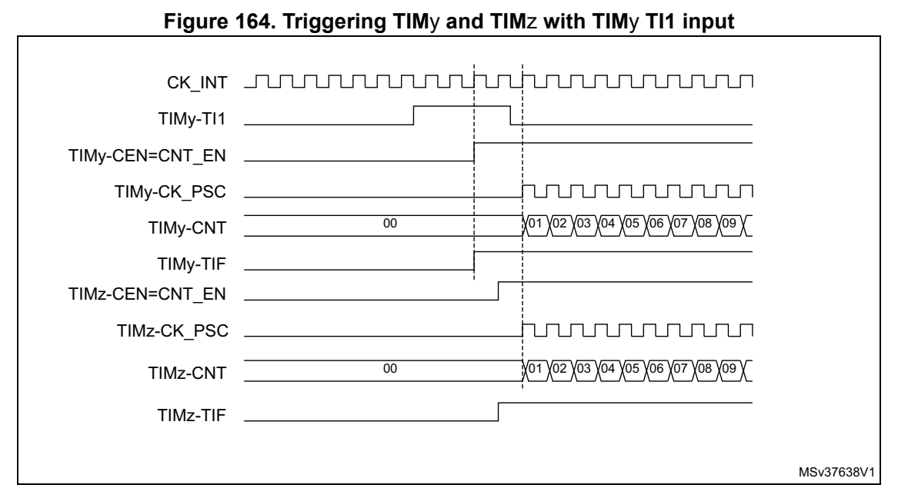
*Figure 164. Triggering TIM y and TIM z with TIM y TI1 input (p. 477)*

Note: The clock of the slave peripherals (timer, ADC, ...) receiving the TRGO or the TRGO2 signals must be enabled prior to receive events from the master timer, and the clock frequency (prescaler) must not be changed on-the-fly while triggers are received from the master timer.

#### 16.3.20 DMA burst mode (p. 477)

The TIMx timers have the capability to generate multiple DMA re quests upon a single event. The main purpose is to be able to re-program part of the timer multiple times without software overhead, but it can also be used to read several regi sters in a row, at regular intervals.

The DMA controller destination is unique and must point to the virtual register TIMx_DMAR. On a given timer event, the timer launches a sequence of DMA re quests (burst). Each write into the TIMx_DMAR register is actually redirected to one of th e timer registers.

The DBL[4:0] bits in the TIMx_DCR register set the DMA burst le ngth. The timer recognizes a burst transfer when a read or a write access is done to the T IMx_DMAR addre ss), i.e. the number of transfers (either in half-words or in bytes).

The DBA[4:0] bits in t he TIMx_DCR registers define the DMA base address for DMA transfers (when read/write acces s are done through the TIMx_DMA R address). DBA is defined as an offset starting fro m the address of the TIMx_CR1 register:

Example:

00000: TIMx_CR1

00001: TIMx_CR2

00010: TIMx_SMCR

As an example, the timer DMA burs t feature is used to update th e contents of the CCRx registers (x = 2, 3, 4) upon an u pdate event, with the DMA tran sferring half words into the CCRx registers.

This is done in the following steps:

1. Configure the correspondi ng DMA channel as follows: – DMA channel peripheral address i s the DMAR register address – DMA channel memory address is th e address of the buffer in the RAM containing the data to be transferred by DMA into CCRx registers. – Number of data to transfer = 3 (See note below). – Circular mode disabled. 2. Configure the DCR register by configuring the DBA and DBL bi t fields as follows: DBL = 3 transfers, DBA = 0xE. 3. Enable the TIMx update DMA request (set the UDE bit in the D IER register). 4. Enable TIMx 5. Enable the DMA channel

This example is for the case whe re every CCRx register has to b e updated once. If every CCRx register is to b e updated twice for example, the number of data to transfer should be 6. Let's take the example of a b uffer in the RAM containing data1, data2, data3, data4, data5 and data6. The data is transferred to the CCRx registers as fol lows: on the first update DMA request, data1 is transferred to CCR2, data2 is transferred to CCR3, data3 is transferred to CCR4 and on the second update DMA request, data4 is transferred to CCR2, data5 is transferred to CCR3 and data6 is transferred to CCR4.

Note: A null value can be written to the reserved registers.

#### 16.3.21 Debug mode (p. 478)

When the microcontroller enters debug mode (Cortex®-M0+ core - halted), the TIMx counter either continues to work normally or stops, depending on DBG_TI Mx_STOP configuration bit in DBGMCU module. For more details, refer to2 Section 29.9.2: Debug support for timers, watchdog and I C.

### 16.4 TIM3/TIM4 registers (p. 479)

Refer to Section 1.2 for a list of abbre viations used in register descriptions.

The peripheral registers can be a ccessed by half-words (16-bit) or words (32-bit).

### 16.4.1 [TIM3.TIMx_CR1] Offset: 0x00 | Reset: 0x0000 (p. 479)

Address offset: 0x00

Reset value: 0x0000

Bits 15:12 Reserved, must be kept at reset value.

Bit 11 UIFREMAP: UIF status bit remapping 0: No remapping. UIF status bit is not copied to TIMx_CNT register bit 31. 1: Remapping enabled. UIF status bit is copied to TIMx_CNT regi ster bit 31.

Bit 10 Reserved, must be kept at reset value.

Bits 9:8 CKD[1:0]: Clock division This bit-field indicates the divi sion ratio between the timer c lock (CK_INT) frequency and sampling clock used by the d igital filters (ETR, TIx), 00: t DTS = t CK_INT 01: t DTS = 2 × t CK_INT 10: t DTS = 4 × t CK_INT 11: Reserved

Bit 7 ARPE: Auto-reload preload enable 0: TIMx_ARR register is not buffered 1: TIMx_ARR register is buffered

Bits 6:5 CMS[1:0]: Center-aligned mode selection 00: Edge-aligned mode. The counter counts up or down depending on the direction bit (DIR). 01: Center-aligned mode 1. The counter counts up and down alternatively. Output compare interrupt flags of channels configured in output (CCxS=00 in TI Mx_CCMRx register) are set only when the counter is counting down. 10: Center-aligned mode 2. The counter counts up and down alternatively. Output compare interrupt flags of channels configured in output (CCxS=00 in TI Mx_CCMRx register) are set only when the counter is counting up. 11: Center-aligned mode 3. The counter counts up and down alternatively. Output compare interrupt flags of channels configured in output (CCxS=00 in TI Mx_CCMRx register) are set both when the counter is counting up or down. Note: It is not allowed to switch from edge-aligned mode to center-aligned mode as long as the counter is enabled (CEN=1)

Bit 4 DIR: Direction 0: Counter used as upcounter 1: Counter used as downcounter Note: This bit is read only when the timer is configured in Center-aligned mode or Encoder mode.

Bit 3 OPM: One-pulse mode 0: Counter is not stopped at update event 1: Counter stops counting at the next update event (clearing th e bit CEN)

Bit 2 URS: Update request source This bit is set and cleared by software to select the UEV event sources. 0: Any of the following events generate an update interrupt or DMA request if enabled. These events can be: – Counter overflow/underflow – Setting the UG bit – Update generation through t he slave mode controller 1: Only counter overflow/underfl ow generates an update interrup t or DMA request if enabled.

Bit 1 UDIS: Update disable This bit is set and cleared by software to enable/disable UEV e vent generation. 0: UEV enabled. The Update (UEV) event is generated by one of t he following events: – Counter overflow/underflow – Setting the UG bit – Update generation through t he slave mode controller Buffered registers are then loa ded with their preload values. 1: UEV disabled. The Update event is not generated, shadow regi sters keep their value (ARR, PSC, CCRx). However the coun ter and the prescaler are rei nitialized if the UG bit is set or if a hardware reset is re ceived from the slave mode cont roller.

Bit 0 CEN: Counter enable 0: Counter disabled 1: Counter enabled Note: External clock, gated mode and encoder m ode can work only if the CEN bit has been previously set by software. However trigger mode can set the CEN bit automatically by hardware. CEN is cleared automatically i n one-pulse mo de, when an update event occurs.

### 16.4.2 [TIM3.TIMx_CR2] Offset: 0x04 | Reset: 0x0000 (p. 480)

Address offset: 0x04

Reset value: 0x0000

Bits 15:8 Reserved, must be kept at reset value.

Bit 7 TI1S: TI1 se lection 0: The TIMx_CH1 pin is connected to TI1 input 1: The TIMx_CH1, CH2 and CH3 pins are connected to the TI1 inpu t (XOR combination) See also Section 15.3.25: Interfacing with Hall sensors on page 387

Bits 6:4 MMS[2:0]: Master mode selection These bits permit to select the i nformation to be sent in maste r mode to slave timers for synchronization (TRGO). The combination is as follows: 000: Reset - the UG bit from the TIMx_EGR register is used as trigger out put (TRGO). If the reset is generated by the trigger input (slave mode controller configured in reset mode) then the signal on TRGO is delayed co mpared to the actual reset. 001: Enable - the Counter enable signal, CNT_EN, is used as trigger output (TRGO). It is useful to start several timers a t the same time or to control a window in which a slave timer is enabled. The Counter Enable signa l is generated by a logic AND between CEN control bit and the trigger input when configured in gated mode. When the Counter Enable signal is controlled by the trigger inp ut, there is a delay on TRGO, except if the master/s lave mode is selected (see the MSM bit de scription in TIMx_SMCR register). 010: Update - The update event is selected as trigger output (TRGO). For i nstance a master timer can then be used as a prescaler for a slave timer. 011: Compare Pulse - The trigger output send a positive pulse when the CC1IF flag is to be set (even if it was already hig h), as soon as a capture or a co mpare match occurred. (TRGO) 100: Compare - OC1REFC signal is used as trigger output (TRGO) 101: Compare - OC2REFC signal is used as trigger output (TRGO) 110: Compare - OC3REFC signal is used as trigger output (TRGO) 111: Compare - OC4REFC signal is used as trigger output (TRGO) Note: The clock of the slave timer or ADC must be enabled prior to receive events from the master timer, and must not be changed on-the-fly while triggers are received from the master timer.

Bit 3 CCDS: Capture/compare DMA selection 0: CCx DMA request sent when CCx event occurs 1: CCx DMA requests sent when update event occurs

Bits 2:0 Reserved, must be kept at reset value.

### 16.4.3 [TIM3.TIMx_SMCR] Offset: 0x08 | Reset: 0x00000000 (p. 482)

Address offset: 0x08

Reset value: 0x0000 0000

Bits 31:22 Reserved, must be kept at reset value.

Bits 19:17 Reserved, must be kept at reset value.

Bit 15 ETP: External trigger polarity This bit selects whether ETR or ETR is used for trigger operations 0: ETR is non-inverted, active at high level or rising edge 1: ETR is inverted, active at low level or falling edge

Bit 14 ECE: External clock enable This bit enables External clock mode 2. 0: External clock mode 2 disabled 1: External clock mode 2 enable d. The counter is clocked by any active edge on the ETRF signal. Note: Setting the ECE bit has the same effect as selecting external clock mode 1 with TRGI connected to ETRF (SMS=111 and TS=00111). It is possible to simultaneously use external clock mode 2 with the following slave modes: reset mode, gated mode and trigge r mode. Nevertheless, TRGI must not be connected to ETRF in this case (TS bits must not be 00111). If external clock mode 1 and external clock mode 2 are enabled at the same time, the external clock input is ETRF.

Bits 13:12 ETPS[1:0]: External trigger prescaler External trigger signal ETRP frequency must be at most 1/4 of C K_INT frequency. A prescaler can be enabled to reduce ETRP frequency. It is useful when inputting fast external clocks. 00: Prescaler OFF 01: ETRP frequency divided by 2 10: ETRP frequency divided by 4 11: ETRP frequency divided by 8

Bits 11:8 ETF[3:0]: External trigger filter This bit-field then defines the frequency used to sample ETRP s ignal and the le ngth of the digital filter applied to ETRP. T he digital filter is made of a n event counter in which N consecutive events are needed to validate a transition on the o utput: 0000: No filter, sampling is done at f DTS 0001: f SAMPLING =f CK_INT, N=2 0010: f SAMPLING =f CK_INT, N=4 0011: f SAMPLING =f CK_INT, N=8 0100: f SAMPLING =f DTS/2, N=6 0101: f SAMPLING =f DTS/2, N=8 0110: f SAMPLING =f DTS/4, N=6 0111: f SAMPLING =f DTS/4, N=8 1000: f SAMPLING =f DTS/8, N=6 1001: f SAMPLING =f DTS/8, N=8 1010: f SAMPLING =f DTS/16, N=5 1011: f SAMPLING =f DTS/16, N=6 1100: f SAMPLING =f DTS/16, N=8 1101: f SAMPLING =f DTS/32, N=5 1110: f SAMPLING =f DTS/32, N=6 1111: f SAMPLING =f DTS/32, N=8

Bit 7 MSM: Master/Slave mode 0: No action 1: The effect of an event on the trigger inp ut (TRGI) is delaye d to allow a perfect synchronization between the current timer and its slaves (throu gh TRGO). It is useful if we want to synchronize several timers on a single external event.

Bits 21, 20, 6, 5, 4 TS[4:0]: Trigger selection This bit-field selects the trig ger input to be us ed to synchron ize the counter. 00000: Internal Trigger 0 (ITR0) 00001: Internal Trigger 1 (ITR1) 00010: Internal Trigger 2 (ITR2) 00011: Internal Trigger 3 (ITR3) 00100: TI1 Edge Detector (TI1F_ED) 00101: Filtered Timer Input 1 (TI1FP1) 00110: Filtered Timer Input 2 (TI2FP2) 00111: External Trigger input (ETRF) 01000: Internal Trigger 4 (ITR4) 01001: Internal Trigger 5 (ITR5) 01010: Internal Trigger 6 (ITR6) 01011: Internal Trigger 7 (ITR7) 01100: Internal Trigger 8 (ITR8) Others: Reserved See Table 73: TIM3 internal trigger connection on page 485 for more details on ITRx meaning for each Timer. Note: These bits must be changed only when they are not used (e.g. when SMS=000) to avoid wrong edge detections at the transition.

Bit 3 OCCS: OCREF clear selection This bit is used to sele ct the OCREF clear source 0: OCREF_CLR_INT is unconnected. 1: OCREF_CLR_INT is connected to ETRF

Bits 16, 2, 1, 0 SMS[3:0]: Slave mode selection When external signals are selected the active edge of the trigg er signal (TRGI) is linked to the polarity selected on the external in put (see Input Control register and Cont rol Register description. 0000: Slave mode disabled - if CEN = ‘1 then the prescaler is c locked directly by the internal clock. 0001: Encoder mode 1 - Counter counts up/down on TI1FP1 edge de pending on TI2FP2 level. 0010: Encoder mode 2 - Counter counts up/down on TI2FP2 edge de pending on TI1FP1 level. 0011: Encoder mode 3 - Counter counts up/down on both TI1FP1 an d TI2FP2 edges depending on the level of the other input. 0100: Reset Mode - Rising edge of the selected trigger input (T RGI) reinitializes the counter and generates an update of the registers. 0101: Gated Mode - The counter clock is enabled when the trigge r input (TRGI) is high. The counter stops (but is not reset) as soon as the trigger becomes low. Both start and stop of the counter are controlled. 0110: Trigger Mode - The counte r starts at a ris ing edge of the trigger TRGI (but it is not reset). Only the start of the counter is controlled. 0111: External Clock Mode 1 - Rising edges of the selected trig ger (TRGI) clock the counter. 1000: Combined reset + trigger mode - Rising edge of the selected trigger input (TRGI) reinitializes the counter, generates an update of the registers and starts the counter. Note: The gated mode must not be used if TI1F_ED is selected as the trigger input (TS=00100). Indeed, TI1F_ED outputs 1 pulse for each transition on TI1F, whereas the gated mode checks the level of the trigger signal. Note: The clock of the slave peripherals (timer, ADC, ...) receiving the TRGO or the TRGO2 signals must be enabled prior to receive even ts from the master timer, and the clock frequency (prescaler) must not be changed on -the-fly while triggers are received from the master timer.

Table 73. TIM3 internal trigger c onnection

Slave TIM ITR0 ITR1 ITR2 ITR3

TIM3 TIM1 - TIM15 TIM14_OC1

TIM4 TIM1 - TIM15 TIM14_OC1

### 16.4.4 [TIM3.TIMx_DIER] Offset: 0x0C | Reset: 0x0000 (p. 485)

Address offset: 0x0C

Reset value: 0x0000

Bit 15 Reserved, must be kept at reset value.

Bit 14 TDE: Trigger DMA request enable 0: Trigger DMA request disabled. 1: Trigger DMA request enabled.

Bit 13 Reserved, must be kept at reset value.

Bit 12 CC4DE: Capture/Compare 4 DMA request enable 0: CC4 DMA request disabled. 1: CC4 DMA request enabled.

Bit 11 CC3DE: Capture/Compare 3 DMA request enable 0: CC3 DMA request disabled. 1: CC3 DMA request enabled.

Bit 10 CC2DE: Capture/Compare 2 DMA request enable 0: CC2 DMA request disabled. 1: CC2 DMA request enabled.

Bit 9 CC1DE: Capture/Compare 1 DMA request enable 0: CC1 DMA request disabled. 1: CC1 DMA request enabled.

Bit 8 UDE: Update DMA request enable 0: Update DMA request disabled. 1: Update DMA request enabled.

Bit 7 Reserved, must be kept at reset value.

Bit 6 TIE: Trigger interrupt enable 0: Trigger interrupt disabled. 1: Trigger interrupt enabled.

Bit 5 Reserved, must be kept at reset value.

Bit 4 CC4IE: Capture/Compare 4 interrupt enable 0: CC4 interrupt disabled. 1: CC4 interrupt enabled.

Bit 3 CC3IE: Capture/Compare 3 interrupt enable 0: CC3 interrupt disabled. 1: CC3 interrupt enabled.

Bit 2 CC2IE: Capture/Compare 2 interrupt enable 0: CC2 interrupt disabled. 1: CC2 interrupt enabled.

Bit 1 CC1IE: Capture/Compare 1 interrupt enable 0: CC1 interrupt disabled. 1: CC1 interrupt enabled.

Bit 0 UIE: Update interrupt enable 0: Update interrupt disabled. 1: Update interrupt enabled.

### 16.4.5 [TIM3.TIMx_SR] Offset: 0x10 | Reset: 0x0000 (p. 486)

Address offset: 0x10

Reset value: 0x0000

Bits 15:13 Reserved, must be kept at reset value.

Bit 12 CC4OF: Capture/Compare 4 overcapture flag refer to CC1OF description

Bit 11 CC3OF: Capture/Compare 3 overcapture flag refer to CC1OF description

Bit 10 CC2OF: Capture/compare 2 overcapture flag refer to CC1OF description

Bit 9 CC1OF: Capture/Compare 1 overcapture flag This flag is set by hardware only when the corresponding channe l is configured in input capture mode. It is cleared by software by writing it to ‘0’. 0: No overcapture has been detected. 1: The counter value has been cap tured in TIMx_CCR1 register wh ile CC1IF flag was already set

Bits 8:7 Reserved, must be kept at reset value.

Bit 6 TIF: Trigger interrupt flag This flag is set by hardware on the TRG tri gger event (active e dge detected on TRGI input when the slave mode controller i s enabled in all modes but gate d mode. It is set when the counter starts or stops when gated mode is selected. It is clea red by software. 0: No trigger event occurred. 1: Trigger interrupt pending.

Bit 5 Reserved, must be kept at reset value.

Bit 4 CC4IF: Capture/Compare 4 interrupt flag Refer to CC1IF description

Bit 3 CC3IF: Capture/Compare 3 interrupt flag Refer to CC1IF description

Bit 2 CC2IF: Capture/Compare 2 interrupt flag Refer to CC1IF description

Bit 1 CC1IF: Capture/compare 1 interrupt flag This flag is set by hardware. It is cleared by software (input capture or output compare mode) or by reading the TIMx_CCR1 register (input capture mode only). 0: No compare match / No input capture occurred 1: A compare match or an input capture occurred If channel CC1 is configured as output: this flag is set when the content of the counter TIMx_CNT matches the content of the TIMx_CCR1 register. When th e content of TIMx_CCR1 is greater than the con tent of TIMx_ARR, the CC1IF bi t goes high on the counter overflow (in u p-counting and up/down-counting modes) or underflow (in down-counting mode). There are 3 possible options for flag setting i n center-aligned mode, refer to the CMS bits in the TIMx_CR1 reg ister for the full description. If channel CC1 is configured as input: this bit is set when counter value has been captured in TIMx_CCR1 register (an edge has been detected on IC1, as per the edge sensitivity defined with the CC1P an d CC1NP bits setting, in TIMx_CCER).

Bit 0 UIF: Update interrupt flag This bit is set by hardware on an update event. It is cleared by software. 0: No update occurred 1: Update interrupt pending. This bit is set by hardware when t he registers are updated: At overflow or underflow and if UDIS=0 in the TIMx_CR1 register. When CNT is reinitialized by software using the UG bit in TIMx_ EGR register, if URS=0 and UDIS=0 in the TIMx_CR1 register. When CNT is reinitialized by a trigger event (refer to the sync hro control register description), if URS=0 and UDIS=0 in the TIMx_CR1 register.

### 16.4.6 [TIM3.TIMx_EGR] Offset: 0x14 | Reset: 0x0000 (p. 488)

Address offset: 0x14

Reset value: 0x0000

Bits 15:7 Reserved, must be kept at reset value.

Bit 6 TG: Trigger generation This bit is set by software in o rder to generate an event, it i s automatically cleared by hardware. 0: No action 1: The TIF flag is set in TIMx_SR register. Related interrupt o r DMA transfer can occur if enabled.

Bit 5 Reserved, must be kept at reset value.

Bit 4 CC4G: Capture/compare 4 generation Refer to CC1G description

Bit 3 CC3G: Capture/compare 3 generation Refer to CC1G description

Bit 2 CC2G: Capture/compare 2 generation Refer to CC1G description

Bit 1 CC1G: Capture/compare 1 generation This bit is set by software in o rder to generate an event, it i s automatically cleared by hardware. 0: No action 1: A capture/compare event i s generated on channel 1: If channel CC1 is co nfigured as output: CC1IF flag is set, Corresponding interrupt or DMA request is se nt if enabled. If channel CC1 is co nfigured as input: The current value of the counte r is captured in TIMx_CCR1 regis ter. The CC1IF flag is set, the corresponding interrupt or DM A request is sent if enabled. The CC1OF flag is set if the CC1IF flag was already high.

Bit 0 UG: Update generation This bit can be set by software, it is automatically cleared by hardware. 0: No action 1: Re-initialize the counter and generates an update of the reg isters. Note that the prescaler counter is cleared too (anyway t he prescaler rati o is not affected). The counter is cleared if the center-aligned m ode is selected or if DIR=0 (upcounting), e lse it takes the auto-reload value (TIMx_ARR) if DI R=1 (downcounting).

16.4.7 TIMx capture/compare mode register 1 [alternate] (TIMx_C CMR1) (x = 3 to 4)

Address offset: 0x18

Reset value: 0x0000 0000

The same register can be used fo r input capture m ode (this sect ion) or for output compare mode (next section). The directi on of a channel is defined by configuring the corresponding CCxS bits. All the other bits of this register ha ve a different function in input and in output mode.

Input capture mode:

Bits 31:16 Reserved, must be kept at reset value.

Bits 15:12 IC2F[3:0]: Input capture 2 filter

Bits 11:10 IC2PSC[1:0]: Input capture 2 prescaler

Bits 9:8 CC2S[1:0]: Capture/compare 2 selection This bit-field defines the direction of the channel (input/outp ut) as well as t he used input. 00: CC2 channel is configured as output. 01: CC2 channel is configured as input, IC2 is mapped on TI2. 10: CC2 channel is configured as input, IC2 is mapped on TI1. 11: CC2 channel is configured as input, IC2 is mapped on TRC. T his mode is working only if an internal trigger input is sele cted through TS bit (TIMx_SMCR register) Note: CC2S bits are writable only when the channel is OFF (CC2E = 0 in TIMx_CCER).

Bits 7:4 IC1F[3:0]: Input capture 1 filter This bit-field defines the frequency used to sample TI1 input a nd the length of the digital filter applied to TI1. The digital filter is made of a n event counter in which N conse cutive events are needed to vali date a transition on the output: 0000: No filter, sampling is done at f DTS 0001: f SAMPLING =f CK_INT, N=2 0010: f SAMPLING =f CK_INT, N=4 0011: f SAMPLING =f CK_INT, N=8 0100: f SAMPLING =f DTS/2, N=6 0101: f SAMPLING =f DTS/2, N=8 0110: f SAMPLING =f DTS/4, N=6 0111: f SAMPLING =f DTS/4, N=8 1000: f SAMPLING =f DTS/8, N=6 1001: f SAMPLING =f DTS/8, N=8 1010: f SAMPLING =f DTS/16, N=5 1011: f SAMPLING =f DTS/16, N=6 1100: f SAMPLING =f DTS/16, N=8 1101: f SAMPLING =f DTS/32, N=5 1110: f SAMPLING =f DTS/32, N=6 1111: f SAMPLING =f DTS/32, N=8

Bits 3:2 IC1PSC[1:0]: Input capture 1 prescaler This bit-field defines the rat io of the prescaler acting on CC1 input (IC1). The prescaler is reset as soon as CC1E=0 (TIMx_CCER register). 00: no prescaler, capture is do ne each time an ed ge is detected on the capture input 01: capture is done once every 2 events 10: capture is done once every 4 events 11: capture is done once every 8 events

Bits 1:0 CC1S[1:0]: Capture/Compare 1 selection This bit-field defines the direction of the channel (input/outp ut) as well as t he used input. 00: CC1 channel is configured as output 01: CC1 channel is configured as input, IC1 is mapped on TI1 10: CC1 channel is configured as input, IC1 is mapped on TI2 11: CC1 channel is configured as input, IC1 is mapped on TRC. T his mode is working only if an internal trigger input is sele cted through TS bit (TIMx_SMCR register) Note: CC1S bits are writable only when the channel is OFF (CC1E = 0 in TIMx_CCER).

16.4.8 TIMx capture/compare mode register 1 [alternate] (TIMx_C CMR1) (x = 3 to 4)

Address offset: 0x18

Reset value: 0x0000 0000

The same register can be used fo r output compare mode (this section) or for input capture mode (previous section). The di rection of a channel is defined by configuring the corresponding CCxS bits. All the other bits of this register ha ve a different function in input and in output mode.

Output compare mode:

Bits 31:25 Reserved, must be kept at reset value.

Bits 23:17 Reserved, must be kept at reset value.

Bit 15 OC2CE: Output compare 2 clear enable

Bits 24, 14:12 OC2M[3:0]: Output compare 2 mode refer to OC1M description on bits 6:4

Bit 11 OC2PE: Output compare 2 preload enable

Bit 10 OC2FE: Output compa re 2 fast enable

Bits 9:8 CC2S[1:0]: Capture/Compare 2 selection This bit-field defines the direction of the channel (input/outp ut) as well as the used input. 00: CC2 channel is configured as output 01: CC2 channel is configured as input, IC2 is mapped on TI2 10: CC2 channel is configured as input, IC2 is mapped on TI1 11: CC2 channel is configured as input, IC2 is mapped on TRC. T his mode is working only if an internal trigger input is sele cted through the TS bit (TIMx_SMCR register) Note: CC2S bits are writable only when the channel is OFF (CC2E = 0 in TIMx_CCER).

Bit 7 OC1CE: Output compare 1 clear enable 0: OC1Ref is not affected by the ETRF input 1: OC1Ref is cleared as soon as a High level is detected on ETR F input

Bits 16, 6:4 OC1M[3:0]: Output compare 1 mode These bits define the behavior of the output reference signal O C1REF from which OC1 and OC1N are derived. OC1REF is active high whereas OC1 and OC1N active level depends on CC1P and CC1NP bits. 0000: Frozen - The comparison between the output compare register TIMx_CCR1 and the counter TIMx_CNT has no effect o n the outputs.(t his mode is use d to generate a timing base). 0001: Set channel 1 to active leve l on match. OC1REF signal is forced high when the counter TIMx_CNT matc hes the capture/compare register 1 (TIMx_C CR1). 0010: Set channel 1 to inactive l evel on match. OC1REF signal i s forced low when the counter TIMx_CNT matc hes the capture/compare register 1 (TIMx_C CR1). 0011: Toggle - OC1REF toggles when TIMx_CNT=TIMx_CCR1. 0100: Force inactive level - OC1REF is forced low. 0101: Force active level - OC1REF is forced high. 0110: PWM mode 1 - In upcounting, channel 1 is active as long a s TIMx_CNT<TIMx_CCR1 else inactive. In dow ncounting, channel 1 is inactive (OC1REF=‘ 0) as long as TIMx_CNT>TIMx_CCR1 else active (OC1REF=1). 0111: PWM mode 2 - In upcounting, channel 1 is inactive as long as TIMx_CNT<TIMx_CCR1 else active. In downcounting, channel 1 is a ctive as long as TIMx_CNT>TIMx_CCR1 else inactive. 1000: Retriggerable OPM mode 1 - In up-counting mode, the chann el is active until a trigger event is detected (on TRGI signal). Then, a comparison is perfo rmed as in PWM mode 1 and the channels becomes inactive again at the next update. In down-counting mode, the channel is inactive until a trig ger event is detected (on TRGI signal). Then, a comparison is performed as in PWM mode 1 and the channels becomes inactive ag ain at the next update. 1001: Retriggerable OPM mode 2 - In up-counting mode, the chann el is inactive until a trigger event is detected (on TR GI signal). Then, a comparison is performed as in PWM mode 2 and the channels becomes inactive again at the next upda te. In down-counting mode, the channel is active until a trigger event is detected ( on TRGI signal). Then, a comparison is performed as in PWM mode 1 and the channels becom es active again at the next update. 1010: Reserved, 1011: Reserved, 1100: Combined PWM mode 1 - OC1R EF has the same behavior as in PWM mode 1. OC1REFC is the logical OR between OC1REF and OC2REF. 1101: Combined PWM mode 2 - OC1R EF has the same behavior as in PWM mode 2. OC1REFC is the logical AND between OC1REF and OC2REF. 1110: Asymmetric PWM mode 1 - OC1R EF has the same behavior as i n PWM mode 1. OC1REFC outputs OC1REF when the counter is counting up, OC2REF when it is counting down. 1111: Asymmetric PWM mode 2 - OC1REF has the same b ehavior as in PWM mode 2. OC1REFC outputs OC1REF when the counter is counting up, OC2REF when it is counting down. Note: In PWM mode, the OCREF level changes only when the result of the comparison changes or when the output compare mode switches from “frozen” mode to “PWM” mode. Note: The OC1M[3] bit is not contiguous, located in bit 16.

Bit 3 OC1PE: Output compare 1 preload enable 0: Preload register on TIMx_CCR1 disabled. TIMx_CCR1 can be wri tten at anytime, the new value is taken in account immediately. 1: Preload register on TIMx_CCR1 enabled. Read/Write operations access the preload register. TIMx_CCR1 preload value is loaded in the active regis ter at each update event. Note: The PWM mode can be used without valida ting the preload register only in one-pulse mode (OPM bit set in TIMx_CR1 register). Else the behavior is not guaranteed.

Bit 2 OC1FE: Output compa re 1 fast enable This bit decreases the latency between a trigger event and a transition on the timer output. It must be used in one -pulse mode (OPM bit set in TIMx_CR1 regi ster), to have the output pulse starting as soon as possibl e after the starting trigger. 0: CC1 behaves normally depending on counter and CCR1 values even when the trigger is ON. The minimum delay to activate CC1 output when an edge occurs on the trigger input is 5 clock cycles. 1: An active edge on the trigger input acts like a compare matc h on CC1 output. Then, OC is set to the compare level independently from the result of th e comparison. Delay to sample the trigger input and to activate CC1 output is reduced to 3 cl ock cycles. OCFE acts only if the channel is configured in PWM1 or PWM2 mode.

Bits 1:0 CC1S[1:0]: Capture/Compare 1 selection This bit-field defines the direction of the channel (input/outp ut) as well as the used input. 00: CC1 channel is configured as output. 01: CC1 channel is configured as input, IC1 is mapped on TI1. 10: CC1 channel is configured as input, IC1 is mapped on TI2. 11: CC1 channel is configured as input, IC1 is mapped on TRC. T his mode is working only if an internal trigger input is sele cted through TS bit (TIMx_SMCR register) Note: CC1S bits are writable only when the channel is OFF (CC1E = 0 in TIMx_CCER).

16.4.9 TIMx capture/compare mode register 2 [alternate] (TIMx_C CMR2) (x = 3 to 4)

Address offset: 0x1C

Reset value: 0x0000 0000

The same register can be used fo r input capture m ode (this sect ion) or for output compare mode (next section). The directi on of a channel is defined by configuring the corresponding CCxS bits. All the other bits of this register ha ve a different function in input and in output mode.

Input capture mode:

Bits 31:16 Reserved, must be kept at reset value.

Bits 15:12 IC4F[3:0]: Input capture 4 filter

Bits 11:10 IC4PSC[1:0]: Input capture 4 prescaler

Bits 9:8 CC4S[1:0]: Capture/Compare 4 selection This bit-field defines the direction of the channel (input/outp ut) as well as t he used input. 00: CC4 channel is co nfigured as output 01: CC4 channel is configured as input, IC4 is mapped on TI4 10: CC4 channel is configured as input, IC4 is mapped on TI3 11: CC4 channel is configured as input, IC4 is mapped on TRC. T his mode is working only if an internal trigger input is sele cted through TS bit (TIMx_SMCR register) Note: CC4S bits are writable only when the channel is OFF (CC4E = 0 in TIMx_CCER).

Bits 7:4 IC3F[3:0]: Input capture 3 filter

Bits 3:2 IC3PSC[1:0]: Input capture 3 prescaler

Bits 1:0 CC3S[1:0]: Capture/Compare 3 selection This bit-field defines the direction of the channel (input/outp ut) as well as t he used input. 00: CC3 channel is co nfigured as output 01: CC3 channel is configured as input, IC3 is mapped on TI3 10: CC3 channel is configured as input, IC3 is mapped on TI4 11: CC3 channel is configured as input, IC3 is mapped on TRC. T his mode is working only if an internal trigger input is sele cted through TS bit (TIMx_SMCR register) Note: CC3S bits are writable only when the channel is OFF (CC3E = 0 in TIMx_CCER).

### 16.4.10 [TIM3.TIMx_CCMR2] Offset: 0x1C | Reset: 0x00000000 (p. 494)

(x = 3 to 4)

Address offset: 0x1C

Reset value: 0x0000 0000

The same register can be used fo r output compare mode (this section) or for input capture mode (previous section). The di rection of a channel is defined by configuring the corresponding CCxS bits. All the other bits of this register ha ve a different function in input and in output mode.

Output compare mode:

Bits 31:25 Reserved, must be kept at reset value.

Bits 23:17 Reserved, must be kept at reset value.

Bit 15 OC4CE: Output compare 4 clear enable

Bits 24, 14:12 OC4M[3:0]: Output compare 4 mode Refer to OC1M description (bits 6:4 in TIMx_CCMR1 register)

Bit 11 OC4PE: Output compare 4 preload enable

Bit 10 OC4FE: Output compare 4 fast enable

Bits 9:8 CC4S[1:0]: Capture/Compare 4 selection This bit-field defines the dire ction of the cha nnel (input/outp ut) as well as the used input. 00: CC4 channel is configured as output 01: CC4 channel is configured a s input, IC4 is mapped on TI4 10: CC4 channel is configured a s input, IC4 is mapped on TI3 11: CC4 channel is configured as input, IC4 is mapped on TRC. T his mode is working only if an internal trigger input is sele cted through TS bit (TIMx_SMCR register) Note: CC4S bits are writable only when the channel is OFF (CC4E = 0 in TIMx_CCER).

Bit 7 OC3CE: Output compare 3 clear enable

Bits 16, 6:4 OC3M[3:0]: Output compare 3 mode Refer to OC1M description (bits 6:4 in TIMx_CCMR1 register)

Bit 3 OC3PE: Output compare 3 preload enable

Bit 2 OC3FE: Output compare 3 fast enable

Bits 1:0 CC3S[1:0]: Capture/Compare 3 selection This bit-field defines the dire ction of the cha nnel (input/outp ut) as well as the used input. 00: CC3 channel is configured as output 01: CC3 channel is configured a s input, IC3 is mapped on TI3 10: CC3 channel is configured a s input, IC3 is mapped on TI4 11: CC3 channel is configured as input, IC3 is mapped on TRC. T his mode is working only if an internal trigger input is sele cted through TS bit (TIMx_SMCR register) Note: CC3S bits are writable only when the channel is OFF (CC3E = 0 in TIMx_CCER).

### 16.4.11 [TIM3.TIMX_CAPTURE_COMPARE_ENABLE] Offset: 0x20 | Reset: 0x0000 (p. 495)

(TIMx_CCER)(x = 3 to 4)

Address offset: 0x20

Reset value: 0x0000

Bit 15 CC4NP: Capture/Compare 4 output Polarity. Refer to CC1NP description

Bit 14 Reserved, must be kept at reset value.

Bit 13 CC4P: Capture/Compare 4 output Polarity. Refer to CC1P description

Bit 12 CC4E: Capture/Compare 4 output enable. refer to CC1E description

Bit 11 CC3NP: Capture/Compare 3 output Polarity. Refer to CC1NP description

Bit 10 Reserved, must be kept at reset value.

Bit 9 CC3P: Capture/Compare 3 output Polarity. Refer to CC1P description

Bit 8 CC3E: Capture/Compare 3 output enable. Refer to CC1E description

Bit 7 CC2NP: Capture/Compare 2 output Polarity. Refer to CC1NP description

Bit 6 Reserved, must be kept at reset value.

Bit 5 CC2P: Capture/Compare 2 output Polarity. refer to CC1P description

Bit 4 CC2E: Capture/Compare 2 output enable. Refer to CC1E description

Bit 3 CC1NP: Capture/Compare 1 output Polarity. CC1 channel configured as output: CC1NP must be kept cleared in this case. CC1 channel configured as input: This bit is used in conj unction with CC1P to define TI1FP1/TI2FP1 polarity. refer to CC1P description.

Bit 2 Reserved, must be kept at reset value.

Bit 1 CC1P: Capture/Compare 1 output Polarity. 0: OC1 active high (out put mode) / Edge sens itivity selection ( input mode, see below) 1: OC1 active low (output mode) / Edge sensitivity selection (i nput mode, see below) When CC1 channel is configured as input, both CC1NP/CC1P bits select the active polarity of TI1FP1 and TI2FP1 for trigger or capture operations. CC1NP=0, CC1P=0: non-inverted/ris ing edge. The circuit is sensit ive to TIxFP1 rising edge (capture or trigger o perations in reset, external clock or trig ger mode), TIxFP1 is not inverted (trigger operation in gated mode or enco der mode). CC1NP=0, CC1P=1: inverted/falling edg e. The circuit is sensitive to TIxFP1 falling edge (capture or trigger o perations in reset, external clock or trig ger mode), TIxFP1 is inverted (trigger operation in gated m ode or encoder mode). CC1NP=1, CC1P=1: non-inverted/bot h edges. The circuit is sensiti ve to both TIxFP1 rising and falling edges (capture or tri gger operations in reset, exte rnal clock or trigger mode), TIxFP1is not i nverted (trigger operation in g ated mode). This configuration must not be used in encoder mode. CC1NP=1, CC1P=0: This configuratio n is reserved, it must not be used.

Bit 0 CC1E: Capture/Compare 1 output enable. 0: Capture mode disabled / OC1 is not active 1: Capture mode enabled / OC1 si gnal is output on the correspon ding output pin

Table 74. Output control bit for standard OCx channels CCxE bit OCx output state

0 Output disabled (not dri ven by the ti mer: Hi-Z)

1 Output enabled (tim_ocx = tim_ocxref + Polarity)

Note: The state of the external IO pins connected to the standard OCx channels depends on the OCx channel state and the GPIO and AFIO registers.

16.4.12 TIMx counter [alternate] (TIMx_CNT)(x = 3 to 4)

Bit 31 of this register has two possible definitions depending on the value of UIFREMAP in TIMx_CR1 register:

- This section is for UIFREMAP = 0

- Next section is for UIFREMAP = 1

Address offset: 0x24

Reset value: 0x0000 0000

Bits 31:16 CNT[31:16]: Most significant part counter value

Bits 15:0 CNT[15:0]: Least significant p art of counter value

### 16.4.13 [TIM3.TIMx_CNT] Offset: 0x24 | Reset: 0x00000000 (p. 497)

Bit 31 of this register has two possible definitions depending on the value of UIFREMAP in TIMx_CR1 register:

- Previous section is for UIFREMAP = 0

- This section is for UIFREMAP = 1

Address offset: 0x24

Reset value: 0x0000 0000

Bit 31 UIFCPY: UIF Copy This bit is a read-only copy of t he UIF bit of the TIMx_ISR reg ister

Bits 30:16 CNT[30:16]: Most significant part counter value

Bits 15:0 CNT[15:0]: Least significant p art of counter value

16.4.14 TIMx prescaler (TI Mx_PSC)(x = 3 to 4)

Address offset: 0x28

Reset value: 0x0000

Bits 15:0 PSC[15:0]: Prescaler value The counter clock frequency CK_CNT is equal to f CK_PSC / (PSC[15:0] + 1). PSC contains the value to be loade d in the active prescaler reg ister at each update event (including when the counter is c leared through UG bit of TIMx_E GR register or through trigger controller when con figured in “reset mode”).

### 16.4.15 [TIM3.TIMx_ARR] Offset: 0x2C | Reset: 0xFFFFFFFF (p. 498)

Address offset: 0x2C

Reset value: 0xFFFF FFFF

Bits 31:16 ARR[31:16]: High auto-reload value

Bits 15:0 ARR[15:0]: Low Auto-reload value ARR is the value to be loaded in the actual auto-reload registe r. Refer to the Section 16.3.1: Time-base unit on page 436 for more details about ARR update and behavior. The counter is blocked while t he auto-reload value is null.

### 16.4.16 [TIM3.TIMx_CCR1] Offset: 0x34 | Reset: 0x00000000 (p. 498)

Address offset: 0x34

Reset value: 0x0000 0000

Bits 31:16 CCR1[31:16]: High Capture/Compare 1 value

Bits 15:0 CCR1[15:0]: Low Capture/Co mpare 1 value If channel CC1 is co nfigured as output: CCR1 is the value to be loaded i n the actual capture/compare 1 register (preload value). It is loaded permanently if the p reload feature is not selected in the TIMx_CCMR1 register (bit OC1PE). Else the preload value is copied in the active capture/compare 1 register when an update event occurs. The active capture/compare regi ster contains the value to be co mpared to the counter TIMx_CNT and signaled on OC1 output.

If channel CC1is configured as input: CCR1 is the counter value transferred by the last input capture 1 event (IC1). The TIMx_CCR1 register is read-only and cannot be programmed.

### 16.4.17 [TIM3.TIMx_CCR2] Offset: 0x38 | Reset: 0x00000000 (p. 499)

Address offset: 0x38

Reset value: 0x0000 0000

Bits 31:16 CCR2[31:16]: High Capture/Compare 2 value

Bits 15:0 CCR2[15:0]: Low Capture/Compare 2 value If channel CC2 is co nfigured as output: CCR2 is the value to be loaded in the actual capture/compare 2 register (preload value). It is loaded permanently if the p reload feature is not selected in the TIMx_CCMR1 register (bit OC2PE). Else the preload value is copied in the active cap ture/compare 2 register when an update event occurs. The active capture/compare register contains the value to be co mpared to the counter TIMx_CNT and signalled on OC2 output. If channel CC2 is co nfigured as input: CCR2 is the counter value transferred by the last input capture 2 event (IC2). The TIMx_CCR2 register is read-on ly and cannot be programmed.

### 16.4.18 [TIM3.TIMx_CCR3] Offset: 0x3C | Reset: 0x00000000 (p. 499)

Address offset: 0x3C

Reset value: 0x0000 0000

Bits 31:16 CCR3[31:16]: High Capture/Compare 3 value

Bits 15:0 CCR3[15:0]: Low Capture/Compare value If channel CC3 is co nfigured as output: CCR3 is the value to be loaded in the actual capture/compare 3 register (preload value). It is loaded permanently if the p reload feature i s not selected in the TIMx_CCMR2 register (bit OC3PE). Else the preload value is copied in the active cap ture/compare 3 register when an update event occurs. The active capture/compare register contains the value to be co mpared to the counter TIMx_CNT and signalled on OC3 output. If channel CC3is configured as input: CCR3 is the counter value transfe rred by the last input capture 3 event (IC3). The TIMx_CCR3 register is read-on ly and cannot be programmed.

### 16.4.19 [TIM3.TIMx_CCR4] Offset: 0x40 | Reset: 0x00000000 (p. 500)

Address offset: 0x40

Reset value: 0x0000 0000

Bits 31:16 CCR4[31:16]: High Capture/Compare 4 value

Bits 15:0 CCR4[15:0]: Low Capture/Compare value 1. if CC4 channel is config ured as output (CC4S bits): CCR4 is the value to be loaded in the actual capture/compare 4 register (preload value). It is loaded permanently if the preload feature is not selected in the TIMx_CCMR2 register (bit OC4PE). Else the preload value is copied in the a ctive capture/compare 4 register when an upd ate event occurs. The active capture/compare register contains the value to be co mpared to the counter TIMx_CNT and signal led on OC4 output. 2. if CC4 channel is configured a s input (CC4S bits in TIMx_CCM R4 register): CCR4 is the counter va lue transferred by the last input capture 4 event (IC4). The TIMx_CCR4 register is read-onl y and cannot be programmed.

### 16.4.20 [TIM3.TIMx_DCR] Offset: 0x48 | Reset: 0x0000 (p. 501)

Address offset: 0x48

Reset value: 0x0000

Bits 15:13 Reserved, must be kept at reset value.

Bits 12:8 DBL[4:0]: DMA burst length This 5-bit vector defines the num ber of DMA transfers (the time r recognizes a burst transfer when a read or a write access is done to t he TIMx_DMAR address). 00000: 1 transfer, 00001: 2 transfers, 00010: 3 transfers,

... 10001: 18 transfers.

Bits 7:5 Reserved, must be kept at reset value.

Bits 4:0 DBA[4:0]: DMA base address This 5-bit vector defines the base-address for DMA transfers (w hen read/write access are done through the TIMx_DMAR addre ss). DBA is defined as an offset starting from the address of the TIMx_CR1 register. Example: 00000: TIMx_CR1 00001: TIMx_CR2 00010: TIMx_SMCR

... Example: Let us consider the following transfer: DBL = 7 transfers & D BA = TIMx_CR1. In this case the transfer is done to/from 7 registers starting fro m the TIMx_CR1 address.

### 16.4.21 [TIM3.TIMx_DMAR] Offset: 0x4C | Reset: 0x0000 (p. 501)

Address offset: 0x4C

Reset value: 0x0000

Bits 15:0 DMAB[15:0]: DMA register for burst accesses A read or write operation to the DMAR register accesses the reg ister located at the address (TIMx_CR1 address) + (DBA + DMA index) x 4 where TIMx_CR1 address is the address of the control register 1, DBA is the DMA base address configured in TIMx_DCR register, DMA index is automatically controlled by the DMA transfer, and rang es from 0 to DBL (DB L configured in TIMx_ DCR).

### 16.4.22 [TIM3.TIM3_AF1] Offset: 0x60 | Reset: 0x00000000 (p. 502)

Address offset: 0x60

Reset value: 0x0000 0000

Bits 31:18 Reserved, must be kept at reset value.

Bits 17:14 ETRSEL[3:0]: ETR source selection These bits select the ETR input source. 0000: ETR legacy mode Others: Reserved

Bits 13:0 Reserved, must be kept at reset value.

### 16.4.23 [TIM3.TIM4_AF1] Offset: 0x60 | Reset: 0x00000000 (p. 502)

Address offset: 0x60

Reset value: 0x0000 0000

Bits 31:18 Reserved, must be kept at reset value.

Bits 17:14 ETRSEL[3:0]: ETR source selection These bits select the ETR input source. 0000: ETR legacy mode Others: Reserved

Bits 13:0 Reserved, must be kept at reset value.

### 16.4.24 [TIM3.TIM3_TISEL] Offset: 0x68 | Reset: 0x00000000 (p. 502)

Address offset: 0x68

Reset value: 0x0000 0000

Bits 31:20 Reserved, must be kept at reset value.

Bits 19:16 TI3SEL[3:0]: TI3[0] to TI3[15] input selection These bits select the TI3[0] to TI3[15] input source. 0000: TIM3_CH3 input Others: Reserved

Bits 15:12 Reserved, must be kept at reset value.

Bits 11:8 TI2SEL[3:0]: TI2[0] to TI2[15] input selection These bits select the TI2[0] to TI2[15] input source. 0000: TIM3_CH2 input Others: Reserved

Bits 7:4 Reserved, must be kept at reset value.

Bits 3:0 TI1SEL[3:0]: TI1[0] to TI1[15] input selection These bits select the TI1[0] to TI1[15] input source. 0000: TIM3_CH1 input Others: Reserved

### 16.4.25 [TIM3.TIM4_TISEL] Offset: 0x68 | Reset: 0x00000000 (p. 503)

Address offset: 0x68

Reset value: 0x0000 0000

Bits 31:20 Reserved, must be kept at reset value.

Bits 19:16 TI3SEL[3:0]: TI3[0] to TI3[15] input selection These bits select the TI3[0] to TI3[15] input source. 0000: TIM4_CH3 input Others: Reserved

Bits 15:12 Reserved, must be kept at reset value.

Bits 11:8 TI2SEL[3:0]: TI2[0] to TI2[15] input selection These bits select the TI2[0] to TI2[15] input source. 0000: TIM4_CH2 input Others: Reserved

Bits 7:4 Reserved, must be kept at reset value.

Bits 3:0 TI1SEL[3:0]: TI1[0] to TI1[15] input selection These bits select the TI1[0] to TI1[15] input source. 0000: TIM4_CH1 input Others: Reserved

#### 16.4.26 TIMx register map (p. 505)

TIMx registers are mapped as d escribed in the table below:

**Table 75. TIM3/TIM4 registe r map and reset values (p. 505)**

| Offset | Register name | 31 | 30 | 29 | 28 | 27 | 26 | 25 | 24 | 23 | 22 | 21 | 20 | 19 | 18 | 17 | 16 | 15 | 14 | 13 | 12 | 11 | 10 | 9 | 8 | 7 | 6 | 5 | 4 | 3 | 2 | 1 | 0 |
| --- | --- | --- | --- | --- | --- | --- | --- | --- | --- | --- | --- | --- | --- | --- | --- | --- | --- | --- | --- | --- | --- | --- | --- | --- | --- | --- | --- | --- | --- | --- | --- | --- | --- |
| 0x00 | TIMx_CR1 | Res. | Res. | Res. | Res. | Res. | Res. | Res. | Res. | Res. | Res. | Res. | Res. | Res. | Res. | Res. | Res. | Res. | Res. | Res. | Res. | UIFREMA | Res. | CKD [1:0] | CKD [1:0] | ARPE | CMS [1:0] | CMS [1:0] | DIR | OPM | URS | UDIS | CEN |

Reset value 0 0 000000000

0x04 TIMx_CR2 Res. Res. Res. Res. Res. Res. Res. Res. Res. Res. Res. Res. Res. Res. Res. Res. Res. Res. Res. Res. Res. Res. Res. Res. TI1S MMS[2:0] CCDS Res. Res. Res. Reset value 00000

0x08 TIMx_SMCR Res. Res. Res. Res. Res. Res. Res. Res. Res. Res. [4:3]TS Res. Res. Res. SMS[3] ETP ECE ETPS[1:0] ETF[3:0] MSM TS[2:0] Res. SMS[2:0]

Reset value 0 0 0 0 0 0 0 0 0 0 0 0 0 0 0 0 0 0

0x0C TIMx_DIER Res. Res. Res. Res. Res. Res. Res. Res. Res. Res. Res. Res. Res. Res. Res. Res. Res. TDE Res. CC4DE CC3DE CC2DE CC1DE UDE Res. TIE Res. CC4IE CC3IE CC2IE CC1IE UIE

Reset value 0 0 0 0 0 0 0 0 0 0 0 0

0x10 TIMx_SR Res. Res. Res. Res. Res. Res. Res. Res. Res. Res. Res. Res. Res. Res. Res. Res. Res. Res. Res. CC4OF CC3OF CC2OF CC1OF Res. Res. TIF Res. CC4IF CC3IF CC2IF CC1IF UIF

Reset value 0000 0 00000

0x14 TIMx_EGR Res. Res. Res. Res. Res. Res. Res. Res. Res. Res. Res. Res. Res. Res. Res. Res. Res. Res. Res. Res. Res. Res. Res. Res. Res. TG Res. CC4G CC3G CC2G CC1G UG Reset value 0 00000

TIMx_CCMR1 Compare modeOutput Res. Res. Res. Res. Res. Res. Res. OC2M[3] Res. Res. Res. Res. Res. Res. Res. OC1M[3] OC2CE OC2M[2:0] OC2PE OC2FE CC2S[1:0] OC1CE OC1M[2:0] OC1PE OC1FE CC1S[1:0]

Reset value 0 0 0 0 0 0 0 0 0 0 0 0 0 0 0 0 0 0 0x18 TIMx_CCMR1 IC2 IC1 CC2S CC1S Input Capture Res. Res. Res. Res. Res. Res. Res. Res. Res. Res. Res. Res. Res. Res. Res. Res. IC2F[3:0] PSC [1:0] IC1F[3:0] PSC [1:0] mode [1:0] [1:0]

Reset value 0 0 0 0 0 0 0 0 0 0 0 0 0 0 0 0

TIMx_CCMR2 Compare modeOutput Res. Res. Res. Res. Res. Res. Res. OC4M[3] Res. Res. Res. Res. Res. Res. Res. OC3M[3] O24CE OC4M[2:0] OC4PE OC4FE CC4S[1:0] OC3CE OC3M[2:0] OC3PE OC3FE CC3S[1:0]

Reset value 0 0 0 0 0 0 0 0 0 0 0 0 0 0 0 0 0 0 0x1C TIMx_CCMR2 IC4 IC3 CC4S CC3S Input Capture Res. Res. Res. Res. Res. Res. Res. Res. Res. Res. Res. Res. Res. Res. Res. Res. IC4F[3:0] PSC [1:0] IC3F[3:0] PSC [1:0] mode [1:0] [1:0]

Reset value 0 0 0 0 0 0 0 0 0 0 0 0 0 0 0 0

0x20 TIMx_CCER Res. Res. Res. Res. Res. Res. Res. Res. Res. Res. Res. Res. Res. Res. Res. Res. CC4NP Res. CC4P CC4E CC3NP Res. CC3P CC3E CC2NP Res. CC2P CC2E CC1NP Res. CC1P CC1E

Reset value 0 0 0 0 0 0 0 0 0 0 0 0

**Table 75. TIM3/TIM4 register m ap and reset values (continued) (p. 506)**

| Offset | Register name | 31 | 30 | 29 | 28 | 27 | 26 | 25 | 24 | 23 | 22 | 21 | 20 | 19 | 18 | 17 | 16 | 15 | 14 | 13 | 12 | 11 | 10 | 9 | 8 | 7 | 6 | 5 | 4 | 3 | 2 | 1 | 0 |
| --- | --- | --- | --- | --- | --- | --- | --- | --- | --- | --- | --- | --- | --- | --- | --- | --- | --- | --- | --- | --- | --- | --- | --- | --- | --- | --- | --- | --- | --- | --- | --- | --- | --- |
| 0x24 | TIMx_CNT | CNT[31] or UIFCPY |  |  |  |  |  |  |  | CNT[30:16] ( only, reserved on the other timers) |  |  |  |  |  |  |  |  |  |  |  |  |  |  | CNT[15:0] | CNT[15:0] |  |  |  |  |  |  |  |

Reset value 0 0 0 0 0 0 0 0 000000000000000 00000000 0

TIMx_PSC Res. Res. Res. Res. Res. Res. Res. Res. Res. Res. Res. Res. Res. Res. Res. Res. PSC[15:0] 0x28 Reset value 0 0 0 0 0 0 0 0 0 0 0 0 0 0 0 0

ARR[31:16] TIMx_ARR ARR[15:0] 0x2C ( only, reserved on the other timers) Reset value 1 1 1 1 1 1 1 1 111111111111111 11111111 1

0x30 Reserved

CCR1[31:16] TIMx_CCR1 CCR1[15:0] 0x34 ( only, reserved on the other timers) Reset value 0 0 0 0 0 0 0 0 000000000000000 00000000 0

CCR2[31:16] TIMx_CCR2 CCR2[15:0] 0x38 ( only, reserved on the other timers) Reset value 0 0 0 0 0 0 0 0 000000000000000 00000000 0

CCR3[31:16] TIMx_CCR3 CCR3[15:0] 0x3C ( only, reserved on the other timers) Reset value 0 0 0 0 0 0 0 0 000000000000000 00000000 0

CCR4[31:16] TIMx_CCR4 CCR4[15:0] 0x40 ( only, reserved on the other timers) Reset value 0 0 0 0 0 0 0 0 000000000000000 00000000 0

| 0x44 | Col 2 | Col 3 | Col 4 | Col 5 | Col 6 | Col 7 | Col 8 | Col 9 | Col 10 | Col 11 | Col 12 | Col 13 | Col 14 | Col 15 | Reserved | Reserved | Col 18 | Col 19 | Col 20 | Col 21 | Col 24 | Col 27 | Col 28 | Col 29 | Col 32 |
| --- | --- | --- | --- | --- | --- | --- | --- | --- | --- | --- | --- | --- | --- | --- | --- | --- | --- | --- | --- | --- | --- | --- | --- | --- | --- |
| 0x48 | TIMx_DCR | Res. | Res. | Res. | Res. | Res. | Res. | Res. | Res. | Res. | Res. | Res. | Res. | Res. | Res. | Res. | Res. | Res. | Res. | Res. | DBL[4:0] | Res. | Res. | Res. | DBA[4:0] |

Reset value 0000 0 00000

TIMx_DMAR Res. Res. Res. Res. Res. Res. Res. Res. Res. Res. Res. Res. Res. Res. Res. Res. DMAB[15:0] 0x4C Reset value 0 0 0 0 0 0 0 0 0 0 0 0 0 0 0 0

TIM3_AF1 Res. Res. Res. Res. Res. Res. Res. Res. Res. Res. Res. Res. Res. Res. ETRSEL[3:0] Res. Res. Res. Res. Res. Res. Res. Res. Res. Res. Res. Res. Res. Res. 0x60 Reset value 0 0 0 0

TIM4_AF1 Res. Res. Res. Res. Res. Res. Res. Res. Res. Res. Res. Res. Res. Res. ETRSEL[3:0] Res. Res. Res. Res. Res. Res. Res. Res. Res. Res. Res. Res. Res. Res. 0x60 Reset value 0 0 0 0

**Table 75. TIM3/TIM4 register m ap and reset values (continued) (p. 507)**

| Offset | Register name | 31 | 30 | 29 | 28 | 27 | 26 | 25 | 24 | 23 | 22 | 21 | 20 | 19 | 18 | 17 | 16 | 15 | 14 | 13 | 12 | 11 | 10 | 9 | 8 | 7 | 6 | 5 | 4 | 3 | 2 | 1 | 0 |
| --- | --- | --- | --- | --- | --- | --- | --- | --- | --- | --- | --- | --- | --- | --- | --- | --- | --- | --- | --- | --- | --- | --- | --- | --- | --- | --- | --- | --- | --- | --- | --- | --- | --- |
| 0x68 | TIM3_TISEL | Res. | Res. | Res. | Res. | Res. | Res. | Res. | Res. | Res. | Res. | Res. | Res. |  | TI3SEL[3:0] | TI3SEL[3:0] |  | Res. | Res. | Res. | Res. |  | TI2SEL[3:0] | TI2SEL[3:0] |  | Res. | Res. | Res. | Res. |  | TI1SEL[3:0] | TI1SEL[3:0] |  |

Reset value 0 0 0 0 0 0 0 0 0 0 0 0

TIM4_TISEL Res. Res. Res. Res. Res. Res. Res. Res. Res. Res. Res. Res. TI3SEL[3:0] Res. Res. Res. Res. TI2SEL[3:0] Res. Res. Res. Res. TI1SEL[3:0] 0x68 Reset value 0 0 0 0 0 0 0 0 0 0 0 0

Refer to Section 2.2 on page 44 for the register boundary addresses.
