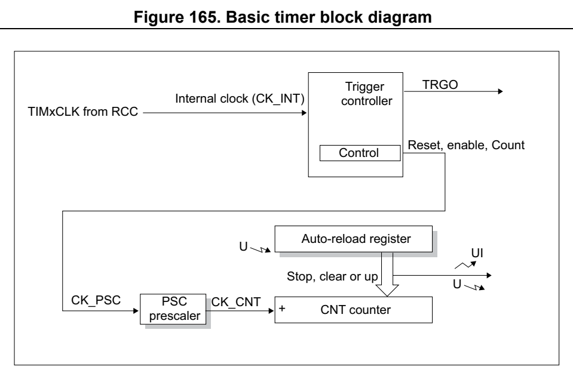
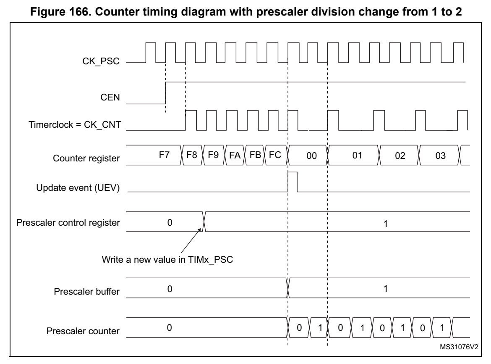
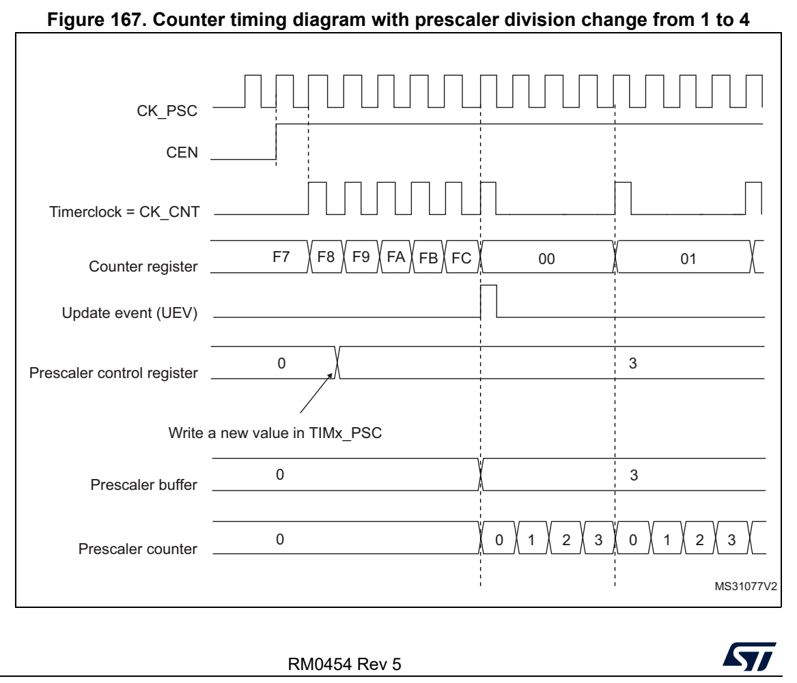
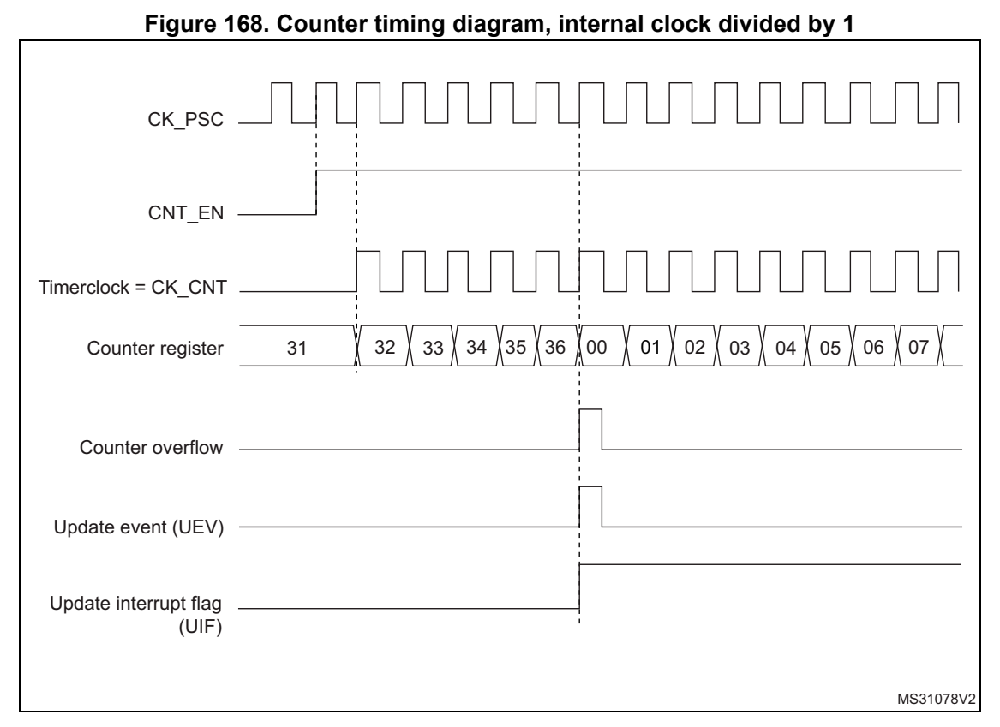
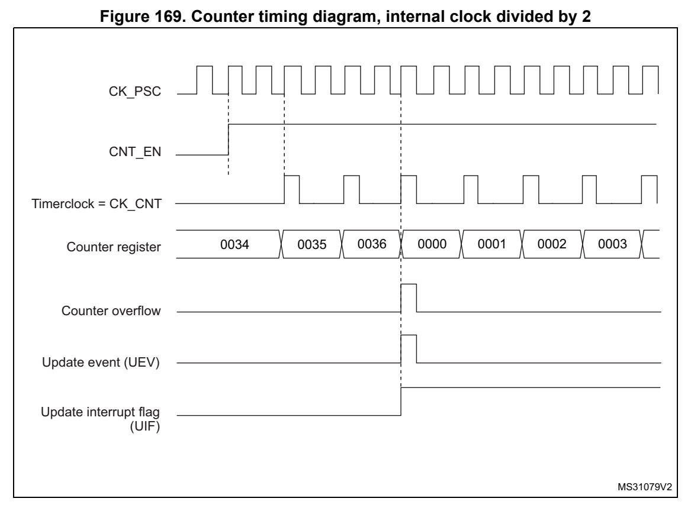
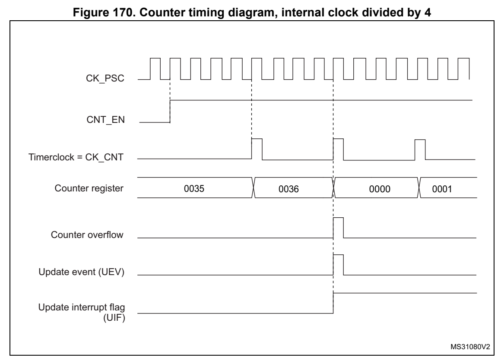
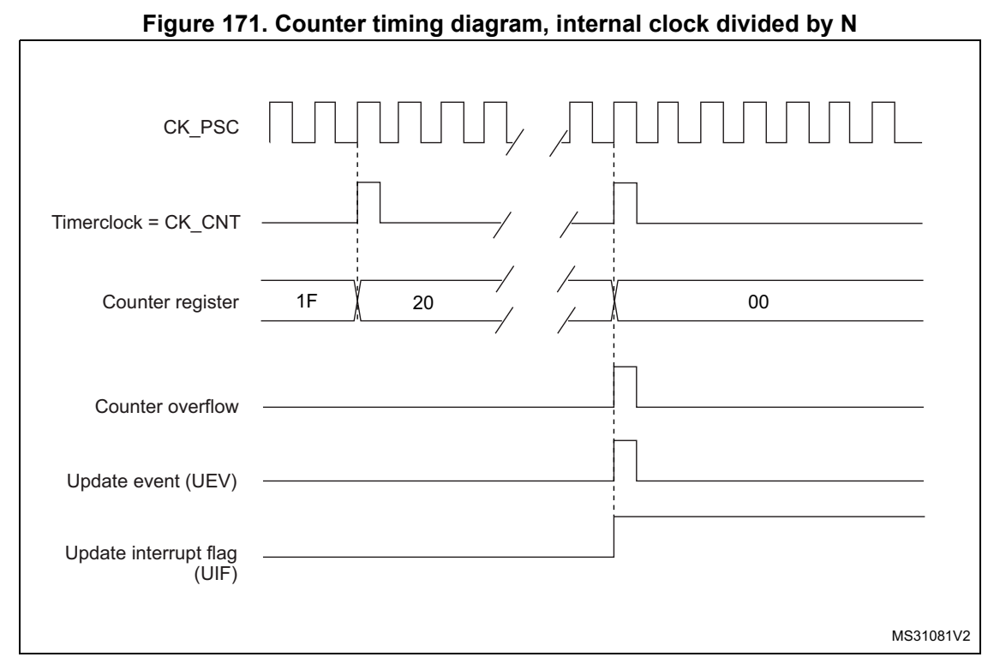
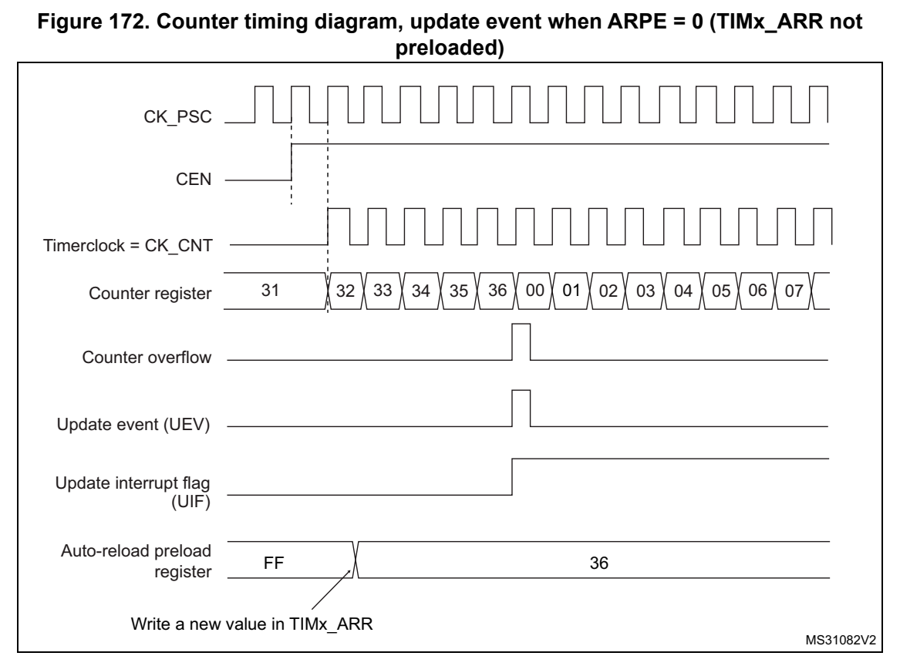
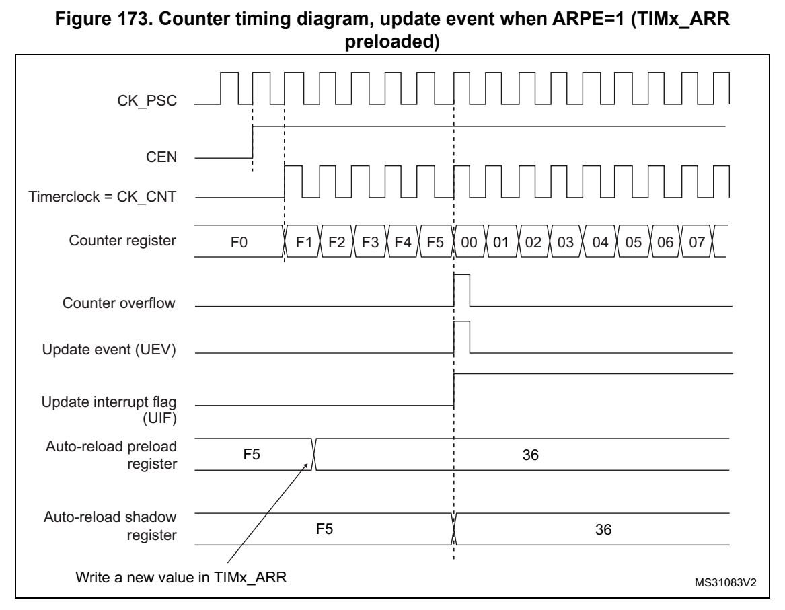
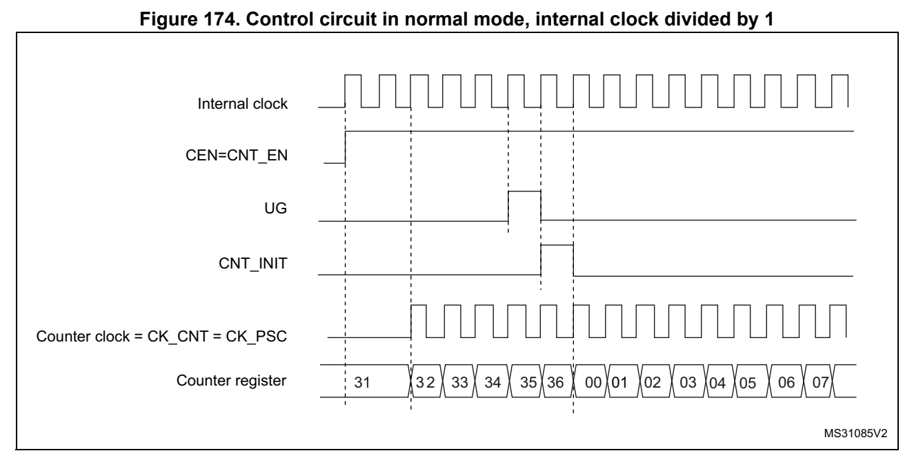

# 17 Basic timers (TIM6/TIM7) (pp. 508-520)

## 17 Basic timers (TIM6/TIM7) (p. 508)

### 17.1 TIM6/TIM7 introduction (p. 508)

The basic timers TIM6 and TIM7 consist of a 16-bit auto-reload counter driven by a programmable prescaler.

They may be used as generic ti mers for time base generation.

The timers are completely indepe ndent, and do not share any res ources.

### 17.2 TIM6/TIM7 main features (p. 508)

Basic timer (TIM6/TIM7) features include:

- 16-bit auto-reload upcounter

- 16-bit programmable prescaler us ed to divide (als o “on the fly”) the counter clock frequency by any factor between 1 and 65535

- Interrupt/DMA generation on the update event: counter overflow

*Figure 165. Basic ti mer block diagram (p. 508)*

Notes: Preload registers transferred Reg to active registers on U event according to control bit Event

Interrupt & DMA output MSv50981V1

### 17.3 TIM6/TIM7 functional description (p. 509)

#### 17.3.1 Time-base unit (p. 509)

The main block of the programmabl e timer is a 16-bit upcounter with its related auto-reload register. The counter clock can be divided by a prescaler.

The counter, the auto-reload register and t he prescaler registe r can be written or read by software. This is true even when the counter is running.

The time-base unit includes:

- Counter Register (TIMx_CNT)

- Prescaler Register (TIMx_PSC)

- Auto-Reload Register (TIMx_ARR)

The auto-reload register is preloaded. The preload register is accessed each time an attempt is made to wri te or read the auto-reload register. The contents of the preload register are transferred into the shadow register permanently o r at each update event UEV, depending on the auto-reload preload enable bit (ARPE) in the T IMx_CR1 register. The update event is sent when the counter reaches the overflow valu e and if the UDIS bit equals 0 in the TIMx_CR1 register. It can also be generated by software. The generation of the update event is described in detail for each configuration.

The counter is clocked by the prescaler output CK_CNT, which is enabled only when the counter enable b it (CEN) in the TIMx_CR1 register is set.

Note that the actual counter enabl e signal CNT_EN is set 1 cloc k cycle after CEN.

Prescaler description

The prescaler can divide the counter clock frequency by any factor between 1 and 65536. It is based on a 16-bit counter controlled through a 16-bit register (in the TIMx_PSC register). It can be changed on the fly as th e TIMx_PSC control register i s buffered. The new prescaler ratio is taken into a ccount at the next update event.

Figure 166 and Figure 167 give some examples of the counter behavior when the prescaler ratio is changed on the fly.

*Figure 166. Counter ti ming diagram with pre scaler division chan ge from 1 to 2 (p. 510)*

*Figure 167. Counter ti ming diagram with pre scaler division chan ge from 1 to 4 (p. 510)*

#### 17.3.2 Counting mode (p. 511)

The counter counts from 0 to the auto-reload value (contents of the TIMx_ARR register), then restarts from 0 and generates a counter overflow event.

An update event can be generate at each counter overflow or by setting the UG bit in the TIMx_EGR register (by s oftware or by using the slave mode controller).

The UEV event can be disabled by software by setting the UDIS b it in the TIMx_CR1 register. This avoids updating the shadow registers while writi ng new values into the preload registers. In this way, no update event occurs until the UDIS b it has been written to 0, however, the counter and the pre scaler counter both restart fro m 0 (but the prescale rate does not change). In addition, i f the URS (update request selection) bit in the TIMx_CR1 register is set, setting the UG bit generates an update event U EV, but the UIF flag is not set (so no interrupt or DM A request is sent).

When an update even t occurs, all the registers are updated and the update flag (UIF bit in the TIMx_SR register) is set (depending on the URS bit):

- The buffer of the prescaler is reloaded with the preload value (contents of the TIMx_PSC register)

- The auto-reload shadow register i s updated with the preload val ue (TIMx_ARR)

The following figures show some examples of the counter behavio r for different clock frequencies when TIMx_ARR = 0x36.

*Figure 168. Counter timing diagram, internal clock divided by 1 (p. 511)*

*Figure 169. Counter timing diagram, internal clock divided by 2 (p. 512)*

*Figure 170. Counter timing diagram, internal clock divided by 4 (p. 512)*

*Figure 171. Counter timing diagram, internal clock divided by N (p. 513)*

*Figure 172. Counter timing diagram, update event when ARPE = 0 (TIMx_ARR not (p. 513)*

*Figure 173. Counter timing diagram, update event when ARPE=1 (T IMx_ARR (p. 514)*

#### 17.3.3 UIF bit remapping (p. 514)

The IUFREMAP bit in the TIMx_CR1 register forces a continuous copy of the Update Interrupt Flag UIF in to the timer counter register’s bit 31 (TI MxCNT[31]). This allows to atomically read both t he counter value and a potential roll-ove r condition signaled by the UIFCPY flag. In particular cases, it can ease the calculations by avoiding race conditions caused for instance by a processing shared between a background task (counter reading) and an interrupt ( Update Interrupt).

There is no latency between the assertions of the UIF and UIFCPY flags.

#### 17.3.4 Clock source (p. 514)

The counter clock is provided by the Internal clock (CK_INT) so urce.

The CEN (in the TIMx_C R1 register) and UG bits (in the TIMx_EGR register) are actual control bits and can b e changed only by software (except for UG that remains cleared automatically). As soon as the CEN bit is written to 1, the pre scaler is clocked by the internal clock CK_INT.

Figure 174 shows the behavior of the contro l circuit and the upcounter in normal mode, without prescaler.

*Figure 174. Control circuit in no rmal mode, internal clock divi ded by 1 (p. 515)*

#### 17.3.5 Debug mode (p. 515)

® When the microcontroller enters the debug mode (Cortex -M0+ core - halted), the TIMx counter either continues to work normally or stops, depending o n the DBG_TIMx_STOP configuration bit in the DBG module. For more details, refer to2 Section 29.9.2: Debug support for timers, watchdog and I C.

### 17.4 TIM6/TIM7 registers (p. 515)

Refer to Section 1.2 on page 39 for a list of abbre viations used in register descriptions.

The peripheral registers can be a ccessed by half-words (16-bit) or words (32-bit).

### 17.4.1 [TIM6.TIMx_CR1] Offset: 0x00 | Reset: 0x0000 (p. 515)

Address offset: 0x00

Reset value: 0x0000

Bits 15:12 Reserved, must be kept at reset value.

Bit 11 UIFREMAP: UIF status bit remapping 0: No remapping. UIF status bit is not copied to TIMx_CNT register bit 31. 1: Remapping enabled. UIF status bit is copied to TIMx_CNT regi ster bit 31.

Bits 10:8 Reserved, must be kept at reset value.

Bit 7 ARPE: Auto-reload preload enable 0: TIMx_ARR register is not buffered. 1: TIMx_ARR register is buffered.

Bits 6:4 Reserved, must be kept at reset value.

Bit 3 OPM: One-pulse mode 0: Counter is not stopped at update event 1: Counter stops counting at the next update event (clearing th e CEN bit).

Bit 2 URS: Update request source This bit is set and cleared by s oftware to select the UEV event sources. 0: Any of the following events generates an update interrupt or DMA request if enabled. These events can be: – Counter overflow/underflow – Setting the UG bit – Update generation through t he slave mode controller 1: Only counter overflow/underfl ow generates an update interrup t or DMA request if enabled.

Bit 1 UDIS: Update disable This bit is set and cleared by s oftware to enable/disable UEV event generation. 0: UEV enabled. The Update (UEV) event is generated by one of t he following events: – Counter overflow/underflow – Setting the UG bit – Update generation through t he slave mode controller Buffered registers are then loa ded with their preload values. 1: UEV disabled. The Update event is not generated, shadow regi sters keep their value (ARR, PSC). However the counter and the prescaler are reinitial ized if the UG bit is set or if a hardware reset is received from the slave mode controller.

Bit 0 CEN: Counter enable 0: Counter disabled 1: Counter enabled Note: Gated mode can work only if the CEN bit has been previously set by software. However trigger mode can set the CEN bit automatically by hardware. CEN is cleared automatically i n one-pulse mo de, when an update event occurs.

### 17.4.2 [TIM6.TIMx_CR2] Offset: 0x04 | Reset: 0x0000 (p. 517)

Address offset: 0x04

Reset value: 0x0000

Bits 15:7 Reserved, must be kept at reset value.

Bits 6:4 MMS[2:0]: Master mode selection These bits are used to select th e information to be sent in mas ter mode to slave timers for synchronization (TRGO). The combination is as follows: 000: Reset - the UG bit from the TIMx_EGR register is used as a trigger o utput (TRGO). If reset is generated by the trigger input (slave mode controller configured in reset mode) then the signal on TRGO is delayed compared to the actual reset. 001: Enable - the Counter enable signal, CNT_EN, is used as a trigger outp ut (TRGO). It is useful to start several timers a t the same time or to control a window in which a slave timer is enabled. The Counter Enable s ignal is generated by a logic O R between CEN control bit and the trigger input when co nfigured in gated mode. When the Counter Enable signal is controlled by the trigger inp ut, there is a delay on TRGO, except if the master/slave mode is selected (see the MSM bit de scription in the TIMx_SMCR register). 010: Update - The update event is selected as a trigger output (TRGO). For instance a master timer can then be used as a prescaler for a slave timer. Note: The clock of the slave timer or ADC must be enabled prior to receive events from the master timer, and must not be changed on-the-fly while triggers are received from the master timer.

Bits 3:0 Reserved, must b e kept at reset value.

### 17.4.3 [TIM6.TIMx_DIER] Offset: 0x0C | Reset: 0x0000 (p. 517)

Address offset: 0x0C

Reset value: 0x0000

Bits 15:9 Reserved, must be kept at reset value.

Bit 8 UDE: Update DMA request enable 0: Update DMA request disabled. 1: Update DMA request enabled.

Bits 7:1 Reserved, must be kept at reset value.

Bit 0 UIE: Update interrupt enable 0: Update interrupt disabled. 1: Update interrupt enabled.

### 17.4.4 [TIM6.TIMx_SR] Offset: 0x10 | Reset: 0x0000 (p. 518)

Address offset: 0x10

Reset value: 0x0000

Res. Res. Res. Res. Res. Res. Res. Re s. Res. Res. Res. Res. Res. Res. Res. UIF rc_w0

Bits 15:1 Reserved, must be kept at reset value.

Bit 0 UIF: Update interrupt flag This bit is set by hardware on an update event. It is cleared by software. 0: No update occurred. 1: Update interrupt pending. This bit is s et by hardware when t he registers are updated: – At overflow or underflow regardi ng the repetition counter valu e and if UDI S = 0 in the TIMx_CR1 register. – When CNT is reinitialized by software using the UG bit in the TIMx_EGR register, if URS = 0 and UDIS = 0 in the TIMx_CR1 register.

### 17.4.5 [TIM6.TIMx_EGR] Offset: 0x14 | Reset: 0x0000 (p. 518)

Address offset: 0x14

Reset value: 0x0000

Res. Res. Res. Res. Res. Res. Res. Re s. Res. Res. Res. Res. Res. Res. Res. UG

w

Bits 15:1 Reserved, must be kept at reset value.

Bit 0 UG: Update generation This bit can be set by software, it is automatically cleared by hardware. 0: No action. 1: Re-initializes the timer counter and generates an update of the registers. Note that the prescaler counter is cleared too (but the prescaler ratio is not affected).

### 17.4.6 [TIM6.TIMx_CNT] Offset: 0x24 | Reset: 0x00000000 (p. 518)

Address offset: 0x24

Reset value: 0x0000 0000

CPY

r

Bit 31 UIFCPY: UIF Copy This bit is a read-only copy of t he UIF bit of the TIMx_ISR reg ister. If the UIFREMAP bit in TIMx_CR1 is reset, bit 31 is reserved and read as 0.

Bits 30:16 Reserved, must be kept at reset value.

Bits 15:0 CNT[15:0]: Counter value

17.4.7 TIMx prescaler (TI Mx_PSC)(x = 6 to 7)

Address offset: 0x28

Reset value: 0x0000

Bits 15:0 PSC[15:0]: Prescaler value The counter clock frequency CK_CNT is equal to f CK_PSC / (PSC[15:0] + 1). PSC contains the value to be loaded into the active prescaler register at each update event. (including when the counter is cleared thro ugh UG bit of TIMx_E GR register or through trigger controller when configured in “reset mode”).

### 17.4.8 [TIM6.TIMx_ARR] Offset: 0x2C | Reset: 0xFFFF (p. 519)

Address offset: 0x2C

Reset value: 0xFFFF

Bits 15:0 ARR[15:0]: Prescaler value ARR is the value to be loaded in to the actual auto-reload register. Refer to Section 17.3.1: Time-base unit on page 509 for more details a bout ARR update and behavior. The counter is blocked while the auto-reload value is null.

#### 17.4.9 TIMx register map (p. 520)

TIMx registers are mapped as 16- bit addressable registers as de scribed in the table below:

**Table 76. TIMx register map and reset values (p. 520)**

| Offset | Register name | 31 | 30 | 29 | 28 | 27 | 26 | 25 | 24 | 23 | 22 | 21 | 20 | 19 | 18 | 17 | 16 | 15 | 14 | 13 | 12 | 11 | 10 | 9 | 8 | 7 | 6 | 5 | 4 | 3 | 2 | 1 | 0 |
| --- | --- | --- | --- | --- | --- | --- | --- | --- | --- | --- | --- | --- | --- | --- | --- | --- | --- | --- | --- | --- | --- | --- | --- | --- | --- | --- | --- | --- | --- | --- | --- | --- | --- |
| 0x00 | TIMx_CR1 | Res. | Res. | Res. | Res. | Res. | Res. | Res. | Res. | Res. | Res. | Res. | Res. | Res. | Res. | Res. | Res. | Res. | Res. | Res. | Res. | UIFREMA | Res. | Res. | Res. | ARPE | Res. | Res. | Res. | OPM | URS | UDIS | CEN |

Reset value 0 0 0000

TIMx_CR2 Res. Res. Res. Res. Res. Res. Res. Res. Res. Res. Res. Res. Res. Res. Res. Res. Res. Res. Res. Res. Res. Res. Res. Res. Res. MMS[2:0] Res. Res. Res. Res. 0x04 Reset value 000

| Col 1 | Col 2 | Col 3 | Col 4 | Col 5 | 0x08 Reserved | 0x08 Reserved | Col 8 | Col 9 | Col 10 | Col 11 | Col 12 | Col 13 | Col 14 | Col 15 | Col 16 | Col 17 | Col 18 | Col 19 | Col 20 | Col 21 | Col 22 | Col 23 | Col 24 | Col 25 | Col 26 | Col 27 | Col 28 | Col 29 | Col 30 | Col 31 | Col 32 | Col 33 | Col 34 |
| --- | --- | --- | --- | --- | --- | --- | --- | --- | --- | --- | --- | --- | --- | --- | --- | --- | --- | --- | --- | --- | --- | --- | --- | --- | --- | --- | --- | --- | --- | --- | --- | --- | --- |
| 0x0C | TIMx_DIER | Res. | Res. | Res. | Res. | Res. | Res. | Res. | Res. | Res. | Res. | Res. | Res. | Res. | Res. | Res. | Res. | Res. | Res. | Res. | Res. | Res. | Res. | Res. | UDE | Res. | Res. | Res. | Res. | Res. | Res. | Res. | UIE |

Reset value 00

TIMx_SR Res. Res. Res. Res. Res. Res. Res. Res. Res. Res. Res. Res. Res. Res. Res. Res. Res. Res. Res. Res. Res. Res. Res. Res. Res. Res. Res. Res. Res. Res. Res. UIF 0x10 Reset value 0

TIMx_EGR Res. Res. Res. Res. Res. Res. Res. Res. Res. Res. Res. Res. Res. Res. Res. Res. Res. Res. Res. Res. Res. Res. Res. Res. Res. Res. Res. Res. Res. Res. Res. UG 0x14 Reset value 0

| 0x18-0x20 | Col 2 | Col 3 | Col 4 | Col 5 | Col 6 | Col 7 | Col 8 | Col 9 | Col 10 | Col 11 | Col 12 | Col 13 | Col 14 | Col 15 | Reserved | Col 17 | Col 18 | Col 26 | Col 27 |
| --- | --- | --- | --- | --- | --- | --- | --- | --- | --- | --- | --- | --- | --- | --- | --- | --- | --- | --- | --- |
| 0x24 | TIMx_CNT | UIFCPY or Res. | Res. | Res. | Res. | Res. | Res. | Res. | Res. | Res. | Res. | Res. | Res. | Res. | Res. | Res. | Res. | CNT[15:0] | CNT[15:0] |

Reset value 0 0 0 0 0 0 0 0 0 0 0 0 0 0 0 0 0

TIMx_PSC Res. Res. Res. Res. Res. Res. Res. Res. Res. Res. Res. Res. Res. Res. Res. Res. PSC[15:0] 0x28 Reset value 0 0 0 0 0 0 0 0 0 0 0 0 0 0 0 0

TIMx_ARR Res. Res. Res. Res. Res. Res. Res. Res. Res. Res. Res. Res. Res. Res. Res. Res. ARR[15:0] 0x2C Reset value 1 1 1 1 1 1 1 1 1 1 1 1 1 1 1 1

Refer to Section 2.2 on page 44 for the register boundary addresses.
