# 18 General-purpose timers (TIM14) (pp. 521-546)

## 18 General-purpose timers (TIM14) (p. 521)

### 18.1 TIM14 introduction (p. 521)

The TIM14 general-purpose timer consists of a 16-bit auto-reloa d counter driven by a programmable prescaler.

It may be used for a va riety of purposes, including measuring t he pulse lengths of input signals (input capture) or generating output waveforms (output compare, PWM).

Pulse lengths and waveform periods can be modulated from a few microseconds to several milliseconds using the timer pre scaler and the RC C clock contro ller prescalers.

The TIM14 timer is completely in dependent, and does not share a ny resources.

### 18.2 TIM14 main features (p. 521)

#### 18.2.1 TIM14 main features (p. 521)

The features of general-purpose timer TIM14 include:

- 16-bit auto-reload upcounter

- 16-bit programmable prescaler used to divide the counter clock frequency by any factor between 1 and 65536 (can be changed “on the fly”)

- independent channel for: – Input capture – Output compare – PWM generation (edge-aligned mode) – One-pulse mode output

- Interrupt generation on the following events: – Update: counter overflow, counte r initialization (by software) – Input capture – Output compare

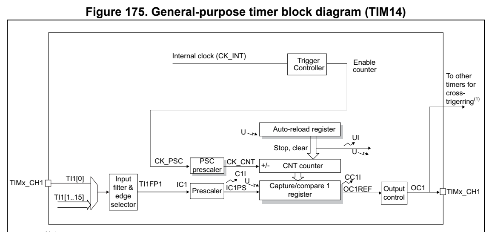
*Figure 175. General-purpose timer block diagram (TIM14) (p. 522)*

Preload registers transferred Reg to active registers on U event according to control bit Event

Interrupt & DMA output MSv40931V2

1. This signal can be used as tri gger for some slave timers, see Section 18.3.11: Using timer output as trigger for other timers (TIM14).

### 18.3 TIM14 functional description (p. 523)

#### 18.3.1 Time-base unit (p. 523)

The main block of the timer is a 16-bit up-counter with its rel ated auto-reload register. The counter clock can be d ivided by a prescaler.

The counter, the auto-reload register and t he prescaler registe r can be written or read by software. This is true even when the counter is running.

The time-base unit includes:

- Counter register (TIMx_CNT)

- Prescaler register (TIMx_PSC)

- Auto-reload register (TIMx_ARR)

The auto-reload register is preloaded. Writing to or reading from the auto-reload register accesses the preload register. Th e content of the preload register are transferred into the shadow register permanently or at each update event (UEV), depe nding on the auto-reload preload enable bit (ARPE) in TIMx_CR1 register. The update even t is sent when the counter reaches the overflow and if th e UDIS bit equals 0 in the TIMx_C R1 register. It can also be generated by software. The generation of the update event is de scribed in details for each configuration.

The counter is clocked by the prescaler output CK_CNT, which is enabled only when the counter enable bi t (CEN) in TIMx_CR1 register is set.

Note that the counter starts coun ting 1 clock cycle after setti ng the CEN bit in the TIMx_CR1 register.

Prescaler description

The prescaler can divide the counter clock frequency by any factor between 1 and 65536. It is based on a 16-bit counter controlled through a 16-bit register (in the TIMx_PSC register). It can be changed on the fly as th is control register is buffered. The new prescaler ratio is taken into account at the next update event.

Figure 176 and Figure 177 give some examples of the counter behavior when the prescaler ratio is changed on the fly.

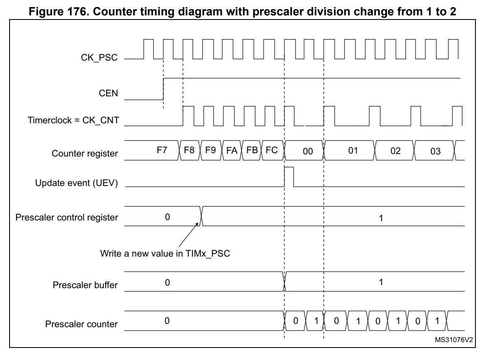
*Figure 176. Counter ti ming diagram with pre scaler division chan ge from 1 to 2 (p. 524)*

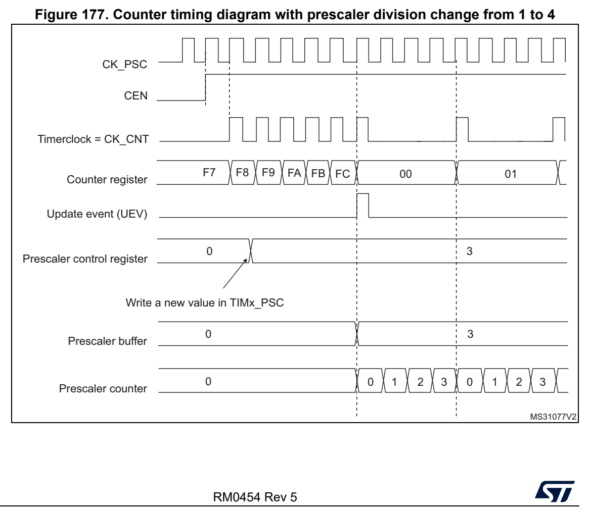
*Figure 177. Counter ti ming diagram with pre scaler division chan ge from 1 to 4 (p. 524)*

#### 18.3.2 Counter modes (p. 525)

Upcounting mode

In upcounting mode, the counter counts from 0 to the auto-reloa d value (content of the TIMx_ARR register), then restarts from 0 and generates a counte r overflow event.

Setting the UG bit in the TIMx_E GR register (by software) also generates an up date event.

The UEV event can be disabled by software by setting the UDIS b it in the TIMx_CR1 register. This is to avoid updati ng the shadow registers while writing new values in the preload registers. Then no update event occurs until the UDIS b it has been written to 0. However, the counter restarts from 0, as well as the counter of the prescaler (but the prescale rate does not change). In addition, if the URS bit (up date request selection) in TIMx_CR1 register is set, setti ng the UG bit gen erates an update event UEV but without setting the UIF flag (th us no interrupt is s ent). This is to avoid generating both update and capture interrupts when clearing the counter on the capture eve nt.

When an update even t occurs, all the registers are updated and the update flag (UIF bit in TIMx_SR register) is set (depending on the URS bit):

- The auto-reload shadow register i s updated with the preload val ue (TIMx_ARR),

- The buffer of the prescaler is reloaded with the preload value (content of the TIMx_PSC register).

The following figures show some examples of the counter behavio r for different clock frequencies when TIMx_ARR=0x36.

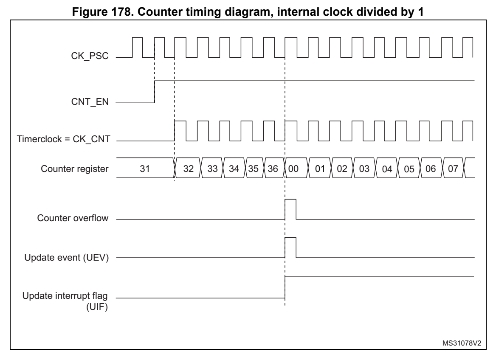
*Figure 178. Counter timing diagram, internal clock divided by 1 (p. 525)*

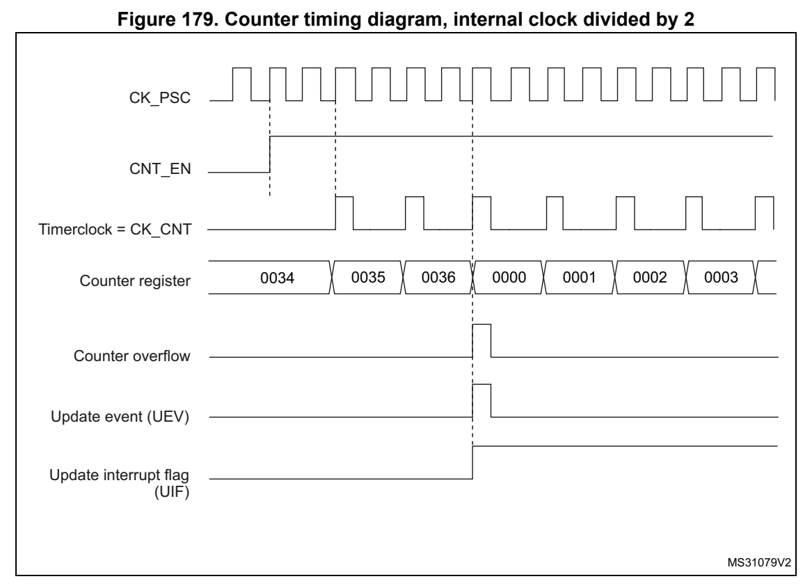
*Figure 179. Counter timing diagram, internal clock divided by 2 (p. 526)*

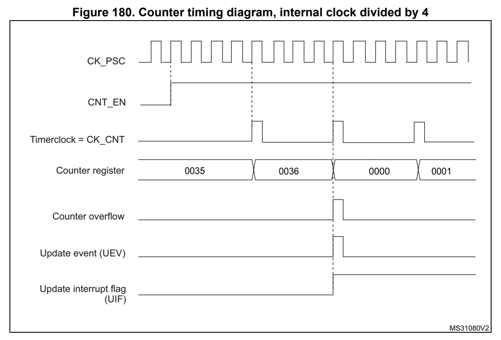
*Figure 180. Counter timing diagram, internal clock divided by 4 (p. 526)*

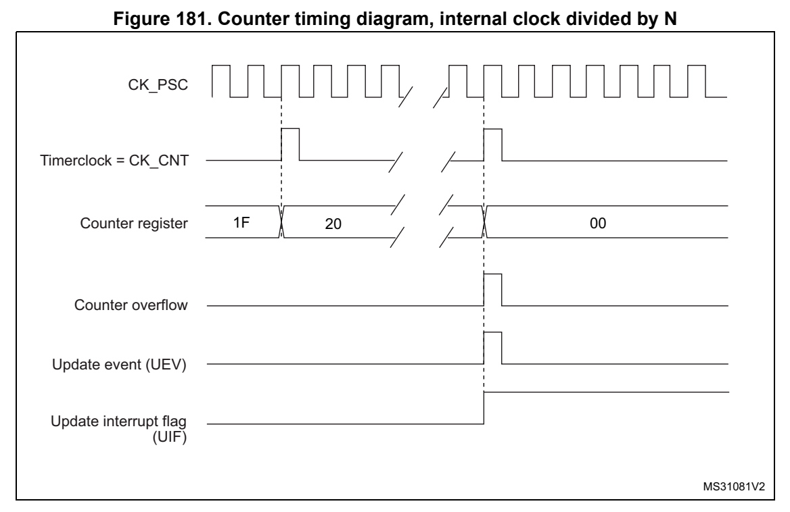
*Figure 181. Counter timing diagram, internal clock divided by N (p. 527)*

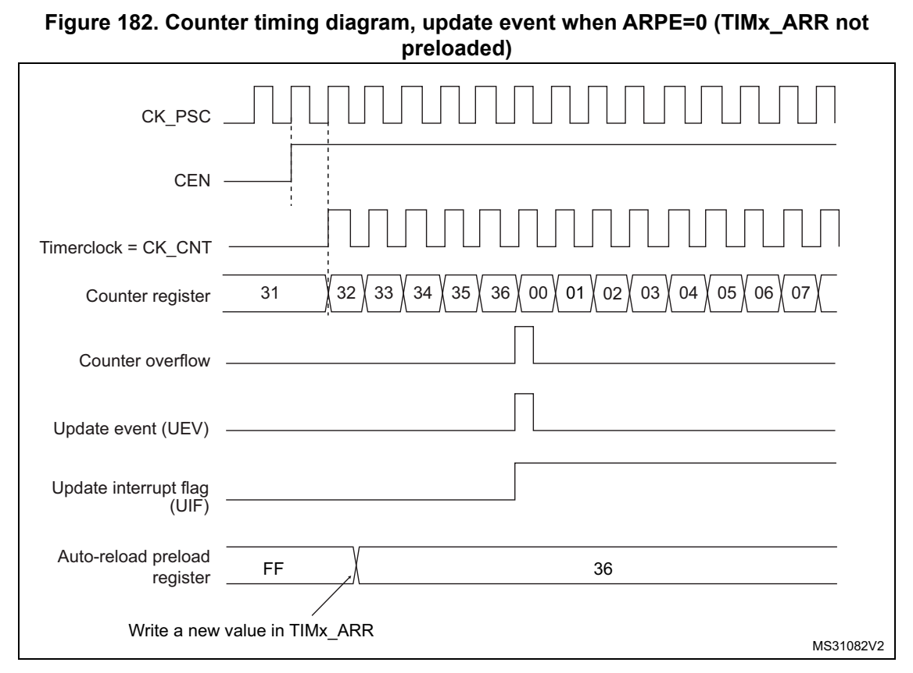
*Figure 182. Counter timing diagra m, update event when ARPE=0 (T IMx_ARR not (p. 527)*

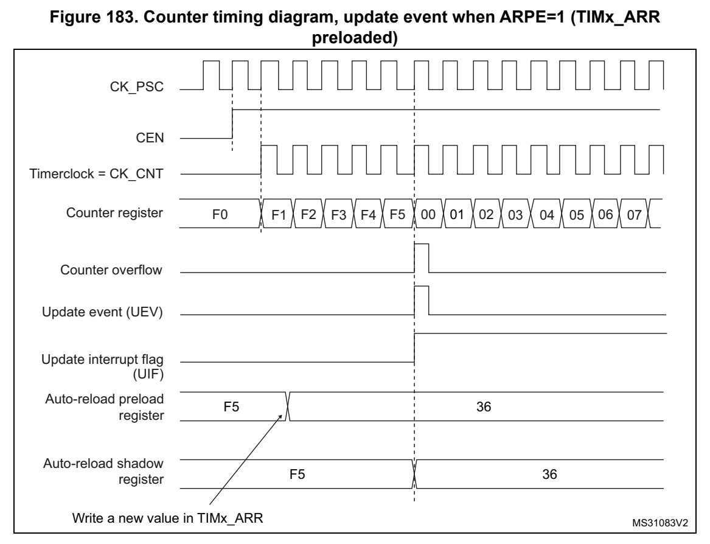
*Figure 183. Counter timing diagram, update event when ARPE=1 (T IMx_ARR (p. 528)*

#### 18.3.3 Clock selection (p. 528)

The counter clock can be provide d by the following clock source s:

- Internal clock (CK_INT)

Internal clock source (CK_INT)

The internal clock source is the default clock source for TIM14.

Figure 184 shows the behavior of the contro l circuit and the upcounter in normal mode, without prescaler.

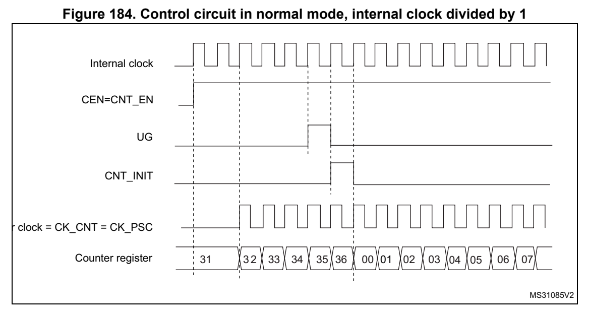
*Figure 184. Control circuit in normal mode, internal clock divi ded by 1 (p. 529)*

#### 18.3.4 Capture/compare channels (p. 529)

Each Capture/Compare channel is built around a capture/compare register (including a shadow register), a input stage for capture (with digital filte r, multiplexing and prescaler) and an output stage (with comparator and output control).

Figure 185 to Figure 187 give an overview of one capture/compare channel.

The input stage samples the corresponding TIx input to generate a filtered signal TIxF. Then, an edge detector with pola rity selection generates a sign al (TIxFPx) which can be used as the capture command. It i s prescaled before the capture register (ICxPS).

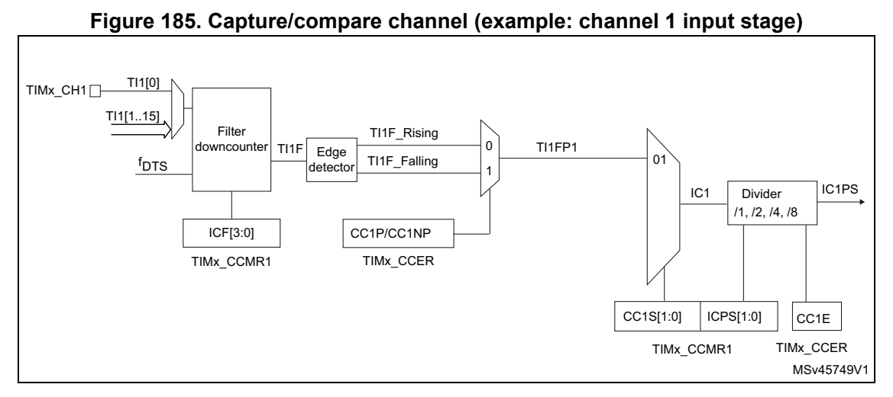
*Figure 185. Capture/compare chan nel (example: ch annel 1 input s tage) (p. 529)*

The output stage generates an intermediate waveform which is th en used for reference: OCxRef (active high). The polarity acts at the end of the chain.

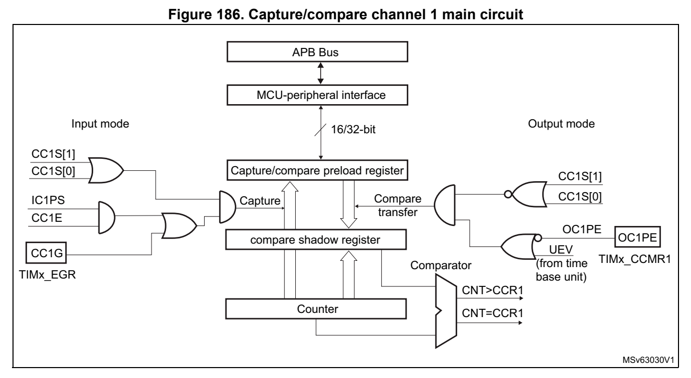
*Figure 186. Capture/compare channel 1 main circuit (p. 530)*

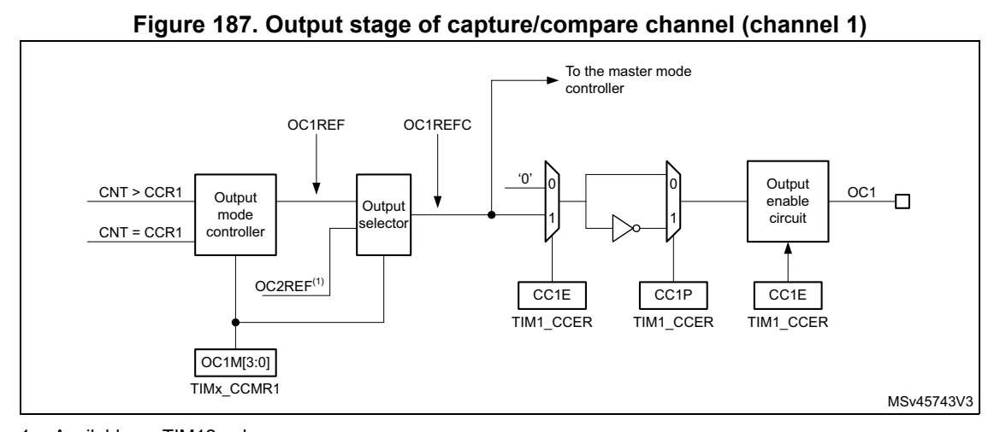
*Figure 187. Output stage of capture/compare channel (channel 1) (p. 530)*

1. Available on TIM12 only. The capture/compare block is made of one preload register and o ne shadow register. Write and read always access the preload register.

In capture mode, captures are actually done in the shadow register, which is copied into the preload register.

In compare mode, the content of the p reload registe r is copied into the shadow register which is compared to the counter.

#### 18.3.5 Input capture mode (p. 530)

In Input capture mode, the Capture/Compare Registers (TIMx_CCRx) are used to latch the value of the counter after a transition dete cted by the corresp onding ICx signal. When a capture occurs, the corresponding CCXIF flag (TIMx_SR register) is set and an interrupt or a DMA request can be sent if they are enabled. If a capture occ urs while the CCxIF flag was already high, then the over-captu re flag CCxOF (TIMx_SR registe r) is set. CCxIF can be

cleared by software by writing i t to ‘0’ or by reading the capt ured data stored in the TIMx_CCRx register. CCxOF is clea red when it is written with 0.

The following example shows how to capture the counter value in TIMx_CCR1 when TI1 input rises. To do this, us e the following procedure: 1. Select the proper TI1[x] source (internal or external) with t he TI1SEL[3:0] bits in the TIMx_TISEL register. 2. Select the active input: TIMx_CCR1 must be linked to the TI1 input, so write the CC1S bits to ‘01’ in the TIMx_CCMR1 register. As soon as CC1S become s different from ‘00’, the channel is configured in inp ut mode and the TIMx_CCR1 register becomes read-only. 3. Program the appropriate input filter duration in relation wi th the signal connected to the timer (by programming the ICxF bi ts in the TIMx_CCMRx register if the input is one of the TIx inputs). Let’s imagine that, when toggling, the input s ignal is not stable during at must 5 internal clock cycles. We must program a filter duration longer than these 5 clock cycles. We can validate a transition on TI1 when 8 consec utive samples with the new level have been detected (sampled at f DTS frequency). Then write IC1F bits to ‘0011’ in the TIMx_CCMR1 register. 4. Select the edge of the activ e transition on the TI1 channel by programming CC1P and CC1NP bits to ‘00’ in the TIMx_CCER register (rising edge in th is case). 5. Program the input prescaler. In our exa mple, we wish the cap ture to be performed at each valid transition, so the prescaler is disabled (write IC1P S bits to ‘00’ in the TIMx_CCMR1 register). 6. Enable capture from the counter into the capture register by setting the CC1E bit in the TIMx_CCER register. 7. If needed, enable the related interrupt request by setting t he CC1IE bit in the TIMx_DIER register.

When an input capture occurs:

- The TIMx_CCR1 register gets the value of the counter on the act ive transition.

- CC1IF flag is set (interrupt flag). CC1OF is also set if at lea st two consecutive captures occurred whereas the flag was not cleared.

- An interrupt is generated depending on the CC1IE bit.

In order to handle the overcapt ure, it is recomm ended to read t he data before the overcapture flag. This is to avoid missing an overcapture which could happen after reading the flag and before reading the data.

Note: IC interrupt requests can be generated by software by setting the corresponding CCxG bit in the TIMx_EGR register.

#### 18.3.6 Forced output mode (p. 531)

In output mode (CCxS bits = ‘00’ in the TIMx_CCMRx register), e ach output compare signal (OCxREF and then OCx) can be forced to active or inactive level directly by software, independently of any comparison between the output compare regi ster and the counter.

To force an output compare signal (OCXREF/OCx) to its active level, one just needs to write ‘0101’ in the OCxM bits in the co rresponding TIMx_CCMRx registe r. Thus OCXREF is forced high (OCxREF is always active high) and OCx get opposite value to CCxP polarity bit.

For example: CCxP=’0’ (OCx active high) => OCx is forced to hig h level.

The OCxREF signal can be forced low by writing t he OCxM bits to ‘0100’ in the TIMx_CCMRx register.

Anyway, the comparison between the TIMx_CCRx shadow register an d the counter is still performed and allows the flag to be set. Interrupt requests can be sent accordingly. This is described in the output com pare mode section below.

#### 18.3.7 Output compare mode (p. 532)

This function is used to control an output wavefo rm or indicati ng when a period of time has elapsed.

When a match is found between the capture/compare register and the counter, the output compare function: 1. Assigns the corresponding output pin to a programmable value defined by the output compare mode (OCxM bits in the TIMx_CCMRx register) and the out put polarity (CCxP bit in the TIMx_CCER re gister). The output p in can keep its level (OCxM=’0000’), be set active (OCxM=’0001’), be set inactive (OCxM=’0010’) or can toggle (OCxM=’0011’) on match. 2. Sets a flag in the interrupt status register (CCxIF bit in t he TIMx_SR register). 3. Generates an interrupt if the corresponding i nterrupt mask i s set (CCXIE bit in the TIMx_DIER register).

The TIMx_CCRx registers can be p rogrammed with or without prelo ad registers using the OCxPE bit in the TIMx_CCMRx register.

In output compare mode, the update event UEV has no effect on O CxREF and OCx output. The timing resolution is one count of the counter. Output compa re mode can also be used to output a single pulse (in One-pulse mode).

Procedure: 1. Select the counter clock (i nternal, external, prescaler). 2. Write the desired data in the TIMx_ARR and TIMx_CCRx registe rs. 3. Set the CCxIE bit if an interrupt request is to be generated. 4. Select the output mode. For example: – Write OCxM = ‘0011’ to toggle O Cx output pin when CNT matches CCRx – Write OCxPE = ‘0’ to dis able preload register – Write CCxP = ‘0’ to sel ect active high polarity – Write CCxE = ‘1’ to enable the output 5. Enable the counter by setting the CEN bit in the TIMx_CR1 re gister.

The TIMx_CCRx register can be upd ated at any time by software to control the output waveform, provided that the preload register is not enabled (OCxPE=’0’, else TIMx_CCRx shadow register is updated only at the next update event UEV). An example is given in Figure 188.

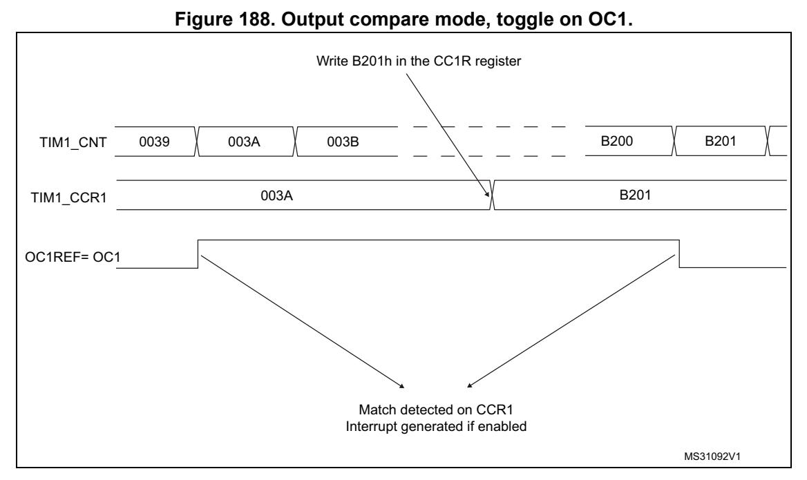
*Figure 188. Output compare mode, toggle on OC1. (p. 533)*

#### 18.3.8 PWM mode (p. 533)

Pulse Width Modulation mode allows to generate a signal with a frequency determined by the value of the TIMx_ARR register and a duty cycle determined by the value of the TIMx_CCRx register.

The PWM mode can be selected i ndependently on each channel (one PWM per OCx output) by writing ‘0110’ (PWM m ode 1) or ‘0111’ (PWM mode 2) i n the OCxM bits in the TIMx_CCMRx register. The corresp onding preload register must be enabled by setting the OCxPE bit in the TIMx_CCMRx regi ster, and eventually the auto-reload preload register (in upcounting or center-aligned mode s) by setting the ARPE bit in the TIMx_CR1 register.

As the preload registers are transferred to the shadow registers only when an update event occurs, before starting the coun ter, all registers must be init ialized by setting the UG bit in the TIMx_EGR register.

The OCx polarity is software programmable using the CCxP bit in the TIMx_CCER register. It can be programmed as active high or active low. The OCx outp ut is enabled by the CCxE bit in the TIMx_CCER register. Refer to the TIMx_CCERx register description for more details.

In PWM mode (1 or 2), TIMx_CNT and TIMx_CCRx are always compare d to determine whether TIMx_C NT ≤ TIMx_CCRx.

The timer is able to generate PWM in edge-aligned mode only sin ce the counter is upcounting.

In the following example, we consider PWM mode 1. The reference PWM signal OCxREF is high as long as TIMx_CNT < TIMx_CCRx else it becomes low. If th e compare value in TIMx_CCRx is greater th an the auto-reload va lue (in TIMx_ARR) t hen OCxREF is held at ‘1’. If the compare value is 0 then OCxRef is held at ‘0’. Figure 189 shows some edge-aligned PWM waveforms in an example where TIMx_ARR=8.

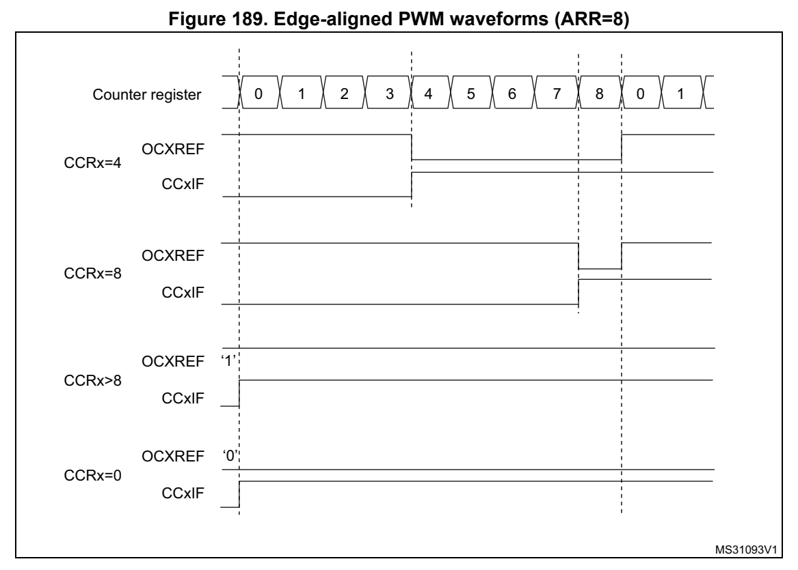
*Figure 189. Edge-aligned PWM waveforms (ARR=8) (p. 534)*

#### 18.3.9 One-pulse mode (p. 534)

One-pulse mode (OPM) is a partic ular case of the previous modes. It allows the counter to be started in response to a stimulus and to generate a pulse wi th a programmable length after a programmable delay.

Starting the counter can be con trolled using the CEN bit. Generating the waveform can be done in output compare mode or PW M mode. One-pulse mode is sele cted by setting the OPM bit in the TIMx_CR1 register. This makes the counter stop a utomatically at the next update event UEV.

A pulse can be correctly genera ted only if the compare value is different from the counter initial value. Before starting (when the timer is waiting for t he trigger), the configuration must be as follows: CNT < CCRx = ARR (in particular, 0 < CCRx)

#### 18.3.10 UIF bit remapping (p. 534)

The IUFREMAP bit in the TIMx_CR1 register forces a continuous copy of the Update Interrupt Flag UIF in to bit 31 of the timer counter register (T IMxCNT[31]). This allows to atomically read both t he counter value and a potential roll-ove r condition signaled by the UIFCPY flag. In particular cases, it can ease the calculations by avoiding race conditions caused for instance by a processing shared between a background task (counter reading) and an interrupt ( Update Interrupt).

There is no latency between the assertions of the UIF and UIFCPY flags.

#### 18.3.11 Using timer out put as trigger for ot her timers (TIM14) (p. 535)

The timers with one channel only do not feature a master mode. However, the OC1 output signal can be used to trigger some other timers (including time rs described in other sections of this document). Check the “TIM x internal trigger connection” table of any TIMx_SMCR register on the device to identify which ti mers can be targeted as slave.

The OC1 signal pulse width must b e programmed to be at least 2 clock cycles of the destination timer, to make sure the slave timer will detect the trigger.

For instance, if the destination's timer CK_INT clock is 4 time s slower than the source timer, the OC1 pulse width must be 8 clock cycles.

#### 18.3.12 Debug mode (p. 535)

® When the microcontroller enters debug mode (Cortex -M0+ core halted), the TIMx counter either continues to work normally or stops, depending on DBG_TI Mx_STOP configuration bit in DBG module. For m2 ore details, refer to Section 29.9.2: Debug support for timers, watchdog and I C.

### 18.4 TIM14 registers (p. 536)

The peripheral registers have to be written by half-words (16 b its) or words (32 bits). Read accesses can be done by bytes (8 b its), half-words (16 bits) or words (32 bits).

### 18.4.1 [TIM14.TIM14_CR1] Offset: 0x00 | Reset: 0x0000 (p. 536)

Address offset: 0x00

Reset value: 0x0000

Bits 15:12 Reserved, must be kept at reset value.

Bit 11 UIFREMAP: UIF status bit remapping 0: No remapping. UIF status bit is not copied to TIMx_CNT register bit 31. 1: Remapping enabled. UIF status bit is copied to TIMx_CNT regi ster bit 31.

Bit 10 Reserved, must be kept at reset value.

Bits 9:8 CKD[1:0]: Clock division This bit-field indicates the di vision ratio between the timer c lock (CK_INT) frequency and sampling clock used by t he digital filters (TIx), 00: t DTS = t CK_INT 01: t DTS = 2 × t CK_INT 10: t DTS = 4 × t CK_INT 11: Reserved

Bit 7 ARPE: Auto-reload preload enable 0: TIMx_ARR register is not buffered 1: TIMx_ARR register is buffered

Bits 6:4 Reserved, must be kept at reset value.

Bit 3 OPM: One-pulse mode 0: Counter is not stopped on the update event 1: Counter stops counting on the next update event (clearing th e CEN bit).

Bit 2 URS: Update request source This bit is set and cleared by software to select the update in terrupt (UEV) sources. 0: Any of the following events generate an U EV if enabled: – Counter overflow – Setting the UG bit 1: Only counter overflow gen erates an UEV if enabled.

Bit 1 UDIS: Update disable This bit is set and cleared by software to enable/disable update interrupt (UEV) event generation. 0: UEV enabled. An UEV is generated by one of the following even ts: – Counter overflow – Setting the UG bit. Buffered registers are then l oaded with their preload values. 1: UEV disabled. No UEV is genera ted, shadow registers keep thei r value (ARR, PSC, CCRx). The counter and the prescaler are re initialized if the U G bit is set.

Bit 0 CEN: Counter enable 0: Counter disabled 1: Counter enabled Note: External clock and gated mode can work only if the CEN bit has been previously set by software. However trigger mode can set the CEN bi t automaticall y by hardware.

### 18.4.2 [TIM14.TIM14_DIER] Offset: 0x0C | Reset: 0x0000 (p. 537)

Address offset: 0x0C

Reset value: 0x0000

Bits 15:2 Reserved, must be kept at reset value.

Bit 1 CC1IE: Capture/Compare 1 interrupt enable 0: CC1 interru pt disabled 1: CC1 interrupt enabled

Bit 0 UIE: Update interrupt enable 0: Update interrupt disabled 1: Update interrupt enabled

### 18.4.3 [TIM14.TIM14_SR] Offset: 0x10 | Reset: 0x0000 (p. 537)

Address offset: 0x10

Reset value: 0x0000

Bits 15:10 Reserved, must be kept at reset value.

Bit 9 CC1OF: Capture/Compare 1 overcapture flag This flag is set by hardware onl y when the corresponding channe l is configured in input capture mode. It is cleared by s oftware by writi ng it to ‘0’. 0: No overcapture has been detected. 1: The counter value has been captured in T IMx_CCR1 register wh ile CC1IF flag was already set

Bits 8:2 Reserved, must be kept at reset value.

Bit 1 CC1IF: Capture/compare 1 interrupt flag This flag is set by hardware. It is cleared by software (input capture or output compare mode) or by reading the TIMx_CCR1 register (input capture mode only). 0: No compare match / No input capture occurred 1: A compare match or an input capture occurred. If channel CC1 is co nfigured as output: this flag is set when he content of t he counter TIMx_CNT matches the content of the TIMx_CCR1 register. When th e content of TIMx_CCR1 is greater than the content of TIMx_ARR, the CC1IF bi t goes high on the counter overflow (in up-counti ng and up/down-counting modes) or underflow (in down-counting mode). There are 3 possible options for flag setting i n center-aligned mode, refer to the CMS bits in the TIMx_CR1 regi ster for the full description. If channel CC1 is co nfigured as input: this bit is set when counter value has been captured in TIMx_CCR1 register (an edge has been detected on IC 1, as per the edge sensitivity defined with the CC1 P and CC1NP bits setting, in TI Mx_CCER).

Bit 0 UIF: Update interrupt flag This bit is set by hardware on an update event. It is cleared by software. 0: No update occurred. 1: Update interrupt pending. Thi s bit is set by hardware when t he registers are updated: – At overflow and if UDIS=’0 ’ in the TIMx_CR1 register. – When CNT is reinitialized by software using the UG bit in TIMx_EGR register, if URS=’0’ and UDIS=’0’ in the TIMx_CR1 register.

### 18.4.4 [TIM14.TIM14_EGR] Offset: 0x14 | Reset: 0x0000 (p. 538)

Address offset: 0x14

Reset value: 0x0000

Bits 15:2 Reserved, must be kept at reset value.

Bit 1 CC1G: Capture/compare 1 generation This bit is set by software in o rder to generate an event, it i s automatically cleared by hardware. 0: No action 1: A capture/compare event i s generated on channel 1: If channel CC1 is co nfigured as output: CC1IF flag is set, Corresponding interrupt or is sent if enable d. If channel CC1 is co nfigured as input: The current value of the counte r is captured in TIMx_CCR1 regis ter. The CC1IF flag is set, the corresponding interrupt is s ent if enabled. The CC1OF flag is set if the CC1IF flag was already high.

Bit 0 UG: Update generation This bit can be set by software, it is automatically cleared by hardware. 0: No action 1: Re-initialize the counter and generates an update of the reg isters. Note that the prescaler counter is cleared too (anyway t he prescaler rati o is not affected). The counter is cleared.

### 18.4.5 [TIM14.TIM14_CCMR1] Offset: 0x18 | Reset: 0x00000000 (p. 539)

Address offset: 0x18

Reset value: 0x0000 0000

The same register can be used fo r input capture m ode (this sect ion) or for output compare mode (next section). The directi on of a channel is defined by configuring the corresponding CCxS bits. All the other bits of this register ha ve a different function in input and in output mode.

Input capture mode:

Bits 31:8 Reserved, must be kept at reset value.

Bits 7:4 IC1F[3:0]: Input capture 1 filter This bit-field defines the frequency used to sample TI1 input a nd the length of the digital filter applied to TI1. The digital filter is made of an event counter in which N conse cutive events are needed to validate a transition on the output: 0000: No filter, sampling is done at f DTS 0001: f SAMPLING =f CK_INT, N=2 0010: f SAMPLING =f CK_INT, N=4 0011: f SAMPLING =f CK_INT, N=8 0100: f SAMPLING =f DTS/2, N=6 0101: f SAMPLING =f DTS/2, N=8 0110: f SAMPLING =f DTS/4, N=6 0111: f SAMPLING =f DTS/4, N=8 1000: f SAMPLING =f DTS/8, N=6 1001: f SAMPLING =f DTS/8, N=8 1010: f SAMPLING =f DTS/16, N=5 1011: f SAMPLING =f DTS/16, N=6 1100: f SAMPLING =f DTS/16, N=8 1101: f SAMPLING =f DTS/32, N=5 1110: f SAMPLING =f DTS/32, N=6 1111: f SAMPLING =f DTS/32, N=8

Bits 3:2 IC1PSC[1:0]: Input capture 1 prescaler This bit-field defines the ratio of the prescaler acting on CC1 input (IC1). The prescaler is reset as soon as CC1E=’0’ (TIMx_CCER register). 00: no prescaler, capture is d one each time an e dge is detected on the capture input 01: capture is done once every 2 events 10: capture is done once every 4 events 11: capture is done once every 8 events

Bits 1:0 CC1S[1:0]: Capture/Compare 1 selection This bit-field defines the direction of the channel (input/outp ut) as well as the used input. 00: CC1 channel is configured as output 01: CC1 channel is configured a s input, IC1 is mapped on TI1 10: Reserved 11: Reserved Note: CC1S bits are writable only when the channel is OFF (CC1E = 0 in TIMx_CCER).

### 18.4.6 [TIM14.TIM14_CCMR1] Offset: 0x18 | Reset: 0x00000000 (p. 540)

Address offset: 0x18

Reset value: 0x0000 0000

The same register can be used fo r output compare mode (this section) or for input capture mode (previous section). The di rection of a channel is defined by configuring the

corresponding CCxS bits. All the other bits of this register ha ve a different function in input and in output mode.

Output compare mode:

[3] rw

Bits 31:17 Reserved, must be kept at reset value.

Bits 15:7 Reserved, must be kept at reset value.

Bits 16, 6:4 OC1M[3:0]: Output compare 1 mode (refer to bit 16 for OC1M[3]) These bits define the behavior of the output reference signal O C1REF from which OC1 is derived. OC1REF is active high w hereas OC1 active level depends on CC1P bit. 0000: Frozen. The comparison betwe en the output compare register TIMx_CCR1 and the counter TIMx_CNT has no effect on the outputs. 0001: Set channel 1 to active leve l on match. OC1REF signal is forced high when the counter TIMx_CNT matches the capture/compare register 1 (TIMx_C CR1). 0010: Set channel 1 to inactive level on match. OC1REF signal is forced low when the counter TIMx_CNT matches the capture/compare register 1 (TIMx_C CR1). 0011: Toggle - OC1REF toggles when TIMx_CNT = TIMx_CCR1. 0100: Force inactive level - OC1REF is forced low. 0101: Force active level - OC1REF is forced high. 0110: PWM mode 1 - Channel 1 is active as long as TIMx_CNT < TIM x_CCR1 else inactive. 0111: PWM mode 2 - Channel 1 is in active as long as TIMx_CNT < T IMx_CCR1 else active Others: Reserved Note: In PWM mode 1 or 2, the OCREF level changes when the result of the comparison changes or when the output compare mode switches from frozen to PWM mode. Note: The OC1M[3] bit is not contiguous, located in bit 16.

Bit 3 OC1PE: Output compare 1 preload enable 0: Preload register on TIMx_CCR1 disabled. TIMx_CCR1 can be written at anytime, the new value is taken in account immediately. 1: Preload register on TIMx_CCR1 e nabled. Read/Write operations access the preload register. TIMx_CCR1 preload val ue is loaded in the active regis ter at each update event. Note: The PWM mode can be used without validating the preload register only in one pulse mode (OPM bit set in TIMx_CR1 register). Else the behavior is not guaranteed.

Bit 2 OC1FE: Output compare 1 fast enable This bit decreases the latency between a trigger event and a transition on the timer output. It must be used in one-pulse mode (O PM bit set in TIMx_CR1 registe r), to have the output pulse starting as soon as possi ble after the starting trigger. 0: CC1 behaves normally depending on counter and CCR1 values eve n when the trigger is ON. The minimum delay to activate CC1 output when an edge occurs on the trigger input is 5 clock cycles. 1: An active edge on the trigger input acts like a compare match on CC1 output. OC is then set to the compare level independe ntly of the result of the com parison. Delay to sample the trigger input and to activate CC1 output is reduced to 3 cl ock cycles. OC1FE acts only if the channel is configured in PWM1 or PWM2 mode.

Bits 1:0 CC1S[1:0]: Capture/Compare 1 selection This bit-field defines the direction of the channel (input/outp ut) as well as the used input. 00: CC1 channel is con figured as output. 01: CC1 channel is configured a s input, IC1 is mapped on TI1. 10: Reserved. 11: Reserved. Note: CC1S bits are writable only when the channel is OFF (CC1E = 0 in TIMx_CCER).

### 18.4.7 [TIM14.TIM14_CCER] Offset: 0x20 | Reset: 0x0000 (p. 542)

Address offset: 0x20

Reset value: 0x0000

Bits 15:4 Reserved, must be kept at reset value.

Bit 3 CC1NP: Capture/Compare 1 comple mentary output Polarity. CC1 channel configured as outpu t: CC1NP must be kept cleared. CC1 channel configured as input: CC1NP bit is used in conjuncti on with CC1P to define TI1FP1 polarity (refer to CC1P description).

Bit 2 Reserved, must be kept at reset value.

Bit 1 CC1P: Capture/Compare 1 output Polarity. 0: OC1 active high (out put mode) / Edge sens itivity selection ( input mode, see below) 1: OC1 active low (output mode) / Edge sensitivity selection (i nput mode, see below) When CC1 channel is configured as input, both CC1NP/CC1P bits select the active polarity of TI1FP1 and TI2FP1 for trigger or capture operations. CC1NP=0, CC1P=0: non-inverted/ris ing edge. The circuit is sensit ive to TIxFP1 rising edge (capture or trigger operations in reset, external clock or trig ger mode), TIxFP1 is not inverted (trigger operation in gated mode or enco der mode). CC1NP=0, CC1P=1: inverted/falling edg e. The circuit is sensitive to TIxFP1 falling edge (capture or trigger operations in reset, external clock or trig ger mode), TIxFP1 is inverted (trigger operation in gated m ode or encoder mode). CC1NP=1, CC1P=1: non-inverted/bot h edges/ The circuit is sensiti ve to both TIxFP1 rising and falling edges (capture or trigger operations in reset, exte rnal clock or trigger mode), TIxFP1is not i nverted (trigger operation in g ated mode). This configuration must not be used in encoder mode. CC1NP=1, CC1P=0:This configuration is reserved, it must not be used.

Bit 0 CC1E: Capture/Compare 1 output enable. 0: Capture mode disabled / OC1 is not active 1: Capture mode enabled / OC1 si gnal is output on the correspon ding output pin

Table 77. Output control bit for standard OCx channels CCxE bit OCx output state

0 Output disabled (not dri ven by the ti mer: Hi-Z)

1 Output enabled (tim_ocx = tim_ocxref + Polarity)

Note: The state of the external I/O pins connected to the standard OCx channels depends on the OCx channel state and the GPIO registers.

### 18.4.8 [TIM14.TIM14_CNT] Offset: 0x24 | Reset: 0x00000000 (p. 543)

Address offset: 0x24

Reset value: 0x0000 0000

CPY

rw

Bit 31 UIFCPY: UIF Copy This bit is a read-onl y copy of the UIF bi t in the TIMx_ISR reg ister.

Bits 30:16 Reserved, must be kept at reset value.

Bits 15:0 CNT[15:0]: Counter value

### 18.4.9 [TIM14.TIM14_PSC] Offset: 0x28 | Reset: 0x0000 (p. 544)

Address offset: 0x28

Reset value: 0x0000

Bits 15:0 PSC[15:0]: Prescaler value The counter clock freque ncy CK_CNT is equal to f CK_PSC / (PSC[15:0] + 1). PSC contains the value to be loaded in the active prescaler reg ister at each update event. (including when the counter is cleared through UG bit of TIMx_E GR register or through trigger controller when config ured in “re set mode”).

### 18.4.10 [TIM14.TIM14_ARR] Offset: 0x2C | Reset: 0xFFFF (p. 544)

Address offset: 0x2C

Reset value: 0xFFFF

Bits 15:0 ARR[15:0]: Auto-reload value ARR is the value to be loaded in the actual auto-reload registe r. Refer to Section 18.3.1: Time-base unit on page 523 for more details about ARR update and behavior. The counter is blocked while t he auto-reload value is null.

### 18.4.11 [TIM14.TIM14_CCR1] Offset: 0x34 | Reset: 0x0000 (p. 544)

Address offset: 0x34

Reset value: 0x0000

Bits 15:0 CCR1[15:0]: Capture/Compare 1 value If channel CC1 is co nfigured as output: CCR1 is the value to b e loaded in the actual capture/compare 1 register (preload value). It is loaded permanently if the p reload feature is not selected in the TIMx_CCMR1 register (bit OC1PE). Else the preload value is copied in the active cap ture/compare 1 register when an update event occurs. The active capture/compare register contains the value to be co mpared to the counter TIMx_CNT and signaled on OC1 output.

If channel CC1is configured as input: CCR1 is the counter value transfe rred by the last input capture 1 event (IC1).

### 18.4.12 [TIM14.TIM14_TISEL] Offset: 0x68 | Reset: 0x0000 (p. 545)

Address offset: 0x68

Reset value: 0x0000

Bits 15:4 Reserved, must be kept at reset value.

Bits 3:0 TI1SEL[3:0]: selects TI1[0] to TI1[15] input 0000: TIM14_CH1 input 0001: RTC CLK 0010: HSE/32 0011: MCO 0100: MCO2 (1) Others: Reserved

1. Available on STM32G0B 0xx salestypes only.

#### 18.4.13 TIM14 register map (p. 545)

TIMx registers are mapped as 16-bi t addressable registers as de scribed in the tables below:

**Table 78. TIM14 register map and reset values (p. 545)**

| Offset | Register name | 31 | 30 | 29 | 28 | 27 | 26 | 25 | 24 | 23 | 22 | 21 | 20 | 19 | 18 | 17 | 16 | 15 | 14 | 13 | 12 | 11 | 10 | 9 | 8 | 7 | 6 | 5 | 4 | 3 | 2 | 1 | 0 |
| --- | --- | --- | --- | --- | --- | --- | --- | --- | --- | --- | --- | --- | --- | --- | --- | --- | --- | --- | --- | --- | --- | --- | --- | --- | --- | --- | --- | --- | --- | --- | --- | --- | --- |
| 0x00 | TIMx_CR1 | Res. | Res. | Res. | Res. | Res. | Res. | Res. | Res. | Res. | Res. | Res. | Res. | Res. | Res. | Res. | Res. | Res. | Res. | Res. | Res. | UIFREMA | Res. | CKD [1:0] | CKD [1:0] | ARPE | Res. | Res. | Res. | OPM | URS | UDIS | CEN |

Reset value 0 000 000 0

| 0x04 to 0x08 | Reserved | Col 3 | Col 4 | Col 5 | Col 6 | Col 7 | Col 8 | Col 9 | Col 10 | Col 11 | Col 12 | Col 13 | Col 14 | Col 15 | Col 16 | Col 17 | Col 18 | Res. | Col 20 | Col 21 | Col 22 | Col 23 | Col 24 | Col 25 | Col 26 | Col 27 | Col 28 | Col 29 | Col 30 | Col 31 | Col 32 | Col 33 | Col 34 |
| --- | --- | --- | --- | --- | --- | --- | --- | --- | --- | --- | --- | --- | --- | --- | --- | --- | --- | --- | --- | --- | --- | --- | --- | --- | --- | --- | --- | --- | --- | --- | --- | --- | --- |
| 0x0C | TIMx_DIER | Res. | Res. | Res. | Res. | Res. | Res. | Res. | Res. | Res. | Res. | Res. | Res. | Res. | Res. | Res. | Res. | Res. | Res. | Res. | Res. | Res. | Res. | Res. | Res. | Res. | Res. | Res. | Res. | Res. | Res. | CC1IE | UIE |
| 0x10 | TIMx_SR | Res. | Res. | Res. | Res. | Res. | Res. | Res. | Res. | Res. | Res. | Res. | Res. | Res. | Res. | Res. | Res. | Res. | Res. | Res. | Res. | Res. | Res. | CC1OF | Res. | Res. | Res. | Res. | Res. | Res. | Res. | CC1IF | UIF |

Reset value 00

Reset value 0 00

0x14 TIMx_EGR Res. Res. Res. Res. Res. Res. Res. Res. Res. Res. Res. Res. Res. Res. Res. Res. Res. Res. Res. Res. Res. Res. Res. Res. Res. Res. Res. Res. Res. Res. CC1G UG Reset value 00

TIMx_CCMR1 Output comparemode Res. Res. Res. Res. Res. Res. Res. Res. Res. Res. Res. Res. Res. Res. Res. OC1M[3] Res. Res. Res. Res. Res. Res. Res. Res. Res. OC1M[2:0] OC1PE OC1FE CC1S[1:0]

Reset value 0 0 0 0 0 0 0 0 0x18 TIMx_CCMR1 IC1 CC1S Input capture Res. Res. Res. Res. Res. Res. Res. Res. Res. Res. Res. Res. Res. Res. Res. Res. Res. Res. Res. Res. Res. Res. Res. Res. IC1F[3:0] PSC [1:0] mode [1:0]

Reset value 0000000 0

| 0x1C | Reserved | Col 3 | Col 4 | Col 5 | Col 6 | Col 7 | Col 8 | Col 9 | Col 10 | Col 11 | Col 12 | Col 13 | Col 14 | Col 15 | Col 16 | Col 17 | Col 18 | Res. | Col 20 | Col 21 | Col 22 | Col 23 | Col 24 | Col 25 | Col 26 | Col 27 | Col 28 | Col 29 | Col 30 | Col 31 | Col 32 | Col 33 | Col 34 |
| --- | --- | --- | --- | --- | --- | --- | --- | --- | --- | --- | --- | --- | --- | --- | --- | --- | --- | --- | --- | --- | --- | --- | --- | --- | --- | --- | --- | --- | --- | --- | --- | --- | --- |
| 0x20 | TIMx_CCER | Res. | Res. | Res. | Res. | Res. | Res. | Res. | Res. | Res. | Res. | Res. | Res. | Res. | Res. | Res. | Res. | Res. | Res. | Res. | Res. | Res. | Res. | Res. | Res. | Res. | Res. | Res. | Res. | CC1NP | Res. | CC1P | CC1E |

Reset value 0 00

0x24 TIMx_CNT UIFCPY Res. Res. Res. Res. Res. Res. Res. Res. Res. Res. Res. Res. Res. Res. Res. CNT[15:0]

Reset value 0 0 0 0 0 0 0 0 0 0 0 0 0 0 0 0 0

TIMx_PSC Res. Res. Res. Res. Res. Res. Res. Res. Res. Res. Res. Res. Res. Res. Res. Res. PSC[15:0] 0x28 Reset value 0 0 0 0 0 0 0 0 0 0 0 0 0 0 0 0

TIMx_ARR Res. Res. Res. Res. Res. Res. Res. Res. Res. Res. Res. Res. Res. Res. Res. Res. ARR[15:0] 0x2C Reset value 0 0 0 0 0 0 0 0 0 0 0 0 0 0 0 0

| 0x30 | Reserved | Col 3 | Col 4 | Col 5 | Col 6 | Col 7 | Col 8 | Col 9 | Col 10 | Col 11 | Col 12 | Col 13 | Col 14 | Col 15 | Col 16 | Col 17 | Col 18 | Res. | Col 26 | Col 27 |
| --- | --- | --- | --- | --- | --- | --- | --- | --- | --- | --- | --- | --- | --- | --- | --- | --- | --- | --- | --- | --- |
| 0x34 | TIMx_CCR1 | Res. | Res. | Res. | Res. | Res. | Res. | Res. | Res. | Res. | Res. | Res. | Res. | Res. | Res. | Res. | Res. |  | CCR1[15:0] | CCR1[15:0] |

Reset value 0 0 0 0 0 0 0 0 0 0 0 0 0 0 0 0

| 0x38 to 0x64 | Reserved | Col 3 | Col 4 | Col 5 | Col 6 | Col 7 | Col 8 | Col 9 | Col 10 | Col 11 | Col 12 | Col 13 | Col 14 | Col 15 | Col 16 | Col 17 | Col 18 | Res. | Col 20 | Col 21 | Col 22 | Col 23 | Col 24 | Col 25 | Col 26 | Col 27 | Col 28 | Col 29 | Col 30 | Col 32 | Col 33 |
| --- | --- | --- | --- | --- | --- | --- | --- | --- | --- | --- | --- | --- | --- | --- | --- | --- | --- | --- | --- | --- | --- | --- | --- | --- | --- | --- | --- | --- | --- | --- | --- |
| 0x68 | TIM14_TISEL | Res. | Res. | Res. | Res. | Res. | Res. | Res. | Res. | Res. | Res. | Res. | Res. | Res. | Res. | Res. | Res. | Res. | Res. | Res. | Res. | Res. | Res. | Res. | Res. | Res. | Res. | Res. | Res. | TI1SEL[3:0] | TI1SEL[3:0] |

Reset value 000 0

Refer to Section 2.2 on page 44 for the register boundary addresses.
