# 19 General-purpose timers (TIM15/TIM16/TIM17) (pp. 547-633)

## 19 General-purpose timers (TIM15/TIM16/TIM17) (p. 547)

### 19.1 TIM15/TIM16/TIM17 introduction (p. 547)

The TIM15/TIM16/TIM17 timers consist of a 16-bit auto-reload co unter driven by a programmable prescaler.

They may be used for a variety of purposes, including measuring the pulse lengths of input signals (input capture) or generating output waveforms (output compare, PWM, complementary PWM with dead-time insertion).

Pulse lengths and waveform periods can be modulated from a few microseconds to several milliseconds using the timer pre scaler and the RC C clock contro ller prescalers.

The TIM15/TIM16/TIM17 timers are completely inde pendent, and do not share any resources. TIM15 can be syn chronized as described in Section 19.4.22: Timer synchronization (TIM15).

### 19.2 TIM15 main features (p. 547)

TIM15 includes the following features:

- 16-bit auto-reload upcounter

- 16-bit programmable prescaler us ed to divide (als o “on the fly”) the counter clock frequency by any factor between 1 and 65535

- Up to 2 independent channels for: – Input capture – Output compare – PWM generation (edge mode) – One-pulse mode output

- Complementary outputs with programmable dead-time (for channel 1 only)

- Synchronization circuit to contro l the timer with external sign als and to interconnect several timers together

- Repetition counter to update the timer registers only after a g iven number of cycles of the counter

- Break input to put the timer’s output signa ls in the reset state or a known state

- Interrupt/DMA generation on the following events: – Update: counter overflow, counte r initialization (by software or internal/external trigger) – Trigger event (counter start, stop, initialization or count by internal/external trigger) – Input capture – Output compare – Break input (in terrupt request)

### 19.3 TIM16/TIM17 main features (p. 548)

The TIM16/TIM17 timers include the following features:

- 16-bit auto-reload upcounter

- 16-bit programmable prescaler us ed to divide (als o “on the fly”) the counter clock frequency by any factor between 1 and 65535

- One channel for: – Input capture – Output compare – PWM generation (edge-aligned mode) – One-pulse mode output

- Complementary outputs wit h programmable dead-time

- Repetition counter to update the timer registers only after a g iven number of cycles of the counter

- Break input to put the timer’s output signa ls in the reset state or a known state

- Interrupt/DMA generation on the following events: – Update: counter overflow – Input capture – Output compare – Break input

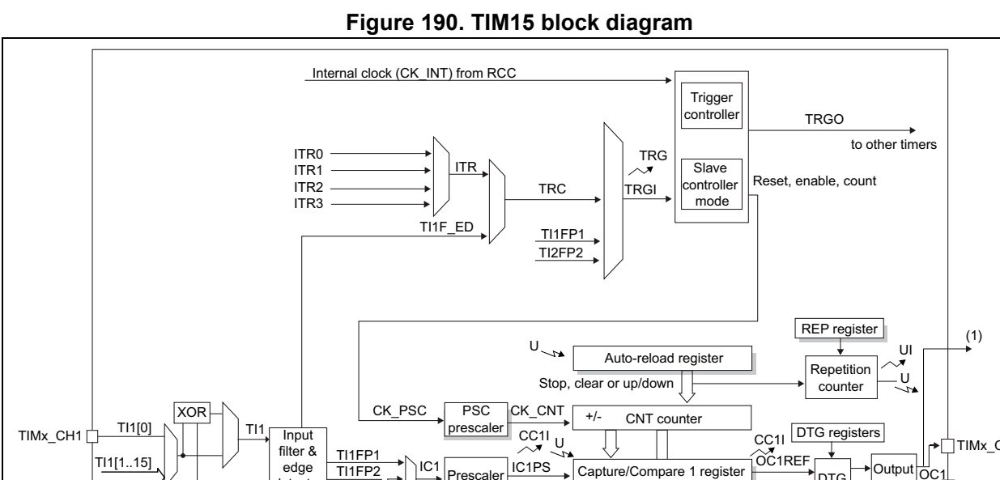
*Figure 190. TIM15 block diagram (p. 549)*

control TIMx_CH1N TRC CC2I OC1N TI2[0] U CC2I TIMx_CH2 Input TI2FP1 TI2 filter & IC2 IC2PS OC2REF Output OC2 TI2FP2 Prescaler Capture/Compare 2 register TIMx_CH2 TI2[1..15] edge control detector TRC

Internal sources SBIF

BIF

(1) BRK request TIMx_BKIN Break circuitry

Notes: Preload registers transferred Reg to active registers on U event according to control bit Event

Interrupt & DMA output MSv40934V5

1. The internal break event source can be:

- A clock failure event generated by CSS. For further informati on on the CSS, refer to Section 5.2.8: Clock security system (CSS)

- SRAM parity error signal®

- Cortex -M0+ LOCKUP (Hardfault) output

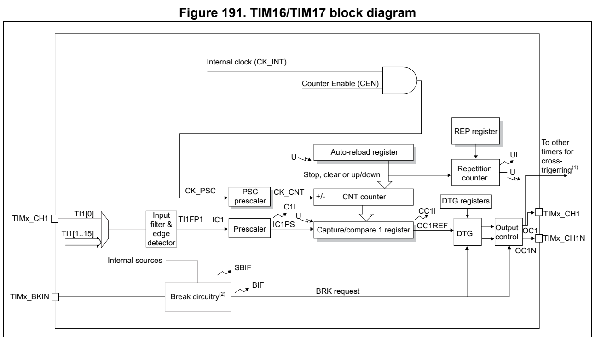
*Figure 191. TIM16/TIM17 block diagram (p. 550)*

Notes: Preload registers transferred Reg to active registers on U event according to control bit Event

Interrupt & DMA output MSv40937V2

1. This signal can be used as tri gger for some slave timer, see Section 19.4.23: Using timer output as trigger for other timers (TIM16/TIM17). 2. The internal break event source can be:

- A clock failure event generated by CSS. For further informati on on the CSS, refer to Section 5.2.8: Clock security system (CSS)

- SRAM parity error signal®

- Cortex -M0+ LOCKUP (Hardfault) output

### 19.4 TIM15/TIM16/TIM17 functional description (p. 551)

#### 19.4.1 Time-base unit (p. 551)

The main block of the programmable advanced-control timer is a 16-bit upcounter with its related auto-reload register. The counter clock can be divided by a prescaler.

The counter, the auto-reload register and t he prescaler registe r can be written or read by software. This is true even when the counter is running.

The time-base unit includes:

- Counter register (TIMx_CNT)

- Prescaler register (TIMx_PSC)

- Auto-reload register (TIMx_ARR)

- Repetition counter register (TIMx_RCR)

The auto-reload register is preloaded. Writing to or reading from the auto-reload register accesses the preload register. Th e content of the preload register are transferred into the shadow register permanently or at each update event (UEV), depe nding on the auto-reload preload enable bit (ARPE) in TIMx_CR1 register. The update even t is sent when the counter reaches the overflow and if th e UDIS bit equals 0 in the TIMx_C R1 register. It can also be generated by software. The generation of the update event is de scribed in detailed for each configuration.

The counter is clocked by the prescaler output CK_CNT, which is enabled only when the counter enable bit (CEN) in TIMx_CR1 register is set (refer als o to the slave mode controller description to get more details on counter enabling).

Note that the counter starts coun ting 1 clock cycle after setti ng the CEN bit in the TIMx_CR1 register.

Prescaler description

The prescaler can divide the counter clock frequency by any factor between 1 and 65536. It is based on a 16-bit counter controlled through a 16-bit register (in the TIMx_PSC register). It can be changed on the fly as th is control register is buffered. The new prescaler ratio is taken into account at the next update event.

Figure 192 and Figure 193 give some examples of the counter behavior when the prescaler ratio is changed on the fly:

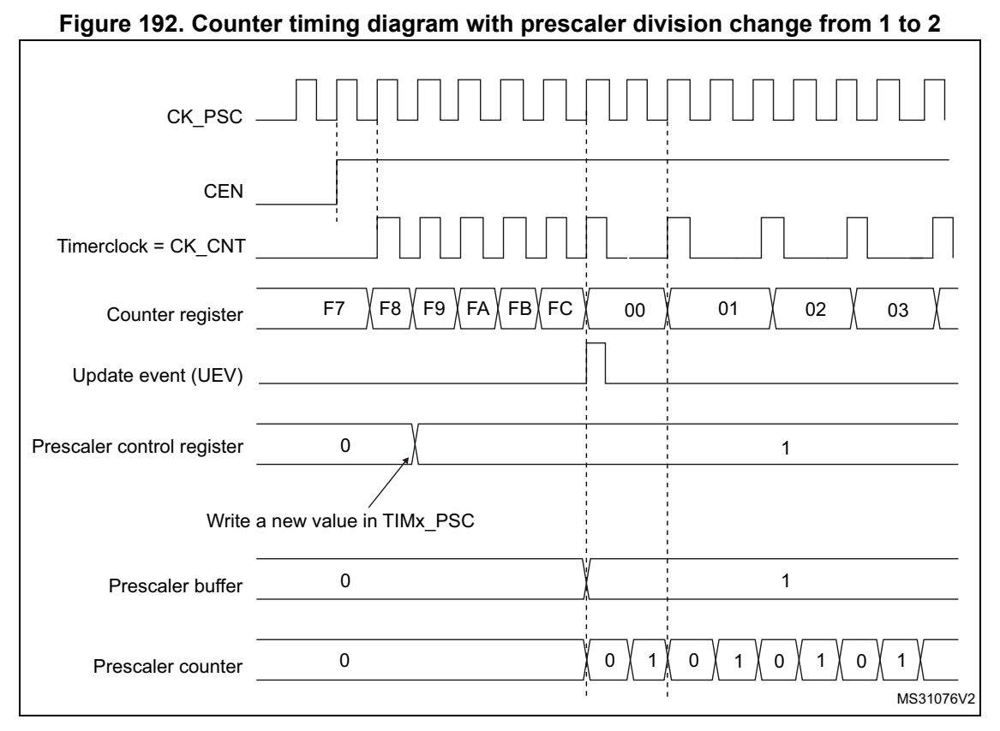
*Figure 192. Counter ti ming diagram with pre scaler division chan ge from 1 to 2 (p. 552)*

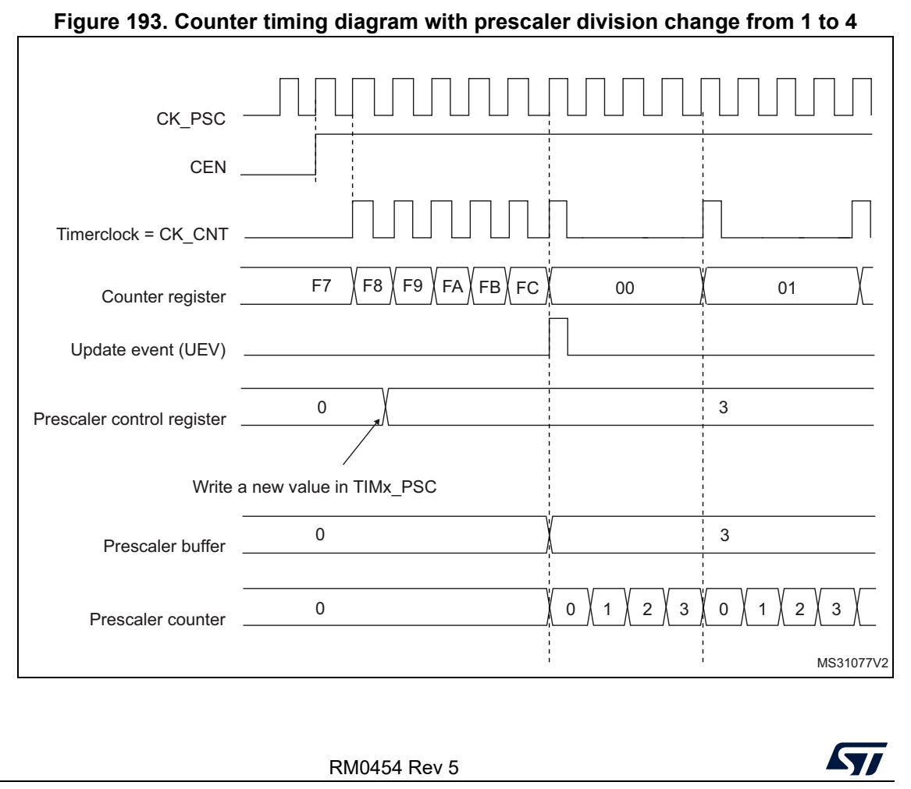
*Figure 193. Counter ti ming diagram with pre scaler division chan ge from 1 to 4 (p. 552)*

#### 19.4.2 Counter modes (p. 553)

Upcounting mode

In upcounting mode, the counter counts from 0 to the auto-reloa d value (content of the TIMx_ARR register), then restarts from 0 and generates a counte r overflow event.

If the repetition counter is used, the update event (UEV) is ge nerated after upcounting is repeated for the number of times programmed in the repetition counter register (TIMx_RCR). Else the update event is generated at each counter overflow.

Setting the UG bit in the TIMx_E GR register (by software or by using the slave mode controller) also generates an update event.

The UEV event can be disabled by software by setting the UDIS b it in the TIMx_CR1 register. This is to avoid updati ng the shadow registers while writing new values in the preload registers. Then no update event occurs until the UDIS b it has been written to 0. However, the counter restarts from 0, as well as the counter of the prescaler (but the prescale rate does not change). In addition, if the URS bit (up date request selection) in TIMx_CR1 register is set, setti ng the UG bit gen erates an update event UEV but without setting the UIF flag (th us no interrupt or D MA request is sent). This is to avoid generating both update and capture interrupts when clearing the counter on the capture event.

When an update even t occurs, all the registers are updated and the update flag (UIF bit in TIMx_SR register) is set (depending on the URS bit):

- The repetition counter is reload ed with the content of TIMx_RCR register,

- The auto-reload shadow register i s updated with the preload val ue (TIMx_ARR),

- The buffer of the prescaler is reloaded with the preload value (content of the TIMx_PSC register).

The following figures show some examples of the counter behavio r for different clock frequencies when TIMx_ARR=0x36.

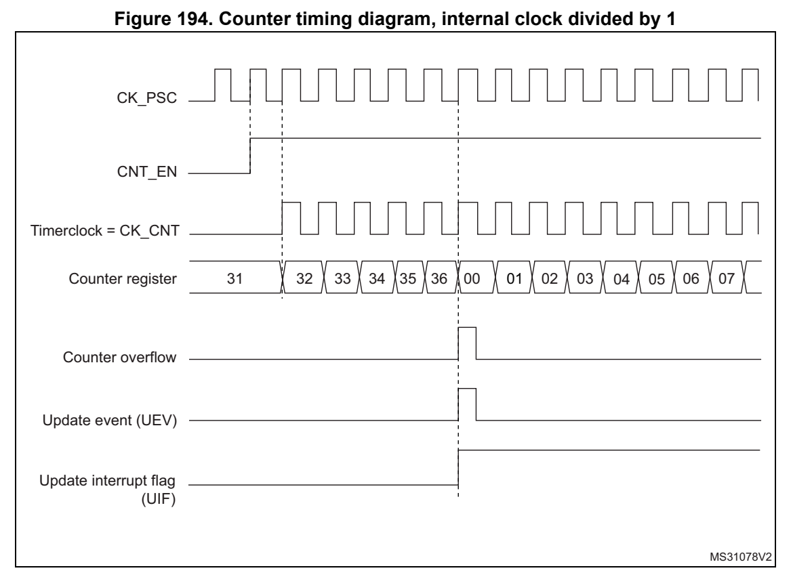
*Figure 194. Counter timing diagram, internal clock divided by 1 (p. 554)*

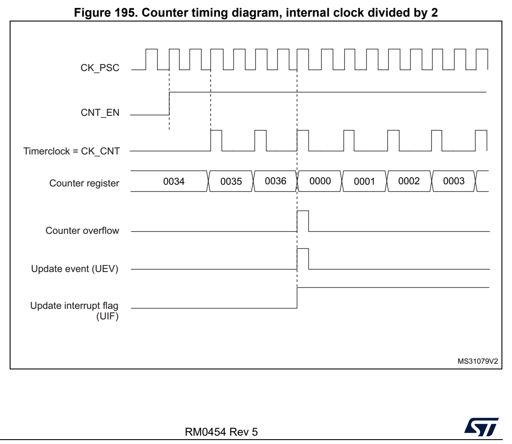
*Figure 195. Counter timing diagram, internal clock divided by 2 (p. 554)*

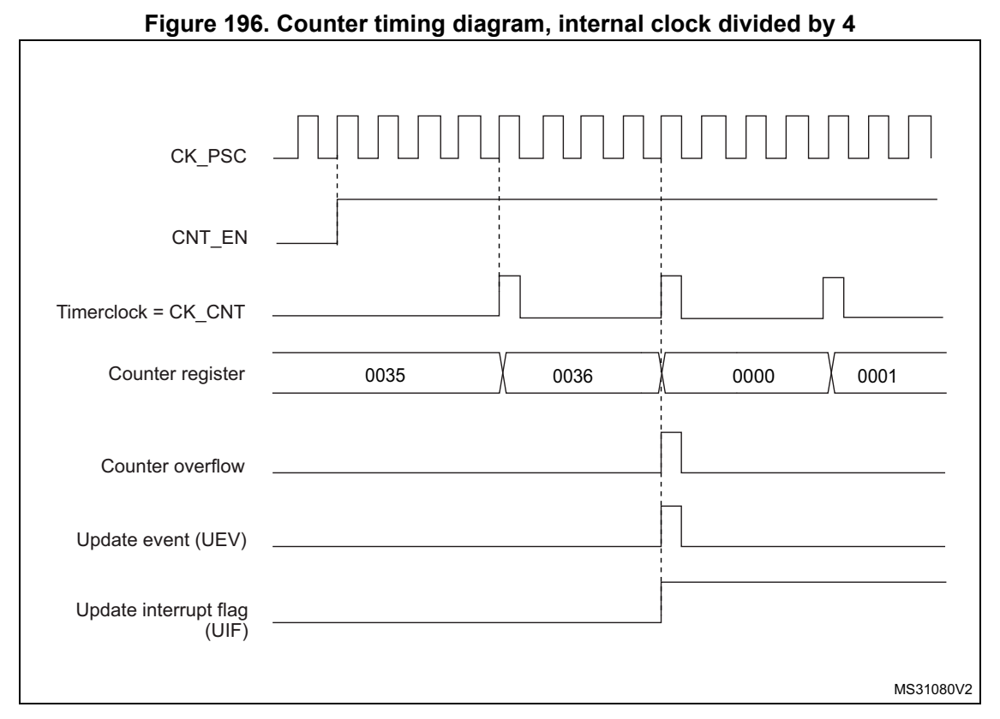
*Figure 196. Counter timing diagram, internal clock divided by 4 (p. 555)*

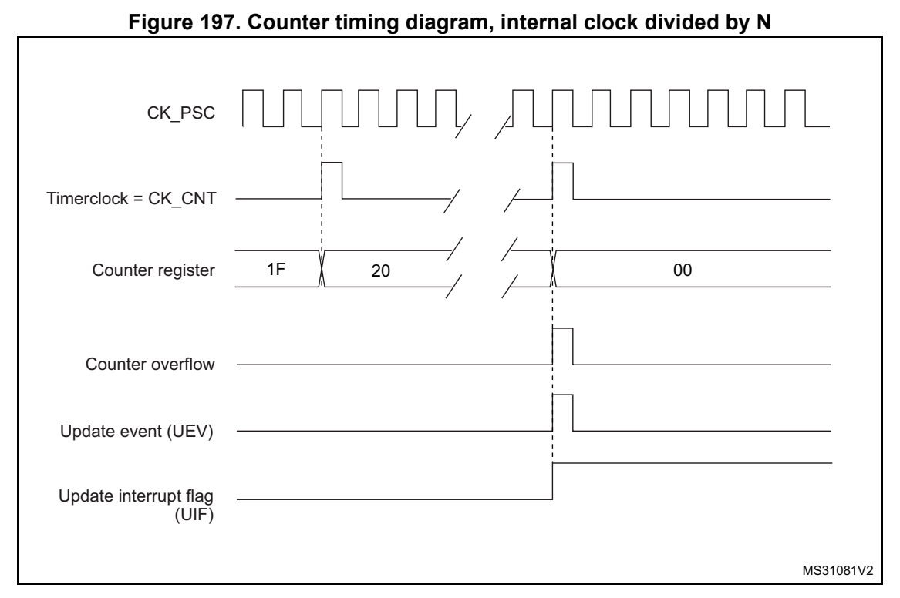
*Figure 197. Counter timing diagram, internal clock divided by N (p. 555)*

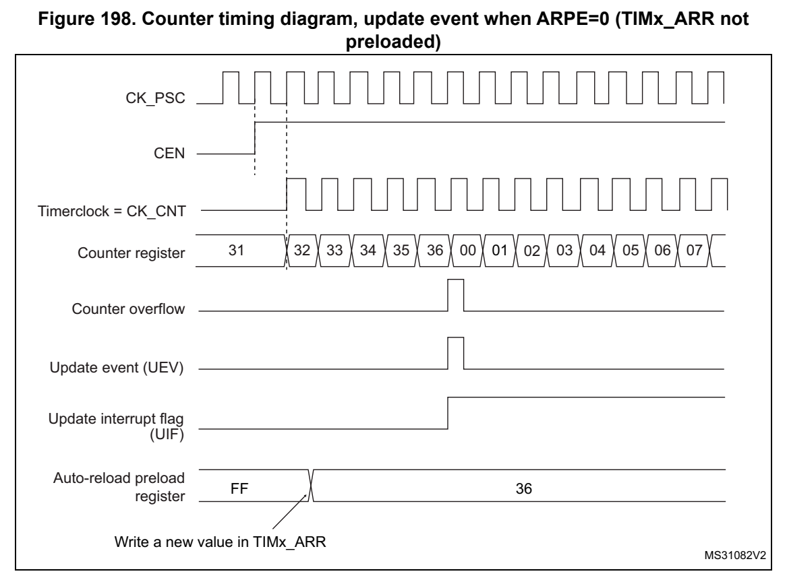
*Figure 198. Counter timing diagra m, update event when ARPE=0 (T IMx_ARR not (p. 556)*

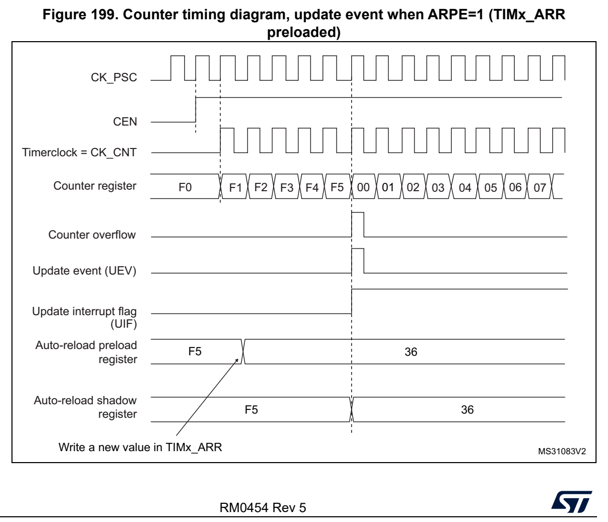
*Figure 199. Counter timing diagram, update event when ARPE=1 (T IMx_ARR (p. 556)*

#### 19.4.3 Repetition counter (p. 557)

Section 19.4.1: Time-base unit describes how the update event (UEV) is generated with respect to the counter overflows. It is actually generated only when the repetition counter has reached zero. This can be useful when generating PWM signal s.

This means that data are transferred from the preload registers to the shadow registers (TIMx_ARR auto-reload register, TIMx_PSC prescaler register, bu t also TIMx_CCRx capture/compare registers in com pare mode) every N counter overflows, where N is the value in the TIMx_RCR repetition counter register.

The repetition counter is decremented at ea ch counter overflow.

The repetition counter is an auto-reload type; the repetition rate is maintained as defined by the TIMx_RCR register value (refer to Figure 200). When the update event is generated by software (by setting the UG bit i n TIMx_EGR register) or by hardware through the slave mode controller, it occurs immediately whatever the value of th e repetition counter is and the repetition counter is reloaded with the content of the TIMx_RCR register.

Figure 200. Update rate examples depending on mode and TIMx_RCR register settings

Edge-aligned mode

Upcounting

Counter TIMx_CNT

TIMx_RCR = 0 UEV

TIMx_RCR = 1 UEV

TIMx_RCR = 2 UEV

TIMx_RCR = 3 UEV

TIMx_RCR = 3 and re-synchronization UEV

(by SW)

UEV Update Event: preload registers transferred to active registers and update interrupt generated.

MS31084V2

#### 19.4.4 Clock selection (p. 558)

The counter clock can be provide d by the following clock source s:

- Internal clock (CK_INT)

- External clock mode1: external input pin

- Internal trigger inputs (ITRx) (o nly for TIM15): using one time r as the prescaler for another timer, for example, TIM1 can be configured to act as a prescaler for TIM15. Refer to Using one timer as prescaler for another timer on page 473 for more details.

Internal clock source (CK_INT)

If the slave mode controller is d isabled (SMS=000), then the CE N (in the TIMx_CR1 register) and UG bits (in the TI Mx_EGR register) are actual con trol bits and can be changed

only by software (except UG which remains cleared automatically). As soon as the CEN bit is written to 1, the prescaler is clocked by the internal clock CK_INT.

Figure 201 shows the behavior of the contro l circuit and the upcounter in normal mode, without prescaler.

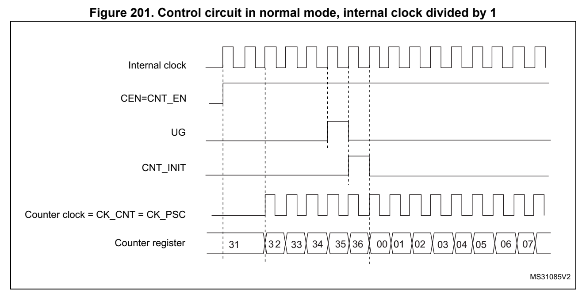
*Figure 201. Control circuit in no rmal mode, internal clock divi ded by 1 (p. 559)*

External clock source mode 1

This mode is selected when SMS=111 in the TIMx_SMCR register. The counter can count at each rising or falling edg e on a selected input.

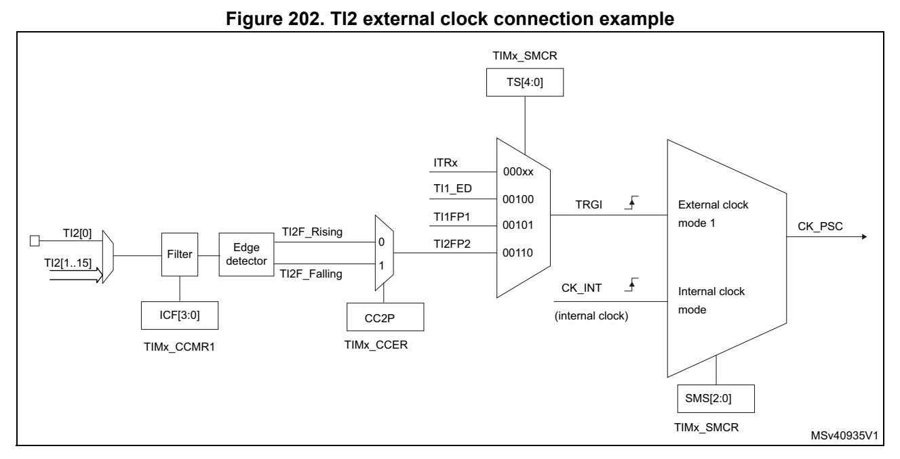
*Figure 202. TI2 external clock connection example (p. 559)*

For example, to configure the upcounter to count in response to a rising edge on the TI2 input, use the following procedure:

1. Select the proper TI2[x] source (internal or external) with t he TI2SEL[3:0] bits in the TIMx_TISEL register. 2. Configure channel 2 to detect rising edges on the TI2 input by writing CC2S = ‘01’ in the TIMx_CCMR1 register. 3. Configure the input filter duration by writing the IC2F[3:0] bits in the TIMx_CCMR1 register (if no filter is needed, keep IC2F=0000). 4. Select rising edge polarity by writing CC2P=0 in the TIMx_CC ER register. 5. Configure the timer in externa l clock mode 1 by writing SMS= 111 in the TIMx_SMCR register. 6. Select TI2 as the trigger in put source by writing TS=00110 i n the TIMx_SMCR register. 7. Enable the counter by writing CEN=1 in the TIMx_CR1 register.

Note: The capture prescaler is not used for triggering, so it does not need to be configured.

When a rising edge occurs on TI2, the counter counts once and t he TIF flag is set.

The delay between the rising edge on TI2 and the actual clock of the counter is due to the resynchronization circuit on TI2 input.

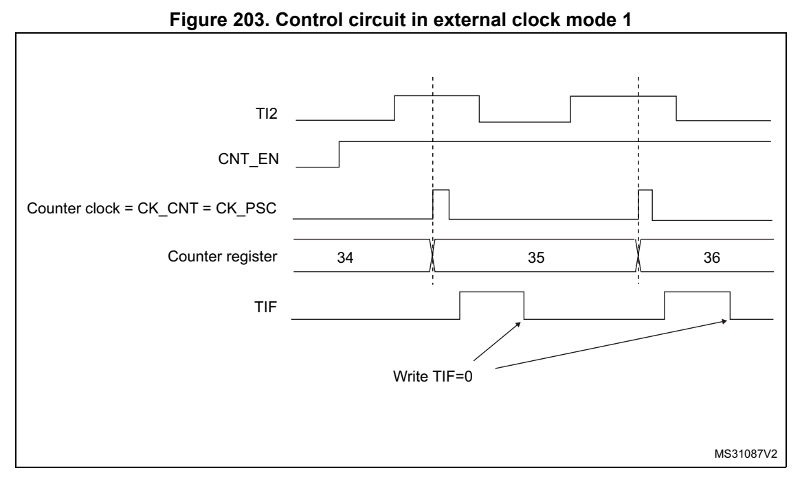
*Figure 203. Control circuit in external clock mode 1 (p. 560)*

#### 19.4.5 Capture/compare channels (p. 560)

Each Capture/Compare channel is built around a capture/compare register (including a shadow register), a input stage for capture (with digital filte r, multiplexing and prescaler) and an output stage (with comparator and output control).

Figure 204 to Figure 207 give an overview of one Capture/Compare channel.

The input stage samples the corresponding TIx input to generate a filtered signal TIxF. Then, an edge detector with pola rity selection generates a sign al (TIxFPx) which can be used as trigger input by the slave mode controller or as the ca pture command. It is prescaled before the capture register (ICxPS).

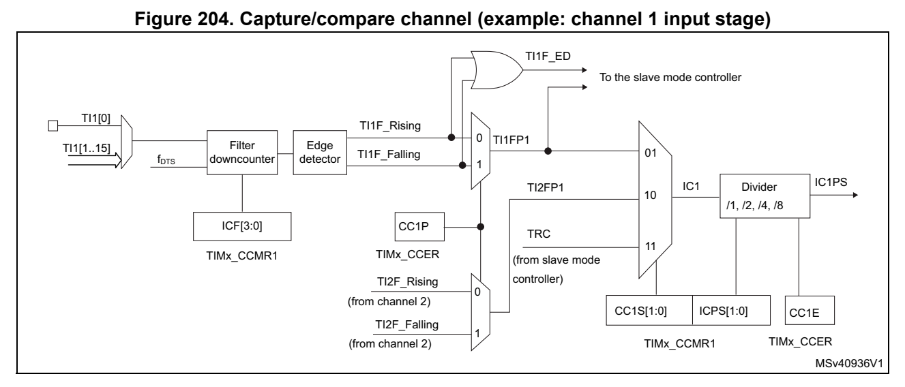
*Figure 204. Capture/compare channel (example: channel 1 input s tage) (p. 561)*

The output stage generates an intermediate waveform which is th en used for reference: OCxRef (active high). The polarity acts at the end of the chain.

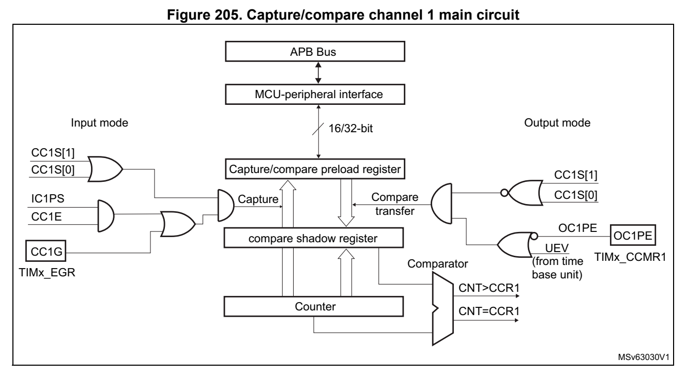
*Figure 205. Capture/compare channel 1 main circuit (p. 561)*

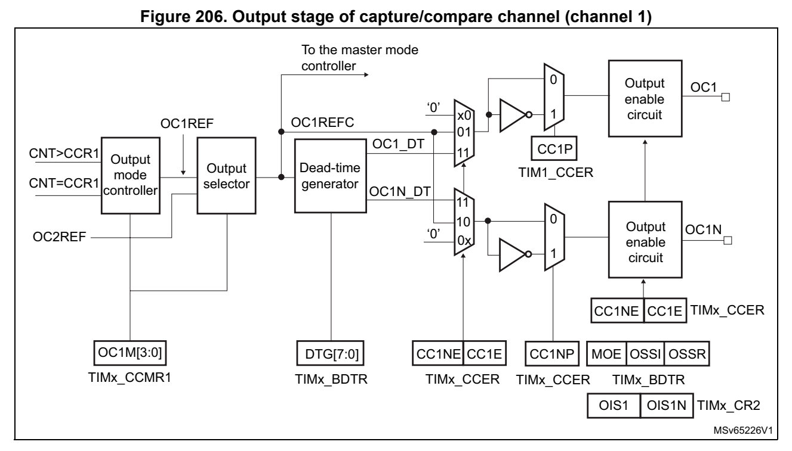
*Figure 206. Output stage of capture/compare channel (channel 1) (p. 562)*

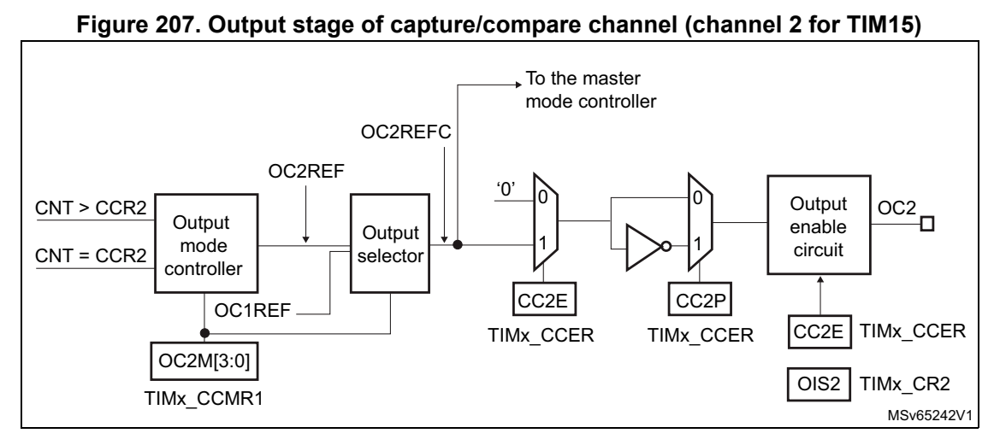
*Figure 207. Output stage of captu re/compare channel (channel 2 for TIM15) (p. 562)*

The capture/compare block is made of one preload register and o ne shadow register. Write and read always access the preload register.

In capture mode, captures are actually done in the shadow register, which is copied into the preload register.

In compare mode, the content of the p reload registe r is copied into the shadow register which is compared to the counter.

#### 19.4.6 Input capture mode (p. 562)

In Input capture mode, the Capture/Compare Registers (TIMx_CCRx) are used to latch the value of the counter after a transition dete cted by the corresp onding ICx signal. When a capture occurs, the corresponding CCXIF flag (TIMx_SR register) is set and an interrupt or a DMA request can be sent if they are enabled. If a capture occ urs while the CCxIF flag was

already high, then the over-captu re flag CCxOF (TIMx_SR registe r) is set. CCxIF can be cleared by software by writing i t to ‘0’ or by reading the capt ured data stored in the TIMx_CCRx register. CCxOF is clea red when it is written with 0.

The following example shows how to capture the counter value in TIMx_CCR1 when TI1 input rises. To do this, us e the following procedure: 1. Select the proper TI1x source (internal or external) with the TI1SEL[3:0] bits in the TIMx_TISEL register. 2. Select the active input: TIMx_CCR1 must be linked to the TI1 input, so write the CC1S bits to 01 in the TIMx_CCMR1 register. As soon as CC1S becomes different from 00, the channel is configured in inp ut and the TIMx_CCR1 register b ecomes read-only. 3. Program the appropriate input filter duration in relation wi th the signal connected to the timer (when the input is one of the TIx (ICxF bits in the TIMx_CCMRx register). Let’s imagine that, when toggling, the input signal is not stable during at least 5 internal clock cycles. We must program a filter duration lo nger than these 5 c lock cycles. We can validate a transition on TI1 when 8 consecutive samples with th e new level have been detected (sampled at f DTS frequency). Then write IC1F bits to 0011 in the TIMx_CCMR1 register. 4. Select the edge of the activ e transition on the TI1 channel by writing CC1P bit to 0 in the TIMx_CCER register (ri sing edge in this case). 5. Program the input prescaler. In our exa mple, we wish the cap ture to be performed at each valid transition, so the prescaler is disabled (write IC1P S bits to ‘00’ in the TIMx_CCMR1 register). 6. Enable capture from the counter into the capture register by setting the CC1E bit in the TIMx_CCER register. 7. If needed, enable the related interrupt request by setting t he CC1IE bit in the TIMx_DIER register, and/or the DMA request by setting the CC1DE bit in the TIMx_DIER register.

When an input capture occurs:

- The TIMx_CCR1 register gets the value of the counter on the act ive transition.

- CC1IF flag is set (interrupt flag). CC1OF is also set if at lea st two consecutive captures occurred whereas the flag was not cleared.

- An interrupt is generated depending on the CC1IE bit.

- A DMA request is generated depending on the CC1DE bit.

In order to handle the overcapt ure, it is recomm ended to read t he data before the overcapture flag. This is to avoid missing an overcapture which could happen after reading the flag and before reading the data.

Note: IC interrupt and/or DMA requests can be generated by software by setting the corresponding CCxG bit in the TIMx_EGR register.

#### 19.4.7 PWM input mode (only for TIM15) (p. 563)

This mode is a particular case of input capture mode. The proce dure is the same except:

- Two ICx signals are mapp ed on the same TIx input.

- These 2 ICx signals are active on edges wit h opposite polarity.

- One of the two TIxFP signals is s elected as trigger input and t he slave mode controller is configured in reset mode.

For example, one can m easure the period (in TIMx_CCR1 register) and the duty cycle (in TIMx_CCR2 register) of the PWM applied on TI1 using the followi ng procedure (depending on CK_INT frequency and prescaler value): 1. Select the proper TI1[x] source (internal or external) with t he TI1SEL[3:0] bits in the TIMx_TISEL register. 2. Select the active in put for TIMx_CCR1: write the CC1S bits to 01 in the TIMx_CCMR1 register (TI1 selected). 3. Select the active polarity fo r TI1FP1 (used both for capture in TIMx_CCR1 and counter clear): write the CC1P and CC1NP bits to ‘0’ (active on rising edge). 4. Select the active in put for TIMx_CCR2: write the CC2S bits to 10 in the TIMx_CCMR1 register (TI1 selected). 5. Select the active polarity fo r TI1FP2 (used fo r capture in T IMx_CCR2): write the CC2P and CC2NP bits to ‘10’ ( active on falling edge). 6. Select the valid trigger input: write the TS bits to 00101 i n the TIMx_SMCR register (TI1FP1 selected). 7. Configure the slave mode controller in reset mode: write the SMS bits to 100 in the TIMx_SMCR register. 8. Enable the captures: write t he CC1E and CC2E bits to ‘1’ in the TIMx_CCER register.

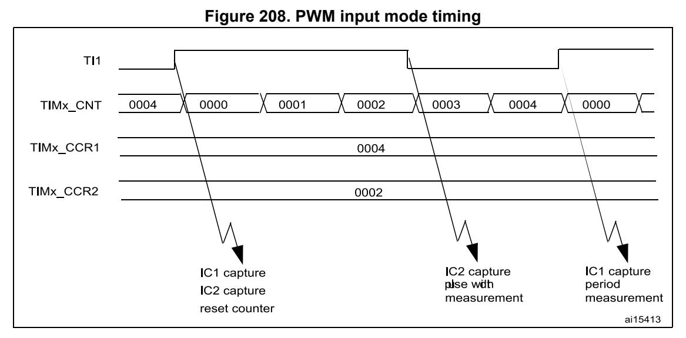
*Figure 208. PWM input mode timing (p. 564)*

1. The PWM input mode can be used only with the TIMx_CH1/TIMx_CH 2 signals due to the fact that only TI1FP1 and TI2FP2 are connected to the slave mode controller.

#### 19.4.8 Forced output mode (p. 564)

In output mode (CCxS bi ts = 00 in the TIMx_CCMRx register), eac h output compare signal (OCxREF and then OCx/OCxN) can be forced to active or inactive level directly by software, independently of any comparison between the output compare regi ster and the counter.

To force an output compare signal (OCXREF/OCx) to its active level, one just needs to write 101 in the OCxM bits in the corresponding TIMx_CCMRx register. Thus OCXREF is forced high (OCxREF is always active hi gh) and OCx get opposite value to CCxP polarity bit.

For example: CCxP=0 (OCx active high) => OCx is forced to high level.

The OCxREF signal can be forced low by writing the OCxM bits to 100 in the TIMx_CCMRx register.

Anyway, the comparison between the TIMx_CCRx shadow register an d the counter is still performed and allows the flag to be set. Interrupt and DMA requ ests can be sent accordingly. This is described i n the output com pare mode secti on below.

#### 19.4.9 Output compare mode (p. 565)

This function is used to control an output wavefo rm or indicati ng when a period of time has elapsed.

When a match is found between the capture/compare register and the counter, the output compare function:

- Assigns the corresponding output pin to a programmable value defined by the output compare mode (OCxM bits in the TIMx_CCMRx register) and the out put polarity (CCxP bit in the TIMx_CCER re gister). The output p in can keep its level (OCXM=000), be set active (OCxM=001), be set inactive (OCxM=010) or can toggle (OCxM=011) on match.

- Sets a flag in the interrupt sta tus register (CCxIF bit in the TIMx_SR register).

- Generates an interrupt if the corresponding interrupt mask is s et (CCXIE bit in the TIMx_DIER register).

- Sends a DMA request if the corresponding enable bit is set (CCx DE bit in the TIMx_DIER register, CCDS bit in the TIMx_CR2 register for the D MA request selection).

The TIMx_CCRx registers can be p rogrammed with or without prelo ad registers using the OCxPE bit in the TIMx_CCMRx register.

In output compare mode, the update event UEV has no effect on O CxREF and OCx output. The timing resolution is one count of the counter. Output compa re mode can also be used to output a single pulse (in One-pulse mode).

Procedure

1. Select the counter clock (i nternal, external, prescaler). 2. Write the desired data in the TIMx_ARR and TIMx_CCRx registe rs. 3. Set the CCxIE bit if an interrupt request is to be generated. 4. Select the output mode. For example: – Write OCxM = 011 to toggle OCx output pin when CNT matches CCRx – Write OCxPE = 0 to dis able preload register – Write CCxP = 0 to select active high polarity – Write CCxE = 1 to enable the output 5. Enable the counter by setting the CEN bit in the TIMx_CR1 re gister.

The TIMx_CCRx register can be upd ated at any time by software to control the output waveform, provided that the preload register is not enabled (OCxPE=’0’, else TIMx_CCRx shadow register is updated only at the next update event UEV). An example is given in Figure 209.

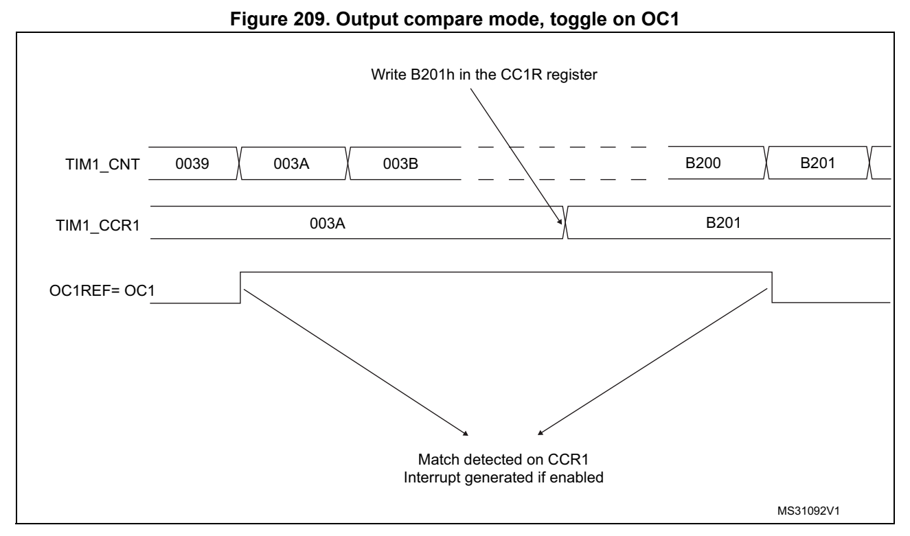
*Figure 209. Output compare mode, toggle on OC1 (p. 566)*

#### 19.4.10 PWM mode (p. 566)

Pulse Width Modulation mode allows a signal to be generated wit h a frequency determined by the value of the TIMx_ARR regi ster and a duty cycle determin ed by the value of the TIMx_CCRx register.

The PWM mode can be selected i ndependently on each channel (one PWM per OCx output) by writing ‘110’ (PWM mo de 1) or ‘111’ (PWM mode 2) in the OCxM bits in the TIMx_CCMRx register. The corresp onding preload register must be enabled by setting the OCxPE bit in the TIMx_CCMRx regi ster, and eventually the auto-reload preload register (in upcounting or center-aligned mode s) by setting the ARPE bit in the TIMx_CR1 register.

As the preload registers are transferred to the shadow registers only when an update event occurs, before starting the coun ter, all registers must be init ialized by setting the UG bit in the TIMx_EGR register.

OCx polarity is software progra mmable using the CCxP bit in the TIMx_CCER register. It can be programmed as active high or active low. OCx output is e nabled by a combination of the CCxE, CCxNE, MOE, OSSI and OSS R bits (TIMx_CCE R and TIMx_BD TR registers). Refer to the TIMx_CCER register description for more details.

In PWM mode (1 or 2), TIMx_CNT and TIMx_CCRx are always compare d to determine whether TIMx_CCRx ≤ TIMx_CNT or TIMx_CNT ≤ TIMx_CCRx (depending on the direction of the counter).

The TIM15/TIM16/TIM17 are capabl e of upcounting only. Refer to Upcounting mode on page 553.

In the following example, we consider PWM mode 1. The reference PWM signal OCxREF is high as long as TIMx_CNT < TIMx_CCRx else it becomes low. If th e compare value in TIMx_CCRx is greater th an the auto-reload va lue (in TIMx_ARR) t hen OCxREF is held at

‘1’. If the compare value is 0 then OCxRef is held at ‘0’. Figure 210 shows some edge-aligned PWM waveforms in an example where TIMx_ARR=8.

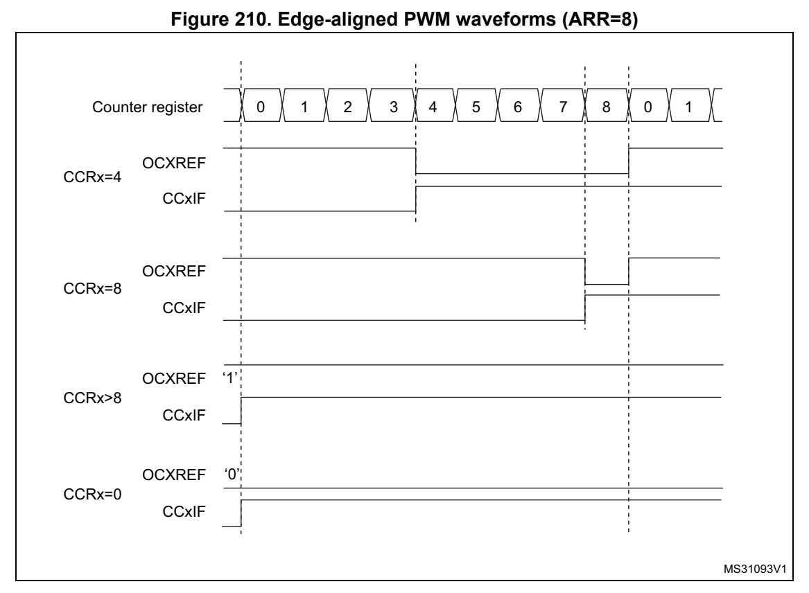
*Figure 210. Edge-aligned PWM waveforms (ARR=8) (p. 567)*

#### 19.4.11 Combined PW M mode (TIM15 only) (p. 567)

Combined PWM mode allows two edge or center-aligned PWM signals to be generated with programmable delay and phase shift between respective pulses. W hile the frequency is determined by the value of the TIMx_ARR register, the duty cycl e and delay are determined by the two TIMx_CCRx registers. T he resulting signals, OCxREFC, are made of an OR or AND logical combination of two reference PWMs:

- OC1REFC (or OC2REFC) is controll ed by the TIMx_CCR1 and TIMx_CC R2 registers

Combined PWM mode can be selected independently on two channels (one OCx output per pair of CCR registers) by writing ‘1100’ (Combined PWM mode 1) or ‘1101’ (Combined PWM mode 2) in the OCxM bits in the TIMx_CCMRx register.

When a given channel is used a s a combined PWM channel, its com plementary channel must be configured in the opposite PWM mode (for instance, one in Combined PWM mode 1 and the other in Combined PWM mode 2).

Note: The OCxM[3:0] bit field is split into two pa rts for compatibility reason s, the most significant bit is not contiguous with the 3 least significant ones.

Figure 211 represents an example of signals that can be generated using Asymmetric PWM mode, obtained with the following configuration:

- Channel 1 is configured in Combined PWM mode 2,

- Channel 2 is configured in PWM mode 1,

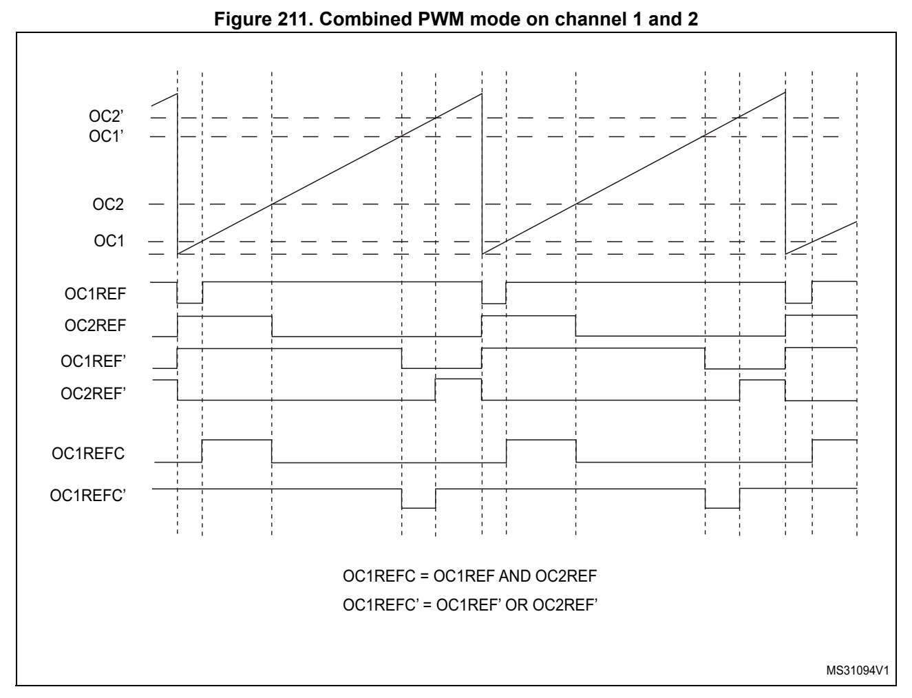
*Figure 211. Combi ned PWM mode on channel 1 and 2 (p. 568)*

#### 19.4.12 Complementary outputs and dead-time insertion (p. 568)

The TIM15/TIM16/TIM17 general-purpose timers can output one com plementary signal and manage the switching-off and switching-on of the outputs.

This time is generally known as dead-time and it has to be adju sted depending on the devices that are connected to the outputs and their characteristics (intrinsic delays of level-shifters, delays due to power switches...)

The polarity of the outputs (main output OCx or complementary O CxN) can be selected independently for each output. T his is done by writing to the C CxP and CCxNP bits in the TIMx_CCER register.

The complementary signa ls OCx and OCxN are activated by a combi nation of several control bits: the CCxE and CCxNE bits in t he TIMx_CCER register and the MOE, OISx, OISxN, OSSI and OSSR bits in the TIMx_BDTR and TIMx_CR2 registe rs. Refer to Table 83: Output control bits for complementary OCx and OCxN channels with break feature (TIM16/17) on page 622 for more details. In particular, the dead-time is activated wh en switching to the i dle state (MOE fa lling down to 0).

Dead-time insertion is enabled by setting both CCxE and CCxNE b its, and the MOE bit if the break circuit is present. There is one 10-bit dead-time generator for each channel. From a

reference waveform OCxREF, it g enerates 2 outputs OCx and OCxN. If OCx and OCxN are active high:

- The OCx output signal is the sam e as the reference signal excep t for the rising edge, which is delayed relative to the reference rising edge.

- The OCxN output signal is the opp osite of the reference signal except for the rising edge, which is delaye d relative to the reference falling edge.

If the delay is greater than t he width of the act ive output (OCx or OCxN) then the corresponding pulse is not generated.

The following figures show the relationships between the output signals of the dead-time generator and the refe rence signal OCxREF. (we suppose CCxP=0, CCxNP=0, MOE=1, CCxE=1 and CCxNE=1 in these examples)

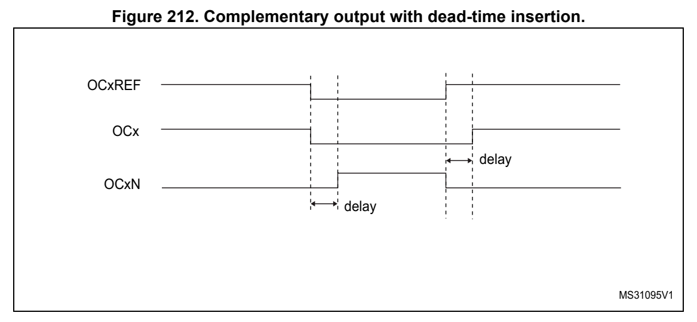
*Figure 212. Complementary output with dead-time insertion. (p. 569)*

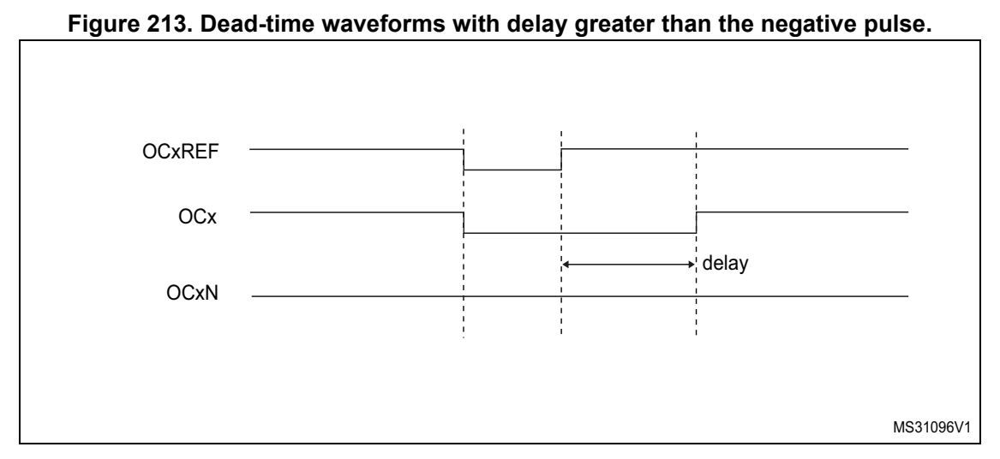
*Figure 213. Dead-time waveforms with delay greater than the neg ative pulse. (p. 569)*

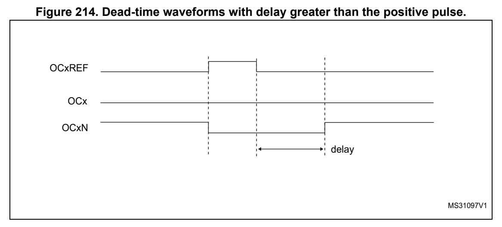
*Figure 214. Dead-time waveforms w ith delay greater than the pos itive pulse. (p. 570)*

The dead-time delay is the same for each of the channels and is programmable with the DTG bits in the TIMx_BDTR register. Refer to Section 19.6.14: TIMx break and dead-time register (TIMx_BDTR)(x = 16 to 17) on page 625 for delay calculation.

Re-directing OCxREF to OCx or OCxN

In output mode (forced, output co mpare or PWM), O CxREF can be re-directed to the OCx output or to OCxN output by config uring the CCxE and CCxNE bits in the TIMx_CCER register.

This allows a specific waveform to be sent (such as PWM or stat ic active level) on one output while the complementary re mains at its inactive level. Other alternative possibilities are to have both outputs at inactive level or both outputs acti ve and complementary with dead-time.

Note: When only OCxN is enabled (CCxE=0, CCxNE=1), it is not complemented and becomes active as soon as OCxREF is high. For example, if CCxNP=0 then OCxN=OCxRef. On the other hand, when both OCx and OCxN are enabled (CCxE=CCxNE=1) OCx becomes active when OCxREF is high whereas OCxN is complemented and becomes active when OCxREF is low.

#### 19.4.13 Using the break function (p. 570)

The purpose of the break functi on is to protect power switches driven by PWM signals generated with the TIM15/TIM16/TI M17 timers. The break input is usually connected to fault outputs of power stage s and 3-phase inverters. When activated, the break circuitry shuts down the PWM outputs a nd forces them to a p redefined safe state.

The break channel gathers both system-level fault (clock failure, parity error,...) and application fault fro m input pins. The break circuitry can force the outputs to a predefined level (either active or inacti ve) after a deadtime duration.

The output enable sign al and output levels during break are dep ending on several control bits:

- the MOE bit in TIMx_BDTR registe r allows to enable /disable the outputs by software and is reset in case of break or break2 event.

- the OSSI bit in the TIMx_BDTR register defines whether the time r controls the output in inactive state or releases the co ntrol to the GPIO controller ( typically to have it in Hi-Z mode)

- the OISx and OISxN bits in the TI Mx_CR2 register which are sett ing the output shut-down level, either active or ina ctive. The OCx a nd OCxN outputs cannot be set both to active level at a given time, wha tever the OISx and OISxN value s. Refer to Table 81: Output control bits for complementary OCx and OCxN channels with break feature (TIM15) on page 601 for more details.

When exiting from reset, the break circuit is disabled and the MOE bit is low. The break function is enabled by setting the BKE bit in the TIMx_BDTR reg ister. The break input polarity can be selected by confi guring the BKP bit in the same register. BKE and BKP can be modified at the s ame time. When the BKE and BKP bits are wri tten, a delay of 1 APB clock cycle is applied before the writing is effective. Consequ ently, it is necessary to wait 1 APB clock period to correctly re ad back the bit after the write operation.

Because MOE falling edg e can be asynchronous, a resynchronizati on circuit has been inserted between the actual signa l (acting on the outputs) and the synchronous control bit (accessed in the TIMx_BDTR register). It results in some delays between the asynchronous and the synchronous signals. In particular, if MOE is set to 1 whereas it was low, a delay must be inserted (dummy instructi on) before reading it correctl y. This is because the write acts on the asynchronous signal whereas the read reflects the synchronous signal.

A programmable filter (BKF[3:0] bi ts in the TIMx_BDTR register allows to filter out spurious events.

The break can be generated from m ultiple sources which can be i ndividually enabled and with programmable edge sensitivity, using th e TIMx_AF1 register.

The sources for break (BRK) channel are:

- An external source con nected to one of the BKIN pin (as per sel ection done in the AFIO controller), with polarity selection and optional digital filtering

- An internal source: – A system break:

- the Cortex®-M0+ LOCKUP output

- the SRAM parity error signal

- a Flash ECC error

- a clock failure event gen erated by the CSS detector

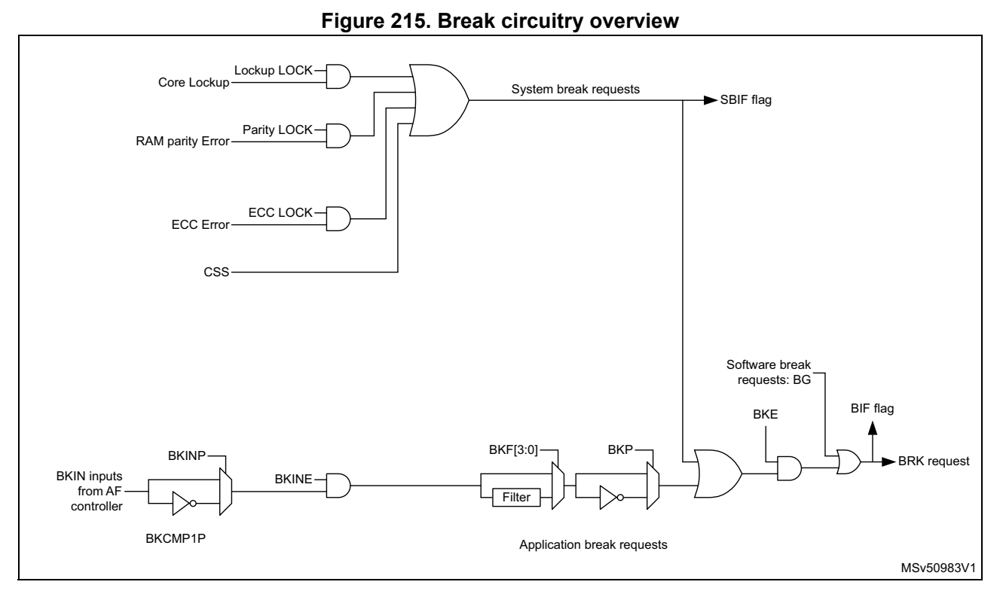
*Figure 215. Break circuitry overview (p. 572)*

Caution: An asynchronous (clockless) operation is only guaranteed when t he programmable filter is disabled. If it is enabled, a fa il safe clock mode (example, us ing the internal PLL and/or the CSS) must be used to guarantee that break events are handled.

When a break occurs (selected level on the break input):

- The MOE bit is cleared asynchronou sly, putting the outputs in i nactive state, idle state or even releasing the control to the AFIO controller (selected by the OSSI bit). This feature functions even if the MCU oscillator is off.

- Each output channel is driven wit h the level programmed in the OISx bit in the TIMx_CR2 register as soon as MOE=0. If OSSI=0, the timer releas es the output control (taken over by the AFIO controlle r) else the enable output rema ins high.

- When complementary outputs are used: – The outputs are first put in reset state inactive state (depen ding on the polarity). This is done asynchronously so that it works even if no clock i s provided to the timer. – If the timer clock is still pres ent, then the dea d-time genera tor is reactivated in order to drive the outputs with the level programmed in the OIS x and OISxN bits after a dead-time. Even in this case, OCx and OCxN cannot be driven to their active level together. Note that because of the resynchronizati on on MOE, the dead-time duration is a bit long er than usual (around 2 ck_tim clock cycles). – If OSSI=0 then the timer releases the enable outputs (taken over by the AFIO controller which forces a Hi-Z state) else the enable outputs remain or become high as soon as one of the CCxE or CCxNE bits is high.

- The break status flag (BIF bit in the TIMx_SR register) is set. An interrupt can be generated if the BIE bit in the TIMx_DIE R register is set.

- If the AOE bit in the TIMx_BDTR register is set, the MOE bit is automatically set again at the next update event UEV. Thi s can be used to perform a reg ulation, for instance.

Else, MOE remains low until it is written with 1 again. In this case, it can be used for security and the break input can be connected to an alarm from power drivers, thermal sensors or any security components.

Note: The break inputs is acting on level. Thus, the MOE cannot be set while the break input is active (neither automatically nor by software). In the meantime, the status flag BIF cannot be cleared.

The break can be gen erated by the BRK input which has a program mable polarity and an enable bit BKE in the TIMx_BDTR Register.

In addition to th e break input and the output management, a wri te protection has been implemented inside the break ci rcuit to safeguard the applicati on. It allows the configuration of several parameters to be freezed (dead-time duration, OCx/OCxN polarities and state when disabled, OCxM configuratio ns, break enable and polarity). The protection can be selected among 3 levels with the LOCK bits in the TIMx_BDTR reg ister. Refer to Section 19.6.14: TIMx break and dead-time register (TIMx_BDTR)(x = 16 to 17) on page 625. The LOCK bits can be written only once after an MCU reset.

The Figure 216 shows an example of behavior of the outputs in response to a b reak.

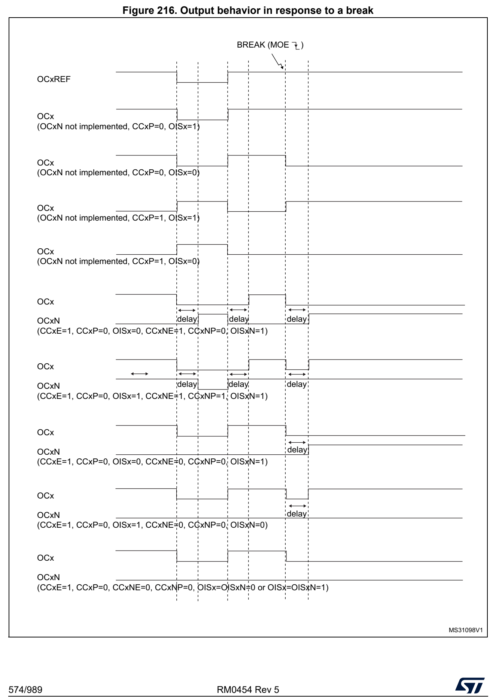
*Figure 216. Output behavior in response to a break (p. 574)*

#### 19.4.14 Bidirectional break inputs (p. 575)

The TIM15/TIM16/TIM17 are featuring bidirectional break I/Os, a s represented on Figure 217.

They allow the following:

- A board-level global break signal available for signaling faults to external MCUs or gate drivers, with a unique pin being both an input and an output status pin

- Internal break sources and multi ple external open drain comparator outputs ORed together to trigger a unique bre ak event, when multiple interna l and external break sources must be merged

The break input is configured in bidirectional mode using the B KBID bit in the TIMxBDTR register. The BKBID programming bit can be locke d in read-only mode using the LOCK bits in the TIMxBDTR register ( in LOCK level 1 or above).

The bidirectional mode requires the I/O to be configured in ope n-drain mode with active low polarity (using BKINP and BKP bits). Any break request coming e ither from system (e.g. CSS), from on-chip peripherals or from break inputs forces a low level on the break input to signal the fault event. The bidire ctional mode is inhibited if the polarity bits are not correctly set (active high polarity), for safety purposes.

The break software event (BG) also causes the break I/O to be forced to '0' to indicate to the external components that the timer has entered in break state. However, this is valid only if the break is enabled (BKE = 1). When a software break event is generated with BKE = 0, the outputs are put in safe state and the break flag is set, bu t there is no effect on the break I/O.

A safe disarming mechanism preve nts the system to be definitive ly locked-up (a low level on the break input triggers a break which enforces a low level on the same input).

When the BKDSRM bit is set to 1, this releases the break output to clear a fault signal and to give the possibility to re-arm the system.

At no point the break protectio n circuitry can be disabled:

- The break input path is always active: a break event is active even if the BKDSRM bit is set and the open drain control is released. This prevents the PWM output to be re-started as long as the bre ak condition is present.

- The BKDSRM bit cannot disarm the break protection as long as th e outputs are enabled (MOE bit is set) (see Table 79)

Table 79. Break protect ion disarming conditions

MOE BKDIR BKDSRM Break protection state

0 0 X Armed

0 1 0 Armed

0 1 1 Disarmed

1 X X Armed

Arming and re-arming break circuitry

The break circuitry (i n input or bidirection al mode) is armed by default (peripheral reset configuration).

The following procedure must be followed to re-arm the protecti on after a break event:

- The BKDSRM bit must be set to release the output control

- The software must wait until th e system break condition disappe ars (if any) and clear the SBIF status flag (o r clear it systematically before re-armi ng)

- The software must poll the BKDSR M bit until it i s cleared by ha rdware (when the application break condition disappears) From this point, the break circui try is armed and active, and t he MOE bit can be set to re-enable the PWM outputs.

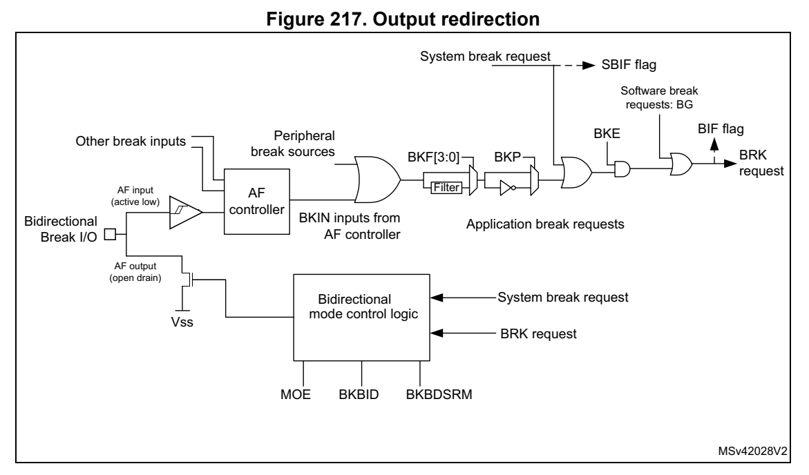
*Figure 217. Output redirection (p. 576)*

#### 19.4.15 One-pulse mode (p. 577)

One-pulse mode (OPM) is a partic ular case of the previous modes. It allows the counter to be started in response to a stimulus and to generate a pulse wi th a programmable length after a programmable delay.

Starting the counter can be controlled through the slave mode controller. Generating the waveform can be done in output compare mode or PWM mode. One-pu lse mode is selected by setting the OPM bit in the TIMx_CR1 register. This makes the counter stop automatically at the next update event UEV.

A pulse can be correctly genera ted only if the compare value is different from the counter initial value. Before starting (when the timer is waiting for t he trigger), the configuration must be:

- CNT < CCRx ≤ ARR (in particular, 0 < CCRx)

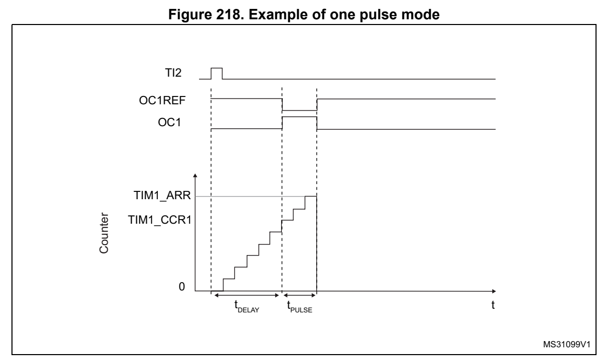
*Figure 218. Example of one pulse mode (p. 578)*

For example one may want to gene rate a positive pulse on OC1 wi th a length of t PULSE and after a delay of t DELAY as soon as a positive edge is detected on the TI2 input pin.

Let’s use TI2FP2 as trigger 1: 1. Select the proper TI2[x] source (internal or external) with t he TI2SEL[3:0] bits in the TIMx_TISEL register. 2. Map TI2FP2 to TI2 by writing CC2S=’01’ in the TIMx_CCMR1 reg ister. 3. TI2FP2 must detect a rising e dge, write CC2P=’0’ and CC2NP=’ 0’ in the TIMx_CCER register. 4. Configure TI2FP2 as trigger for the slave mode controller (T RGI) by writing TS=’00110’ in the TIMx_SMCR register. 5. TI2FP2 is used to s tart the counter by writing SMS to ‘110’ in the TIMx_SMCR register (trigger mode).

The OPM waveform is defined by writing the compare registers (taking into account the clock frequency and the counter prescaler).

- The t DELAY is defined by the value writte n in the TIMx_CCR1 register.

- The t PULSE is defined by the difference between the auto-reload value and the compare value (TIMx_A RR - TIMx_CCR1).

- Let’s say one want to build a waveform with a transition from ‘ 0’ to ‘1’ when a compare match occurs and a tran sition from ‘1’ to ‘0’ when the counter reaches the auto-reload value. To do this PWM mode 2 must be enabled by writing OC1M=11 1 in the TIMx_CCMR1 register. O ptionally the preload registers can be en abled by writing OC1PE=’1’ in the TIMx_CCMR1 regi ster and ARPE in the TIMx_CR1 register. In this case one has to write the compare value in the TIMx_CCR1 register, the auto-reload value in the TIMx_ARR register, generate an update by setting t he UG bit and wait for external trigger event on TI2. C C1P is written to ‘0’ in this example.

Since only 1 pulse is needed, a 1 must be written in the OPM bi t in the TIMx_CR1 register to stop the counter at the next update event (when the counter rol ls over from the auto-reload value back to 0).

Particular case: OCx fast enable

In One-pulse mode, the edge detection on TIx inp ut set the CEN bit which enables the counter. Then the comparison between the counter and the compare value makes the output toggle. But several cloc k cycles are needed for these op erations and it limits the minimum delay t DELAY min we can get.

If one wants to output a waveform with the minimum delay, the O CxFE bit can be set in the TIMx_CCMRx register. Then OCxRef (and OCx) are forced in respon se to the stimulus, without taking in account the comp arison. Its new level is the same as if a compare match had occurred. OCxFE acts only i f the channel is configured in PWM1 or PWM2 mode.

#### 19.4.16 Retriggerable one pulse mode (TIM15 only) (p. 579)

This mode allows the counter to be started in re sponse to a sti mulus and to generate a pulse with a programmable length, but with the following differences with Non-retriggerable one pulse mode described in Section 19.4.15: – The pulse starts as soon as th e trigger occurs (no programmabl e delay) – The pulse is extended if a new trigger occurs before the previ ous one is completed

The timer must be in Slave mode, with the bits SMS[3:0] = ‘1000 ’ (Combined Reset + trigger mode) in the TIMx_SMCR register, and the OCxM[3:0] bits set to ‘1000’ or ‘1001’ for Retrigerrable OPM mode 1 or 2.

If the timer is configured in Up -counting mode, the correspondi ng CCRx must be set to 0 (the ARR register sets the pulse length). If the timer is confi gured in Down-counting mode, CCRx must be above or equal to ARR.

Note: The OCxM[3:0] and SMS[3:0] bit fields are split into two parts for compatibility reasons, the most significant bit are not contiguo us with the 3 least significant ones. This mode must not be used with center-aligned PWM modes. It is mandatory to have CMS[1:0] = 00 in TIMx_CR1.

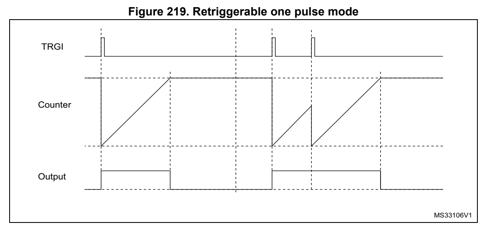
*Figure 219. Retrigge rable one pulse mode (p. 579)*

#### 19.4.17 UIF bit remapping (p. 579)

The IUFREMAP bit in the TIMx_CR1 register forces a continuous copy of the Update Interrupt Flag UIF in to bit 31 of the timer counter register (T IMxCNT[31]). This allows both

the counter value and a potentia l roll-over condition signaled by the UIFCPY flag, to be atomically read. In particular cases, it can ease the calculati ons by avoiding race conditions caused for instance by a processing shared between a background task (counter reading) and an interrupt ( Update Interrupt).

There is no latency between the assertions of the UIF and UIFCPY flags.

#### 19.4.18 Timer input XOR function (TIM15 only) (p. 581)

The TI1S bit in the TIMx_CR2 register, allows the input filter of channel 1 to be connected to the output of a XOR gate, combining the two input pins TIMx_CH1 and TIMx_CH2.

The XOR output can be used with a ll the timer input functions s uch as trigger or input capture. It is useful for measuring the interval between the ed ges on two input signals, as shown in Figure 220.

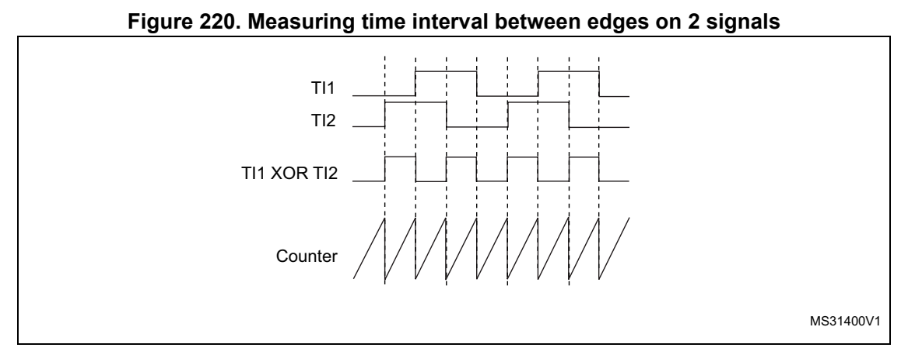
*Figure 220. Measuring time inte rval between edges on 2 signals (p. 581)*

#### 19.4.19 External trigger syn chronization (TIM15 only) (p. 582)

The TIM timers are linked togethe r internally for timer synchro nization or chaining.

The TIM15 timer can be synchro nized with an external trigger in several modes: Reset mode, Gated mode and Trigger mode.

Slave mode: Reset mode

The counter and its prescaler can be reinitialized in response to an event on a trigger input. Moreover, if the URS bit from th e TIMx_CR1 register is low, an update event UEV is generated. Then all the preloade d registers (TIMx_ARR, TIMx_CCRx) are updated.

In the following examp le, the upcounter is cleared in response to a rising edge on TI1 input: 1. Configure the channel 1 to detect rising edges on TI1. Config ure the input filter duration (in this example, we do not need any filter, so we keep IC1F=00 00). The capture prescaler is not used for triggering, so it does not need to be configured. The CC1S bits select the input capture source only, CC1S = 01 in the TIMx_CCM R1 register. Write CC1P=’0’ and CC1NP=’0’ in the TI Mx_CCER register to validate th e polarity (and detect rising edges only). 2. Configure the timer in reset m ode by writing SMS=100 in TIMx_SMCR register. Select TI1 as the input source by writing TS=00101 in TIMx_SMCR register. 3. Start the counter by writing CEN=1 in the TIMx_CR1 register.

The counter starts counting on t he internal clock, then behaves normally until TI1 rising edge. When TI1 rises, the counter is cleared and restarts from 0. In the meantime, the trigger flag is set (TIF bit in the TIMx_SR register) and an in terrupt request, or a DMA request can be sent if enabled (d epending on the TIE and TDE bi ts in TIMx_DIER register).

The following figure shows this behavior when the auto-reload register TIMx_ARR=0x36. The delay between the rising edge on TI1 and the actual reset of the counter is due to the resynchronization circuit on TI1 input.

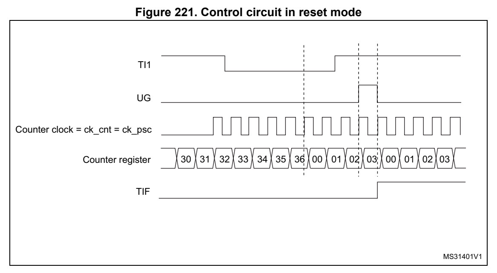
*Figure 221. Control circuit in reset mode (p. 582)*

Slave mode: Gated mode

The counter can be ena bled depending on the level of a selected input.

In the following examp le, the upcounter counts only when TI1 in put is low: 1. Configure the channel 1 to detect low levels on TI1. Configure the input filter duration (in this example, we do not need any filter, so we keep IC1F=00 00). The capture prescaler is not used for triggering, so it does not need to be configured. The CC1S bits select the input capture source only, CC1S=01 in TIMx_CCMR1 reg ister. Write CC1P=1 and CC1NP = ‘0’ in the TI Mx_CCER register to validate th e polarity (and detect low level only). 2. Configure the timer in gated mode by writing SMS=101 in TIMx_SMCR register. Select TI1 as the input source by writing TS=00101 in TIMx_SMCR register. 3. Enable the counter by writing CEN=1 in the TIMx_CR1 register (in gated mode, the counter doesn’t start if CEN=0, w hatever is the trigger input l evel).

The counter starts counting on the internal clock as long as TI 1 is low and stops as soon as TI1 becomes high. The TIF flag in the TIMx_SR register is set b oth when the counter starts or stops.

The delay between the rising edge on TI1 and the actual stop of the counter is due to the resynchronization circuit on TI1 input.

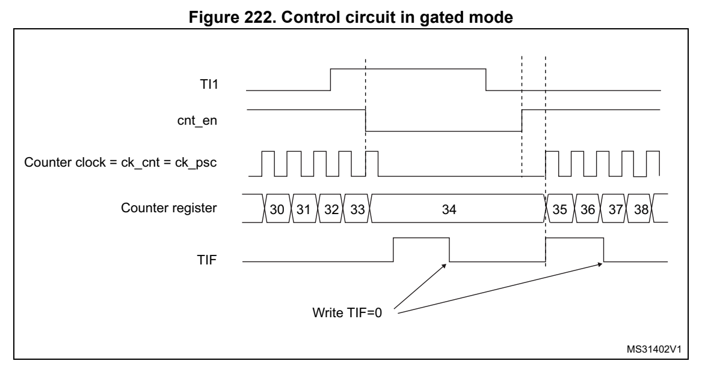
*Figure 222. Control circuit in gated mode (p. 583)*

Slave mode: Trigger mode

The counter can start in response to an event on a selected inp ut.

In the following examp le, the upcounter starts in response to a rising edge on TI2 input: 1. Configure the channel 2 to detect rising edges on TI2. Config ure the input filter duration (in this example, we do not need any filter, so we keep IC2F=00 00). The capture prescaler is not used for triggering, so it does not need to be configured. The CC2S bits are configured to select the in put capture source only, CC2S=01 in TIMx_CCMR1 register. Write CC2P=’1 ’ and CC2NP=’0’ in th e TIMx_CCER registe r to validate the polarity (and detect low level only). 2. Configure the timer in trigg er mode by writing SMS=110 in th e TIMx_SMCR register. Select TI2 as the inpu t source by writing TS =00110 in the TIMx_SMCR register.

When a rising edge occurs on TI2, the counter starts counting o n the internal clock and the TIF flag is set.

The delay between the rising edge on TI2 and the actual start of the counter is due to the resynchronization circuit on TI2 input.

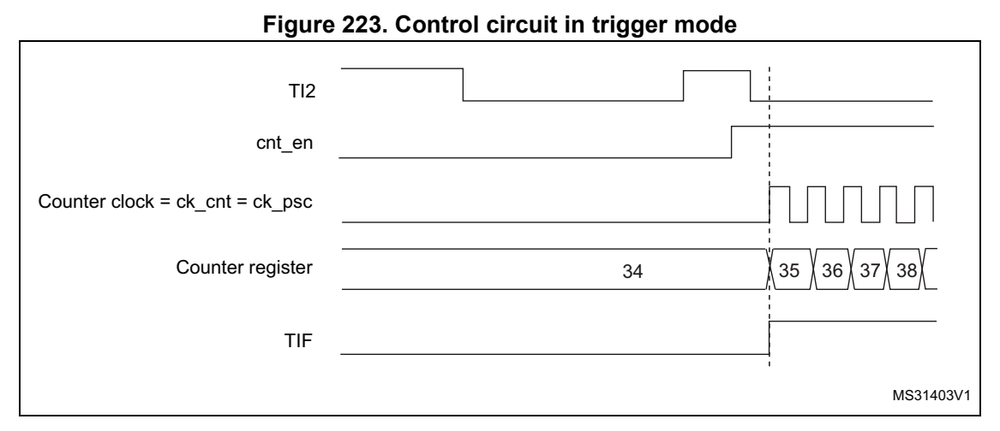
*Figure 223. Control c ircuit in trigger mode (p. 584)*

19.4.20 Slave mode – combi ned reset + trigger mode

In this case, a rising edge of t he selected trigger input (TRGI) reinitializes the counter, generates an update of the reg isters, and starts the counter.

This mode is used for one-pulse mode.

#### 19.4.21 DMA burst mode (p. 584)

The TIMx timers have th e capability to generate multiple DMA re quests on a single event. The main purpose is to be able to re-program several timer regi sters multiple times without software overhead, but it can also be used to read several regi sters in a row, at regular intervals.

The DMA controller destination is unique and must point to the virtual register TIMx_DMAR. On a given timer event, the timer launches a sequence of DMA re quests (burst). Each write into the TIMx_DMAR register is actually redirected to one of th e timer registers.

The DBL[4:0] bits in the TIMx_DCR register set the DMA burst le ngth. The timer recognizes a burst transfer when a read or a write access is done to the T IMx_DMAR addre ss), i.e. the number of transfers (either in half-words or in bytes).

The DBA[4:0] bits in t he TIMx_DCR registers define the DMA base address for DMA transfers (when read/write acces s are done through the TIMx_DMA R address). DBA is defined as an offset starting fro m the address of the TIMx_CR1 register.

Example:

00000: TIMx_CR1,

00001: TIMx_CR2,

00010: TIMx_SMCR,

For example, the timer DMA burst feature could be used to update the contents of the CCRx registers (x = 2, 3, 4) on an upd ate event, with the DMA transferring half words into the CCRx registers.

This is done in the following steps: 1. Configure the correspondi ng DMA channel as follows: – DMA channel peripheral address i s the DMAR register address – DMA channel memory address is th e address of the buffer in the RAM containing the data to be transfe rred by DMA into t he CCRx registers. – Number of data to transfer = 3 (See note below). – Circular mode disabled. 2. Configure the DCR register by configuring the DBA and DBL bi t fields as follows: DBL = 3 transfers, DBA = 0xE. 3. Enable the TIMx update DMA request (set the UDE bit in the D IER register). 4. Enable TIMx 5. Enable the DMA channel

This example is for the case whe re every CCRx register is to be updated once. If every CCRx register is to b e updated twice for example, the number of data to transfer should be 6. Let's take the example of a b uffer in the RAM containing data1, data2, data3, data4, data5 and data6. The data is transferred to the CCRx registers as fol lows: on the first update DMA request, data1 is transferred to CCR2, data2 is transferred to CCR3, data3 is transferred to CCR4 and on the second update DMA request, data4 is transferred to CCR2, data5 is transferred to CCR3 and data6 is transferred to CCR4.

Note: A null value can be written to the reserved registers.

#### 19.4.22 Timer synchronization (TIM15) (p. 586)

The TIMx timers are linked together internally for timer synchronization or chaining. Refer to Section 16.3.19: Timer synchronization for details.

Note: The clock of the slave peripherals (timer, ADC, ...) receiving the TRGO or the TRGO2 signals must be enabled prior to receive events from the master timer, and the clock frequency (prescaler) must not be changed on-the-fly while triggers are received from the master timer.

#### 19.4.23 Using timer out put as trigger for ot her timers (TIM16/T IM17) (p. 586)

The timers with one channel only do not feature a master mode. However, the OC1 output signal can be used to trigger some other timers (including time rs described in other sections of this document). Check the “TIM x internal trigger connection” table of any TIMx_SMCR register on the device to identify which ti mers can be targeted as slave.

The OC1 signal pulse width must b e programmed to be at least 2 clock cycles of the destination timer, to make sure the slave timer will detect the trigger.

For instance, if the destination's timer CK_INT clock is 4 time s slower than the source timer, the OC1 pulse width must be 8 clock cycles.

#### 19.4.24 Debug mode (p. 586)

® When the microcontroller enters debug mode (Cortex -M0+ core halted), the TIMx counter either continues to work normally or stops, depending on DBG_TI Mx_STOP configuration bit in DBG module. For m2 ore details, refer to Section 29.9.2: Debug support for timers, watchdog and I C.

For safety purposes, when the co unter is stopped (DBG_TIMx_STOP = 1), the outputs are disabled (as if the MOE bit was reset). The outpu ts can either be forced to an inactive state (OSSI bit = 1), or have their control taken over by the GPIO co ntroller (OSSI bit = 0) to force them to Hi-Z.

### 19.5 TIM15 registers (p. 587)

Refer to Section 1.2 for a list of abbre viations used in register descriptions.

The peripheral registers can be a ccessed by half-words (16-bit) or words (32-bit).

### 19.5.1 [TIM15.TIM15_CR1] Offset: 0x00 | Reset: 0x0000 (p. 587)

Address offset: 0x00

Reset value: 0x0000

Bits 15:12 Reserved, must be kept at reset value.

Bit 11 UIFREMAP: UIF status b it remapping 0: No remapping. UIF status bit is not copied to TIMx_CNT register bit 31. 1: Remapping enabled. UIF status bit is copied to TIMx_CNT regi ster bit 31.

Bit 10 Reserved, must be kept at reset value.

Bits 9:8 CKD[1:0]: Clock division This bitfield indicates the division ratio between the timer cl ock (CK_INT) frequency and the dead-time and sampling clock (t DTS) used by the dead-time generators and the digital filters (TIx) 00: t DTS = t CK_INT 01: t DTS = 2 * t CK_INT 10: t DTS = 4 * t CK_INT 11: Reserved, d o not program this value

Bit 7 ARPE: Auto-reload preload enable 0: TIMx_ARR register is not buffered 1: TIMx_ARR register is buffered

Bits 6:4 Reserved, must be kept at reset value.

Bit 3 OPM: One-pulse mode 0: Counter is not stopped at update event 1: Counter stops coun ting at the next update event (clearing th e bit CEN)

Bit 2 URS: Update request source This bit is set and cleared by software to select the UEV event sources. 0: Any of the following events g enerate an update interrupt if enabled. These events can be: – Counter overflow/underflow – Setting the UG bit – Update generation through the slave mode controller 1: Only counter overflow/underfl ow generates an update interrup t if enabled

Bit 1 UDIS: Update disable This bit is set and cleared by software to enable/disable UEV event generation. 0: UEV enabled. The Update (UEV) event is generated by one of t he following events: – Counter overflow/underflow – Setting the UG bit – Update generation through the slave mode controller Buffered registers are then lo aded with their preload values. 1: UEV disabled. The Update event is not generated, shadow regi sters keep their value (ARR, PSC, CCRx). However the coun ter and the prescaler are rei nitialized if the UG bit is set or if a hardware reset is re ceived from the slave mode cont roller.

Bit 0 CEN: Counter enable 0: Counter disabled 1: Counter enabled Note: External clock and gated mode can work only if the CEN bit has been previously set by software. However trigger mode can set the CEN bit automatically by hardware.

### 19.5.2 [TIM15.TIM15_CR2] Offset: 0x04 | Reset: 0x0000 (p. 588)

Address offset: 0x04

Reset value: 0x0000

Bits 15:11 Reserved, must be kept at reset value.

Bit 10 OIS2: Output idle state 2 (OC2 output) 0: OC2=0 when MOE=0 1: OC2=1 when MOE=0 Note: This bit cannot be modified as long as LOCK level 1, 2 or 3 has been programmed (LOCK bits in the TIM15_BDTR register).

Bit 9 OIS1N: Output Idle state 1 (OC1N output) 0: OC1N=0 after a dead-time when MOE=0 1: OC1N=1 after a dead-time when MOE=0 Note: This bit can not be modified as long as LOCK level 1, 2 or 3 has been programmed (LOCK bits in TIM1 5_BDTR register).

Bit 8 OIS1: Output Idle state 1 (OC1 output) 0: OC1=0 (after a d ead-time if OC1N is im plemented) when MOE=0 1: OC1=1 (after a d ead-time if OC1N is im plemented) when MOE=0 Note: This bit can not be modified as long as LOCK level 1, 2 or 3 has been programmed (LOCK bits in TIM1 5_BDTR register).

Bit 7 TI1S: TI1 selection 0: The TIMx_CH1 pin is connected to TI1 input 1: The TIMx_CH1, CH2 pins are connected to the TI1 input (XOR combination)

Bits 6:4 MMS[2:0]: Master mode selection These bits allow to select the in formation to be sent in master mode to slave timers for synchronization (TRGO). The combination is as follows: 000: Reset - the UG bit from the TIMx_EGR register is used as trigger out put (TRGO). If the reset is generated by the trigger input (slave mode controller configured in reset mode) then the signal on TRGO is delayed compared to t he actual reset. 001: Enable - the Counter Enable signal CNT_EN is used as trigger output ( TRGO). It is useful to start several timers at the same time or to control a window in which a slave timer is enable. The Counter E nable signal is generated by a lo gic AND between CEN control bit and the t rigger input when con figured in gated mode. When the Counter Enable signal is controlled by t he trigger input, there is a de lay on TRGO, except if the master/slave mode is selected (s ee the MSM bit de scription in T IMx_SMCR register). 010: Update - The update event is selected as trigger output (TRGO). For i nstance a master timer can then be used as a prescaler for a slave timer. 011: Compare Pulse - The trigger output send a positive pulse when the CC1IF flag is to be set (even if it was already hig h), as soon as a capture or a co mpare match occurred. (TRGO). 100: Compare - OC1REFC signal is used as trigger output (TRGO). 101: Compare - OC2REFC signal is used as trigger output (TRGO).

Bit 3 CCDS: Capture/compare DMA selection 0: CCx DMA request sent when CCx event occurs 1: CCx DMA requests sen t when update event occurs

Bit 2 CCUS: Capture/compare cont rol update selection 0: When capture/compare control bits are preloaded (CCPC=1), the y are updated by setting the COMG bit only. 1: When capture/compare control bits are preloaded (CCPC=1), the y are updated by setting the COMG bit or when an r ising edge occurs on TRGI. Note: This bit acts only on channels that have a complementary output.

Bit 1 Reserved, must be kept at reset value.

Bit 0 CCPC: Capture/compare preloaded control 0: CCxE, CCxNE and OCxM b its are not preloaded 1: CCxE, CCxNE and OCxM bits are preloaded, after having been written, they are updated only when a commutation event (COM) occurs (COMG bit set or ris ing edge detected on TRGI, depending on the CCUS bit). Note: This bit acts only on channels that have a complementary output.

### 19.5.3 [TIM15.TIM15_SMCR] Offset: 0x08 | Reset: 0x00000000 (p. 590)

Address offset: 0x08

Reset value: 0x0000 0000

Bits 31:22 Reserved, must be kept at reset value.

Bits 19:17 Reserved, must be kept at reset value.

Bits 15:8 Reserved, must be kept at reset value.

Bit 7 MSM: Master/slave mode 0: No action 1: The effect of an event on the trigger input (TRGI) is delayed to allow a perfect synchronization between the curre nt timer and its slaves (throu gh TRGO). It is useful if we want to synchronize several t imers on a single external even t.

Bits 21, 20, 6, 5, 4 TS[4:0]: Trigger selection This bit field selects the trigge r input to be used to synchron ize the counter. 00000: Internal Trigger 0 (ITR0) 00001: Internal Trigger 1 (ITR1) 00010: Internal Trigger 2 (ITR2) 00011: Internal Trigger 3 (ITR3) 00100: TI1 Edge Detector (TI1F_ED) 00101: Filtered Timer Input 1 (TI1FP1) 00110: Filtered Timer Input 2 (TI2FP2) Other: Reserved See Table 80: TIMx Internal trigger connection on page 591 for more detai ls on ITRx meaning for each Timer. Note: These bits must be changed only when they are not used (e.g. when SMS=000) to avoid wrong edge detections at the transition.

Bit 3 Reserved, must be kept at reset value.

Bits 16, 2, 1, 0 SMS[3:0]: Slave mode selection When external signals are selected the active ed ge of the trigg er signal (TRGI) is linked to the polarity selected on the external input (see Input Control register and Cont rol Register description. 0000: Slave mode disabled - if CEN = ‘1’ then the prescaler is c locked directly by the internal clock. 0001: Reserved 0010: Reserved 0011: Reserved 0100: Reset Mode - Rising edge of the selected trigger input (TR GI) reinitializes the counter and generates an update of the registers. 0101: Gated Mode - The counter clock is enabled when the trigger input (TRGI) is high. The counter stops (but is not reset) as soon as the trigger becomes low. Both start and stop of the counter are controlled. 0110: Trigger Mode - The counter starts at a rising edge of the trigger TRGI (but it is not reset). Only the start of the counter is controlled. 0111: External Clock Mode 1 - Rising edges of the selected trigg er (TRGI) clock the counter. 1000: Combined reset + trigger mode - Rising edge of the selecte d trigger input (TRGI) reinitializes the counter, genera tes an update of the registers and starts the counter. Other codes: reserved. Note: The gated mode must not be used if TI1F_ED is selected as the trigger input (TS=’00100’). Indeed, TI1F_ED outputs 1 pulse for each transition on TI1F, whereas the gated mode che cks the level of th e trigger signal. Note: The clock of the slave peripherals (timer, ADC, ...) receiving th e TRGO or the TRGO2 signals must be enabled prior to receive events from the master timer, and the clock frequency (prescaler) must not be changed on- the-fly while triggers are received from the master timer.

**Table 80. TIMx Interna l trigger connection (p. 591)**

| Slave TIM ITR0 (TS = 00000) ITR1 ( | Col 3 | TS = 00001) ITR2 (TS = 00010) ITR | 3 (TS = 00011) |
| --- | --- | --- | --- |
|  | TIM15 - TIM3 TIM16_OC1 TIM17_OC1 |  |  |

### 19.5.4 [TIM15.TIM15_DIER] Offset: 0x0C | Reset: 0x0000 (p. 591)

Address offset: 0x0C

Reset value: 0x0000

Bit 15 Reserved, must be kept at reset value.

Bit 14 TDE: Trigger DMA request enable 0: Trigger DMA request disabled 1: Trigger DMA request enabled

Bit 13 COMDE: COM DMA request enable 0: COM DMA request disabled 1: COM DMA request enabled

Bits 12:11 Reserved, must be kept at reset value.

Bit 10 CC2DE: Capture/Compare 2 DMA request enable 0: CC2 DMA request disabled 1: CC2 DMA request enabled

Bit 9 CC1DE: Capture/Compare 1 DMA request enable 0: CC1 DMA request disabled 1: CC1 DMA request enabled

Bit 8 UDE: Update DMA request enable 0: Update DMA request disabled 1: Update DMA request enabled

Bit 7 BIE: Break interrupt enable 0: Break interrupt disabled 1: Break interrupt enabled

Bit 6 TIE: Trigger interrupt enable 0: Trigger interrupt disabled 1: Trigger interrupt enabled

Bit 5 COMIE: COM interrupt enable 0: COM interrupt disabled 1: COM interrupt enabled

Bits 4:3 Reserved, must b e kept at reset value.

Bit 2 CC2IE: Capture/Compare 2 interrupt enable 0: CC2 interrupt disabled 1: CC2 interrupt enabled

Bit 1 CC1IE: Capture/Compare 1 interrupt enable 0: CC1 interrupt disabled 1: CC1 interrupt enabled

Bit 0 UIE: Update interrupt enable 0: Update interrupt disabled 1: Update interrupt enabled

### 19.5.5 [TIM15.TIM15_SR] Offset: 0x10 | Reset: 0x0000 (p. 592)

Address offset: 0x10

Reset value: 0x0000

Bits 15:11 Reserved, must be kept at reset value.

Bit 10 CC2OF: Capture/Compare 2 overcapture flag Refer to CC1OF description

Bit 9 CC1OF: Capture/Compare 1 overcapture flag This flag is set by hardware onl y when the corresponding channe l is configured in input capture mode. It is cl eared by software by writing it to ‘0’. 0: No overcapture has been detected 1: The counter value has been captured in TIMx_CCR1 register whi le CC1IF flag was already set

Bit 8 Reserved, must be kept at reset value.

Bit 7 BIF: Break interrupt flag This flag is set by hardware as s oon as the break input goes active. It can be cleared by software if the break input is not active. 0: No break event occurred 1: An active level has bee n detected on t he break input

Bit 6 TIF: Trigger interrupt flag This flag is set by hardware on t he TRG trigger event (active e dge detected on TRGI input when the slave mode controller is enabled in all modes but gate d mode, both edges in case gated mode is selected). It is s et when the counter starts or stops when gated mode is selected. It is cl eared by software. 0: No trigger event occurred 1: Trigger interrupt pending

Bit 5 COMIF: COM interrupt flag This flag is set by hardware on a COM event (once the capture/compare control bits –CCxE, CCxNE, OCxM– have been updated). It is cleared by software. 0: No COM event occurred 1: COM interrupt pending

Bits 4:3 Reserved, must be kept at reset value.

Bit 2 CC2IF: Capture/Compare 2 interrupt flag refer to CC1IF description

Bit 1 CC1IF: Capture/Compare 1 interrupt flag This flag is set by hardware. It is cleared by software (input capture or out put compare mode) or by reading the TIMx_CCR1 register (input capture mode only). 0: No compare match / No input capture occurred 1: A compare match or an input capture occurred If channel CC1 is configured as output: this flag is set when the content of the counter TIMx_CNT matches the content of the TIMx_C CR1 register. When th e content of TIMx_CCR1 is greater t han the content of TI Mx_ARR, the CC1IF bi t goes high on the counter overflow (in up-counti ng and up/down-counting modes) or underflow (in down-counting mode). There are 3 possible option s for flag setting i n center-aligned mode, refer to the CMS bits in the TIMx_CR1 register for the full descripti on. If channel CC1 is configured as input: this bit is set when counter value has been captured in TIMx_CCR1 register (an edge has been detected on IC 1, as per the edge sensitivity defined wit h the CC1P and CC1NP b its setting, in TI Mx_CCER).

Bit 0 UIF: Update interrupt flag This bit is set by ha rdware on an update event. It is cleared by software. 0: No update occurred. 1: Update interrupt pending. This bit is set by hardware when t he registers are updated: – At overflow regarding the repet ition counter value (update if repetition counter = 0) and if the UDIS=0 in the TIMx_CR1 register. – When CNT is reinitialized by software using the UG bit in TIMx_EGR register, if URS=0 and UDIS=0 in the TIMx_CR1 register. – When CNT is reinitialized by a trigger eve nt (refer to Section 19.5.3: TIM15 slave mode control register (TIM15_SMCR)), if URS=0 and UDIS=0 in the TIMx_CR1 register.

### 19.5.6 [TIM15.TIM15_EGR] Offset: 0x14 | Reset: 0x0000 (p. 594)

Address offset: 0x14

Reset value: 0x0000

Bits 15:8 Reserved, must be kept at reset value.

Bit 7 BG: Break generation This bit is set by software in order to generate an event, it i s automaticall y cleared by hardware. 0: No action 1: A break event is generated. M OE bit is cleare d and BIF flag i s set. Related interrupt or DMA transfer can occur if enabled.

Bit 6 TG: Trigger generation This bit is set by software in order to generate an event, it i s automaticall y cleared by hardware. 0: No action 1: The TIF flag is set in TIMx_SR register. Related interrupt or DMA transfer can occur if enabled

Bit 5 COMG: Capture/Compare cont rol update generation This bit can be set by software, it is automatically cleared by hardware. 0: No action 1: When the CCPC bit is set, i t is possible to update the CCxE, CCxNE and OCxM bits Note: This bit acts only on channels that have a complementary output.

Bits 4:3 Reserved, must be kept at reset value.

Bit 2 CC2G: Capture/Compare 2 generation Refer to CC1G description

Bit 1 CC1G: Capture/Compare 1 generation This bit is set by software in order to generate an event, it i s automaticall y cleared by hardware. 0: No action 1: A capture/compare event is generated on channel 1: If channel CC1 is co nfigured as output: CC1IF flag is set, Corresponding interrupt or DMA request is se nt if enabled. If channel CC1 is co nfigured as input: The current value of the counter is captured in TIMx_CCR1 regis ter. The CC1IF flag is set, the corresponding interrupt or DMA request is sent if enabled. The CC1OF flag is set if the CC1IF flag was already high.

Bit 0 UG: Update generation This bit can be set by software, it is automatically cleared by hardware. 0: No action 1: Reinitialize the counter and g enerates an update of the registers. Note that the prescaler counter is cleared too (anyway t he prescaler rati o is not affected).

### 19.5.7 [TIM15.TIM15_CCMR1] Offset: 0x18 | Reset: 0x00000000 (p. 595)

Address offset: 0x18

Reset value: 0x0000 0000

The same register can be used fo r input capture m ode (this sect ion) or for output compare mode (next section). The directi on of a channel is defined by configuring the corresponding CCxS bits. All the other bits of this register ha ve a different function in input and in output mode.

Input capture mode:

Bits 31:16 Reserved, must be kept at reset value.

Bits 15:12 IC2F[3:0]: Input capture 2 filter

Bits 11:10 IC2PSC[1:0]: Input capture 2 prescaler

Bits 9:8 CC2S[1:0]: Capture/Compare 2 selection This bit-field defines the direction of the channel (input/outp ut) as well as t he used input. 00: CC2 channel is configured as output 01: CC2 channel is configured a s input, IC2 is mapped on TI2 10: CC2 channel is configured a s input, IC2 is mapped on TI1 11: CC2 channel is configured as i nput, IC2 is mapped on TRC. T his mode is work ing only if an internal trigger input is selected through TS bit (TIMx_SMCR re gister) Note: CC2S bits are writable only when the channel is OFF (CC2E = ‘0’ in TIMx_CCER).

Bits 7:4 IC1F[3:0]: Input capture 1 filter This bit-field defines the frequency used to sample TI1 input a nd the length of the digital filter applied to TI1. The digital filter is m ade of an event counter in which N consecutive events are needed to validate a transition on the output: 0000: No filter, sampling is done at f DTS 0001: f SAMPLING =f CK_INT, N=2 0010: f SAMPLING =f CK_INT, N=4 0011: f SAMPLING =f CK_INT, N=8 0100: f SAMPLING =f DTS/2, N=6 0101: f SAMPLING =f DTS/2, N=8 0110: f SAMPLING =f DTS/4, N=6 0111: f SAMPLING =f DTS/4, N=8 1000: f SAMPLING =f DTS/8, N=6 1001: f SAMPLING =f DTS/8, N=8 1010: f SAMPLING =f DTS/16, N=5 1011: f SAMPLING =f DTS/16, N=6 1100: f SAMPLING =f DTS/16, N=8 1101: f SAMPLING =f DTS/32, N=5 1110: f SAMPLING =f DTS/32, N=6 1111: f SAMPLING =f DTS/32, N=8

Bits 3:2 IC1PSC[1:0]: Input capture 1 prescaler This bit-field defi nes the ratio of the prescaler acting on CC1 input (IC1). The prescaler is reset as soon as CC1E=’0’ (TIMx_CCER register). 00: no prescaler, capture is do ne each time an ed ge is detected on the capture input 01: capture is done once every 2 events 10: capture is done once every 4 events 11: capture is done once every 8 events

Bits 1:0 CC1S[1:0]: Capture/Compare 1 Selection This bit-field defines the direction of the channel (input/outp ut) as well as t he used input. 00: CC1 channel is configured as output 01: CC1 channel is configured a s input, IC1 is mapped on TI1 10: CC1 channel is configured a s input, IC1 is mapped on TI2 11: CC1 channel is configured as i nput, IC1 is mapped on TRC. T his mode is work ing only if an internal trigger input is selected through TS bit (TIMx_SMCR re gister) Note: CC1S bits are writable only when the channel is OFF (CC1E = ‘0’ in TIMx_CCER).

### 19.5.8 [TIM15.TIM15_CCMR1] Offset: 0x18 | Reset: 0x00000000 (p. 596)

Address offset: 0x18

Reset value: 0x0000 0000

The same register can be used fo r output compare mode (this section) or for input capture mode (previous section). The di rection of a channel is defined by configuring the

corresponding CCxS bits. All the other bits of this register ha ve a different function in input and in output mode. Output compare mode:

Bits 31:25 Reserved, must be kept at reset value.

Bits 23:17 Reserved, must be kept at reset value.

Bit 15 Reserved, must b e kept at reset value.

Bits 24, 14:12 OC2M[3:0]: Output Compare 2 mode

Bit 11 OC2PE: Output Compare 2 preload enable

Bit 10 OC2FE: Output Compare 2 fast enable

Bits 9:8 CC2S[1:0]: Capture/Compare 2 selection This bit-field defines the dire ction of the chan nel (input/outp ut) as well as the used input. 00: CC2 channel is con figured as output. 01: CC2 channel is configured a s input, IC2 is mapped on TI2. 10: CC2 channel is configured a s input, IC2 is mapped on TI1. 11: CC2 channel is configured as input, IC2 is mapped on TRC. T his mode is working only if an internal trigger inpu t is selected through the TS bit (TIMx_SMCR register) Note: CC2S bits are writable only when the ch annel is OFF (CC2E = ‘0’ in TIMx_CCER).

Bit 7 Reserved, must b e kept at reset value.

Bits 16, 6:4 OC1M[3:0]: Output Compare 1 mode These bits define the behavior of the output reference signal O C1REF from which OC1 and OC1N are derived. OC1REF is act ive high whereas OC1 and OC1N active level depends on CC1P and CC1NP bits. 0000: Frozen - The comparison between the output compare registe r TIMx_CCR1 and the counter TIMx_CNT has no effect on the outputs. 0001: Set channel 1 to active leve l on match. OC1REF signal is forced high when the counter TIMx_CNT matches the capture/compare register 1 (TIMx_C CR1). 0010: Set channel 1 to inactive level on match. OC1REF signal is forced low when the counter TIMx_CNT matches the capture/compare register 1 (TIMx_C CR1). 0011: Toggle - OC1REF toggles when TIMx_CNT=TIMx_CCR1. 0100: Force inactive level - OC1REF is forced low. 0101: Force active level - OC1REF is forced high. 0110: PWM mode 1 - Channel 1 is a ctive as long as TIMx_CNT<TIMx_CCR1 else inactive. 0111: PWM mode 2 - Channel 1 is i nactive as long as TIMx_CNT<TIM x_CCR1 else active. 1000: Retrigerrable OPM mode 1 - In up-counting mode, the channel is active until a trigger event is detected (on TRGI signal). Then, a comparison is perfo rmed as in PWM mode 1 and the channels becomes active again at the next update. In down-counting mode, the channel is inactive unt il a trigger event is detected (on TRGI signal). Then, a comparison is performed as i n PWM mode 1 and the channels becomes inactive again at the next update. 1001: Retrigerrable OPM mode 2 - In up-counting mode, the channel is inactive until a trigger event is detected (on TR GI signal). Then, a comparison is performed as in PWM mode 2 and the channels becomes inactive again at the next update. In down-counting mode, the channel is acti ve until a trigger event is d etected (on TRGI signal). Then, a comparison is performed as in PWM mode 1 and t he channels becomes active again at the next update. 1010: Reserved 1011: Reserved 1100: Combined PWM mode 1 - OC1REF has the same behavior as in PWM mode 1. OC1REFC is the logical OR b etween OC1REF and OC2REF. 1101: Combined PWM mode 2 - OC1REF has the same behavior as in PWM mode 2. OC1REFC is the logical AND between OC1REF and OC2REF. 1110: Reserved, 1111: Reserved, Note: These bits can not be modified as long as LOCK level 3 has been programmed (LOCK bits in TIMx_BDTR register) and CC1S=’00’ (the channel is configured in output). In PWM mode, the OCREF level changes only when the result of the comparison changes or when the output compare mode switches from “frozen” mode to “PWM” mode. On channels that have a complementary output, this bit field is preloaded. If the CCPC bit is set in the TIMx_CR2 register then the OC1M active bits take the new value from the preloaded bits only when a COM event is generated. The OC1M[3] bit is not contiguous, located in bit 16.

Bit 3 OC1PE: Output Compare 1 preload enable 0: Preload register on TIMx_CCR1 disabled. TIMx_CCR1 can be wri tten at anytime, the new value is taken in account immediately. 1: Preload register on TIMx_CCR1 enabled. Read/Write operations access the preload register. TIMx_CCR1 preload valu e is loaded in the active regis ter at each update event. Note: These bits can not be modified as long as LOCK level 3 has been programmed (LOCK bits in TIMx_BDTR register) and CC1S=’00’ (the channel is configured in output). The PWM mode can be used without validating the preload register only in one pulse mode (OPM bit set in TIMx_CR1 register). Else the behavior is not guaranteed.

Bit 2 OC1FE: Output Compare 1 fast enable This bit decreases the latency between a trigger event and a transition on the timer output. It must be used in one- pulse mode (OPM bit set in TIMx_CR1 regi ster), to have the output pulse starting as soon as possi ble after the starting trigger. 0: CC1 behaves normally depending on counter and CCR1 values even when the trigger is ON. The minimum delay to activate CC1 output when an edge occurs on the trigger input is 5 clock cycles. 1: An active edge on the trigger input acts like a compare matc h on CC1 output. Then, OC is set to the compare level independe ntly of the result of the com parison. Delay to sample the trigger input and to activate CC1 output is reduced to 3 cl ock cycles. OCFE acts only if the channel is configured in PWM1 or PWM2 mode.

Bits 1:0 CC1S[1:0]: Capture/Compare 1 selection This bit-field defines the dire ction of the chan nel (input/outp ut) as well as the used input. 00: CC1 channel is con figured as output. 01: CC1 channel is configured a s input, IC1 is mapped on TI1. 10: CC1 channel is configured a s input, IC1 is mapped on TI2. 11: CC1 channel is configured as input, IC1 is mapped on TRC. T his mode is working only if an internal trigger inpu t is selected through TS bit (TIMx_SMCR register) Note: CC1S bits are writable only when the ch annel is OFF (CC1E = ‘0’ in TIMx_CCER).

### 19.5.9 [TIM15.TIM15_CCER] Offset: 0x20 | Reset: 0x0000 (p. 599)

Address offset: 0x20

Reset value: 0x0000

Bits 15:8 Reserved, must be kept at reset value.

Bit 7 CC2NP: Capture/Compare 2 comple mentary output polarity Refer to CC1NP description

Bit 6 Reserved, must be kept at reset value.

Bit 5 CC2P: Capture/Compare 2 output polarity Refer to CC1P description

Bit 4 CC2E: Capture/Compare 2 output enable Refer to CC1E description

Bit 3 CC1NP: Capture/Compare 1 comple mentary output polarity CC1 channel config ured as output: 0: OC1N active high 1: OC1N active low CC1 channel configured as input: This bit is used in conjunction with CC1P to define the polarity of TI1FP1 and TI2FP1. Refer to CC1P description. Note: This bit is not writable as soon as LOCK level 2 or 3 has been programmed (LOCK bits in TIMx_BDTR register) and CC1S=”00” (the channel is configured in output). On channels that have a complementary output, this bit is preloaded. If the CCPC bit is set in the TIMx_CR2 register then the CC1NP active bit takes the new value from the preloaded bit only when a Commutation event is generated.

Bit 2 CC1NE: Capture/Compare 1 comp lementary output enable 0: Off - OC1N is not active. OC1N level is then function of MOE, OSSI, OSSR, OIS1, OIS1N and CC1E bits. 1: On - OC1N signal is output on the corresponding output pin de pending on MOE, OSSI, OSSR, OIS1, OIS1 N and CC1E bits.

Bit 1 CC1P: Capture/Compare 1 output polarity 0: OC1 active high (output mode) / Edge sensitivity selection ( input mode, see below) 1: OC1 active low (output mode) / Edge sensitivity selection (i nput mode, see below) When CC1 channel is configured as input, both CC1NP/CC1P bits select the active polarity of TI1FP1 and TI2FP1 for trigger or capture operations. CC1NP=0, CC1P=0: non-inverted/risi ng edge. The circuit is sensit ive to TIxFP1 rising edge (capture or trigger operations in reset, external clock or trig ger mode), TIxFP1 is not in verted (trigger operatio n in gated mode or enco der mode). CC1NP=0, CC1P=1: inverted/falling edge. The circuit is sensitive to TIxFP1 falling edge (capture or trigger operations in reset, external clock or trig ger mode), TIxFP1 is inverted (trigger operation in gated m ode or encoder mode). CC1NP=1, CC1P=1: non-inverted/both edges/ The circuit is sensiti ve to both TIxFP1 rising and falling edges (capture or trigger operations in reset, exte rnal clock or trigger mode), TIxFP1is not i nverted (trigger operation in g ated mode). This configuration must not be used in encoder mode. CC1NP=1, CC1P=0: this configurat ion is reserved, it must not be used. Note: This bit is not writable as soon as LOCK level 2 or 3 has been programmed (LOCK bits in TIMx_BDTR register). On channels that have a complementary output, this bit is preloaded. If the CCPC bit is set in the TIMx_CR2 register then the CC1 P active bit takes the new value from the preloaded bit only when a Commutation event is generated.

Bit 0 CC1E: Capture/Compare 1 output enable 0: Capture mode disabled / O C1 is not active (see below) 1: Capture mode enabled / OC1 signal is output on the correspon ding output pin When CC1 channel is co nfigured as output, the OC1 level depe nds on MOE, OSSI, OSSR, OIS1, OIS1N and CC1NE bits, regardless of the CC1E bits s tate. Refer to Table 81 for details.

(TIM15)

**Table 81. Output control bits for complementary OCx and OCxN ch annels with break feature (p. 601)**

| Col 1 | Col 2 | Col 3 | Col 4 | Col 5 | Control bits Output states | (1) |
| --- | --- | --- | --- | --- | --- | --- |
|  |  | MOE bit OSSI bit OSSR bit CCxE bit CCx |  |  | NE bit OCx output state OCxN ou | tput state |
|  |  |  | X0 0 |  | Output Disabled (not dri OCx=0 OCxN=0, OCxN_EN=0 | ven by the timer: Hi-Z) |
|  |  |  | 00 1 |  | Output Disabled (not driven by the timer: Hi-Z) OCx=0 | OCxREF + Polarity OCxN=OCxREF XOR CCxNP |
| 1X | 1X |  | 01 0 |  | OCxREF + Polarity OCx=OCxREF XOR CCxP | Output Disabled ( not driven by the timer: Hi-Z) OCxN=0 |
|  |  |  | X1 1 |  | OCREF + Polarity + dead-time | Complementary to OCREF (not OCREF) + Polarity + dead-time |
|  |  |  | 10 1 |  | Off-State (output enabled with inactive state) OCx=CCxP | OCxREF + Polarity OCxN=OCxREF XOR CCxNP |
|  |  |  | 11 0 |  | OCxREF + Polarity OCx=OCxREF xor CCxP, OCx_EN=1 | Off-State (out put enabled with inactive state) OCxN=CCxNP, OCxN_EN=1 |
|  | 0 |  | XX 00 | XX 00 | Output disabled (not dri | ven by the timer: Hi-Z) |
| 0 | 1 | X | 11 | 10 11 | 0 1 Off-State (output enable Asynchronously: OCx=CCxP, OCxN=CCxNP after a dead-time, assuming t correspond to OCX and OCxN | d with inactive state) Then if the clock is present: OCx=OISx and OCxN=OISxN hat OISx and OISxN do not both in act ive state |

1. When both outputs of a channel are not used (control taken over by GPIO controller), the OISx, OISxN, CCxP and CCxNP bits must be kept cleared.

Note: The state of the external I/O pins connected to the complementary OCx and OCxN channels depends on the OCx and OCxN channel state and AFIO registers.

### 19.5.10 [TIM15.TIM15_CNT] Offset: 0x24 | Reset: 0x00000000 (p. 602)

Address offset: 0x24

Reset value: 0x0000 0000

CPY

r

Bit 31 UIFCPY: UIF Copy This bit is a read-only copy of the UIF bit in the TIMx_ISR reg ister.

Bits 30:16 Reserved, must be kept at reset value.

Bits 15:0 CNT[15:0]: Counter value

### 19.5.11 [TIM15.TIM15_PSC] Offset: 0x28 | Reset: 0x0000 (p. 602)

Address offset: 0x28

Reset value: 0x0000

Bits 15:0 PSC[15:0]: Prescaler value The counter clock frequen cy (CK_CNT) is equal to f CK_PSC / (PSC[15:0] + 1). PSC contains the value to be loa ded in the active prescaler reg ister at each update event (including when the counter is cleared through UG bit of TIMx_E GR register or through trigger controller when configured in “reset mode”).

### 19.5.12 [TIM15.TIM15_ARR] Offset: 0x2C | Reset: 0xFFFF (p. 602)

Address offset: 0x2C

Reset value: 0xFFFF

Bits 15:0 ARR[15:0]: Auto-reload value ARR is the value to be loaded in the actual auto-reload registe r. Refer to the Section 19.4.1: Time-base unit on page 551 for more details about ARR update and behavior. The counter is blocked while the auto-reload value is null.

### 19.5.13 [TIM15.TIM15_RCR] Offset: 0x30 | Reset: 0x0000 (p. 603)

Address offset: 0x30

Reset value: 0x0000

Bits 15:8 Reserved, must be kept at reset value.

Bits 7:0 REP[7:0]: Repetition counter value These bits allow the user to se t-up the update rate of the comp are registers (i.e. periodic transfers from preload to active registers) when preload registers are enable, as well as the update interrupt generation rate, if this interrupt is enable. Each time the REP_CNT related downcounter reaches zero, an upda te event is generated and it restarts counting from REP value. As REP_CNT is reloaded with REP value only at the repetition update event U_RC, any write to the TIMx_RCR reg ister is not taken in account until the next repetition update event. It means in PWM mode (REP+1) corresponds to the number of PWM p eriods in edge-aligned mode.

### 19.5.14 [TIM15.TIM15_CCR1] Offset: 0x34 | Reset: 0x0000 (p. 603)

Address offset: 0x34

Reset value: 0x0000

Bits 15:0 CCR1[15:0]: Capture/Compare 1 value If channel CC1 is con figured as output: CCR1 is the value to be loaded in the actual capture/compare 1 register (preload value). It is loaded permanently if the preload feature is not selected in the TIMx_CCMR1 register (bit OC1PE). Else the preload value is copied in the active cap ture/compare 1 register when an update event occurs. The active capture/compare register contains the value to be co mpared to the counter TIMx_CNT and sig naled on OC1 output. If channel CC1 is configured as input: CCR1 is the counter va lue transferred by the last input capture 1 event (IC1).

### 19.5.15 [TIM15.TIM15_CCR2] Offset: 0x38 | Reset: 0x0000 (p. 604)

Address offset: 0x38

Reset value: 0x0000

Bits 15:0 CCR2[15:0]: Capture/Compare 2 value If channel CC2 is con figured as output: CCR2 is the value to be loaded in the actual capture/compare 2 register (preload value). It is loaded permanently if the preload feature is not selected in the TIMx_CCMR2 register (bit OC2PE). Else the preload value is copied in the active cap ture/compare 2 register when an update event occurs. The active capture/compare register contains the value to be co mpared to the counter TIMx_CNT and signal led on OC2 output. If channel CC2 is configured as input: CCR2 is the counter va lue transferred by the last input capture 2 event (IC2).

### 19.5.16 [TIM15.TIM15_BDTR] Offset: 0x44 | Reset: 0x00000000 (p. 604)

Address offset: 0x44

Reset value: 0x0000 0000

Note: As the BKBID, BKDSRM, BKF[3:0], AOE, BKP, BKE, OSSI, O SSR and DTG[7:0] bits may be write-locked depending on the LOCK configuration, it may be necessary to configure all of them during the first write access to the TIMx_BDTR register.

Bits 31:29 Reserved, must be kept at reset value.

Bit 28 BKBID: Break Bidirectional 0: Break input BRK in input mode 1: Break input BRK in bidirectional mode In the bidirectional mode (BKBID bit set to 1), the break input is configured both in input mode and in open drain output mode. Any active break event asse rts a low logic level on the Break input to indicate an inte rnal break event to external dev ices. Note: This bit cannot be modified as long as LOCK level 1 has been programmed (LOCK bits in TIMx_BDTR register). Note: Any write operation to this bit takes a delay of 1 APB clock cycle to become effective.

Bit 27 Reserved, must be kept at reset value.

Bit 26 BKDSRM: Break Disarm 0: Break input BRK is armed 1: Break input BRK is disarmed This bit is cleared by hardware when no break source is active. The BKDSRM bit must be set by software to release the bidirecti onal output control (open-drain output in Hi-Z state) and then be polled it until it is reset by hardware, indicating that the fault condition has disappeared. Note: Any write operation to this bit takes a delay of 1 APB clock cycle to become effective.

Bits 25:20 Reserved, must be kept at reset value.

Bits 19:16 BKF[3:0]: Break filter This bit-field defines the frequency used to sample the BRK inp ut signal and the length of the digital filter applied to BRK. T he digital filter is made of an event counter in which N events are needed to vali date a transition on the output: 0000: No filter, BRK acts asynchronously 0001: f SAMPLING =f CK_INT, N=2 0010: f SAMPLING =f CK_INT, N=4 0011: f SAMPLING =f CK_INT, N=8 0100: f SAMPLING =f DTS/2, N=6 0101: f SAMPLING =f DTS/2, N=8 0110: f SAMPLING =f DTS/4, N=6 0111: f SAMPLING =f DTS/4, N=8 1000: f SAMPLING =f DTS/8, N=6 1001: f SAMPLING =f DTS/8, N=8 1010: f SAMPLING =f DTS/16, N=5 1011: f SAMPLING =f DTS/16, N=6 1100: f SAMPLING =f DTS/16, N=8 1101: f SAMPLING =f DTS/32, N=5 1110: f SAMPLING =f DTS/32, N=6 1111: f SAMPLING =f DTS/32, N=8 Note: This bit cannot be modified when LOCK level 1 has been programmed (LOCK bits in TIMx_BDTR register).

Bit 15 MOE: Main output enable This bit is cleared a synchronously by hardware as soon as the b reak input is active. It is set by software or automatically depending on the AOE bit. It is acting only on the channels which are configured in output. 0: OC and OCN outputs are disabled or forced to idle state depen ding on the OSSI bit. 1: OC and OCN outputs are enabled if their respective enable bits are set (CCxE, CCxNE in TIMx_CCER register) See OC/OCN enable description for more details ( Section 19.5.9: TIM15 capture/compare enable register (TIM15_CCER) on page 599).

Bit 14 AOE: Automatic output enable 0: MOE can be set only by software 1: MOE can be set by software or automatically at the next update event (if the break input is not be active) Note: This bit can not be modified as long as LOCK level 1 has been programmed (LOCK bits in TIMx_BDTR register).

Bit 13 BKP: Break polarity 0: Break input BRK is active low 1: Break input BRK is active high Note: This bit can not be modified as long as LOCK level 1 has been programmed (LOCK bits in TIMx_BDTR register). Any write operation to this bit takes a delay of 1 APB clock cycle to become effective.

Bit 12 BKE: Break enable 0: Break inputs (BRK and CCS c lock failure event) disabled 1; Break inputs (BRK and CCS c lock failure event) enabled This bit cannot be modified when L OCK level 1 has been programm ed (LOCK bits in TIMx_BDTR register). Note: Any write operation to this bit takes a delay of 1 APB clock cycle to become effective.

Bit 11 OSSR: Off-state selection for Run mode This bit is used when M OE=1 on channels that have a complementa ry output which are configured as outputs. OSSR is not implemented if no complementary output is implemented in the timer. See OC/OCN enable description for more details ( Section 19.5.9: TIM15 capture/compare enable register (TIM15_CCER) on page 599). 0: When inactive, OC/OCN outputs are disabled (the timer release s the output control which is taken over by the AFIO logi c, which force s a Hi-Z state) 1: When inactive, OC/OCN outputs are enabled with their inactive level as soon as CCxE=1 or CCxNE=1 (the outp ut is still controll ed by the timer). Note: This bit can not be modified as soon as the LOCK level 2 has been programmed (LOCK bits in TIMx_BDTR register).

Bit 10 OSSI: Off-state selection for Idle mode This bit is used when MOE=0 on channels configured as outputs. See OC/OCN enable description for more details ( Section 19.5.9: TIM15 capture/compare enable register (TIM15_CCER) on page 599). 0: When inactive, OC/O CN outputs are disabled (OC/OCN enable out put signal=0) 1: When inactive, OC/OCN outputs a re forced first with their idl e level as soon as CCxE=1 or CCxNE=1. OC/OCN enable output signal=1) Note: This bit can not be modified as soon as the LOCK level 2 has been programmed (LOCK bits in TIMx_BDTR register).

Bits 9:8 LOCK[1:0]: Lock configuration These bits offer a write prote ction against software errors. 00: LOCK OFF - No bit is write protected 01: LOCK Level 1 = DTG bits in TIMx_BDTR register, OISx and OISx N bits in TIMx_CR2 register and BKE/BKP/AOE bits in TIMx_BDTR re gister can no long er be written 10: LOCK Level 2 = LOCK Level 1 + CC Polarity bits (CCxP/CCxNP b its in TIMx_CCER register, as long as the relate d channel is configured in outpu t through the CCxS bits) as well as OSSR and OSSI bits can no longer be written. 11: LOCK Level 3 = LOCK Level 2 + CC Control bits (OCxM and OCxP E bits in TIMx_CCMRx registers, as long as the related channel is configu red in output through the CCxS bits) can no longer be written. Note: The LOCK bits can be written only once after the reset. Once the TIMx_BDTR register has been written, their content is frozen until the next reset.

Bits 7:0 DTG[7:0]: Dead-time generator setup This bit-field defines the durat ion of the dead-time inserted b etween the complementary outputs. DT correspond to this duration. DTG[7:5] = 0xx => DT = DTG[7:0] x t dtg with t dtg = t DTS DTG[7:5] = 10x => DT = (64+DTG[5:0]) x t dtg with t dtg = 2 x t DTS DTG[7:5] = 110 => DT = (32+DTG[4:0]) x t dtg with t dtg = 8 x t DTS DTG[7:5] = 111 => DT = (32+DTG[4:0]) x t dtg with t dtg = 16 x t DTS Example if t DTS = 125 ns (8 MHz), dead-time possible values are: 0 to 15875 ns by 125 ns steps, 16 µs to 31750 ns by 250 ns steps, 32 µs to 63 µs by 1 µs steps, 64 µs to 126 µs by 2 µs steps Note: This bit-field can not be modified as long as LOCK level 1, 2 or 3 has been programmed (LOCK bits in TIMx_BDTR register).

### 19.5.17 [TIM15.TIM15_DCR] Offset: 0x48 | Reset: 0x0000 (p. 607)

Address offset: 0x48

Reset value: 0x0000

Bits 15:13 Reserved, must be kept at reset value.

Bits 12:8 DBL[4:0]: DMA burst length This 5-bit field defines the leng th of DMA transfers (the timer recognizes a burst transfer when a read or a write access is done to the TIMx_DMAR address). 00000: 1 transfer, 00001: 2 transfers, 00010: 3 transfers,

... 10001: 18 transfers.

Bits 7:5 Reserved, must b e kept at reset value.

Bits 4:0 DBA[4:0]: DMA base address This 5-bit field defines the base -address for DMA transfers (wh en read/write access are done through the TIMx_DMAR address). DBA is defined as an offset starting from the address of the TIMx_CR1 register. Example: 00000: TIMx_CR1, 00001: TIMx_CR2, 00010: TIMx_SMCR,

...

### 19.5.18 [TIM15.TIM15_DMAR] Offset: 0x4C | Reset: 0x0000 (p. 607)

Address offset: 0x4C

Reset value: 0x0000

Bits 15:0 DMAB[15:0]: DMA register for burst accesses A read or write operation to the DMAR register accesses the reg ister located at the address (TIMx_CR1 address) + (DBA + DMA index) x 4 where TIMx_CR1 address is the add ress of the control register 1, DBA is the DMA base address configured in T IMx_DCR register, DMA index is automatically controlled by the DMA transfer, and ranges from 0 to DBL (DBL configured in TIMx_ DCR).

### 19.5.19 [TIM15.TIM15_AF1] Offset: 0x60 | Reset: 0x00000001 (p. 608)

Address offset: 0x60

Reset value: 0x0000 0001

Bits 31:10 Reserved, must be kept at reset value.

Bit 9 BKINP: BRK BKIN in put polarity This bit selects the BKIN altern ate function input sensitivity. It must be programmed together with the BKP pol arity bit. 0: BKIN input is active low 1: BKIN input is active high Note: This bit can not be modified as long as LOCK level 1 has been programmed (LOCK bits in TIMx_BDTR register).

Bits 8:1 Reserved, must b e kept at reset value.

Bit 0 BKINE: BRK BKIN input enable This bit enables the BKIN alternate function in put for the time r’s BRK input. BKIN input is ‘ORed’ with the ot her BRK sources. 0: BKIN input disabled 1: BKIN input enabled Note: This bit can not be modified as long as LOCK level 1 has been programmed (LOCK bits in TIMx_BDTR register).

### 19.5.20 [TIM15.TIM15_TISEL] Offset: 0x68 | Reset: 0x00000000 (p. 608)

Address offset: 0x68

Reset value: 0x0000 0000

Bits 31:12 Reserved, must be kept at reset value.

Bits 11:8 TI2SEL[3:0]: selects TI2[0] to TI2[15] input 0000: TIM15_CH2 input 0001: Reserved 0010: TIM3_IC2 Others: Reserved

Bits 7:4 Reserved, must b e kept at reset value.

Bits 3:0 TI1SEL[3:0]: selects TI1[0] to TI1[15] input 0000: TIM15_CH1 input 0001: Reserved 0010: TIM3_IC1 Others: Reserved

#### 19.5.21 TIM15 register map (p. 609)

TIM15 registers are mapped as 16 -bit addressable registers as d escribed in the table below:

**Table 82. TIM15 register map and reset values (p. 609)**

| Col 1 | Register | Col 3 | Col 4 | Col 5 | Col 6 | Col 7 | Col 8 | Col 9 | Col 10 | Col 11 | Col 12 | Col 13 | Col 14 | Col 15 | Col 16 | Col 17 | Col 18 | Col 19 | Col 20 | Col 21 | Col 22 | Col 23 | Col 24 | Col 25 | Col 26 | Col 27 | Col 28 | Col 29 | Col 30 | Col 31 | Col 32 | Col 33 | Col 34 |
| --- | --- | --- | --- | --- | --- | --- | --- | --- | --- | --- | --- | --- | --- | --- | --- | --- | --- | --- | --- | --- | --- | --- | --- | --- | --- | --- | --- | --- | --- | --- | --- | --- | --- |
| Offset |  | 31 | 30 | 29 | 28 | 27 | 26 | 25 | 24 | 23 | 22 | 21 | 20 | 19 | 18 | 17 | 16 | 15 | 14 | 13 | 12 | 11 | 10 | 9 | 8 | 7 | 6 | 5 | 4 | 3 | 2 | 1 | 0 |
|  | name |  |  |  |  |  |  |  |  |  |  |  |  |  |  |  |  |  |  |  |  |  |  |  |  |  |  |  |  |  |  |  |  |
| 0x00 | TIM15_CR1 | Res. | Res. | Res. | Res. | Res. | Res. | Res. | Res. | Res. | Res. | Res. | Res. | Res. | Res. | Res. | Res. | Res. | Res. | Res. | Res. | UIFREMA | Res. | CKD [1:0] | CKD [1:0] | ARPE | Res. | Res. | Res. | OPM | URS | UDIS | CEN |

Reset value 0 000 0000

0x04 TIM15_CR2 Res. Res. Res. Res. Res. Res. Res. Res. Res. Res. Res. Res. Res. Res. Res. Res. Res. Res. Res. Res. Res. OIS2 OIS1N OIS1 TI1S MMS[2:0] CCDS CCUS Res. CCPC Reset value 000000000 0

0x08 TIM15_SMCR Res. Res. Res. Res. Res. Res. Res. Res. Res. Res. [4:3]TS Res. Res. Res. SMS[3] Res. Res. Res. Res. Res. Res. Res. Res. MSM TS[2:0] Res. SMS[2:0] Reset value 0 0 0 0 0 0 0 0 0 0

0x0C TIM15_DIER Res. Res. Res. Res. Res. Res. Res. Res. Res. Res. Res. Res. Res. Res. Res. Res. Res. TDE COMDE Res. Res. CC2DE CC1DE UDE BIE TIE COMIE Res. Res. CC2IE CC1IE UIE

Reset value 0 0 0 0 0 0 0 0 0 0 0

0x10 TIM15_SR Res. Res. Res. Res. Res. Res. Res. Res. Res. Res. Res. Res. Res. Res. Res. Res. Res. Res. Res. Res. Res. CC2OF CC1OF Res. BIF TIF COMIF Res. Res. CC2IF CC1IF UIF

Reset value 00 000 000

0x14 TIM15_EGR Res. Res. Res. Res. Res. Res. Res. Res. Res. Res. Res. Res. Res. Res. Res. Res. Res. Res. Res. Res. Res. Res. Res. Res. BG TG COMG Res. Res. CC2G CC1G UG

Reset value 000 000

**Table 82. TIM15 register map and reset values (continued) (p. 610)**

| Col 1 | Register | Col 3 | Col 4 | Col 5 | Col 6 | Col 7 | Col 8 | Col 9 | Col 10 | Col 11 | Col 12 | Col 13 | Col 14 | Col 15 | Col 16 | Col 17 | Col 18 | Col 19 | Col 20 | Col 21 | Col 22 | Col 23 | Col 24 | Col 25 | Col 26 | Col 27 | Col 28 | Col 29 | Col 30 | Col 31 | Col 32 | Col 33 | Col 34 |
| --- | --- | --- | --- | --- | --- | --- | --- | --- | --- | --- | --- | --- | --- | --- | --- | --- | --- | --- | --- | --- | --- | --- | --- | --- | --- | --- | --- | --- | --- | --- | --- | --- | --- |
| Offset |  | 31 | 30 | 29 | 28 | 27 | 26 | 25 | 24 | 23 | 22 | 21 | 20 | 19 | 18 | 17 | 16 | 15 | 14 | 13 | 12 | 11 | 10 | 9 | 8 | 7 | 6 | 5 | 4 | 3 | 2 | 1 | 0 |
|  | name |  |  |  |  |  |  |  |  |  |  |  |  |  |  |  |  |  |  |  |  |  |  |  |  |  |  |  |  |  |  |  |  |
|  | TIM15_CCMR1 Output Compare mode | Res. | Res. | Res. | Res. | Res. | Res. | Res. | OC2M[3] | Res. | Res. | Res. | Res. | Res. | Res. | Res. | OC1M[3] | Res. |  | OC2M [2:0] |  | OC2PE | OC2FE | CC2S [1:0] | CC2S [1:0] | Res. |  | OC1M [2:0] |  | OC1PE | OC1FE | CC1S [1:0] | CC1S [1:0] |

Reset value 0 0 0 0 0 0 0 0 0 0 0 0 0 0 0 0 0x18 TIM15_CCMR1 IC2 IC1 CC2S CC1S Input Capture Res. Res. Res. Res. Res. Res. Res. Res. Res. Res. Res. Res. Res. Res. Res. Res. IC2F[3:0] PSC [1:0] IC1F[3:0] PSC [1:0] mode [1:0] [1:0]

Reset value 0 0 0 0 0 0 0 0 0 0 0 0 0 0 0 0

0x20 TIM15_CCER Res. Res. Res. Res. Res. Res. Res. Res. Res. Res. Res. Res. Res. Res. Res. Res. Res. Res. Res. Res. Res. Res. Res. Res. CC2NP Res. CC2P CC2E CC1NP CC1NE CC1P CC1E

Reset value 0 000000

0x24 TIM15_CNT UIFCPY or Res. Res. Res. Res. Res. Res. Res. Res. Res. Res. Res. Res. Res. Res. Res. Res. CNT[15:0]

Reset value 0 0 0 0 0 0 0 0 0 0 0 0 0 0 0 0 0

TIM15_PSC Res. Res. Res. Res. Res. Res. Res. Res. Res. Res. Res. Res. Res. Res. Res. Res. PSC[15:0] 0x28 Reset value 0 0 0 0 0 0 0 0 0 0 0 0 0 0 0 0

TIM15_ARR Res. Res. Res. Res. Res. Res. Res. Res. Res. Res. Res. Res. Res. Res. Res. Res. ARR[15:0] 0x2C Reset value 1 1 1 1 1 1 1 1 1 1 1 1 1 1 1 1

TIM15_RCR Res. Res. Res. Res. Res. Res. Res. Res. Res. Res. Res. Res. Res. Res. Res. Res. Res. Res. Res. Res. Res. Res. Res. Res. REP[7:0] 0x30 Reset value 00000000

TIM15_CCR1 Res. Res. Res. Res. Res. Res. Res. Res. Res. Res. Res. Res. Res. Res. Res. Res. CCR1[15:0] 0x34 Reset value 0 0 0 0 0 0 0 0 0 0 0 0 0 0 0 0

TIM15_CCR2 Res. Res. Res. Res. Res. Res. Res. Res. Res. Res. Res. Res. Res. Res. Res. Res. CCR2[15:0] 0x38 Reset value 0 0 0 0 0 0 0 0 0 0 0 0 0 0 0 0

0x44 TIM15_BDTR Res. Res. Res. BKBID Res. BKDSRM Res. Res. Res. Res. Res. Res. BKF[3:0] MOE AOE BKP BKE OSSR OSSI LOCK[1:0] DTG[7:0]

Reset value 0 0 0 0 0 0 0 0 0 0 0 0 0 0 0 0 0 0 0 0 0 0

TIM15_DCR Res. Res. Res. Res. Res. Res. Res. Res. Res. Res. Res. Res. Res. Res. Res. Res. Res. Res. Res. DBL[4:0] Res. Res. Res. DBA[4:0] 0x48 Reset value 00000 00000

**Table 82. TIM15 register map and reset values (continued) (p. 611)**

| Col 1 | Register | Col 3 | Col 4 | Col 5 | Col 6 | Col 7 | Col 8 | Col 9 | Col 10 | Col 11 | Col 12 | Col 13 | Col 14 | Col 15 | Col 16 | Col 17 | Col 18 | Col 19 | Col 20 | Col 21 | Col 22 | Col 23 | Col 24 | Col 25 | Col 26 | Col 27 | Col 28 | Col 29 | Col 30 | Col 31 | Col 32 | Col 33 | Col 34 |
| --- | --- | --- | --- | --- | --- | --- | --- | --- | --- | --- | --- | --- | --- | --- | --- | --- | --- | --- | --- | --- | --- | --- | --- | --- | --- | --- | --- | --- | --- | --- | --- | --- | --- |
| Offset |  | 31 | 30 | 29 | 28 | 27 | 26 | 25 | 24 | 23 | 22 | 21 | 20 | 19 | 18 | 17 | 16 | 15 | 14 | 13 | 12 | 11 | 10 | 9 | 8 | 7 | 6 | 5 | 4 | 3 | 2 | 1 | 0 |
|  | name |  |  |  |  |  |  |  |  |  |  |  |  |  |  |  |  |  |  |  |  |  |  |  |  |  |  |  |  |  |  |  |  |
| 0x4C | TIM15_DMAR | Res. | Res. | Res. | Res. | Res. | Res. | Res. | Res. | Res. | Res. | Res. | Res. | Res. | Res. | Res. | Res. |  |  |  |  |  |  |  | DMAB[15:0] | DMAB[15:0] |  |  |  |  |  |  |  |

Reset value 0 0 0 0 0 0 0 0 0 0 0 0 0 0 0 0

0x60 TIM15_AF1 Res. Res. Res. Res. Res. Res. Res. Res. Res. Res. Res. Res. Res. Res. Res. Res. Res. Res. Res. Res. Res. Res. BKINP Res. Res. Res. Res. Res. Res. Res. Res. BKINE Reset value 01

TIM15_TISEL Res. Res. Res. Res. Res. Res. Res. Res. Res. Res. Res. Res. Res. Res. Res. Res. Res. Res. Res. Res. TI2SEL[3:0] Res. Res. Res. Res. TI1SEL[3:0] 0x68 Reset value 0000 0000

Refer to Section 2.2 on page 44 for the register boundary addresses.

### 19.6 TIM16/TIM17 registers (p. 612)

Refer to Section 1.2 for a list of abbre viations used in register descriptions.

The peripheral registers can be a ccessed by half-words (16-bit) or words (32-bit).

### 19.6.1 [TIM16.TIMx_CR1] Offset: 0x00 | Reset: 0x0000 (p. 612)

Address offset: 0x00

Reset value: 0x0000

Bits 15:12 Reserved, must be kept at reset value.

Bit 11 UIFREMAP: UIF status b it remapping 0: No remapping. UIF status bit is not copied to TIMx_CNT register bit 31. 1: Remapping enabled. UIF status bit is copied to TIMx_CNT regi ster bit 31.

Bit 10 Reserved, must be kept at reset value.

Bits 9:8 CKD[1:0]: Clock division This bit-field indicates the division ratio between the timer c lock (CK_INT) frequency and the dead-time and sampling clock (t DTS)used by the dead-t ime generators and t he digital filters (TIx), 00: t DTS = t CK_INT 01: t DTS = 2 * t CK_INT 10: t DTS = 4 * t CK_INT 11: Reserved, d o not program this value

Bit 7 ARPE: Auto-reload preload enable 0: TIMx_ARR register is not buffered 1: TIMx_ARR register is buffered

Bits 6:4 Reserved, must be kept at reset value.

Bit 3 OPM: One pulse mode 0: Counter is not stopped at update event 1: Counter stops coun ting at the next update event (clearing th e bit CEN)

Bit 2 URS: Update request source This bit is set and cleared by software to select the UEV event sources. 0: Any of the following events generate an update interrupt or D MA request if enabled. These events can be: – Counter overflow/underflow – Setting the UG bit – Update generation through the slave mode controller 1: Only counter overflow/underflow generates an update interrupt or DMA request if enabled.

Bit 1 UDIS: Update disable This bit is set and cleared by software to enable/disable UEV event generation. 0: UEV enabled. The Update (UEV) e vent is generated by one of th e following events: – Counter overflow/underflow – Setting the UG bit – Update generation through the slave mode controller Buffered registers are then l oaded with their preload values. 1: UEV disabled. The Update even t is not generated, shadow regis ters keep their value (ARR, PSC, CCRx). However the coun ter and the prescaler are rei nitialized if the UG bit is set or if a hardware reset is received from the slave mode controller.

Bit 0 CEN: Counter enable 0: Counter disabled 1: Counter enabled Note: External clock and gated mode can work only if the CEN bit has been previously set by software. However trigger mode can set the CEN bit automatically by hardware.

### 19.6.2 [TIM16.TIMx_CR2] Offset: 0x04 | Reset: 0x0000 (p. 613)

Address offset: 0x04

Reset value: 0x0000

Bits 15:10 Reserved, must be kept at reset value.

Bit 9 OIS1N: Output Idle state 1 (OC1N output) 0: OC1N=0 after a dead-time when MOE=0 1: OC1N=1 after a dead-time when MOE=0 Note: This bit can not be modified as long as LOCK level 1, 2 or 3 has been programmed (LOCK bits in TIMx_BDTR register).

Bit 8 OIS1: Output Idle state 1 (OC1 output) 0: OC1=0 (after a d ead-time if OC1N is im plemented) when MOE=0 1: OC1=1 (after a d ead-time if OC1N is im plemented) when MOE=0 Note: This bit can not be modified as long as LOCK level 1, 2 or 3 has been programmed (LOCK bits in TIMx_BDTR register).

Bits 7:4 Reserved, must be kept at reset value.

Bit 3 CCDS: Capture/compare DMA selection 0: CCx DMA request sent when CCx event occurs 1: CCx DMA requests sen t when update event occurs

Bit 2 CCUS: Capture/compare cont rol update selection 0: When capture/compare control bits are preloaded (CCPC=1), the y are updated by setting the COMG bit only. 1: When capture/compare control bits are preloaded (CCPC=1), the y are updated by setting the COMG bit or when an r ising edge occurs on TRGI. Note: This bit acts only on channels that have a complementary output.

Bit 1 Reserved, must be kept at reset value.

Bit 0 CCPC: Capture/compare preloaded control 0: CCxE, CCxNE and OCxM b its are not preloaded 1: CCxE, CCxNE and OCxM bits are preloaded, after having been written, they are updated only when COM bit is set. Note: This bit acts only on channels that have a complementary output.

### 19.6.3 [TIM16.TIMx_DIER] Offset: 0x0C | Reset: 0x0000 (p. 614)

Address offset: 0x0C

Reset value: 0x0000

Bits 15:10 Reserved, must be kept at reset value.

Bit 9 CC1DE: Capture/Compare 1 DMA request enable 0: CC1 DMA request disabled 1: CC1 DMA request enabled

Bit 8 UDE: Update DMA request enable 0: Update DMA request disabled 1: Update DMA request enabled

Bit 7 BIE: Break interrupt enable 0: Break interrupt disabled 1: Break interrupt enabled

Bit 6 Reserved, must be kept at reset value.

Bit 5 COMIE: COM interrupt enable 0: COM interrupt disabled 1: COM interrupt enabled

Bits 4:2 Reserved, must b e kept at reset value.

Bit 1 CC1IE: Capture/Compare 1 interrupt enable 0: CC1 interrupt disabled 1: CC1 interrupt enabled

Bit 0 UIE: Update interrupt enable 0: Update interrupt disabled 1: Update interrupt enabled

### 19.6.4 [TIM16.TIMx_SR] Offset: 0x10 | Reset: 0x0000 (p. 615)

Address offset: 0x10

Reset value: 0x0000

Bits 15:10 Reserved, must be kept at reset value.

Bit 9 CC1OF: Capture/Compare 1 overcapture flag This flag is set by hardware onl y when the corresponding channe l is configured in input capture mode. It is cl eared by software by writing it to ‘0’. 0: No overcapture has been detected 1: The counter value has been cap tured in TIMx_CCR1 register wh ile CC1IF flag was already set

Bit 8 Reserved, must be kept at reset value.

Bit 7 BIF: Break interrupt flag This flag is set by hardware as s oon as the break input goes active. It can be cleared by software if the break input is not active. 0: No break event occurred 1: An active level has bee n detected on t he break input

Bit 6 Reserved, must be kept at reset value.

Bit 5 COMIF: COM interrupt flag This flag is set by hardware on a COM event (once the capture/compare control bits –CCxE, CCxNE, OCxM– have been updated). It is cleared by software. 0: No COM event occurred 1: COM interrupt pending

Bits 4:2 Reserved, must be kept at reset value.

Bit 1 CC1IF: Capture/Compare 1 interrupt flag This flag is set by hardware. It is cleared by software (input capture or out put compare mode) or by reading the TIMx_CCR1 register (input capture mode only). 0: No compare match / No input capture occurred 1: A compare match or an input capture occurred If channel CC1 is configured as output: this flag is set when the content of the counter TIMx_CNT matches the content of the TIMx_C CR1 register. When th e content of TIMx_CCR1 is greater t han the content of TI Mx_ARR, the CC1IF bi t goes high on the counter overflow (in up-counti ng and up/down-counting modes) or underflow (in down-counting mode). There are 3 possible option s for flag setting i n center-aligned mode, refer to the CMS bits in the TIMx_CR1 register for the full descripti on. If channel CC1 is configured as input: this bit is set when counter value has been captured in TIMx_CCR1 register (an edge has been detected on IC 1, as per the edge sensitivity defined wit h the CC1P and CC1NP b its setting, in TI Mx_CCER).

Bit 0 UIF: Update interrupt flag This bit is set by ha rdware on an update event. It is cleared by software. 0: No update occurred. 1: Update interrupt pending. This bit is set by hardware when t he registers are updated: – At overflow regardi ng the repetition counter value (update if repetition counter = 0) and if the UDIS=0 in t he TIMx_CR1 register. – When CNT is reinitialized by software using the UG bit in TIMx_EGR register, if URS=0 and UDIS=0 in the TIMx_CR1 register.

### 19.6.5 [TIM16.TIMx_EGR] Offset: 0x14 | Reset: 0x0000 (p. 616)

Address offset: 0x14

Reset value: 0x0000

Bits 15:8 Reserved, must be kept at reset value.

Bit 7 BG: Break generation This bit is set by software in order to generate an event, it i s automaticall y cleared by hardware. 0: No action. 1: A break event is generated. MOE bit is cleared and BIF flag is set. Related interrupt or DMA transfer can occur if enabled.

Bit 6 Reserved, must be kept at reset value.

Bit 5 COMG: Capture/Compare cont rol update generation This bit can be set by software, it is automatically cleared by hardware. 0: No action 1: When the CCPC bit is set, i t is possible to update the CCxE, CCxNE and OCxM bits Note: This bit acts only on channels that have a complementary output.

Bits 4:2 Reserved, must be kept at reset value.

Bit 1 CC1G: Capture/Compare 1 generation This bit is set by software in order to generate an event, it i s automaticall y cleared by hardware. 0: No action. 1: A capture/compare event is generated on channel 1: If channel CC1 is co nfigured as output: CC1IF flag is set, Corresponding interrupt or DMA request is se nt if enabled. If channel CC1 is co nfigured as input: The current value of the counter is captured in TIMx_CCR1 regis ter. The CC1IF flag is set, the corresponding interrupt or DMA request is sent if enabled. The CC1OF flag is set if the CC1IF flag was already high.

Bit 0 UG: Update generation This bit can be set by software, it is automatically cleared by hardware. 0: No action. 1: Reinitialize the counter a nd generates an up date of the regi sters. Note that the prescaler counter is cleared too (anyway t he prescaler rati o is not affected).

19.6.6 TIMx capture/compare mode register 1 [alternate] (TIMx_C CMR1) (x = 16 to 17)

Address offset: 0x18

Reset value: 0x0000 0000

The same register can be used fo r input capture m ode (this sect ion) or for output compare mode (next section). The directi on of a channel is defined by configuring the corresponding CCxS bits. All the other bits of this register ha ve a different function in input and in output mode.

Input capture mode:

Bits 31:8 Reserved, must be kept at reset value.

Bits 7:4 IC1F[3:0]: Input capture 1 filter This bit-field defines the freq uency used to sample TI1 input a nd the length of the digital filter applied to TI1. The digital filter is made of an event counter in which N consecutive events are needed to validate a transition on the output: 0000: No filter, sa mpling is done at f DTS 0001: f SAMPLING =f CK_INT, N=2 0010: f SAMPLING =f CK_INT, N=4 0011: f SAMPLING =f CK_INT, N=8 0100: f SAMPLING =f DTS/2, N= 0101: f SAMPLING =f DTS/2, N=8 0110: f SAMPLING =f DTS/4, N=6 0111: f SAMPLING =f DTS/4, N=8 1000: f SAMPLING =f DTS/8, N=6 1001: f SAMPLING =f DTS/8, N=8 1010: f SAMPLING =f DTS/16, N=5 1011: f SAMPLING =f DTS/16, N=6 1100: f SAMPLING =f DTS/16, N=8 1101: f SAMPLING =f DTS/32, N=5 1110: f SAMPLING =f DTS/32, N=6 1111: f SAMPLING =f DTS/32, N=8

Bits 3:2 IC1PSC[1:0]: Input capture 1 prescaler This bit-field defin es the ratio of the prescaler acting on CC1 input (IC1). The prescaler is reset as soon as CC1E=’0’ (TIMx_CCER register). 00: no prescaler, capture is done each time an edge is detected on the capt ure input. 01: capture is done once every 2 events 10: capture is done once every 4 events 11: capture is done once every 8 events

Bits 1:0 CC1S[1:0]: Capture/Compare 1 Selection This bit-field defines the dire ction of the cha nnel (input/outp ut) as well as t he used input. 00: CC1 channel is configured as output 01: CC1 channel is configured a s input, IC1 is mapped on TI1 Others: Reserved Note: CC1S bits are writable only when the channel is OFF (CC1E = ‘0’ in TIMx_CCER).

19.6.7 TIMx capture/compare mode register 1 [alternate] (TIMx_C CMR1) (x = 16 to 17)

Address offset: 0x18

Reset value: 0x0000 0000

The same register can be used fo r output compare mode (this section) or for input capture mode (previous section). The di rection of a channel is defined by configuring the corresponding CCxS bits. All the other bits of this register ha ve a different function in input and in output mode.

Output compare mode:

[3] rw

Bits 31:17 Reserved, must be kept at reset value.

Bits 15:7 Reserved, must be kept at reset value.

Bits 16, 6:4 OC1M[3:0]: Output Compare 1 mode These bits define the behavior of the output reference signal O C1REF from which OC1 and OC1N are derived. OC1REF is act ive high whereas OC1 and OC1N active level depends on CC1P and CC1NP bits. 0000: Frozen - The comparison be tween the output compare registe r TIMx_CCR1 and the counter TIMx_CNT has no effect on the outputs. 0001: Set channel 1 to active leve l on match. OC1REF signal is forced high when the counter TIMx_CNT matches the capture/compare register 1 (TIMx_C CR1). 0010: Set channel 1 to inactive level on match. OC1REF signal is forced low when the counter TIMx_CNT matches the capture/compare register 1 (TIMx_C CR1). 0011: Toggle - OC1REF toggles when TIMx_CNT=TIMx_CCR1. 0100: Force inactive level - OC1REF is forced low. 0101: Force active level - OC1REF is forced high. 0110: PWM mode 1 - Channel 1 is active as long as TIMx_CNT<TIMx_CCR1 else inactive. 0111: PWM mode 2 - Channel 1 is inactive as long as TIMx_CNT<TIM x_CCR1 else active. All other values: Reserved Note: These bits can not be modified as long as LOCK level 3 has been programmed (LOCK bits in TIMx_BDTR register) and CC1S=’00’ (the channel is configured in output). In PWM mode 1 or 2, the OCREF level changes only when the result of the comparison changes or when the output comp are mode switches from “frozen” mode to “PWM” mode. The OC1M[3] bit is not contiguous, located in bit 16.

Bit 3 OC1PE: Output Compare 1 preload enable 0: Preload register on TIMx_CCR1 d isabled. TIMx_CCR1 can be written at anytime, the new value is taken in account immediately. 1: Preload register on TIMx_CCR1 enabled. Read/Write operations access the preload register. TIMx_CCR1 preload value is loaded in the active register at each update event. Note: These bits can not be modified as long as LOCK level 3 has been programmed (LOCK bits in TIMx_BDTR register) and CC1S=’00’ (the channel is configured in output). The PWM mode can be used without validating the preload register only in one pulse mode (OPM bit set in TIMx_CR1 register). Else the behavior is not guaranteed.

Bit 2 OC1FE: Output Compare 1 fast enable This bit decreases the latency between a trigger event and a transition on the timer output. It must be used in one- pulse mode (OPM bit set in TIMx_CR1 regi ster), to have the output pulse starting as soon as possi ble after the starting trigger. 0: CC1 behaves normally depending on counter and CCR1 values eve n when the trigger is ON. The minimum delay to activate CC1 output when an edge occurs on the trigger input is 5 clock cycles. 1: An active edge on the trigger input acts like a compare match on CC1 output. Then, OC is set to the compare level in dependently of the result of the comparison. Delay to sample the trigger input and to activate CC1 output is reduced to 3 clock cycles. OC1FE acts only if the channel is con figured in PWM1 or PWM2 mode.

Bits 1:0 CC1S[1:0]: Capture/Compare 1 selection This bit-field defines the dire ction of the chan nel (input/outp ut) as well as the used input. 00: CC1 channel is configured as output 01: CC1 channel is configured a s input, IC1 is mapped on TI1 Others: Reserved Note: CC1S bits are writable only when the ch annel is OFF (CC1E = ‘0’ in TIMx_CCER).

### 19.6.8 [TIM16.TIMx_CCER] Offset: 0x20 | Reset: 0x0000 (p. 620)

Address offset: 0x20

Reset value: 0x0000

Bits 15:4 Reserved, must be kept at reset value.

Bit 3 CC1NP: Capture/Compare 1 comple mentary output polarity CC1 channel configured as output: 0: OC1N active high 1: OC1N active low CC1 channel configured as input: This bit is used in conjunction with CC1P to define the polarity of TI1FP1 and TI2FP1. Refer to the description of CC1P. Note: This bit is not writable as soon as LOCK level 2 or 3 has been programmed (LOCK bits in TIMx_BDTR register) and CC1S=”00” (the channel is configured in output). On channels that have a complementary output, this bit is preloaded. If the CCPC bit is set in the TIMx_CR2 register then the CC1NP active bit takes the new value from the preloaded bit only when a commutation event is generated.

Bit 2 CC1NE: Capture/Compare 1 comp lementary output enable 0: Off - OC1N is not active. OC1N level is then function of MOE, OSSI, OSSR, OIS1, OIS1N and CC1E bits. 1: On - OC1N signal is output on the corresponding output pin de pending on MOE, OSSI, OSSR, OIS1, OIS1 N and CC1E bits.

Bit 1 CC1P: Capture/Compare 1 output polarity 0: OC1 active high (output mode) / Edge sensitivity selection ( input mode, see below) 1: OC1 active low (output mode) / Edge sensitivity selection (i nput mode, see below) When CC1 channel is configured as input, both CC1NP/CC1P bits select the active polarity of TI1FP1 and TI2FP1 for trigger or capture operations. CC1NP=0, CC1P=0: non-inverted/risi ng edge. The circuit is sensit ive to TIxFP1 rising edge (capture or trigger operations in reset, external clock or trig ger mode), TIxFP1 is not in verted (trigger operatio n in gated mode or enco der mode). CC1NP=0, CC1P=1: inverted/falling edge. The circuit is sensitive to TIxFP1 falling edge (capture or trigger operations in reset, external clock or trig ger mode), TIxFP1 is inverted (trigger operation in gated m ode or encoder mode). CC1NP=1, CC1P=1: non-inverted/both edges/ The circuit is sensiti ve to both TIxFP1 rising and falling edges (capture or trigger operations in reset, exte rnal clock or trigger mode), TIxFP1is not i nverted (trigger operation in g ated mode). This configuration must not be used in encoder mode. CC1NP=1, CC1P=0: this configurati on is reserved, it must not be used. Note: This bit is not writable as soon as LOCK level 2 or 3 has been programmed (LOCK bits in TIMx_BDTR register). On channels that have a complementary output, this bit is preloaded. If the CCPC bit is set in the TIMx_CR2 register then the CC1 P active bit takes the new value from the preloaded bit only when a Commutation event is generated.

Bit 0 CC1E: Capture/Compare 1 output enable 0: Capture mode disabled / O C1 is not active (see below) 1: Capture mode enabled / OC1 signal is output on the correspon ding output pin When CC1 channel is configured as output, the OC1 level depends on MOE, OSSI, OSSR, OIS1, OIS1N and CC1NE bits, regardless of the CC1E bits s tate. Refer to Table 83 for details.

(TIM16/17)

**Table 83. Output control bits for complementary OCx and OCxN ch annels with break feature (p. 622)**

| Col 1 | Col 2 | Col 3 | Col 4 | Col 5 | Control bits Output states | (1) |
| --- | --- | --- | --- | --- | --- | --- |
|  |  |  |  | MOE bit OSSI bit OSSR bit CCxE bit CCxNE bit OCx output state OCxN ou |  | tput state |
|  |  |  | X0 0 |  | Output Disabled (not dri OCx=0 OCxN=0, OCxN_EN=0 | ven by the timer: Hi-Z) |
|  |  |  | 00 1 |  | Output Disabled (not driven by the timer: Hi-Z) OCx=0 | OCxREF + Polarity OCxN=OCxREF XOR CCxNP |
| 1X | 1X |  | 01 0 |  | OCxREF + Polarity OCx=OCxREF XOR CCxP | Output Disabled ( not driven by the timer: Hi-Z) OCxN=0 |
|  |  |  | X1 1 |  | OCREF + Polarity + dead-time | Complementary to OCREF (not OCREF) + Polarity + dead-time |
|  |  |  | 10 1 |  | Off-State (output enabled with inactive state) OCx=CCxP | OCxREF + Polarity OCxN=OCxREF XOR CCxNP |
|  |  |  | 11 0 |  | OCxREF + Polarity OCx=OCxREF XOR CCxP, OCx_EN=1 | Off-State (out put enabled with inactive state) OCxN=CCxNP, OCxN_EN=1 |
|  | 0 |  | XX 00 | XX 00 | Output disabled (not dri | ven by the timer: Hi-Z). |
| 0 | 1 | X | 11 | 10 11 | 0 1 Off-State (output enable Asynchronously: OCx=CCxP, OCxN=CCxNP after a dead-time, assuming t correspond to OCX and OCxN | d with inactive state) Then if the clock is present: OCx=OISx and OCxN=OISxN hat OISx and OISxN do not both in act ive state |

1. When both outputs of a channel are not used (control taken over by GPIO controller), the OISx, OISxN, CCxP and CCxNP bits must be kept cleared.

Note: The state of the external I/O pins connected to the complementary OCx and OCxN channels depends on the OCx and OCxN channel state and AFIO registers.

19.6.9 TIMx counter (TIM x_CNT)(x = 16 to 17)

Address offset: 0x24

Reset value: 0x0000 0000

CPY

r

Bit 31 UIFCPY: UIF Copy This bit is a read-only copy of th e UIF bit of the TIMx_ISR reg ister. If the UIFREMAP bit in TIMx_CR1 is reset, bit 31 is reserved and read as 0.

Bits 30:16 Reserved, must be kept at reset value.

Bits 15:0 CNT[15:0]: Counter value

19.6.10 TIMx prescaler (TI Mx_PSC)(x = 16 to 17)

Address offset: 0x28

Reset value: 0x0000

Bits 15:0 PSC[15:0]: Prescaler value The counter clock frequen cy (CK_CNT) is equal to f CK_PSC / (PSC[15:0] + 1). PSC contains the value to be loa ded in the active prescaler reg ister at each update event (including when the counter is cleared through UG bit of TIMx_E GR register or through trigger controller when configured in “reset mode”).

### 19.6.11 [TIM16.TIMx_ARR] Offset: 0x2C | Reset: 0xFFFF (p. 623)

Address offset: 0x2C

Reset value: 0xFFFF

Bits 15:0 ARR[15:0]: Auto-reload value ARR is the value to be loaded in the actual auto-reload registe r. Refer to the Section 19.4.1: Time-base unit on page 551 for more details about ARR update and behavior. The counter is blocked while the auto-reload value is null.

### 19.6.12 [TIM16.TIMx_RCR] Offset: 0x30 | Reset: 0x0000 (p. 624)

Address offset: 0x30

Reset value: 0x0000

Bits 15:8 Reserved, must be kept at reset value.

Bits 7:0 REP[7:0]: Repetition counter value These bits allow the user to se t-up the update rate of the comp are registers (i.e. periodic transfers from preload to active registers) when preload registers are enable, as well as the update interrupt generation rate, if this interrupt is enable. Each time the REP_CNT related downcounter reaches zero, an upda te event is generated and it restarts counting from REP value. As REP_CNT is reloaded with REP value only at the repetition update event U_RC, any write to the TIMx_RCR reg ister is not taken in account until the next repetition update event. It means in PWM mode (REP+1) corresponds to the number of PWM p eriods in edge-aligned mode.

### 19.6.13 [TIM16.TIMx_CCR1] Offset: 0x34 | Reset: 0x0000 (p. 624)

Address offset: 0x34

Reset value: 0x0000

Bits 15:0 CCR1[15:0]: Capture/Compare 1 value If channel CC1 is con figured as output: CCR1 is the value to be loaded in the actual capture/compare 1 register (preload value). It is loaded permanently if the preload feature is not selected in the TIMx_CCMR1 register (bit OC1PE). Else the preload value is copied in the active cap ture/compare 1 register when an update event occurs. The active capture/compare register contains the value to be co mpared to the counter TIMx_CNT and sig naled on OC1 output. If channel CC1 is configured as input: CCR1 is the counter va lue transferred by the last input capture 1 event (IC1).

### 19.6.14 [TIM16.TIMx_BDTR] Offset: 0x44 | Reset: 0x00000000 (p. 625)

Address offset: 0x44

Reset value: 0x0000 0000

Note: As the BKBID, BKDSRM, BKF[3:0], AOE, BKP, BKE, OSSI, O SSR and DTG[7:0] bits may be write-locked depending on the LOCK configuration, it may be necessary to configure all of them during the first write access to the TIMx_BDTR register.

Bits 31:29 Reserved, must be kept at reset value.

Bit 28 BKBID: Break Bidirectional 0: Break input BRK in input mode 1: Break input BRK in bidirectional mode In the bidirectional mode (BKBI D bit set to 1), the break input is configured both in input mode and in open drain output mode. Any active break event asse rts a low logic level on the Break input to indicate an internal break e vent to external dev ices. Note: This bit cannot be modified as long as LOCK level 1 has been programmed (LOCK bits in TIMx_BDTR register). Note: Any write operation to this bit takes a delay of 1 APB clock cycle to become effective.

Bit 27 Reserved, must be kept at reset value.

Bit 26 BKDSRM: Break Disarm 0: Break input BRK is armed 1: Break input BRK is disarmed This bit is cleared by hardware when no break source is active. The BKDSRM bit must be set by software to release the bidirecti onal output control (open-drain output in Hi-Z state) and t hen be polled it until it is reset by hardware, indicating that the fault condition has disappeared. Note: Any write operation to this bit takes a delay of 1 APB clock cycle to become effective.

Bits 25:20 Reserved, must be kept at reset value.

Bits 19:16 BKF[3:0]: Break filter This bit-field defines the freq uency used to sample BRK input a nd the length of the digital filter applied to BRK. The digi tal filter is ma de of an event counter in which N events are needed to validate a tran sition on the output: 0000: No filter, BRK acts asynchronously 0001: f SAMPLING =f CK_INT, N=2 0010: f SAMPLING =f CK_INT, N=4 0011: f SAMPLING =f CK_INT, N=8 0100: f SAMPLING =f DTS/2, N=6 0101: f SAMPLING =f DTS/2, N=8 0110: f SAMPLING =f DTS/4, N=6 0111: f SAMPLING =f DTS/4, N=8 1000: f SAMPLING =f DTS/8, N=6 1001: f SAMPLING =f DTS/8, N=8 1010: f SAMPLING =f DTS/16, N=5 1011: f SAMPLING =f DTS/16, N=6 1100: f SAMPLING =f DTS/16, N=8 1101: f SAMPLING =f DTS/32, N=5 1110: f SAMPLING =f DTS/32, N=6 1111: f SAMPLING =f DTS/32, N=8 This bit cannot be modified when LOCK level 1 has been programm ed (LOCK bits in TIMx_BDTR register).

Bit 15 MOE: Main output enable This bit is cleared asynchronously by hardware as soon as the b reak input is active. It is set by software or autom atically depending on the AOE bit. It is acting only on the channels which are config ured in output. 0: OC and OCN outputs are disabled or forced to idle state depe nding on the OSSI bit. 1: OC and OCN outputs are enabled if their respective enable bi ts are set (CCxE, CCxNE in TIMx_CCER register) See OC/OCN enable descrip tion for more details ( Section 19.6.8: TIMx capture/compare enable register (TIMx_CCER)(x = 16 to 17) on page 620).

Bit 14 AOE: Automatic output enable 0: MOE can be set only by software 1: MOE can be set by software or automatically at the next update event (if the break input is not be active) Note: This bit can not be modified as long as LOCK level 1 has been programmed (LOCK bits in TIMx_BDTR register).

Bit 13 BKP: Break polarity 0: Break input BRK is active low 1: Break input BRK is active high Note: This bit can not be modified as long as LOCK level 1 has been programmed (LOCK bits in TIMx_BDTR register). Any write operation to this bit takes a delay of 1 APB clock cycle to become effective.

Bit 12 BKE: Break enable 0: Break inputs (BRK and CCS c lock failure event) disabled 1; Break inputs (BRK and CCS clock failure event) enabled Note: This bit cannot be modified when LOCK level 1 has been programmed (LOCK bits in TIMx_BDTR register). Any write operation to this bit takes a delay of 1 APB clock cycle to become effective.

Bit 11 OSSR: Off-state select ion for Run mode This bit is used when MOE=1 on ch annels that have a complementa ry output which are configured as outputs. OSSR is not implemented if no complementary output is implemented in the timer. See OC/OCN enable descrip tion for more details ( Section 19.6.8: TIMx capture/compare enable register (TIMx_CCER)(x = 16 to 17) on page 620). 0: When inactive, OC/OCN outputs are disabled (the timer releas es the output control which is taken over by the AFIO logic, which forces a Hi-Z state) 1: When inactive, OC/OCN outputs are enabled with their inactive level as soon as CCxE=1 or CCxNE=1 (the output is st ill controlled by the timer). Note: This bit can not be modified as soon as the LOCK level 2 has been programmed (LOCK bits in TIMx_BDTR register).

Bit 10 OSSI: Off-state selecti on for Idle mode This bit is used when MOE=0 on channels configured as outputs. See OC/OCN enable descrip tion for more details ( Section 19.6.8: TIMx capture/compare enable register (TIMx_CCER)(x = 16 to 17) on page 620). 0: When inactive, OC/OCN outputs are disabled (OC/OCN enable ou tput signal=0) 1: When inactive, OC/OCN outputs are forced first with their id le level as soon as CCxE=1 or CCxNE=1. OC/OCN enable output signal=1) Note: This bit can not be modified as soon as the LOCK level 2 has been programmed (LOCK bits in TIMx_BDTR register).

Bits 9:8 LOCK[1:0]: Lock configuration These bits offer a write prote ction against software errors. 00: LOCK OFF - No bi t is write protected 01: LOCK Level 1 = DTG bits in TIMx_BDTR register, OISx and OISxN bits in TIMx_CR2 register and BKE/BKP/AO E bits in TIMx_BDTR register can no long er be written. 10: LOCK Level 2 = LOC K Level 1 + CC Polari ty bits (CCxP/CCxNP bits in TIMx_CCER register, as long as the related channel is configured in outpu t through the CCxS bits) as well as OSSR and OSSI bits can no longer be written. 11: LOCK Level 3 = LOCK Level 2 + CC Control bits (OCxM and OCx PE bits in TIMx_CCMRx registers, as long as the related chann el is configu red in output through the CCxS bits) can no lo nger be written. Note: The LOCK bits can be written only once after the reset. Once the TIMx_BDTR register has been written, their content is frozen until the next reset.

Bits 7:0 DTG[7:0]: Dead-time generator setup This bit-field defines the durat ion of the dead-time inserted b etween the complementary outputs. DT correspond to this duration. DTG[7:5] = 0xx => DT = DTG[7:0] x t dtg with t dtg = t DTS DTG[7:5] = 10x => DT = (64 + DTG[5:0]) x t dtg with t dtg = 2 x t DTS DTG[7:5] = 110 => DT = (32 + DTG[4:0]) x t dtg with t dtg = 8 x t DTS DTG[7:5] = 111 => DT = (32 + DTG[4:0]) x t dtg with t dtg = 16 x t DTS Example if t DTS = 125 ns (8 MHz), dead-ti me possible values are: 0 to 15875 ns by 125 ns steps, 16 µs to 31750 ns by 250 ns steps, 32 µs to 63 µs by 1 µs steps, 64 µs to 126 µs by 2 µs steps Note: This bit-field can not be modified as long as LOCK level 1, 2 or 3 has been programmed (LOCK bits in TIMx_BDTR register).

### 19.6.15 [TIM16.TIMx_DCR] Offset: 0x48 | Reset: 0x0000 (p. 628)

Address offset: 0x48

Reset value: 0x0000

Bits 15:13 Reserved, must be kept at reset value.

Bits 12:8 DBL[4:0]: DMA burst length This 5-bit field defines the leng th of DMA transfers (the timer recognizes a burst transfer when a read or a write access is done to the TIMx_DMAR address), i.e. the number of transfers. Transfers can be in h alf-words or in bytes (see exam ple below). 00000: 1 transfer, 00001: 2 transfers, 00010: 3 transfers,

... 10001: 18 transfers.

Bits 7:5 Reserved, must b e kept at reset value.

Bits 4:0 DBA[4:0]: DMA base address This 5-bit field defines the base -address for DMA transfers (wh en read/write access are done through the TIMx_DMAR address). DBA is defined as an offset starting from the address of the TIMx_CR1 register. Example: 00000: TIMx_CR1, 00001: TIMx_CR2, 00010: TIMx_SMCR,

... Example: Let us consider the following transfer: DBL = 7 transfers and DBA = TIMx_CR1. In this case the transfer is done to/from 7 registers starting fro m the TIMx_CR1 address.

### 19.6.16 [TIM16.TIMx_DMAR] Offset: 0x4C | Reset: 0x0000 (p. 628)

Address offset: 0x4C

Reset value: 0x0000

Bits 15:0 DMAB[15:0]: DMA register for burst accesses A read or write operation to the DMAR register accesses the reg ister located at the address (TIMx_CR1 address) + (DBA + DMA index) x 4 where TIMx_CR1 address is the add ress of the control register 1, DBA is the DMA base address configured in T IMx_DCR register, DMA index is automatically controlled by the DMA transfer, and ranges from 0 to DBL (DBL configured in TIMx_ DCR).

### 19.6.17 [TIM16.TIM16_AF1] Offset: 0x60 | Reset: 0x00000001 (p. 629)

Address offset: 0x60

Reset value: 0x0000 0001

Bits 31:10 Reserved, must be kept at reset value.

Bit 9 BKINP: BRK BKIN in put polarity This bit selects the BKIN alte rnate function in put sensitivity. It must be programmed together with the BKP pol arity bit. 0: BKIN input is active low 1: BKIN input is active high Note: This bit can not be modified as long as LOCK level 1 has been programmed (LOCK bits in TIMx_BDTR register).

Bits 8:1 Reserved, must b e kept at reset value.

Bit 0 BKINE: BRK BKIN input enable This bit enables the BKIN alternate function in put for the time r’s BRK input. BKIN input is ‘ORed’ with the ot her BRK sources. 0: BKIN input disabled 1: BKIN input enabled Note: This bit can not be modified as long as LOCK level 1 has been programmed (LOCK bits in TIMx_BDTR register).

### 19.6.18 [TIM16.TIM16_TISEL] Offset: 0x68 | Reset: 0x00000000 (p. 629)

Address offset: 0x68

Reset value: 0x0000 0000

Bits 31:4 Reserved, must be kept at reset value.

Bits 3:0 TI1SEL[3:0]: selects TI1[0] to TI1[15] input 0000: TIM16_CH1 input 0001: LSI 0010: LSE 0011: RTC wakeup(1) 0100: MCO2 Others: Reserved

1. Available on STM32G0B0xx sale stypes only, reserved otherwise.

### 19.6.19 [TIM16.TIM17_AF1] Offset: 0x60 | Reset: 0x00000001 (p. 630)

Address offset: 0x60

Reset value: 0x0000 0001

Bits 31:10 Reserved, must be kept at reset value.

Bit 9 BKINP: BRK BKIN in put polarity This bit selects the BKIN alte rnate function in put sensitivity. It must be programmed together with the BKP pol arity bit. 0: BKIN input is active low 1: BKIN input is active high Note: This bit can not be modified as long as LOCK level 1 has been programmed (LOCK bits in TIMx_BDTR register).

Bits 8:1 Reserved, must b e kept at reset value.

Bit 0 BKINE: BRK BKIN input enable This bit enables the BKIN alternate function in put for the time r’s BRK input. BKIN input is ‘ORed’ with the ot her BRK sources. 0: BKIN input disabled 1: BKIN input enabled Note: This bit can not be modified as long as LOCK level 1 has been programmed (LOCK bits in TIMx_BDTR register).

### 19.6.20 [TIM16.TIM17_TISEL] Offset: 0x68 | Reset: 0x00000000 (p. 630)

Address offset: 0x68

Reset value: 0x0000 0000

Bits 31:4 Reserved, must be kept at reset value.

Bits 3:0 TI1SEL[3:0]: selects TI1[0] to TI1[15] input 0000: TIM17_CH1 input 0001: reserved 0010: HSE/32 0011: MCO 0100: MCO2 (1) Others: Reserved

1. Available on STM32G0B0xx salestypes only, reserved otherwise.

#### 19.6.21 TIM16/TIM17 register map (p. 632)

TIM16/TIM17 registers are mapped as 16-bit addressable registers as described in the table below:

**Table 84. TIM16/TIM17 regi ster map and reset values (p. 632)**

| Offset | Register name | 31 | 30 | 29 | 28 | 27 | 26 | 25 | 24 | 23 | 22 | 21 | 20 | 19 | 18 | 17 | 16 | 15 | 14 | 13 | 12 | 11 | 10 | 9 | 8 | 7 | 6 | 5 | 4 | 3 | 2 | 1 | 0 |
| --- | --- | --- | --- | --- | --- | --- | --- | --- | --- | --- | --- | --- | --- | --- | --- | --- | --- | --- | --- | --- | --- | --- | --- | --- | --- | --- | --- | --- | --- | --- | --- | --- | --- |
| 0x00 | TIMx_CR1 | Res. | Res. | Res. | Res. | Res. | Res. | Res. | Res. | Res. | Res. | Res. | Res. | Res. | Res. | Res. | Res. | Res. | Res. | Res. | Res. | UIFREMA | Res. | CKD [1:0] | CKD [1:0] | ARPE | Res. | Res. | Res. | OPM | URS | UDIS | CEN |

Reset value 0 000 0000

0x04 TIMx_CR2 Res. Res. Res. Res. Res. Res. Res. Res. Res. Res. Res. Res. Res. Res. Res. Res. Res. Res. Res. Res. Res. Res. OIS1N OIS1 Res. Res. Res. Res. CCDS CCUS Res. CCPC Reset value 00 00 0

0x0C TIMx_DIER Res. Res. Res. Res. Res. Res. Res. Res. Res. Res. Res. Res. Res. Res. Res. Res. Res. Res. Res. Res. Res. Res. CC1DE UDE BIE Res. COMIE Res. Res. Res. CC1IE UIE

Reset value 000 0 00

0x10 TIMx_SR Res. Res. Res. Res. Res. Res. Res. Res. Res. Res. Res. Res. Res. Res. Res. Res. Res. Res. Res. Res. Res. Res. CC1OF Res. BIF Res. COMIF Res. Res. Res. CC1IF UIF

Reset value 0 0 0 00

0x14 TIMx_EGR Res. Res. Res. Res. Res. Res. Res. Res. Res. Res. Res. Res. Res. Res. Res. Res. Res. Res. Res. Res. Res. Res. Res. Res. BG Res. COMG Res. Res. Res. CC1G UG

Reset value 0 0 00

TIMx_CCMR1 CC1 OC1M Compare modeOutput Res. Res. Res. Res. Res. Res. Res. Res. Res. Res. Res. Res. Res. Res. Res. OC1M[3] Res. Res. Res. Res. Res. Res. Res. Res. Res. [2:0] OC1PE OC1FE [1:0]S Reset value 0 0 0 0 0 0 0 0 0x18 TIMx_CCMR1 IC1 CC1 Input Capture Res. Res. Res. Res. Res. Res. Res. Res. Res. Res. Res. Res. Res. Res. Res. Res. Res. Res. Res. Res. Res. Res. Res. Res. IC1F[3:0] PSC S mode [1:0] [1:0]

Reset value 00000000

0x20 TIMx_CCER Res. Res. Res. Res. Res. Res. Res. Res. Res. Res. Res. Res. Res. Res. Res. Res. Res. Res. Res. Res. Res. Res. Res. Res. Res. Res. Res. Res. CC1NP CC1NE CC1P CC1E

Reset value 0000

0x24 TIMx_CNT UIFCPY or Res. Res. Res. Res. Res. Res. Res. Res. Res. Res. Res. Res. Res. Res. Res. Res. CNT[15:0]

Reset value 0 0 0 0 0 0 0 0 0 0 0 0 0 0 0 0 0

TIMx_PSC Res. Res. Res. Res. Res. Res. Res. Res. Res. Res. Res. Res. Res. Res. Res. Res. PSC[15:0] 0x28 Reset value 0 0 0 0 0 0 0 0 0 0 0 0 0 0 0 0

TIMx_ARR Res. Res. Res. Res. Res. Res. Res. Res. Res. Res. Res. Res. Res. Res. Res. Res. ARR[15:0] 0x2C Reset value 1 1 1 1 1 1 1 1 1 1 1 1 1 1 1 1

**Table 84. TIM16/TIM17 register map and reset values (continued) (p. 633)**

| Offset | Register name | 31 | 30 | 29 | 28 | 27 | 26 | 25 | 24 | 23 | 22 | 21 | 20 | 19 | 18 | 17 | 16 | 15 | 14 | 13 | 12 | 11 | 10 | 9 | 8 | 7 | 6 | 5 | 4 | 3 | 2 | 1 | 0 |
| --- | --- | --- | --- | --- | --- | --- | --- | --- | --- | --- | --- | --- | --- | --- | --- | --- | --- | --- | --- | --- | --- | --- | --- | --- | --- | --- | --- | --- | --- | --- | --- | --- | --- |
| 0x30 | TIMx_RCR | Res. | Res. | Res. | Res. | Res. | Res. | Res. | Res. | Res. | Res. | Res. | Res. | Res. | Res. | Res. | Res. | Res. | Res. | Res. | Res. | Res. | Res. | Res. | Res. |  |  |  | REP[7:0] | REP[7:0] |  |  |  |

Reset value 00000000

TIMx_CCR1 Res. Res. Res. Res. Res. Res. Res. Res. Res. Res. Res. Res. Res. Res. Res. Res. CCR1[15:0] 0x34 Reset value 0 0 0 0 0 0 0 0 0 0 0 0 0 0 0 0

LOC 0x44 TIMx_BDTR Res. Res. Res. BKBID Res. BKDSRM Res. Res. Res. Res. Res. Res. BKF[3:0] MOE AOE BKP BKE OSSR OSSI [1:0]K DTG[7:0]

Reset value 0 0 0 0 0 0 0 0 0 0 0 0 0 0 0 0 0 0 0 0 0 0

TIMx_DCR Res. Res. Res. Res. Res. Res. Res. Res. Res. Res. Res. Res. Res. Res. Res. Res. Res. Res. Res. DBL[4:0] Res. Res. Res. DBA[4:0] 0x48 Reset value 00000 00000

TIMx_DMAR Res. Res. Res. Res. Res. Res. Res. Res. Res. Res. Res. Res. Res. Res. Res. Res. DMAB[15:0] 0x4C Reset value 0 0 0 0 0 0 0 0 0 0 0 0 0 0 0 0

0x60 TIM16_AF1 Res. Res. Res. Res. Res. Res. Res. Res. Res. Res. Res. Res. Res. Res. Res. Res. Res. Res. Res. Res. Res. Res. BKINP Res. Res. Res. Res. Res. Res. Res. Res. BKINE Reset value 01

0x60 TIM17_AF1 Res. Res. Res. Res. Res. Res. Res. Res. Res. Res. Res. Res. Res. Res. Res. Res. Res. Res. Res. Res. Res. Res. BKINP Res. Res. Res. Res. Res. Res. Res. Res. BKINE Reset value 01

TIM16_TISEL Res. Res. Res. Res. Res. Res. Res. Res. Res. Res. Res. Res. Res. Res. Res. Res. Res. Res. Res. Res. Res. Res. Res. Res. Res. Res. Res. Res. TI1SEL[3:0] 0x68 Reset value 0000

TIM17_TISEL Res. Res. Res. Res. Res. Res. Res. Res. Res. Res. Res. Res. Res. Res. Res. Res. Res. Res. Res. Res. Res. Res. Res. Res. Res. Res. Res. Res. TI1SEL[3:0] 0x68 Reset value 0000

Refer to Section 2.2 on page 44 for the register boundary addresses.
