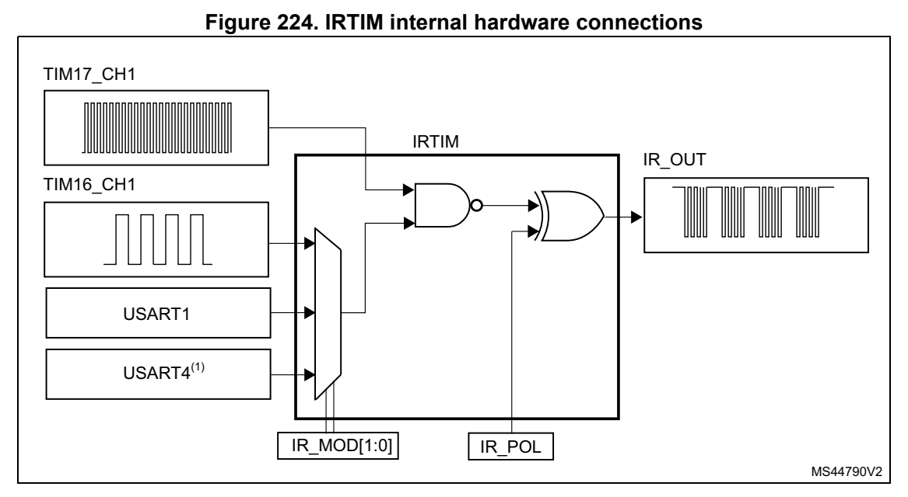

# 20 Infrared interface (IRTIM) (pp. 634-634)

## 20 Infrared interface (IRTIM) (p. 634)

An infrared interface (IRTIM) fo r remote control is available o n the device. It can be used with an infrared LED to perform remote contro l functions.

It uses internal connections with USART1, USART4 (on STM32G070/ B0xx) or USART2 (STM32G030/50xx), TIM16 and TIM17 as shown in Figure 224.

To generate the infrared remote control signals, the IR interfa ce must be enabled and TIM16 channel 1 (TIM16_OC1) and TIM17 channel 1 (TIM17_OC1) must be p roperly configured to generate correct waveforms.

The infrared receiver can be implemented easily through a basic input capture mode.

*Figure 224. IRTIM internal hardware connections (p. 634)*

2. USART4 (on STM32G070/B0xx) or USART2 (STM32G030/50xx). All standard IR pulse modulati on modes can be obtained by programming the two timer output compare channels.

TIM17 is used to gener(a) ate the high frequency carrier signal, wh ile TIM16 or alternatively USART1 or USART4 generates the modulation envelo pe according to the setting of the IR_MOD[1:0] bits in the SYSCFG_CFGR1 register.

The polarity of the output sign al from IRTIM is controlled by t he IR_POL bit in the SYSCFG_CFGR1 register and could be inverted by setting of this bit.

The infrared function is output on the IR_OUT pin. The activati on of this function is done through the GPIOx_AFRx register by enabling the related alterna te function bit.

The high sink LED driver capab ility (only available on the PB9 pin) can be activated through the I2C_PB9_FMP bit in the SYSCFG_CFGR1 register and used to si nk the high current needed to directly control an infrared LED.

a. USART4 (on STM32G070/B0xx) or USART2 (STM32G030/50xx).
