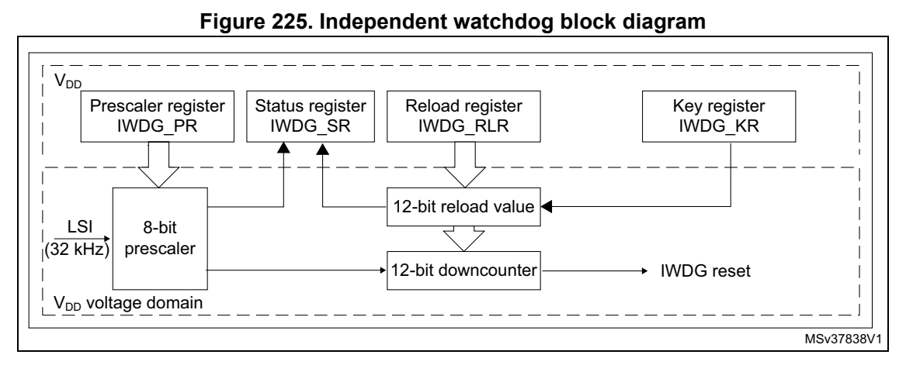

# 21 Independent watchdog (IWDG) (pp. 635-643)

## 21 Independent watchdog (IWDG) (p. 635)

### 21.1 Introduction (p. 635)

The devices feature an embedded watchdog peripheral that offers a combination of high safety level, timing accuracy a nd flexibility of use. The Indep endent watchdog peripheral detects and solves malfunctions due to software failure, and triggers system reset when the counter reaches a given timeout value.

The independent watchdog (IWDG) is clocked by its own dedicated low-speed clock (LSI) and thus stays active even if the main clock fails.

The IWDG is best suited for app lications that require the watch dog to run as a totally independent process outside the ma in application, but have lowe r timing accuracy constraints. For further informat ion on the window watchdog, re fer to Section 22 on page 644.

### 21.2 IWDG ma in features (p. 635)

- Free-running downcounter

- Clocked from an independent RC o scillator (can operate in Stand by and Stop modes)

- Conditional reset – Reset (if watchdog activated) w hen the downcounter value becom es lower than 0x000 – Reset (if watchdog activated) if the downcounter is reloaded o utside the window

### 21.3 IWDG functional description (p. 635)

#### 21.3.1 IWDG block diagram (p. 635)

Figure 225 shows the functional blocks of the independent watchdog module.

*Figure 225. Independent watchdog block diagram (p. 635)*

1. The register interface is located in the V DD voltage domain. The watchdog function is located in the V DD voltage domain, still functional in Stop and Standby modes.

When the independent watchdog is started by writing the value 0x0000 CCCC in the IWDG key register (IWDG_KR), the counter starts counting dow n from the reset value of 0xFF F. When it reaches the end of count value (0x000) a reset signal i s generated (IWDG reset).

Whenever the key value 0x00 00 AAAA is written in the IWDG key register (IWDG_KR), the IWDG_RLR value is reloaded in th e counter and the watchdog rese t is prevented.

Once running, the IWDG cannot be stopped.

#### 21.3.2 Window option (p. 636)

The IWDG can also work as a window watchdog by setting the appropriate window in the IWDG window register (IWDG_WINR).

If the reload operation is perfo rmed while the counter is greater than the value stored in the IWDG window register (IWDG_WINR), then a reset is provided.

The default value of the IWDG window register (IWDG_WINR) is 0x0000 0FFF, so if it is not updated, the window option is disabled.

As soon as the window value is c hanged, a reload operation is p erformed in order to reset the downcoun ter to the IWDG reload register (IWDG_RLR) value and ease the cycle number calculation to generate the next reload.

Configuring the IWDG when the window option is enabled

1. Enable the IWDG by writ ing 0x0000 CCCC in the IWDG key register (IWDG_KR). 2. Enable register access by writing 0x0000 5555 in the IWDG key register (IWDG_KR). 3. Write the IWDG prescaler by programming IWDG prescaler register (IWDG_PR) from 0 to 7. 4. Write the IWDG reload register (IWDG_RLR). 5. Wait for the registers to be updated (IWDG_SR = 0x0000 0000). 6. Write to the IWDG window register (IWDG_WINR). This automatically refreshes the counter value in the IWDG reload register (IWDG_RLR).

Note: Writing the window value allows the counter value to be refreshed by the RLR when IWDG status register (IWDG_SR) is set to 0x0000 0000.

Configuring the IWDG when the window option is disabled

When the window option it is not used, the IWDG can be configured as follows: 1. Enable the IWDG by writ ing 0x0000 CCCC in the IWDG key register (IWDG_KR). 2. Enable register access by writing 0x0000 5555 in the IWDG key register (IWDG_KR). 3. Write the prescaler by programming the IWDG prescaler register (IWDG_PR) from 0 to 7. 4. Write the IWDG reload register (IWDG_RLR). 5. Wait for the registers to be updated (IWDG_SR = 0x0000 0000). 6. Refresh the counter value with IWDG_RLR (IWDG_KR = 0x0000 AAAA).

#### 21.3.3 Hardware watchdog (p. 637)

If the “Hardware watchdog” feature is enabled through the device option bits, the watchdog is automatically enabled at power-on, and generates a reset unl ess the IWDG key register (IWDG_KR) is written by the software before the counter re aches end of count or if the downcounter is reloaded inside the window.

#### 21.3.4 Register access protection (p. 637)

Write access to IWDG prescaler register (IWDG_PR), IWDG reload register (IWDG_RLR) and IWDG window register (IWDG_WINR) is protected. To modify t hem, the user must first write the code 0x0000 5555 in the IWDG key register (IWDG_KR). A write access to this register with a different value breaks the sequence and registe r access is pro tected again. This is the case of the reload operation (writing 0x0000 AAAA).

A status register is available to indicate that an update of th e prescaler or of the downcounter reload va lue or of the window value is ongoing.

#### 21.3.5 Debug mode (p. 637)

When the device enters Debug mode (core halted), the IWDG counter either continues to work normally or stops, depending on the configuration of the corresponding bit in DBGMCU freeze register.

### 21.4 IWDG registers (p. 638)

Refer to Section 1.2 on page 39 for a list of abbre viations used in register descriptions.

The peripheral registers can be a ccessed by half-words (16-bit) or words (32-bit).

### 21.4.1 [IWDG.IWDG_KR] Offset: 0x00 | Reset: 0x00000000 (p. 638)

Address offset: 0x00

Reset value: 0x0000 0000 (reset by Standby mode)

Bits 31:16 Reserved, must be kept at reset value.

Bits 15:0 KEY[15:0]: Key value (write only, read 0x0000) These bits must be written by s oftware at regular intervals wit h the key value 0xAAAA, otherwise the watchdog generates a reset when the counter reach es 0. Writing the key value 0x5555 to enable access to the IWDG_PR, I WDG_RLR and IWDG_WINR registers (see Section 21.3.4: Register access protection) Writing the key value 0xCCCC starts the watchdog (except if the hardware watchdog option is selected)

### 21.4.2 [IWDG.IWDG_PR] Offset: 0x04 | Reset: 0x00000000 (p. 639)

Address offset: 0x04

Reset value: 0x0000 0000

Res. Res. Res. Res. Res. Res. Re s. Res. Res. Res. Res. Res. Res. PR[2:0]

rw rw rw

Bits 31:3 Reserved, must be kept at reset value.

Bits 2:0 PR[2:0]: Prescaler divider These bits are write access protected see Section 21.3.4: Register access protection. They are written by software to sel ect the prescaler divider feeding the counter clock. PVU bit of the IWDG status register (IWDG_SR) must be reset in order to be able to change the prescaler divider. 000: divider /4 001: divider /8 010: divider /16 011: divider /32 100: divider /64 101: divider /128 110: divider /256 111: divider /256 Note: Reading this register returns the prescaler value from the V DD voltage domain. This value may not be up to date/valid if a write operation to this register is ongoing. For this reason the value read from this register is valid only when the PVU bit in the IWDG status register (IWDG_SR) is reset.

### 21.4.3 [IWDG.IWDG_RLR] Offset: 0x08 | Reset: 0x00000FFF (p. 640)

Address offset: 0x08

Reset value: 0x0000 0FFF (reset by Standby mode)

Bits 31:12 Reserved, must be kept at reset value.

Bits 11:0 RL[11:0]: Watchdog counter reload value These bits are write access protected see Register access protection. They are written by software to define the value to be loaded in the watchdog counter each time the value 0xAAAA is written in the IWDG key register (IWDG_KR). The watchdog counter counts down from this value. The timeou t period is a function of this value and the clock prescaler. Refer to the datasheet for the timeout information. The RVU bit in the IWDG status register (IWDG_SR) must be reset to be able to change the reload value. Note: Reading this register returns the reload value from the V DD voltage domain. This value may not be up to date/valid if a write operation to this register is ongoing on it. For this reason the value read from this register is valid only when the RVU bit in the IWDG status register (IWDG_SR) is reset.

### 21.4.4 [IWDG.IWDG_SR] Offset: 0x0C | Reset: 0x00000000 (p. 641)

Address offset: 0x0C

Reset value: 0x0000 0000 (n ot reset by Standby mode)

Res. Res. Res. Res. Res. Res. Re s. Res. Res. Res. Res. Res. Res. WVU RVU PVU

rrr

Bits 31:3 Reserved, must be kept at reset value.

Bit 2 WVU: Watchdog counter window value update This bit is set by hardware to indicate that an update of the w indow value is ongoing. It is reset by hardware w hen the reload value upd ate operation is com pleted in the V DD voltage domain (takes up to five LSI cycles). Window value can be updated only when WVU bit is reset.

Bit 1 RVU: Watchdog counter reload value update This bit is set by hardware to indicate that an update of the reload value is ongoing. It is reset by hardware when the reload value update operation is completed in the V DD voltage domain (takes up to five LSI cycles). Reload value can be updated only when RVU bit is reset.

Bit 0 PVU: Watchdog prescaler value update This bit is set by hardware to indicate that an update of the p rescaler value is ongoing. It is reset by hardware when the prescaler update operation is completed in the V DD voltage domain (takes up to five LSI cycles). Prescaler value can be update d only when PVU bit is reset.

Note: If several reload, prescaler, or window values are used by the application, it is mandatory to wait until RVU bit is reset before changing the reload value, to wait until PVU bit is reset before changing the prescaler value, and to wait until WVU bit is reset before changing the window value. However, after updating the pres caler and/or the reload/window value it is not necessary to wait until RVU or PVU or WVU is reset before continuing code execution except in case of low-power mode entry.

### 21.4.5 [IWDG.IWDG_WINR] Offset: 0x10 | Reset: 0x00000FFF (p. 642)

Address offset: 0x10

Reset value: 0x0000 0FFF (reset by Standby mode)

Bits 31:12 Reserved, must be kept at reset value.

Bits 11:0 WIN[11:0]: Watchdog counter window value These bits are write access protected, see Section 21.3.4, they contain the high limit of the window value to be comp ared with the downcounter. To prevent a reset, the downcoun ter must be relo aded when its value is lower than the window register value and greater than 0x0 The WVU bit in the IWDG status register (IWDG_SR) must be reset in order to be able to change the reload value. Note: Reading this register returns the reload value from the V DD voltage domain. This value may not be valid if a write operation to this register is ongoing. For this reason the value read from this register is valid only when the WVU bit in the IWDG status register (IWDG_SR) is reset.

#### 21.4.6 IWDG register map (p. 643)

The following table gives the IW DG register map and reset value s.

**Table 85. IWDG register map and reset values (p. 643)**

| Offset | Register name | 31 | 30 | 29 | 28 | 27 | 26 | 25 | 24 | 23 | 22 | 21 | 20 | 19 | 18 | 17 | 16 | 15 | 14 | 13 | 12 | 11 | 10 | 9 | 8 | 7 | 6 | 5 | 4 | 3 | 2 | 1 | 0 |
| --- | --- | --- | --- | --- | --- | --- | --- | --- | --- | --- | --- | --- | --- | --- | --- | --- | --- | --- | --- | --- | --- | --- | --- | --- | --- | --- | --- | --- | --- | --- | --- | --- | --- |
| 0x00 | IWDG_KR | Res. | Res. | Res. | Res. | Res. | Res. | Res. | Res. | Res. | Res. | Res. | Res. | Res. | Res. | Res. | Res. |  |  |  |  |  |  |  | KEY[15:0] | KEY[15:0] |  |  |  |  |  |  |  |

Reset value 0 0 0 0 0 0 0 0 0 0 0 0 0 0 0 0

0x04 IWDG_PR Res. Res. Res. Res. Res. Res. Res. Res. Res. Res. Res. Res. Res. Res. Res. Res. Res. Res. Res. Res. Res. Res. Res. Res. Res. Res. Res. Res. Res. PR[2:0] Reset value 000

0x08 IWDG_RLR Res. Res. Res. Res. Res. Res. Res. Res. Res. Res. Res. Res. Res. Res. Res. Res. Res. Res. Res. Res. RL[11:0] Reset value 111111111111

0x0C IWDG_SR Res. Res. Res. Res. Res. Res. Res. Res. Res. Res. Res. Res. Res. Res. Res. Res. Res. Res. Res. Res. Res. Res. Res. Res. Res. Res. Res. Res. Res. WVU RVU PVU Reset value 000

0x10 IWDG_WINR Res. Res. Res. Res. Res. Res. Res. Res. Res. Res. Res. Res. Res. Res. Res. Res. Res. Res. Res. Res. WIN[11:0] Reset value 111111111111

Refer to Section 2.2 on page 44 for the register boundary addresses.
