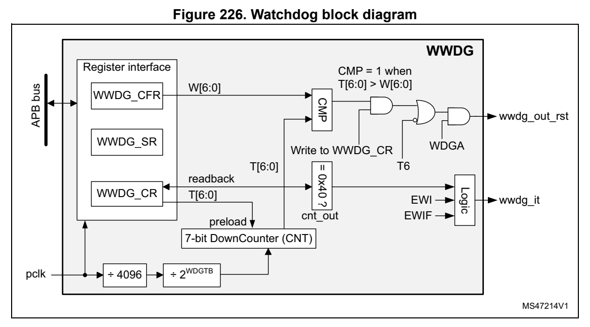
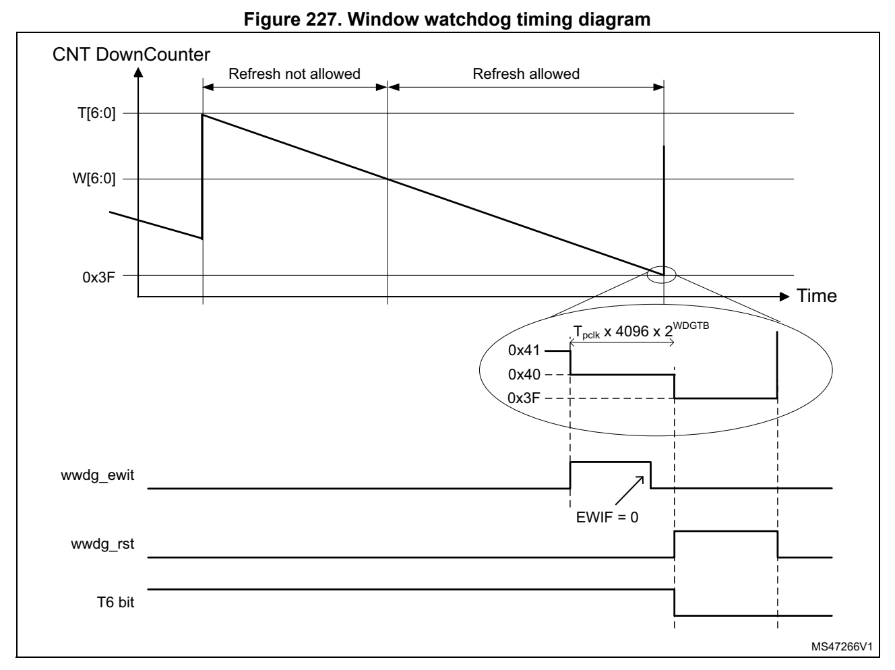

# 22 System window watchdog (WWDG) (pp. 644-649)

## 22 System window watchdog (WWDG) (p. 644)

### 22.1 Introduction (p. 644)

The system window watchdog (WWDG) is used to detect the occurre nce of a software fault, usually generated by external interference or by unforeseen log ical conditions, which causes the application program to abandon its normal sequence. The watchdog circuit generates an MCU reset on expiry of a programmed time period, u nless the program refreshes the contents of the dow n-counter before the T6 bit be comes cleared. An MCU reset is also generated if the 7- bit down-counter value (in the control register) is refreshed before the down-counter has reached the window register value. This implies that the counter must be refres hed in a limited window.

The WWDG clock is prescaled from the APB clock and has a config urable time-window that can be programmed to detect abnormally late or early applicatio n behavior.

The WWDG is best suited for app lications which require the watc hdog to react within an accurate timing window.

### 22.2 WWDG main features (p. 644)

- Programmable free-running down-counter

- Conditional reset – Reset (if watchdog activated) w hen the down-counter value beco mes lower than 0x40 – Reset (if watchdog activated) if the down-counter is reloaded outside the window (see Figure 227)

- Early wakeup interrupt (EWI): triggered (if enabled and the watchdog activated) when the down-counter is equal to 0x40.

### 22.3 WWDG functional description (p. 644)

If the watchdog is activated (th e WDGA bit is set in the WWDG_C R register) and when the 7-bit down-counter (T[6:0] bits) is decremented from 0x40 to 0x3F (T6 becomes cleared), it initiates a reset. If the softwa re reloads the co unter while th e counter is gre ater than the value stored in the window register, then a reset is generated.

The application program must wri te in the WWDG_C R register at regular intervals during normal operation to prevent an MCU reset. This operation must o ccur only when the counter value is lower than the window reg ister value and higher than 0x3F. The value to be stored in the WWDG_CR register mus t be between 0xFF and 0xC0.

Refer to Figure 226 for the WWDG block diagram.

#### 22.3.1 WWDG block diagram (p. 645)

*Figure 226. Watchdog block diagram (p. 645)*

#### 22.3.2 Enabling the watchdog (p. 645)

When the user option WWDG_SW se lects “Software window watchdog”, the watchdog is always disabled after a reset. I t is enabled by setting the WDG A bit in the WWDG_CR register, then it cannot be disabled again except by a reset.

When the user option WWDG_SW selects “Hardware window watchdog”, the watchdog is always enabled after a rese t, it cannot be disabled.

#### 22.3.3 Controlling the down-counter (p. 645)

This down-counter is free-runni ng, counting down even if the wa tchdog is disabled. When the watchdog is enabled, the T6 b it must be set to prevent gene rating an immediate reset.

The T[5:0] bits contain the numb er of increments that represent the time dela y before the watchdog produces a reset. The ti ming varies between a minimum and a maximum value due to the unknown status of the prescaler when writing to the WWDG_CR register (see Figure 227). The WWDG configuration register (WWDG_CFR) contains the high limit of the window: to prevent a reset, the down-counter must be reloaded w hen its value is lower than the window register value and greater than 0x3F. Figure 227 describes the window watchdog process.

Note: The T6 bit can be used to generate a software reset (the WDGA bit is set and the T6 bit is cleared).

#### 22.3.4 How to program the watchdog timeout (p. 645)

Use the formula in Figure 227 to calculate the WWDG timeout.

Warning: When writing to the WWDG_CR register, always write 1 in the T6 bit to avoid generating an immediate reset.

*Figure 227. Window watc hdog timing diagram (p. 646)*

The formula to calculate the timeout value is given by: WDGTB[1:0] t = mst × 4096 2× × ()T 5:0[] + 1 () WWDG PCLK

where: t WWDG: WWDG timeout t PCLK: APB clock period measured in ms 4096: value corresponding to internal divider

As an example, lets assume APB frequency is equal to 48 MHz, WDG TB[1:0] is set to 3 and T[5:0] is set to 63: 3 t ==()1 48000⁄ × 4096 2× × ()63 1+ 43.69ms WWDG

Refer to the datasheet for the mi nimum and maximum values of th e t WWDG.

#### 22.3.5 Debug mode (p. 647)

When the device enters debug mode (processor halted), the WWDG counter either continues to work normally or stops, depending on the configura tion bit in DBG module. For more details refer to Section 29: Debug support (DBG).

### 22.4 WWDG interrupts (p. 647)

The early wakeup interrupt (EWI) can be used if specific safety operations or data logging must be performed before the act ual reset is gen erated. The EWI interrupt is enabled by setting the EWI bit in the WWDG_CFR register. When the down-cou nter reaches the value 0x40, an EWI interrupt is genera ted and the corresponding interrupt service routine (ISR) can be used to trigger specific actions (such as communications or data logging), before resetting the device.

In some applications, the EWI in terrupt can be used to manage a software system check and/or system recovery/graceful d egradation, without generating a WWDG reset. In this case, the corresponding interrupt service routine (ISR) has to reload the WWDG counter to avoid the WWDG reset, then trigger the required actions.

The EWI interrupt is cleared by writing '0' to t he EWIF bit in the WWDG_SR register.

Note: When the EWI interrupt cannot be served, e.g. due to a system lock in a higher priority task, the WWDG reset is eventually generated.

### 22.5 WWDG registers (p. 647)

Refer to Section 1.2 on page 39 for a list of abbre viations used in register descriptions.

The peripheral registers can be a ccessed by halfwords (16-bit) or words (32-bit).

### 22.5.1 [WWDG.WWDG_CR] Offset: 0x000 | Reset: 0x0000007F (p. 647)

Address offset: 0x000

Reset value: 0x0000 007F

Bits 31:8 Reserved, must be kept at reset value.

Bit 7 WDGA: Activation bit This bit is set by software and only clea red by hardware after a reset. When WDGA = 1, the watchdog can gen erate a reset. 0: Watchdog disabled 1: Watchdog enabled

Bits 6:0 T[6:0]: 7-bit counter (MSB to LSB) These bits contain the value of the watchdog coun ter, decremented every (4096 x 2 WDGTB [1:0]) PCLK cycles. A reset is produced when it is decremented from 0x40 to 0x3F (T6 becomes cleared).

### 22.5.2 [WWDG.WWDG_CFR] Offset: 0x004 | Reset: 0x0000007F (p. 648)

Address offset: 0x004

Reset value: 0x0000 007F

Bits 31:10 Reserved, must be kept at reset value.

Bits 13:11 WDGTB[2:0]: Timer base The timebase of the prescale r can be modified as follows: 000: CK Counter Clock (PCLK div 4096) div 1 001: CK Counter Clock (PCLK div 4096) div 2 010: CK Counter Clock (PCLK div 4096) div 4 011: CK Counter Clock (PCLK div 4096) div 8 100: CK Counter Clock (PCLK div 4096) div 16 101: CK Counter Clock (PCLK div 4096) div 32 110: CK Counter Clock (PCLK div 4096) div 64 111: CK Counter Clock (PCLK div 4096) div 128

Bit 9 EWI: Early wakeup interrupt When set, an interrupt occurs whenever the counter reaches the value 0x40. This interrupt is only cleared by hardware after a reset.

Bits 6:0 W[6:0]: 7-bit window value These bits contain the window val ue to be compared with the dow n-counter.

### 22.5.3 [WWDG.WWDG_SR] Offset: 0x008 | Reset: 0x00000000 (p. 649)

Address offset: 0x008

Reset value: 0x0000 0000

Res. Res. Res. Res. Res. Res. Res. Re s. Res. Res. Res. Res. Res. Res. Res. EWIF rc_w0

Bits 31:1 Reserved, must be kept at reset value.

Bit 0 EWIF: Early wakeup interrupt flag This bit is set by hardware when the counter has reached the va lue 0x40. It must be cleared by software by writing ‘0’. Writ ing ‘1’ has no effect. This bit is also set if the interrupt is not enabled.

#### 22.5.4 WWDG register map (p. 649)

The following table gives the WWD G register map and reset value s.

**Table 86. WWDG register map and reset values (p. 649)**

| Col 1 | Offset Register | 31 | 30 | 29 | 28 | 27 | 26 | 25 | 24 | 23 | 22 | 21 | 20 | 19 | 18 | 17 | 16 | 15 | 14 | 13 | 12 | 11 | 10 | 9 | 8 | 7 | 6 | 5 | 4 | 3 | 2 | 1 | 0 |
| --- | --- | --- | --- | --- | --- | --- | --- | --- | --- | --- | --- | --- | --- | --- | --- | --- | --- | --- | --- | --- | --- | --- | --- | --- | --- | --- | --- | --- | --- | --- | --- | --- | --- |
| 0x000 | WWDG_CR | Res. | Res. | Res. | Res. | Res. | Res. | Res. | Res. | Res. | Res. | Res. | Res. | Res. | Res. | Res. | Res. | Res. | Res. | Res. | Res. | Res. | Res. | Res. | Res. | WDGA |  |  |  | T[6:0] |  |  |  |

Reset value 01111111

WDGTB 0x004 WWDG_CFR Res. Res. Res. Res. Res. Res. Res. Res. Res. Res. Res. Res. Res. Res. Res. Res. Res. Res. [2:0] Res. EWI Res. Res. W[6:0]

Reset value 0 0 0 0 1 1 1 1 1 1 1

0x008 WWDG_SR Res. Res. Res. Res. Res. Res. Res. Res. Res. Res. Res. Res. Res. Res. Res. Res. Res. Res. Res. Res. Res. Res. Res. Res. Res. Res. Res. Res. Res. Res. Res. EWIF Reset value 0

Refer to Section 2.2 on page 44 for the register boundary addresses.
