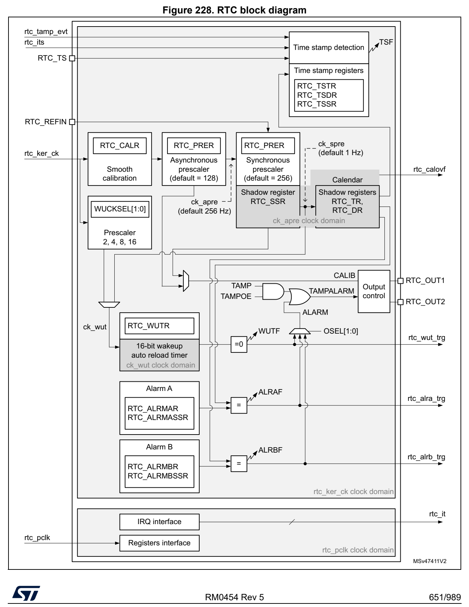

# 23 Real-time clock (RTC) (pp. 650-688)

## 23 Real-time clock (RTC) (p. 650)

### 23.1 Introduction (p. 650)

The RTC provides an automatic wakeup to manage all low-power mo des.

The real-time clock (RTC) is an independent BCD timer/counter. The RTC provides a time-of-day clock/calendar with programmable alarm interrupts.

As long as the supply voltage rem ains in the operating range, t he RTC never stops, regardless of the device status (Run mode, low-power mode or un der reset).

The RTC is functional in V BAT mode.

### 23.2 RTC main features (p. 650)

The RTC supports the fo llowing features (see Figure 228: RTC block diagram):

- Calendar with subsecond, seconds, minutes, hours (12 or 24 form at), week day, date, month, year, in BCD (binary-coded decimal) format.

- Automatic correction for 28, 29 (leap year), 30, and 31 days of the month.

- Two programmable alarms.

- On-the-fly correction from 1 to 32767 RTC clock pulses. This ca n be used to synchronize it with a master clock.

- Reference clock detection: a more precise second source clock ( 50 or 60 Hz) can be used to enhance the calendar precision.

- Digital calibration circuit with 0.95 ppm resolution, to compen sate for quartz crystal inaccuracy.

- Timestamp feature which can be u sed to save the calendar conten t. This function can be triggered by an event on the t imestamp pin, or by a tamper e vent, or by a switch to V BAT mode.

- 17-bit auto-reload wa keup timer (WUT) for periodic events with programmable resolution and period.

The RTC is supplied through a sw itch that takes power either from the V DD supply when present or from the V BAT pin.

The RTC clock sources can be:

- A 32.768 kHz external crystal (LSE)

- An external resonator or oscillator (LSE)

- The internal low power RC osc illator (LSI, with typical frequen cy of 32 kHz)

- The high-speed external clock (HSE), divided by a prescaler in the RCC.

The RTC is functional in V BAT mode and in all low- power modes when it is clocked by the LSE. When clocked by the LSI, t he RTC is not functional in V BAT mode, but is functional in all low-power modes.

All RTC events (Alarm, WakeUp Ti mer, Timestamp) can generate an interrupt and wakeup the device from the low-power modes.

### 23.3 RTC functional description (p. 651)

#### 23.3.1 RTC block diagram (p. 651)

*Figure 228. RTC block diagram (p. 651)*

#### 23.3.2 RTC pins and internal signals (p. 652)

Table 87. RTC input/output pins

Pin name Signal type Description

RTC_TS Input RTC timestamp input

RTC_REFIN Input RTC 50 or 60 Hz reference clock input

RTC_OUT1 Output RTC output 1

RTC_OUT2 Output RTC output 2

- RTC_OUT1 and RTC_OUT2 which sel ects one of the following two ou tputs: – CALIB: 512 Hz or 1 Hz clock output (with an LSE frequency of 32. 768 kHz). This output is enabled by setting the COE bit in the RTC_CR register. – TAMPALRM: This output is the OR between TAMP and ALARM outputs.

ALARM is enabled by configuring the OSEL[1:0] bits in the RTC_C R register which select the alarm A, alarm B or wakeup outputs. TAMP is enabled by sett ing the TAMPOE bit in the RTC_CR register which selects the tamper event outputs.

**Table 88. RTC intern al input/output signals (p. 652)**

| Col 1 | Internal signal name Signal type Description | Col 3 |
| --- | --- | --- |
| rtc_ker_ck Input |  | RTC kernel clock, also named RTCCLK in this document |
|  | rtc_pclk Input RTC APB clock |  |
|  | rtc_its Input RTC internal timestamp event |  |
| rtc_tamp_evt Input |  | Tamper event (internal or external) detected in TAMP peripheral |
| rtc_it Output |  | RTC interrupts (refer to Section 23.5: RTC interrupts for details) |
|  | rtc_alra_trg Output RTC alarm A event detection trigger |  |
|  | rtc_alrb_trg Output RTC ala | rm B event detection trigger |
|  | rtc_wut_trg Output RTC wakeup timer event detection trigger |  |
|  | rtc_calovf Output RTC calendar overflow |  |

The RTC kernel clock is usually the LSE at 32.768 kHz although i t is possible to select other clock sources in the RCC (refer to RCC for more details). Some functions are not available in some low-power modes or V BAT when the selected clock is not LSE. Refer to Section 23.4: RTC low-power modes for more details.

**Table 89. RTC in terconnection (p. 653)**

| Col 1 | Signal name Source/destination |
| --- | --- |
| rtc_its | From power controller (PWR): main power loss/switch to V BAT detection output |
|  | rtc_tamp_evt From TAMP peripheral: tamp_evt |
|  | rtc_calovf To TAMP peripheral: tamp_itamp5 |

The triggers outputs can be used a s triggers for other peripherals.

#### 23.3.3 GPIOs controlled by the RTC and TAMP (p. 653)

The GPIOs included in the Battery Backup Domain (V BAT) are directly controlled by the peripherals providing functions on these I/Os, whatever the GPI O configuration.

Both RTC and TAMP peripherals provide functions on these I/Os ( refer to Section 24: Tamper and backup registers (TAMP)).

RTC_OUT1, RTC_TS and TAMP_IN1 are mapped on the same pin (PC13). The RTC and TAMP functions mapped on PC13 a re available in a ll low-power mo des and in V BAT mode.

The output mechanism follows t he priority order shown in Table 90.

**Table 90. PC13 configuration (1) (pp. 653-655)**

| PC13 Pin function | OSEL[1:0] (ALARM output enable) | TAMPOE (TAMPER output enable) | COE (CALIB output enable) | OUT2EN | TAMPALRM_TYPE | TAMPALRM_PU | TAMP1E (TAMP_IN1 input enable) | TSE (RTC_TS input enable) |
| --- | --- | --- | --- | --- | --- | --- | --- | --- |
| TAMPALRM output Push-Pull | 01 or 10 or 11 00 1 01 or 10 or 11 | 0 1 | Don’t care | Don’t care | 00 | 00 | Don’t care | Don’t care |
| TAMPALRM output | No pull | 01 or 10 or 11 00 1 01 or 10 or 11 | 0 1 | Don’t care | Don’t care | 10 | 10 | Don’t care |
| output (2) Open-Drain | Internal pull-up | 01 or 10 or 11 00 1 01 or 10 or 11 | 0 1 | Don’t care | Don’t care | 11 | 11 | Don’t care |
|  |  | CALIB output PP 00 0 1 0 |  |  |  | Don’t care | Don’t care | Don’t care |
|  |  |  | 00 0 0 |  | Don’t care |  |  |  |
| TAMP_IN1 input floating |  |  | 00 0 1 |  |  | Don’t care | Don’t care | 10 |
|  |  | Don’t care | Don’t care | 0 | 1 |  |  |  |
|  |  |  | 00 0 0 |  | Don’t care |  |  |  |
| RTC_TS and TAMP_IN1 input floating |  |  | 00 0 1 |  |  | Don’t care | Don’t care | 11 |
|  |  | Don’t care | Don’t care | 0 | 1 |  |  |  |
|  |  |  | 00 0 0 |  | Don’t care |  |  |  |
| RTC_TS input floating |  |  | 00 0 1 |  |  | Don’t care | Don’t care | 01 |
|  |  | Don’t care | Don’t care | 0 | 1 |  |  |  |
|  |  | 00 0 0 |  | Don’t care |  |  |  |  |
| Wakeup pin or Standard GPIO |  | 00 0 1 |  |  | Don’t care | Don’t care | 00 | 00 |
|  | Don’t care | Don’t care | 0 | 1 |  |  |  |  |

1. OD: open drain; PP: push-pull. 2. In this configuration the GPIO must be configured in input.

In addition, it is pos sible to output RTC_OUT2 on PA4 pin thanks to OUT2EN bit. This output is not available in V BAT mode. The different functio ns are mapped on RTC_OUT1 or on RTC_OUT2 depending on OSEL, CO E and OUT2EN configuration, as show in table Table 91.

For PA4, the GPIO should be con figured as an alternate function.

**Table 91. RTC_OUT mapping (p. 655)**

| OSEL[1:0] bits ALARM output enable) | COE bit (CALIB output enable) | OUT2EN bit | RTC_OUT1 on PC13 | RTC_OUT2 on PA4 |
| --- | --- | --- | --- | --- |
| 00 0 | 00 0 |  | -- | -- |
|  |  | 00 1 CALIB -0 |  |  |
| 01 or 10 or 11 Don’ |  | t care TAMPALRM - | t care TAMPALRM - |  |
| 00 0 | 00 0 |  | -- | -- |
|  |  | 00 1 - CALIB 1 |  |  |
|  |  | 1 01 or 10 or 11 0 - TAMPALRM |  |  |
|  |  | 01 or 10 or 11 1 TAMPALRM CALIB |  |  |

#### 23.3.4 Clock and prescalers (p. 655)

The RTC clock source (RTCCLK) is selected through the clock con troller among the LSE clock, the LSI oscilla tor clock, and the H SE clock. For more in formation on the RTC clock source configuration, refer to Section 5: Reset and clock control (RCC).

A programmable prescaler stage generates a 1 Hz clock which is u sed to update the calendar. To minimize power con sumption, the prescaler is split into 2 programmable prescalers (see Figure 228: RTC block diagram):

- A 7-bit asynchronous prescaler co nfigured through the PREDIV_A bits of the RTC_PRER register.

- A 15-bit synchronous prescaler co nfigured through the PREDIV_S bits of the RTC_PRER register.

Note: When both prescalers are used, it is recommended to configure the asynchronous prescaler to a high value to minimize consumption.

The asynchronous prescaler divis ion factor is set to 128, and t he synchronous division factor to 256, to obtain an internal clock frequency of 1 Hz (ck_spre) with an LSE frequency of 32.768 kHz.

The minimum division factor is 1 and the maximum division facto r is 2 22 .

This corresponds to a maximum input frequency of around 4 MHz.

f ck_apre is given by the following formula:

f f = --------------------------------------RTCCLK - CK_APRE PREDIV_A 1+

The ck_apre clock is used to cloc k the binary RTC_SSR subsecond s downcounter. When it reaches 0, RTC_SSR is reloaded with the content of PREDIV_S.

f ck_spre is given by the following formula:

f f = ---------------------------------------------------------------RTCCLK ------------------------------- CK_SPRE ()PREDIV_S 1+ × ()PREDIV_A 1+

The ck_spre clock can be used ei ther to update the calendar or as timebase for the 16-bit wakeup auto-reload timer. To obtain short timeout periods, the 16-bit wakeup auto-reload timer can also run wit h the RTCCLK divided by the programmable 4-bit asynchronous prescaler (see Section 23.3.7: Periodic auto-wakeup for details).

#### 23.3.5 Real-time clock and calendar (p. 656)

The RTC calendar time and date registers are accessed through s hadow registers which are synchronized with PCLK (APB clock). They can also be access ed directly in order to avoid waiting for the synchronization duration.

- RTC_SSR for the subseconds

- RTC_TR for the time

- RTC_DR for the date

Every RTCCLK periods, the current calendar value is copied into the shadow registers, and the RSF bit of RTC_ICSR register is set (see Section 23.6.10: RTC shift control register (RTC_SHIFTR)). The copy is not performed in Stop and Standby mode. When exi ting these modes, the shadow registers are updated after up to 4 RTCCLK pe riods.

When the application reads the ca lendar registers, it accesses the content of the shadow registers. It is possible to make a direct access to the calend ar registers by setting the

BYPSHAD control bit in the RTC_C R register. By default, this bi t is cleared, and the user accesses the shadow registers.

When reading the RTC_SSR, RTC_TR or RTC_DR registers in BYPSHAD = 0 mode, the frequency of the APB clock (f APB) must be at least 7 times t he frequency of the RTC clock (f RTCCLK).

The shadow registers are reset by system reset.

#### 23.3.6 Programmable alarms (p. 657)

The RTC unit provides programmable alarm: alarm A and alarm B. The description below is given for alarm A, but can be t ranslated in the same way for al arm B.

The programmable alarm function is enabled through the ALRAE bi t in the RTC_CR register.

The ALRAF is set to 1 if the ca lendar subseconds, seconds, minu tes, hours, date or day match the values programmed in the alarm registers RTC_ALRMASSR and RTC_ALRMAR. Each calendar field can be independently selected t hrough the MSKx bits of the RTC_ALRMAR reg ister, and through t he MASKSSx bits of the RTC_ALRMASSR register.

The alarm interrupt is enabled th rough the ALRAIE bit in the RT C_CR register.

Caution: If the seconds field is selected (MSK1 bit reset i n RTC_ALRMAR), the synchronous prescaler division factor set in the RTC_PRER register must be at least 3 to ensure correct behavior.

Alarm A and alarm B (if enabled by bits OSEL[1:0] in RTC_CR reg ister) can be routed to the TAMPALRM output. TAMPALRM outpu t polarity can be configured through bit POL the RTC_CR register.

#### 23.3.7 Periodic auto-wakeup (p. 657)

The periodic wakeup flag is generated by a 16-bit programmable auto-reload down-counter. The wakeup timer range can be extended to 17 bits.

The wakeup function is enabled through the WUTE bit in the RTC_CR register.

The wakeup timer clock input ck_wut can be:

- RTC clock (RTCCLK) div ided by 2, 4, 8, or 16. When RTCCLK is LSE (32.768 kHz), this allows to co nfigure the wa keup interrupt period from 122 µs to 32 s, with a resolution down to 61 µs.

- ck_spre (usually 1 Hz internal clock) When ck_spre frequency is 1 Hz, this allows to achieve a wakeup time from 1 s to around 36 hours with one-second resolution. This large programm able time range is divided in 2 parts: – from 1 s to 18 hours when WUCKSEL [2:1] = 10 – and from around 18 h to 36 h when WUCKSEL[2:1] = 11. In this las t case 2 16 is added to the 16-bit counter curre nt value. When the initializat ion sequence is complete (see Programming the wakeup timer on page 659), the timer starts counting down. When the wakeup function is enabled, the down-co unting remains active in low-power modes. In add ition, when it reaches 0, the WUTF flag is set in

the RTC_SR register, and the wake up counter is automatically re loaded with its reload value (RTC_WU TR register value).

The WUTF flag must then be cleared by software.

When the periodic wakeup interrupt is enabled by setting the WU TIE bit in the RTC_CR register, it can exit the dev ice from low-power modes.

The periodic wakeup flag can be routed to the TAMPALRM output p rovided it has been enabled through bits OSEL[1:0] of RTC_CR register. TAMPALRM out put polarity can be configured through the POL bit in the RTC_CR register.

System reset, as well as low-power modes (Sleep, Stop and Stand by) have no influence on the wakeup timer.

#### 23.3.8 RTC initialization and configuration (p. 658)

RTC register access

The RTC registers are 32-bit registers. Th e APB interface intro duces 2 wait-states in RTC register accesses except on read accesses to calendar shadow re gisters when BYPSHAD = 0.

RTC register write protection

After system reset, the RTC regi sters are protected against parasitic write access by the DBP bit in the power control peripheral (refer to the PWR power control section). DBP bit must be set in order to enable RTC registers write access.

After Backup domain reset, some of the RTC registers are write- protected.

Writing to the protected RTC regi sters is enabled by writing a key into the Write Protection register, RTC_WPR.

The following steps are required to unlock the write protection on the protected RTC registers. 1. Write 0xCA into th e RTC_WPR register. 2. Write 0x53 into t he RTC_WPR register.

Writing a wrong key reacti vates the write protection.

The protection mechanism is not affected by system reset.

Calendar initialization and configuration

To program the initial time and date calendar values, including the time format and the prescaler configuration, the following sequence is required:

1. Set INIT bit to 1 in the RTC_I CSR register to enter initialization mode. In this mode, the calendar counter is stopped a nd its value can be updated. 2. Poll INITF bit of in the RTC_ICSR register. The initializati on phase mode is entered when INITF is set to 1. It takes around 2 RTCCLK clock cycles ( due to clock synchronization). 3. To generate a 1 Hz clock for th e calendar counter, program both the prescaler factors in RTC_PRER register. 4. Load the initial time and date values in the shadow registers (RTC_TR and RTC_DR), and configure the time format ( 12 or 24 hours) through the FMT bit in the RTC_CR register. 5. Exit the initialization mode by clearing the INIT bit. The a ctual calendar counter value is then automatically loaded and the counting restarts after 4 RTC CLK clock cycles.

When the initialization sequence is complete, the calendar starts counting.

Note: After a system reset, the application can read the INITS flag in the RTC_ICSR register to check if the calendar has been initialized or not. If this flag equals 0, the calendar has not been initialized since the year field is set at its Backup domain reset default value (0x00). To read the calendar after initialization, the software must first check that the RSF flag is set in the RTC_ICSR register.

Daylight saving time

The daylight saving time management is performed through bits S UB1H, ADD1H, and BKP of the RTC_CR register.

Using SUB1H or ADD1H, the software can subtract or add one hour to the calendar in one single operation without going t hrough the initialization proce dure.

In addition, the software can us e the BKP bit to memorize this operation.

Programming the alarm

A similar procedure must be followed to program or update the p rogrammable alarms. The procedure below is given for alarm A but can be translated in t he same way for alarm B. 1. Clear ALRAE in RTC_CR to disable alarm A. 2. Program the alarm A registers (RTC_ALRMASSR/RTC_ALRMAR). 3. Set ALRAE in the RTC_CR register to enable alarm A again.

Note: Each change of the RTC_CR register is taken into account after around 2 RTCCLK clock cycles due to clock synchronization.

Programming the wakeup timer

The following sequence is required to configure or change the wakeup timer auto-reload value (WUT[15:0] in RTC_WUTR): 1. Clear WUTE in RTC_CR to d isable the wakeup timer. 2. Poll WUTWF until i t is set in RTC_ICSR to make sure the acce ss to wakeup auto-reload counter and to WUCKSEL[2:0] bits is allowed. This step m ust be skipped in calendar initialization mode. It takes around 2 RTCCLK clock cycles (due to clock synchronization). 3. Program the wakeup auto-reload value WUT[15:0], and the wake up clock selection (WUCKSEL[2:0] bits in RTC_CR). Set WUTE in RTC_CR to enable the timer again.

The wakeup timer restarts down-counting.The WUTWF bit is cleare d up to 2 RTCCLK clocks cycles after WUTE is cleared, due to clock synchronizati on.

#### 23.3.9 Reading the calendar (p. 660)

When BYPSHAD control bit is cleared in the RTC_CR register

To read the RTC calendar registers (RTC_SSR, RTC_TR and RTC_DR) properly, the APB1 clock frequency (f PCLK) must be equal to or greater than seven times the RTC clock frequency (f RTCCLK). This ensures a secure behavio r of the synchronization mechan ism.

If the APB1 clock frequency is le ss than seven times the RTC cl ock frequency, the software must read the calendar time and date registers twice. If the se cond read of the RTC_TR gives the same result as the first read, this ensures that the data is correct. Otherwise a third read access must be done. In any case the APB1 clock frequency must never be lower than the RTC clock frequency.

The RSF bit is set in RTC_ICSR register each time the calendar registers are copied into the RTC_SSR, RTC_TR and RTC_DR sh adow registers. The copy is pe rformed every RTCCLK cycles. To ensure consiste ncy between the 3 values, read ing either RTC_SSR or RTC_TR locks the values in the hi gher-order calendar shadow reg isters until RTC_DR is read. In case the software makes read accesses to the calendar in a time interval smaller than 1 RTCCLK periods: RSF must be cleared by software after th e first calendar read, and then the software must wait until RSF is set before reading aga in the RTC_SSR, RTC_TR and RTC_DR registers.

After waking up from low-power mode (Stop or Standby), RSF must be cleared by software. The software must then wait until it is set again before readin g the RTC_SSR, RTC_TR and RTC_DR registers.

The RSF bit must be cleared after wakeup and not before enterin g low-power mode.

After a system reset, the softwa re must wait until RSF is set b efore reading the RTC_SSR, RTC_TR and RTC_DR registers. In deed, a system reset resets the shadow registers to their default values.

After an initialization (refer to Calendar initialization and configuration on page 658): the software must wait until RSF is s et before reading the RTC_SSR, RTC_TR and RTC_DR registers.

After synchroniza tion (refer to Section 23.3.11: RTC synchronization): the software must wait until RSF is set before reading the RT C_SSR, RTC_TR and RT C_DR registers.

When the BYPSHAD control bit is set in the RTC_CR register (byp ass shadow registers)

Reading the calendar registers gives the values from the calend ar counters directly, thus eliminating the need to wait for the RSF bit to be set. This is especially useful after exiting from low-power modes (Stop or Standby), since the shadow registers are not updated during these modes.

When the BYPSHAD bit is set to 1, the results of the different registers might not be coherent with ea ch other if an RTCCLK ed ge occurs between two read accesses to the registers. Additionally, the value of one of the registers may be incorrect if an RTCCLK edge occurs during the read operation. The software must read all th e registers twice, and then compare the results to confirm th at the data is coherent and co rrect. Alternatively, the software can just compare the two results of the least-significant calendar register.

Note: While BYPSHAD = 1, instructions which read the calendar registers require one extra APB cycle to complete.

#### 23.3.10 Resetting the RTC (p. 661)

The calendar shadow registers (RTC_SSR, RTC_TR and RTC_DR) and some bits of the RTC status register (RTC_ICSR) a re reset to their default value s by all available system reset sources.

On the contrary, the following registers are reset to their default values by a Backup domain reset and are not affected by a system reset: the RTC current calendar registers, the RTC control register (RTC_CR), the prescaler register (RTC_PRER), t he RTC calibration register (RTC_CALR), the RTC shift register (RTC_SHIFTR), the RTC timestamp registers (RTC_TSSSR, RTC_TSTR and RTC_TSDR), the wakeup timer register ( RTC_WUTR), and the alarm A and alarm B registers (RTC_ALRMASSR/RTC_ALRMAR and RTC_ALRMBSSR/RTC_ALRMBR).

In addition, when clocked by LSE, the RTC keeps on running unde r system reset if the reset source is different from the Ba ckup domain reset one (refer to RCC for details about RTC clock sources not affected by s ystem reset). When a Backup doma in reset occurs, the RTC is stopped and all the RTC registers are set to their reset val ues.

#### 23.3.11 RTC synchronization (p. 661)

The RTC can be synchronized to a remote clock with a high degre e of precision. After reading the sub-second field (RTC_SSR or RTC_TSSSR), a calculat ion can be made of the precise offset between the times being maintained by the remote clock and the RTC. The RTC can then be adjusted to elimin ate this offset by “shifting” its clock by a fraction of a second using RTC_SHIFTR.

RTC_SSR contains the value of the synchronous prescaler counter. This allows one to calculate the exact time being m aintained by the RTC down to a resolution of 1 / (PREDIV_S + 1) seconds. As a con sequence, the resolution can be improved by increasing the synchronous prescaler value (PREDIV_S[14:0]. The maximum resolution allowed (30.52 µs with a 32768 Hz clock) is obtained with PREDIV_S set to 0x7FFF.

However, increasing PREDIV_S me ans that PREDIV_A must be decrea sed in order to maintain the synchro nous prescaler output at 1 Hz. In this way, the frequency of the asynchronous pre scaler output increases, which may increase the RTC dynamic consumption.

The RTC can be finely adjusted using the RTC shift control regi ster (RTC_SHIFTR). Writing to RTC_SHIFTR can shift (either d elay or advance) the clock by up to a second with a resolution of 1 / (PREDIV_S + 1) seco nds. The shift operation consi sts of adding the SUBFS[14:0] value to the synchron ous prescaler counter SS[15:0]: this will delay the clock. If at the same time the ADD1S bit is set, this results in addin g one second a nd at the same time subtracting a fraction of s econd, so this will advance the clock.

Caution: Before initiating a shift operation, the user must check that S S[15] = 0 in order to ensure that no overflow will occur.

As soon as a shift operation is initiated by a write to the RTC_SHIFTR register, the SHPF flag is set by hardware to indicate that a shift operation is p ending. This bit is cleared by hardware as so on as the shift operation has completed.

Caution: This synchronization feature is not compatible w ith the referen ce clock detection feature: firmware must not write to RTC_SHIFTR when REFCKON = 1.

#### 23.3.12 RTC referen ce clock detection (p. 662)

The update of the RTC ca lendar can be synchronized to a referen ce clock, RTC_REFIN, which is usually the mains frequen cy (50 or 60 Hz). The precisio n of the RTC_REFIN reference clock should be higher than the 32.768 kHz LSE clock. When the RTC_REFIN detection is enabled (REFCKON bit of RTC_CR set to 1), the cale ndar is still clocked by the LSE, and RTC_REFIN is used to co mpensate for the imprecision of the calendar update frequency (1 Hz).

Each 1 Hz clock edge is compared to the nearest RTC_REFIN clock edge (if one is found within a given time window). In most cases, the two clock edges are properly aligned. When the 1 Hz clock becomes misaligned due to the imprecision of the LSE clock, the RTC shifts the 1 Hz clock a bit so that future 1 Hz clock edges are aligned. Thanks to this mechanism, the calendar becomes as precise as the reference clock.

The RTC detects if the reference clock source is present by usi ng the 256 Hz clock (ck_apre) generated from the 32.768 kHz quartz. The detection is performed during a time window around each of the calenda r updates (every 1 s). The wind ow equals 7 ck_apre periods when detecting the first reference clock edge. A smalle r window of 3 ck_apre periods is used for subse quent calendar updates.

Each time the reference clock is detected in the window, the asynchronous prescaler which outputs the ck_spre clock is forced to reload. This has no effe ct when the reference clock and the 1 Hz clock are aligned because the prescaler is being re loaded at the same moment. When the clocks are not aligned, the relo ad shifts futu re 1 Hz clock edges a little for them to be aligned wi th the reference clock.

If the reference clock halts (no reference clock edge occurred during the 3 ck_apre window), the calendar is updated continuously based solely on the LSE cl ock. The RTC then waits for the reference clock using a larg e 7 ck_apre peri od detection wi ndow centered on the ck_spre edge.

When the RTC_REFIN detection is enabled, PREDIV_A and PREDIV_S must be set to their default values:

- PREDIV_A = 0x007F

- PREVID_S = 0x00FF

Note: RTC_REFIN clock detection is not available in Standby mode.

#### 23.3.13 RTC smooth digital calibration (p. 662)

The RTC frequency can be digita lly calibrated wit h a resolution of about 0.954 ppm with a range from -487.1 ppm to +488.5 pp m. The correction of the freque ncy is performed using series of small adjustments (adding and/or subtracting individu al RTCCLK pulses). These adjustments are fairly well dist ributed so that the RTC is well calibrated even when observed over short durations of time.

The smooth digital calibration i s performed during a cycle of a bout 2 20 RTCCLK pulses, or 32 seconds when the input frequency is 32768 Hz. This cycle is m aintained by a 20-bit counter, cal_cnt[19:0], clocked by RTCCLK.

The smooth calibration register (RTC_CALR) specifies the number of RTCCLK clock cycles to be masked during the 32-second cycle:

- Setting the bit CALM[0] to 1 caus es exactly one pulse to be mas ked during the 32-second cycle.

- Setting CALM[1] to 1 causes two a dditional cycles to be masked

- Setting CALM[2] to 1 causes four additional cycle s to be masked

- and so on up to CALM[8] set to 1 which caus es 256 clocks to be masked.

Note: CALM[8:0] (RTC_CALR) specifies the number of RTCCLK pulses to be masked during the 32-second cycle. Setting the bit CALM[0] to 1 causes exactly one pulse to be masked during the 32-second cycle at the moment when cal_cn t[19:0] is 0x80000; CALM[1] = 1 causes two other cycles to be masked (when cal_cnt is 0x40000 and 0xC0000); CALM[2] = 1 causes four other cycles to be masked (cal_cnt = 0x20000/0x60000/0xA0000/ 0xE0000); and so on up to CALM[8] = 1 which causes 256 clocks to be masked (cal_cnt = 0xXX800).

While CALM allows the RTC frequency to be re duced by up to 487. 1 ppm with fine resolution, the bit CALP can be used to increase the frequency11 by 488.5 ppm. Setting CALP to 1 effectively inserts an extra RTCCLK pulse every 2 RTCCLK cycles, which means that 512 clocks are added during every 32-second cycle.

Using CALM together with CALP, an offset ranging from -511 to + 512 RTCCLK cycles can be added during the 32-second cycle, which translates to a cali bration range of -487.1 ppm to +488.5 ppm with a resolution of about 0.954 ppm.

The formula to calculate the effective calibrate d frequency (F CAL) given the input frequency (F RTCCLK) is as follows: 20 F CAL = F RTCCLK x [1 + (CALP x 512 - CALM) / (2 + CALM - CALP x 512)]

Calibration when PREDIV_A < 3

The CALP bit can not be set to 1 when the asynchronous prescale r value (PREDIV_A bits in RTC_PRER register) is less than 3. If CALP was already set to 1 and PREDIV_A bits are set to a value less than 3, CALP is ignored and the calibration operates as if CALP was equal to 0.

To perform a ca libration with PREDIV_A less than 3, the synchro nous prescaler value (PREDIV_S) should be reduced so that each second is accelerated by 8 RTCCLK clock cycles, which is equivalent to a dding 256 clock cycles every 32 seconds. As a result, between 255 and 256 clock pulses (corresponding to a calibratio n range from 243.3 to 244.1 ppm) can effectively be ad ded during each 32-second cycle using only the CALM bits.

With a nominal RTCCLK frequency of 32768 Hz, when PREDIV_A equal s 1 (division factor of 2), PREDIV_S should be set to 16379 rather than 16383 (4 less). The only other interesting case is w hen PREDIV_A equals 0, PREDIV_S should be set to 32759 rather than 32767 (8 less).

If PREDIV_S is reduced in this way, the formula given the effective frequency of the calibrated input cl ock is as follows: 20 F CAL = F RTCCLK x [1 + (256 - CALM) / (2 + CALM - 256)]

In this case, CALM[7:0] equals 0x 100 (the midpoint of the CALM range) is the correct setting if RTCCLK is exactly 32768.00 Hz.

Verifying the RTC calibration

RTC precision is ensured by measu ring the precise frequency of RTCCLK and calculating the correct CALM value and CALP values. An option al 1 Hz output is provided to allow applications to measure an d verify the RTC precision.

Measuring the precise frequency of the RTC over a limited interval can result in a measurement error of up to 2 RTCCLK clock cycles over the measu rement period, depending on how the digital ca libration cycle is aligned with the measurement period.

However, this measure ment error can be e liminated if the measurement period is the same length as the calibration cycle period. In this case, the only error observed is the error due to the resolution of the digital calibration.

- By default, the calibration cyc le period is 32 seconds.

Using this mode and measuring t he accuracy of the 1 Hz output over exactly 32 seconds guarantees that the measure is w ithin 0.477 ppm (0.5 RTCCLK cycl es over 32 seconds, due to the limitation of the calibration resolution).

- CALW16 bit of the RTC_CALR register can be set to 1 to force a 16- second calibration cycle period.

In this case, the RTC precision can be measured during 16 secon ds with a maximum error of 0.954 ppm (0.5 RTCCLK cycles over 16 seconds). However, since the calibration resolution is reduced, the long term RTC precision is also redu ced to 0.954 ppm: CALM[0] bit is stuck at 0 when CALW16 is set to 1.

- CALW8 bit of the RTC_CALR register can be set to 1 to force a 8 -second calibration cycle period.

In this case, the RTC precision can be measured during 8 second s with a maximum error of 1.907 ppm (0.5 RTCCLK cycles over 8 s). The long term RTC precisi on is also reduced to 1.907 ppm: CALM[1:0] bits are stuc k at 00 when CALW8 is set to 1.

Re-calibration on-the-fly

The calibration register (RTC_CALR) can be updated on-the-fly w hile RTC_ICSR/INITF = 0, by using the follow process: 1. Poll the RTC_ICSR/RECALPF (re -calibration pending flag). 2. If it is set to 0, write a new value to RTC_CALR, if necessa ry. RECALPF is then automatically set to 1 3. Within three ck_apre cycles after the write operation to RTC_CALR, the new calibration settings take effect.

#### 23.3.14 Timestamp function (p. 664)

Timestamp is enabled by setting the TSE or ITSE bits of RTC_CR register to 1.

When TSE is set:

The calendar is save d in the timestamp registers (RTC_TSSSR, RT C_TSTR, RTC_TSDR) when a timestamp event is de tected on the RTC_TS pin.

When TAMPTS is set:

The calendar is save d in the timestamp registers (RTC_TSSSR, RT C_TSTR, RTC_TSDR) when a tamper event is dete cted on the TAMP_INx pinx.

When ITSE is set:

The calendar is save d in the timestamp registers (RTC_TSSSR, RT C_TSTR, RTC_TSDR) when an internal timestamp event is detected. The internal time stamp event is generated by the switch to the V BAT supply.

When a timestamp event occurs, d ue to internal or external even t, the timestamp flag bit (TSF) in RTC_SR register is set. In case the event is internal, the ITSF flag is also set in RTC_SR register.

By setting the TSIE bit in the RTC_CR register, an interrupt is generated when a timestamp event occurs.

If a new timestamp event is detected while the timestamp flag ( TSF) is already set, the timestamp overflow flag (TSOVF) flag is set and the timestamp registers (RTC_TSTR and RTC_TSDR) maintain the resu lts of the previous event.

Note: TSF is set 2 ck_apre cycles after the timestamp event occurs due to synchronization process. There is no delay in the setting of TSOVF. This means that if two timestamp events are close together, TSOVF can be seen as '1' while TSF is still '0'. As a consequence, it is recommended to poll TSOVF only after TSF has been set.

Caution: If a timestamp event occurs imm ediately after the TSF bit is su pposed to be cleared, then both TSF and TSOVF bits are set. To avoid masking a timestamp event occurring at the same moment, the application must not write 0 into TSF bit unle ss it has already read it to 1.

Optionally, a tamper event can cause a timestamp to be recorded. See the description of the TAMPTS control bit in the RTC control register (RTC_CR).

#### 23.3.15 Calibration clock output (p. 665)

When the COE bit is set to 1 in the RTC_CR register, a reference clock is provided on the CALIB device output.

If the COSEL bit in the RTC_CR register is reset and PREDIV_A = 0x7F, the CALIB frequency is f RTCCLK/64. This corresponds to a calibration output at 512 Hz for an RTCC LK frequency at 32.768 kHz. The CAL IB duty cycle is irregular: there is a light jitter on falling edges. It is therefore reco mmended to use rising edges.

When COSEL is set and “PREDIV_S+1” is a non-zero multiple of 25 6 (i.e: PREDIV_S[7:0] = 0xFF), the CALIB frequency is f RTCCLK/(256 * (PREDIV_A+1)). T his corresponds to a calibration output at 1 Hz for prescaler default values (PREDIV_A = Ox7F, PREDIV_S = 0xFF), with an RTCCLK frequency at 32.768 kHz.

Note: When the CALIB output is selected, the RTC_ OUT1 pin is automatically configured but the RTC_OUT2 pin must be set as alternate function. th When COSEL is cleared, the CALIB output is the output of the 6 stage of the asynchronous prescaler. When COSEL is set, the CALIB output is the output of the 8 th stage of the synchronous prescaler.

#### 23.3.16 Tamper and alarm output (p. 665)

The OSEL[1:0] control bits in th e RTC_CR register are used to a ctivate the alarm output TAMPALRM, and to select the function which is output. These fun ctions reflect the contents of the corresponding flags in the RTC_SR register.

When the TAMPOE control bit is set is the RTC_CR, all external and internal tamper flags are ORed and routed to the TAMPALRM outpu t. If OSEL = 00 the TA MPALRM output reflects only the tampers flags. If OSEL ≠ 00, the signal on TA MPALRM provides both tamper flags and alarm A, B, or wakeup flag.

The polarity of the TAMPALRM out put is determine d by the POL co ntrol bit in RTC_CR so that the opposite of the selected flags bit is output when POL is set to 1.

TAMPALRM output

The TAMPALRM pin can be configured in output ope n drain or outp ut push-pull using the control bit TAMPALRM_TYPE in t he RTC_CR register. It is possibl e to apply the internal pull-up in output mode thanks to TAMPALRM_PU in the RTC_CR.

Note: Once the TAMPALRM output is enabled, it has priority over CALIB on RTC_OUT1. When TAMPALRM output is selected, the RTC_ OUT1 pin is automatically configured but the RTC_OUT2 pin must be set as alternate function. In case the TAMPALRM is configured open-drain in the RTC, the RTC_OUT1 GPIO must be configured as input.

### 23.4 RTC low-power modes (p. 666)

**Table 92. Effect of low-power modes on RTC (p. 666)**

| Col 1 | Mode Description |
| --- | --- |
| Sleep | No effect RTC interrupts cause the device to exit the Sleep mode. |
| Stop | The RTC remains active when the RTC clock source is LSE or LSI. RTC interrupts cause the device to exit the Stop mode. |
| Standby | The RTC remains active when the RTC clock source is LSE or LSI. RTC interrupts cause the device to ex it the Standby mode. |

The table below summarizes the RTC pins and functions capability in all modes.

**Table 93. RTC pins functionality over modes (p. 666)**

| Functions | Functional in all low-power modes except Standby modes | Functional in Standby mode | Functional in V BAT mode |
| --- | --- | --- | --- |
|  | RTC_TS Yes Yes Yes |  |  |
|  | RTC_REFIN Yes No No |  |  |
|  | RTC_OUT1 Yes Yes Yes |  |  |
|  | RTC_OUT2 Yes Yes No |  |  |

### 23.5 RTC interrupts (p. 666)

The interrupt channel is set in t he masked interrupt status reg ister. The interrupt output is also activated.

**Table 94. Interrupt requests (p. 667)**

| Interrupt acronym | Interrupt event | Event flag (1) | Enable control bit (2) | Interrupt clear method | Exit from Sleep mode | Exit from Stop and Standby mode |
| --- | --- | --- | --- | --- | --- | --- |
|  |  | Alarm A ALRAF ALRAIE |  | write 1 in CALRAF | Yes Yes | (3) |
| RTC |  | Alarm B ALRBF ALRBIE |  | write 1 in CALRBF | Yes Yes | (3) |
| RTC |  | Timestamp TSF TSIE |  | write 1 in CTSF | Yes Yes | (3) |
|  | Wakeup timer interrupt |  | WUTF WUTIE | write 1 in CWUTF | Yes Yes | (3) |

1. The event flags are in the RTC_SR register. 2. The interrupt masked flags (re sulting from event flags AND en able control bits) are in the RTC_MISR register. 3. Wakeup from Stop and Standby modes is possible only when the RTC clock source is LSE or LSI.

### 23.6 RTC registers (p. 667)

Refer to Section 1.2 on page 39 of the reference manual for a list of abbreviations used in register descriptions.

The peripheral registers can be accessed by words (32-bit).

### 23.6.1 [RTC.RTC_TR] Offset: 0x00 | Reset: 0x00000000 (p. 667)

The RTC_TR is the calendar time s hadow register. This register must be written in initialization mode only. Refer to Calendar initialization and configuration on page 658 and Reading the calendar on page 660.

This register is write protected. The write access procedure is described in RTC register write protection on page 658.

Address offset: 0x00

Backup domain reset value: 0x0000 0000

System reset value: 0x0000 0000 (when BYPSHAD = 0, not affected when BYPSHAD = 1)

Bits 31:23 Reserved, must be kept at reset value.

Bit 22 PM: AM/PM notation 0: AM or 24-hour format 1: PM

Bits 21:20 HT[1:0]: Hour tens in BCD format

Bits 19:16 HU[3:0]: Hour units in BCD format

Bit 15 Reserved, must be kept at reset value.

Bits 14:12 MNT[2:0]: Minute tens in BCD format

Bits 11:8 MNU[3:0]: Minute units in BCD format

Bit 7 Reserved, must be kept at reset value.

Bits 6:4 ST[2:0]: Second tens in BCD format

Bits 3:0 SU[3:0]: Second units in BCD format

### 23.6.2 [RTC.RTC_DR] Offset: 0x04 | Reset: 0x00002101 (p. 668)

The RTC_DR is the calendar date shadow register. This register must be written in initialization mode only. Refer to Calendar initialization and configuration on page 658 and Reading the calendar on page 660.

This register is write protected. The write access procedure is described in RTC register write protection on page 658.

Address offset: 0x04

Backup domain reset value: 0x0000 2101

System reset value: 0x0000 2101 (when BYPSHAD = 0, not affected when BYPSHAD = 1)

Bits 31:24 Reserved, must be kept at reset value.

Bits 23:20 YT[3:0]: Year tens in BCD format

Bits 19:16 YU[3:0]: Year units in BCD format

Bits 15:13 WDU[2:0]: Week day units 000: forbidden 001: Monday

... 111: Sunday

Bit 12 MT: Month tens in BCD format

Bits 11:8 MU[3:0]: Month units in BCD format

Bits 7:6 Reserved, must be kept at reset value.

Bits 5:4 DT[1:0]: Date tens in BCD format

Bits 3:0 DU[3:0]: Date units in BCD format

Note: The calendar is frozen when reaching the maximum value, and can’t roll over.

### 23.6.3 [RTC.RTC_SSR] Offset: 0x08 | Reset: 0x00000000 (p. 669)

Address offset: 0x08

Backup domain reset value: 0x0000 0000

System reset value: 0x0000 0000 (when BYPSHAD = 0, not affected when BYPSHAD = 1)

Bits 31:16 Reserved, must be kept at reset value.

Bits 15:0 SS[15:0]: Sub second value SS[15:0] is the value in the synchronous prescaler counter. The fraction of a second is given by the formula below: Second fraction = (PREDIV_S - SS) / (PREDIV_S + 1) Note: SS can be larger than PREDIV_S only after a shift operation. In that case, the correct time/date is one second less than as indicated by RTC_TR/RTC_DR.

### 23.6.4 [RTC.RTC_ICSR] Offset: 0x0C | Reset: 0x00000007 (p. 669)

This register is write protected. The write access procedure is described in RTC register write protection on page 658.

Address offset: 0x0C

Backup domain reset value: 0x0000 0007

System reset value: 0bxxxx xxxx xxxx xxxx xxxx xxxx 000x xxxx ( not affected, except INIT, INITF, and RSF bits wh ich are cleared to 0)

PF

r

Bits 31:17 Reserved, must be kept at reset value.

Bit 16 RECALPF: Recalibration pending Flag The RECALPF status flag is automatically set to 1 when software writes to the RTC_CALR register, indicating that the RTC_CALR register is blocked. Whe n the new calibration settings are taken into account, this bit returns to 0. Refer to Re-calibration on-the-fly.

Bits 15:8 Reserved, must be kept at reset value.

Bit 7 INIT: Initialization mode 0: Free running mode 1: Initialization mode used to p rogram time and date register ( RTC_TR and RTC_DR), and prescaler register (RTC_PRER). Counters are stopped and start counting from the new value when INIT is reset.

Bit 6 INITF: Initialization flag When this bit is set to 1, the RT C is in initializ ation state, and the time, date and prescaler registers can be updated. 0: Calendar registers update is not allowed 1: Calendar registers update is allowed

Bit 5 RSF: Registers synchronization flag This bit is set by hardware eac h time the calendar registers are copied into the shadow registers (RTC_SSRx, RTC_TRx and RTC_DRx). This bit is cleared by hardware in initialization mode, while a shift operation is pending (SHPF = 1), or when in bypass shadow register mode (BYPSHAD = 1). This bit can also be cleared by software. It is cleared either by software or by hardware in initializati on mode. 0: Calendar shadow registers not yet synchronized 1: Calendar shadow registers synchronized

Bit 4 INITS: Initialization status flag This bit is set by hardware when the calendar year field is different from 0 (Backup domain reset state). 0: Calendar has not been initialized 1: Calendar has been initialized

Bit 3 SHPF: Shift operation pending This flag is set by hardware as s oon as a shift operation is in itiated by a w rite to the RTC_SHIFTR register. It is cleared by hardware when the corresp onding shift operation has been executed. Writing to t he SHPF bit has no effect. 0: No shift operation is pending 1: A shift operation is pending

Bit 2 WUTWF: Wakeup timer write flag This bit is set by hardware when WUT value can be changed, afte r the WUTE bit has been set to 0 in RTC_CR. It is cleared by hardware in initialization mode. 0: Wakeup timer configuration up date not allowed except in init ialization mode 1: Wakeup timer configuration update allowed

Bit 1 ALRBWF: Alarm B write flag This bit is set by hardware wh en alarm B values can be changed, after the ALRBE bit has been set to 0 in RTC_CR. It is cleared by hardware in initialization mode. 0: Alarm B update not allowed 1: Alarm B update allowed

Bit 0 ALRAWF: Alarm A write flag This bit is set by hardware wh en alarm A values can be changed, after the ALRAE bit has been set to 0 in RTC_CR. It is cleared by hardware in initialization mode. 0: Alarm A update not allowed 1: Alarm A update allowed

### 23.6.5 [RTC.RTC_PRER] Offset: 0x10 | Reset: 0x007F00FF (p. 671)

This register must be written in initialization mode only. The initialization must be performed in two separate write accesses. Refer to Calendar initialization and configuration on page 658.

This register is write protected. The write access procedure is described in RTC register write protection on page 658.

Address offset: 0x10

Backup domain reset value: 0x007F 00FF

System reset: not affected

Bits 31:23 Reserved, must be kept at reset value.

Bits 22:16 PREDIV_A[6:0]: Asynchronous prescaler factor This is the asynchron ous division factor: ck_apre frequency = RTCCLK frequency/(PREDIV_A+1)

Bit 15 Reserved, must be kept at reset value.

Bits 14:0 PREDIV_S[14:0]: Synchronous prescaler factor This is the synchrono us division factor: ck_spre frequency = ck_apre frequency/(PREDIV_S+1)

### 23.6.6 [RTC.RTC_WUTR] Offset: 0x14 | Reset: 0x0000FFFF (p. 672)

This register can be written only when WUTWF is set to 1 in RTC_ICSR.

This register is write protected. The write access procedure is described in RTC register write protection on page 658.

Address offset: 0x14

Backup domain reset value: 0x0000 FFFF

System reset: not affected

Bits 31:16 Reserved, must be kept at reset value.

Bits 15:0 WUT[15:0]: Wakeup auto-reload value bits When the wakeup timer is enabled (WUTE set to 1), the WUTF flag is set every (WUT[15:0] + 1) ck_wut cycles. T he ck_wut period is selected thro ugh WUCKSEL[2:0] bits of the RTC_CR register. When WUCKSEL[2] = 1, the wakeup t imer becomes 17-bits and WUCKS EL[1] effectively becomes WUT[16] the most-signi ficant bit to be reloaded into th e timer. The first assertion of WUTF occurs between WUT and (WUT + 1) ck_wut cycles after WUTE is set. Setting WUT[15: 0] to 0x0000 w ith WUCKSEL[2:0] = 011 (RT CCLK/2) is forbidden.

### 23.6.7 [RTC.RTC_CR] Offset: 0x18 | Reset: 0x00000000 (p. 672)

This register is write protected. The write access procedure is described in RTC register write protection on page 658.

Address offset: 0x18

Backup domain reset value: 0x0000 0000

System reset: not affected

Bit 31 OUT2EN: RTC_OUT2 output enable Setting this bit allows to remap the RTC outputs on RTC_OUT2 as follows: OUT2EN = 0: RTC output 2 disable If OSEL ≠ 00 or TAMPOE = 1: TAM PALRM is output on RTC_OUT1 If OSEL = 00 and TAMPOE = 0 and COE = 1: CALIB is output on RTC_OUT1 OUT2EN = 1: RTC output 2 enable If (OSEL ≠ 00 or TAMPOE = 1) and C OE = 0: TAMPALRM is output on RTC_OUT2 If OSEL = 00 and TAMPOE = 0 and COE = 1: CALIB is output on RTC_OUT2 If (OSEL≠ 00 or TAMPOE = 1) and COE = 1: CALIB is output on RTC_OUT2 and TAMPALRM is output on RTC_OUT1.

Bit 30 TAMPALRM_TYPE: TAMPALRM output type 0: TAMPALRM is push-pull output 1: TAMPALRM is open-drain output

Bit 29 TAMPALRM_PU: TAMPALRM pull-up enable 0: No pull-up is applie d on TAMPALRM output 1: A pull-up is applie d on TAMPALRM output

Bits 28:27 Reserved, must be kept at reset value.

Bit 26 TAMPOE: Tamper detection output enable on TAMPALRM 0: The tamper flag is not routed on TAMPALRM 1: The tamper flag is routed on TAMPALRM, combined with the sig nal provided by OSEL and with the polarity provided by POL.

Bit 25 TAMPTS: Activate timestamp on tamper detection event 0: Tamper detection event does no t cause a RTC timestamp to be saved 1: Save RTC timestamp on tamper detection event TAMPTS is valid even if TSE = 0 in the RTC_CR register. Timesta mp flag is set after the tamper flags, therefore if TAMPTS and TSIE are set, it is recom mended to disable the tamper interrupts in order to avoid servicing 2 interrupts.

Bit 24 ITSE: timestamp on internal event enable 0: internal event timestamp disabled 1: internal event timestamp enabled

Bit 23 COE: Calibration output enable This bit enables the CALIB output 0: Calibration output disabled 1: Calibration output enabled

Bits 22:21 OSEL[1:0]: Output selection These bits are used to select t he flag to be routed to TAMPALRM output. 00: Output disabled 01: Alarm A output enabled 10: Alarm B output enabled 11: Wakeup output enabled

Bit 20 POL: Output polarity This bit is used to configure t he polarity of TAMPALRM output. 0: The pin is high when ALRAF/ALRBF/WUTF is asserted (depending on OSEL[1:0]), or when a TAMPxF/ITAMPxF is asserted (if TAMPOE = 1). 1: The pin is low when ALRAF/ALRBF/WUTF is asserted (depending on OSEL[1:0]), or when a TAMPxF/ITAMPxF is asserted (if TAMPOE = 1).

Bit 19 COSEL: Calibration output selection When COE = 1, this bit selects w hich signal is output on CALIB. 0: Calibration output is 512 Hz 1: Calibration output is 1 Hz These frequencies are valid for RTCCLK at 32.768 kHz and prescal ers at their default values (PREDIV_A = 127 and PREDIV_S = 255). Refer to Section 23.3.15: Calibration clock output.

Bit 18 BKP: Backup This bit can be written by the us er to memorize whether the day light saving time change has been performed or not.

Bit 17 SUB1H: Subtract 1 hour (winter time change) When this bit is set outside initialization mode, 1 hour is sub tracted to the calendar time if the current hour is not 0. This bit is always read as 0. Setting this bit has no effe ct when current hour is 0. 0: No effect 1: Subtracts 1 hour to the current time. This can be used for w inter time change.

Bit 16 ADD1H: Add 1 hour (summer time change) When this bit is set ou tside initialization mode, 1 hour is add ed to the calendar time. This bit is always read as 0. 0: No effect 1: Adds 1 hour to the current tim e. This can be used for summer time change

Bit 15 TSIE: Timestamp interrupt enable 0: Timestamp interrupt disable 1: Timestamp interrupt enable

Bit 14 WUTIE: Wakeup timer interrupt enable 0: Wakeup timer interrupt disabled 1: Wakeup timer interrupt enabled

Bit 13 ALRBIE: Alarm B interrupt enable 0: Alarm B inte rrupt disable 1: Alarm B inte rrupt enable

Bit 12 ALRAIE: Alarm A interrupt enable 0: Alarm A interrupt disabled 1: Alarm A interrupt enabled

Bit 11 TSE: timestamp enable 0: timestamp disable 1: timestamp enable

Bit 10 WUTE: Wakeup timer enable 0: Wakeup timer disabled 1: Wakeup timer enabled Note: When the wakeup timer is disabled, wait for WUTWF=1 before enabling it again.

Bit 9 ALRBE: Alarm B enable 0: Alarm B disabled 1: Alarm B enabled

Bit 8 ALRAE: Alarm A enable 0: Alarm A disabled 1: Alarm A enabled

Bit 7 Reserved, must be kept at reset value.

Bit 6 FMT: Hour format 0: 24 hour/day format 1: AM/PM hour format

Bit 5 BYPSHAD: Bypass the shadow registers 0: Calendar values (when reading from RTC_SSR, RTC_TR, and RTC_ DR) are taken from the shadow registers, which are updated once every two RTCCLK cycles. 1: Calendar values (when reading from RTC_SSR, RTC_TR, and RTC_ DR) are taken directly from the calendar counters. Note: If the frequency of the APB1 clock is less than seven times the frequency of RTCCLK, BYPSHAD must be set to 1.

Bit 4 REFCKON: RTC_REFIN reference clock detection enable (50 or 60 Hz) 0: RTC_REFIN detection disabled 1: RTC_REFIN detection enabled Note: PREDIV_S must be 0x00FF.

Bit 3 TSEDGE: Timestamp event active edge 0: RTC_TS input rising edge generates a timestamp event 1: RTC_TS input falling edge generates a timestamp event TSE must be reset when TSEDGE is changed to avoid unwanted TSF setting.

Bits 2:0 WUCKSEL[2:0]: ck_wut wakeup cl ock selection 000: RTC/16 clock is selected 001: RTC/8 clock is selected 010: RTC/4 clock is selected 011: RTC/2 clock is selected 10x: ck_spre (usually 1 Hz) clock is selected 16 11x: ck_spre (usually 1 Hz) clock is selected and 2 is added to the WUT counter value

Note: Bits 6 and 4 of this register can be written in initialization mode only (RTC_ICSR/INITF = 1). WUT = wakeup unit counter value. WUT = (0x0000 to 0xFFFF) + 0x10000 added when WUCKSEL[2:1 = 11].

Bits 2 to 0 of this register can be writte n only when RTC_CR WUTE bit = 0 and RTC_ICSR WUTWF bit = 1.

It is recommended not to change the hour during the calendar hour increment as it could mask the incrementation of the calendar hour.

ADD1H and SUB1H changes are effective in the next second.

### 23.6.8 [RTC.RTC_WPR] Offset: 0x24 | Reset: 0x00000000 (p. 675)

Address offset: 0x24

Reset value: 0x0000 0000

Bits 31:8 Reserved, must be kept at reset value.

Bits 7:0 KEY[7:0]: Write protection key This byte is wri tten by software. Reading this byte always returns 0x00. Refer to RTC register write protection for a description of how to unlock RTC register write protection.

### 23.6.9 [RTC.RTC_CALR] Offset: 0x28 | Reset: 0x00000000 (p. 676)

This register is write protected. The write access procedure is described in RTC register write protection on page 658.

Address offset: 0x28

Backup domain reset value: 0x0000 0000

System reset: not affected

Bits 31:16 Reserved, must be kept at reset value.

Bit 15 CALP: Increase frequency of RTC by 488.5 ppm 0: No RTCCLK pulses are added. 11 1: One RTCCLK pulse is effe ctively inserted every 2 pulses (frequen cy increased by 488.5 ppm). This feature is intended to be us ed in conjunction with CALM, w hich lowers the frequency of the calendar with a fine resolution. if the input frequency is 32768 Hz, the number of RTCCLK pulses added during a 32- second window is calculated as follows: (512 × CALP) - CALM. Refer to Section 23.3.13: RTC smooth digital calibration.

Bit 14 CALW8: Use an 8-second cali bration cycle period When CALW8 is set to 1, the 8- second calibrati on cycle period i s selected. Note: CALM[1:0] are stuck at 00 when CALW8 = 1. Refer to Section 23.3.13: RTC smooth digital calibration.

Bit 13 CALW16: Use a 16-second calibration cycle period When CALW16 is set to 1, the 16- second calibration cycle period is selected. T his bit must not be set to 1 if CALW8 = 1. Note: CALM[0] is stuck at 0 when CALW16 = 1. Refer to Section 23.3.13: RTC smooth digital calibration.

Bits 12:9 Reserved, must be kept at reset value.

Bits 8:0 CALM[8:0]: Calibration minus The frequency of the calendar is reduced by maski ng CALM out of 2 20 RTCCLK pulses (32 seconds if the input frequency is 32768 Hz). This decreases the frequency of the calendar with a resolution of 0.9537 ppm. To increase the frequency of the calendar, this feature should be used in conjunction with CALP. See Section 23.3.13: RTC smooth digital calibration on page 662.

### 23.6.10 [RTC.RTC_SHIFTR] Offset: 0x2C | Reset: 0x00000000 (p. 677)

This register is write protected. The write access procedure is described in RTC register write protection on page 658.

Address offset: 0x2C

Backup domain reset value: 0x0000 0000

System reset: not affected

ADD1S Res. Res. Res. Res. Res. Res. Res. Re s. Res. Res. Res. Res. Res. Res. Res.

w

Bit 31 ADD1S: Add one second 0: No effect 1: Add one second to the clock/calendar This bit is write only and is al ways read as zero. Writing to t his bit has no effe ct when a shift operation is pending (when S HPF = 1, in RTC_ICSR). This function is inten ded to be used with SUBFS (see descriptio n below) in order to effectively add a fraction of a second to the clock in an atomi c operation.

Bits 30:15 Reserved, must be kept at reset value.

Bits 14:0 SUBFS[14:0]: Subtract a fraction of a second These bits are write only and is always read as zero. Writing to this bit has n o effect when a shift operation is pending (when SHPF = 1, in RTC_ICSR). The value which is written to S UBFS is added to the synchronous prescaler coun ter. Since this counter counts down, this op eration effectively subtracts from (delays) the clock by: Delay (seconds) = SUBFS / (PREDIV_S + 1) A fraction of a second can effectively be added to the clock (a dvancing the clock) when the ADD1S function is used in conjunction with SUBFS, effectively a dvancing the clock by: Advance (seconds) = (1 - (S UBFS / (PREDIV_S + 1))). Note: Writing to SUBFS causes RSF to be cleared. Software can then wait until RSF = 1 to be sure that the shadow registers have been updated with the shifted time.

### 23.6.11 [RTC.RTC_TSTR] Offset: 0x30 | Reset: 0x00000000 (p. 678)

The content of this register is valid only when TSF is set to 1 in RTC_SR. It is cleared when TSF bit is reset.

Address offset: 0x30

Backup domain reset value: 0x0000 0000

System reset: not affected

Bits 31:23 Reserved, must be kept at reset value.

Bit 22 PM: AM/PM notation 0: AM or 24-hour format 1: PM

Bits 21:20 HT[1:0]: Hour tens in BCD format.

Bits 19:16 HU[3:0]: Hour units in BCD format.

Bit 15 Reserved, must be kept at reset value.

Bits 14:12 MNT[2:0]: Minute tens in BCD format.

Bits 11:8 MNU[3:0]: Minute units in BCD format.

Bit 7 Reserved, must be kept at reset value.

Bits 6:4 ST[2:0]: Second tens in BCD format.

Bits 3:0 SU[3:0]: Second units in BCD format.

### 23.6.12 [RTC.RTC_TSDR] Offset: 0x34 | Reset: 0x00000000 (p. 678)

The content of this register is valid only when TSF is set to 1 in RTC_SR. It is cleared when TSF bit is reset.

Address offset: 0x34

Backup domain reset value: 0x0000 0000

System reset: not affected

Bits 31:16 Reserved, must be kept at reset value.

Bits 15:13 WDU[2:0]: Week day units

Bit 12 MT: Month tens in BCD format

Bits 11:8 MU[3:0]: Month units in BCD format

Bits 7:6 Reserved, must be kept at reset value.

Bits 5:4 DT[1:0]: Date tens in BCD format

Bits 3:0 DU[3:0]: Date units in BCD format

### 23.6.13 [RTC.RTC_TSSSR] Offset: 0x38 | Reset: 0x00000000 (p. 679)

The content of this register is valid only when TSF is set to 1 in RTC_SR. It is cleared when the TSF bit is reset.

Address offset: 0x38

Backup domain reset value: 0x0000 0000

System reset: not affected

Bits 31:16 Reserved, must be kept at reset value.

Bits 15:0 SS[15:0]: Sub second value SS[15:0] is the value of the syn chronous prescaler counter when the timestamp event occurred.

### 23.6.14 [RTC.RTC_ALRMAR] Offset: 0x40 | Reset: 0x00000000 (p. 680)

This register can be written only when ALRAWF is set to 1 in RT C_ICSR, or in initialization mode.

This register is write protected. The write access procedure is described in RTC register write protection on page 658.

Address offset: 0x40

Backup domain reset value: 0x0000 0000

System reset: not affected

Bit 31 MSK4: Alarm A date mask 0: Alarm A set if the date/day match 1: Date/day don’t care in alarm A comparison

Bit 30 WDSEL: Week day selection 0: DU[3:0] repres ents the date units 1: DU[3:0] represents the week day. DT[1:0] is don’t care.

Bits 29:28 DT[1:0]: Date tens in BCD format

Bits 27:24 DU[3:0]: Date units or day in BCD format

Bit 23 MSK3: Alarm A hours mask 0: Alarm A set if the hours match 1: Hours don’t care in alarm A comparison

Bit 22 PM: AM/PM notation 0: AM or 24-hour format 1: PM

Bits 21:20 HT[1:0]: Hour tens in BCD format

Bits 19:16 HU[3:0]: Hour units in BCD format

Bit 15 MSK2: Alarm A minutes mask 0: Alarm A set if the minutes match 1: Minutes don’t care in alarm A comparison

Bits 14:12 MNT[2:0]: Minute tens in BCD format

Bits 11:8 MNU[3:0]: Minute units in BCD format

Bit 7 MSK1: Alarm A seconds mask 0: Alarm A set if the seconds match 1: Seconds don’t care in alarm A comparison

Bits 6:4 ST[2:0]: Second tens in BCD format.

Bits 3:0 SU[3:0]: Second units in BCD format.

### 23.6.15 [RTC.RTC_ALRMASSR] Offset: 0x44 | Reset: 0x00000000 (p. 681)

This register can be written only when ALRAWF is set to 1 in RT C_ICSR, or in initialization mode.

This register is write protected. The write access procedure is described in RTC register write protection on page 658.

Address offset: 0x44

Backup domain reset value: 0x0000 0000

System reset: not affected

Bits 31:28 Reserved, must be kept at reset value.

Bits 27:24 MASKSS[3:0]: Mask the most-significant bits starting at this bit 0:No comparison on sub seconds for alarm A. The alarm is set wh en the seconds unit is incremented (assuming that t he rest of the fields match). 1:SS[14:1] are don’t care in alarm A comparison. Only SS[0] is compared. 2:SS[14:2] are don’t care in al arm A comparison. Only SS[1:0] a re compared. 3:SS[14:3] are don’t care in al arm A comparison. Only SS[2:0] a re compared.

... 12:SS[14:12] are don’t care in alarm A comparison. SS[11:0] are compared. 13:SS[14:13] are don’t care in alarm A comparison. SS[12:0] are compared. 14:SS[14] is don’t care in alarm A comparison. SS[13:0] are com pared. 15:All 15 SS bits are compared and must match to activate alarm. The overflow bits of the synchronous counter (bits 15) is never compared. This bit can be different from 0 only after a shift operation. Note: The overflow bits of the synchronous counte r (bits 15) is never compared. This bit can be different from 0 only after a shift operation.

Bits 23:15 Reserved, must be kept at reset value.

Bits 14:0 SS[14:0]: Sub seconds value This value is compared with t he contents of the synchronous pre scaler counter to determine if alarm A is to be activated. O nly bits 0 up MASKSS-1 are comp ared.

### 23.6.16 [RTC.RTC_ALRMBR] Offset: 0x48 | Reset: 0x00000000 (p. 682)

This register can be written only when ALRBWF is set to 1 in RT C_ICSR, or in initialization mode.

This register is write protected. The write access procedure is described in RTC register write protection on page 658.

Address offset: 0x48

Backup domain reset value: 0x0000 0000

System reset: not affected

Bit 31 MSK4: Alarm B date mask 0: Alarm B set if the date and day match 1: Date and day don’t care in alarm B comparison

Bit 30 WDSEL: Week day selection 0: DU[3:0] repres ents the date units 1: DU[3:0] represents the week day. DT[1:0] is don’t care.

Bits 29:28 DT[1:0]: Date tens in BCD format

Bits 27:24 DU[3:0]: Date units or day in BCD format

Bit 23 MSK3: Alarm B hours mask 0: Alarm B set if the hours match 1: Hours don’t care in alarm B comparison

Bit 22 PM: AM/PM notation 0: AM or 24-hour format 1: PM

Bits 21:20 HT[1:0]: Hour tens in BCD format

Bits 19:16 HU[3:0]: Hour units in BCD format

Bit 15 MSK2: Alarm B minutes mask 0: Alarm B set if the minutes match 1: Minutes don’t care in alarm B comparison

Bits 14:12 MNT[2:0]: Minute tens in BCD format

Bits 11:8 MNU[3:0]: Minute units in BCD format

Bit 7 MSK1: Alarm B seconds mask 0: Alarm B set if t he seconds match 1: Seconds don’t care in alarm B comparison

Bits 6:4 ST[2:0]: Second tens in BCD format

Bits 3:0 SU[3:0]: Second units in BCD format

### 23.6.17 [RTC.RTC_ALRMBSSR] Offset: 0x4C | Reset: 0x00000000 (p. 683)

This register can be written only when ALRBE is reset in RTC_CR register, or in initialization mode.

This register is write protected.The write access procedure is described in Section : RTC register write protection.

Address offset: 0x4C

Backup domain reset value: 0x0000 0000

System reset: not affected

Bits 31:28 Reserved, must be kept at reset value.

Bits 27:24 MASKSS[3:0]: Mask the most-significant bits starting at this bit 0x0: No comparison on sub seconds for alarm B. The alarm is set when the seconds unit is incremented (assuming that the rest of the fields match). 0x1: SS[14:1] are don’t care in alarm B comparison. Only SS[0] is compared. 0x2: SS[14:2] are don’t care in alarm B comparison. Only SS[1:0] are compared. 0x3: SS[14:3] are don’t care in alarm B comparison. Only SS[2:0] are compared.

... 0xC: SS[14:12] are don’t care in alarm B comparison. SS[11:0] a re compared. 0xD: SS[14:13] are don’t care i n alarm B comparison. SS[12:0] a re compared. 0xE: SS[14] is don’t care in alarm B comparison. SS[13:0] are compared. 0xF: All 15 SS bits are compared and must match to activate ala rm. The overflow bits of the synchronous counter (bits 15) is never compared. This bit can be different from 0 only after a shift operation.

Bits 23:15 Reserved, must be kept at reset value.

Bits 14:0 SS[14:0]: Sub seconds value This value is compared with t he contents of the synchronous pre scaler counter to determine if alarm B is to be activated. O nly bits 0 up to MASKSS-1 are compared.

### 23.6.18 [RTC.RTC_SR] Offset: 0x50 | Reset: 0x00000000 (p. 683)

Address offset: 0x50

Backup domain reset value: 0x0000 0000

System reset: not affected

Bits 31:6 Reserved, must be kept at reset value.

Bit 5 ITSF: Internal timestamp flag This flag is set by hardware wh en a timestamp on the internal event occurs.

Bit 4 TSOVF: Timestamp overflow flag This flag is set by hardware when a timestamp event occurs whil e TSF is already set. It is recommended to check and then clear TSOVF only after clea ring the TSF bit. Otherwise, an overflow might not be noticed if a timestamp event occurs im mediately before the TSF bit is cleared.

Bit 3 TSF: Timestamp flag This flag is set by hardware wh en a timestamp event occurs. If ITSF flag is set, TSF must be cleared toget her with ITSF.

Bit 2 WUTF: Wakeup timer flag This flag is set by hardware wh en the wakeup auto-reload counte r reaches 0. This flag must be cleared by software at least 1.5 RTCCLK perio ds before WUTF is set to 1 again.

Bit 1 ALRBF: Alarm B flag This flag is set by hardware when the time/date registers (RTC_TR and RTC_DR) match the alarm B register (RTC_ALRMBR).

Bit 0 ALRAF: Alarm A flag This flag is set by hardware when the time/date registers (RTC_TR and RTC_DR) match the alarm A register (RTC_ALRMAR).

Note: The bits of this register are cleared 2 APB clock cycles after setting their corresponding clear bit in the RTC_SCR register.

### 23.6.19 [RTC.RTC_MISR] Offset: 0x54 | Reset: 0x00000000 (p. 684)

Address offset: 0x54

Backup domain reset value: 0x0000 0000

System reset: not affected

Bits 31:6 Reserved, must be kept at reset value.

Bit 5 ITSMF: Internal timestamp masked flag This flag is set by hardware wh en a timestamp on the internal event occurs and timestampinterrupt is raised.

Bit 4 TSOVMF: Timestamp overflow masked flag This flag is set by hardware when a timestamp interrupt occurs while TSMF is already set. It is recommended to check and then clear TSOVF only after clea ring the TSF bit. Otherwise, an overflow might not be noticed if a timestamp event occurs im mediately before the TSF bit is cleared.

Bit 3 TSMF: Timestamp masked flag This flag is set by hardware when a timestamp interrupt occurs. If ITSF flag is set, TSF must be cleared toget her with ITSF.

Bit 2 WUTMF: Wakeup time r masked flag This flag is set by hardware when the wakeup timer interrupt occurs. This flag must be cleared by software at least 1.5 RTCCLK perio ds before WUTF is set to 1 again.

Bit 1 ALRBMF: Alarm B masked flag This flag is set by hardware w hen the alarm B interrupt occurs.

Bit 0 ALRAMF: Alarm A masked flag This flag is set by hardware wh en the alarm A interrupt occurs.

### 23.6.20 [RTC.RTC_SCR] Offset: 0x5C | Reset: 0x00000000 (p. 685)

Address offset: 0x5C

Backup domain reset value: 0x0000 0000

System reset: not affected

Bits 31:6 Reserved, must be kept at reset value.

Bit 5 CITSF: Clear internal timestamp flag Writing 1 in this bit clears the ITSF bit in the RTC_SR registe r.

Bit 4 CTSOVF: Clear timestamp overflow flag Writing 1 in this bit clears the TSOVF bit in the RTC_SR register. It is recommended to check and then clear TSOVF only after clea ring the TSF bit. Otherwise, an overflow might not be noticed if a timestamp event occurs im mediately before the TSF bit is cleared.

Bit 3 CTSF: Clear timestamp flag Writing 1 in this bit clears the TSOVF bit in the RTC_SR register. If ITSF flag is set, TSF must be cleared together with ITSF by setting CRSF and CITSF.

Bit 2 CWUTF: Clear wakeup timer flag Writing 1 in this bit clears t he WUTF bit in the RTC_SR registe r.

Bit 1 CALRBF: Clear alarm B flag Writing 1 in this bit clears the ALRBF bit in the RTC_SR register.

Bit 0 CALRAF: Clear alarm A flag Writing 1 in this bit clears the ALRBF bit in the RTC_SR register.

#### 23.6.21 RTC register map (p. 687)

**Table 95. RTC register map and reset values (p. 687)**

| Col 1 | Offset Register | 31 | 30 | 29 | 28 | 27 | 26 | 25 | 24 | 23 | 22 | 21 | 20 | 19 | 18 | 17 | 16 | 15 | 14 | 13 | 12 | 11 | 10 | 9 | 8 | 7 | 6 | 5 | 4 | 3 | 2 | 1 | 0 |
| --- | --- | --- | --- | --- | --- | --- | --- | --- | --- | --- | --- | --- | --- | --- | --- | --- | --- | --- | --- | --- | --- | --- | --- | --- | --- | --- | --- | --- | --- | --- | --- | --- | --- |
| 0x00 | RTC_TR | Res. | Res. | Res. | Res. | Res. | Res. | Res. | Res. | Res. | PM | HT [1:0] | HT [1:0] |  | HU[3:0] | HU[3:0] |  | Res. |  |  |  | MNT[2:0] MNU[3:0] |  |  |  | Res. |  |  |  | ST[2:0] SU[3:0] |  |  |  |

Reset value 0 0 0 0 0 0 0 0 0 0 0 0 0 0 0 0 0 0 0 0 0

0x04 RTC_DR Res. Res. Res. Res. Res. Res. Res. Res. YT[3:0] YU[3:0] WDU[2:0] MT MU[3:0] Res. Res. [1:0]DT DU[3:0] Reset value 0 0 0 0 0 0 0 0 0 0 1 0 0 0 0 1 0 0 0 0 0 1

0x08 RTC_SSR Res. Res. Res. Res. Res. Res. Res. Res. Res. Res. Res. Res. Res. Res. Res. Res. SS[15:0] Reset value 0 0 0 0 0 0 0 0 0 0 0 0 0 0 0 0 0x0C RTC_ICSR Res. Res. Res. Res. Res. Res. Res. Res. Res. Res. Res. Res. Res. Res. Res. RECALPF Res. Res. Res. Res. Res. Res. Res. Res. INIT INITF RSF INITS SHPF WUT WF ALRBWF ALRAWF Reset value 0 0 0 0 0 0 1 1 1

0x10 RTC_PRER Res. Res. Res. Res. Res. Res. Res. Res. Res. PREDIV_A[6:0] PREDIV_S[14:0] Reset value 1 1 1 1 1 1 1 0 0 0 0 0 0 0 0 1 1 1 1 1 1 1 1

0x14 RTC_WUTR Res. Res. Res. Res. Res. Res. Res. Res. Res. Res. Res. Res. Res. Res. Res. Res. WUT[15:0] Reset value 1 1 1 1 1 1 1 1 1 1 1 1 1 1 1 1

O WUCK 0x18 RTC_CR OUT2EN TAMPALRM_TYPE TAMPALRM_PU Res. Res. TAMPOE TAMPTS ITSE COE [1:0]SEL POL COSEL BKP SUB1H ADD1H TSIE WUTIE ALRBIE ALRAIE TSE WUTE ALRBE ALRAE Res. FMT BYPSHAD REFCKON TSEDGE SEL[2:0] Reset value 0 0 0 0 0 0 0 0 0 0 0 0 0 0 0 0 0 0 0 0 0 0 0 0 0 0 0 0 0

0x24 RTC_WPR Res. Res. Res. Res. Res. Res. Res. Res. Res. Res. Res. Res. Res. Res. Res. Res. Res. Res. Res. Res. Res. Res. Res. Res. KEY[7:0] Reset value 00000000 0x28 RTC_ CALR Res. Res. Res. Res. Res. Res. Res. Res. Res. Res. Res. Res. Res. Res. Res. Res. CALP CALW8 CALW16 Res. Res. Res. Res. CALM[8:0] Reset value 0 0 0 0 0 0 0 0 0 0 0 0 0x2C RTC_SHIFTR ADD1S Res. Res. Res. Res. Res. Res. Res. Res. Res. Res. Res. Res. Res. Res. Res. Res. SUBFS[14:0] Reset value 0 0 0 0 0 0 0 0 0 0 0 0 0 0 0 0 0x30 RTC_TSTR Res. Res. Res. Res. Res. Res. Res. Res. Res. PM HT[1:0] HU[3:0] Res. MNT[2:0] MNU[3:0] Res. ST[2:0] SU[3:0] Reset value 0 0 0 0 0 0 0 0 0 0 0 0 0 0 0 0 0 0 0 0 0

0x34 RTC_TSDR Res. Res. Res. Res. Res. Res. Res. Res. Res. Res. Res. Res. Res. Res. Res. Res. WDU[1:0] MT MU[3:0] Res. Res. [1:0]DT DU[3:0] Reset value 0 0 0 0 0 0 0 0 0 0 0 0 0 0

0x38 RTC_TSSSR Res. Res. Res. Res. Res. Res. Res. Res. Res. Res. Res. Res. Res. Res. Res. Res. SS[15:0] Reset value 0 0 0 0 0 0 0 0 0 0 0 0 0 0 0 0

**Table 95. RTC register map and reset values (continued) (p. 688)**

| Col 1 | Offset Register | 31 | 30 | 29 | 28 | 27 | 26 | 25 | 24 | 23 | 22 | 21 | 20 | 19 | 18 | 17 | 16 | 15 | 14 | 13 | 12 | 11 | 10 | 9 | 8 | 7 | 6 | 5 | 4 | 3 | 2 | 1 | 0 |
| --- | --- | --- | --- | --- | --- | --- | --- | --- | --- | --- | --- | --- | --- | --- | --- | --- | --- | --- | --- | --- | --- | --- | --- | --- | --- | --- | --- | --- | --- | --- | --- | --- | --- |
| 0x40 | RTC_ALRMAR | MSK4 | WDSEL | DT [1:0] | DT [1:0] |  | DU[3:0] | DU[3:0] |  | MSK3 | PM | HT [1:0] | HT [1:0] |  | HU[3:0] | HU[3:0] |  | MSK2 |  |  |  | MNT[2:0] MNU[3:0] |  |  |  | MSK1 |  |  |  | ST[2:0] SU[3:0] |  |  |  |

Reset value 0 0 0 0 0 0 0 0 0 0 0 0 0 0 0 0 0 0 0 0 0 0 0 0 0 0 0 0 0 0 0 0

0x44 ALRMASSRRTC_ Res. Res. Res. Res. MASKSS[3:0] Res. Res. Res. Res. Res. Res. Res. Res. Res. SS[14:0] Reset value 0 0 0 0 0 0 0 0 0 0 0 0 0 0 0 0 0 0 0 0x48 RTC_ALRMBR MSK4 WDSEL [1:0]DT DU[3:0] MSK3 PM [1:0]HT HU[3:0] MSK2 MNT[2:0] MNU[3:0] MSK1 ST[2:0] SU[3:0] Reset value 0 0 0 0 0 0 0 0 0 0 0 0 0 0 0 0 0 0 0 0 0 0 0 0 0 0 0 0 0 0 0 0

0x4C ALRMBSSRRTC_ Res. Res. Res. Res. MASKSS[3:0] Res. Res. Res. Res. Res. Res. Res. Res. Res. SS[14:0] Reset value 0 0 0 0 0 0 0 0 0 0 0 0 0 0 0 0 0 0 0 0x50 RTC_SR Res. Res. Res. Res. Res. Res. Res. Res. Res. Res. Res. Res. Res. Res. Res. Res. Res. Res. Res. Res. Res. Res. Res. Res. Res. Res. ITSF TSOVF TSF WUTF ALRBF ALRAF Reset value 000000 0x54 RTC_MISR Res. Res. Res. Res. Res. Res. Res. Res. Res. Res. Res. Res. Res. Res. Res. Res. Res. Res. Res. Res. Res. Res. Res. Res. Res. Res. ITSMF TSOVMF TSMF WUTMF ALRBMF ALRAMF Reset value 000000 0x5C RTC_SCR Res. Res. Res. Res. Res. Res. Res. Res. Res. Res. Res. Res. Res. Res. Res. Res. Res. Res. Res. Res. Res. Res. Res. Res. Res. Res. CITSF CTSOVF CTSF CWUTF CALRBF CALRAF Reset value 000000

Refer to Section 2.2 on page 44 for the register boundary addresses.
